# CMU 15-445 第 [02](index.md) 讲：现代 SQL（Modern SQL）

> **课程**：CMU 15-445/645 Database Systems（Fall 2025）· **主讲**：Andy Pavlo
> **课程主页**：https://15445.courses.cs.cmu.edu/fall2025/
> **材料**：课件 PPT、官方 Lecture Notes、课堂录音转写稿
> **说明**：正文以 PPT 与 Lecture Notes 为准。讲者原话的中文为意译，英文原文见脚注，依据课堂录音转写整理，已修正明显的语音识别错误。文中“📍 PPT 第 X 页”指幻灯片右上角印的编号。文中示例查询的结果均已在 PostgreSQL 16 和 SQLite 3.45 上实际运行核对。

## 摘要（Abstract）

第 [1](../L01/index.md) 讲得出的结论是：查询只应声明想要什么，怎样计算交给 DBMS。SQL 是这个想法在工业界的落地。它诞生于 1970 年代初 IBM 的 System R 项目，此后半个世纪里不断有人宣称要取代它，都没有成功。SQL 延续至今靠的是不断吸收新的需求，代价是标准与各家实现之间始终存在差距：同一行查询在不同系统里可能报错，可能返回不同的结果，也可能返回一个看起来合理的错误答案。

最基本的 `SELECT … FROM … WHERE …` 只能把已有的行筛选出来。要从数据中得出新的信息，需要用[聚合函数](#聚合函数)把多行压成一个值；要按类别分别统计，需要 `GROUP BY`；要一次得到几种[分组](#分组)的结果，有 `GROUPING SETS`；要筛掉某些[分组](#分组)，有 `HAVING`。`WHERE` 为什么看不到聚合结果、`HAVING` 里为什么有时不能引用别名，都由子句的[逻辑求值顺序](#逻辑求值顺序)决定。一个查询的结果还常常要交给另一个查询继续加工：存进临时表太笨重，于是有了[嵌套查询](#嵌套查询)；同一层的[子查询](#子查询)彼此看不见，于是有了[横向连接](#横向连接)；嵌套写得太深难以阅读和复用，于是有了[公用表表达式](#公用表表达式)；聚合会把行压扁，SQL 又没有行序的概念，排名、累计和移动平均都无从表达，于是有了[窗口函数](#窗口函数)。这些特性指向同一个原则：尽量用一条 SQL 语句算出答案，把完整的意图交给 DBMS。

读完之后，你应该能写出包含[分组](#分组)、[分组](#分组)筛选、[子查询](#子查询)、[横向连接](#横向连接)、[CTE](#公用表表达式) 和[窗口函数](#窗口函数)的查询，能说清 SQL 子句的[逻辑求值顺序](#逻辑求值顺序)，并避开 `COUNT(*)` 与 `COUNT(col)`、`NOT IN` 遇上 [NULL](#NULL)、`RANK()` 遇上并列这类常见陷阱。面对一个没用过的[数据库](#数据库)，你也会知道字符串大小写、引号、拼接和日期运算这几处最容易出现方言差异，需要先在目标系统上验证再使用。

## 课程地图

本讲属于课程的第一阶段“基础与查询语言”，也是这一阶段的最后一讲。

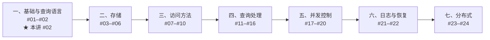

第 [1](../L01/index.md) 讲建立了[关系模型](#关系模型)和[关系代数](#关系代数)，并论证了声明式语言的价值：写查询的人只给出意图，由查询优化器（query optimizer，见第 [1](../L01/index.md) 讲）找出执行顺序。本讲把这个抽象落到一门具体的语言上。第 [1](../L01/index.md) 讲区分过集合语义与包语义（`UNION` 与 `UNION ALL`），这个区分在 SQL 里成了默认行为；第 [1](../L01/index.md) 讲的选择、[投影](#投影)、[连接](#连接)等运算，也会在本讲的查询里反复出现。第 [1](../L01/index.md) 讲还提到，与 `NULL` 比较不能用 `=`，需要专门的写法 `IS NULL`；第 3 节讨论[聚合函数](#聚合函数)跳过 `NULL` 时会用到它。

本讲定义的主要构造，后面大多会从实现的角度再出现一次（[横向连接](#横向连接)、[分组集](#分组集)与[递归 CTE](#递归%20CTE) 不在此列，本课不再展开）。第 [3](../L03/index.md) 讲起课程转向 DBMS 内部，先讨论表在磁盘上如何存储。`GROUP BY`、`ORDER BY` 和[窗口函数](#窗口函数)背后的排序与哈希，是第 [11](../L11/index.md) 讲的内容；[连接](#连接)算法在第 [12](../L12/index.md) 讲；一条查询被编译成算子树之后如何执行，在第 [13](../L13/index.md)、[14](../L14/index.md) 讲；把[嵌套查询](#嵌套查询)改写成连接、决定 [CTE](#公用表表达式) 是否[物化](#物化)，属于第 [15](../L15/index.md)、[16](../L16/index.md) 讲的[查询优化](#查询优化)；SQL 中的事务语句（`BEGIN`、`COMMIT`、`ROLLBACK`）要到第 [17](../L17/index.md) 讲以后才正式登场。

## 1. SQL 从哪里来，为什么还在

📍 *PPT 第 4–5 页*

### 1.1 从 SQUARE 到 SQL

📍 *PPT 第 4–5 页*

Ted Codd 在 1969、1970 年发表的论文只定义了[关系模型](#关系模型)和[关系代数](#关系代数)，既没有给出查询语言，也没有讨论系统如何实现（见第 [1](../L01/index.md) 讲）。当时 IBM 正靠非关系型的 IMS 赚得盆满钵满，但公司里的研究人员认定这个想法值得做，开始动手搭建原型。

他们在 1971 年做出的 SQUARE 被认为是第一个关系查询语言，却几乎没有人真正用过它。SQUARE 的语法是二维的：要表达“求鞋类部门（Shoe Department）员工的平均工资”，表名 `EMP` 写在中间，要取的[属性](#属性) `SAL` 和查找依据 `DEPT` 以上下标的形式挂在两侧，后面跟常量 `'SHOE'`，整个表达式再套进 `AVG( … )`。这种写法印在论文里清楚好读，但没法用键盘输入，也没有任何程序接受这样的输入。
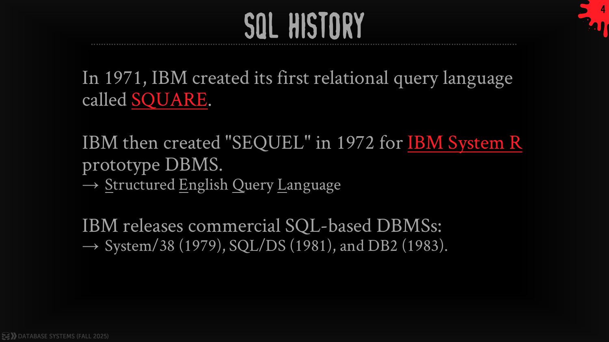

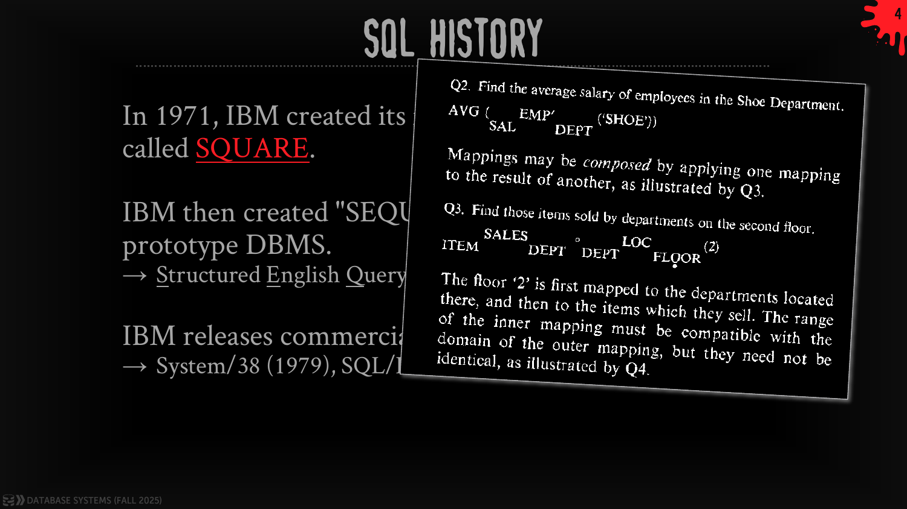


随后 IBM 启动了 System R 项目。这是历史上最有影响力的关系[数据库](#数据库)原型之一，大量奠基性的工作出自这里。这门课里会反复出现同一种情形：某个现代系统实现了一个看似新颖的想法，追溯下去才发现，用 Andy 的话说，“IBM 早在 1970 年代就把这些玩意儿发明过了”。[^ibm] 1972 年，Donald Chamberlin 和 Raymond Boyce 为 System R 设计了查询语言 SEQUEL，全称 Structured English Query Language（结构化英语查询语言）。但一家英国公司已经把这个名字注册成了商标，于是 IBM 去掉元音，把它改名为 SQL。许多资深从业者至今仍把 SQL 读作 “sequel”，原因就在这里。

IBM 随后推出了一系列基于 SQL 的商业产品：System/38（1979）、SQL/DS（1981）和 DB2（1983）。System/38 早已退出历史舞台，SQL/DS 处于维护状态，DB2 则一直用到今天，银行等传统行业的核心业务很可能就跑在它上面。

SQL 最终胜出，很大程度上是因为提出它的是 IBM。1960 到 1980 年代的 IBM 是计算机行业的巨无霸，它采用什么，业界就把什么当成标准。Oracle 的创始团队照着 IBM 公开的 SQL 做了自己的系统；伯克利的 Ingres 原本有自己的查询语言 QUEL，但 DB2 发布之后，SQL 成了事实标准。1986 年 ANSI、1987 年 ISO 先后把它定为正式标准，全称也改成了 Structured Query Language（结构化查询语言）。

> 💬 **旁注**
> Oracle 的创始人 Larry Ellison 是世界上最富有的人之一，拥有夏威夷的一座岛。Andy 的评论是：这些全是[数据库](#数据库)买单的，这也正是这门课重要的原因。
>
> *原话：“He owns a Hawaiian island. All paid for by databases. Again, this is why this class is important.”*

### 1.2 标准与方言（Dialect）

📍 *PPT 第 5 页*

SQL 没有停留在 1970 年代。标准每隔几年修订一次，每一版都在吸收当时的新需求：
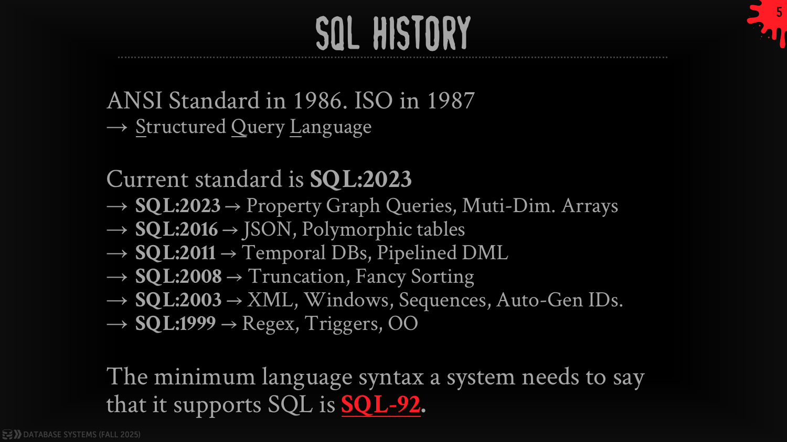


| 版本 | 主要新增 |
|---|---|
| SQL:1999 | 正则表达式、触发器、面向对象特性 |
| SQL:2003 | XML、[窗口函数](#窗口函数)、序列、自动生成的 ID |
| SQL:2008 | 截断、更丰富的排序 |
| SQL:2011 | 时态[数据库](#数据库)、流水线式 DML |
| SQL:2016 | JSON、多态表 |
| SQL:2023 | [属性](#属性)图查询、多维数组 |

这张表可以当作一部数据管理的流行史来读。二三十年前 XML 大热，SQL 加入了 XML 支持；十五年前 MongoDB 带着“一切皆 JSON”的风潮兴起，SQL:2016 加入了 JSON；Neo4j、Dgraph 这类图[数据库](#数据库)流行起来之后，SQL:2023 又加入了[属性](#属性)图查询，原本要换一个图数据库才能做的事，现在可以直接用 SQL 表达。SQL 能活半个世纪，靠的就是这种进化：新的数据形态出现，它就把新的能力吸收进来。

标准越写越厚，各家系统的实现却从来没有完全跟上。一个系统要声称自己“支持 SQL”，最低要求是实现 SQL-92，也就是 `SELECT`、`INSERT`、`UPDATE`、`DELETE`，`CREATE TABLE`、`CREATE INDEX`，以及事务。即便是这条最低线，Andy 也说他不知道世界上有哪个系统一字不差地实现了 SQL-92 标准。[^sql92] 至于最新的 SQL:2023，他所知道的唯一支持[属性](#属性)图查询的系统是 Oracle，因为正是 Oracle 推动了这项特性进入标准。

厂商与标准的关系是双向的：有时厂商先做出某个特性，再设法把自己的版本写进标准；有时标准先发布，厂商再按自己的理解跟进，照样各有取舍。Andy 的概括是：“SQL 标准规定的是一回事，但没有人会完全照着它去实现。”[^oneway] 第 5 节会用字符串和日期运算把这句话变成具体的例子。

### 1.3 半个世纪的“SQL 将死”

📍 *PPT 第 5、39 页*

每隔十年左右，就会有人站出来说 SQL 是一门糟糕的语言。Andy 承认它“确实不完美，有不少粗糙的地方，但过去五六十年里，每一次取代它的尝试都失败了”。[^replace]

最新一轮攻势来自 AI。2023 年的两条推文很有代表性：一条出自向量搜索引擎 Vespa 的开发者，预言张量和向量[数据库](#数据库)将在十年内取代大多数传统数据库，自然查询语言（NQL）将取代 SQL；另一条干脆宣布“SQL 将死于 AI 之手”，理由是把公司数据接入 ChatGPT 之后，就能用自然语言提问。
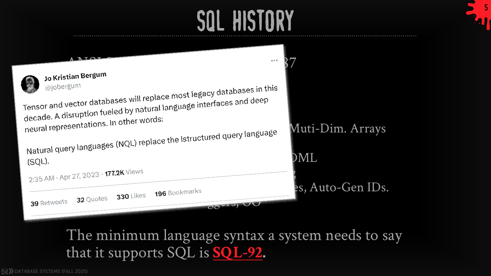

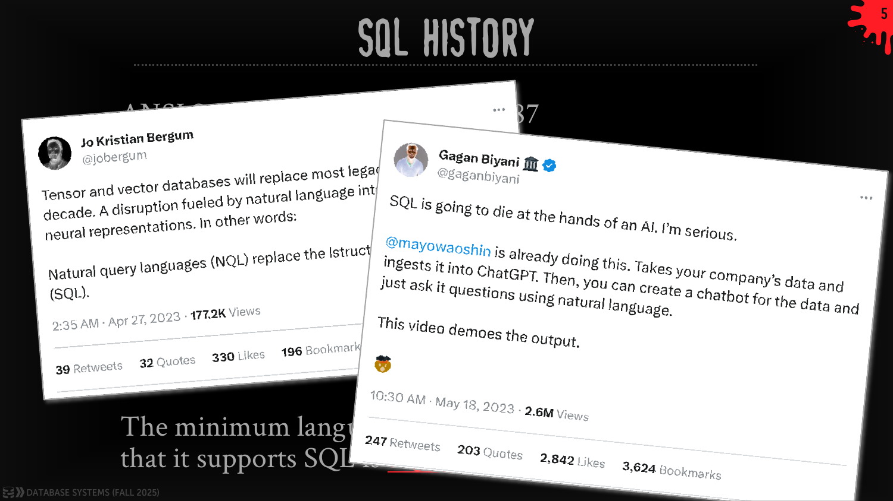


Andy 没有断言 SQL 在他有生之年一定不会被取代，只是认为可能性很小：“它在你们出生之前就在了，在我们死后也还会在。”[^born] 排行榜的数据也支持这个判断。IEEE Spectrum 2024 年编程语言排行榜的就业（Jobs）维度上，SQL 排名第一，Python 和 Java 紧随其后；IEEE Spectrum 此前还专门撰文，称 SQL 已经成为每个人都需要掌握的第二门编程语言。今天最流行的数据工程工具之一 dbt，核心也就是带模板的 SQL。

至于 SQL 未来的样子，Andy 认为最接近成功的方案其实是对 SQL 的扩展，比如 Google 提出的管道语法（pipe syntax，见 4.4 节）。大语言模型也许能帮人写出查询的初稿；另一种可能是 SQL 退到类似汇编的位置，人们用更高层的语言书写，再转译成 SQL 执行，许多号称要取代 SQL 的方案实际上就是这样做的。无论哪种前景，SQL 都还在底层。所以 Andy 把 SQL 称为学生最需要学的编程语言，[^important]因为将来不论是开发[数据库](#数据库)系统还是使用数据库系统，你都会一直和它打交道。

> 💬 **旁注**
> 为了说明他对学 SQL 有多认真，Andy 放了一段视频：他五岁的女儿每天早上 7 点起床后，要先写 SQL 才能吃早饭。
>
> *原话：“This is my five-year-old biological daughter, and every morning we wake up at 7:00 a.m. and she has to write SQL before she can have breakfast.”*

## 2. SQL 的组成与包语义

📍 *PPT 第 7–9 页*

### 2.1 三类语句

📍 *PPT 第 7 页*

SQL 是几种子语言的合称：

- **[数据操纵语言](#数据操纵语言)（Data Manipulation Language，DML）**：`SELECT`、`INSERT`、`UPDATE`、`DELETE`，负责查询和修改数据。第 [1](../L01/index.md) 讲讨论的过程式与声明式之分，说的就是 DML。
- **[数据定义语言](#数据定义语言)（Data Definition Language，[DDL](#数据定义语言)）**：定义表、索引、[视图](#视图)等对象的模式（schema）。
- **[数据控制语言](#数据控制语言)（Data Control Language，[DCL](#数据控制语言)）**：安全与访问控制，决定谁能看到、修改哪些数据。

除此之外，SQL 还涵盖[视图](#视图)定义、完整性约束与引用约束（见第 [1](../L01/index.md) 讲），以及事务。事务留到第 [17](../L17/index.md) 讲以后再谈，本讲关注的几乎全是 DML 里的 `SELECT`。

### 2.2 包语义（Bag Semantics）

📍 *PPT 第 7 页*

[关系代数](#关系代数)建立在**集合（set）**上：集合无序，且不含重复元素。SQL 建立在**包（bag，也称多重集，见第 [1](../L01/index.md) 讲）**上：包同样无序，但允许重复。两者都有别于**列表（list）**，列表的元素有确定的顺序。

SQL 做这个选择是出于代价。要保证结果里没有重复，DBMS 必须在输出之前做一次去重，通常意味着把结果排序或放进哈希表逐个比对（第 [11](../L11/index.md) 讲会算出它的代价）。大多数时候重复无关紧要，于是 SQL 默认保留重复；确实需要去重时，由写查询的人用 `DISTINCT` 之类的关键字明确提出。第 [1](../L01/index.md) 讲里 `UNION` 与 `UNION ALL` 的区别就是这个选择的缩影：带 `ALL` 的版本是包语义，省掉了去重。

“无序”这一半同样重要：除非显式写出 `ORDER BY`，SQL 查询结果的行序没有任何保证（见第 6 节）。[窗口函数](#窗口函数)需要一套专门的语法来表达“顺序”，根源也在这里（见第 10 节）。

### 2.3 示例[数据库](#数据库)

📍 *PPT 第 9 页*

本讲所有例子都基于一个极简的大学[数据库](#数据库)：学生（student）、课程（course），以及记录谁选了哪门课、得了什么成绩的选课表（enrolled）。第 [1](../L01/index.md) 讲用的是音乐商店，从本讲起换成这套更小的表，第 [11](../L11/index.md)、[16](../L16/index.md)、[25](../L25/index.md) 讲也会继续用它。
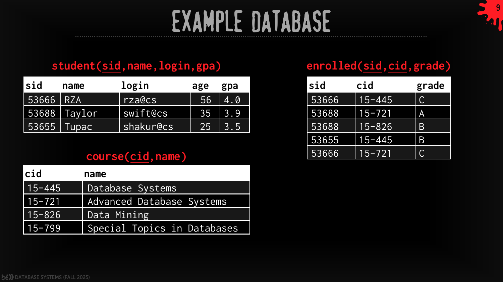


```sql
CREATE TABLE student (
   sid INT PRIMARY KEY,
   name VARCHAR(16),
   login VARCHAR(32) UNIQUE,
   age SMALLINT,
   gpa FLOAT
);

CREATE TABLE course (
   cid VARCHAR(32) PRIMARY KEY,
   name VARCHAR(32) NOT NULL
);

CREATE TABLE enrolled (
   sid INT REFERENCES student (sid),
   cid VARCHAR(32) REFERENCES course (cid),
   grade CHAR(1),
   PRIMARY KEY (sid, cid)
);
```

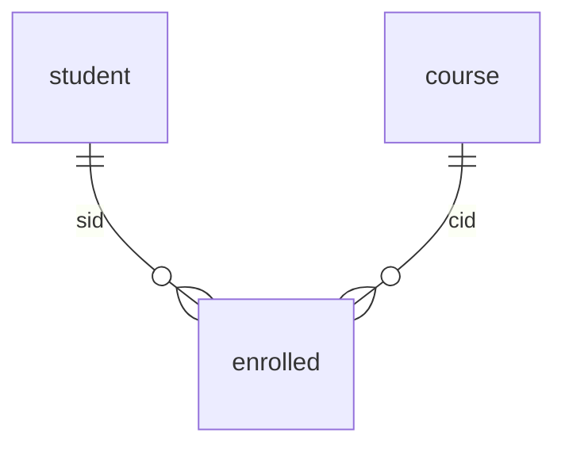

**student**

| sid | name | login | age | gpa |
|---|---|---|---|---|
| 53666 | RZA | rza@cs | 56 | 4.0 |
| 53688 | Taylor | swift@cs | 35 | 3.9 |
| 53655 | Tupac | shakur@cs | 25 | 3.5 |

**course**

| cid | name |
|---|---|
| 15-445 | Database Systems |
| 15-721 | Advanced Database Systems |
| 15-826 | Data Mining |
| 15-799 | Special Topics in Databases |

**enrolled**

| sid | cid | grade |
|---|---|---|
| 53666 | 15-445 | C |
| 53688 | 15-721 | A |
| 53688 | 15-826 | B |
| 53655 | 15-445 | B |
| 53666 | 15-721 | C |

enrolled 是一张[关联表](#关联表)（junction table，见第 [1](../L01/index.md) 讲），两个[外键](#外键) `sid`、`cid` 分别指向 student 和 course；最后一行是和第 [1](../L01/index.md) 讲 ArtistAlbum 同样的复合[主键](#主键)——主键一旦漏掉，同一个学生同一门课就能登记两次。有几个细节后面会用到：RZA 和 Taylor 各选了两门课；15-445 和 15-721 各有两人选，15-826 只有 Taylor 一人；15-799 没有任何人选。

## 3. 从多行到一个值：聚合（Aggregation）

📍 *PPT 第 10–12 页*

到目前为止，`SELECT` 能做的是把表里已有的行筛选出来、把需要的列[投影](#投影)出来。分析数据时更常见的问题却是“有多少”“平均是多少”，答案不在任何一行里，而是由许多行共同决定。

### 3.1 聚合函数（Aggregate Function）

📍 *PPT 第 10–11 页*

**[聚合函数](#聚合函数)（aggregate function）**接收一个包（多行上的某个值），输出一个标量。标准定义了五个：
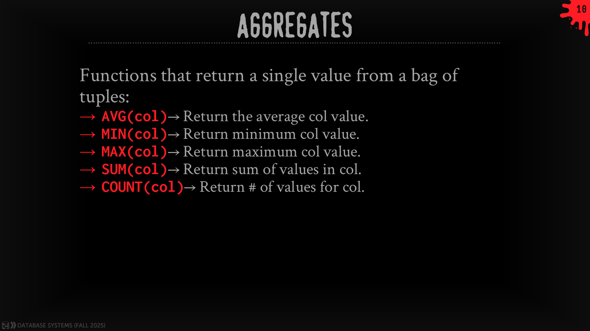


| 函数 | 含义 |
|---|---|
| `AVG(col)` | `col` 的平均值 |
| `MIN(col)` | `col` 的最小值 |
| `MAX(col)` | `col` 的最大值 |
| `SUM(col)` | `col` 的总和 |
| `COUNT(col)` | `col` 的值的个数 |

许多系统还提供标准差、几何平均等更多的[聚合函数](#聚合函数)。

[聚合函数](#聚合函数)（几乎）只能出现在 `SELECT` 的输出列表里。“几乎”是因为它也可以出现在 `HAVING`（4.3 节）和 `ORDER BY` 中，但不能出现在 `WHERE` 中，原因在 4.4 节。

统计登录名以 `@cs` 结尾的学生人数，下面四种写法的结果都是 3：
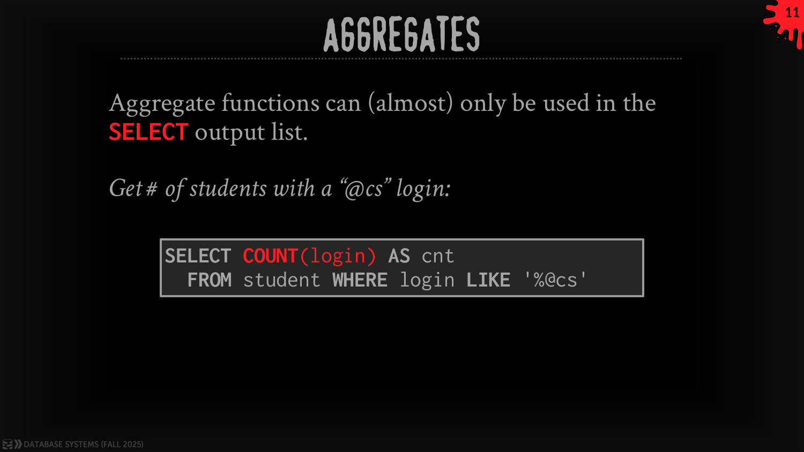

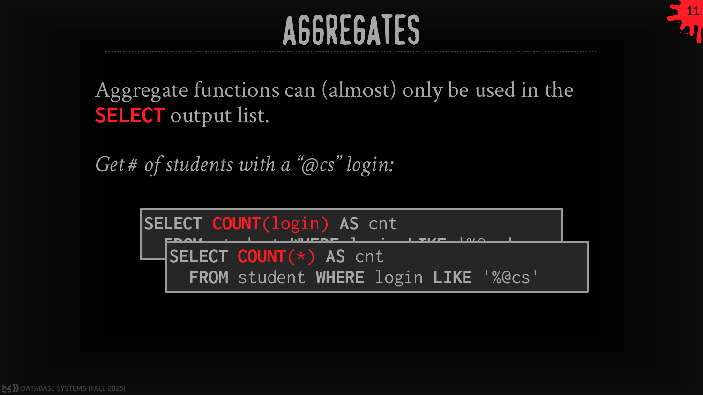

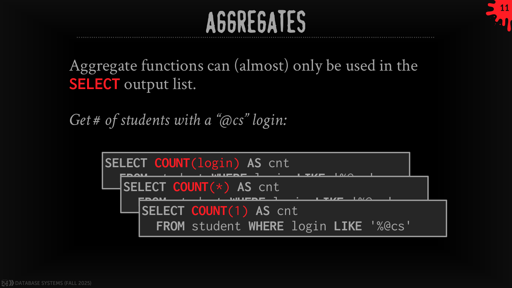


```sql
SELECT COUNT(login) AS cnt FROM student WHERE login LIKE '%@cs';
SELECT COUNT(*)     AS cnt FROM student WHERE login LIKE '%@cs';
SELECT COUNT(1)     AS cnt FROM student WHERE login LIKE '%@cs';
SELECT COUNT(1+1+1) AS cnt FROM student WHERE login LIKE '%@cs';
```

`COUNT(login)` 读起来像是在“数登录名”，`COUNT(1+1+1)` 则更让人困惑。实际上 `COUNT` 在数的是满足条件的行，括号里的表达式具体算出什么值，它并不关心。

这种等价有一个前提。按照标准，`COUNT(*)` 数的是行数，`COUNT(expr)` 数的是 `expr` 不为 [NULL](#NULL) 的行数。`1` 和 `1+1+1` 永远不是 NULL，所以 `COUNT(1)` 总是等于 `COUNT(*)`；`COUNT(login)` 在这里也等于它们，是因为 `WHERE login LIKE '%@cs'` 已经排除了 `login` 为 NULL 的行（NULL 与任何模式比较的结果都是“未知”，过不了 `WHERE`）。去掉这个 `WHERE`，只要有学生的 `login` 为空，`COUNT(login)` 就会比 `COUNT(*)` 小。PPT 把 `COUNT(col)` 解释为“`col` 的值的个数”，Lecture Notes 写的是“关系中的[元组](#元组)数”，前者更准确。8.2 节会看到这个区别造成的实际差异。

`COUNT`、`SUM`、`AVG` 等函数支持在参数前加 `DISTINCT`，只统计不同的值：

```sql
SELECT COUNT(DISTINCT login) FROM student WHERE login LIKE '%@cs';
```

一条 `SELECT` 也可以同时计算多个聚合。下面的查询返回 `@cs` 学生的平均 GPA 和人数，结果是 3.8 和 3，其中 3.8 = (4.0 + 3.9 + 3.5) / 3：

```sql
SELECT AVG(gpa), COUNT(sid) FROM student WHERE login LIKE '%@cs';
```

### 3.2 聚合之外的列

📍 *PPT 第 12 页*

现在想求“每门课的学生平均 GPA”。把课程号直接加进输出列表，是最自然的第一次尝试：

```sql
SELECT AVG(s.gpa), e.cid
  FROM enrolled AS e JOIN student AS s
    ON e.sid = s.sid;
```

[连接](#连接)之后共有 5 行，`AVG(s.gpa)` 把它们压成一个值：(4.0 + 3.9 + 3.9 + 3.5 + 4.0) / 5 = 3.86。问题出在 `e.cid` 上：这 5 行里的 `cid` 有三种不同的取值，输出却只有一行，应该填哪一个？没有任何一个值有资格代表全体，所以这一格的内容是未定义的，PPT 上画的是 `???`。

大多数系统遇到这种查询会直接报错。PostgreSQL 的错误信息把问题说得很清楚：

```text
ERROR:  column "e.cid" must appear in the GROUP BY clause or be used in an aggregate function
```

SQLite 则会随便挑一个值填进去（实测返回 15-445）。MySQL 以前也允许这样写，新版本默认不再允许。SQL:2023 把这种“随便挑一个”的行为正式纳入了标准，写法是[聚合函数](#聚合函数) `ANY_VALUE`：

```sql
SELECT AVG(s.gpa), ANY_VALUE(e.cid)
  FROM enrolled AS e JOIN student AS s
    ON e.sid = s.sid;
```

结果是 `3.86 | 15-445`。从 DBMS 的角度看，这个结果完全正确：你要的就是任意一个 `cid`。`ANY_VALUE` 的价值在于把“任意”写在了明处，读查询的人一眼就知道这一列的值没有意义。但它并没有回答“每门课”的平均 GPA，要回答这个问题，需要先把数据按课程分开。

## 4. 分组：GROUP BY、GROUPING SETS 与 HAVING

📍 *PPT 第 13–15 页*

### 4.1 GROUP BY

📍 *PPT 第 13 页*

**`GROUP BY`** 把[元组](#元组)按[分组](#分组)列的取值划分成若干子集，再对每个子集分别计算聚合。每个子集内部，[分组](#分组)列只有一个取值，于是 3.2 节里“`e.cid` 该填哪个值”的问题有了唯一的答案。由此得到一条规则：`SELECT` 输出列表中不在[聚合函数](#聚合函数)里的列，必须出现在 `GROUP BY` 中。

```sql
SELECT AVG(s.gpa), e.cid
  FROM enrolled AS e JOIN student AS s
    ON e.sid = s.sid
 GROUP BY e.cid;
```

换一组数据（PPT 第 13 页）来看[分组](#分组)的过程：[连接](#连接)结果按 `e.cid` 分成三组，每组各算一个平均值：
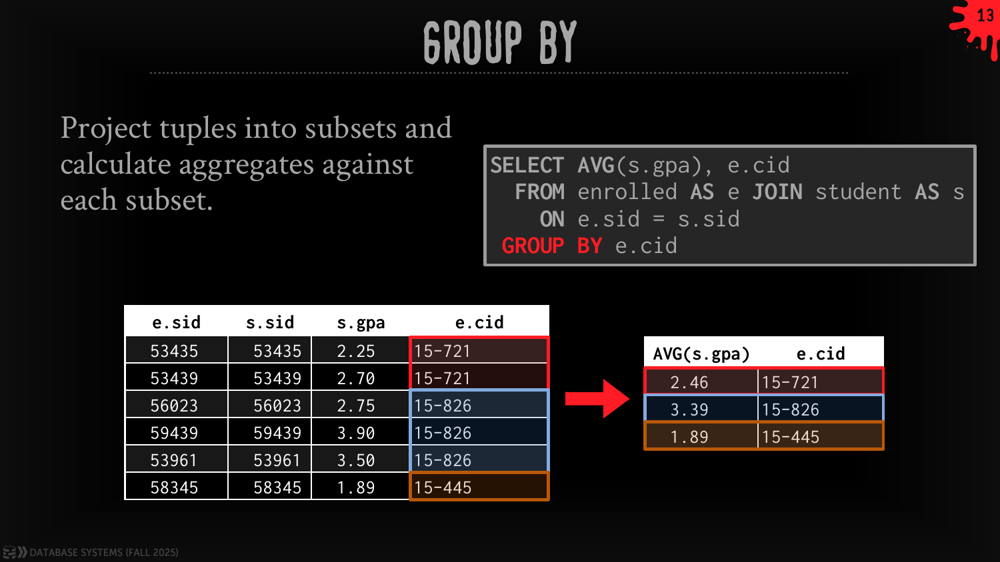


| e.sid | s.sid | s.gpa | e.cid | 所属[分组](#分组) |
|---|---|---|---|---|
| 53435 | 53435 | 2.25 | 15-721 | 15-721 |
| 53439 | 53439 | 2.70 | 15-721 | 15-721 |
| 56023 | 56023 | 2.75 | 15-826 | 15-826 |
| 59439 | 59439 | 3.90 | 15-826 | 15-826 |
| 53961 | 53961 | 3.50 | 15-826 | 15-826 |
| 58345 | 58345 | 1.89 | 15-445 | 15-445 |

| AVG(s.gpa) | e.cid |
|---|---|
| 2.475 | 15-721 |
| 3.383 | 15-826 |
| 1.89 | 15-445 |

按表中数据，15-721 组的平均值是 (2.25 + 2.70) / 2 = 2.475，15-826 组是 (2.75 + 3.90 + 3.50) / 3 ≈ 3.383；PPT 上印的是 2.46 和 3.39，与表中数据对不上，这里按表中数据重算。换成本讲的示例[数据库](#数据库)，同一条查询得到 15-445 为 3.75、15-721 为 3.95、15-826 为 3.9，4.3 节会用到这组数。

`GROUP BY` 只规定结果是什么，不规定怎么[分组](#分组)。DBMS 可以边扫描边把每一行放进以 `cid` 为键的哈希表，在每个桶里维护该组的累计和与计数；也可以先按 `cid` 排序，再顺序扫描，在 `cid` 变化的地方切出一组。两种做法的代价在第 [11](../L11/index.md) 讲比较。

另外，Lecture Notes 里这个例子把 `ON` 写成了 `WHERE`（`JOIN student AS s WHERE e.sid = s.sid`），这是笔误，照抄会得到语法错误。

### 4.2 分组集（Grouping Sets）

📍 *PPT 第 14 页*

有时需要从几个粒度同时看同一份数据，比如同时统计“每门课每个成绩的人数”“每门课的人数”和“总人数”。最直接的写法是三条 `GROUP BY` 查询，用 `UNION ALL` 拼起来。**[分组集](#分组集)（grouping sets）**允许在一条查询里列出多种[分组](#分组)方式：

```sql
SELECT c.name AS c_name, e.grade,
       COUNT(*) AS num_students
  FROM enrolled AS e
  JOIN course AS c ON e.cid = c.cid
 GROUP BY GROUPING SETS (
   (c.name, e.grade), -- By course and grade
   (c.name),          -- By course only
   ()                 -- Overall total
 );
```

| c_name | grade | num_students | 所属[分组](#分组) |
|---|---|---|---|
| [NULL](#NULL) | NULL | 5 | `()` |
| Advanced Database Systems | C | 1 | `(c.name, e.grade)` |
| Data Mining | B | 1 | `(c.name, e.grade)` |
| Database Systems | B | 1 | `(c.name, e.grade)` |
| Database Systems | C | 1 | `(c.name, e.grade)` |
| Advanced Database Systems | A | 1 | `(c.name, e.grade)` |
| Database Systems | NULL | 2 | `(c.name)` |
| Data Mining | NULL | 1 | `(c.name)` |
| Advanced Database Systems | NULL | 2 | `(c.name)` |

（PPT 上的结果表第一列显示的是课程号 `cid`；按查询的写法，输出的应是课程名。各行的先后顺序没有保证。）
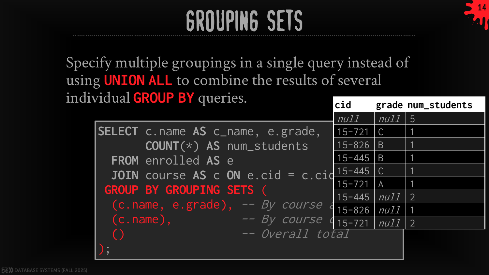


每个[分组集](#分组集)的结果就像一条独立的 `GROUP BY` 查询的结果，不属于当前[分组](#分组)的列填成 [NULL](#NULL)。Andy 也承认这样填“有点怪”，而且一旦数据本身就含有 NULL（比如某个成绩尚未录入），读结果的人就分不清这个 NULL 是“所有成绩的合计”还是“成绩为空的那一组”。标准为此提供了 `GROUPING(col)` 函数：某一行在计算时没有按 `col` [分组](#分组)，它就返回 1，否则返回 0。
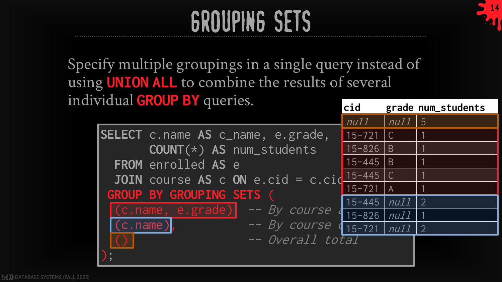


语义上，[分组集](#分组集)等价于把各个[分组](#分组)查询的结果用 `UNION ALL` 拼在一起。PPT 写的是 `UNION ALL`，Lecture Notes 写的是 `UNION`；[分组集](#分组集)不会对各组的结果去重，所以 `UNION ALL` 更准确。

两种写法的差别在执行上：`UNION ALL` 的版本要把数据扫描三遍，[分组集](#分组集)的版本只需扫描一遍，在一次扫描中同时维护三种[分组](#分组)的计数，最后把结果拼在一起。这个例子里的三个[分组集](#分组集)恰好是逐级上卷的关系，标准为这种常见模式提供了简写 `GROUP BY ROLLUP (c.name, e.grade)`；另一个简写 `CUBE (a, b)` 则会生成 `(a, b)`、`(a)`、`(b)`、`()` 全部四种组合。

[分组集](#分组集)体现了本讲反复出现的一个主题。SQL 是声明式的，理论上写查询的人不用操心执行方式；但正如 Andy 所说，我们可以“对 DBMS 好一点”，写出让它更容易推理的查询。[^nice] 把完整的意图放进一条查询交给 DBMS，它就有机会只扫描一遍数据；换成应用程序先后发出三条查询再自己拼接，每条查询都要在应用和[数据库](#数据库)服务器之间往返一次，DBMS 也只能孤立地优化每一条。

### 4.3 HAVING

📍 *PPT 第 15 页*

现在要找出学生平均 GPA 大于 3.9 的课程。第一次尝试是把条件写进 `WHERE`：
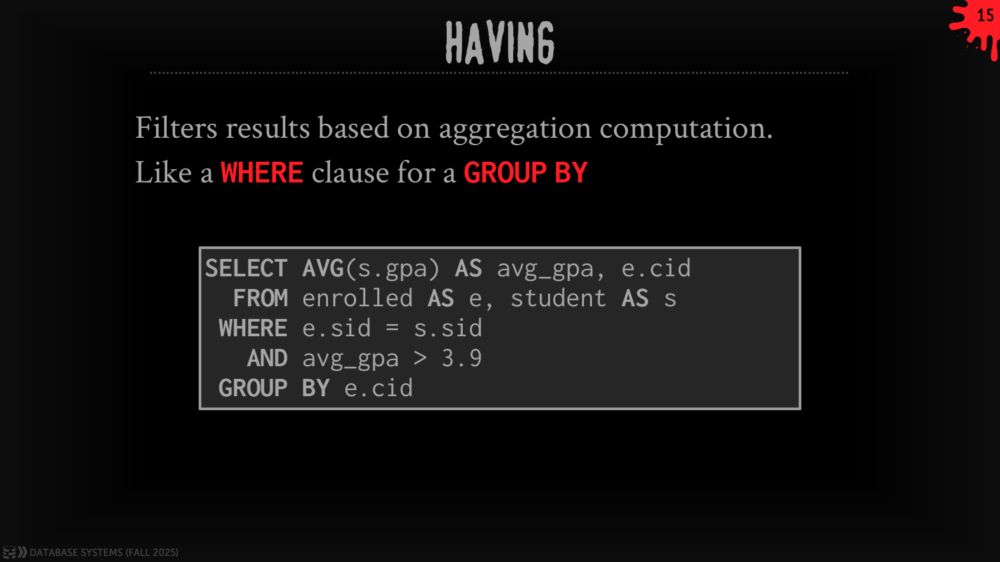


```sql
SELECT AVG(s.gpa) AS avg_gpa, e.cid
  FROM enrolled AS e, student AS s
 WHERE e.sid = s.sid
   AND avg_gpa > 3.9      -- invalid
 GROUP BY e.cid;
```

这条查询是错的。`WHERE` 的作用是在扫描时逐行判断去留，而判断某一行时，所在[分组](#分组)的平均值还没有算出来，DBMS 无从决定是否丢弃这一行。对[分组](#分组)的筛选要放进 **`HAVING`** 子句，它在聚合完成之后，按每组的聚合结果决定整组的去留。可以把 `HAVING` 理解为 `GROUP BY` 专用的 `WHERE`：`WHERE` 筛行，`HAVING` 筛组。
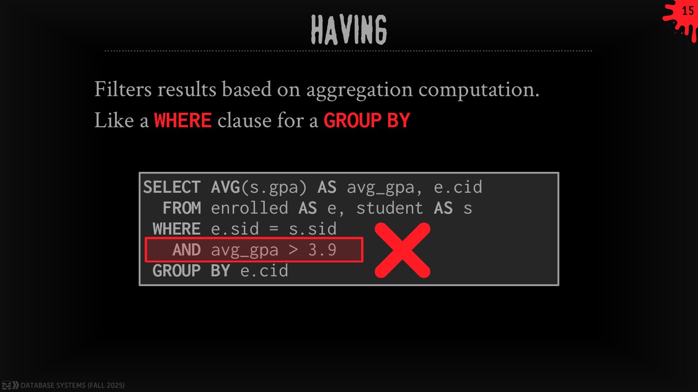


```sql
SELECT AVG(s.gpa) AS avg_gpa, e.cid
  FROM enrolled AS e, student AS s
 WHERE e.sid = s.sid
 GROUP BY e.cid
HAVING avg_gpa > 3.9;     -- not standard
```

第二次尝试把条件移进了 `HAVING`，却直接引用了别名 `avg_gpa`。许多系统接受这种写法，但它不符合标准：别名 `avg_gpa` 定义在 `SELECT` 里，按标准 `HAVING` 看不到它（4.4 节解释原因）。PostgreSQL 严格执行这一点，报错 `column "avg_gpa" does not exist`；MySQL、SQLite、DuckDB 则允许这样写。符合标准的写法是在 `HAVING` 里把聚合表达式重写一遍：

```sql
SELECT AVG(s.gpa) AS avg_gpa, e.cid
  FROM enrolled AS e, student AS s
 WHERE e.sid = s.sid
 GROUP BY e.cid
HAVING AVG(s.gpa) > 3.9;
```

| [分组](#分组)后 AVG(s.gpa) | e.cid | 通过 `HAVING`？ |
|---|---|---|
| 3.75 | 15-445 | 否 |
| 3.95 | 15-721 | 是 |
| 3.9 | 15-826 | 否，3.9 不大于 3.9 |

最终结果只有 `3.95 | 15-721` 一行。（PPT 上第一行的课程号印成了 15-415，应为 15-445。）
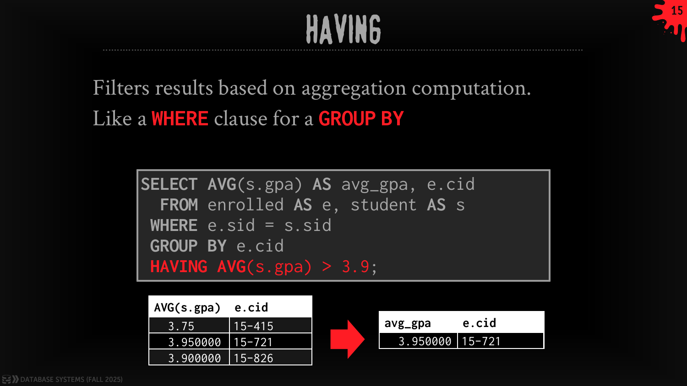


15-826 那一行值得多看一眼。`gpa` 列声明为 `FLOAT`，而 `FLOAT` 的精度因系统而异：PostgreSQL 中它是 8 字节的双精度，DuckDB 和 MySQL 中它是 4 字节的单精度，和 C 语言的 `double` 与 `float` 是同一对区别。3.9 无法用二进制浮点数精确表示，存成单精度后变成 3.9000000953674316，比 3.9 略大。把 `gpa` 改成单精度（PostgreSQL 的 `REAL`）后重新运行同一条查询，15-826 也会出现在结果里。比较浮点数时恰好卡在边界上，结果就可能随系统而变。

这条查询还引出了课上两个问题。

第一个问题是 `FROM enrolled AS e, student AS s` 这种写法。它在逻辑上先做两张表的[笛卡尔积](#笛卡尔积)（5 × 3 = 15 行），再由 `WHERE e.sid = s.sid` 筛出匹配的 5 行，效果等同于内[连接](#连接)，称为**[隐式连接](#隐式连接)（implicit join）**。DBMS 会识别出 `WHERE` 里的连接条件，不会真的先生成笛卡尔积。Andy 说明这是旧式写法，建议始终写出显式的 `JOIN … ON …`。一个实际的理由是：显式写法把连接条件和筛选条件分开，漏写 `ON` 会直接得到语法错误；隐式写法漏掉连接条件，查询照常运行，只是悄悄返回了一个笛卡尔积。

第二个问题是 `AVG(s.gpa)` 在 `SELECT` 和 `HAVING` 中各出现了一次，DBMS 会不会算两遍。标准对此不做任何保证，但大多数系统会识别出这是同一个表达式，只计算一次。这属于[查询优化](#查询优化)的范畴。

### 4.4 一条分组查询的求值过程

📍 *PPT 第 15 页*

上一节有两个现象需要一个统一的解释：`WHERE` 里不能用聚合，`HAVING` 里按标准不能用 `SELECT` 定义的别名。答案在于 SQL 子句的**[逻辑求值顺序](#逻辑求值顺序)**。子句的书写顺序是 `SELECT … FROM … WHERE … GROUP BY … HAVING … ORDER BY …`，但它们在语义上的求值顺序是：

```text
FROM / JOIN → WHERE → GROUP BY → HAVING → SELECT（含窗口函数）→ DISTINCT → ORDER BY → LIMIT / FETCH
```

用 4.3 节的查询在示例[数据库](#数据库)上走一遍：

```sql
SELECT AVG(s.gpa) AS avg_gpa, e.cid
  FROM enrolled AS e, student AS s
 WHERE e.sid = s.sid
 GROUP BY e.cid
HAVING AVG(s.gpa) > 3.9;
```

| 步骤 | 子句 | 这一步之后的中间结果 |
|---|---|---|
| ① | `FROM enrolled AS e, student AS s` | [笛卡尔积](#笛卡尔积)，5 × 3 = 15 行 |
| ② | `WHERE e.sid = s.sid` | 保留 5 行：(53666, 15-445, 4.0)、(53688, 15-721, 3.9)、(53688, 15-826, 3.9)、(53655, 15-445, 3.5)、(53666, 15-721, 4.0)，括号内依次为 `e.sid`、`e.cid`、`s.gpa` |
| ③ | `GROUP BY e.cid` | 三组：15-445 → {4.0, 3.5}；15-721 → {3.9, 4.0}；15-826 → {3.9} |
| ④ | 计算聚合 | 15-445 → 3.75；15-721 → 3.95；15-826 → 3.9 |
| ⑤ | `HAVING AVG(s.gpa) > 3.9` | 只剩 15-721 → 3.95 |
| ⑥ | `SELECT AVG(s.gpa) AS avg_gpa, e.cid` | 输出一行：avg_gpa 为 3.95，cid 为 15-721；别名 `avg_gpa` 在这一步才诞生 |

对照这张表，上一节的两条规则都有了着落。`WHERE` 在第②步执行，聚合值要到第④步才出现，所以 `WHERE` 里不能用聚合。别名 `avg_gpa` 在第⑥步才定义，第⑤步的 `HAVING` 自然看不到它；MySQL、DuckDB 等系统允许在 `HAVING` 里引用别名，相当于在解析时提前把别名替换成对应的表达式，属于方便用户的扩展。反过来，`ORDER BY` 排在 `SELECT` 之后，所以标准允许在 `ORDER BY` 里使用别名。

这是逻辑上的顺序，只规定结果应当等于按这个顺序计算的结果，DBMS 实际怎么执行由优化器决定（见第 [1](../L01/index.md) 讲）。第①步的 15 行[笛卡尔积](#笛卡尔积)在真实系统里通常不会出现，DBMS 会直接做[连接](#连接)。

书写顺序和求值顺序不一致，也是 SQL 最常被抱怨的地方之一：`SELECT` 写在最前面，却几乎最后才执行，写查询时得先想清楚最后要输出什么，再回头写数据从哪里来。一些系统对此做了改进。DuckDB 允许把 `FROM` 写在最前面（如 `FROM student SELECT name;`）。Google 的管道语法走得更远，它让每个操作按求值顺序依次排列，上一步的结果通过 `|>` 流向下一步：

```sql
FROM enrolled AS e
|> JOIN student AS s ON e.sid = s.sid
|> AGGREGATE AVG(s.gpa) AS avg_gpa GROUP BY cid
|> WHERE avg_gpa > 3.9;
```

这里聚合之后的 `WHERE` 就起到了 `HAVING` 的作用，而且可以直接引用 `avg_gpa`，因为它在上一步已经定义好了。这正是 Andy 认为最有可能延续 SQL 的方向：不另起炉灶，而是在 SQL 上做扩展。

## 5. 同一个问题，不同的写法：方言

📍 *PPT 第 16–20 页*

到目前为止的内容，主流系统基本都支持，差别只在 `HAVING` 能否引用别名这类细节上。一旦离开 `SELECT` 的骨架，进入具体的数据类型，差别就大了起来。字符串的处理在各个系统之间还算大体一致，而按 Andy 的说法，“到了日期和时间，一切就都乱了套”。[^dates]

学 SQL 时用哪个系统练习并不要紧，要紧的是理解 SQL 在高层上能做什么。具体到每个系统，总有它自己的小怪癖，下面这些例子就是最常见的几类。

### 5.1 字符串的大小写与引号

📍 *PPT 第 16 页*

SQL 标准规定：字符串比较区分大小写，字符串常量只能用单引号括起来。各系统对这两条的遵守程度并不相同：
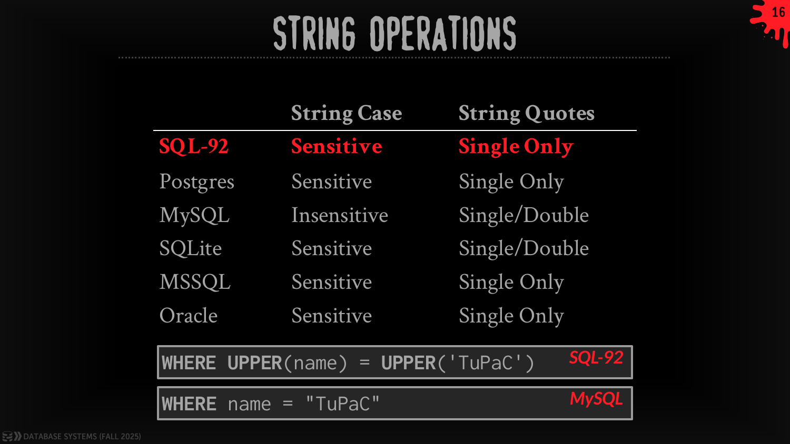


| 系统 | 字符串大小写 | 字符串引号 |
|---|---|---|
| SQL-92 | 区分 | 仅单引号 |
| PostgreSQL | 区分 | 仅单引号 |
| MySQL | 不区分 | 单引号或双引号 |
| SQLite | 区分 | 单引号或双引号 |
| SQL Server（MSSQL） | 区分 | 仅单引号 |
| Oracle | 区分 | 仅单引号 |

按标准的写法，要做不区分大小写的比较，得把两边都转成大写（或小写）再比；MySQL 则可以直接比较：

```sql
WHERE UPPER(name) = UPPER('TuPaC')   -- SQL-92
WHERE name = "TuPaC"                 -- MySQL
```

在示例表上，PostgreSQL 中 `WHERE name = 'rza'` 查不到任何行，必须写成 `'RZA'`；同一条查询在 MySQL 里能查到 RZA，把单引号换成双引号也照样能查到。

双引号的差别比大小写更容易出事。在标准和 PostgreSQL 里，双引号括起来的是**[标识符](#标识符)（identifier）**，也就是表名、列名这类名字；名字里含有空格或需要保留大小写时，就用双引号把它括起来，比如 `"first name"`。这和 C 语言里 `'a'` 与 `"a"` 是两种不同的东西类似：SQL 的单引号表示一个值，双引号表示一个名字。所以在 PostgreSQL 中写 `WHERE name = "RZA"`，系统会去找一个叫 RZA 的列，报错 `column "RZA" does not exist`；DuckDB 的行为相同。SQLite 看起来更宽容，它接受 `"RZA"` 作为字符串，但这只是一个兜底规则：SQLite 先把双引号内容当作列名去找，找不到才退回来当作字符串。于是 `WHERE name = "name"` 在 SQLite 里不会报错，而是把 `name` 列和它自己比较，返回表中所有行。

大小写是否敏感，实际上由**[排序规则](#排序规则)（collation）**决定。[排序规则](#排序规则)规定了字符串如何比较和排序，可以按[数据库](#数据库)、表甚至列来设置。MySQL 不区分大小写，是因为它默认的[排序规则](#排序规则)（如 `utf8mb4_0900_ai_ci`，后缀 `ci` 即 case-insensitive）不区分大小写。SQL Server 也是如此，它默认安装时的[排序规则](#排序规则)同样不区分大小写，表中给它标注的“区分”，只在选用了区分大小写的[排序规则](#排序规则)时才成立。

课上有学生接着问：表名和列名区分大小写吗？这同样取决于实现。PostgreSQL 会把没有加引号的[标识符](#标识符)一律转成小写，加了双引号的则原样保留。Andy 当场做了实验，结果如下：

```sql
CREATE TABLE "XX" (a INT);
SELECT * FROM xx;     -- ERROR: relation "xx" does not exist
SELECT * FROM XX;     -- ERROR: relation "xx" does not exist (XX is folded to xx)
SELECT * FROM "XX";   -- OK
```

一个用双引号、以大写字母命名的表，此后每次引用都必须带上双引号。顺带一提，标准规定未加引号的[标识符](#标识符)应转成大写，PostgreSQL 转成小写，本身就是一处偏离标准的地方。

### 5.2 模式匹配与字符串函数

📍 *PPT 第 17–19 页*

`LIKE` 用于字符串的模式匹配，它有两个通配符：`%` 匹配任意子串（包括空串），`_` 恰好匹配一个字符。
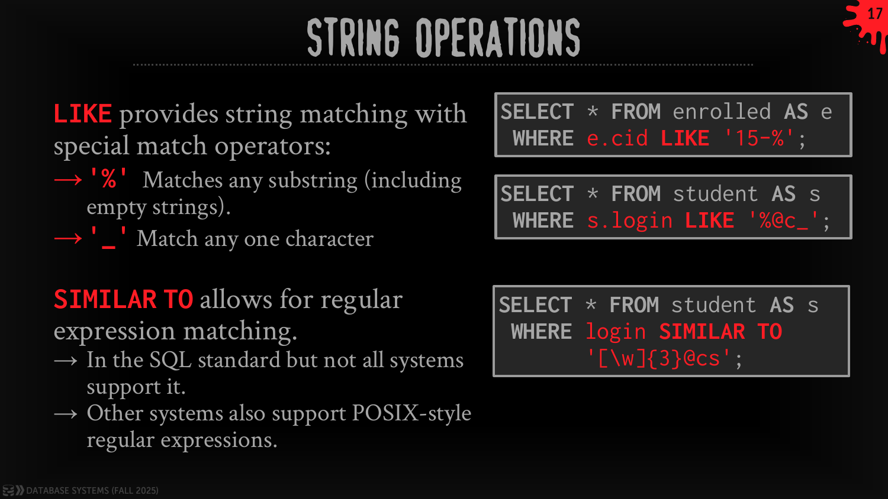


```sql
SELECT * FROM enrolled AS e
 WHERE e.cid LIKE '15-%';

SELECT * FROM student AS s
 WHERE s.login LIKE '%@c_';
```

第一条查询选出课程号以 `15-` 开头的所有选课记录，在示例数据里就是全部 5 行；第二条选出登录名以 `@c` 加任意一个字符结尾的学生，三名学生的登录名都以 `@cs` 结尾，所以全部入选。`LIKE` 的通配符和常见正则表达式里的 `.`、`*` 不是一套写法，而且匹配时区分大小写；PostgreSQL 和 DuckDB 另外提供了不区分大小写的 `ILIKE`，它不在标准里。

需要真正的正则表达式时，标准提供了 `SIMILAR TO`：

```sql
SELECT * FROM student AS s
 WHERE login SIMILAR TO '[\w]{3}@cs';
```

这个模式要求整个登录名恰好是三个单词字符后面跟 `@cs`，示例数据中只有 `rza@cs` 符合。PostgreSQL 和 DuckDB 支持 `SIMILAR TO`，但许多系统并不支持，而是提供各自的正则语法，通常是 POSIX 风格（例如 PostgreSQL 的 `~` 运算符、MySQL 的 `REGEXP`）。这又是一处标准规定一套、各家实现另一套的例子。

SQL-92 定义了一批字符串函数，各系统在此基础上又加了许多自己的函数。它们既可以出现在输出列表里，也可以出现在[谓词](#谓词)里：
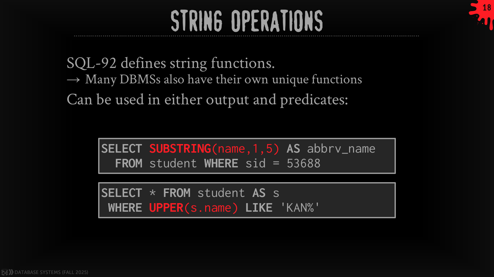


```sql
SELECT SUBSTRING(name, 1, 5) AS abbrv_name
  FROM student WHERE sid = 53688;

SELECT * FROM student AS s
 WHERE UPPER(s.name) LIKE 'KAN%';
```

第一条查询返回 `Taylo`：`SUBSTRING` 的第二个参数是起始位置（从 1 开始计数），第三个参数是长度，标准的完整写法是 `SUBSTRING(name FROM 1 FOR 5)`。Lecture Notes 把它写成 `SUBSTRING(S, B, E)`，容易被误读成“起点到终点”，实际上第三个参数是长度。第二条查询把名字转成大写后再做模式匹配，在示例数据里不返回任何行。

`SUBSTRING`、`UPPER`、`LOWER` 这类基本函数在各系统中的名字和语义大致相同，连字符串拼接这么简单的操作却出了分歧：

```sql
SELECT name FROM student
 WHERE login = LOWER(name) || '@cs';          -- SQL standard

SELECT name FROM student
 WHERE login = LOWER(name) + '@cs';           -- SQL Server

SELECT name FROM student
 WHERE login = CONCAT(LOWER(name), '@cs');    -- MySQL
```

三条查询想做的是同一件事：找出登录名恰好是“小写姓名 + @cs”的学生，示例数据中只有 RZA。标准用 `||` 拼接，SQL Server 用 `+`，MySQL 要调用 `CONCAT()` 函数。MySQL 的情况尤其值得警惕：在默认模式下，`||` 在 MySQL 里是逻辑“或”的同义词，`+` 是数值加法，两种写法都不会报错，而是悄悄算出别的东西。相比之下，PostgreSQL 遇到 `'rza' + '@cs'` 会直接报错，至少让人知道写错了。Andy 对此的态度是：这很烦人，但不是世界末日，从一个系统换到另一个系统时，这类差别很容易应付。

### 5.3 日期与时间

📍 *PPT 第 20 页*

标准定义了 `DATE`、`TIME`、`TIMESTAMP` 等类型，以及带时区的变体。它们同样可以出现在输出和[谓词](#谓词)中。存储时间时，如果不显式指定时区，得到的是[数据库](#数据库)服务器所在的时区，运气好的话是 UTC；确实需要时区信息，就应当把时区和时间一起存下来，但并非所有系统都支持带时区的类型。

Andy 每年都会做同一个演示：计算从当年 1 月 1 日到上课当天（2025 年 8 月 27 日）有多少天。答案是 31 + 28 + 31 + 30 + 31 + 30 + 31 + 26 = 238。这看起来再简单不过，但正如他所说，“每个系统都会用略有不同的方式来做”。[^demo] 他在七个系统上逐一尝试，先是取当前时间，再是做日期减法。

**第一步：取当前时间。**标准的写法是不带括号的关键字 `CURRENT_TIMESTAMP`（以及 `CURRENT_DATE`）；`NOW()` 是 PostgreSQL 的函数，被许多系统借了过去。演示结果如下（✓ 表示支持，✗ 表示报错）：

| 系统 | `NOW()` | `CURRENT_TIMESTAMP` | `CURRENT_TIMESTAMP()` |
|---|---|---|---|
| PostgreSQL | ✓ | ✓ | ✗ |
| MySQL | ✓ | ✓ | ✓ |
| SQLite | ✗ | ✓ | ✗ |
| DuckDB | ✓ | ✓ | ✗ |
| ClickHouse | ✓ | ✗ | ✓ |
| Firebolt | ✓ | ✗ | ✓ |
| SQL Server | ✗ | ✓ | ✗ |

三种写法没有一种能在七个系统上全部跑通。SQL Server 还有两处特别的地方：它取当前时间用的是自家的 `GETDATE()`；它自带的命令行客户端要求在每批语句后面单独写一行 `GO`，否则语句不会执行。

**第二步：日期相减。**

| 系统 | 写法 | 结果 |
|---|---|---|
| PostgreSQL | `CAST('2025-08-27' AS DATE) - CAST('2025-01-01' AS DATE)` | 238 |
| PostgreSQL | `'2025-08-27'::DATE - '2025-01-01'::DATE` | 238 |
| DuckDB、Firebolt | 与 PostgreSQL 相同 | 238 |
| MySQL | 与 PostgreSQL 相同的日期减法 | **726** |
| MySQL | `DATEDIFF('2025-08-27', '2025-01-01')` | 238 |
| SQL Server | `DATEDIFF(day, '2025-01-01', GETDATE())`（在 8 月 27 日当天运行） | 238 |
| SQLite | `'2025-08-27' - '2025-01-01'` | **0** |
| SQLite | `CAST(julianday('2025-08-27') - julianday('2025-01-01') AS INT)` | 238 |

PostgreSQL 的做法最直接：把字符串转换（cast）成 `DATE`，两个日期相减得到相差的天数。`::DATE` 是 PostgreSQL 特有的类型转换写法，等价于 `CAST(… AS DATE)`，Andy 很喜欢这个简写。DuckDB 直接沿用了 PostgreSQL 的语法解析器，所以 PostgreSQL 能用的写法，DuckDB 大多也能用。

同样的减法在 MySQL 里得到 726。一年只有 365 天，这个数显然不是天数。原因在于 MySQL 把参与数值运算的日期转换成了形如 `YYYYMMDD` 的整数：

```text
20250827 − 20250101 = 726
```

726 是“7 个月”和“26 天”拼在一起的结果。它比报错更危险：数值看上去合情合理，查询顺利执行，没有任何警告提醒你算错了。MySQL 算天数的正确做法是调用 `DATEDIFF` 函数。

> 💬 **旁注**
> 726 这个数一开始连 Andy 自己也解释不了，最后是一位网友在 YouTube 评论区里给出了答案。
>
> *原话：“I didn't know either. Some rando in the YouTube comments, of all places, posted what it was. And I'm like, oh, he was right.”*

SQLite 的结果是 0，原因是 SQLite 根本没有日期类型，日期只是按约定格式存放的字符串（或数字）。两个字符串相减时，SQLite 把每个字符串开头最长的一段合法数字取出来做运算，也就是 2025 − 2025 = 0，`DATE()` 函数返回的也是字符串，结果同样是 0。SQLite 里要算日期差，得先把日期换算成某种“从固定起点数起”的数值：

- `julianday()` 返回儒略日，即从公元前 4714 年 11 月 24 日（按公历推算）正午起经过的天数，所以 `julianday('2025-01-01')` 等于 2460676.5，带着半天的零头。两个儒略日相减得到 238.0，再转成整数就是 238。
- `strftime('%s', …)` 返回 Unix 时间戳，即从 1970 年 1 月 1 日零点（UTC）起经过的秒数。两个时间戳相减再除以 60 × 60 × 24，同样得到 238：

```sql
SELECT (strftime('%s', '2025-08-27') - strftime('%s', '2025-01-01')) / (60 * 60 * 24);
```

第二种写法的结果是整数而不是小数，原因是 `strftime` 返回的是字符串，相减时被转成了整数，整数除以整数在 SQLite 中做的是整除，和 C 语言里 `7 / 2` 得 3 是一回事。两个日期都在零点，整除恰好没有损失；如果换成 `CURRENT_TIMESTAMP` 这种带时分秒的值，零头会被直接截掉。

ClickHouse 那一步出了另一种问题。Andy 让 ChatGPT 写了一条 ClickHouse 查询，里面用了 `TODAY()` 函数，结果报错说函数不存在；ClickHouse 的文档明明列出了这个函数，原来 ClickHouse 的许多函数名区分大小写，必须写成小写的 `today()`，而 `NOW()` 写成大写或小写都可以。

一个简单的日期差，七个系统需要至少四种不同的写法，其中两种写法会在不报错的情况下返回错误答案。

### 5.4 方言从哪里来，怎样应对

📍 *PPT 第 16–20 页*

课上有学生问：一个系统不支持某项标准特性，是不是就算不符合标准？答案是肯定的，而且这种情况普遍存在。前面提到，Andy 不知道有哪个系统一字不差地实现了 SQL-92。MySQL 曾是偏离标准最严重的系统，过去十年里改进了不少。

这些差异的来源往往很随意。Andy 曾当面问一位 MySQL 的开发者，MySQL 为什么有那么多与众不同的地方，得到的回答大意是“90 年代就是这么做的”。在 Andy 看来，很多时候就是“某个人坐在那里说，我就这么做吧，然后大家都说，行，挺好”。[^someguy] 第 8 节会看到另一个例子：标准里早就有[横向连接](#横向连接)，SQL Server 却另起了一个名字。

面对方言，最有效的准备是掌握 SQL 的基本概念，它们在所有系统之间通用。从一种方言换到另一种方言，远比换一门编程语言容易：“从 Python 换到 Rust 是个大工程，从 MySQL 换到 PostgreSQL，脑子里要转的弯就少多了。”[^rust] 但这不意味着能把查询原样搬过去，现实中有不少公司花了大价钱把业务从一个[数据库](#数据库)迁移到另一个。实用的原则是：不论查询是自己凭记忆写的，还是 ChatGPT 生成的，都要在目标系统上实际运行验证，ClickHouse 那条 `TODAY()` 就是现成的教训。

## 6. 查询结果的去向

📍 *PPT 第 21–22 页*

### 6.1 排序与截取

📍 *PPT 第 21 页*

SQL 的结果是无序的包（2.2 节），需要确定的顺序时，就要用 `ORDER BY`。默认按升序（`ASC`）排列，`DESC` 表示降序：
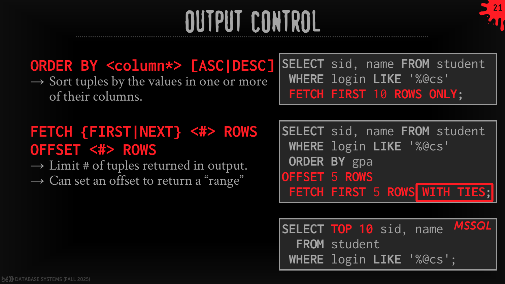


```sql
SELECT sid, grade FROM enrolled WHERE cid = '15-721'
 ORDER BY grade;                    -- 53688 A, 53666 C

SELECT sid, grade FROM enrolled WHERE cid = '15-721'
 ORDER BY grade DESC, sid ASC;      -- 53666 C, 53688 A
```

`ORDER BY` 后面可以跟多个排序键，前一个键相同时再按后一个键排序，用来打破并列。排序键也可以是任意表达式，比如 `ORDER BY UPPER(grade) DESC, sid + 1 ASC`。

默认情况下，DBMS 会返回查询产生的所有行。只要前几行时，标准的写法是 `FETCH FIRST n ROWS ONLY`，配合 `OFFSET n ROWS` 可以跳过前面若干行，取出一个“区间”：

```sql
SELECT sid, name FROM student
 WHERE login LIKE '%@cs'
 FETCH FIRST 10 ROWS ONLY;

SELECT sid, name FROM student
 WHERE login LIKE '%@cs'
 ORDER BY gpa
 OFFSET 5 ROWS
 FETCH FIRST 5 ROWS WITH TIES;
```

更常见的是非标准的 `LIMIT`，PostgreSQL、MySQL、SQLite、DuckDB 都支持，比如 `LIMIT 10` 或 `LIMIT 20 OFFSET 10`；SQL Server 则把行数写在最前面：`SELECT TOP 10 sid, name FROM student …`。

`WITH TIES` 规定了截断处出现并列时怎么办：和最后一行排序键相同的行一并返回。用示例数据看得最清楚：

```sql
SELECT sid, grade FROM enrolled
 ORDER BY grade
 FETCH FIRST 2 ROWS WITH TIES;   -- (53688, A), (53688, B), (53655, B)
```

排在第二位的是 B，而得 B 的有两行，`WITH TIES` 把它们都返回，结果是 3 行。换成 `ONLY`，结果就是 2 行，第二行是哪一个 B 没有规定，两次运行可能不同。

这引出了截取操作的一个普遍问题：没有 `ORDER BY` 的 `LIMIT`，每次运行都可能返回不同的行，因为[关系模型](#关系模型)不规定行序；即使有 `ORDER BY`，只要排序键有并列，截断边界上留下哪一行也是不确定的。要得到稳定的结果，排序键必须能唯一确定顺序（例如最后加上[主键](#主键)），或者用 `WITH TIES` 把并列的行全部留下。

### 6.2 输出重定向（Output Redirection）

📍 *PPT 第 22 页*

有时一条查询算不出全部答案，需要把中间结果存下来，交给后续的查询继续处理。这时可以让 DBMS 把结果写进一张表，而不是返回给客户端：
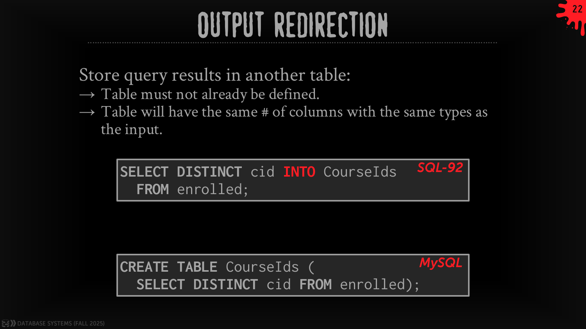


```sql
SELECT DISTINCT cid INTO CourseIds
  FROM enrolled;                          -- PostgreSQL, SQL Server

SELECT DISTINCT cid
  INTO TEMPORARY CourseIds
  FROM enrolled;                          -- PostgreSQL

CREATE TABLE CourseIds (
  SELECT DISTINCT cid FROM enrolled);     -- MySQL
```

新建的表不能事先存在，它的列数和列类型与查询的输出相同。PostgreSQL 的 `INTO TEMPORARY` 建的是临时表，客户端断开连接时自动删除。如果目标表已经存在，就用 `INSERT INTO`：
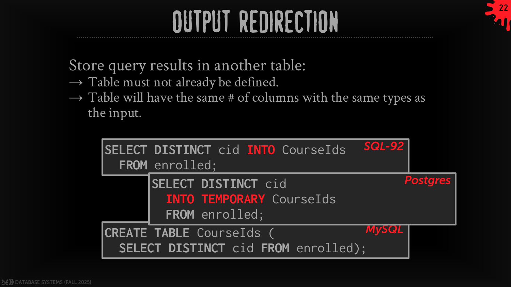


```sql
INSERT INTO CourseIds (SELECT DISTINCT cid FROM enrolled);
```

此时查询输出的列数和列类型必须与目标表一致，列名则不必相同。

PPT 把第一种写法标为 SQL-92。严格地说，标准里的 `SELECT … INTO` 是嵌入式 SQL 的语法，作用是把单行结果存进宿主程序的变量；用它来建表是 PostgreSQL、SQL Server 等系统的扩展。标准的建表写法是 `CREATE TABLE CourseIds AS SELECT DISTINCT cid FROM enrolled;`，PostgreSQL 的文档也推荐用这种写法代替 `SELECT INTO`。

把中间结果存进表里是可行的，但代价不小：计算被拆成了几条语句，每条都要在应用和服务器之间往返一次；临时表的创建和清理要人来操心；DBMS 每次只看到一条语句，没法把整个计算放在一起优化。更好的做法是把一条查询直接嵌进另一条查询里。

## 7. 查询套查询：嵌套查询（Nested Query）

📍 *PPT 第 23–27 页*

### 7.1 外层查询与内层查询

📍 *PPT 第 23–24 页*

**[嵌套查询](#嵌套查询)（nested query）**，也叫[子查询](#子查询)（subquery），是写在另一条查询内部的查询。外面的一层称为**[外层查询](#外层查询)（outer query）**，里面的一层称为**[内层查询](#内层查询)（inner query）**：

```sql
SELECT name FROM student          -- outer query
 WHERE sid IN (SELECT sid FROM enrolled);   -- inner query
```

[内层查询](#内层查询)算出所有选过课的学号，[外层查询](#外层查询)取出学号在其中的学生姓名，结果是 RZA、Taylor、Tupac。

[内层查询](#内层查询)（几乎）可以出现在查询的任何位置：

- **`WHERE` 子句**，如上例。
- **输出列表**。下面的查询为每条选课记录查出学生姓名：
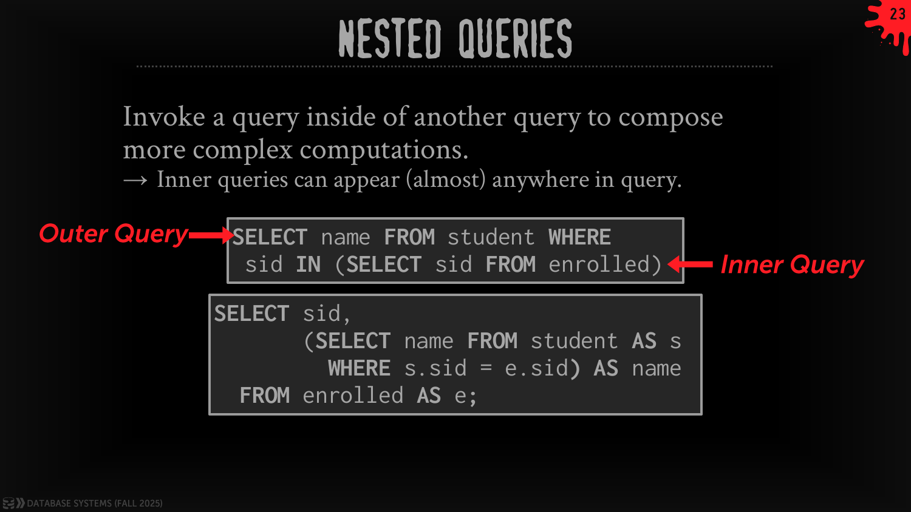


  ```sql
  SELECT sid,
         (SELECT name FROM student AS s
           WHERE s.sid = e.sid) AS name
    FROM enrolled AS e;
  ```

  出现在这里的[子查询](#子查询)称为**[标量子查询](#标量子查询)（scalar subquery）**，对外层的每一行，它最多只能返回一个值：查不到时结果是 [NULL](#NULL)，查到多行时报错（PostgreSQL 的错误信息是 `more than one row returned by a subquery used as an expression`）。Lecture Notes 里的 `SELECT (SELECT 1) AS one FROM student;` 是它最简单的形式，结果是三行 1。
- **`FROM` 子句**。[子查询](#子查询)的结果当作一张临时的表参与计算，称为**[派生表](#派生表)（derived table）**：

  ```sql
  SELECT name
    FROM student AS s, (SELECT sid FROM enrolled) AS e
   WHERE s.sid = e.sid;
  ```

  这条查询看起来和本节开头的 `IN` 版本等价，结果却是 5 行：RZA 和 Taylor 各出现两次。[派生表](#派生表) `e` 里每条选课记录都是一行，[连接](#连接)会让每个学生按选课次数重复出现，这就是包语义；`IN` 只判断学号是否属于那个集合，每个学生至多出现一次。

一些系统还允许把[子查询](#子查询)写进 `GROUP BY` 或 `HAVING`，Andy 的意见是可以这么写，但不是好主意。

写[嵌套查询](#嵌套查询)时，Andy 建议从外往里写。以“找出选了 15-445 的学生姓名”为例：

1. 先写[外层查询](#外层查询)，想清楚最终要输出什么：`SELECT name FROM student WHERE …`。
2. 用自然语言描述缺的那一块：`sid` 属于选了 15-445 的人的集合。
3. 把这句话翻译成[内层查询](#内层查询)：`SELECT sid FROM enrolled WHERE cid = '15-445'`。
4. 选一个运算符把内外两层连起来。这里是集合成员判断，用 `IN`：

```sql
SELECT name FROM student
 WHERE sid IN (
   SELECT sid FROM enrolled
    WHERE cid = '15-445'
 );
```

结果是 RZA 和 Tupac。注意同一个名字 `sid` 在两处指的不是同一列：外层的 `sid` 绑定到 student，内层的 `sid` 绑定到 enrolled。规则和 C 语言的块作用域一样：[内层查询](#内层查询)可以使用[外层查询](#外层查询)的[属性](#属性)，同名时内层的遮蔽外层的；[外层查询](#外层查询)看不到[内层查询](#内层查询)里的任何东西。
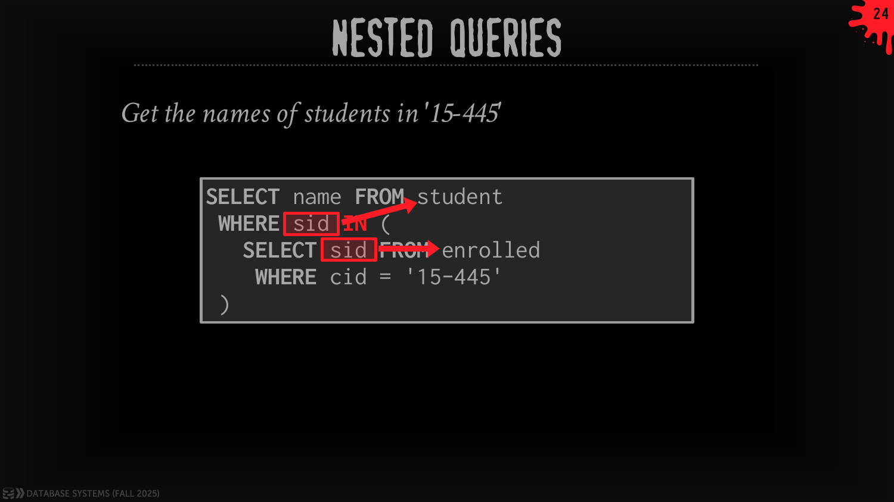


### 7.2 连接内外层的运算符

📍 *PPT 第 25 页*

[内层查询](#内层查询)返回的是一组行，外层需要一个运算符来说明拿这组行做什么：
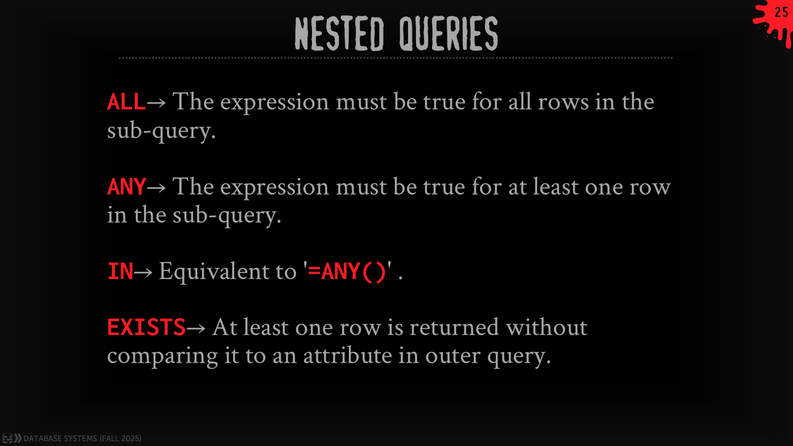


| 运算符 | 含义 |
|---|---|
| `ALL` | 表达式对[子查询](#子查询)结果中的每一行都成立 |
| `ANY` | 表达式对[子查询](#子查询)结果中的至少一行成立 |
| `IN` | 等价于 `= ANY()` |
| `EXISTS` | [子查询](#子查询)至少返回一行，不拿结果和外层的[属性](#属性)做比较 |

它们都可以加 `NOT` 取反。上一节的 `sid IN (…)` 也可以写成 `sid = ANY (…)`，结果相同。`ALL` 适合表达“比所有都大”这类条件，比如找出 GPA 最高的学生：

```sql
SELECT name FROM student
 WHERE gpa >= ALL (SELECT gpa FROM student);   -- RZA
```

`NOT IN` 有一个经典陷阱：只要[子查询](#子查询)的结果里含有 [NULL](#NULL)，`NOT IN` 就一行也选不出来。`x NOT IN (a, NULL)` 展开后是 `x <> a AND x <> NULL`，而任何值与 NULL 比较的结果都是“未知”，整个条件永远不会为真。`NOT EXISTS` 只关心[子查询](#子查询)有没有返回行，不受这个问题影响，所以“某个集合里没有”这类条件通常用 `NOT EXISTS` 来写更稳妥。7.4 节的例子就是这样写的。

### 7.3 同一个问题的几种写法

📍 *PPT 第 26 页*

找出选了至少一门课的学生中学号最大的那一位。[外层查询](#外层查询)要的是学号和姓名：`SELECT sid, name FROM student WHERE …`，缺的那一块用自然语言说是“学号等于选课记录中最大的学号”。翻译成 SQL，至少有四种写法：

```sql
-- 1. Compare with a scalar subquery
SELECT sid, name FROM student
 WHERE sid = (SELECT MAX(sid) FROM enrolled);

-- 2. Set membership
SELECT sid, name FROM student
 WHERE sid IN (SELECT MAX(sid) FROM enrolled);

-- 3. Sort and take the first row
SELECT sid, name FROM student
 WHERE sid IN (
   SELECT sid FROM enrolled
    ORDER BY sid DESC FETCH FIRST 1 ROW ONLY
 );

-- 4. Join with a derived table
SELECT student.sid, name
  FROM student
  JOIN (SELECT MAX(sid) AS sid
          FROM enrolled) AS max_e
    ON student.sid = max_e.sid;
```

四条查询的结果都是 `53688 | Taylor`。（PPT 上的结果表写的是 `53688 | Bieber`，是早年示例数据的遗留；按本讲的示例[数据库](#数据库)，53688 是 Taylor。）第一种写法能用 `=`，是因为不带 `GROUP BY` 的 `MAX` 总是恰好返回一行，满足[标量子查询](#标量子查询)的要求。
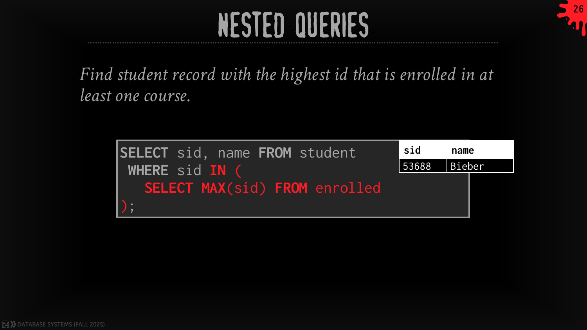

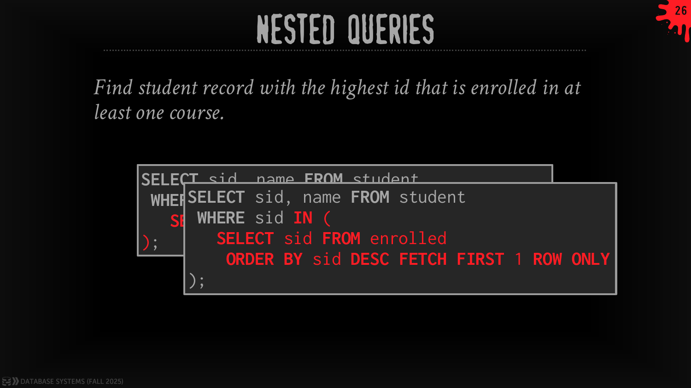

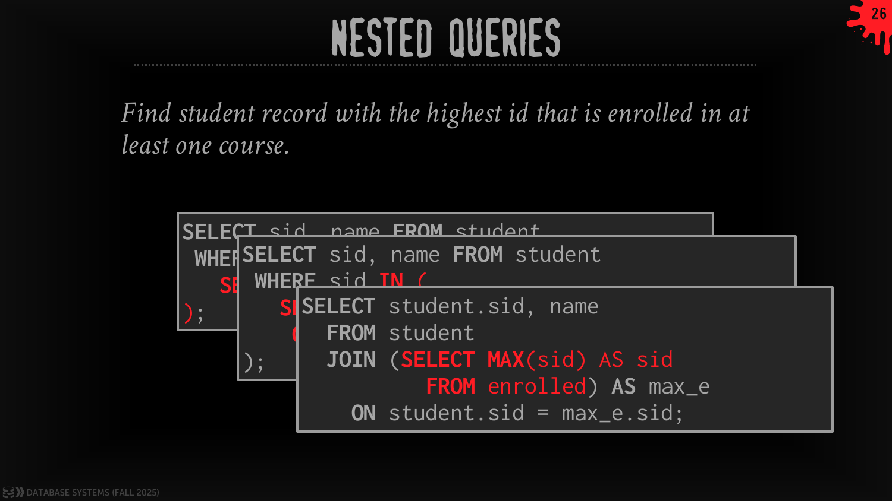


Andy 的看法是，这些写法没有哪一种天然更好。理论上 SQL 是声明式的，写法不应该影响性能；实际上它常常有影响，取决于具体系统的优化器能把哪种写法处理好。数据量小的时候，比如在自己电脑上用 DuckDB 跑练习题，几种写法不会有明显差别。

### 7.4 相关子查询（Correlated Subquery）与执行代价

📍 *PPT 第 27 页*

找出没有任何学生选的课程。[外层查询](#外层查询)是 `SELECT * FROM course WHERE …`，缺的那一块是“enrolled 表里没有这门课的记录”，正好对应 `NOT EXISTS`：

```sql
SELECT * FROM course
 WHERE NOT EXISTS(
   SELECT * FROM enrolled
    WHERE course.cid = enrolled.cid
 );
```

结果是 `15-799 | Special Topics in Databases`。这里的[内层查询](#内层查询)引用了[外层查询](#外层查询)的 `course.cid`，它的结果随外层当前处理的那一行而变化。这样的[子查询](#子查询)称为**[相关子查询](#相关子查询)（correlated subquery）**；7.1 节里 `IN` 的例子，内层结果与外层无关，称为非[相关子查询](#相关子查询)。

执行[子查询](#子查询)最笨的办法，是把它当成两层嵌套的 `for` 循环：外层每处理一行，就把[内层查询](#内层查询)完整地跑一遍。对 7.1 节的非[相关子查询](#相关子查询)来说，这纯属浪费，因为内层的结果对外层的每一行都一样。Andy 说 MySQL 以前就是这么执行的，许多系统在刚开始支持[子查询](#子查询)时也是如此；他的评价是：“我不认为你会想一遍又一遍地运行[内层查询](#内层查询)，那太蠢了。”[^stupid] 有学生提出，有时候[子查询](#子查询)反而比[连接](#连接)更快，比如像 `MAX(sid)` 这样的[子查询](#子查询)只算一次，把结果缓存起来反复使用。Andy 同意这一点：算一次再复用没有问题，要避免的是反复重算。

[相关子查询](#相关子查询)的内层结果确实依赖外层的每一行，看上去只能逐行重算，但它同样可以改写。上面的 `NOT EXISTS` 查询，按字面执行是这样的：

```python
# Naive evaluation: re-run the inner query for every outer row
result = []
for c in course:
    found = False
    for e in enrolled:          # inner query, executed once per course row
        if e.cid == c.cid:
            found = True
            break
    if not found:
        result.append(c)
```

改写成**[反连接](#反连接)（anti-join）**之后，只需把 enrolled 扫描一遍，建一个哈希集合，再逐个检查课程：

```python
# Rewritten as an anti-join: scan enrolled once, then probe a hash set
enrolled_cids = {e.cid for e in enrolled}   # built once
result = [c for c in course if c.cid not in enrolled_cids]
```

前者最坏要做 |course| × |enrolled| 次比较，后者大约是 |course| + |enrolled| 次操作。假设有 1 万门课、100 万条选课记录，前者是 100 亿次比较，后者约 101 万次操作，相差近一万倍。所以理想的做法是由 DBMS 自动把[嵌套查询](#嵌套查询)改写成[连接](#连接)，再用高效的连接算法执行。哈希连接等算法在第 [12](../L12/index.md) 讲介绍，查询改写属于第 [15](../L15/index.md)、[16](../L16/index.md) 讲的[查询优化](#查询优化)。

难点在于，不是每个系统都能做好这种改写，尤其是[相关子查询](#相关子查询)。Andy 点名的几个做得好的系统是 SQL Server、DuckDB，以及德国的研究型系统 Umbra 和它的商业版本 CedarDB。Umbra 的作者在 2025 年发表了一篇新论文，基本上能处理任意的[嵌套查询](#嵌套查询)；DuckDB 实现的是他早先发表的方法。Andy 的一名博士生构造出了一条[嵌套查询](#嵌套查询)，DuckDB 处理它时中间结果急剧膨胀，最终耗尽内存；新版的 Umbra / CedarDB 则能正确处理。

到这里，[子查询](#子查询)已经可以出现在 `FROM` 子句里充当[派生表](#派生表)。但 `FROM` 里并列的几个[子查询](#子查询)彼此独立，一个[子查询](#子查询)无法引用写在它前面的另一张表或另一个[子查询](#子查询)。下一节的[横向连接](#横向连接)解决的就是这个问题。

## 8. 横向连接（Lateral Join）

📍 *PPT 第 28–29 页*

### 8.1 让同层的子查询互相引用

📍 *PPT 第 28 页*

`LATERAL` 运算符允许一个[嵌套查询](#嵌套查询)引用在它之前出现的其他[嵌套查询](#嵌套查询)（或表）的[属性](#属性)，“之前”指的是在查询文本中的位置。用这种方式连接起来的查询称为**[横向连接](#横向连接)（lateral join）**。可以把它想成一个 `for` 循环：对前面那张表的每一个[元组](#元组)，调用一次后面的查询。

```sql
SELECT * FROM
  (SELECT 1 AS x) AS t1,
  LATERAL (SELECT t1.x+1 AS y) AS t2;
```

`t1` 是一张凭空造出来的表，只有一行一列，值为 1。`t2` 引用了 `t1.x`，结果是一行 `x = 1, y = 2`。它相当于下面的 Python 代码：

```python
for x in [1]:
    for y in [x+1]:
        print(x, y)
```

去掉 `LATERAL`，同一条查询在 PostgreSQL 中会报错，提示信息说得很直白：`t1` 确实存在，但查询的这一部分不能引用它，要引用就必须给[子查询](#子查询)加上 `LATERAL`。

前面一再强调，声明式语言不规定运算的先后顺序。[横向连接](#横向连接)是一个例外：`t2` 依赖 `t1` 的每一行，求值时（至少在逻辑上）必须先有 `t1`，再对它的每一行计算 `t2`，查询里的书写位置也因此有了意义。

### 8.2 每门课的人数与平均 GPA

📍 *PPT 第 29 页*

任务是：计算每门课的选课人数和选课学生的平均 GPA，按人数升序输出。按[横向连接](#横向连接)的思路，可以把它拆成两步，对每门课：先算出选课人数；再算出选课学生的平均 GPA。
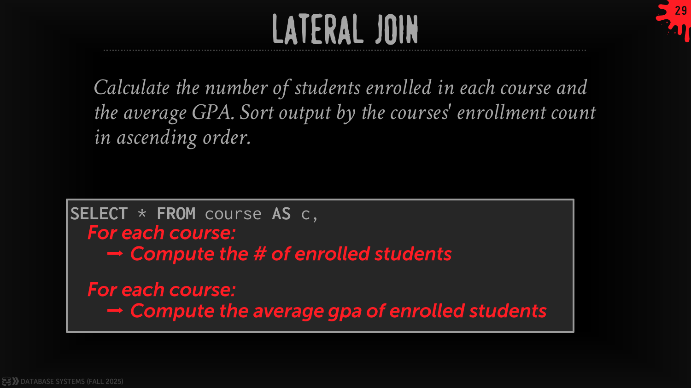

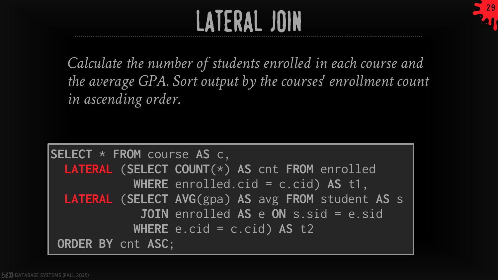


```sql
SELECT * FROM course AS c,
  LATERAL (SELECT COUNT(*) AS cnt FROM enrolled
            WHERE enrolled.cid = c.cid) AS t1,
  LATERAL (SELECT AVG(gpa) AS avg FROM student AS s
             JOIN enrolled AS e ON s.sid = e.sid
            WHERE e.cid = c.cid) AS t2
 ORDER BY cnt ASC;
```

两个 `LATERAL` [子查询](#子查询)里的 `c.cid` 都指向外面的 `course AS c`，所以它们都是针对“当前这门课”来计算的。

| cid | name | cnt | avg |
|---|---|---|---|
| 15-799 | Special Topics in Databases | 0 | [NULL](#NULL) |
| 15-826 | Data Mining | 1 | 3.9 |
| 15-445 | Database Systems | 2 | 3.75 |
| 15-721 | Advanced Database Systems | 2 | 3.95 |

15-445 和 15-721 的人数都是 2，它们之间的先后顺序没有保证。Lecture Notes 中的同一个例子有两处不同：正文说按人数降序排列，查询里却没有 `ORDER BY`；`course AS c` 后面还漏了逗号，照抄会得到语法错误。这里以 PPT 为准。

没人选的 15-799 也出现在结果里，人数为 0，平均 GPA 为 [NULL](#NULL)。这是因为不带 `GROUP BY` 的聚合查询总是恰好返回一行，即使输入为空也是如此：`COUNT` 返回 0，`AVG` 返回 NULL。带上 `GROUP BY` 就不一样了，空输入得到的是零个[分组](#分组)，也就是零行。
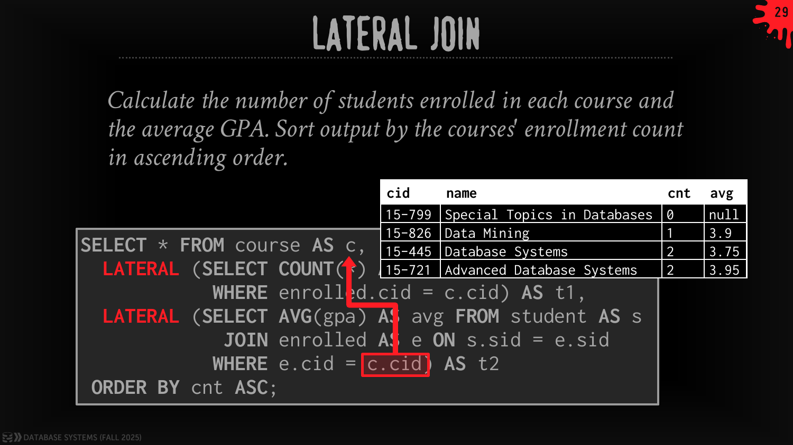


课上有学生问：普通的[连接](#连接)能不能做到同样的事？能，但要避开两个坑：

```sql
SELECT c.cid, c.name, COUNT(e.sid) AS cnt, AVG(s.gpa) AS avg
  FROM course AS c
  LEFT JOIN enrolled AS e ON e.cid = c.cid
  LEFT JOIN student AS s ON s.sid = e.sid
 GROUP BY c.cid, c.name
 ORDER BY cnt ASC;
```

这条查询的结果与[横向连接](#横向连接)的版本相同。第一个坑是连接方式：用普通的内连接，15-799 在 enrolled 中找不到匹配的行，会从结果中消失，只剩 3 行。第二个坑是计数方式：改用**外[连接](#连接)**——第 [1](../L01/index.md) 讲讲内连接时说过它留到本讲，这里补上定义：外连接在内连接的结果之外，把一侧或两侧没匹配上的行也保留下来，缺失的列填 `NULL`，`LEFT JOIN`（左外连接）保留左表的全部行。它保住了 15-799，代价是为它补上一行 enrolled 和 student 的列全为 [NULL](#NULL) 的记录，`COUNT(*)` 会把这一行也数进去，得到 1；`COUNT(e.sid)` 跳过 NULL，才得到正确的 0。3.1 节里 `COUNT(*)` 与 `COUNT(col)` 的区别，在这里直接决定了结果的对错。

[横向连接](#横向连接)真正不可替代的场合，是对每一行执行一个带排序和截取的[子查询](#子查询)，比如“每门课成绩最好的学生”：

```sql
SELECT c.cid, t.sid, t.grade
  FROM course AS c,
       LATERAL (SELECT sid, grade FROM enrolled AS e
                 WHERE e.cid = c.cid
                 ORDER BY grade ASC
                 FETCH FIRST 1 ROW ONLY) AS t;
```

结果是 15-445 的 53655（B）、15-721 的 53688（A）、15-826 的 53688（B）。这一次 15-799 不在结果里：它的[子查询](#子查询)一行也没有返回，而用逗号写的[横向连接](#横向连接)和内[连接](#连接)一样，会丢掉右边为空的行。要保留它，PostgreSQL 中可以写成 `LEFT JOIN LATERAL (…) AS t ON TRUE`。“每组取前几名”也可以用[窗口函数](#窗口函数)来写，见 10.3 节。

Andy 演示时，DuckDB、MySQL、PostgreSQL 和 Firebolt 对[横向连接](#横向连接)给出了相同的结果。SQL Server 提供的是语义基本相同的 `CROSS APPLY`（以及对应左外[连接](#连接)的 `OUTER APPLY`）。按 Andy 的说法，[横向连接](#横向连接)早已写进标准，微软的工程师并不知道，于是自己发明了一个新名字。

## 9. 公用表表达式（Common Table Expression，CTE）

📍 *PPT 第 30–31 页*

### 9.1 给子查询起个名字

📍 *PPT 第 30–31 页*

[嵌套查询](#嵌套查询)写在语句的中间，嵌套一深，读的人就要从里往外一层层拆；同一个[子查询](#子查询)要用两次，还得把它原样写两遍。**[公用表表达式](#公用表表达式)（Common Table Expression，[CTE](#公用表表达式)）**把[子查询](#子查询)提到语句的最前面，给它起一个名字，语句的其余部分可以像引用一张表一样引用它。可以把 [CTE](#公用表表达式) 看作只在一条查询内有效的临时表。它可以替代[嵌套查询](#嵌套查询)、[视图](#视图)和显式建立的临时表。

```sql
WITH cteName (col1, col2) AS (
   SELECT 1, 2
)
SELECT col1 + col2 FROM cteName;   -- 3
```

`WITH` 子句绑定了名字 `cteName`，后面的主查询在 `FROM` 中引用它。列名写在 `AS` 之前，不需要声明类型，DBMS 会根据括号里查询的输出推导出类型；不写列名时，列名取自内部查询的输出（如 `WITH cteName AS (SELECT 1)`）。一条查询可以声明多个 [CTE](#公用表表达式)，用逗号隔开：
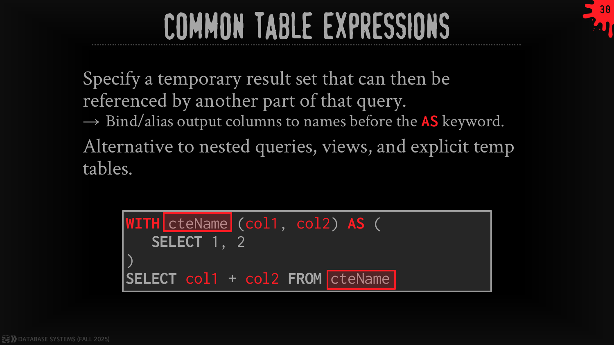


```sql
WITH cte1 (col1) AS (SELECT 1), cte2 (col2) AS (SELECT 2)
SELECT * FROM cte1, cte2;
```

后声明的 [CTE](#公用表表达式) 可以引用先声明的，比如把 `cte2` 写成 `SELECT col1 + 1 FROM cte1`。

用 [CTE](#公用表表达式) 重写 7.3 节的问题，找出选了课的学生中学号最大的那一位：
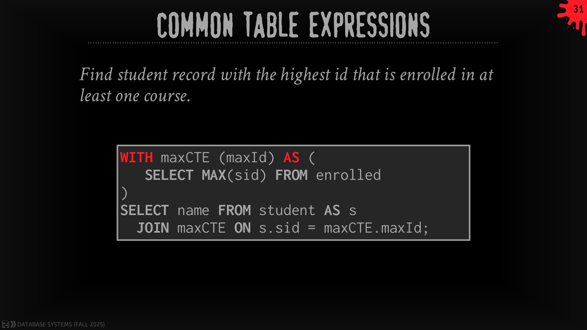


```sql
WITH maxCTE (maxId) AS (
   SELECT MAX(sid) FROM enrolled
)
SELECT name FROM student AS s
  JOIN maxCTE ON s.sid = maxCTE.maxId;
```

结果是 Taylor。它和 7.3 节第 4 种写法的逻辑完全一样，区别只在组织方式：先声明、后使用，从上往下读，就像写程序时先定义变量再使用它。Andy 认为用 [CTE](#公用表表达式) 还是用[嵌套查询](#嵌套查询)，很大程度上是个人偏好。
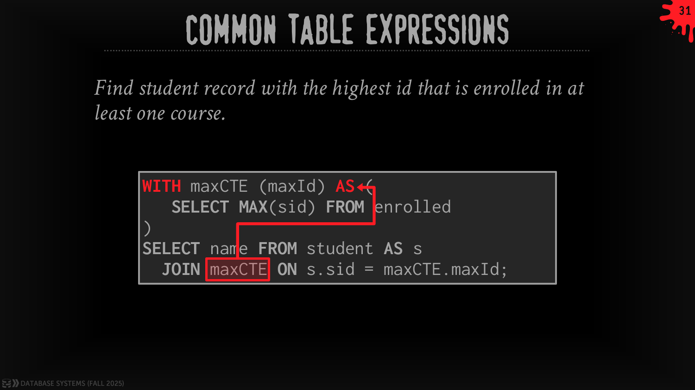


Andy 既把 [CTE](#公用表表达式) 比作临时表，也把它比作宏，这两个比喻恰好对应两种实现思路。一种是把 [CTE](#公用表表达式) 当作临时表：查询开始时先把它算出来并[物化](#物化)（materialize），查询结束后丢弃，这样即使它被引用多次，也只计算一次。另一种是把 [CTE](#公用表表达式) 当作宏：在每个引用它的地方，把它的定义原样替换成一个[嵌套查询](#嵌套查询)，这样优化器可以把它和主查询放在一起优化，比如把外面的筛选条件推进 [CTE](#公用表表达式) 内部。具体选哪一种由 DBMS 决定，PostgreSQL 在 12 版之前总是[物化](#物化) [CTE](#公用表表达式)，12 版起对只引用一次、非递归、没有副作用的 [CTE](#公用表表达式) 默认采用内联。这类决策属于第 [15](../L15/index.md)、[16](../L16/index.md) 讲的[查询优化](#查询优化)。

有学生问，[CTE](#公用表表达式) 能否参数化，也就是像函数那样传入一个值。Andy 的回答是不能。与此相关的一个研究方向是反过来的：把用 PL/SQL 等语言写的存储过程、函数这类过程式代码，自动转换成基于（递归）[CTE](#公用表表达式) 的 SQL，用一张表来保存程序的状态。这超出了本课程的范围。

### 9.2 递归 CTE（Recursive CTE）

📍 *Lecture Notes 第 12 节（PPT 无对应页）*

在 `WITH` 后面加上 `RECURSIVE` 关键字，[CTE](#公用表表达式) 就可以引用它自己，SQL 由此获得了递归的能力。有了[递归 CTE](#递归%20CTE)，SQL 可以被证明是图灵完备的，在计算能力上和通用编程语言相当，只是写起来繁琐得多。

下面的查询输出 1 到 10：

```sql
WITH RECURSIVE cteSource (counter) AS (
    ( SELECT 1 )
    UNION
    ( SELECT counter + 1 FROM cteSource
       WHERE counter < 10 )
)
SELECT * FROM cteSource;
```

[递归 CTE](#递归%20CTE) 由两部分组成：`UNION` 前面是非递归部分 `SELECT 1`，提供初始的行；后面是递归部分，它引用了 `cteSource` 自己。求值时，DBMS 先执行非递归部分，然后反复执行递归部分。关键在于，递归部分每一轮看到的 `cteSource` 并不是到目前为止的全部结果，而只是上一轮新产生的行；没有新行产生时，递归结束。

| 轮次 | 递归部分看到的行（上一轮新增） | 本轮新增的行 | 累计结果 |
|---|---|---|---|
| 初始 | — | 1 | 1 |
| 1 | 1 | 2 | 1–2 |
| 2 | 2 | 3 | 1–3 |
| … | … | … | … |
| 9 | 9 | 10 | 1–10 |
| 10 | 10 | 无（`10 < 10` 不成立） | 1–10，递归结束 |

`WHERE counter < 10` 是递归的终止条件。这里用的是 `UNION`，它会丢弃结果中已经存在的行，所以某一轮如果只产生了旧行，下一轮就没有输入，递归自然停止，这在遍历可能有环的图时很有用；换成 `UNION ALL` 则保留所有行，没有终止条件就会无限递归下去。在这个例子里，每一轮产生的都是新数字，所以无论用哪一种，`WHERE` 条件都必不可少。[递归 CTE](#递归%20CTE) 的典型用途是层次或图结构的数据，比如沿着先修课关系找出一门课的全部前置课程。

## 10. 窗口函数（Window Function）

📍 *PPT 第 34–38 页*

### 10.1 聚合，但不压扁

📍 *PPT 第 34–35 页*

聚合有两个局限。第一，它把一组行压成一行，每一行原本的身份就丢掉了。第二，SQL 的数据是无序的，聚合在计算时没有“处理到第几行”的概念。于是有一类很常见的需求无法表达：比如一张按时间记录温度的时序数据表，要求每个时刻最近几次读数的移动平均；或者股价的移动平均、累计总和、排名。

**[窗口函数](#窗口函数)（window function）**在一组与当前行相关的行上做计算，但不把这些行压成一行：每一个输入行都有自己的一个输出值。它的形式是：
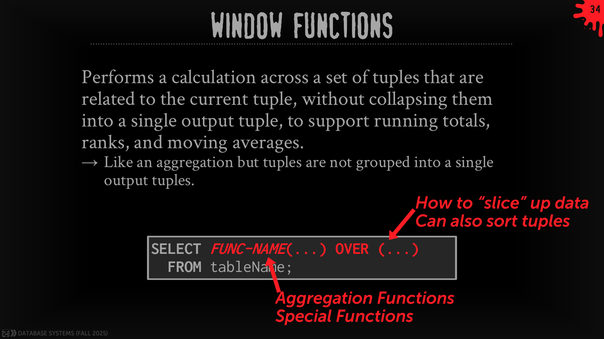


```sql
SELECT FUNC-NAME(...) OVER (...)
  FROM tableName;
```

`FUNC-NAME` 可以是第 3 节讲过的任何[聚合函数](#聚合函数)，也可以是[窗口函数](#窗口函数)专用的函数，比如 `ROW_NUMBER()`（当前行的行号）和 `RANK()`（当前行在排序中的名次）。`OVER` 子句说明如何把数据切分成组，以及组内是否排序。

```sql
SELECT *, ROW_NUMBER() OVER () AS row_num
  FROM enrolled;
```

| sid | cid | grade | row_num |
|---|---|---|---|
| 53666 | 15-445 | C | 1 |
| 53688 | 15-721 | A | 2 |
| 53688 | 15-826 | B | 3 |
| 53655 | 15-445 | B | 4 |
| 53666 | 15-721 | C | 5 |

`OVER ()` 里什么都没写，整张表就是一个窗口，也不排序，行号按 DBMS 恰好读到各行的顺序分配，这个顺序没有保证。
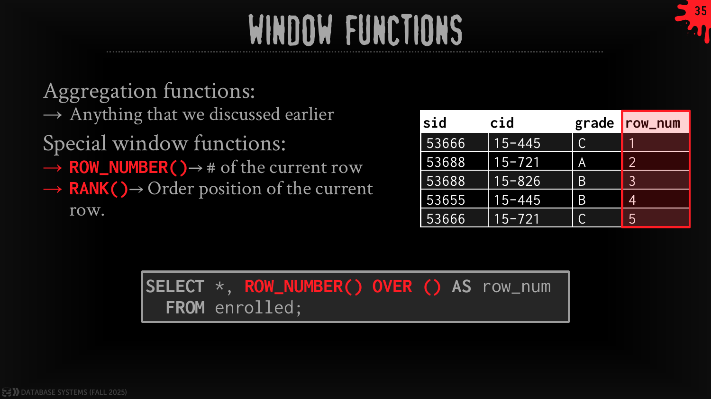


[窗口函数](#窗口函数)和 `GROUP BY` 的差别，把同一个计数分别用两种方式写出来就一目了然：

```sql
SELECT cid, COUNT(*) AS cnt
  FROM enrolled GROUP BY cid;                           -- 3 rows

SELECT cid, sid, COUNT(*) OVER (PARTITION BY cid) AS cnt
  FROM enrolled ORDER BY cid;                           -- 5 rows
```

| cid | sid | cnt |
|---|---|---|
| 15-445 | 53666 | 2 |
| 15-445 | 53655 | 2 |
| 15-721 | 53688 | 2 |
| 15-721 | 53666 | 2 |
| 15-826 | 53688 | 1 |

`GROUP BY` 版本每门课输出一行；[窗口函数](#窗口函数)版本保留了每一条选课记录，只是在每一行旁边附上了它所在课程的人数。

Lecture Notes 给出了[窗口函数](#窗口函数)在概念上的执行步骤：先对表[分区](#分区)，再在每个[分区](#分区)内排序（如果写了 `ORDER BY`），然后为每一条记录确定一个跨越若干行的窗口，最后对每个窗口计算输出。并不是所有[窗口函数](#窗口函数)都严格照这个步骤执行，但它足以帮助理解。在 4.4 节的[逻辑求值顺序](#逻辑求值顺序)里，[窗口函数](#窗口函数)在 `WHERE`、`GROUP BY`、`HAVING` 之后计算，在 `DISTINCT`、`ORDER BY` 和截取之前计算。

### 10.2 OVER：分区与排序

📍 *PPT 第 36–37 页*

`OVER` 中的 `PARTITION BY` 指定如何[分组](#分组)，作用和 `GROUP BY` 类似，只是不压扁：

```sql
SELECT cid, sid,
       ROW_NUMBER() OVER (PARTITION BY cid)
  FROM enrolled
 ORDER BY cid;
```

| cid | sid | row_number | [分区](#分区) |
|---|---|---|---|
| 15-445 | 53666 | 1 | 15-445 |
| 15-445 | 53655 | 2 | 15-445 |
| 15-721 | 53688 | 1 | 15-721 |
| 15-721 | 53666 | 2 | 15-721 |
| 15-826 | 53688 | 1 | 15-826 |

每进入一个新的[分区](#分区)，行号就从 1 重新开始。同一个[分区](#分区)内哪一行排第 1，这条查询没有规定。
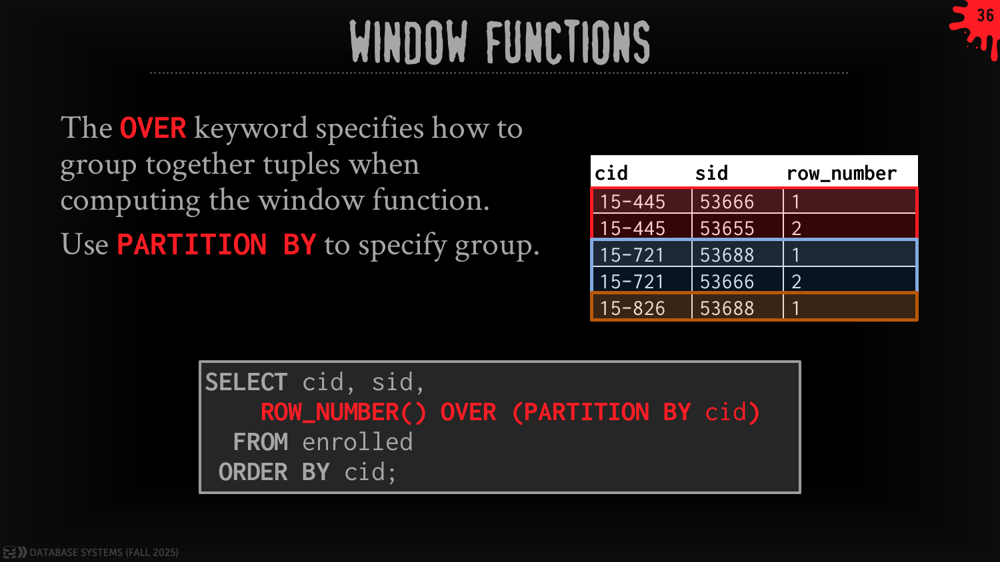


`OVER` 中还可以写 `ORDER BY`，规定组内的排序：
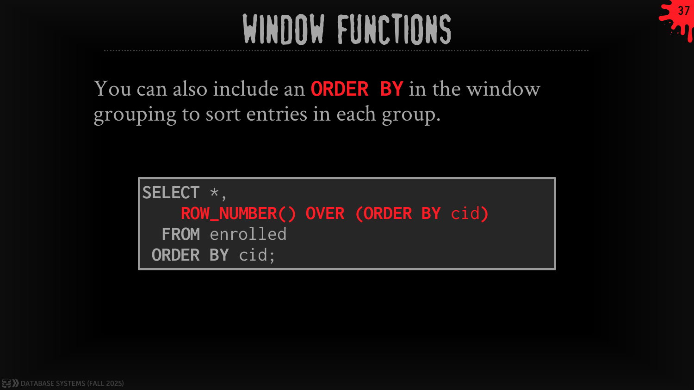


```sql
SELECT *,
       ROW_NUMBER() OVER (ORDER BY cid)
  FROM enrolled
 ORDER BY cid;
```

| sid | cid | grade | row_number |
|---|---|---|---|
| 53666 | 15-445 | C | 1 |
| 53655 | 15-445 | B | 2 |
| 53688 | 15-721 | A | 3 |
| 53666 | 15-721 | C | 4 |
| 53688 | 15-826 | B | 5 |

这条查询里有两个 `ORDER BY`，作用各不相同：`OVER` 里的决定行号怎么分配，最外层的决定结果按什么顺序输出，两者互不影响。Lecture Notes 说，在 `OVER` 里写 `ORDER BY` 可以保证即使[数据库](#数据库)内部发生变化，结果的顺序也是确定的。这要求排序键能唯一确定顺序：这里 15-445 有两行，谁得 1、谁得 2 仍然没有规定，要真正确定下来，得写成 `ORDER BY cid, sid`。

对[聚合函数](#聚合函数)来说，`OVER` 里加不加 `ORDER BY`，含义完全不同：

```sql
SELECT sid, gpa,
       SUM(gpa) OVER (ORDER BY sid) AS running,
       SUM(gpa) OVER () AS total
  FROM student;
```

| sid | gpa | running | total |
|---|---|---|---|
| 53655 | 3.5 | 3.5 | 11.4 |
| 53666 | 4.0 | 7.5 | 11.4 |
| 53688 | 3.9 | 11.4 | 11.4 |

没有 `ORDER BY` 时，窗口是整个[分区](#分区)，每一行得到的都是总和；有了 `ORDER BY`，默认的窗口变成“从[分区](#分区)开头到当前行（连同排序键与当前行相同的行）”，每一行得到的是累计和。开头提到的移动平均，需要再用一个[窗口框架](#窗口框架)（window frame）子句明确窗口的范围，比如 `AVG(temp) OVER (ORDER BY ts ROWS BETWEEN 2 PRECEDING AND CURRENT ROW)` 表示当前读数与前两次读数的平均值。框架子句的完整语法超出了本讲的范围。

### 10.3 排名：每门课成绩第二的学生

📍 *PPT 第 35、38 页*

`ROW_NUMBER()` 和 `RANK()` 都能给行编号，区别在于如何处理并列。把 enrolled 按成绩排序，同时算出三种编号（`DENSE_RANK()` 是第三种常用的[排名函数](#排名函数)）：

```sql
SELECT sid, grade,
       RANK()       OVER (ORDER BY grade) AS rnk,
       DENSE_RANK() OVER (ORDER BY grade) AS drnk,
       ROW_NUMBER() OVER (ORDER BY grade) AS rn
  FROM enrolled;
```

| sid | grade | RANK | DENSE_RANK | ROW_NUMBER |
|---|---|---|---|---|
| 53688 | A | 1 | 1 | 1 |
| 53688 | B | 2 | 2 | 2 |
| 53655 | B | 2 | 2 | 3 |
| 53666 | C | 4 | 3 | 4 |
| 53666 | C | 4 | 3 | 5 |

`ROW_NUMBER` 给每一行不同的连续编号，并列的行谁先谁后是任意的。`RANK` 让并列的行共享同一个名次，之后跳过被占掉的名次，就像两人并列第二时下一位是第四名。`DENSE_RANK` 也让并列的行共享名次，但不跳号。

Lecture Notes 里有一句强调：DBMS 在窗口排序之后计算 `RANK`，在排序之前计算 `ROW_NUMBER`。它的意思可以这样理解：`RANK` 的含义完全来自 `OVER` 里的 `ORDER BY`，没有 `ORDER BY` 时所有行都算并列，`RANK() OVER ()` 给每一行都是 1；`ROW_NUMBER` 不排序也能编号，只是顺序任意。`OVER` 里写了 `ORDER BY` 时，`ROW_NUMBER` 同样按排好的顺序编号。

现在找出每门课成绩第二高的学生：

```sql
SELECT * FROM (
  SELECT *, RANK() OVER (PARTITION BY cid
                         ORDER BY grade ASC) AS rank
    FROM enrolled) AS ranking
 WHERE ranking.rank = 2;
```

先按 `cid` [分组](#分组)，再在组内按成绩排序。成绩用的是字母 A、B、C，A 最好，所以要按升序排列，排在前面的才是高分。逐步来看：
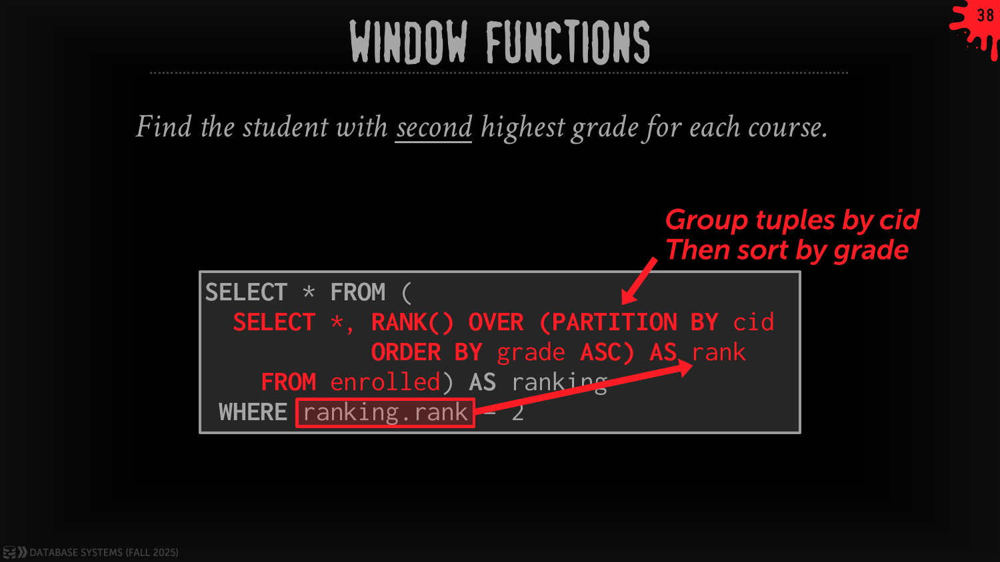


```text
① PARTITION BY cid
   15-445: (53666, C) (53655, B)
   15-721: (53688, A) (53666, C)
   15-826: (53688, B)

② ORDER BY grade ASC within each partition
   15-445: (53655, B) (53666, C)
   15-721: (53688, A) (53666, C)
   15-826: (53688, B)

③ RANK()
   15-445: (53655, B, 1) (53666, C, 2)
   15-721: (53688, A, 1) (53666, C, 2)
   15-826: (53688, B, 1)

④ Outer query: WHERE ranking.rank = 2
   (53666, 15-445, C, 2)
   (53666, 15-721, C, 2)
```

结果是 RZA 在 15-445 和 15-721 的两条记录。15-826 只有一个学生，没有第二名。

这条查询必须包一层[外层查询](#外层查询)。按 4.4 节的[逻辑求值顺序](#逻辑求值顺序)，[窗口函数](#窗口函数)在 `WHERE` 之后才计算，如果直接在同一层写 `WHERE rank = 2`，`WHERE` 执行时 `rank` 还不存在，PostgreSQL 会报错 `column "rank" does not exist`。所以要先在[子查询](#子查询)（或 [CTE](#公用表表达式)）里把排名算出来，再在外层按排名筛选。DuckDB、Snowflake 等系统提供了非标准的 `QUALIFY` 子句，可以在同一层直接筛选[窗口函数](#窗口函数)的结果，作用相当于[窗口函数](#窗口函数)专用的 `HAVING`。

“成绩第二高”还有一个语义问题。如果某门课有两名学生并列拿了 A，他们的 `RANK` 都是 1，下一名是 3，这门课就不存在 `rank = 2` 的行，查询对它什么也不返回。如果题目的意思是“成绩等于该课第二好的那个成绩的学生”，应当改用 `DENSE_RANK`。选哪一个函数，取决于问题本身的含义。

把条件换成 `rank = 1`，得到的是每门课成绩最好的学生，与 8.2 节用[横向连接](#横向连接)加 `FETCH FIRST 1 ROW ONLY` 回答的是同一个问题。两者的区别在并列时显现出来：`RANK` 会把并列第一的学生全部保留，`FETCH FIRST 1 ROW ONLY` 只任意保留其中一个。

## 小结

从聚合开始的每一步，都是为了回答一个前一步回答不了的问题。聚合把多行压成一个值，`GROUP BY` 让它按组计算，`GROUPING SETS` 一次给出多种[分组](#分组)，`HAVING` 在[分组](#分组)之后筛选。子句的[逻辑求值顺序](#逻辑求值顺序)解释了 `WHERE` 为什么看不到聚合、`HAVING` 为什么按标准不能引用别名、[窗口函数](#窗口函数)的结果为什么要到外层才能筛选。[嵌套查询](#嵌套查询)让一条查询的结果直接流进另一条查询，[横向连接](#横向连接)让同一层的[子查询](#子查询)可以互相引用，[CTE](#公用表表达式) 让[子查询](#子查询)有了名字、可以复用，[递归 CTE](#递归%20CTE) 让 SQL 拥有了图灵完备的表达能力，[窗口函数](#窗口函数)则在不压扁行的前提下引入了顺序和排名。

这些特性指向同一个原则：尽量用一条 SQL 语句算出答案。完整的意图交给 DBMS，它才有机会只扫描一遍数据、把[子查询](#子查询)改写成[连接](#连接)、自行决定 [CTE](#公用表表达式) 是[物化](#物化)还是内联；拆成多条语句在应用程序里拼接，这些机会就都没有了。另一方面，SQL 标准与各家实现之间的差距是实际存在的，字符串的大小写和引号、拼接运算符、日期运算，都可能在不报错的情况下给出错误答案。在一个新系统上写查询，要先验证再相信。

本讲的主要构造都会在后面以实现的面目再次出现：`GROUP BY`、`DISTINCT`、`ORDER BY` 和[窗口函数](#窗口函数)背后的排序与哈希在第 [11](../L11/index.md) 讲，[连接](#连接)算法在第 [12](../L12/index.md) 讲，[逻辑求值顺序](#逻辑求值顺序)如何变成一棵物理算子树在第 [13](../L13/index.md)、[14](../L14/index.md) 讲，[子查询](#子查询)的改写和 [CTE](#公用表表达式) 的处理在第 [15](../L15/index.md)、[16](../L16/index.md) 讲。下一讲开始进入 DBMS 的内部，从数据在磁盘上如何存储讲起。

## 术语速查表

### NULL

**NULL**：表示值未知或未定义的特殊值，与任何值比较的结果都是未知。（本讲首次出现：摘要；引入于：第 1 讲）

### 数据库

**Database**：一组经过组织、相互关联、用来模拟现实世界某方面的数据。（本讲首次出现：摘要；引入于：第 1 讲）

### 关系模型

**Relational Model**：以关系描述数据、以值表达联系、以声明式接口操纵数据的数据模型。（本讲首次出现：课程地图；引入于：第 1 讲）

### 关系代数

**Relational Algebra**：在关系上检索和操纵元组的一组基本运算。（本讲首次出现：课程地图；引入于：第 1 讲）

### 投影

**Projection**：只保留、重排或计算指定属性，对应 SQL 的 `SELECT` 列表。（本讲首次出现：课程地图；引入于：第 1 讲）

### 连接

**Join**：在共同属性上取值相同的元组组合。（本讲首次出现：课程地图；引入于：第 1 讲）

### 查询优化

**Query Optimization**：DBMS 为声明式查询找出最高效执行策略的过程。（本讲首次出现：课程地图；引入于：第 1 讲）

### 属性

**Attribute**：关系中的一个命名分量，即表中的一列。（本讲首次出现：1.1；引入于：第 1 讲）

### SQL 方言

**SQL Dialect**：某个系统对 SQL 标准的具体实现，包括它的偏离和扩展。（本讲首次出现：1.2；引入于：本讲）

### 数据定义语言

**Data Definition Language (DDL)**：定义表、索引、视图等对象模式的语句。（本讲首次出现：2.1；引入于：[第 01 讲](../L01/index.md)）

### 数据控制语言

**Data Control Language (DCL)**：控制谁能访问哪些数据的语句。（本讲首次出现：2.1；引入于：本讲）

### 数据操纵语言

**Data Manipulation Language (DML)**：DBMS 向应用暴露的存取数据的接口。（本讲首次出现：2.1；引入于：第 1 讲）

### 视图

**View**：用查询定义的虚拟表，用来实现外模式。（本讲首次出现：2.1；引入于：第 1 讲）

### 关联表

**Junction Table**：专门记录两个实体之间多对多联系的表。（本讲首次出现：2.3；引入于：第 1 讲）

### 外键

**Foreign Key**：值必须对应另一关系中某个元组（通常是其主键）的属性。（本讲首次出现：2.3；引入于：第 1 讲）

### 主键

**Primary Key**：唯一标识关系中一个元组的属性或属性组合。（本讲首次出现：2.3；引入于：第 1 讲）

### 聚合函数

**Aggregate Function**：把一个包里的多个值压成一个标量，如 `AVG`、`COUNT`。（本讲首次出现：3.1；引入于：本讲）

### 元组

**Tuple**：关系中的一个元素，即表中的一行。（本讲首次出现：3.1；引入于：第 1 讲）

### 分组

**`GROUP BY`**：按分组列的取值把元组划分成子集，对每个子集分别聚合。（本讲首次出现：4.1；引入于：本讲）

### 分组集

**Grouping Sets**：在一条查询里同时指定多种分组方式，`ROLLUP`、`CUBE` 是它的简写。（本讲首次出现：4.2；引入于：本讲）

### HAVING 子句

**`HAVING` Clause**：在分组聚合之后按聚合结果筛选分组。（本讲首次出现：4.3；引入于：本讲）

### 隐式连接

**Implicit Join**：在 `FROM` 中用逗号列出多张表、把连接条件写进 `WHERE` 的旧式写法。（本讲首次出现：4.3；引入于：本讲）

### 笛卡尔积

**Product**：两个关系中元组的所有组合。（本讲首次出现：4.3；引入于：第 1 讲）

### 逻辑求值顺序

**Logical Order of Evaluation**：SQL 子句在语义上的计算顺序：`FROM`→`WHERE`→`GROUP BY`→`HAVING`→`SELECT`→`ORDER BY`→截取。（本讲首次出现：4.4；引入于：本讲）

### 标识符

**Identifier**：表名、列名等名字；标准中用双引号括起。（本讲首次出现：5.1；引入于：本讲）

### 排序规则

**Collation**：规定字符串如何比较和排序，包括是否区分大小写。（本讲首次出现：5.1；引入于：本讲）

### 谓词

**Predicate**：对每个元组得出真或假的条件。（本讲首次出现：5.2；引入于：第 1 讲）

### 输出重定向

**Output Redirection**：把查询结果写进一张新表或已有的表，而不返回给客户端。（本讲首次出现：6.2；引入于：本讲）

### 嵌套查询

**Nested Query**：写在另一条查询内部的查询。（本讲首次出现：7.1；引入于：本讲）

### 子查询

**Subquery**：写在另一条查询内部的查询。（本讲首次出现：7.1；引入于：本讲）

### 外层查询

**Outer Query**：嵌套查询中包在外面的查询和嵌在里面的查询。（本讲首次出现：7.1；引入于：本讲）

### 内层查询

**Inner Query**：嵌套查询中包在外面的查询和嵌在里面的查询。（本讲首次出现：7.1；引入于：本讲）

### 标量子查询

**Scalar Subquery**：对外层每一行最多返回一个值的子查询。（本讲首次出现：7.1；引入于：本讲）

### 派生表

**Derived Table**：出现在 `FROM` 中、结果当作一张表使用的子查询。（本讲首次出现：7.1；引入于：本讲）

### 相关子查询

**Correlated Subquery**：引用了外层查询属性、结果随外层当前行变化的子查询。（本讲首次出现：7.4；引入于：本讲）

### 反连接

**Anti-Join**：保留在另一张表中找不到匹配的行，`NOT EXISTS` 可改写成它。（本讲首次出现：7.4；引入于：本讲）

### 横向连接

**Lateral Join**：允许 `FROM` 中的子查询引用在它之前出现的表或子查询。（本讲首次出现：8.1；引入于：本讲）

### 公用表表达式

**Common Table Expression (CTE)**：用 `WITH` 声明、只在一条查询内有效的具名临时结果。（本讲首次出现：9.1；引入于：本讲）

### 物化

**Materialization**：把中间结果实际计算出来并保存，供后续使用。（本讲首次出现：9.1；引入于：本讲）

### 递归 CTE

**Recursive CTE**：引用自身、按轮迭代直到不再产生新行的 CTE。（本讲首次出现：9.2；引入于：本讲）

### 窗口函数

**Window Function**：在与当前行相关的一组行上计算、但不把它们压成一行的函数。（本讲首次出现：10.1；引入于：本讲）

### 分区

**`PARTITION BY`**：窗口函数中划分组的方式，每个分区独立计算。（本讲首次出现：10.2；引入于：本讲）

### 窗口框架

**Window Frame**：规定窗口从哪一行到哪一行，如“前两行到当前行”。（本讲首次出现：10.2；引入于：本讲）

### 排名函数

**`ROW_NUMBER` / `RANK` / `DENSE_RANK`**：给行编号的窗口函数，区别在于如何处理并列。（本讲首次出现：10.3；引入于：本讲）

[^ibm]: 原话：“Well, it turns out IBM invented a bunch of that crap in the 1970s.”

[^sql92]: 原话：“There's no system in the world that I've been aware of that implements exactly the SQL-92 standard as written. They're always going to be slightly off.”

[^oneway]: 原话：“The SQL standard is going to say one thing, but nobody is actually going to implement it exactly.”

[^replace]: 原话：“People come along every ten years and say SQL is a terrible language. It's not great. It certainly has its rough spots. But every attempt to try to replace it in the last 50, 60 years has failed.”

[^born]: 原话：“I'm not here to say that SQL is not gonna be replaced in my lifetime. It may be, but it's very unlikely. It was here before you were born, it'll be here after we die, so it's not going to go away.”

[^important]: 原话：“SQL is the most important programming language you need to learn as a student.”

[^nice]: 原话：“Although we said it's declarative and we don't have to tell the database system how to actually execute the query, we can be nice to it and actually produce queries for it that it has a better time reasoning about.”

[^dates]: 原话：“Then we'll come to dates and times, and that's when it all falls apart.”

[^demo]: 原话：“It seems pretty, pretty simple, but as we'll see, every system is going to do something slightly different.”

[^someguy]: 原话：“Oftentimes it's like some guy sitting there just like, oh, I'll do it this way. And then everyone's like, all right, good.”

[^rust]: 原话：“Going from Python to Rust, that's a major lift. Going from MySQL to Postgres, mentally less.”

[^stupid]: 原话：“I don't think you ever want to run the inner query over and over again. It's stupid.”

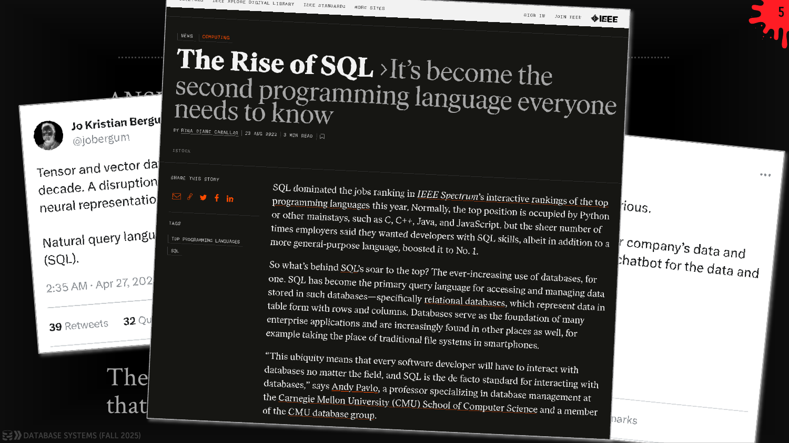

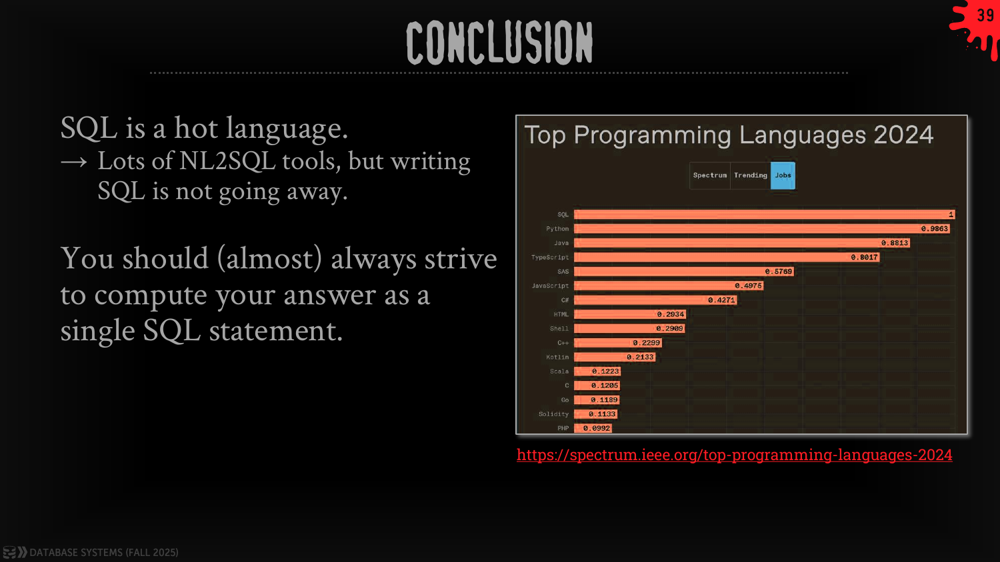

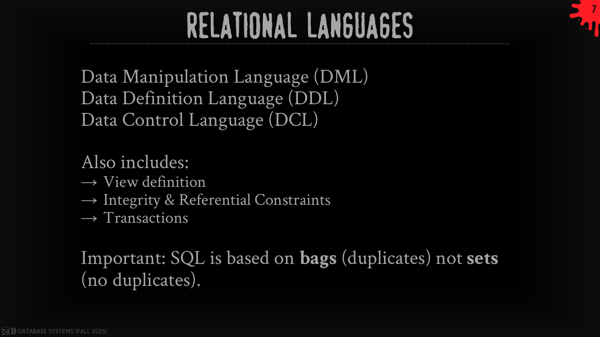

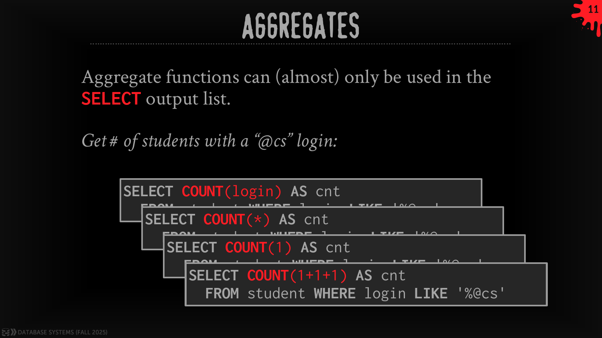

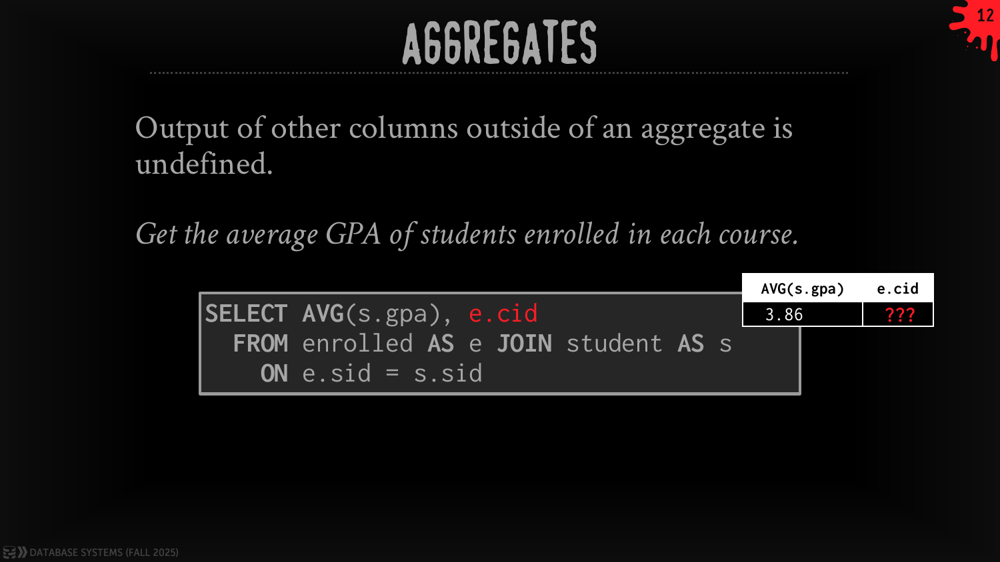

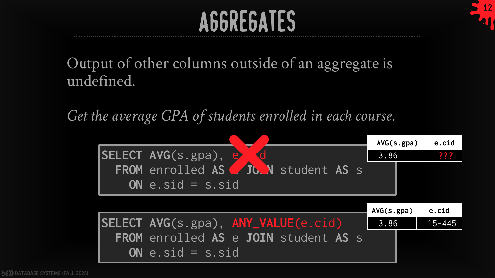

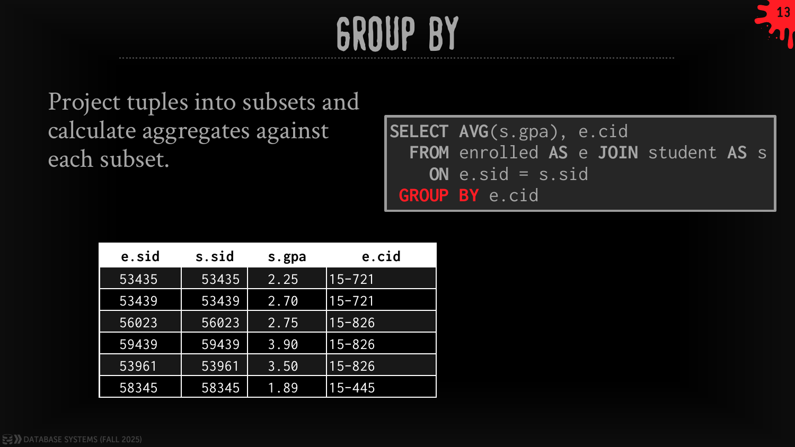

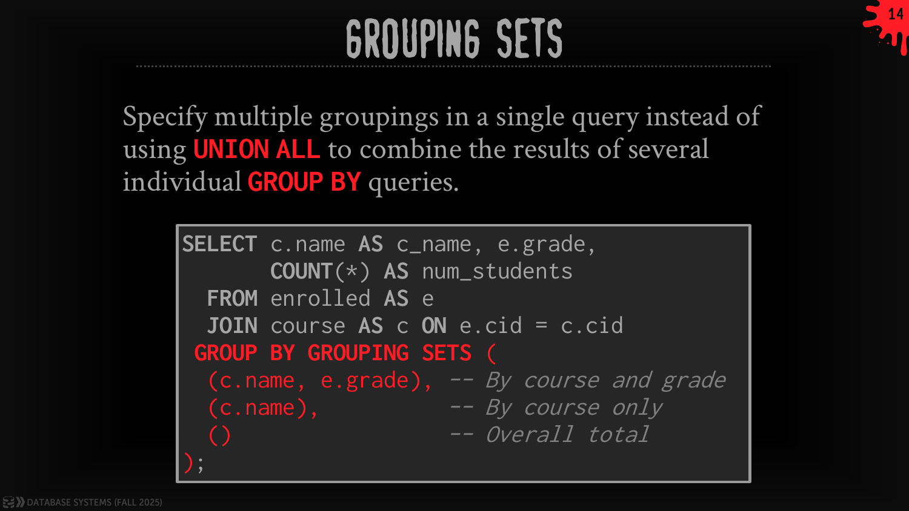

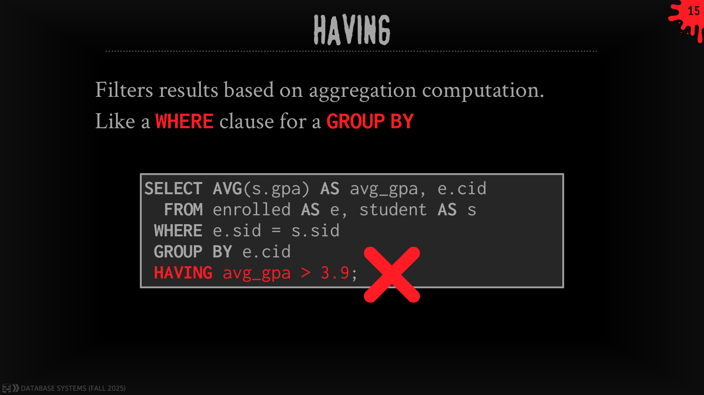


<details>
<summary>📎 本讲未被 📍 标注的幻灯片（共 6 页：封面、目录与行政页）</summary>


</details>

[^1]: 
