# CMU 15-445 第 [05](index.md) 讲：数据库存储（下）（Database Storage II）

> **课程**：CMU 15-445/645 Database Systems（Fall 2025）· **主讲**：Andy Pavlo
> **课程主页**：https://15445.courses.cs.cmu.edu/fall2025/
> **材料**：课件 PPT、官方 Lecture Notes、课堂录音转写稿
> **说明**：正文以 PPT 与 Lecture Notes 为准。讲者原话的中文为意译，英文原文见脚注，依据课堂录音转写整理，已修正明显的语音识别错误。文中“📍 PPT 第 X 页”指幻灯片右上角印的编号。

## 摘要（Abstract）

[缓冲池](#缓冲池)由 DBMS 自己管理，最大的好处是可以利用它对查询的了解。多缓冲池、预取和[扫描共享](#扫描共享)这三种优化在第 [4](../L04/index.md) 讲已经出现过，这里补上它们在实际系统中的几处细节：一个[页](#页)为什么只能属于一个缓冲池，操作系统的预读为什么停在文件偏移上，扫描共享为什么只适用于顺序扫描，以及 Oracle 的游标共享为什么连大小写不同都认不出来。

接下来回到[页](#页)的内部。第 [3](../L03/index.md) 讲的[槽式页](#槽式页)读起来方便，前提是手里已有[记录 ID](#记录%20ID)，而按值查找必须先查索引、再回[堆文件](#堆文件)取页；写起来则有[碎片](#碎片)、无用 I/O 和随机 I/O 三个问题，在 HDFS 这类只允许追加的存储上甚至无法原地修改。前一个问题引出[索引组织存储](#索引组织存储)：把[元组](#元组)直接放进索引的叶节点，表和索引合二为一。后一个问题引出[日志结构存储](#日志结构存储)：只追加 PUT 和 DELETE 记录，先在内存中的 [MemTable](#MemTable) 里累积，写满后顺序写成按键排序的 [SSTable](#SSTable)，再由后台[压实](#压实)合并旧版本。写因此变快了，代价转移到读和[压实](#压实)上；[分层压实](#分层压实)与[通用压实](#通用压实)是两种不同的分配方式，[写放大](#写放大)则是两者都绕不开的开销。

读完之后，你应该能够：对[槽式页](#槽式页)、[索引组织存储](#索引组织存储)和 [LSM 树](#LSM%20树)，分别说出一次按键查找和一次更新要经过哪些步骤；手工模拟 [LSM 树](#LSM%20树)的写入、落盘和读取，以及两张 [SSTable](#SSTable) 的归并，并解释[墓碑](#墓碑)为什么不能过早丢弃；说明[分层压实](#分层压实)与[通用压实](#通用压实)各自把代价放在了哪里，以及[写放大](#写放大)从何而来。

## 课程地图

本讲是课程第二阶段“存储”的第三讲。

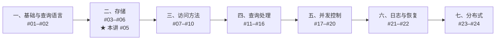

第 [3](../L03/index.md) 讲确立了[面向磁盘的架构](#面向磁盘的架构)：[数据库](#数据库)的主存储位置在非易失性磁盘上，数据库被切成定长的[页](#页)，[页目录](#页目录)（page directory）记录每一页在哪里，[元组](#元组)放在[堆文件](#堆文件)（heap file）的[槽式页](#槽式页)（slotted page）中，由[记录 ID](#记录%20ID)（record ID）定位；同时确立了一条贯穿整个存储阶段的经验事实：顺序 I/O 远快于随机 I/O。第 [4](../L04/index.md) 讲在这之上加了一层[缓冲池](#缓冲池)（buffer pool）：DBMS 在内存里保存从磁盘读来的页的副本，自己决定何时读入、何时淘汰、何时写回，不交给操作系统。
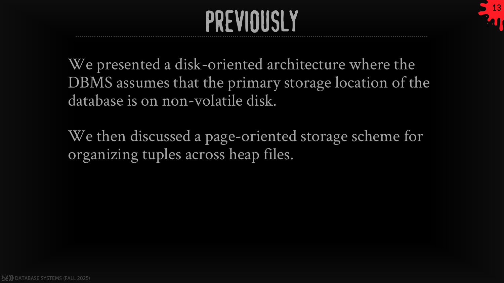

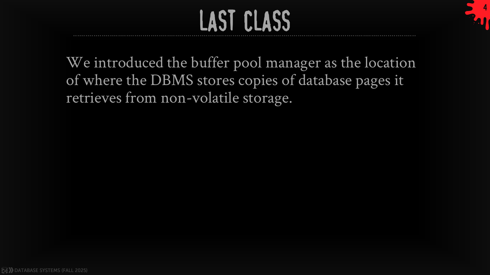


本讲前半部分延续第 [4](../L04/index.md) 讲，补完[缓冲池](#缓冲池)优化的几处细节；后半部分回到[页](#页)的内部，给出[槽式页](#槽式页)之外的两种页布局。其中许多东西会在后面正式登场：[索引组织存储](#索引组织存储)的树就是第 [8](../L08/index.md) 讲的 B+ 树，[LSM 树](#LSM%20树)读路径上的过滤器是第 [8](../L08/index.md)、[9](../L09/index.md) 讲的布隆过滤器，[压实](#压实)用到的归并与第 [11](../L11/index.md) 讲的外部归并排序、第 [12](../L12/index.md) 讲的排序归并连接同出一源；“不原地修改，只写新版本”的做法会在第 [20](../L20/index.md) 讲的多版本并发控制中再次出现，[MemTable](#MemTable) 的[持久性](#持久性)则要靠第 [21](../L21/index.md) 讲的预写日志来保证。下一讲（第 [6](../L06/index.md) 讲）会推翻本讲一直默认的“[元组](#元组)按行存放”这个前提。

## 1. [缓冲池](#缓冲池)优化：几处补充

📍 *PPT 第 6–12 页*

第 [4](../L04/index.md) 讲第 7 节介绍过[缓冲池](#缓冲池)的几种优化，它们有一个共同的前提：SQL 是声明式的，DBMS 在执行一条查询之前就已经生成了它的查询计划（query plan，第 [13](../L13/index.md)、[14](../L14/index.md)、[15](../L15/index.md)、[16](../L16/index.md) 讲），知道它要扫描哪张表、走哪个索引、读到哪里为止，而操作系统只看得到一串[页](#页)访问。多缓冲池（multiple buffer pools）把一个大缓冲池拆成多个实例，以减少[闩](#闩)（latch）的争用，并按页的类型定制策略；预取（pre-fetching）按查询计划提前读入后面要用的页；[扫描共享](#扫描共享)（scan sharing）让扫描同一张表的多条查询共用一个游标。下面只补充第 [4](../L04/index.md) 讲没有展开的几点。

**一个[页](#页)只能在一个[缓冲池](#缓冲池)里。**无论按对象 ID 还是按哈希把页分配给缓冲池，都必须保证同一个物理页在同一时刻只存在于一个缓冲池中。如果两个缓冲池各有一份副本，又分别被修改，就没有办法让它们重新一致。按哈希分配时，`HASH(page_id) % n` 对同一个页永远算出同一个编号，这条约束自动成立；按对象分配时，则由“一个对象只映射到一个缓冲池”来保证。各个实例发出的读写请求最终汇集到第 [4](../L04/index.md) 讲的 I/O 调度那里，由它统一排序、合并，避免多个实例各自的请求在磁盘上变成一堆随机 I/O。拆分的粒度可以很细：IBM DB2 允许建立多个缓冲池，再把不同的表空间指派给它们，于是表、索引、大对象都可以各用一个缓冲池；MySQL 的做法则简单得多，就是按[页 ID](#页%20ID) 哈希。
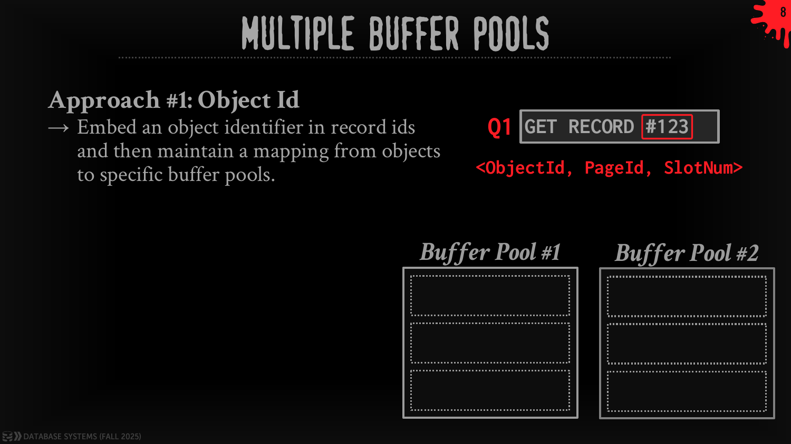

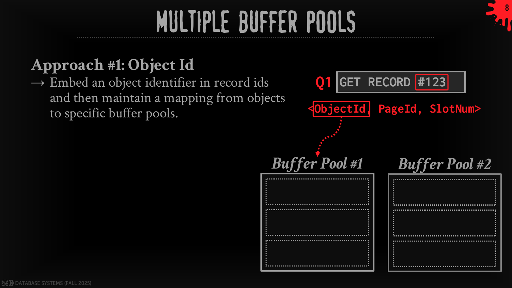

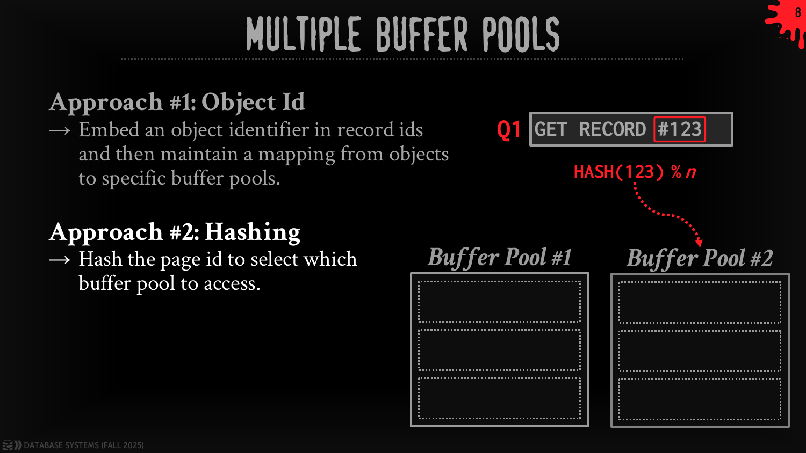


**操作系统的预取停在文件偏移上。**操作系统也会预读：Linux 发现文件被顺序读取时会自动多读后面几块，程序还可以用 `posix_fadvise`、`madvise` 这类调用告诉内核“我要顺序读”。但这些提示能表达的只有“按文件偏移往后读”。Andy 的说法是，操作系统做不了更复杂的事，因为它不知道[页](#页)里装的是什么，也不知道页和页之间有什么关系。[^1] B+ 树做范围扫描时，下一个要读的叶节点在文件里往往不紧挨着当前页，DBMS 预取的是扫描的下一个**逻辑**页，而不是磁盘上物理相邻的下一页。
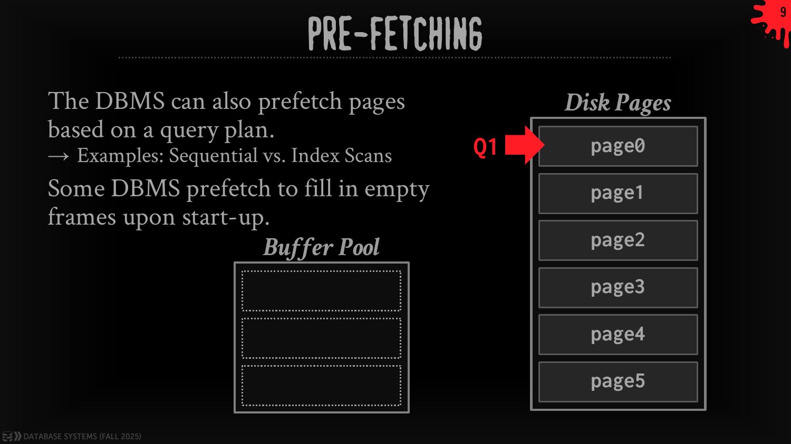

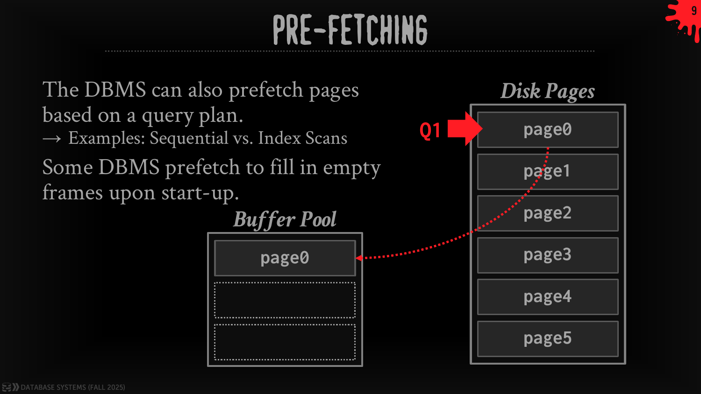

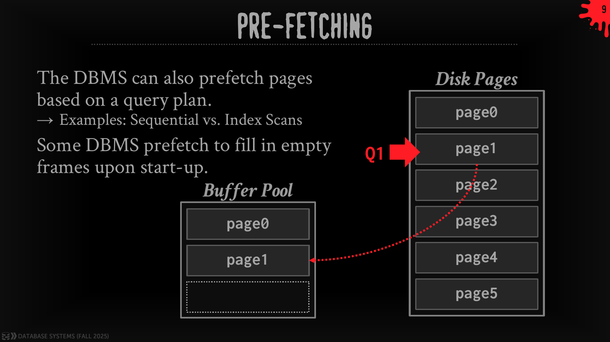

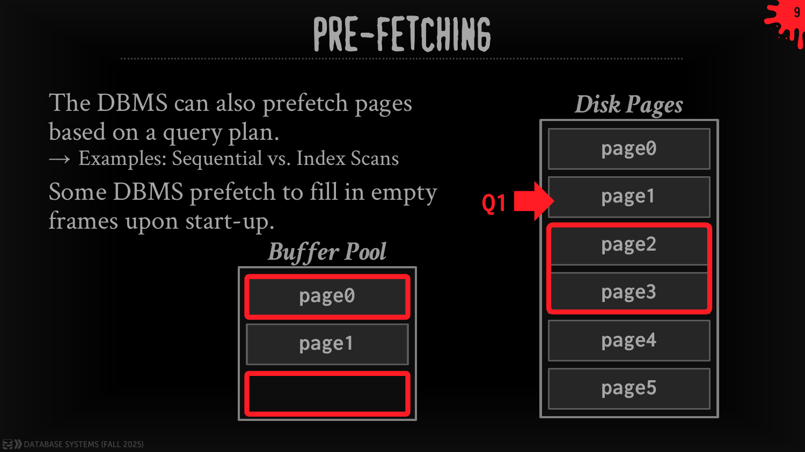

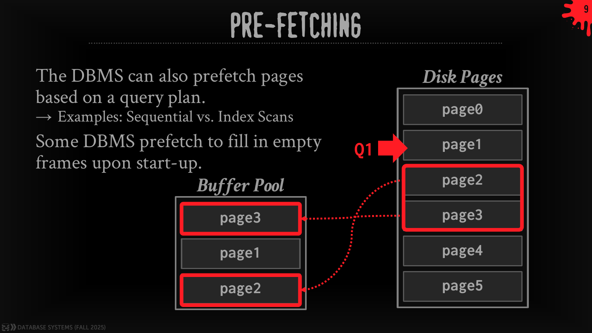

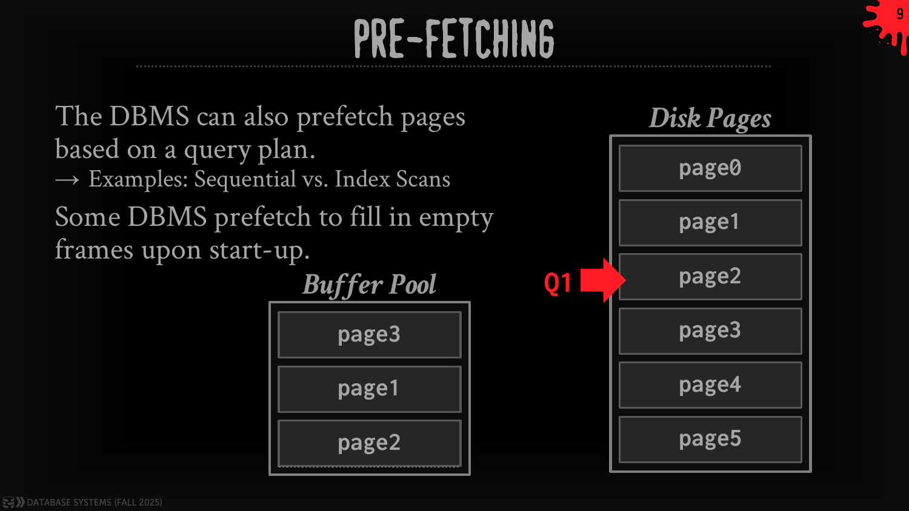

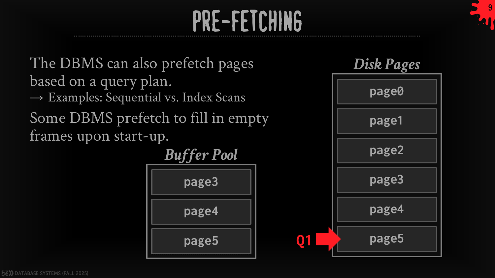

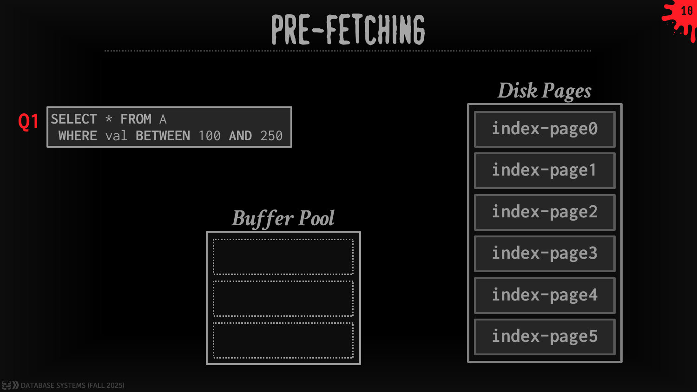

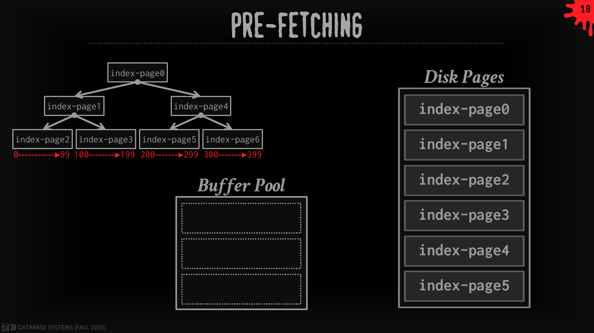

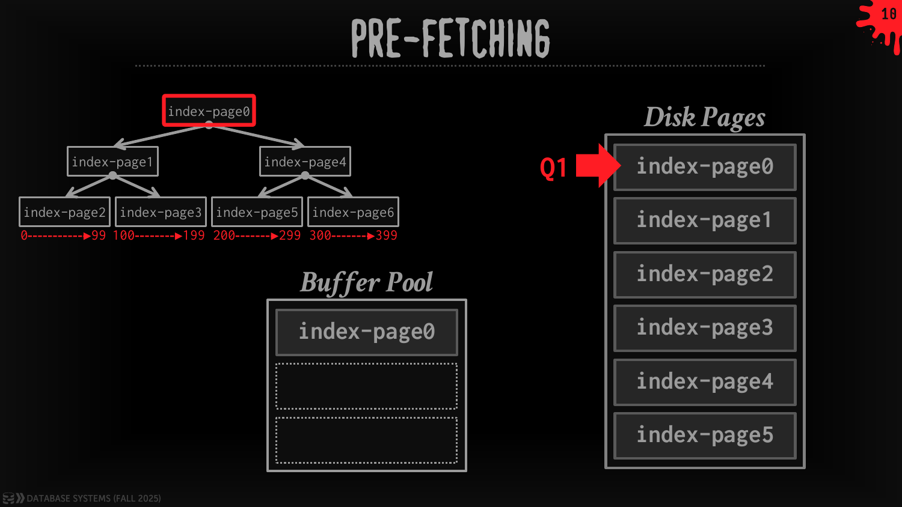

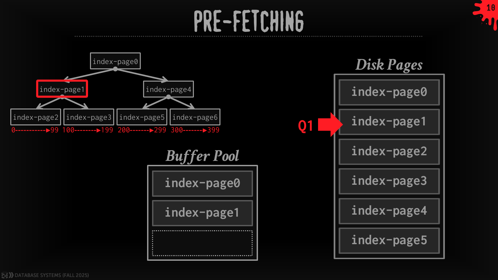

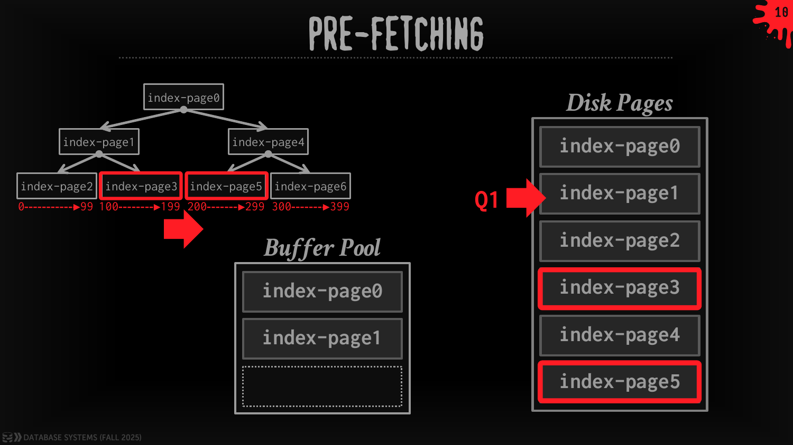


**[扫描共享](#扫描共享)为什么值得做。**第 [4](../L04/index.md) 讲说过，一个[页](#页)从磁盘读进内存的代价很高，应当在它被淘汰之前让它做尽可能多的有用功。扫描共享把这个原则推广到了查询之间：如果一次取页能同时满足两条查询的需要，那对 DBMS 来说是巨大的收益。[^2] 它和结果缓存（result caching）的区别也在这里。结果缓存重用的是某条查询的输出，只对完全相同的查询有效；扫描共享发生在存储层的最底部，共享的只是读页这件事，两条查询可以计算完全不同的东西，比如一条求和、一条求平均。

**[扫描共享](#扫描共享)只适用于顺序扫描。**DBMS 靠[页目录](#页目录)（第 [3](../L03/index.md) 讲）知道一张表由哪些[页](#页)组成，因此能判断两个全表扫描读的是同一批页。查询如果带着[谓词](#谓词)、走的是索引，它读的页就和别人不同，也就谈不上共享。在第 [4](../L04/index.md) 讲的例子里（[缓冲池](#缓冲池) 3 个[帧](#帧)，Q1 扫到 page3 时 Q2 到达），还可以再进一步：Q2 需要的 page1、page2 此刻仍在缓冲池里，它可以先读掉这两页再挂到 Q1 上，最后只需回头补读 page0。这个想法可行，不过 Andy 并不知道有哪个系统这样做，他印象中 PostgreSQL 没有。

**支持[扫描共享](#扫描共享)的系统很少。**DB2、SQL Server、Teradata 和 PostgreSQL 完整地支持它，其中只有 PostgreSQL 是开源系统，它的同步扫描由参数 `synchronize_seqscans` 控制，默认打开。Oracle 只支持相同查询之间的游标共享，而“相同”是逐字符比较查询文本得出的：`SELECT * FROM employees` 和 `SELECT * FROM Employees` 语义上完全一样，但只因一个字母的大小写不同，甚至只要多一个空格，就无法共享。
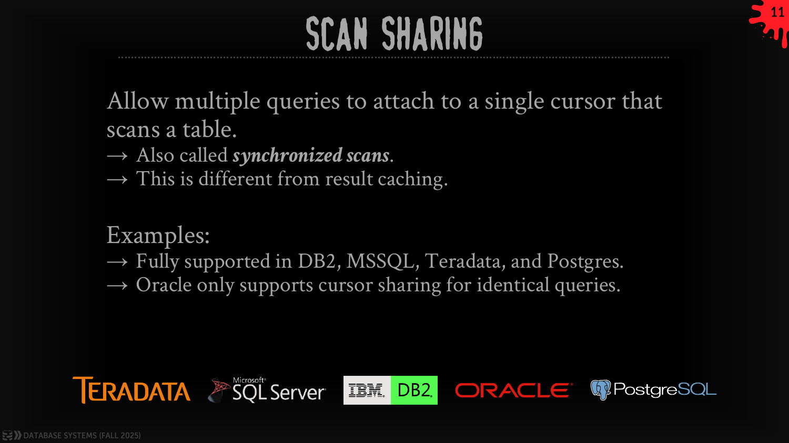

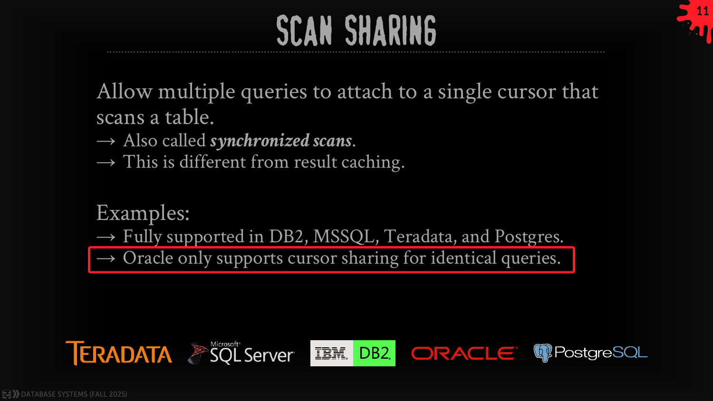

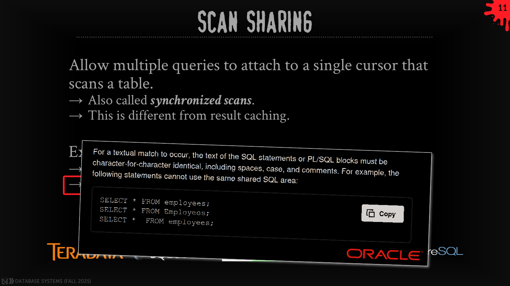


**[连续扫描共享](#连续扫描共享)。**学术界还有一种更激进的原型，叫[连续扫描共享](#连续扫描共享)（continuous scan sharing）：对某些表不停地做顺序扫描，查询随时挂上、随时下来。它的问题是即使没有查询需要，扫描也在持续产生 I/O，在按 I/O 次数计费的环境里，这种浪费会直接变成账单。

这些细节再次印证了第 [4](../L04/index.md) 讲的结论：在淘汰、分配和预取这几件事上，DBMS 几乎总能比操作系统做得更好，因为它掌握着查询计划的语义。

## 2. 面向元组的存储：读很简单，但总要先有[记录 ID](#记录%20ID)

📍 *PPT 第 13–17 页*

[缓冲池](#缓冲池)把[页](#页)当作不透明的字节块来搬运，页里的字节如何组织，属于页布局（page layout）的问题。讨论它之前，先重申两个前提：[元组](#元组)按行存储，一条元组的所有[属性](#属性)连续存放（第 [6](../L06/index.md) 讲会推翻这个前提）；每条元组都能装进一个页（装不下的大属性放进[溢出页](#溢出页)，见第 [3](../L03/index.md) 讲）。

在这两个前提下，[页](#页)布局有三种做法：[面向元组的存储](#面向元组的存储)（tuple-oriented storage）、[索引组织存储](#索引组织存储)（index-organized storage）和[日志结构存储](#日志结构存储)（log-structured storage）。第一种就是第 [3](../L03/index.md) 讲的[槽式页](#槽式页)。下面先看它的读和写各要付出什么代价，后两种做法正是为了避开这些代价而出现的。

### 2.1 [槽式页](#槽式页)与[记录 ID](#记录%20ID) 回顾

📍 *PPT 第 15–16 页*

[槽式页](#槽式页)（slotted page，见第 [3](../L03/index.md) 讲）的[页头](#页头)记录已用槽的个数，以及最后一个已用槽所指[元组](#元组)的起始偏移，此外还有[校验和](#校验和)、版本号之类的元数据；页头之后是[槽数组](#槽数组)，每个槽记录一条元组在[页](#页)内的起始偏移；元组数据从页尾往前放，与槽数组相向增长。PostgreSQL 的页就是这样排列的，也有教材把两者的位置倒过来画，原理完全一样。槽数组提供了一层间接：外界通过“页号 + 槽号”找元组，元组在页内移动时（比如删除一条元组后，把后面的元组挪过来填补空洞）只需修改槽数组，页外的一切都不受影响。

DBMS 给每条逻辑[元组](#元组)分配一个[记录 ID](#记录%20ID)（record ID，见第 [3](../L03/index.md) 讲），表示它的物理位置，典型的组成是文件 ID、[页 ID](#页%20ID) 和槽号。大多数 DBMS 不把它存在元组里，SQLite 是个例外，它把 `ROWID` 当作真正的[主键](#主键)，存为元组的隐藏[属性](#属性)。各系统的记录 ID 从 Ingres 的 4 字节 `TID` 到 Oracle 的 10 字节 `ROWID` 不等，第 [3](../L03/index.md) 讲列过完整的表。记录 ID 描述的是物理位置，DBMS 移动数据时它就会变，所以应用程序永远不应该依赖它表示任何含义。

[记录 ID](#记录%20ID) 的宽度会不会成为瓶颈？以 PostgreSQL 为例，6 字节的 `CTID` 由 4 字节的[页](#页)号和 2 字节的槽号组成，4 字节页号最多能区分 2^32 个页。PostgreSQL 默认的页大小是 8 KB，于是

$$

2^{32} \times 8\,\text{KB} = 2^{32} \times 2^{13}\,\text{B} = 2^{45}\,\text{B} = 32\,\text{TB}

$$

这正是 PostgreSQL 文档给出的单表大小上限。所以理论上[记录 ID](#记录%20ID) 确实可能用完，只是上限很高。`CTID` 的编号只在一张表内部有效，真碰到上限时，可以把表[分区](#分区)（partitioning）：逻辑上仍是一张父表，物理上拆成若干张子表，每张子表有自己的[页](#页)号空间。

实践中更容易先碰到的是别的限制，比如列数。PostgreSQL 一张表最多允许 1600 列，但这个数字还受“一条[元组](#元组)必须装进一个[页](#页)”的约束：1600 个 4 字节的 `INT` 列共 6400 字节，放得进 8 KB 的页；换成 8 字节的 `BIGINT`，就是 12800 字节，放不下了。本讲一直默认的“元组能装进一页”，在这里变成了实实在在的硬限制。一张表真会有上千列吗？在企业级应用里并不罕见。

> 💬 **旁注**
> Andy 说企业级应用的表结构相当吓人，他点名的例子是 SAP 的企业资源计划（ERP）软件。他请大家设想一个运行了 30 年的应用：每隔两年，就有人因为业务里多了点什么而加上十来列，不知不觉就到了一千列。
>
> *原话：“Think of an application running for 30 years. Every two years someone's got to add ten columns because something else gets added, and before you know it you're at a thousand.”*

### 2.2 读路径

📍 *PPT 第 17 页*

给定[记录 ID](#记录%20ID)，读一条[元组](#元组)只需三步：查[页目录](#页目录)找到[页](#页)的位置；页不在[缓冲池](#缓冲池)中就从磁盘读进来；再经[槽数组](#槽数组)找到元组在页内的偏移。
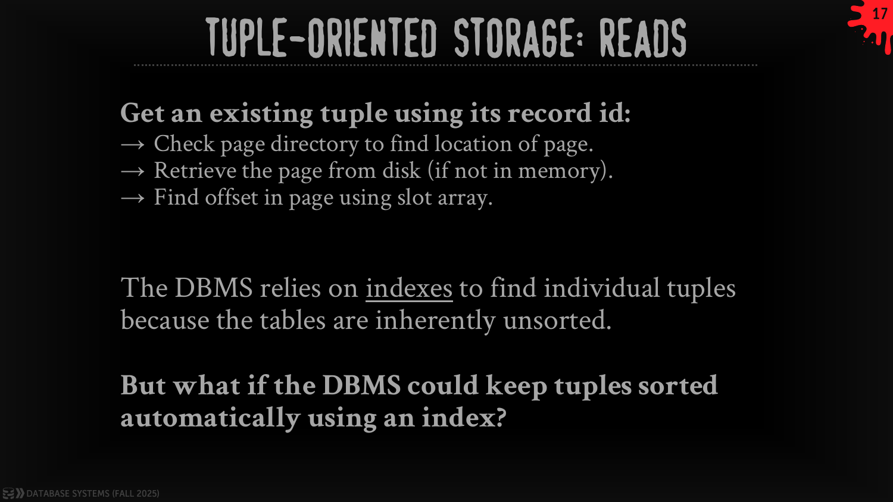

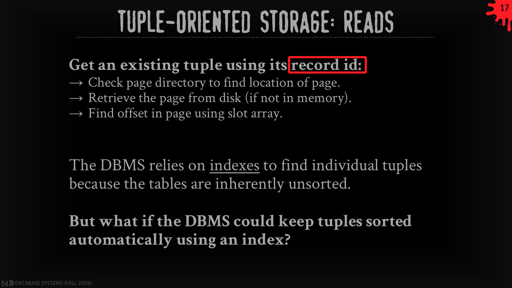


问题在于[记录 ID](#记录%20ID) 从哪里来。用户查询时给出的是值，比如某个学生的邮箱地址，而不是“第 7 页第 3 个槽”。[堆文件](#堆文件)里的[元组](#元组)没有任何顺序，DBMS 要按值找到元组，只能依靠另外建立的索引（第 [7](../L07/index.md)、[8](../L08/index.md)、[9](../L09/index.md) 讲），由索引把键映射到记录 ID。于是一次按键的[点查询](#点查询)实际上要查两个结构：

```text
WHERE email = 'xxx@cmu.edu'
    │
    │  ① 在索引中查找这个键
    ▼
索引：key ──► record ID（页 7，槽 3）
    │
    │  ② 查页目录，取出页 7，经槽数组找到槽 3 的偏移
    ▼
堆文件中的元组
```

索引和[堆文件](#堆文件)各有各的[页](#页)，一次查询可能要在两处分别读盘。既然索引本来就按键把数据排好了，为什么不让它直接存放[元组](#元组)，省掉第二步？

## 3. 索引组织存储（Index-Organized Storage）

📍 *PPT 第 18 页*

**[索引组织存储](#索引组织存储)**（index-organized storage）把表的[元组](#元组)直接作为索引数据结构中的值来存放。这个索引通常是 B+ 树（第 [8](../L08/index.md) 讲），也可以是跳表、字典树等其他有序结构（两者都在第 [9](../L09/index.md) 讲展开）。在[面向元组的存储](#面向元组的存储)中，索引叶节点里存的是“键 → [记录 ID](#记录%20ID)”；在[索引组织存储](#索引组织存储)中，叶节点里存的是“键 → 元组本身”，表和索引合二为一。

叶节点所在的[页](#页)看上去仍然像[槽式页](#槽式页)，区别在于[页头](#页头)后面是一个“键 → 偏移”数组（key→offset array），它必须按键排序；[元组](#元组)仍从页尾往前放，在页内通常也按键排好序。
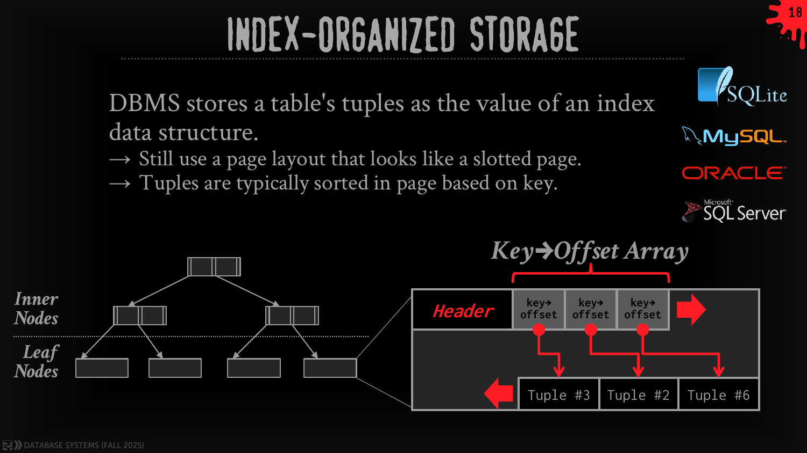


```text
                 ┌───────────────┐
                 │  Inner Nodes  │
                 └───────┬───────┘
              ┌──────────┴──────────┐
        ┌─────┴─────┐         ┌─────┴─────┐
        │ Leaf Node │   ···   │ Leaf Node │
        └───────────┘         └───────────┘

一个叶节点页的内部：
┌────────┬────────────┬────────────┬────────────┬── Key→Offset 数组（按键排序）→
│ Header │ key→offset │ key→offset │ key→offset │
├────────┴────────────┴────────────┴────────────┘
│                        空闲空间
│                 ┌──────────┬──────────┬──────────┐
│  ← 元组数据     │ Tuple #3 │ Tuple #2 │ Tuple #6 │
└─────────────────┴──────────┴──────────┴──────────┘
```

按键查找时，DBMS 从根节点沿内部节点下降到叶节点，在“键 → 偏移”数组上做二分查找，得到偏移，[元组](#元组)就在同一[页](#页)里。整个过程不需要[记录 ID](#记录%20ID)，也不必再去[堆文件](#堆文件)里另取一页。

SQLite 和 MySQL 的 InnoDB 引擎都用这种方式组织表。第 [3](../L03/index.md) 讲提到 SQLite 的普通表在内部是一棵以 `ROWID` 为键的 B 树，现在可以看清这句话的含义：这棵树就是表本身，`ROWID` 是树的键，所以必须实实在在地存下来，这也是它成为“大多数系统不存[记录 ID](#记录%20ID)”的例外的原因。InnoDB 以[主键](#主键)为键组织整张表，表上没有定义主键时，它会自动生成一个隐藏的 6 字节行 ID 充当键。Oracle 默认使用堆表，建表时可以声明为索引组织表（index-organized table）；SQL Server 的聚簇索引（clustered index）也是同一个思路。

有序是要付出代价的。在[槽式页](#槽式页)里，新[元组](#元组)可以放进任何一个有空位的[页](#页)；在[索引组织存储](#索引组织存储)中，新元组只能放进它的键所属的那个叶节点，页内还要维持“键 → 偏移”数组的顺序，叶节点满了就要分裂，一部分元组被搬到新页。这种分裂和树的重新平衡是第 [8](../L08/index.md) 讲的内容。元组会随分裂移动，它的物理地址就不稳定，所以这类系统中表上的其他索引，即[二级索引](#二级索引)（secondary index），通常不保存物理地址，而是保存[主键](#主键)：InnoDB 的[二级索引](#二级索引)按列值找到主键之后，还要再到主键索引里查一次。换来的好处是，按主键的范围查询变成了沿叶节点的有序扫描，读出的元组天然有序。

## 4. 面向元组的存储：写入的代价

📍 *PPT 第 19–20 页*

[索引组织存储](#索引组织存储)改善了读，写的问题还在。回到[面向元组的存储](#面向元组的存储)，看一条[元组](#元组)是怎样被写入和修改的。

插入比较简单。DBMS 查[页目录](#页目录)，找一个有空闲槽的[页](#页)，页不在内存中就从磁盘读进来，再检查[槽数组](#槽数组)，看页内剩余空间能否放下这条[元组](#元组)；放不下就换一个页，所有页都满了就分配新页，最后写入元组、更新槽数组。由于 SQL 是声明式的，表的模式事先已知，DBMS 在插入的那一刻就能算出元组需要多少空间。

更新就麻烦了。DBMS 先按读路径找到[元组](#元组)所在的[页](#页)和偏移。新值能放进原来的位置，就直接覆盖；放不下（比如一个变长字符串变长了），[页内整理](#页内整理)之后也腾不出足够空间，就只能把旧元组标记为删除，再把新版本当作一条新元组插入另一个页。一次更新变成了一次删除加一次插入，而且元组换了页，[记录 ID](#记录%20ID) 随之改变，所有指向它的索引项都得跟着修改。这里还假设了更新是原地覆盖的，很多系统其实并不覆盖，例如 PostgreSQL 每次更新都会写一个新版本的元组（第 [3](../L03/index.md) 讲的 `ctid` 实验已经看到过），原因要到第 [20](../L20/index.md) 讲的多版本并发控制才能讲清楚。

归纳起来，[面向元组的存储](#面向元组的存储)在写入上有三个问题。
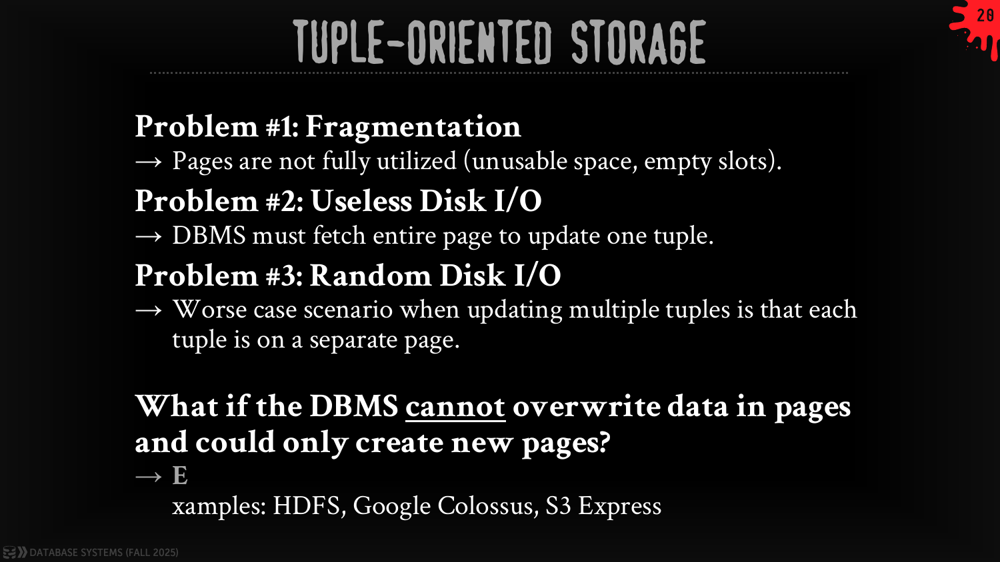


**[碎片](#碎片)（fragmentation）。**[页](#页)很难被完全用满。[槽数组](#槽数组)和[元组](#元组)数据相向增长，中间剩下的空闲空间几乎不可能恰好被用完；元组删除后，还会留下空洞和空槽。

**无用的磁盘 I/O。**非易失性存储按块读写，为了改一条[元组](#元组)里的几个字节，也要把整个[页](#页)读进内存、再整页写回。页大小是 16 KB 时，修改几个字节就要搬动 16 KB。

**随机磁盘 I/O。**要更新的一批[元组](#元组)分散在不同的[页](#页)上时，最坏情况是每条元组各在一个页里：更新 20 条元组，磁盘就要跳到 20 个不同的位置，这正是第 [3](../L03/index.md) 讲说过代价最高的访问模式。

还有一种更根本的情况：存储系统根本不允许原地覆盖。HDFS、Google 的 Colossus、Amazon S3 Express 这类系统只允许创建新数据或在末尾追加，不能改写已有数据中的某一段；想“修改”，只能写新的、删旧的。在这样的系统上，[槽式页](#槽式页)“把[页](#页)读进来、在某个偏移处改几个字节、再写回去”的做法根本无法实施。

原地修改既昂贵，又不一定可行。那么，如果干脆不再修改，只追加呢？

## 5. 日志结构存储（Log-Structured Storage）

📍 *PPT 第 21–23 页*

### 5.1 只追加，不覆盖

📍 *PPT 第 21 页*

**[日志结构存储](#日志结构存储)**（log-structured storage）不把[元组](#元组)存进[页](#页)里再原地修改，而是维护一份记录元组变化的日志。日志中只有两种记录：PUT 表示写入一条元组，DELETE 表示删除一条元组。每条记录都必须带上元组的唯一标识符（下文称为键）；PUT 记录还带有元组的完整内容，DELETE 记录只标明这条元组已被删除。应用每修改一次[数据库](#数据库)，DBMS 就在日志末尾追加一条记录，不去检查之前的记录。

这很像会计记账：账簿上的数字发生变化时，不去涂改原来的数字，而是追加一笔新的分录。任何时刻，一个键的当前值都由它最近的那条 PUT 或 DELETE 决定。

因为只追加，所有写入都是顺序 I/O，插入和更新都很快；它也天然适合上一节那些只允许追加的存储系统。这一思想可以追溯到 1990 年代初的日志结构文件系统，1996 年提出的 [LSM 树](#LSM%20树)（log-structured merge tree）把它用到了[数据库](#数据库)上。

一个日志结构的存储引擎由两部分组成。

- **[MemTable](#MemTable)**：内存中的有序数据结构，所有修改先写到这里。它在内存中，因此可以原地更新。常用跳表实现（RocksDB 的默认选择，跳表见第 [9](../L09/index.md) 讲），也可以是 B+ 树或字典树。
- **[SSTable](#SSTable)**（sorted string table，有序字符串表）：[MemTable](#MemTable) 写满后，DBMS 把其中的内容按键排序，顺序写到磁盘上形成的文件。[SSTable](#SSTable) 一旦写出就不再修改。这个名字来自 Google 的 Bigtable。

[MemTable](#MemTable) 在内存中，断电就会丢失。实际系统在修改 [MemTable](#MemTable) 的同时，会把每条 PUT、DELETE 追加到一个单独的日志文件，并在事务提交前把它刷到磁盘，这就是第 [21](../L21/index.md) 讲的预写日志。这里暂且不管它，只需知道 [MemTable](#MemTable) 有办法保持持久。

[MemTable](#MemTable) 为什么用有序结构，而不用查找更快的哈希表？因为它最终要写成按键排序的 [SSTable](#SSTable)。有序结构只需沿着叶节点（或跳表的最底层）从头走到尾，就能按键序吐出全部内容；换成哈希表，落盘前还得先排一次序。

### 5.2 写路径：从 MemTable 到 SSTable

📍 *PPT 第 22 页*

依次执行四个 PUT，再让 [MemTable](#MemTable) 落盘：

| 步骤 | 操作 | [MemTable](#MemTable)（按键排序） | 磁盘 |
|---|---|---|---|
| 1 | `PUT (key101, a1)` | key101→a1 | 空 |
| 2 | `PUT (key102, b1)` | key101→a1，key102→b1 | 空 |
| 3 | `PUT (key101, a2)` | key101→**a2**，key102→b1 | 空 |
| 4 | `PUT (key103, c1)` | key101→a2，key102→b1，key103→c1 | 空 |
| 5 | [MemTable](#MemTable) 写满，按键序写出 | 清空，接收新的写入 | 第 0 层新增一张 [SSTable](#SSTable)：`PUT (key101, a2)`、`PUT (key102, b1)`、`PUT (key103, c1)` |

这里的键可以理解为系统维护的一个递增计数器，就像 SQLite 的 `ROWID`，每插入一条新[元组](#元组)就加一。表中有两点值得注意。第一，`key101` 被写了两次，但 a1 从未到达磁盘：[MemTable](#MemTable) 吸收了对同一个键的重复修改，落盘时只保留最新值。第二，[SSTable](#SSTable) 内部按键从小到大排列，这是后面能在 [SSTable](#SSTable) 里做二分查找、能高效归并两张 [SSTable](#SSTable) 的前提。

[MemTable](#MemTable) 的大小通常在几十到几百 MB 之间。写出 [SSTable](#SSTable) 并刷盘之后，DBMS 换上一个新的空 [MemTable](#MemTable) 继续接收写入。如此反复，磁盘上的 [SSTable](#SSTable) 越来越多。每张 [SSTable](#SSTable) 的文件名带有单调递增的时间戳，所以单个文件内部按键排序，文件之间按从新到旧排列。

新写出的 [SSTable](#SSTable) 放在第 0 层（Level #0）。某一层积累得太多时，DBMS 把其中的 [SSTable](#SSTable) 合并成更大的 [SSTable](#SSTable) 放到下一层，并删除旧文件，越往下 [SSTable](#SSTable) 越大。磁盘部分因此呈现出上小下大的层次结构：

```text
 内存   ┌──────────────┐
        │   MemTable   │   ← 所有 PUT / DELETE 先到这里
        └──────┬───────┘
 ─ ─ ─ ─ ─ ─ ─ ┼ ─ ─ ─ ─ ─ ─   写满后按键序顺序写出
 磁盘          ▼
 Level #0   [SSTable] [SSTable] [SSTable]            新 → 旧，键范围可能重叠
 Level #1   [    SSTable    ]  [    SSTable    ]
 Level #2   [             SSTable              ] …   越往下越大
```

层与层之间怎样合并，放在第 6 节讲，先看删除和读取。

### 5.3 删除与更新

📍 *PPT 第 23 页*

在[槽式页](#槽式页)里删除一条[元组](#元组)，要先把它所在的[页](#页)取进内存，再做标记。[日志结构存储](#日志结构存储)只要知道键，追加一条 DELETE 记录就完成了，不需要先找到这条元组。落盘之后的 [SSTable](#SSTable) 可能是这样的：

```text
SSTable（键从小到大）
┌──────────────────┐
│ DEL (key100)     │
│ PUT (key101, a3) │
│ PUT (key102, b2) │
│ PUT (key103, c1) │
└──────────────────┘
```

这张 [SSTable](#SSTable) 说明 `key100` 已被删除，而更老的 [SSTable](#SSTable) 里很可能还留着 `key100` 的某个旧值。DELETE 记录的作用就是盖住这些旧值：之后任何读取 `key100` 的查询，只要先遇到这条记录，就知道这条[元组](#元组)在逻辑上已经不存在，尽管它在物理上仍分散在若干张 [SSTable](#SSTable) 中。这种表示“已删除”的标记称为[墓碑](#墓碑)（tombstone）。

更新同样只是追加一条 PUT。需要澄清的是，PUT 里存的永远是整条[元组](#元组)，而不是被修改的那一个字段，同一条元组的不同[属性](#属性)不会分散在不同的 [SSTable](#SSTable) 里。由此引出一个区别：如果新值不依赖旧值，比如用全新的内容替换整条元组，DBMS 直接追加 PUT 即可，这称为[盲写](#盲写)（blind write）；如果是

```sql
UPDATE people SET age = age + 1 WHERE id = 1;
```

这样的更新，DBMS 必须先读出当前[元组](#元组)，算出新值，再写入完整的新元组。“[日志结构存储](#日志结构存储)写得快”，严格说指的是[盲写](#盲写)；读-改-写式的更新仍要先付出一次读的代价，而读恰恰是[日志结构存储](#日志结构存储)的弱项。

### 5.4 读路径与摘要表（SummaryTable）

📍 *PPT 第 22 页*

读 `key101` 时，DBMS 先查 [MemTable](#MemTable)，因为那里保存着最新的修改，找到就直接返回。找不到，就到磁盘上的 [SSTable](#SSTable) 里找，而且必须按从新到旧的顺序：第 0 层从最新的文件查起，然后是第 1 层、第 2 层……遇到的第一条关于 `key101` 的记录就是答案；如果这条记录是 DELETE，结论就是“不存在”。[SSTable](#SSTable) 内部有序，所以在每张 [SSTable](#SSTable) 里可以用二分查找。

最坏的情况是要找的键根本不存在：DBMS 必须查遍每一张 [SSTable](#SSTable) 才能确认，而每查一张都可能是一次磁盘读，相当于大海捞针。为此，DBMS 在内存中维护一张[摘要表](#摘要表)（SummaryTable），保存两类元数据：

- 每张 [SSTable](#SSTable) 的最小键和最大键。键落在范围之外的 [SSTable](#SSTable) 可以直接跳过。
- 每一层一个[键过滤器](#键过滤器)（key filter），用来快速判断某个键是否可能在这一层。常见的实现是布隆过滤器（Bloom filter，第 [8](../L08/index.md)、[9](../L09/index.md) 讲），它回答“一定不在”时绝对可靠，回答“可能在”时却可能出错（假阳性），这时仍需真正去查。过滤器也可以按范围设计，判断某个键区间里有没有数据，以支持范围扫描。

把这些合起来，读路径可以写成下面的 C 代码：

```c
// Look up key k in an LSM tree. Returns NULL if the key does not exist.
const Tuple *lsm_get(const LSM *db, int64_t k) {
    const Record *r = memtable_find(db->mem, k);         // newest changes live here
    if (r != NULL)
        return r->is_delete ? NULL : &r->tuple;

    for (int lvl = 0; lvl < db->num_levels; lvl++) {
        if (!filter_may_contain(db->filter[lvl], k))
            continue;                                    // "definitely not in this level"
        // Visit this level's SSTables from newest to oldest.
        for (const SSTable *t = db->newest[lvl]; t != NULL; t = t->older) {
            if (k < t->min_key || k > t->max_key)
                continue;                                // key range from the SummaryTable
            r = sstable_search(t, k);                    // binary search, may cost a disk read
            if (r != NULL)
                return r->is_delete ? NULL : &r->tuple;  // the first hit wins
        }
    }
    return NULL;                                         // not found anywhere
}
```

两个 `return r->is_delete ? NULL : &r->tuple` 体现了[墓碑](#墓碑)的语义：先遇到 DELETE，就直接判定不存在，不再往更老的文件里找。

[日志结构存储](#日志结构存储)在这里做了一笔明确的交换：用更慢的读换来更快的写，再用额外的内存结构把读的代价压下来。

## 6. 压实（Compaction）

📍 *PPT 第 24–26 页*

### 6.1 归并两张 SSTable

📍 *PPT 第 24 页*

在写入密集的负载下，磁盘上的 [SSTable](#SSTable) 会越积越多。同一个键被更新了一千次，就可能有一千条记录分布在不同的文件里，真正有用的只有最新的一条；读取时要检查的文件也越来越多。**[压实](#压实)**（compaction）定期把若干张 [SSTable](#SSTable) 合并成一张，每个键只保留最新的修改，以回收空间、加快读取。套用记账的类比，这相当于账本太厚时誊抄一本新账本，每个账户只抄最新的余额。（注意，第 [3](../L03/index.md) 讲[槽式页](#槽式页)的[页内整理](#页内整理)在英文里也叫 compaction，但那是在单个[页](#页)里挪动[元组](#元组)，这里是把多个文件合并成新文件，两者只是同名。）

合并用的是排序归并（sort-merge）算法。以两张 [SSTable](#SSTable) 为例，左边较新，右边较旧：
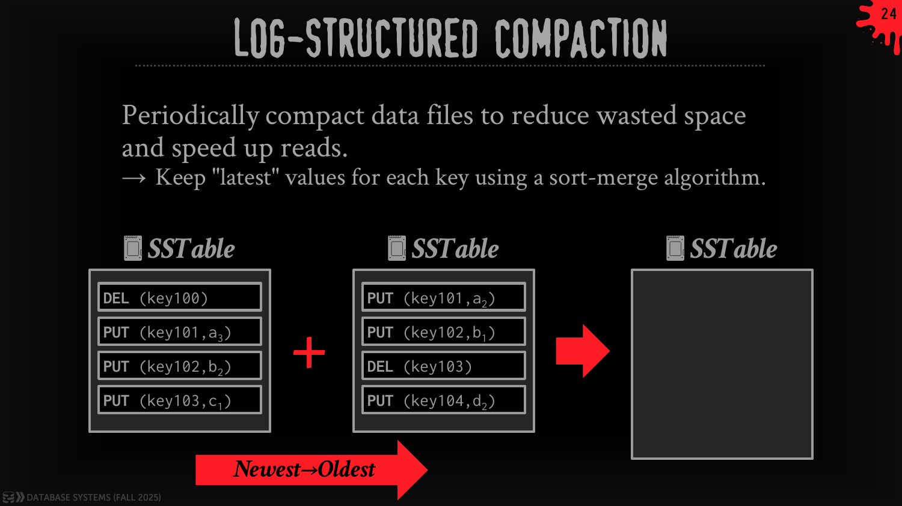

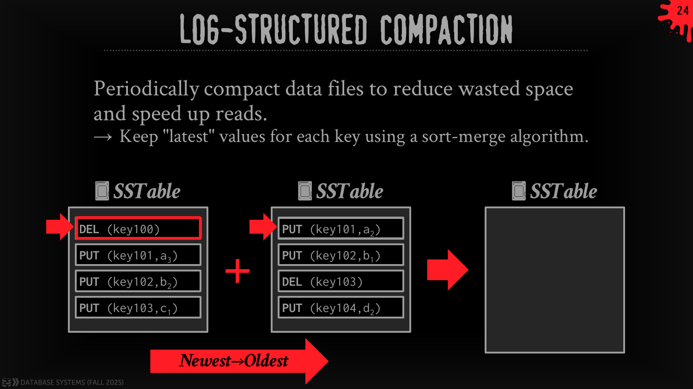


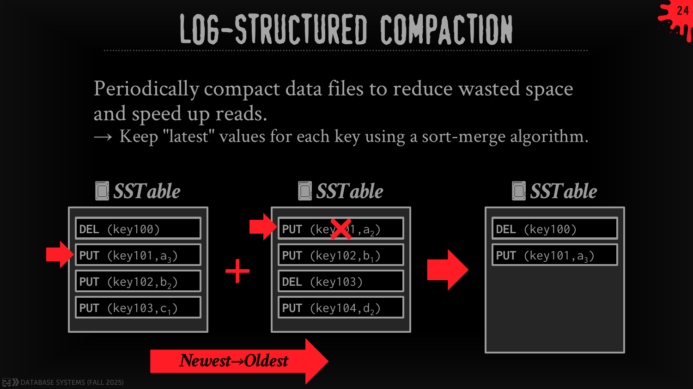

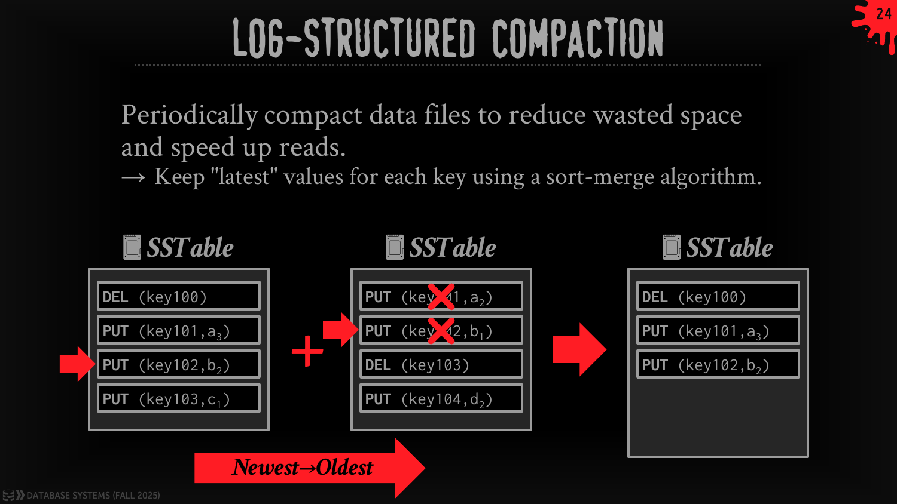

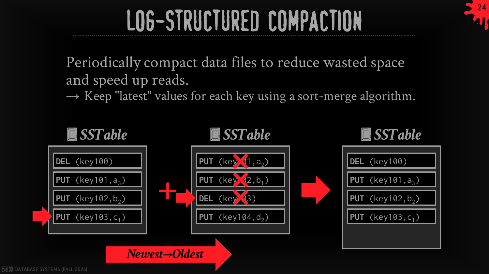

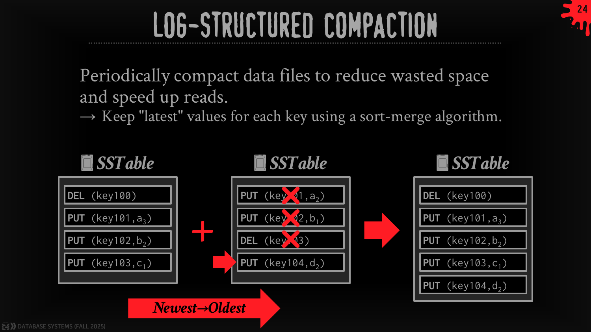


```text
较新的 SSTable              较旧的 SSTable
┌──────────────────┐       ┌──────────────────┐
│ DEL (key100)     │       │ PUT (key101, a2) │
│ PUT (key101, a3) │   +   │ PUT (key102, b1) │
│ PUT (key102, b2) │       │ DEL (key103)     │
│ PUT (key103, c1) │       │ PUT (key104, d2) │
└──────────────────┘       └──────────────────┘
```

两个游标分别从两张表的开头出发，每一步比较游标所指记录的键：

| 步 | 较新表游标 | 较旧表游标 | 判断 | 写入结果 |
|---|---|---|---|---|
| 1 | `DEL (key100)` | `PUT (key101, a2)` | 100 < 101，较旧表往后的键只会更大，不可能再出现 key100 | `DEL (key100)`；只移动较新表的游标 |
| 2 | `PUT (key101, a3)` | `PUT (key101, a2)` | 键相同，取较新的 | `PUT (key101, a3)`；丢弃 a2，两个游标都前移 |
| 3 | `PUT (key102, b2)` | `PUT (key102, b1)` | 键相同，取较新的 | `PUT (key102, b2)`；丢弃 b1 |
| 4 | `PUT (key103, c1)` | `DEL (key103)` | 键相同：删除之后又重新写入，取较新的 | `PUT (key103, c1)`；丢弃旧的 DEL |
| 5 | （已读完） | `PUT (key104, d2)` | 只剩较旧表，余下的记录照抄 | `PUT (key104, d2)` |

得到的新 [SSTable](#SSTable) 是：

```text
┌──────────────────┐
│ DEL (key100)     │
│ PUT (key101, a3) │
│ PUT (key102, b2) │
│ PUT (key103, c1) │
│ PUT (key104, d2) │
└──────────────────┘
```

整个过程对两张输入表各做一次顺序读，对输出做一次顺序写，时间与记录总数成正比。它就是归并排序的合并步骤，第 [11](../L11/index.md) 讲的外部归并排序和第 [12](../L12/index.md) 讲的排序归并连接会再次用到它。实际系统通常一次合并多张 [SSTable](#SSTable)，道理相同。

结果中为什么还保留着 `DEL (key100)`？参与这次合并的只有两张 [SSTable](#SSTable)，更老的文件（比如更下层的 [SSTable](#SSTable)）里可能仍有 `key100` 的旧 PUT。如果此时把[墓碑](#墓碑)丢掉，这些旧值就会重新“复活”，已经删除的[元组](#元组)又能被读到。只有当合并的结果已经是最老的数据、下面再没有更旧的文件时，[墓碑](#墓碑)才可以连同它盖住的旧值一起丢弃。反过来，如果一个键先被 PUT 多次、最后被删除，合并时那些 PUT 都可以扔掉，只留下删除这件事。

[压实](#压实)由后台进程执行，触发条件可以是 [SSTable](#SSTable) 的大小、数量，或者键范围的重叠程度。这和第 [4](../L04/index.md) 讲[缓冲池](#缓冲池)里的[后台写](#后台写)回是同一类取舍：后台维护做得越勤，前台查询越快，但维护本身要消耗 CPU 和磁盘带宽，做得太多又会拖慢正在执行的查询。Andy 的看法是，何时触发[压实](#压实)，并不存在放之四海而皆准的答案[^3]，RocksDB 因此提供了多种可配置的策略。

怎样挑选要合并的 [SSTable](#SSTable)，决定了磁盘上的 [SSTable](#SSTable) 呈现什么结构，也决定了读和写各自付出多少代价。下面是两种典型的策略。

### 6.2 分层压实（Leveled Compaction）

📍 *PPT 第 25 页*

**[分层压实](#分层压实)**（leveled compaction）把 [SSTable](#SSTable) 组织成多个层级，每一层有大小上限，越往下越大。它的规则有三条：

- 第 0 层存放刚从内存刷出的 [SSTable](#SSTable)，它们之间的键范围可以重叠。
- 从第 1 层起，同一层内各 [SSTable](#SSTable) 的键范围互不重叠，并按键排好序。
- [压实](#压实)时，把某一层的文件与下一层中键范围重叠的文件归并，结果写入下一层，并保持下一层有序、互不重叠。
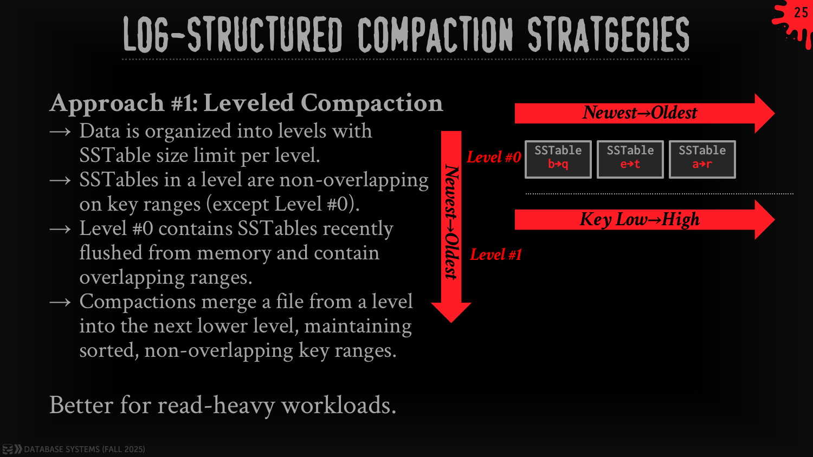

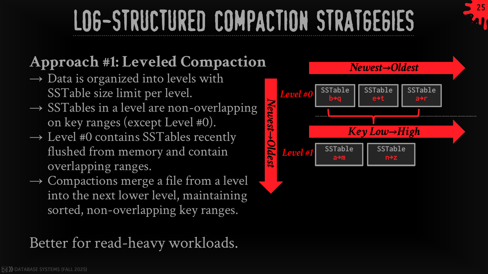

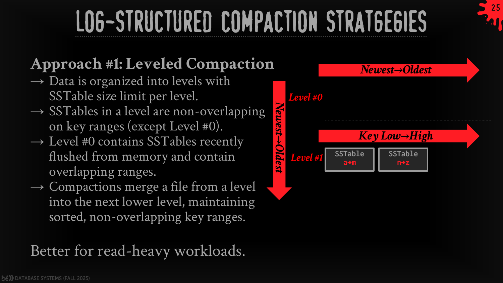


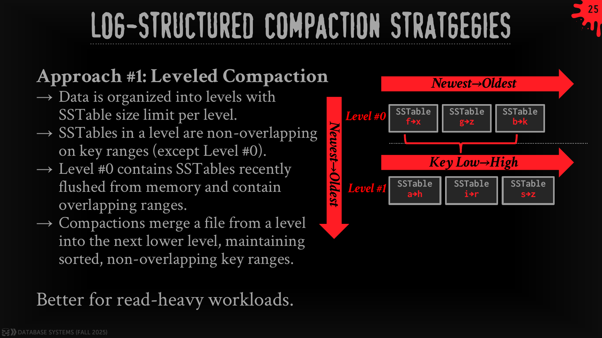

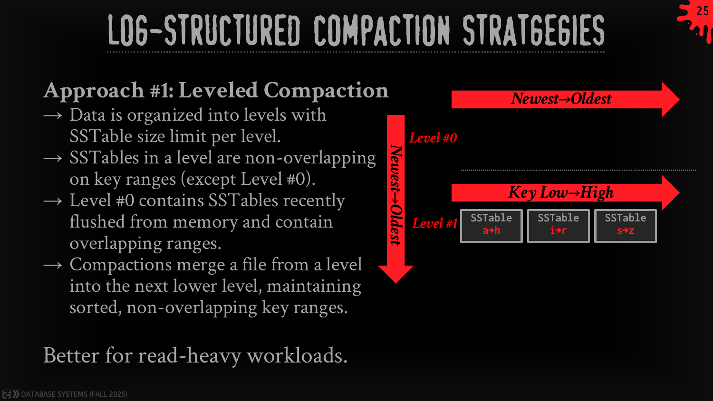

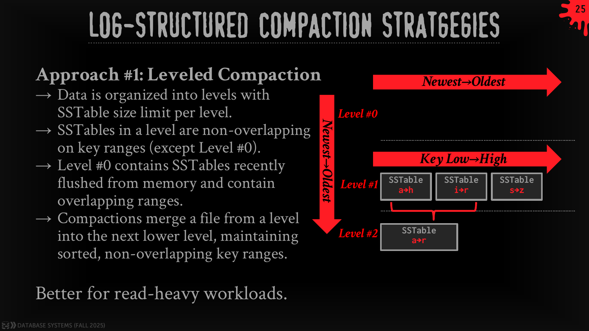

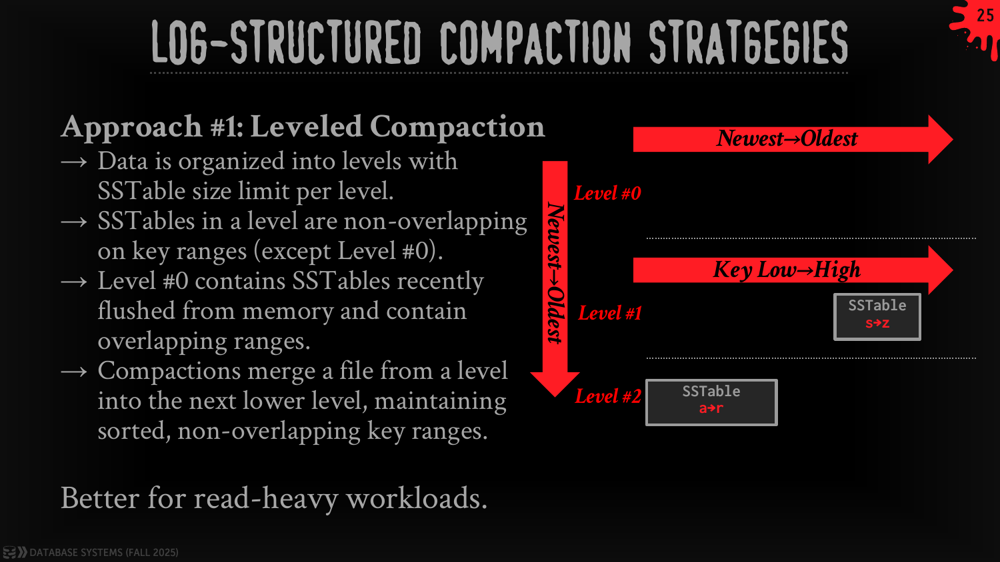


下面用键的首字母表示键范围，走一遍这个过程：

```text
① 第 0 层积累了三张刚落盘的 SSTable（从新到旧），键范围互相重叠
   Level #0 │ [a→r] [e→t] [b→q]
   Level #1 │

② 压实：三张归并后，按键范围切成两张互不重叠的 SSTable 写入第 1 层，第 0 层清空
   Level #0 │
   Level #1 │ [a→m] [n→z]

③ 第 0 层又积累了三张
   Level #0 │ [b→k] [g→z] [f→x]
   Level #1 │ [a→m] [n→z]

④ 再次压实：第 0 层的三张与第 1 层中所有与之重叠的 SSTable（这里是全部两张）一起归并
   Level #0 │
   Level #1 │ [a→h] [i→r] [s→z]

⑤ 第 1 层超过上限，把其中两张归并到第 2 层
   Level #0 │
   Level #1 │ [s→z]
   Level #2 │ [a→r]
```

这套规则换来的是读取的效率。找键 q 时，在第 0 层，[a→r]、[e→t]、[b→q] 三张的范围都包含 q，最坏情况下要从新到旧查完三张；到了第 1 层（第 ④ 步之后），只有 [i→r] 可能含有 q。从第 1 层起，每一层至多只需要查一张 [SSTable](#SSTable)，再加上过滤器，大部分层连这一张都不用真的去读。同一个键当然可以同时出现在第 0 层和第 1 层，读取时按从上到下的顺序，上层的记录更新，先遇到的那条为准。所以[分层压实](#分层压实)更适合读多写少的负载。

第 ④ 步则暴露了它的代价。第 0 层的键可能落在第 1 层任何一张文件的范围里，于是第 1 层的文件很可能要全部重写一遍。Andy 举的例子是：第 1 层有 10 GB 数据时，一次[压实](#压实)就要读入 10 GB，再写出 10 GB。

关于层和文件的数量，还有几点细节。每张 [SSTable](#SSTable) 的大小有上限，归并的结果超过上限时就会切成多张，所以同一层可以有多张 [SSTable](#SSTable)，文件切成几张并不影响“互不重叠”这条性质。层数随数据量增长，可以配置一个最大值（RocksDB 默认最多 7 层），到了最大层数就不再加层，最底层的文件会变得很大。第 ⑤ 步只把两张归并到下一层，只是为了演示；一次归并多少文件是策略问题，归并得越激进，花在[压实](#压实)上的时间就越多，留给查询的就越少。

### 6.3 通用压实（Universal Compaction）

📍 *PPT 第 26 页*

**[通用压实](#通用压实)**（universal compaction）不分层，所有 [SSTable](#SSTable) 都放在同一个“通用”层里，按时间从新到旧排列，键范围可以重叠。当重叠的 [SSTable](#SSTable) 太多，或者大小超过阈值时，DBMS 挑出一组时间上相邻的 [SSTable](#SSTable)，合并成一张更大的 [SSTable](#SSTable)。例如，l→m、a→t、r→x 三张在时间上相邻、键范围大量重叠，合并成一张覆盖 a→x 的 [SSTable](#SSTable)；随后，最新的 c→y 与这张表再合并为 a→y，而更早的 a→q 始终不必重写。

每次[压实](#压实)只动一小组相邻的文件，没有“逐层下沉、每下沉一层就重写一次”的过程，同一条数据被重写的次数少得多，所以它更适合插入密集的负载。[SSTable](#SSTable) 保持着时间顺序，也适合面向时间的查询：比如记录房间温度的时间序列，通常只关心最近五分钟、十分钟的数据，而这些数据恰好都在最新的几张 [SSTable](#SSTable) 里。代价落在读的一侧：键范围互相重叠，查一个较老的键，可能要检查很多张 [SSTable](#SSTable)。

| | [分层压实](#分层压实) | [通用压实](#通用压实) |
|---|---|---|
| 组织方式 | 多层；从第 1 层起，每层内键范围互不重叠 | 单层；按时间排列，键范围可以重叠 |
| 一次[点查询](#点查询)最多检查 | 第 0 层的全部文件，加上其余每层一张 | 所有键范围包含该键的文件 |
| 数据被重写的次数 | 多：每下沉一层重写一次，还可能连带重写下一层的重叠文件 | 少 |
| 适合的负载 | 读多写少 | 插入密集、主要查询最近数据 |

这是计算机科学中典型的取舍：[分层压实](#分层压实)在写入时多花功夫，换取更快的读；[通用压实](#通用压实)让写入更轻快，读取可能慢一些，慢多少取决于要找的是什么。

## 7. 日志结构存储的代价与现状

📍 *PPT 第 27–28 页*

[日志结构存储](#日志结构存储)把写变成了顺序追加，但写到磁盘上的数据并不会就此安定下来。**[写放大](#写放大)**（write amplification）指一次逻辑上的写入，在[压实](#压实)过程中引起多次物理写入。一条[元组](#元组)即使只写过一次、此后再也没被修改，也会随着[压实](#压实)被一次次读进来、写出去，每下沉一层就被重写一遍。[^4] 相比之下，在[面向元组的存储](#面向元组的存储)中，一条元组写进[页](#页)、页刷回磁盘之后，只要它不再被修改，就不会被再写一次。

所以[日志结构存储](#日志结构存储)的代价可以归结为三点：读可能变慢；[压实](#压实)开销很大，要和前台查询争抢 CPU 与磁盘带宽；[写放大](#写放大)。换来的是快速的顺序写，以及对只追加存储的天然适配。

即便如此，[日志结构存储](#日志结构存储)在今天比过去几十年都更常见，很大程度上要归功于 RocksDB。RocksDB 是 Facebook（现在的 Meta）维护的 [LSM 树](#LSM%20树)键值存储引擎，由 Google 的 LevelDB 分叉而来，而 LevelDB 出自开发 Bigtable 的团队。两者的一个重要差别是，LevelDB 读取数据文件时默认使用 `mmap`，RocksDB 则默认不用 `mmap`，改用自己管理的块缓存（block cache），走的正是第 [4](../L04/index.md) 讲[缓冲池](#缓冲池)的路线。Andy 对这一改动的评价一如既往：`mmap` 就是垃圾，去掉它、换成缓冲池是理所当然的第一步。[^5] RocksDB 同时支持[分层压实](#分层压实)和[通用压实](#通用压实)，默认用[分层压实](#分层压实)。许多新系统起步时直接拿 RocksDB 当自己的[存储管理器](#存储管理器)，例如 CockroachDB，后来它又换成了自己编写的存储引擎 Pebble。
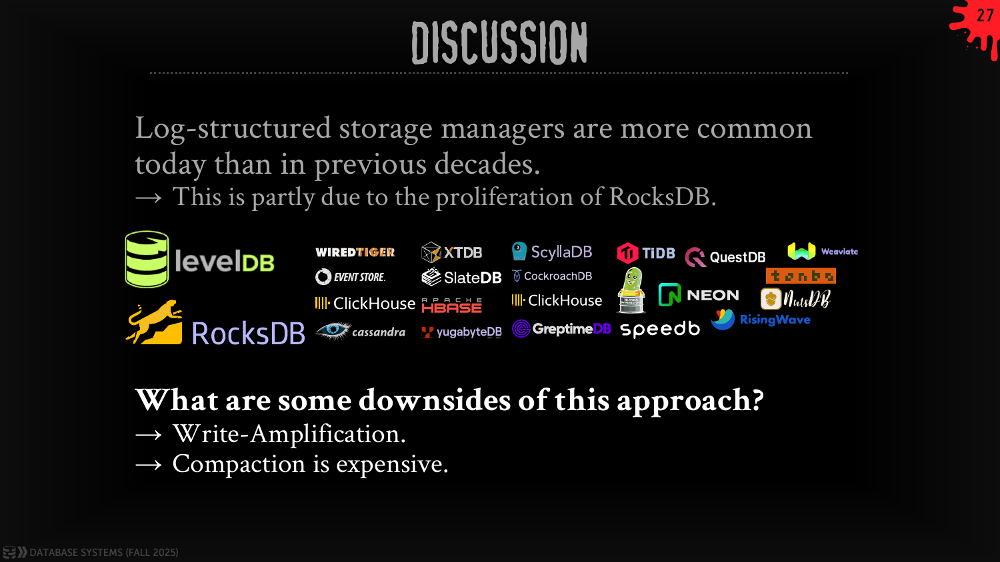


[日志结构存储](#日志结构存储)最适合写多读少的负载，但这并不意味着它一定不适合读多的负载。Andy 举了 ClickHouse 作为例子：它的存储同样是写入不可变的数据片段、再在后台合并，却以分析查询速度快著称。原因在于还有许多手段可以弥补读的劣势，其中最重要的一种就是下一讲的列存储。

最后把三种[页](#页)布局放在一起比较：

| | [面向元组的存储](#面向元组的存储) | [索引组织存储](#索引组织存储) | [日志结构存储](#日志结构存储) |
|---|---|---|---|
| [元组](#元组)放在哪里 | [堆文件](#堆文件)中任意有空位的[页](#页) | 索引的叶节点，按键有序 | [MemTable](#MemTable) 与各层 [SSTable](#SSTable)，文件内按键有序、文件间按新旧排列 |
| 按键查找 | 查索引得到[记录 ID](#记录%20ID)，再取堆文件中的页 | 沿树下降到叶节点即得 | 依次查 [MemTable](#MemTable) 和各层 [SSTable](#SSTable)，先命中的为准 |
| 更新 | 原地覆盖，放不下就删除后在别处插入 | 在所属叶节点内修改，可能引起节点分裂 | 追加一条 PUT |
| 删除 | 取出所在页，标记删除 | 在所属叶节点内删除 | 追加一条 DELETE（[墓碑](#墓碑)） |
| 主要代价 | [碎片](#碎片)、无用 I/O、随机 I/O | 维持有序：插入位置固定，分裂会移动元组 | 读要查多处，[压实](#压实)开销与[写放大](#写放大) |
| 例子 | PostgreSQL 的堆表 | SQLite、MySQL InnoDB | RocksDB、LevelDB |

这张表也说明，[存储管理器](#存储管理器)并不能和 DBMS 的其余部分完全分开。[索引组织存储](#索引组织存储)让表和索引合二为一，于是[二级索引](#二级索引)只能保存[主键](#主键)，而不是物理地址；[日志结构存储](#日志结构存储)的 [MemTable](#MemTable) 要靠预写日志保证持久，它“只写新版本、不改旧数据”的做法又和多版本并发控制十分相似；就连第 1 节的预取，也要求[缓冲池](#缓冲池)理解索引的结构。选定一种[页](#页)布局，会牵动索引、并发控制和恢复的设计。

## 小结

📍 *PPT 第 28–29 页*

[缓冲池](#缓冲池)的几处补充延续了第 [4](../L04/index.md) 讲的主线：查询计划里的信息可以直接用来决定[页](#页)放在哪个缓冲池、提前读哪些页、怎样让一次读盘服务多条查询，而这些都是只看得到文件偏移的操作系统做不到的。

[页](#页)布局则沿另一条线展开。[槽式页](#槽式页)的读依赖额外的索引，按键查找要先查索引、再回[堆文件](#堆文件)，于是有了把[元组](#元组)直接放进索引叶节点的[索引组织存储](#索引组织存储)，代价是插入位置固定、元组会随节点分裂移动。槽式页的写要原地修改，带来[碎片](#碎片)、无用 I/O 和随机 I/O，在只允许追加的存储上甚至行不通，于是有了只追加、不覆盖的[日志结构存储](#日志结构存储)：修改先进 [MemTable](#MemTable)，写满后顺序写成有序的 [SSTable](#SSTable)，读取按从新到旧的顺序查找，由[摘要表](#摘要表)和过滤器减少读盘，再靠[压实](#压实)合并旧版本、清理[墓碑](#墓碑)。它把写的代价转移给了读和[压实](#压实)，[分层压实](#分层压实)与[通用压实](#通用压实)只是在这两者之间选择不同的平衡点，[写放大](#写放大)则是两者都绕不开的开销。三种布局放在一起看，还可以看出[存储管理器](#存储管理器)并不是一个孤立的模块，它的选择会牵动索引、并发控制和恢复。

本讲出现的许多结构会在后面正式登场：B+ 树的分裂与合并在第 [8](../L08/index.md) 讲，布隆过滤器在第 [8](../L08/index.md)、[9](../L09/index.md) 讲，归并算法在第 [11](../L11/index.md)、[12](../L12/index.md) 讲，多版本在第 [20](../L20/index.md) 讲，预写日志在第 [21](../L21/index.md) 讲。到目前为止，我们始终假设一条[元组](#元组)的全部[属性](#属性)连续存放在一起。下一讲将推翻这个假设，讨论按列存放数据的列存储，以及随之而来的压缩技术。
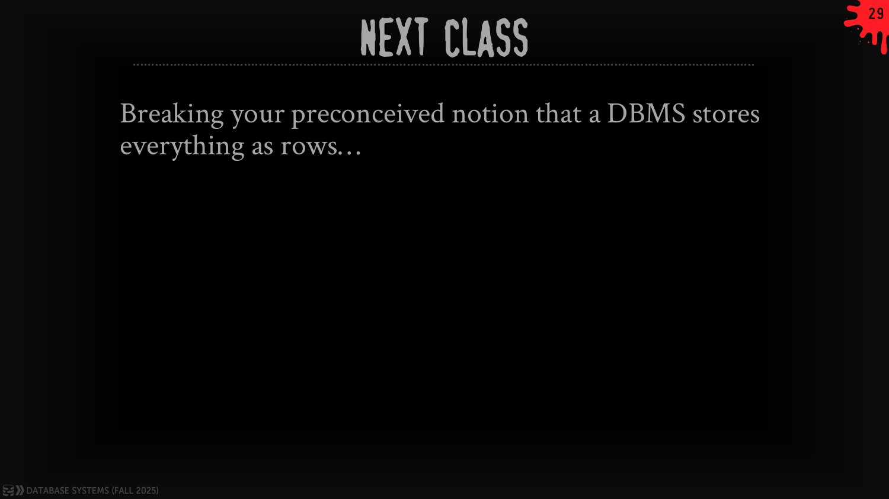


## 术语速查表

### 缓冲池

**Buffer Pool**：由定长帧组成的一大块内存，用来存放从磁盘读入的页。（本讲首次出现：摘要；引入于：第 3 讲）

### 扫描共享

**Scan Sharing**：多个查询共用同一个扫描游标，共享读页的 I/O。（本讲首次出现：摘要；引入于：第 4 讲）

### 页

**Page**：定长的数据块，数据库中一切数据的存放单位。（本讲首次出现：摘要；引入于：第 3 讲）

### 槽式页

**Slotted Page**：用槽数组记录元组页内偏移、元组从页尾向前存放的页布局。（本讲首次出现：摘要；引入于：第 3 讲）

### 记录 ID

**Record ID**：表示元组物理位置的唯一标识，如页 ID 加槽号。（本讲首次出现：摘要；引入于：第 3 讲）

### 堆文件

**Heap File**：页的无序集合，元组以任意顺序存放。（本讲首次出现：摘要；引入于：第 3 讲）

### 元组

**Tuple**：关系中的一个元素，即表中的一行。（本讲首次出现：摘要；引入于：第 1 讲）

### 面向磁盘的架构

**Disk-Oriented Architecture**：假定数据库主要存放在非易失磁盘上、由 DBMS 在磁盘与内存之间搬运数据的系统架构。（本讲首次出现：课程地图；引入于：第 3 讲）

### 数据库

**Database**：一组经过组织、相互关联、用来模拟现实世界某方面的数据。（本讲首次出现：课程地图；引入于：第 1 讲）

### 页目录

**Page Directory**：记录各数据库对象的页位置及空闲空间等元数据的特殊页。（本讲首次出现：课程地图；引入于：第 3 讲）

### 持久性

**Durability**：已写入的数据能在故障中保存下来。（本讲首次出现：课程地图；引入于：第 1 讲）

### 连续扫描共享

**Continuous Scan Sharing**：持续不断地扫描某些表、让查询随时挂上和离开的学术原型。（本讲首次出现：1；引入于：本讲）

### 闩

**Latch**：保护内部数据结构临界区、在一次操作期间持有的底层原语。（本讲首次出现：1；引入于：第 4 讲）

### 页 ID

**Page ID**：页的唯一标识，经间接层映射到文件和偏移。（本讲首次出现：1；引入于：第 3 讲）

### 谓词

**Predicate**：对每个元组得出真或假的条件。（本讲首次出现：1；引入于：第 1 讲）

### 帧

**Frame**：缓冲池中能放一页的位置。（本讲首次出现：1；引入于：第 3 讲）

### 面向元组的存储

**Tuple-Oriented Storage**：把元组存进槽式页、就地修改的页布局。（本讲首次出现：2；引入于：本讲）

### 属性

**Attribute**：关系中的一个命名分量，即表中的一列。（本讲首次出现：2；引入于：第 1 讲）

### 溢出页

**Overflow Page**：存放元组中过大属性值的独立页。（本讲首次出现：2；引入于：第 3 讲）

### 分区

**Partitioning**：把一张逻辑表物理上拆成若干张子表存放。（本讲首次出现：2.1；引入于：[第 02 讲](../L02/index.md)）

### 页头

**Page Header**：页开头记录页大小、校验和等元数据的区域。（本讲首次出现：2.1；引入于：第 3 讲）

### 校验和

**Checksum**：由页内容算出的值，用于检测页是否损坏。（本讲首次出现：2.1；引入于：第 3 讲）

### 槽数组

**Slot Array**：从槽号到元组起始偏移的映射。（本讲首次出现：2.1；引入于：第 3 讲）

### 主键

**Primary Key**：唯一标识关系中一个元组的属性或属性组合。（本讲首次出现：2.1；引入于：第 1 讲）

### 点查询

**Point Query**：按键查找单条记录的查询。（本讲首次出现：2.2；引入于：第 4 讲）

### 索引组织存储

**Index-Organized Storage**：把元组直接作为索引叶节点中的值存放，表与索引合一。（本讲首次出现：3；引入于：本讲）

### 二级索引

**Secondary Index**：表上主键索引以外的其他索引。（本讲首次出现：3；引入于：本讲）

### 碎片

**Fragmentation**：页内因空洞、空槽等原因无法利用的空间。（本讲首次出现：4；引入于：本讲）

### 页内整理

**Compaction**：在页内移动元组以合并空闲空间。（本讲首次出现：4；引入于：第 3 讲）

### 日志结构存储

**Log-Structured Storage**：只追加 PUT/DELETE 记录、从不原地修改的页布局。（本讲首次出现：5.1；引入于：本讲）

### LSM 树

**Log-Structured Merge Tree**：由 MemTable 和分层 SSTable 组成的日志结构存储结构。（本讲首次出现：5.1；引入于：本讲）

### MemTable

**MemTable**：内存中先接收所有修改的有序数据结构。（本讲首次出现：5.1；引入于：本讲）

### SSTable

**Sorted String Table**：MemTable 写满后落盘形成的按键有序、不可修改的文件。（本讲首次出现：5.1；引入于：本讲）

### 墓碑

**Tombstone**：表示某个键已被删除、用来盖住旧值的 DELETE 记录。（本讲首次出现：5.3；引入于：本讲）

### 盲写

**Blind Write**：不需要先读出旧值的写入。（本讲首次出现：5.3；引入于：本讲）

### 摘要表

**SummaryTable**：内存中记录各 SSTable 键范围和各层键过滤器的元数据。（本讲首次出现：5.4；引入于：本讲）

### 键过滤器

**Key Filter**：快速判断某个键是否可能在某一层的结构，如布隆过滤器。（本讲首次出现：5.4；引入于：本讲）

### 压实

**Compaction**：把多张 SSTable 归并成新文件、每个键只保留最新记录。（本讲首次出现：6.1；引入于：本讲）

### 后台写

**Background Writing**：定期把脏页提前写回磁盘，让淘汰时多是干净页。（本讲首次出现：6.1；引入于：第 4 讲）

### 分层压实

**Leveled Compaction**：多层组织、第 1 层起每层键范围互不重叠的压实策略。（本讲首次出现：6.2；引入于：本讲）

### 通用压实

**Universal Compaction**：单层按时间排列、合并时间上相邻文件的压实策略。（本讲首次出现：6.3；引入于：本讲）

### 写放大

**Write Amplification**：一次逻辑写入在压实中引起多次物理写入。（本讲首次出现：7；引入于：本讲）

### 存储管理器

**Storage Manager**：维护数据库文件、把文件组织成页并追踪空闲空间的组件。（本讲首次出现：7；引入于：第 3 讲）

[^1]: 原话：“It can't do anything more sophisticated because it doesn't know what's in these pages, doesn't know how they're related to each other.”

[^2]: 原话：“So if I can run two queries, or satisfy two queries' operations, for one single page fetch, that's a huge win for us.”

[^3]: 原话：“There's not a sort of one-size-fits-all solution to determine when you should trigger a compaction.”

[^4]: 原话：“We do one update to a single tuple, and even though we never update it ever again, we're going to read it in, write it out, read it in, write it out over and over again, multiple times because of the compaction process.”

[^5]: 原话：“The very first thing they did was get rid of mmap because it's garbage, and switch to a buffer pool manager the same way that we talked about last class.”

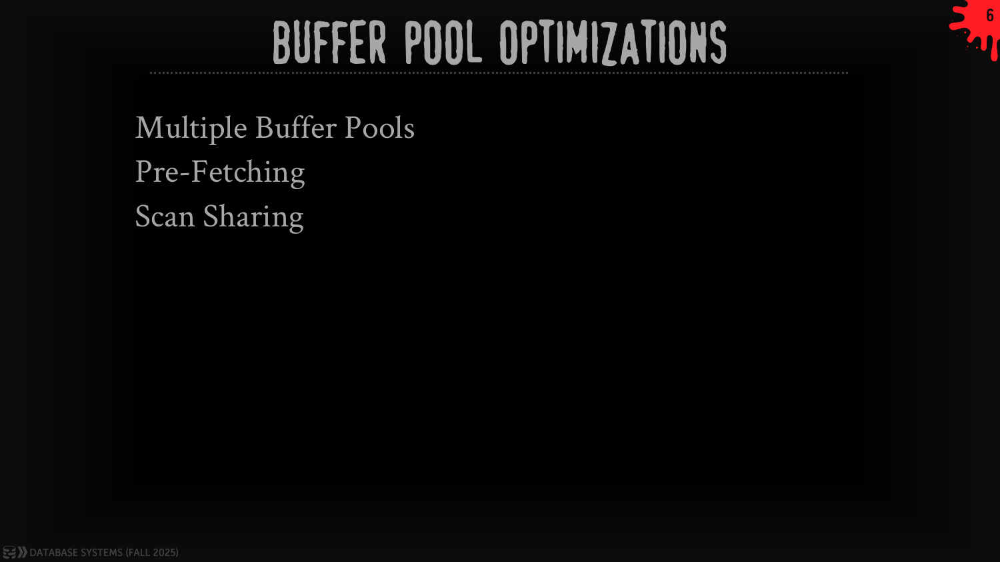

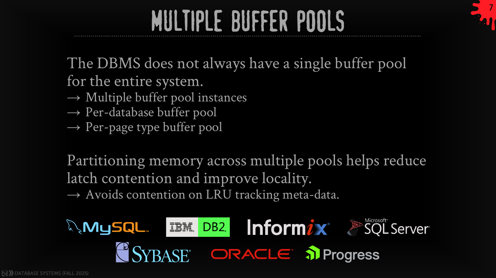

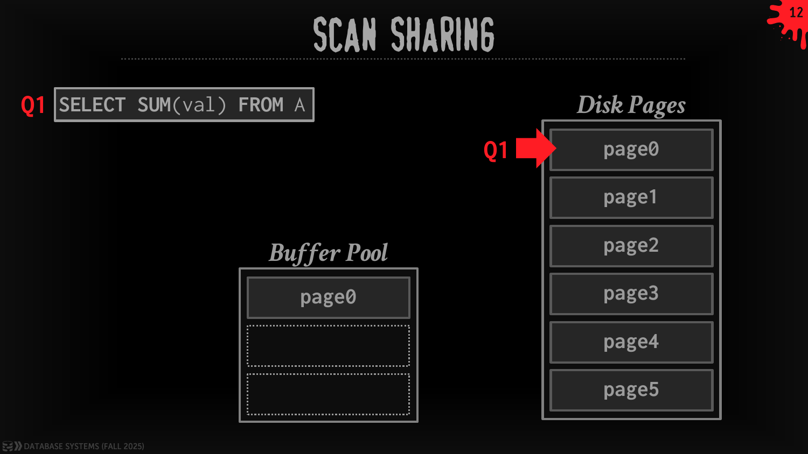

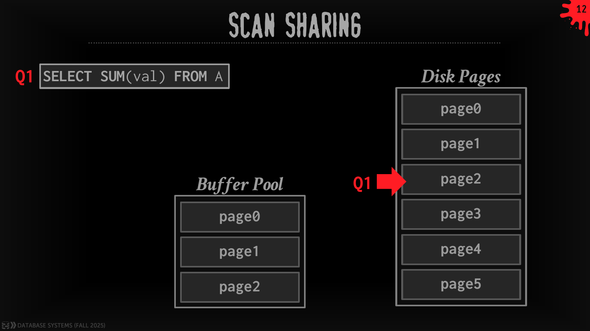

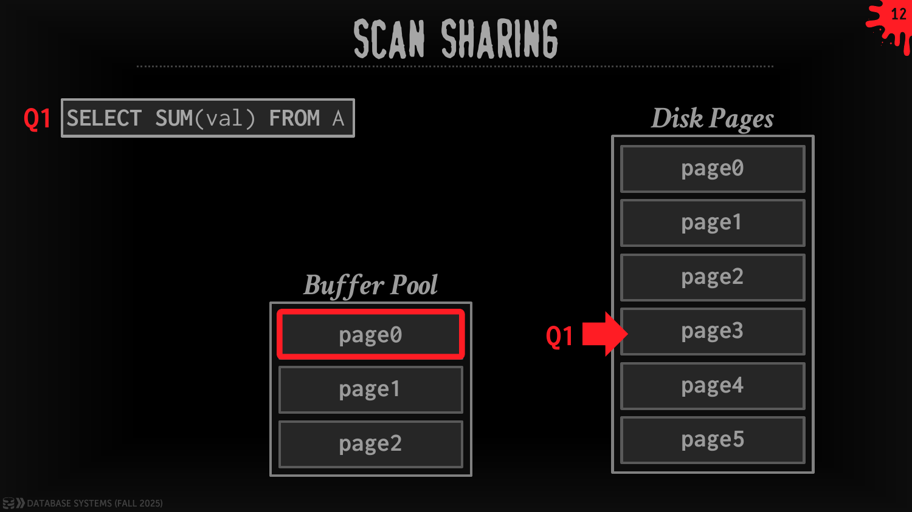


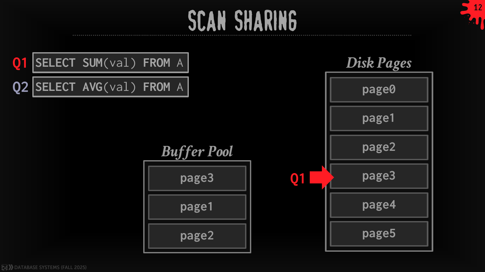

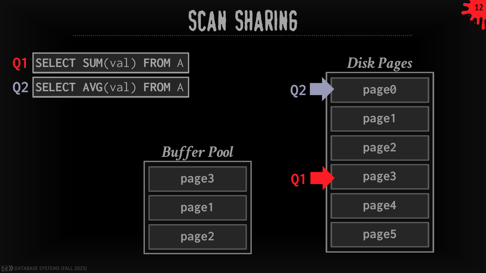


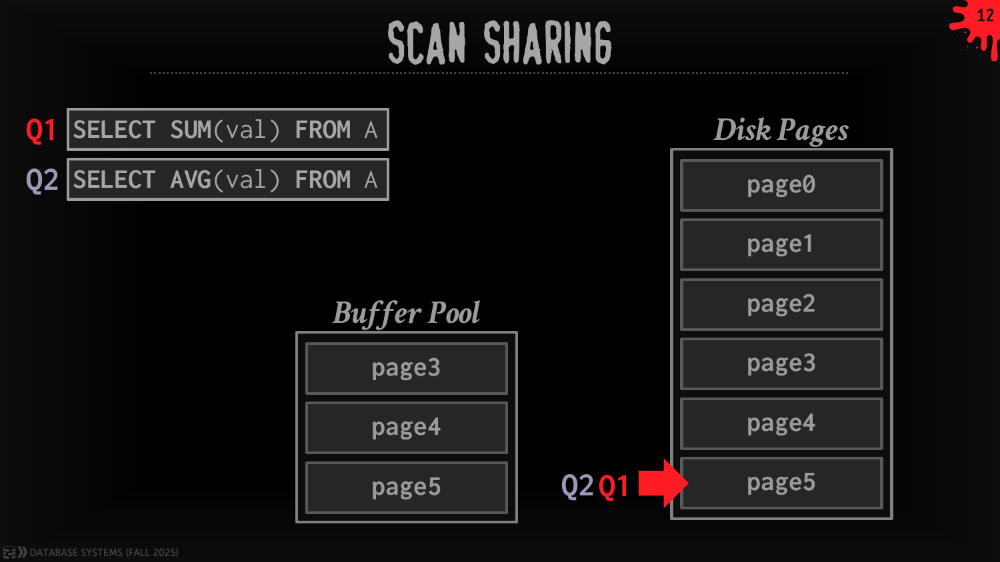

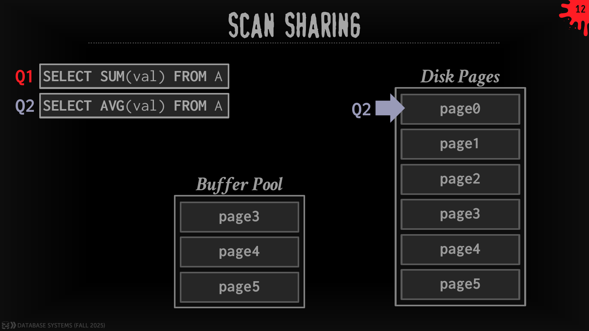

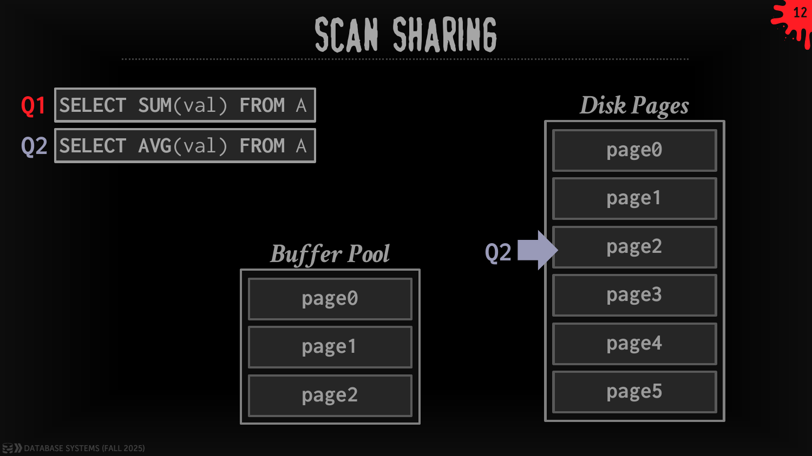


<details>
<summary>📎 本讲未被 📍 标注的幻灯片（共 12 页：封面、目录与行政页）</summary>


</details>
