# CMU 15-445 第 [06](index.md) 讲：存储模型与压缩（Storage Models & Compression）

> **课程**：CMU 15-445/645 Database Systems（Fall 2025）· **主讲**：Andy Pavlo
> **课程主页**：https://15445.courses.cs.cmu.edu/fall2025/
> **材料**：课件 PPT、官方 Lecture Notes、课堂录音转写稿
> **说明**：正文以 PPT 与 Lecture Notes 为准。讲者原话的中文为意译，英文原文见脚注，依据课堂录音转写整理，已修正明显的语音识别错误。文中“📍 PPT 第 X 页”指幻灯片右上角印的编号；本讲课件的编号从第 46 页直接跳到第 48 页，没有第 47 页。

## 摘要（Abstract）

一张表在逻辑上是一组[元组](#元组)，在物理上却可以有截然不同的摆法。第 3 到第 [5](../L05/index.md) 讲的各种页面布局都默认一个元组的[属性](#属性)挨在一起存放，这正合[联机事务处理](#联机事务处理)（[OLTP](#联机事务处理)）的需要：每次只读写一两个实体，要的就是整行。[联机分析处理](#联机分析处理)（[OLAP](#联机分析处理)）的查询却要扫过大半张表，只用其中几列，[行存储](#行存储)会把大量无关的列一起读进内存。

按列存放（[列存储](#列存储)）解决了这个问题，又带来两个新问题：拆开的[元组](#元组)怎样拼回来，变长的值怎样放进定长的数组。前者催生了先按行分组、组内再按列存放的 [PAX](#PAX) 布局，Parquet、ORC 等文件格式都属于这一类；后者把压缩推到了台前。列式布局让同一值域的值排在一起，为压缩创造了条件；而通用压缩算法对[数据库](#数据库)而言是黑盒，读取之前必须先解压，于是数据库需要一组自己掌控的列式编码，包括[游程编码](#游程编码)、[位打包](#位打包)、[位图编码](#位图编码)、[差值编码](#差值编码)和[字典编码](#字典编码)，让查询能直接在压缩数据上执行。最后，数据诞生于 [OLTP](#联机事务处理) 系统，却要在 [OLAP](#联机分析处理) 系统上分析，行与列要么分属两套系统、用 [ETL](#抽取—转换—加载) 连接，要么在同一个系统中按数据的冷热分工。

读完本讲，你应该能够：判断一个查询属于哪类[工作负载](#工作负载)，估算它在[行存储](#行存储)和[列存储](#列存储)下各要读多少数据；说出 Parquet 这类文件内部“文件—[行组](#行组)—[列块](#列块)—[页](#页)”的层次和读取路径；针对一列数据的特点选择合适的编码，并算出压缩后的大小；解释[字典编码](#字典编码)为什么最常用、为什么要保序，以及它怎样把字符串条件变成整数比较。

## 课程地图

本讲是“存储”阶段的最后一讲。第 3 到第 [5](../L05/index.md) 讲讨论的是单个[元组](#元组)怎样放进[页](#页)、页怎样在磁盘和内存之间移动；这一讲把视角拉到整张表：一张表的数据应该按行存放还是按列存放，存放之前能不能先压缩。


第 [5](../L05/index.md) 讲介绍的两种布局各解决一头：[日志结构存储](#日志结构存储)偏向写路径，[索引组织存储](#索引组织存储)换来的则是按[主键](#主键)的有序扫描（读路径，见第 [5](../L05/index.md) 讲 §4）；但两者都保留着“[元组](#元组)按行存放”这个前提。可是现实中的查询大多是读查询，其中有一类要扫过大量数据做统计，在第 [3](../L03/index.md) 讲以来的所有页面布局下都跑得很慢。本讲从这类查询出发，会反复用到第 [3](../L03/index.md) 讲的[槽式页](#槽式页)（slotted page）、[记录 ID](#记录%20ID)、[元组头](#元组头)部里的[NULL 位图](#NULL%20位图)和[溢出页](#溢出页)，以及第 [4](../L04/index.md) 讲的[缓冲池](#缓冲池)（buffer pool）：把一[页](#页)读进缓冲池是有代价的，读进来的内容里有多少真正有用，决定了这份代价花得值不值。
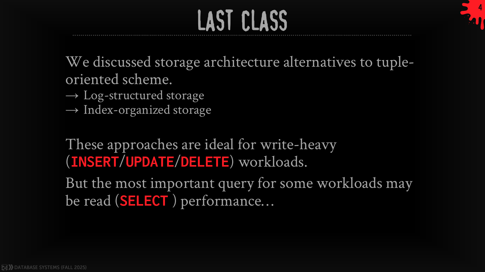


本讲的结论在后面还会反复出现。第 [8](../L08/index.md)、[9](../L09/index.md) 讲的索引负责在[行存储](#行存储)中快速定位单个[元组](#元组)，B+ 树节点内的键压缩也会用到本讲的编码思想；第 [13](../L13/index.md)、[14](../L14/index.md) 讲的查询执行会说明引擎怎样利用列式布局和压缩数据把 CPU 用满；第 [21](../L21/index.md) 讲的预写日志与本讲 InnoDB 压缩[页](#页)上的[修改日志](#修改日志)思路相通。

## 1. 布局的好坏取决于查询：[数据库](#数据库)[工作负载](#工作负载)（Workloads）

📍 *PPT 第 6–8、10–11 页*

要比较哪种数据布局更好，先得说清楚“对什么样的查询更好”。一个应用发给[数据库](#数据库)的查询有什么样的整体特征：读多还是写多，每次涉及多少数据，逻辑复杂还是简单，这些合起来称为它的**[工作负载](#工作负载)（workload）**。存储层的每一个设计决定，最终都要放到某种[工作负载](#工作负载)下去衡量。

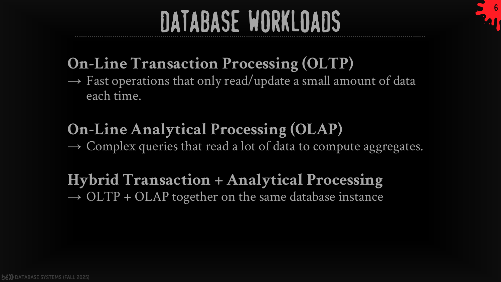


### 1.1 贯穿全讲的例子：维基百科

📍 *PPT 第 8 页*

维基百科使用的软件 MediaWiki 是开源的，用 PHP 编写，数据存放在 MySQL（后来换成了 MySQL 的分支 MariaDB）里，是世界上规模最大的 MySQL 部署之一。它的模式可以简化成三张表：
【test]
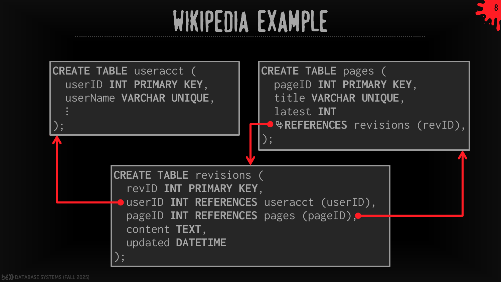


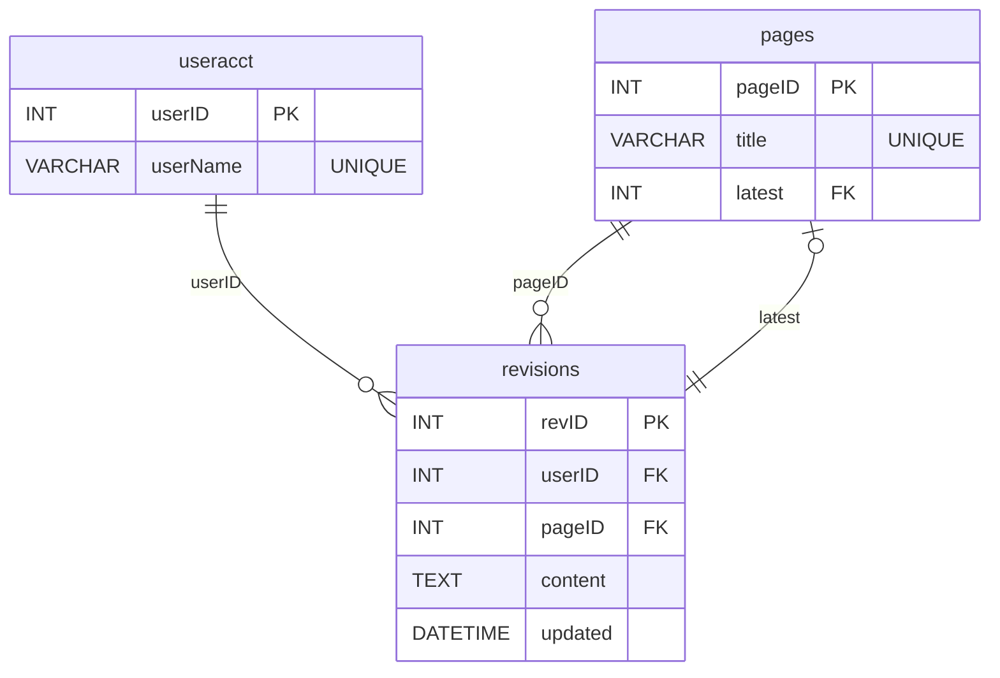

`useracct` 存放用户账号，建表语句中省略掉的列里，后面会用到 `userPass`（密码）、`hostname`（登录时的主机名）和 `lastLogin`（上次登录时间）。`pages` 存放词条，`revisions` 存放词条的每一个历史版本：谁在什么时候把哪个词条改成了什么内容。`pages.latest` 指向该词条的最新版本，`revisions.pageID` 又指回所属的词条，两张表的[外键](#外键)互相引用。真实的 MediaWiki 把版本正文放在另一张单独的表里，道理和第 [3](../L03/index.md) 讲把大字段移到[溢出页](#溢出页)一样：不让一个巨大的 `TEXT` 值撑大每一行。这里为了简洁，把 `content` 留在 `revisions` 中。

> 💬 **旁注**
> 几年前有人在维基百科上为 Andy 写了个人词条，其中一句说他“在巴尔的摩的街头出生、长大”。维基百科的编辑认为“在街头”这种说法不够百科，把它标记了出来，词条几经标记后被撤下。从那以后，大约每隔三个月就有人给他发邮件，声称只要付钱就能帮他把词条写出来。Andy 借此在课上郑重澄清：他确实生在巴尔的摩，但不是生在街头。
>
> *原话：“Was I born in Baltimore? Yes. Was I born in the streets of Baltimore? No.”*

### 1.2 [联机事务处理](#联机事务处理)（OLTP）：每次只碰一个实体

📍 *PPT 第 6、10 页*

**[联机事务处理](#联机事务处理)（On-Line Transaction Processing，[OLTP](#联机事务处理)）**负载由大量快速、简单的操作组成，每次只读取或更新少量数据，这些数据通常属于[数据库](#数据库)里的同一个实体：一个用户、一个订单、一个词条。在 Reddit 上发一条评论，数据库要存下的只是用户名、时间戳和评论正文；在 Amazon 上把一件商品放进购物车，要写的也只是用户账号、时间戳、商品编号和数量。单次操作的数据量很小，但操作的次数极多，而且每一次都要求很快返回。一个新应用上线时，最先建起来的几乎都是这种系统，它负责从外部世界收集新数据。

维基百科里的 [OLTP](#联机事务处理) 查询是这样的：

```sql
SELECT P.*, R.*
  FROM pages AS P
 INNER JOIN revisions AS R
    ON P.latest = R.revID
 WHERE P.pageID = ?

UPDATE useracct
   SET lastLogin = NOW(),
       hostname = ?
 WHERE userID = ?

INSERT INTO revisions
VALUES (?,?…,?)
```

其中的 `?` 是参数占位符，应用程序在运行时把具体的值填进去。第一条查询读取某个词条及其最新版本，第二条在用户登录时记下登录时间和主机名，第三条插入一个新版本。前两条都通过[主键](#主键)定位，主键上有索引，查找几乎一步到位；它们最多涉及两个[元组](#元组)，第三条只写一个元组。

与 [OLAP](#联机分析处理) 相比，[OLTP](#联机事务处理) 负载通常写多于读：来自外部世界的新数据几乎全部要经由 [OLTP](#联机事务处理) 系统写入。这并不是说 [OLTP](#联机事务处理) 系统里没有读，上面第一条查询就是读，只是每次读的范围都很小。

### 1.3 联机分析处理（OLAP）：一次扫过大半张表

📍 *PPT 第 6、11 页*

[OLTP](#联机事务处理) 系统积累了足够多的数据之后，人们会想从中提炼新的知识。**[联机分析处理](#联机分析处理)（On-Line Analytical Processing，[OLAP](#联机分析处理)）**负载由复杂的只读查询组成，它们读取[数据库](#数据库)的大部分内容，跨越大量实体计算聚合值。还是以 Amazon 为例：每一笔订单只是一个用户买了一件商品，但把所有用户的所有订单放在一起，就能回答“9 月里气温超过某个值的日子，匹兹堡卖得最多的是哪件商品”，也能据此给不同的用户推送不同的个性化广告。这类查询通常要[连接](#连接)多张表、分组聚合、使用[窗口函数](#窗口函数)，也就是第 [2](../L02/index.md) 讲里那些较复杂的 SQL。

维基百科上的一个 [OLAP](#联机分析处理) 查询：

```sql
SELECT COUNT(U.lastLogin),
       EXTRACT(month FROM U.lastLogin) AS month
  FROM useracct AS U
 WHERE U.hostname LIKE '%.gov'
 GROUP BY EXTRACT(month FROM U.lastLogin)
```

`LIKE '%.gov'` 匹配所有以 `.gov` 结尾的主机名，`%` 代表任意长度的任意字符串；`EXTRACT(month FROM ...)` 从时间戳中取出月份。整条查询统计每个月有多少次登录来自美国政府网络。这个问题有现实背景：2006 年，人们发现美国国会的工作人员在用国会的网络修改议员本人的维基百科词条，删去负面内容，换上办公室自己写的溢美之词，事情正是通过追查编辑来源的 IP 地址曝光的。

这条查询和上一节的三条有一个根本区别：`WHERE` 条件没有指向任何一个具体的实体。[数据库](#数据库)事先不知道哪些用户的主机名以 `.gov` 结尾，只能把每一个用户的 `hostname` 都看一遍。

### 1.4 两个维度：读写倾向与操作复杂度

📍 *PPT 第 6–7 页*

把两类负载放在两个维度上比较，界限就清楚了。横轴是[工作负载](#工作负载)的侧重，从写密集到读密集；纵轴是单个操作的复杂度，从简单到复杂。这张图出自 Michael Stonebraker：

| | 写密集 | 读密集 |
|---|---|---|
| **复杂** | | [OLAP](#联机分析处理) |
| **简单** | [OLTP](#联机事务处理) | |

“复杂度”不是一个能精确测量的量，粗略地说，要看一条查询[连接](#连接)了几张表、有没有聚合和 `GROUP BY`、嵌套了几层子查询。`SELECT * FROM useracct WHERE userName = 'Andy'` 靠一次索引查找就能拿到结果，是典型的简单操作。

图的中间地带还有第三类负载：**[混合事务/分析处理](#混合事务/分析处理)（Hybrid Transaction + Analytical Processing，[HTAP](#混合事务/分析处理)）**，指在同一个[数据库](#数据库)实例上同时承担 [OLTP](#联机事务处理) 和 [OLAP](#联机分析处理)：一边高速写入新数据，一边在这些数据上做分析，而且分析不拖慢写入。这是许多厂商追求的目标，SingleStore、TiDB 都在朝这个方向努力。Andy 对它的评价比较保守：[HTAP](#混合事务/分析处理) 系统往往成败参半，因为它常常既不是最好的 [OLTP](#联机事务处理) 系统，也不是最好的 [OLAP](#联机分析处理) 系统。[^1] 在大公司里，关心事务处理的团队会挑最好的 [OLTP](#联机事务处理) 系统，关心分析的团队会挑最好的 [OLAP](#联机分析处理) 系统，两边各选各的。

[^1]: 原话：“This one is going to be a bit hit or miss because oftentimes it isn't the best OLTP system and it isn't the best OLAP system.”

Andy 还谈到了近年兴起的 AI 类分析。[OLAP](#联机分析处理) 回答的是“发生了什么”，比如某一天匹兹堡卖得最多的是哪件商品；AI 类分析进一步追问“为什么”，比如这件商品为什么在这一天、在这一人群中卖得好。在他看来，这类负载的数据访问特征与 [OLAP](#联机分析处理) 足够相似，不必单列一类；它依赖的向量索引属于索引的话题，后面讲索引时（第 [8](../L08/index.md)、[9](../L09/index.md) 讲）会涉及。

你可能会问：既然两类负载差别这么大，是否应该给它们各配一个系统？如果分开，新数据怎样从一个系统流到另一个系统；如果合一，一个系统又怎样同时照顾两边？答案取决于接下来要讲的[存储模型](#存储模型)，所以要等到第 9 节才能回答。

> 💬 **旁注**
> Andy 在课上把 [OLAP](#联机分析处理) 这个词和 Jim Gray 联系在一起。Jim Gray 是事务处理领域的奠基人，1998 年获得图灵奖，本课程后面要讲的两阶段锁等技术都和他有关；他也是 1996 年提出“数据立方体（Data Cube）”算子的论文的第一作者，这篇论文是 [OLAP](#联机分析处理) 查询的重要基础。2007 年初，他独自驾船出海后失踪，搜寻行动甚至动用了卫星图像，最终没有找到他。
>
> 不过，“[OLAP](#联机分析处理)”这个词本身出自[关系模型](#关系模型)的提出者 E. F. Codd 在 1993 年发表的一份白皮书。白皮书由 Computerworld 刊出，其中的“[OLAP](#联机分析处理) 十二条准则”恰好贴合 Arbor Software 的产品 Essbase；后来人们发现 Codd 是受这家公司资助撰写的，Computerworld 随即撤回了这篇文章。Andy 在课上讲的“收钱写文章、事后被撤稿”的故事，史料记载的主角是 Codd。

## 2. [关系模型](#关系模型)不规定[元组](#元组)怎样摆放：存储模型（Storage Model）

📍 *PPT 第 9、12 页*

[关系模型](#关系模型)只规定数据在逻辑上是什么样子：一张表由若干[元组](#元组)组成，每个元组有若干[属性](#属性)。它没有要求一个元组的所有属性必须连续存放在同一个[页](#页)里。第 [3](../L03/index.md) 讲其实已经打破过这个默认：一个过大的 `TEXT` 值会被移到单独的[溢出页](#溢出页)（PostgreSQL 称之为 TOAST），原来的位置只留一个指针，查询时由 DBMS 顺着指针把元组拼回完整的样子，应用程序完全察觉不到。

那时这只是一个例外。对某些[工作负载](#工作负载)来说，“一个[元组](#元组)的[属性](#属性)挨在一起”本身就不是最好的布局。第 [1](../L01/index.md) 讲的[数据独立性](#数据独立性)在这里兑现了它的价值：应用程序照样用 `CREATE TABLE` 建表、用 SQL 查询，DBMS 在底下换一种物理组织，查询就能快起来，按 Andy 的说法，快的不是一星半点，而是几个数量级。[^2]

[^2]: 原话：“But underneath the covers, we can use one of these alternative storage models to come up with a more optimized scheme for our data to make queries run faster and not just a little bit faster. I mean, orders of magnitude faster.”

DBMS 的**[存储模型](#存储模型)（storage model）**规定了它在磁盘和内存中怎样物理地组织[元组](#元组)。不同的[存储模型](#存储模型)在不同的[工作负载](#工作负载)下性能差别很大，而且[存储模型](#存储模型)会影响 DBMS 其余部分的设计，从[执行引擎](#执行引擎)到压缩方式都要随之调整。常见的选择有三种：[N 元存储模型](#N%20元存储模型)（N-ary Storage Model，[NSM](#N%20元存储模型)），也就是[行存储](#行存储)；[分解存储模型](#分解存储模型)（Decomposition Storage Model，[DSM](#分解存储模型)），也就是[列存储](#列存储)；以及混合[存储模型](#存储模型) [PAX](#PAX)（Partition Attributes Across）。

熟悉 C 语言的读者可以把前两种想成“结构体数组”和“数组结构体”的区别：

```c
/* NSM: an array of structs, all fields of one row are adjacent */
struct user {
    int32_t userID;
    char    userName[32];
    char    userPass[32];
    char    hostname[32];
    int64_t lastLogin;
};
struct user rows[N];

/* DSM: a struct of arrays, all values of one column are adjacent */
struct user_columns {
    int32_t userID[N];
    char    userName[N][32];
    char    userPass[N][32];
    char    hostname[N][32];
    int64_t lastLogin[N];
};
```

要取出第 i 个用户的全部信息，`rows[i]` 一次就能拿到，数组结构体却要从五个数组里各取一个元素；要统计所有用户的 `lastLogin`，结构体数组每走一步都要跳过一百多字节的其他字段，数组结构体只需从头到尾扫一遍 `lastLogin[]`。这两句话几乎概括了[行存储](#行存储)和[列存储](#列存储)的全部取舍，下面两节把它们展开。

## 3. 行存储：N 元存储模型（NSM）

📍 *PPT 第 13–17 页*

### 3.1 一个[元组](#元组)的[属性](#属性)挨在一起

📍 *PPT 第 13–14 页*

在**[N 元存储模型](#N%20元存储模型)（N-ary Storage Model，[NSM](#N%20元存储模型)）**中，DBMS 把单个[元组](#元组)的（几乎）所有[属性](#属性)连续存放在同一个[页](#页)里，所以它也叫**[行存储](#行存储)（row store）**。“几乎”指的是上一节说的例外：放不下的大值去了[溢出页](#溢出页)。[NSM](#N%20元存储模型) 的页大小通常是 4 KB [硬件页](#硬件页)的整数倍，常见的是 4 KB、8 KB 或 16 KB。

第 [3](../L03/index.md) 讲的[槽式页](#槽式页)就是一种 [NSM](#N%20元存储模型) 布局：[页头](#页头)之后是[槽数组](#槽数组)（slot array），从前往后增长；[元组](#元组)从页尾往前写，每个元组带着自己的头部（记录[NULL 位图](#NULL%20位图)等元数据），后面紧跟它的定长和变长[属性](#属性)。下图是写入 6 个元组 `(a, b, c)` 之后的[页](#页)，`h` 表示[元组头](#元组头)部，`s0` 到 `s5` 是槽：

```text
page start                                                              page end
+--------+-----------------------+------------+-------------------------------+
| header | s0 s1 s2 s3 s4 s5 --> | free space | <-- ... h a1 b1 c1 h a0 b0 c0 |
+--------+-----------------------+------------+-------------------------------+
            slot array grows ->                   <- tuples grow from the end
```

每个[元组](#元组)由它的**[记录 ID](#记录%20ID)（record id）**唯一标识，记录 ID 由[页](#页)号和槽号组成：页号找到页，槽号找到槽，槽里存着元组在页内的偏移。

### 3.2 OLTP 查询：一次定位，一[页](#页)取全

📍 *PPT 第 15 页*

用户登录时，应用会执行：

```sql
SELECT * FROM useracct
 WHERE userName = ?
   AND userPass = ?
```

（这里比较的应当是应用程序算好的密码哈希值。[数据库](#数据库)里存明文密码，正是许多数据泄露事件的根源。）

DBMS 先查 `userName` 上的索引，得到目标[元组](#元组)的[记录 ID](#记录%20ID)。索引是第 [8](../L08/index.md)、[9](../L09/index.md) 讲的内容，此刻只需把它当成一张“键 → 记录 ID”的映射表，类似一个哈希表或一棵搜索树。拿到记录 ID 后，DBMS 通过[页目录](#页目录)（page directory，见第 [3](../L03/index.md) 讲）找到这一[页](#页)在[数据库](#数据库)文件中的位置，请[缓冲池](#缓冲池)把它读进内存，再按[槽数组](#槽数组)里的偏移跳到元组所在的位置。元组的五个[属性](#属性)全都在这里，读一个页就拿齐了查询需要的全部数据。

插入同样顺手。执行 `INSERT INTO useracct VALUES (?,?,…?)` 时，DBMS 通过[页目录](#页目录)找到一个还有空闲空间的[页](#页)，把它读进内存，把整个[元组](#元组)一次写进去。

[OLTP](#联机事务处理) 查询要的恰好是“一个实体的全部[属性](#属性)”，而 [NSM](#N%20元存储模型) 恰好把它们放在一起，[页](#页)的组织方式和查询的访问方式完全对齐。

### 3.3 OLAP 查询：读进来的大半是无用数据

📍 *PPT 第 16 页*

换成 1.3 节那条统计 `.gov` 登录的查询，情况就不同了。没有任何条件能把范围缩小到某几个[元组](#元组)，DBMS 只能把 `useracct` 的每一[页](#页)依次读进[缓冲池](#缓冲池)。对每个元组，先看 `hostname` 是否以 `.gov` 结尾；如果匹配，再读 `lastLogin`，取出月份，累加计数。

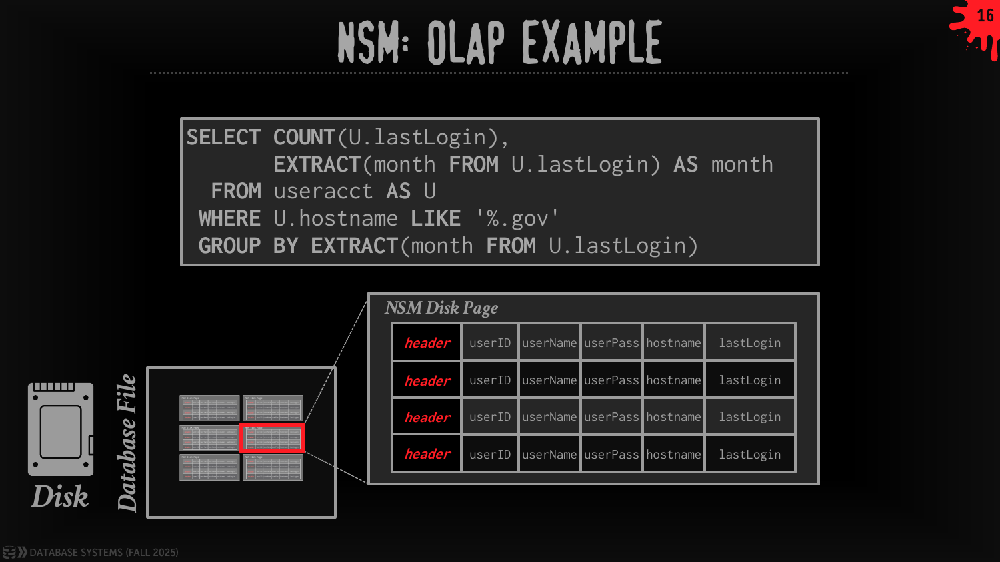

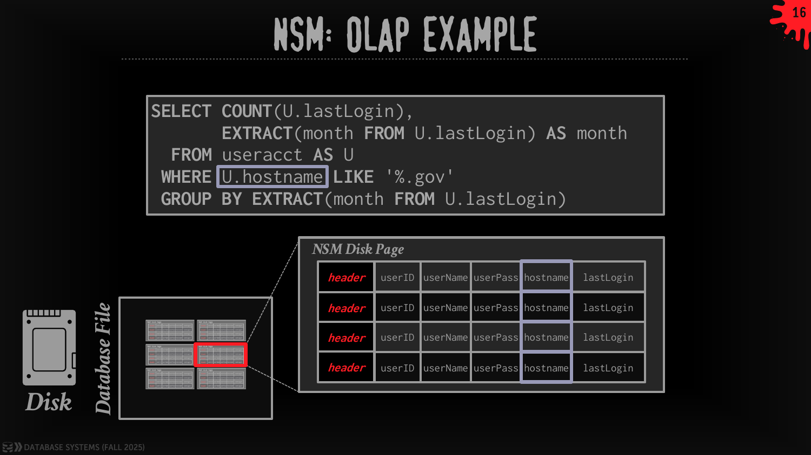

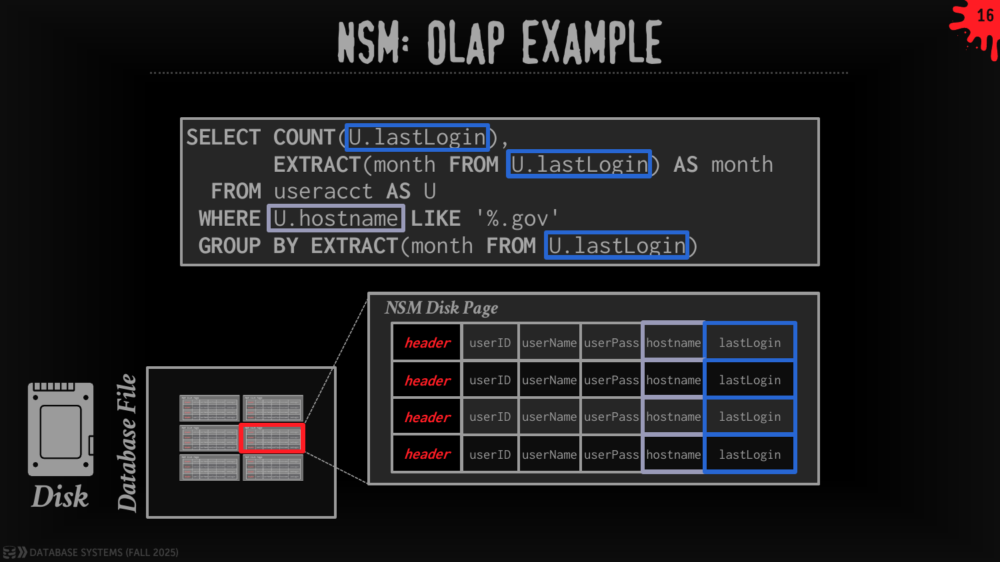


整个过程中，`userID`、`userName`、`userPass` 三列从头到尾没有用上，却和 `hostname`、`lastLogin` 一起被读进了内存，因为它们和有用的数据挤在同一个[页](#页)里。在[行存储](#行存储)中，I/O 的最小单位是页，页里装的是整行，要读一个[属性](#属性)就得把它所在的整行都带上。这些无用的数据还会占据[缓冲池](#缓冲池)的[帧](#帧)，把别的查询真正需要的页挤出去（第 [4](../L04/index.md) 讲）。

分析查询很少需要一行的全部[属性](#属性)。Andy 指出，分析查询里几乎见不到 `SELECT *`；即使要把整张表导出，也有比 `SELECT *` 更快的办法。

### 3.4 行存储的得与失

📍 *PPT 第 17 页*

[NSM](#N%20元存储模型) 的优点都和“整行”有关。插入、更新、删除都快；需要整个[元组](#元组)的查询，也就是 [OLTP](#联机事务处理) 查询，效率很高；它还可以配合第 [5](../L05/index.md) 讲的[索引组织存储](#索引组织存储)，按键把元组聚集存放，让一次[点查询](#点查询)只读一个[页](#页)。更进一步，可以把查询要用的列直接放进索引，查询只遍历索引就能得到结果，完全不必访问表本身，第 [8](../L08/index.md)、[9](../L09/index.md) 讲会再谈这一点。

缺点有三个。第一，扫描表的大部分内容、或者只用部分[属性](#属性)时效率很低，原因上一节已经说明。第二，访问模式的内存局部性差：扫描一列时，CPU 每处理一个值都要跳过一整行的其他属性。第三，一个[页](#页)里混杂着整数、字符串、时间戳等多种值域，不利于压缩，第 6 节还会回到这一点。

## 4. 列存储：分解存储模型（DSM）

📍 *PPT 第 18–23 页*

### 4.1 同一[属性](#属性)的值挨在一起

📍 *PPT 第 18–19 页*

**[分解存储模型](#分解存储模型)（Decomposition Storage Model，[DSM](#分解存储模型)）**把表中所有[元组](#元组)的同一个[属性](#属性)连续存放在一块数据里，所以也叫**[列存储](#列存储)（column store）**。这个模型由 George Copeland 和 Setrag Khoshafian 在 1985 年的论文《A Decomposition Storage Model》中系统地提出。它适合 [OLAP](#联机分析处理) 负载：只读查询对表的一部分属性做大范围扫描。代价是元组被拆开了，DBMS 要负责在写入时把元组拆成各列，在读取时再把它们拼回来。

物理上，[DSM](#分解存储模型) 为每个[属性](#属性)单独开辟[页](#页)。每个页有一个[页头](#页头)，存放关于整列的元数据，其中包括一张[NULL 位图](#NULL%20位图)（null bitmap）；页头之后，这一列的值依次排成一个定长值的数组：

```text
Page #1   | header | null bitmap |
          | a0 | a1 | a2 | a3 | a4 | a5 |

Page #2   | header | null bitmap |
          | b0 | b1 | b2 | b3 | b4 | b5 |

Page #3   | header | null bitmap |
          |  c0  |  c1  |  c2  |  c3  |  c4  |
          |  c5  |
```

和 [NSM](#N%20元存储模型) 对比一下：[NSM](#N%20元存储模型) 中每个[元组](#元组)都有自己的头部和自己的[NULL 位图](#NULL%20位图)，[DSM](#分解存储模型) 中一整列只需要[页头](#页头)里的一份。第 3 页的 `c` 值画得更宽，表示这一列的每个值都更长，一行排不下六个值，`c5` 只好另起一行；但它们仍然一样长。如果一列的值不仅长，而且长短不一，就会带来麻烦（4.4 节）。
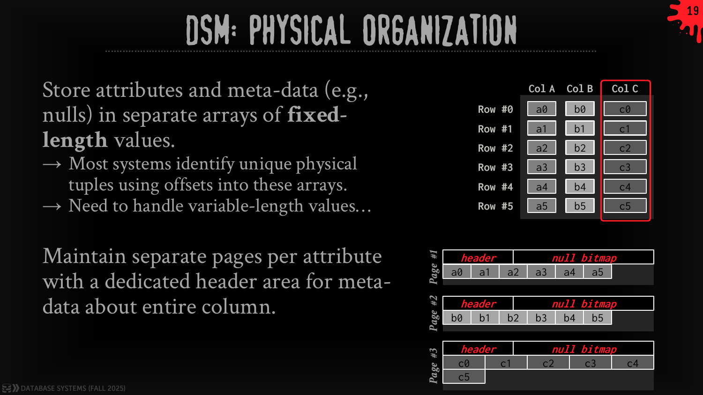


每一列的值宽度不同，每一列的[页](#页)大小是否也不同？不会。[缓冲池](#缓冲池)的[帧](#帧)大小是固定的，所有页必须一样大，DBMS 才不必在同一个缓冲池里拼凑不同尺寸的页；值宽的列只是占用的页多一些。分析型系统倾向于使用更大的页，常以 MB 计，5.3 节会看到 Parquet 的页默认是 1 MB。

### 4.2 同一个查询，换成列存储

📍 *PPT 第 20 页*

把 `useracct` 按 [DSM](#分解存储模型) 存放之后，[数据库](#数据库)文件里分别有 `userID`、`userName`、`userPass`、`hostname`、`lastLogin` 五组[页](#页)。执行 `.gov` 查询时，DBMS 先只把 `hostname` 列的页读进[缓冲池](#缓冲池)，页里清一色是主机名，逐个检查是否以 `.gov` 结尾，记下匹配值在列中的位置；然后把 `lastLogin` 列的页读进来，按记下的位置直接取出对应的时间戳，提取月份，分组计数。`userID`、`userName`、`userPass` 的页一个都没有碰。

能省下多少 I/O？下面做一次估算。假设 `useracct` 有 1 亿行，各列的平均宽度如下（这些数值是为演示而设的；[元组头](#元组头)部取 24 字节，接近 PostgreSQL 的实际大小）：

| 列               | 平均宽度 |
| --------------- | ---- |
| [元组头](#元组头)部    | 24 B |
| `userID`        | 4 B  |
| `userName`      | 16 B |
| `userPass`（哈希值） | 32 B |
| `hostname`      | 24 B |
| `lastLogin`     | 8 B  |


$$

\begin{aligned}
\text{NSM:}\quad & 10^8 \times (24+4+16+32+24+8)\ \text{B} = 10^8 \times 108\ \text{B} \approx 10.8\ \text{GB} \\
\text{DSM:}\quad & 10^8 \times (24+8)\ \text{B} = 10^8 \times 32\ \text{B} = 3.2\ \text{GB}
\end{aligned}

$$

[行存储](#行存储)每读一行，都要把[元组头](#元组头)部和五列一起读进来；[列存储](#列存储)只读 `hostname`（24 B）和 `lastLogin`（8 B）两列，读取量约为[行存储](#行存储)的 30%。这里还忽略了[页头](#页头)、[槽数组](#槽数组)和[页](#页)内的空隙，把它们算进来只会让[行存储](#行存储)更吃亏。这张表只有五列，真实系统中的表往往宽得多：一张 50 列、每列平均 8 字节的表，查询只用其中 2 列，[行存储](#行存储)每行读 400 字节，[列存储](#列存储)每行读 16 字节，相差 25 倍。再叠加后面要讲的压缩：如果 `hostname` 改用 4 字节的[字典编码](#字典编码)（8.6 节），这一列从 2.4 GB 降为 0.4 GB（另加一份相对很小的字典），上例中[列存储](#列存储)的总读取量就只有约 1.2 GB，约为[行存储](#行存储)的九分之一。列宽带来的倍数和压缩带来的倍数相乘，这就是 Andy 所说的“几个数量级”的来源。

### 4.3 怎样把一行拼回来：[元组](#元组)标识

📍 *PPT 第 21 页*

上一节里“按记下的位置取出对应的时间戳”这句话藏着一个问题：`hostname` 列的第 k 个值和 `lastLogin` 列的第 k 个值属于同一个[元组](#元组)，这件事靠什么保证？有两种做法。
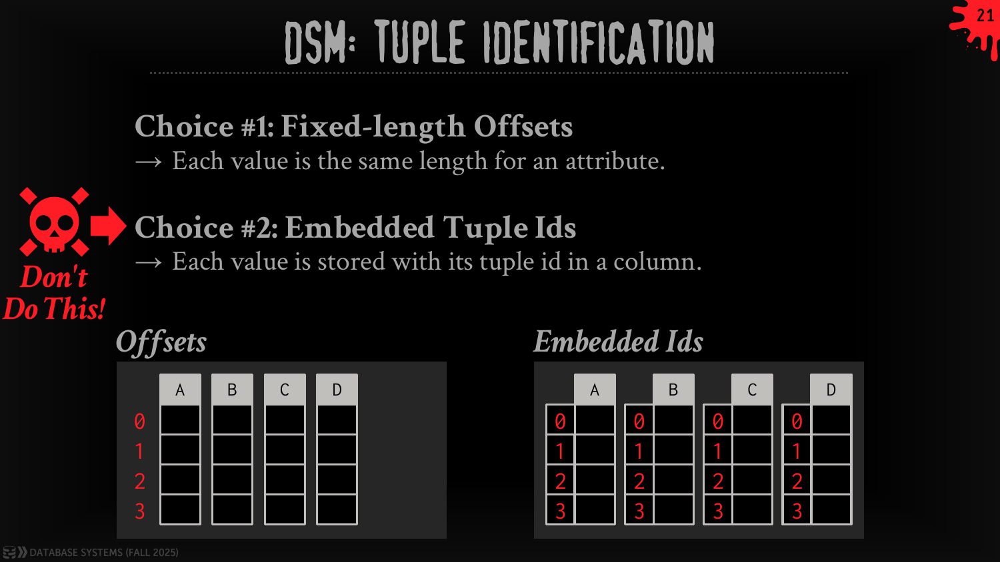


**[固定长度偏移](#固定长度偏移)（fixed-length offsets）**：同一[属性](#属性)的每个值都一样长，于是各列中第 i 个位置上的值天然属于第 i 个[元组](#元组)。找第 i 个值只需要一次乘法 `base + i × width`，和 C 语言里 `col[i]` 的寻址完全一样。大多数系统采用这种做法。

**[嵌入元组 ID](#嵌入元组%20ID)（embedded tuple IDs）**：每个值旁边都存一个[元组](#元组) ID（比如[主键](#主键)；这里是逻辑标识，不是第 [3](../L03/index.md) 讲[记录 ID](#记录%20ID) 意义上的物理地址），各列中的值可以长短不一，顺序也不必对齐，但系统还要维护一个额外的索引，记录每个元组 ID 在各列中的位置。

```text
Offsets                           Embedded Ids
     A    B    C    D                A         B         C         D
0  [  ] [  ] [  ] [  ]             [0|  ]    [0|  ]    [0|  ]    [0|  ]
1  [  ] [  ] [  ] [  ]             [1|  ]    [1|  ]    [1|  ]    [1|  ]
2  [  ] [  ] [  ] [  ]             [2|  ]    [2|  ]    [2|  ]    [2|  ]
3  [  ] [  ] [  ] [  ]             [3|  ]    [3|  ]    [3|  ]    [3|  ]
```

Andy 对第二种做法的态度非常明确：不要这样做。它坏在两处。每存一个值都要多存一个 ID，存储开销大增；而且值可以变长，扫描某一列找到匹配值之后，要去另一列取同一[元组](#元组)的值时，无法直接算出位置，只能再查一次索引。[固定长度偏移](#固定长度偏移)用一次乘法做到的事，这里要付出一次索引查找。

> 💬 **旁注**
> Andy 举的反面例子是 DATAllegro。这家公司在 2000 年代基于[行存储](#行存储)[数据库](#数据库) Ingres 构建数据仓库一体机，据 Andy 说，为了在[行存储](#行存储)之上做出[列存储](#列存储)的效果，它用的正是[嵌入元组 ID](#嵌入元组%20ID) 的办法。Microsoft 在 2008 年收购了 DATAllegro，Andy 认为这是一笔很不划算的买卖。
>
> *原话：“Somebody did try to do this. Don't do this. This is what DATAllegro did.”*

[固定长度偏移](#固定长度偏移)的前提是“每个值一样长”。整数、浮点数、时间戳天然满足这一点，字符串就不行了。

### 4.4 变长数据：压缩提前登场

📍 *PPT 第 22 页*

`VARCHAR` 列怎样放进定长数组？最直接的办法是填充：把 `VARCHAR(32)` 的每个值都补足 32 字节，短的值后面填空格。对长度差异大的[属性](#属性)，这会浪费大量空间，属性越大浪费越多。
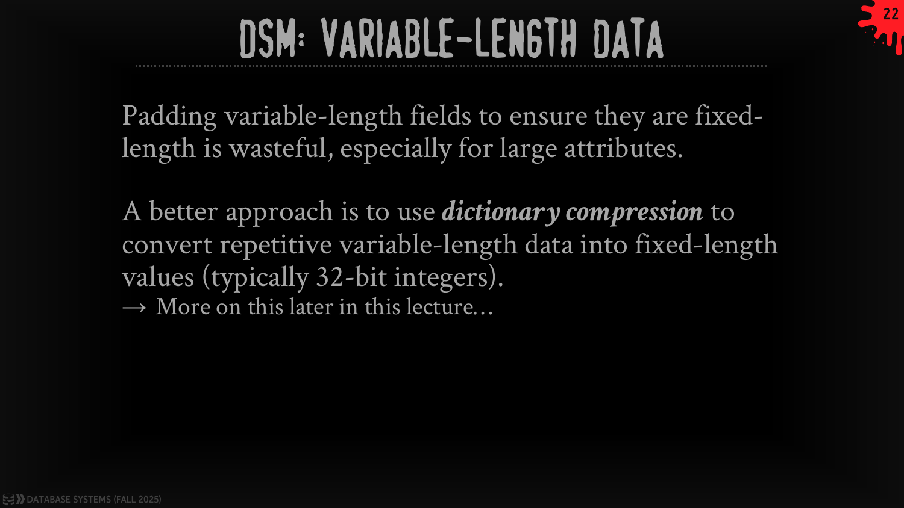


更好的办法是**字典压缩（dictionary compression）**：给每个不同的字符串分配一个定长的整数编码，通常是 32 位整数，列里只存编码，另外保存一张“编码 → 原值”的字典。这样一来，列又变回了定长数组，扫描时比较的是整数而不是字符串，速度也快得多。[字典编码](#字典编码)的细节在 8.6 节。

在[列存储](#列存储)中，压缩从一开始就是布局的一部分：没有[字典编码](#字典编码)，变长列就放不进[固定长度偏移](#固定长度偏移)的框架。

### 4.5 列存储的得与失

📍 *PPT 第 23 页*

[DSM](#分解存储模型) 的优点有三个。
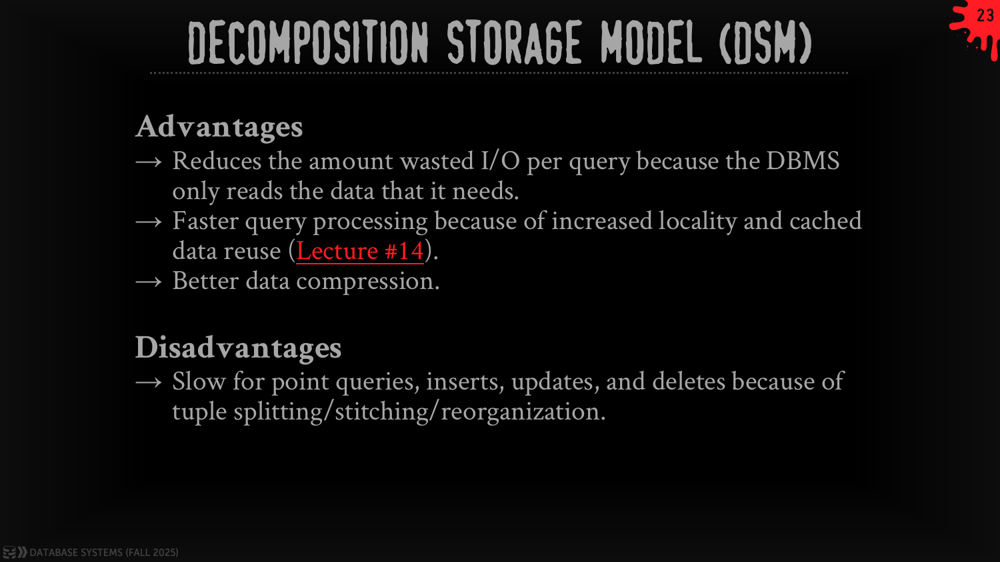


第一，每个查询浪费的 I/O 更少，DBMS 只读查询需要的[属性](#属性)，4.2 节已经算过。

第二，查询处理更快，因为数据的局部性更好，缓存中的数据能被反复利用（第 [14](../L14/index.md) 讲）。现代 CPU 像一条流水线那样执行指令：前一条指令还没做完，后面几条已经在准备。遇到 `if` 这样的分支，CPU 要猜下一步走哪条路，猜错了就得清空流水线重来。扫描一列同类型的值时，循环体简单、分支很少、数据一个挨一个，流水线可以一直满负荷运转；8.3 节还会看到，CPU 可以用一条指令同时处理一组相邻的值。

第三，压缩效果更好。同一个[页](#页)里的值来自同一个值域，彼此相似，重复也多。Andy 用了一个日常的对比：把一张 JPEG 图片交给 gzip，几乎压不下去，因为它已经压缩过，内容看起来接近随机；把一个塞满 0 的文本文件交给 gzip，压缩率高得惊人。一页温度读数更像后者，一页混杂着整数、字符串和浮点数的[行存储](#行存储)页更像前者。

缺点只有一条，却正好落在 [OLTP](#联机事务处理) 最在意的地方：[点查询](#点查询)、插入、更新、删除都慢，因为每次都要拆分、拼接或重新组织[元组](#元组)。一张 1000 列的表插入一行，就要写 1000 个不同的[页](#页)。

## 5. 折中方案：PAX

📍 *PPT 第 24–26 页*

### 5.1 纯列存储的软肋

📍 *PPT 第 24 页*

只访问一列的 [OLAP](#联机分析处理) 查询几乎不存在。查询执行到某个阶段，DBMS 总要取出其他列，把原来的[元组](#元组)拼回来。设想一张 10 亿行的表，过滤之后只剩 1000 行，但这 1000 行要输出五列。如果每一列存放在文件中完全独立的区域，这 1000 行的每一行都要到五个相距很远的地方各取一个值，扫描阶段省下的 I/O，在拼接阶段又以随机读的形式付了出去。

我们想要的布局是：数据仍然按列存放，保住[列存储](#列存储)在存储和执行上的好处；同时，同一个[元组](#元组)的各个[属性](#属性)在物理上彼此靠近，拼接时不必跑远。

### 5.2 先横切，再竖切：行组与列块

📍 *PPT 第 25–26 页*

**[PAX](#PAX)（Partition Attributes Across）**是一种混合[存储模型](#存储模型)，它在一个[数据库](#数据库)[页](#页)的内部按[属性](#属性)纵向划分数据。它出自 Anastassia Ailamaki、David DeWitt、Mark Hill 和 Marios Skounakis 在 VLDB 2001 上发表的论文《Weaving Relations for Cache Performance》，论文标题点明了当初的动机：CPU 缓存。原始的 [PAX](#PAX) 让每个页装的[元组](#元组)和 [NSM](#N%20元存储模型) 完全相同，只是在页内把每个属性的值集中到一个“小页”（minipage）里。扫描一个属性时，载入 CPU 缓存的全是有用的值；而一个元组的所有属性都还在同一个页里，拼回元组时不用离开这个页。
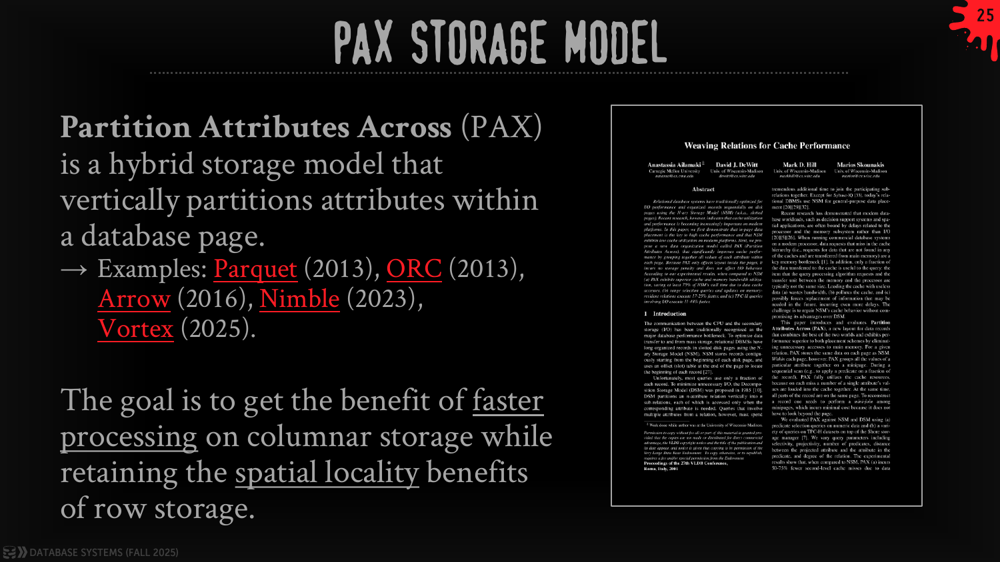


今天的列式文件格式把同样的思路用在了更大的尺度上：Parquet（2013）、ORC（2013）、Arrow（2016，一种内存中的格式）、Nimble（2023）、Vortex（2025）都属于 [PAX](#PAX)。Andy 的判断是，一个系统说自己用[列存储](#列存储)时，差不多 99% 的情况指的都是 [PAX](#PAX)，而不是 4.1 节那种纯粹的 [DSM](#分解存储模型)。[^3]

[^3]: 原话：“So most systems, when they say they're going to use a column store, almost 99% of the time they're doing this.”

具体做法分两步。先按行横向划分，把连续的若干行分成一个**[行组](#行组)（row group）**；再在每个[行组](#行组)内部按列纵向划分，同一列的值组成一个**[列块](#列块)（column chunk）**。以六行三列的表为例，每三行一个[行组](#行组)：

```text
PAX file
+------------------------------------------+
| Row Group Meta-Data                      |
| [a0 a1 a2] [b0 b1 b2] [c0 c1 c2]         |   <- row group 0 (rows #0-#2)
+------------------------------------------+
| Row Group Meta-Data                      |
| [a3 a4 a5] [b3 b4 b5] [c3 c4 c5]         |   <- row group 1 (rows #3-#5)
+------------------------------------------+
| File Meta-Data                           |   <- footer
+------------------------------------------+
```

`[a0 a1 a2]` 就是一个[列块](#列块)。每个[行组](#行组)内部是一个小型的[列存储](#列存储)，而同一行的各个[属性](#属性)最远也只隔着一个[行组](#行组)的距离，拼接[元组](#元组)时不会跑出这个[行组](#行组)。“[行组](#行组)”是 Parquet 的叫法，已经成为通用的术语；ORC 把同样的单位叫作条带（stripe）。

每个[行组](#行组)带有自己的元数据，描述组内的内容，比如各[列块](#列块)的偏移、压缩方式、解压要用的字典。整个文件还有一份全局元数据，记录每个[行组](#行组)在文件中的偏移。对于 Parquet、ORC 这种写完就不再修改的不可变文件，全局元数据放在文件末尾，称为[页脚](#页脚)（footer）。有些资料把这份全局目录称为文件的头部（header），名字不同，作用是一样的：它是整个文件的目录。

放在末尾是写入过程决定的。生成一个 1 GB 的文件时，写入者在写完所有数据之前，并不知道每个[行组](#行组)最终从哪个偏移开始、每一列的统计信息是多少，只能边写边在内存中记账，全部写完之后再把账本作为[页脚](#页脚)追加到最后。读取时顺序相反：先读文件末尾的[页脚](#页脚)，找到目标[行组](#行组)的偏移；再读这个[行组](#行组)的元数据，找到所需[列块](#列块)的偏移；最后只读这一个[列块](#列块)。只用 A 列的查询，从头到尾不会读 B、C 两列的任何字节。

### 5.3 文件里的[页](#页)：大小与元数据

📍 *PPT 第 26 页*

上面的图画的是文件的组织，而不是[页](#页)的组织，[PAX](#PAX) 文件内部仍然分页。Databricks 对 Parquet 的描述是：文件由[行组](#行组)构成（默认 128 MB），[行组](#行组)由[列块](#列块)构成，[列块](#列块)再切成页（默认 1 MB）。每个页带有自己的元数据，包括最小值、最大值和值的个数，还有重复级别与定义级别（repetition/definition levels，用于表示嵌套结构和空值，超出本课范围），之后才是编码后的值。数据落到磁盘上时仍是一个个 4 KB 的[硬件页](#硬件页)，但 DBMS 以大得多的单位看待和读取它们。[OLTP](#联机事务处理) 系统的页以 KB 计；分析型系统一次要读大量数据，读取单位常以 MB 计，与对象存储（如 Amazon S3）上一次读取的粒度相当。即使[行组](#行组)大到会带进一些暂时用不上的数据，换来拼接[元组](#元组)时不必远跳，仍然划算。

[页](#页)上的最小值和最大值很有用。假设查询条件是 `year = 2025`，而某一页的最大值是 2020，这一页就可以整个跳过，连读都不用读。

[行组](#行组)的大小各家不同。Parquet 的上述默认值按字节数计；也有写入器按行数切分，例如 Apache Arrow 的 Parquet 写入器默认每组最多约 100 万行；ORC 的条带按字节数切分。这些都是可以调整的参数。每个[行组](#行组)都存一份元数据，会不会造成重复和浪费？与数据相比，元数据小到可以忽略：Andy 举的量级是，一个[行组](#行组)的元数据若有 1 KB，数据却有 100 MB。

还有一个实现细节。Parquet 的[页脚](#页脚)用 Apache Thrift 序列化，这种格式必须把整个[页脚](#页脚)反序列化之后才能读取其中的字段。一张很宽、[行组](#行组)很多的表，[页脚](#页脚)可能达到 MB 量级，即使查询只需要其中几十个字节，也得先把整个[页脚](#页脚)解析一遍。一些较新的格式改用 Google 的 FlatBuffers，它可以直接按偏移从序列化后的字节中读取某个字段，不必整体解析。

## 6. 读得少，还要读得小：[数据库](#数据库)压缩（Database Compression）

📍 *PPT 第 27–29、34 页*

### 6.1 用 CPU 换 I/O

📍 *PPT 第 27 页*

[列存储](#列存储)让 DBMS 只读需要的列，但需要的列本身可能仍然很大。在本课程中，我们始终假定：DBMS 在查询执行中从磁盘取数据时，I/O 是主要瓶颈。在云上，“磁盘”往往是一台通过网络访问的存储服务，这个假定只会更成立。
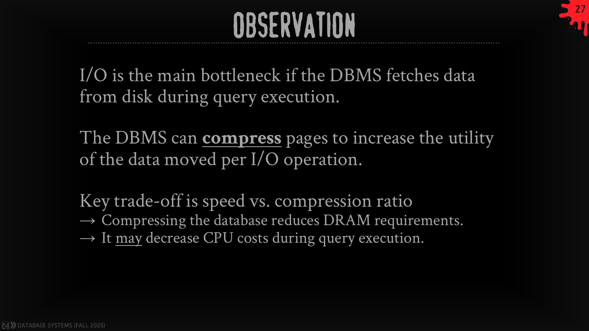


既然 I/O 贵，就让每一次 I/O 带回更多有用的数据。压缩因此在基于磁盘的 DBMS 中用得很普遍，在承担只读分析负载的系统里尤其流行。一个未压缩的[页](#页)能装 10 个[元组](#元组)，压缩之后如果能装 100 个，同样一次读页就能带回 10 倍的元组，前提是内存里放得下处理它们所需的空间。这是计算机科学里经典的交换：花 CPU 时间压缩和解压，换取更少的存储空间和 I/O。

关键的权衡在速度和压缩率之间。压缩还有两个附带的好处：压缩后的[数据库](#数据库)占用的内存（DRAM）更少，[缓冲池](#缓冲池)能缓存更多的数据；如果能直接在压缩数据上计算，甚至可能降低查询执行的 CPU 开销（7.3 节）。对于数据全部放在内存里的数据库，不存在从磁盘取数据的 I/O，但同样的权衡依然存在：压缩减少了内存需求，也消耗了计算，要在速度和压缩率之间找到平衡。

### 6.2 三条要求

📍 *PPT 第 28 页*

[数据库](#数据库)里的压缩方案要满足三条要求。
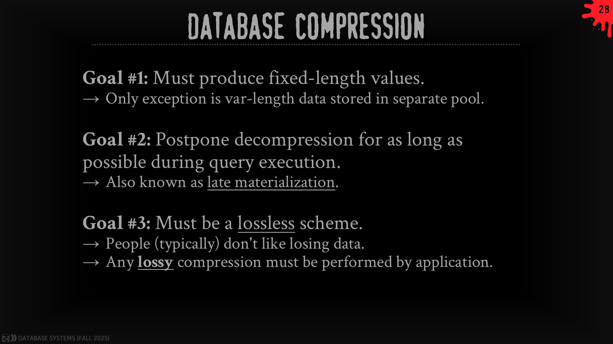


**第一，必须产生定长的值。**理由在 4.3 节：DBMS 靠偏移定位列中的值，而且希望值按机器[字对齐](#字对齐)，以便 CPU 高效地读取。如果一列 32 位整数压缩之后有的变成 16 位、有的变成 24 位，就无法算出第 123 个值在哪里，只能另建一个索引。唯一的例外是存放在独立存储区里的变长数据，那里可以使用任意压缩方案，结果长短不一也无妨。

**第二，尽可能推迟解压。**查询执行时，数据保持压缩形态的时间越长越好，理想的情况是直接在压缩数据上过滤和计算，只在结果要交还给用户时才还原。这种做法称为**[延迟物化](#延迟物化)（late materialization）**。这个词在[列存储](#列存储)中还有一层含义：尽可能推迟把各列拼回完整[元组](#元组)的时机，第 [13](../L13/index.md)、[14](../L14/index.md) 讲会再遇到它。

**第三，必须是[无损](#无损)的。****[无损](#无损)（lossless）**压缩在解压后得到的每一个比特都和原始数据相同。MP3 和视频编码属于**有损（lossy）**压缩：它们丢掉人耳和人眼察觉不到的信息，还原出的内容不是原始数据的精确拷贝。人们通常不愿意丢数据，所以任何[有损压缩](#有损压缩)都只能由应用程序，也就是由人来决定。比如按秒记录一个房间一整年的温度，一年之后也许不再需要每一秒的读数，每十分钟保留一个平均值就够了；把逐秒的数据删掉，就是一次由人拍板的[有损压缩](#有损压缩)。还有一类技术叫近似查询处理（approximate query processing），它保留原始数据，用有损的算法给出带误差界的估计结果，这超出了本讲的范围。

### 6.3 在什么粒度上压缩

📍 *PPT 第 29、34 页*

压缩可以作用在四种粒度上。

- **块级（block-level）**：把同一张表的一块[元组](#元组)作为整体压缩。下一节的 MySQL 就是这样做的。
- **元组级（tuple-level）**：把整个元组的内容作为整体压缩，只适用于 [NSM](#N%20元存储模型)。支持它的系统很少，Andy 举的例子是 TerarkDB，它是 RocksDB 的一个分支，2019 年被字节跳动收购，能在高度压缩的数据上直接查找；SQL Server 也提供行级压缩。
- **[属性](#属性)级（attribute-level）**：单独压缩一个元组中的某个属性值，典型的场景是溢出存储的大值，也可以同时针对同一个元组的多个属性。第 [3](../L03/index.md) 讲的 PostgreSQL TOAST 会压缩这些大值；按 Andy 的说法，这也是 PostgreSQL 唯一的压缩手段。
- **列级（column-level）**：把一个或多个属性在许多元组上的值放在一起压缩，只适用于 [DSM](#分解存储模型)（[PAX](#PAX) 的[列块](#列块)也属于这种情况）。几乎所有[列存储](#列存储)系统都用这一种，它带来的收益最大，第 8 节专门讲它。

列级压缩之所以效果最好，是因为只有列式布局才会把同一值域的大量值排在一起，压缩算法能利用的重复和相似之处最多。
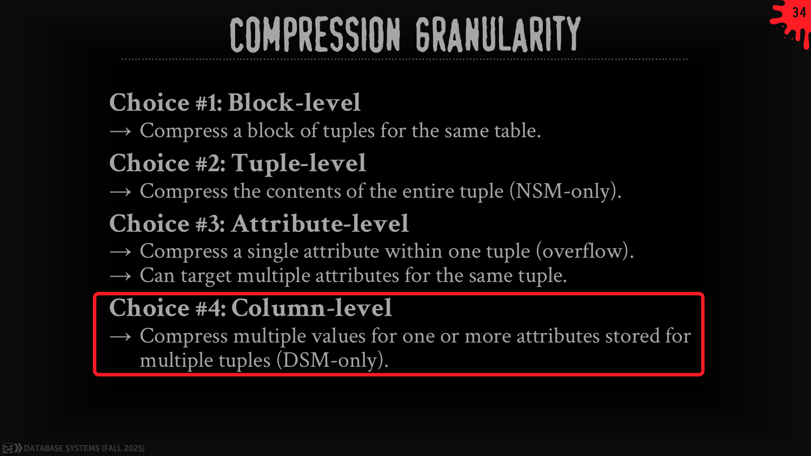


## 7. 通用算法的局限：朴素压缩（Naive Compression）

📍 *PPT 第 30–33 页*

### 7.1 拿来就用的通用算法

📍 *PPT 第 30 页*

最省事的做法是直接调用通用压缩算法，可选的有 Deflate（1990）、LZO（1996）、LZ4（2011）、Snappy（2011）、Oracle OZIP（2014）、Zstd（2015）、Lizard（2017）等。给它什么数据，它就压缩什么数据，压缩的范围完全由输入决定，输出是一段长度不定的字节。选择时要考虑计算开销有多大，以及压缩和解压各自有多快。[数据库](#数据库)工程师往往宁可接受较低的压缩率，换取更快的压缩和解压速度，LZ4、Snappy 这类以速度见长的算法因此很受欢迎。

### 7.2 MySQL InnoDB 的压缩[页](#页)

📍 *PPT 第 31 页*

MySQL 的 InnoDB 存储引擎提供了一个具体的例子（依据 MySQL 5.7 文档）。InnoDB 默认的[页](#页)大小是 16 KB。开启压缩后，每个页用通用算法压缩，结果向上取整到 1 KB、2 KB、4 KB、8 KB 中的某一档再写到磁盘上，比如一个页压缩后是 900 字节，就补齐到 1 KB。每个压缩页的开头附带一块**[修改日志](#修改日志)（mod log）**。下面按时间顺序，看一个压缩页在[缓冲池](#缓冲池)中的经历。

**第一步，读入。**[缓冲池](#缓冲池)从磁盘读入压缩[页](#页)，原样保留它的压缩形态。

```text
(1) Read: the compressed page enters the buffer pool as is

    Buffer Pool                      Database File
    +--------------------+           +--------------------+
    | mod log            |  <------  | mod log            |  \
    | Compressed Page0   |           | Compressed Page0   |  /  1, 2, 4 or 8 KB
    +--------------------+           +--------------------+
                                     | mod log            |
                                     | Compressed Page1   |
                                     +--------------------+
                                     | mod log            |
                                     | Compressed Page2   |
                                     +--------------------+
```

**第二步，写。**有些更新不需要知道旧值，比如用户登录时执行 `SET lastLogin = NOW()`，新值与旧值无关，这类写称为**[盲写](#盲写)（blind write）**。对于[盲写](#盲写)，InnoDB 不解压[页](#页)，只在[修改日志](#修改日志)末尾追加一条记录，写明“某[元组](#元组)的 `lastLogin` 改为某值”。

```text
(2) Blind write: append a record to the mod log, no decompression

             +--------------------+
    Write -> | mod log  [+1 rec]  |
             | Compressed Page0   |
             +--------------------+
```

**第三步，读。**如果读请求能直接从[修改日志](#修改日志)得到答案，比如读的正是刚写过的那个 `lastLogin`，就不必解压。如果必须查看[页](#页)里原有的数据，InnoDB 就把页解压到一个 16 KB 的[帧](#帧)中，再应用[修改日志](#修改日志)里积攒的修改。

```text
(3) Read that needs the page contents: decompress into a 16 KB frame

             +--------------------+
             | mod log            |
             | Compressed Page0   |
             +--------------------+
                       |  decompress, then apply the mod log
                       v
             +--------------------+  \
             |                    |   |
     Read -> |   Uncompressed     |   |  16 KB
             |      Page0         |   |
             |                    |   |
             +--------------------+  /
```

解压之后，压缩版本仍然留在[缓冲池](#缓冲池)中。内存紧张时，如果解压出来的[页](#页)没有新的修改，可以直接丢弃它，只留下更小的压缩版本。

**第四步，[修改日志](#修改日志)写满。**这时必须解压整[页](#页)、应用所有修改、重新压缩，然后清空[修改日志](#修改日志)。

[修改日志](#修改日志)和预写日志（write-ahead log，第 [21](../L21/index.md) 讲）思路相近，都记录“对数据做了哪些修改”，区别在于[修改日志](#修改日志)是每个[页](#页)私有的，目的是让页保持压缩状态。它也不是[日志结构存储](#日志结构存储)的专利。把修改先快速记在一个小区域里，稍后再由后台统一整理，是[数据库](#数据库)中很常见的套路：第 [5](../L05/index.md) 讲 [LSM 树](#LSM%20树)的内存表是这个思路，第 9 节的[增量存储](#增量存储)（delta store）也是。

[修改日志](#修改日志)会随[页](#页)一起写到磁盘上。页被刷回磁盘时不必先应用修改，连同[修改日志](#修改日志)原样写出即可，数据因此能尽可能长时间地保持压缩。代价出现在[修改日志](#修改日志)写满的时候：写操作必须停下来，等待整页解压、应用修改、重新压缩。

InnoDB 也不能只解压[页](#页)里需要的那一部分。gzip、Snappy 这类算法输出的是一个整体的字节流，要读中间某处的内容，只能从头开始解压。能随机访问的压缩需要专门的设计，这正是[元组](#元组)级压缩（6.3 节的 TerarkDB）要解决的问题。按页压缩还有一层考虑：既然每次访问都要解压，压缩的单位就不能太大。如果把整张表压成一个巨大的块，每次访问都要解压整张表，这完全不可行；MySQL 按页压缩，就是把每次解压的范围控制在一个页之内。Andy 认为 InnoDB 的这套做法是个好主意，作为对照，PostgreSQL 根本不支持页级压缩。

### 7.3 黑盒的代价

📍 *PPT 第 32–33 页*

InnoDB 的例子暴露了通用压缩的两个根本局限。第一，DBMS 必须先解压，才能读取数据或者修改数据，这限制了压缩的范围，上一节已经看到。第二，这些算法不理解数据的高层含义。Andy 的说法是，不管用的是 gzip、Snappy 还是 Zstandard，对 DBMS 来说它都是一个黑盒。[^4] DBMS 手里只有一串压缩后的字节，不知道其中哪一段对应哪个值，想知道内容只能调用解压算法还原；反过来，压缩算法也不知道哪些数据彼此相关、查询打算怎样访问它们。于是[延迟物化](#延迟物化)无从谈起，DBMS 无法判断什么时候可以推迟解压。

[^4]: 原话：“So the big thing to point out is, in this case here, the compression algorithm we're using, whether it's gzip or Snappy or Zstandard, it's considered a black box to the database system.”

其实 LZ4、Zstd 这类算法内部也在做类似[字典编码](#字典编码)的事，用简短的引用代替重复出现的字节序列，只是它们不把“字典”暴露给调用者，DBMS 无从利用。

理想的情况是 DBMS 不解压就能直接在压缩数据上操作。设想 `users` 表只有两行：
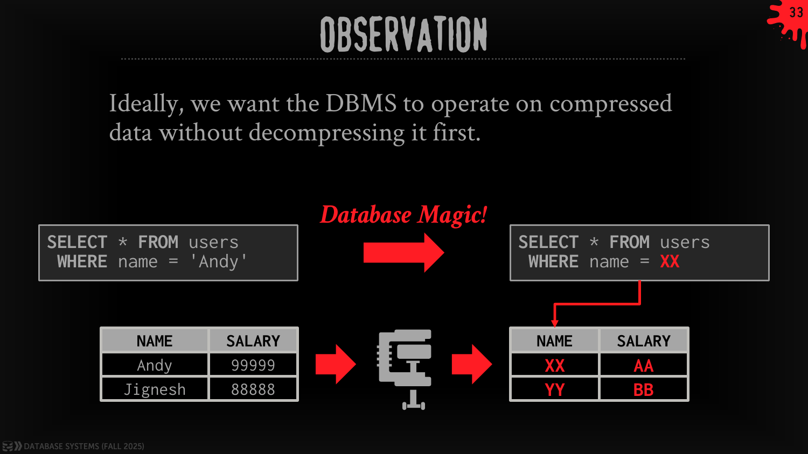


| NAME | SALARY |
|---|---|
| Andy | 99999 |
| Jignesh | 88888 |

压缩之后，姓名和工资都变成了某种编码：`Andy` 变成 `XX`，`Jignesh` 变成 `YY`，`99999` 和 `88888` 变成 `AA` 和 `BB`。查询 `SELECT * FROM users WHERE name = 'Andy'` 到来时，DBMS 先把常量 `'Andy'` 转换成它的压缩形式 `XX`，再拿 `XX` 去和压缩后的列逐个比较。如果编码是整数，每次比较就是一条 CPU 指令，而比较字符串要逐字节进行。两行数据看不出差别，但 Andy 提醒，思考这类问题要往极端的规模去想，换成一万亿行，差别就是天壤之别。

做到这一点需要一个前提：压缩方案由 DBMS 自己掌控，DBMS 知道每个编码代表什么。这就是列式压缩。

## 8. 列式压缩编码（Columnar Compression）

📍 *PPT 第 35–46 页*

列式压缩是 DBMS 内置的一组编码方案，它们让 DBMS 不必把[元组](#元组)还原成原始形态就能读取和处理数据。这些编码利用的都是同一个事实：一列里的值属于同一个值域，重复的多，相近的也多。选用哪一种取决于数据的特点和[工作负载](#工作负载)。[字典编码](#字典编码)最常用；但一列数据如果恰好符合其他某种编码的适用条件，收益往往比[字典编码](#字典编码)大得多。这些编码还可以叠加：先用一种编码，再对结果用另一种，压缩率相乘。
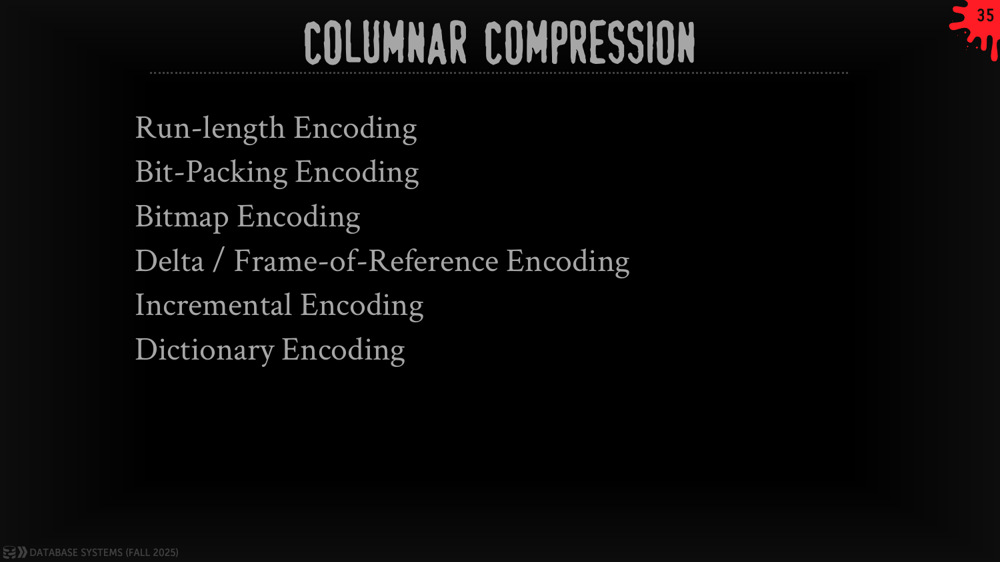


### 8.1 游程编码（Run-Length Encoding，RLE）

📍 *PPT 第 35–37 页*

一列里如果有连续重复的值，就不必把它一遍遍地存下来。**[游程编码](#游程编码)（Run-Length Encoding，[RLE](#游程编码)）**把单列中每一段连续相同的值（称为一个“游程”）压缩成一个三元组：值本身、游程在该列片段中的起始位置（偏移）、游程的长度。

看一张记录“是否已故”的表。`id` 是应用层面的标识，相当于身份证号或邮箱地址，并不是 DBMS 内部的编号；`isDead` 取值 Y 或 N。为便于对照，左边加上了每一行在列中的偏移：

| 偏移 | id | isDead |
|---|---|---|
| 0 | 1 | Y |
| 1 | 2 | Y |
| 2 | 3 | Y |
| 3 | 4 | N |
| 4 | 6 | Y |
| 5 | 7 | N |
| 6 | 8 | Y |
| 7 | 9 | Y |

`isDead` 列压缩成五个 `(值, 偏移, 长度)` 三元组：
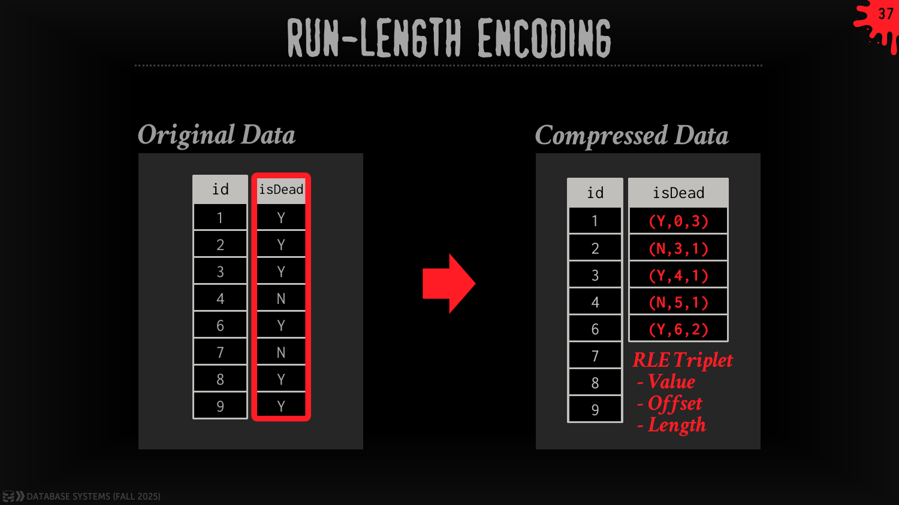


```text
(Y,0,3)  (N,3,1)  (Y,4,1)  (N,5,1)  (Y,6,2)
```

查询 `SELECT isDead, COUNT(*) FROM users GROUP BY isDead` 可以直接在三元组上计算：Y 的个数是 3 + 1 + 2 = 6，N 的个数是 1 + 1 = 2，一个值都不用展开。

问题出在中间那段 N、Y、N 上。它们交替出现，每个游程的长度只有 1，而一个三元组比它代表的那一个值大得多。数据如果处处是这种交替，[RLE](#游程编码) 压缩的结果反而比原始数据更大。[RLE](#游程编码) 的效果完全取决于数据本身的特点。
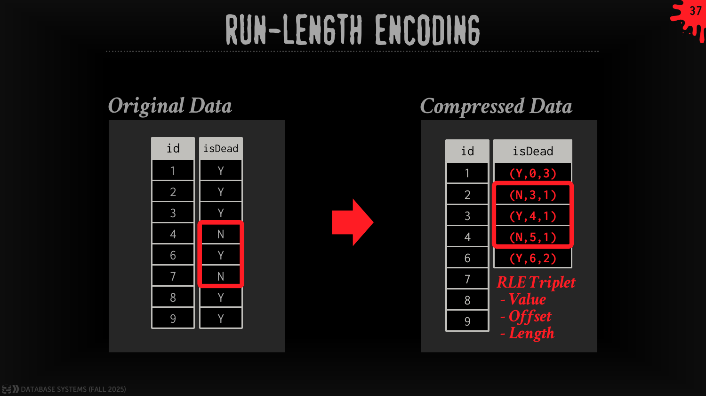


解决办法是先按 `isDead` 排序，让相同的值聚到一起：

| 偏移 | id | isDead |
|---|---|---|
| 0 | 1 | Y |
| 1 | 2 | Y |
| 2 | 3 | Y |
| 3 | 6 | Y |
| 4 | 8 | Y |
| 5 | 9 | Y |
| 6 | 4 | N |
| 7 | 7 | N |

整列只剩两个三元组：

```text
(Y,0,6)  (N,6,2)
```

PPT 上第二个三元组印作 `(N,7,2)`。按照前一个例子的计数方式，偏移从 0 开始，第一个 N 位于偏移 6，所以应为 `(N,6,2)`。

排序是有代价的。按[固定长度偏移](#固定长度偏移)对齐的[列存储](#列存储)中，所有列必须保持同一个行序，按 `isDead` 重排时，`id` 列以及其他所有列都得跟着一起重排。对 `isDead` 最有利的顺序，对别的列未必有利，而一张表只能有一种物理行序。选哪一列作为排序的依据，是一个很难的决策。

### 8.2 位打包（Bit Packing）与补丁编码（Patching）

📍 *PPT 第 38–39 页*

建表时声明的类型常常比实际需要的大。比如年龄列声明为 `INT`，每个值占 32 位，但年龄不会超过几百，高位永远是 0。**[位打包](#位打包)（bit packing）**的做法是：如果一个整数[属性](#属性)的值都远小于其数据类型的表示范围，就用更少的位来存每个值。

下面 8 个 `int32` 值都小于 256：

| 值 | 32 位表示 | [位打包](#位打包)后 |
|---|---|---|
| 13 | `00000000 00000000 00000000 00001101` | `00001101` |
| 191 | `00000000 00000000 00000000 10111111` | `10111111` |
| 56 | `00000000 00000000 00000000 00111000` | `00111000` |
| 92 | `00000000 00000000 00000000 01011100` | `01011100` |
| 81 | `00000000 00000000 00000000 01010001` | `01010001` |
| 120 | `00000000 00000000 00000000 01111000` | `01111000` |
| 231 | `00000000 00000000 00000000 11100111` | `11100111` |
| 172 | `00000000 00000000 00000000 10101100` | `10101100` |

每个值的高 24 位全是 0，丢掉它们没有任何信息损失。存储量从 8 × 32 = 256 位降到 8 × 8 = 64 位，每个值仍然定长，[固定长度偏移](#固定长度偏移)照样可用。打包之后，一个 64 位的机器字能装下 8 个值，借助移位和按位运算，一条指令可以同时处理这 8 个值。
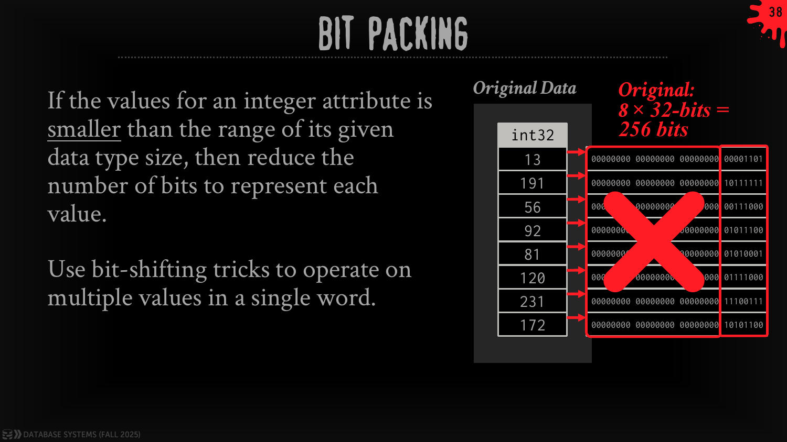

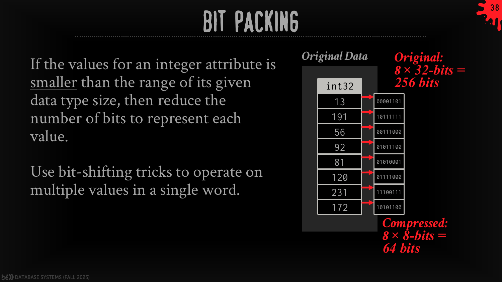


[位打包](#位打包)的弱点在于新数据：只要后来插入一个 8 位装不下的值，整列就得换一种宽度重新打包。**[补丁编码](#补丁编码)（patching）**，在 Amazon Redshift 中叫 **Mostly 编码（mostly encoding）**，专门应对“绝大多数值都小，偶尔有几个特别大”的情况。大多数值照常用小类型存储；装不下的值在原位置放一个特殊标记，真实值另存在一张补丁表里，表中每一项是 `(偏移, 原值)`：
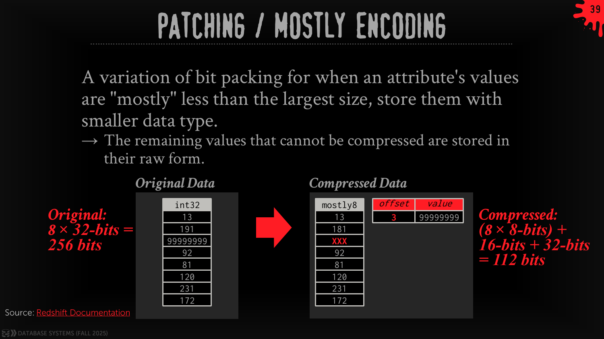


```text
Original (int32)        Compressed (mostly8)       Patch table
+----------+            +----------+               +--------+----------+
|       13 |            |       13 |               | offset |  value   |
|      191 |            |      191 |               +--------+----------+
| 99999999 |            |      XXX |   -------->   |      3 | 99999999 |
|       92 |            |       92 |               +--------+----------+
|       81 |            |       81 |
|      120 |            |      120 |
|      231 |            |      231 |
|      172 |            |      172 |
+----------+            +----------+
```

这里的偏移 3 指第 3 个值，是从 1 开始计数的。另外，PPT 上压缩列的第二个值印作 181，应是 191 的笔误。

存储量：原始数据是 8 × 32 = 256 位；压缩后是 8 个 8 位的值、一个 16 位的偏移和一个 32 位的原值，共 64 + 16 + 32 = 112 位。

特殊标记通常取一个保留的位模式，比如 8 位全为 1。这样一来，真实值恰好等于这个位模式（255）的，也要放进补丁表，否则会和标记混淆。补丁表本身是一个定长数组，按偏移排列，查找时可以二分。

### 8.3 位图编码（Bitmap Encoding）

📍 *PPT 第 40–42 页*

**[位图编码](#位图编码)（bitmap encoding）**为[属性](#属性)的每一个不同取值单独维护一个位图。位图的第 i 位对应表中第 i 个[元组](#元组)：该元组的属性值等于这个取值，这一位就是 1，否则是 0。实现时位图通常切成若干段，以免分配一整块巨大的连续内存。有些 DBMS 以位图索引（bitmap index）的形式提供这一功能。

还是 `isDead` 列：
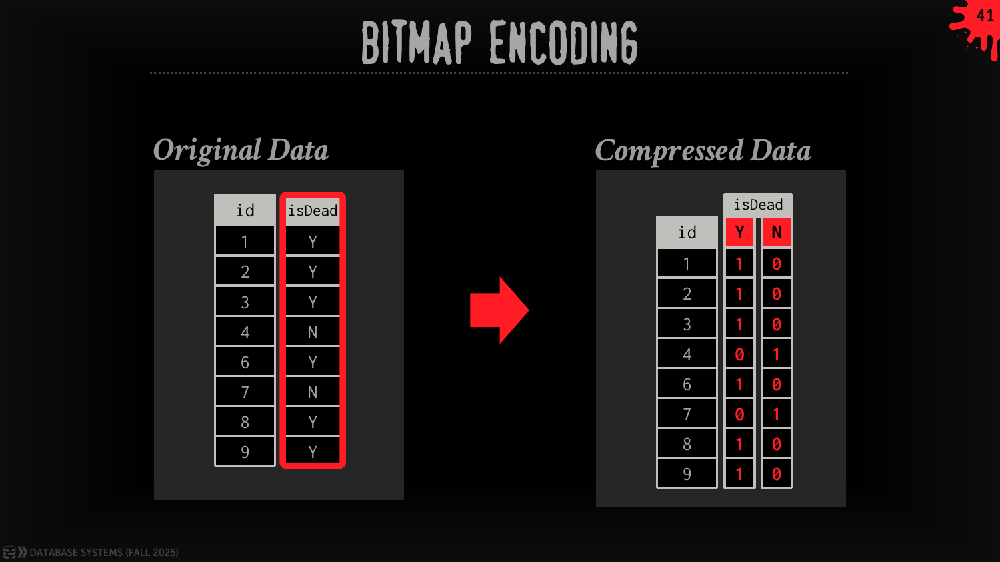


| id | isDead | Y 位图 | N 位图 |
|---|---|---|---|
| 1 | Y | 1 | 0 |
| 2 | Y | 1 | 0 |
| 3 | Y | 1 | 0 |
| 4 | N | 0 | 1 |
| 6 | Y | 1 | 0 |
| 7 | N | 0 | 1 |
| 8 | Y | 1 | 0 |
| 9 | Y | 1 | 0 |

原始数据中每个值用一个 8 位字符存储，共 8 × 8 = 64 位。编码后，两个取值 Y、N 各存一次，占 2 × 8 = 16 位；每个[元组](#元组)在两个位图中各占 1 位，共 8 × 2 = 16 位；合计 32 位。

对于只有两个取值的[属性](#属性)，Y 位图本身就等价于把 `isDead` 存成一个比特，N 位图是多余的，这里画出两个位图只是为了演示。那么，给每个取值一个位图，比起给每个取值编一个小整数（0、1、2……）好在哪里？答案在于位图擅长的运算。查询条件 `isDead = 'Y'` 的结果就是 Y 位图本身，不用做任何比较；多个条件之间的 `AND`、`OR` 变成位图之间的按位与、按位或，一个 64 位的机器字一次就能处理 64 个[元组](#元组)；借助 SIMD（Single Instruction, Multiple Data，一条指令同时处理一组数据的 CPU 扩展指令），一次能处理的更多。计数就是数 1 的个数，CPU 有专门的指令。下面这段 C 代码统计同时满足两个条件的元组个数：

```c
/* Count tuples with isDead = 'Y' AND region = 'PA', one bitmap per predicate. */
uint64_t count = 0;
for (size_t w = 0; w < n_words; w++) {
    uint64_t hits = dead_y[w] & region_pa[w];  /* 64 tuples per AND */
    count += __builtin_popcountll(hits);       /* count the 1 bits */
}
```

`__builtin_popcountll` 是 GCC 和 Clang 提供的内建函数，通常编译成一条统计 1 的个数的机器指令；`region` 条件是为演示而假设的第二个条件。如果把取值存成小整数，同样的查询要对每个[元组](#元组)做两次比较和相应的分支判断。

[位图编码](#位图编码)只适合**[基数](#基数)（cardinality）**低的[属性](#属性)，这里的[基数](#基数)指一个属性不同取值的个数。位图的总大小与[基数](#基数)成正比，[基数](#基数)一高，位图就会比原始数据大得多。以美国邮政编码为例：

```sql
CREATE TABLE customer (
    id INT PRIMARY KEY,
    name VARCHAR(32),
    email VARCHAR(64),
    address VARCHAR(64),
    zip_code INT
);
```

假设有 1000 万个客户，美国约有 4.3 万个邮编：
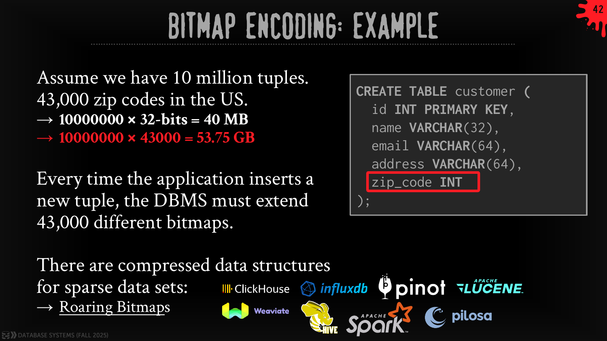


$$
\begin{aligned}
\text{int32:}\quad & 10^7 \times 32\ \text{bits} = 3.2\times 10^{8}\ \text{bits} = 40\ \text{MB} \\
\text{bitmaps:}\quad & 10^7 \times 43000\ \text{bits} = 4.3\times 10^{11}\ \text{bits} = 53.75\ \text{GB}
\end{aligned}
$$

位图方案的大小是原始数据的 43000 / 32 ≈ 1344 倍。而且每插入一个[元组](#元组)，DBMS 都要把 4.3 万个位图各延长一位。

不过这些位图极其稀疏：每个[元组](#元组)在 4.3 万个位图里只占一个 1。针对稀疏数据有专门的压缩位图结构，最常用的是 Roaring Bitmap。它按整数的高 16 位把整个 32 位空间切成许多段，每段根据其中 1 的疏密选择存储方式：稀疏时存一个有序的 16 位整数数组，稠密时存普通位图（后来的版本又加入了按游程存储的形式）。ClickHouse、InfluxDB、Apache Pinot、Apache Lucene、Weaviate、Apache Hive、Apache Spark、Pilosa 等系统都在使用它。

### 8.4 差值编码（Delta Encoding）与参照系编码（Frame-of-Reference）

📍 *PPT 第 43 页*

如果一列里相邻的值很接近，就不必存每个值的绝对大小。**[差值编码](#差值编码)（delta encoding）**只记录同一列中相邻两个值的差，基准值可以放在列的开头，也可以放在一张单独的查找表里。下面是按分钟记录的时间和温度：

| time64（原始） | temp（原始） | time64（编码后） | temp（编码后） |
|---|---|---|---|
| 12:00 | 99.5 | 12:00 | 99.5 |
| 12:01 | 99.4 | +1 | −0.1 |
| 12:02 | 99.5 | +1 | +0.1 |
| 12:03 | 99.6 | +1 | +0.1 |
| 12:04 | 99.4 | +1 | −0.2 |

时间每次恰好增加 1 分钟，温度每次只变化零点几度，差值都很小，可以用比原值窄得多的类型存储。
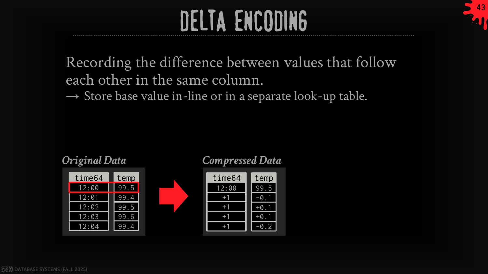


`time64` 列编码后是一串连续的 `+1`，正好适合再做一次 [RLE](#游程编码)：4 个 `+1` 压成一个 `(+1,4)`。
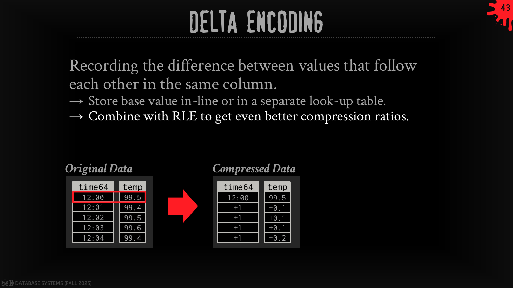

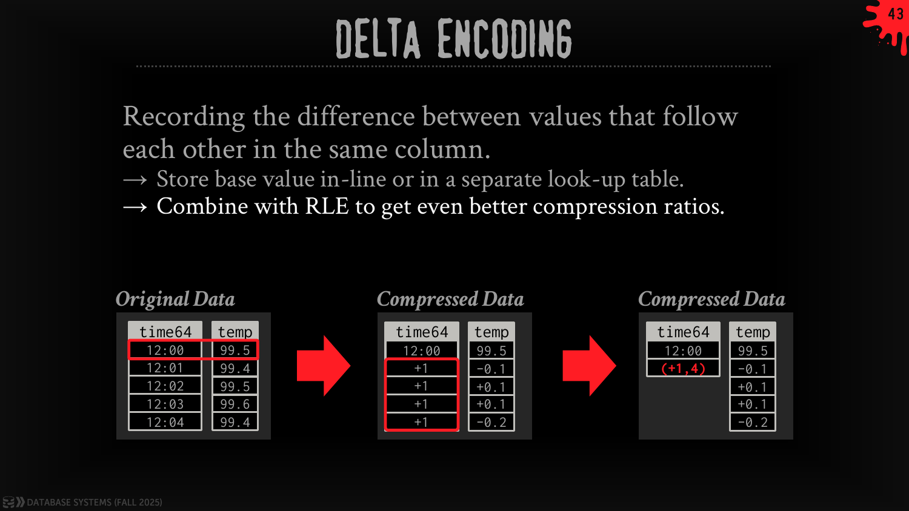


```text
time64 (delta)             time64 (delta + RLE)
12:00                      12:00
+1                         (+1,4)
+1          -- RLE -->
+1
+1
```

算一下 `time64` 列的存储量，基准值用 64 位，差值以及 [RLE](#游程编码) 对中的两个数各用 16 位：

$$
\begin{aligned}
\text{original:}\quad & 5 \times 64 = 320\ \text{bits} \\
\text{delta:}\quad & 64 + 4 \times 16 = 128\ \text{bits} \\
\text{delta + RLE:}\quad & 64 + 2 \times 16 = 96\ \text{bits}
\end{aligned}
$$

两种编码叠加，压缩效果逐级累积。几十个比特的差别看起来微不足道，放到 GB、PB 级别的数据上就很可观了。

[差值编码](#差值编码)有一个代价：要得到第 i 个值，必须从基准值开始把前面所有的差值累加起来，无法像[固定长度偏移](#固定长度偏移)那样一步定位。它的变体**[参照系编码](#参照系编码)（frame-of-reference，[FOR](#参照系编码)）**改用一个全局的最小值作为参照，每个值只存它与这个最小值的差。以上面的温度为例，取最小值 99.4 作为参照，五个值依次存为 0.1、0、0.1、0.2、0，任意一个值都能单独还原，随机访问的能力就保住了。编码后的差值通常很小，还可以再做[位打包](#位打包)。

### 8.5 前缀增量编码（Incremental Encoding）

📍 *PPT 第 35 页*

[前缀增量编码](#前缀增量编码)可以看作[差值编码](#差值编码)在字符串上的版本，适用于排好序的字符串。排序后相邻的字符串往往有公共前缀，于是每个值只存“与前一个值的公共前缀长度”和“剩下的后缀”：

| 原值 | 与前一个值的公共前缀长度 | 后缀 |
|---|---|---|
| rob | 0 | rob |
| robbed | 3 | bed |
| robbing | 4 | ing |
| robot | 3 | ot |

它常用于有序的键，比如 B+ 树节点内的键（第 [8](../L08/index.md) 讲）。编码的结果长短不一，所以通常放在变长数据区或者索引节点内部，而不是定长的列数组里。

### 8.6 字典编码（Dictionary Encoding）

📍 *PPT 第 44–46 页*

**[字典编码](#字典编码)（dictionary encoding）**是[数据库](#数据库)中使用最广泛的原生压缩方案。它把频繁出现的值替换成更短的定长编码，列里只存编码，另外维护一个把编码映射回原值的数据结构，称为字典（dictionary）。通常每个[属性](#属性)值对应一个编码：即使一个值是 1 MB 的一段文本，也只换成一个 32 位整数，文本本身存在字典里。理论上还可以做更细粒度的编码，给值中的片段分别编码，但据 Andy 所知，没有生产系统这样做。
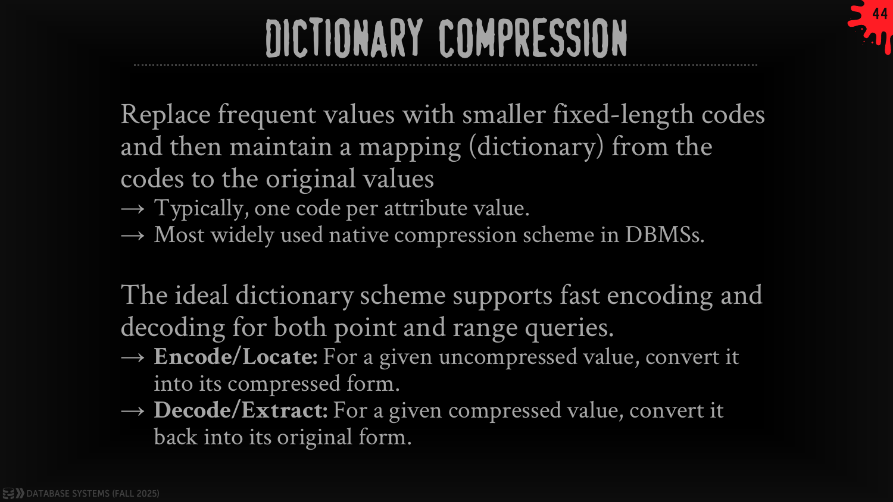


一个好的字典方案要同时支持两种操作，而且无论是[点查询](#点查询)还是范围查询，都要快：

- **编码（encode / locate）**：给定一个未压缩的值，找到它的编码；
- **解码（decode / extract）**：给定一个编码，还原出原值。

这也说明了为什么不能直接用哈希函数生成编码。哈希只能从值算出编码，无法从编码反推原值；而且哈希值的大小顺序与原值毫无关系，无法支持范围查询。字典常见的实现是一个按值排序的数组，编码就是数组下标，或者能直接换算成下标：解码是一次数组访问，编码是一次二分查找。

**[保序编码](#保序编码)（order-preserving encoding）**要求编码的大小顺序与原值的[排序规则](#排序规则)（collation）一致。以一列姓名为例：

| name（原始） | name（编码后） |
|---|---|
| Andrea | 10 |
| Mr.Pickles | 40 |
| Andy | 20 |
| Jignesh | 30 |
| Mr.Pickles | 40 |

对应的有序字典：
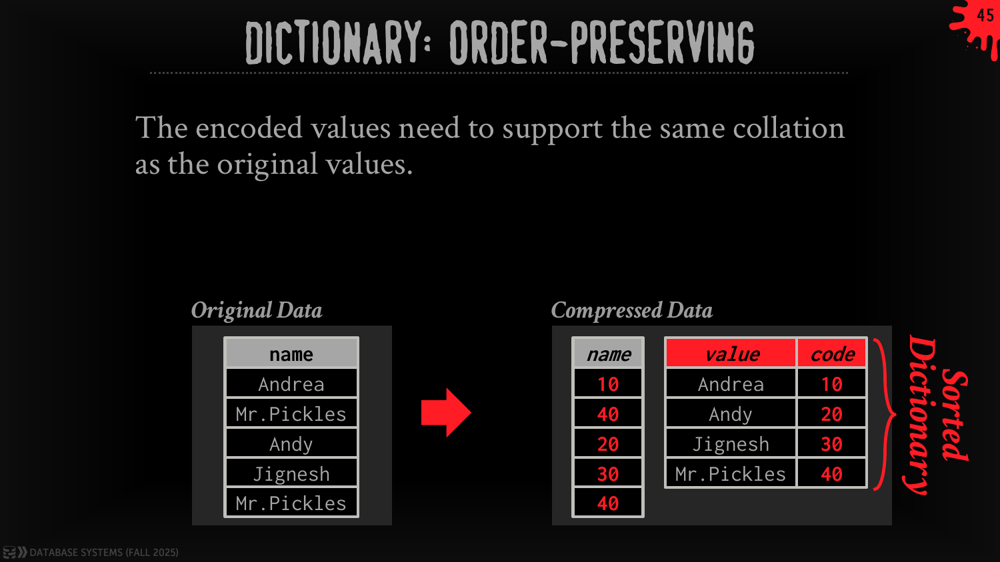


| value | code |
|---|---|
| Andrea | 10 |
| Andy | 20 |
| Jignesh | 30 |
| Mr.Pickles | 40 |

Andrea < Andy < Jignesh < Mr.Pickles，它们的编码也满足 10 < 20 < 30 < 40。于是比较运算可以直接在编码上进行，结果和在原值上比较完全一致。前缀匹配就是受益者之一：

```sql
SELECT * FROM users
 WHERE name LIKE 'And%'
```

DBMS 先在字典上执行 `LIKE 'And%'`，匹配的是 Andrea 和 Andy。由于字典有序，所有以 `And` 开头的值一定排在一段连续的区间里，对应编码区间 [10, 20]，查询于是被改写成：
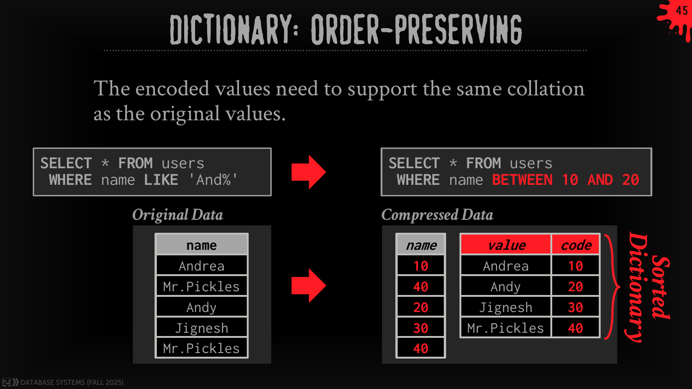


```sql
SELECT * FROM users
 WHERE name BETWEEN 10 AND 20
```

字符串匹配只在字典上做了一次，字典的条目数是不同取值的个数，通常远小于表的行数；扫描列本身时，比较的全是整数。

改写之后，两种查询的代价仍有差别。
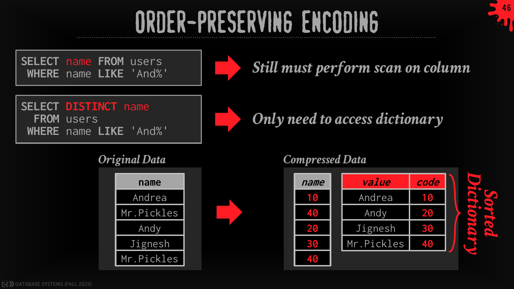


```sql
SELECT name FROM users
 WHERE name LIKE 'And%'
```

这条查询仍然要扫描整个 `name` 列，因为每一个匹配的[元组](#元组)都要在结果中输出一行，DBMS 得找出所有编码落在 [10, 20] 之间的元组，再把编码解码回字符串。

```sql
SELECT DISTINCT name
  FROM users
 WHERE name LIKE 'And%'
```

这条查询只需要访问字典：字典里每个值恰好出现一次，匹配的那几个条目就是答案，列本身完全不必访问。

回到本讲一直在用的 `hostname LIKE '%.gov'`。这是后缀匹配，以 `.gov` 结尾的主机名在有序字典里并不连续，得不到一个编码区间。但字典依然有用：在字典上执行一遍 `LIKE`，得到一组匹配的编码，再扫描整数列，检查每个编码是否属于这一组即可。保序让前缀条件和范围条件变成一个区间，字典本身则让任何条件都只需在不同的取值上计算一次。

[字典编码](#字典编码)的更新比较麻烦。删除没有问题，字典里留几个用不上的条目无伤大雅。插入则可能破坏保序：新值如果恰好排在两个相邻的编码之间，而这两个编码之间没有空位，就得重新编码。上例中的编码取 10、20、30、40，中间留有空隙，可以容纳一些后来插入的值，但空隙总有用完的时候。好在 [OLAP](#联机分析处理) 的数据大多写入后就不再修改，Parquet 文件本身就是不可变的，所以这个问题在实践中不太突出。说一个系统使用[字典编码](#字典编码)时，一般默认它是保序的，但不保序的字典方案也存在。

与 [RLE](#游程编码) 相比，[字典编码](#字典编码)不要求数据事先排序，对任何重复较多的列都能直接使用，这是它最常用的原因。

## 9. 行和列怎样共处

📍 *PPT 第 48–53 页*

到这里，结论已经很清楚：[OLTP](#联机事务处理) 适合[行存储](#行存储)，[OLAP](#联机分析处理) 适合[列存储](#列存储)。可是数据诞生在 [OLTP](#联机事务处理) 系统里，分析却要在 [OLAP](#联机分析处理) 系统上做。1.4 节留下的问题现在可以回答了。

### 9.1 两套系统：分离式环境

📍 *PPT 第 48–49 页*

既然 [OLAP](#联机分析处理) [数据库](#数据库)做分析远比 [OLTP](#联机事务处理) 数据库擅长，分析查询就应该交给 [OLAP](#联机分析处理) 数据库。但新数据不断进入 [OLTP](#联机事务处理) 数据库，两者之间需要一条搬运数据的通道。最常见的架构是**[分离式环境](#分离式环境)（bifurcated environment）**：前端有一个或多个 [OLTP](#联机事务处理) 数据库负责业务，后端有一个 [OLAP](#联机分析处理) 数据库（通常称为数据仓库）负责分析，中间定期搬运数据。

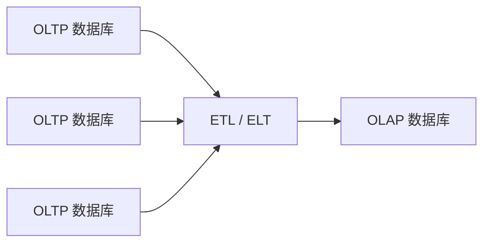

传统的搬运方式是 **[ETL](#抽取—转换—加载)（Extract, Transform, Load，[抽取—转换—加载](#抽取—转换—加载)）**：从各个 [OLTP](#联机事务处理) [数据库](#数据库)抽取数据，在中间环节清洗、转换成统一的格式，再加载进 [OLAP](#联机分析处理) 数据库。Informatica、Fivetran、Talend、Qlik 都提供这类工具。近年流行的是 **ELT（Extract, Load, Transform）**：先把原始数据原样加载进 [OLAP](#联机分析处理) 数据库，再用 [OLAP](#联机分析处理) 数据库自身的计算能力在里面做转换，dbt、Airbyte 属于这一类。无论哪种方式，分析看到的数据都有一定的延迟，最新的数据要等下一次搬运之后才能查到。

### 9.2 一套系统：利用数据的冷热

📍 *PPT 第 50–53 页*

另一条路是只维护一个 DBMS，让它同时支持 [OLTP](#联机事务处理) 和 [OLAP](#联机分析处理)。这之所以可行，是因为数据有时间上的规律：一个[元组](#元组)刚进入[数据库](#数据库)时是“热”的，会被频繁读写；随着时间推移，它被修改的次数越来越少，逐渐变“冷”，主要由分析查询读取。

混合[存储模型](#存储模型)（hybrid storage model）据此使用两个分别针对 [NSM](#N%20元存储模型) 和 [DSM](#分解存储模型) 优化的[执行引擎](#执行引擎)：新数据以 [NSM](#N%20元存储模型) 形式存放，服务快速的 [OLTP](#联机事务处理)；数据变冷之后迁移到 [DSM](#分解存储模型)，服务高效的 [OLAP](#联机分析处理)；查询时把两个引擎的结果合并，对应用程序呈现为一个逻辑上的[数据库](#数据库)。注意这里的“混合[存储模型](#存储模型)”和第 2 节把 [PAX](#PAX) 称为混合[存储模型](#存储模型)是两回事：[PAX](#PAX) 是在一份数据内部混合行与列的布局，这里是让两份按不同方式存放的数据配合工作。具体有两种方案。
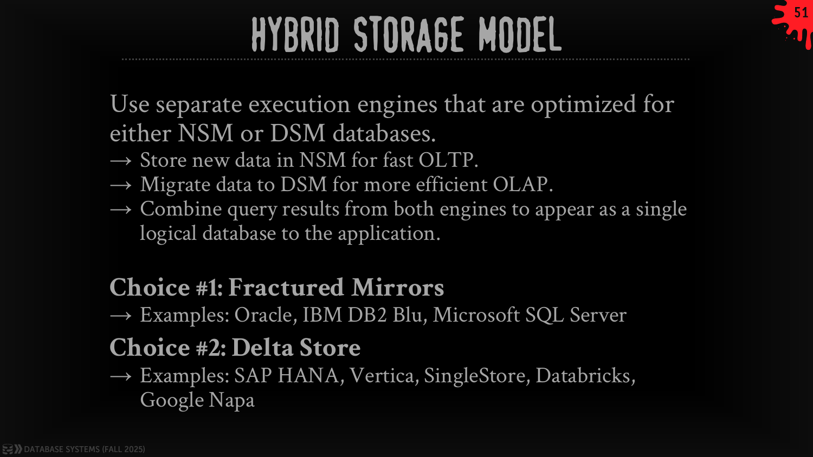


**[分裂镜像](#分裂镜像)（fractured mirrors）**，代表系统有 Oracle、IBM DB2 BLU 和 Microsoft SQL Server。[数据库](#数据库)的主副本以 [NSM](#N%20元存储模型) 存放，系统另外自动维护一份 [DSM](#分解存储模型) 布局的镜像副本。所有更新先写入 [NSM](#N%20元存储模型) 主副本，之后再复制到 [DSM](#分解存储模型) 镜像；如果系统支持更新，还要让镜像中对应的旧[元组](#元组)失效。写操作全部进入主副本，分析查询全部读镜像：

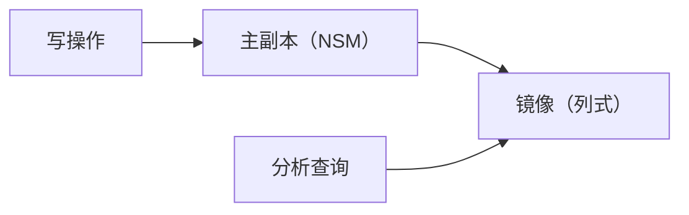

**[增量存储](#增量存储)（delta store）**，代表系统有 SAP HANA、Vertica、SingleStore、Databricks 和 Google Napa。更新先暂存在一张 [NSM](#N%20元存储模型) 表里，这张表就是[增量存储](#增量存储)；后台线程把积攒的更新迁移出来，应用到 [DSM](#分解存储模型) 数据上。迁移成批进行，攒够一大块就以 [PAX](#PAX) 文件的形式写出，这些记录进入[列存储](#列存储)之后，再从[增量存储](#增量存储)中删除。分析查询面对的主要是列式的历史数据，但要看到最新的结果，还得把[增量存储](#增量存储)里尚未迁移的部分一并考虑进去：

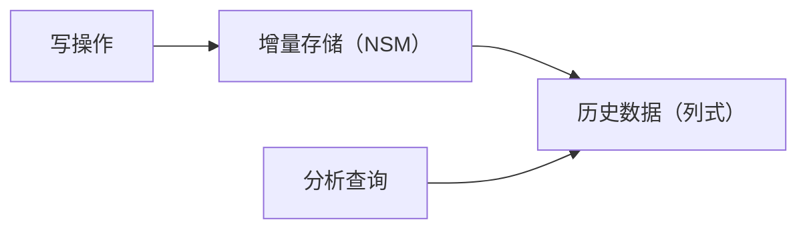

两种方案的差别在于数据存几份。[分裂镜像](#分裂镜像)存两份完整的数据，空间加倍，但每个查询只需面对一种布局；[增量存储](#增量存储)只存一份，数据按冷热分居两处。[增量存储](#增量存储)的思路读者应该已经熟悉：先把新写入快速记在一个小的、适合写的区域里，再由后台整理成适合读的格式。第 [5](../L05/index.md) 讲 [LSM 树](#LSM%20树)的内存表与压实、7.2 节 InnoDB 的[修改日志](#修改日志)，用的都是这个套路。（“[增量存储](#增量存储)”和 8.4 节“[差值编码](#差值编码)”的英文都带 delta，但指的是两件完全不同的事。）

这类在一个系统里兼顾两种负载的产品，就是 1.4 节所说的 [HTAP](#混合事务/分析处理) 系统，Andy 对它们的保留意见也在那里。

## 小结

📍 *PPT 第 54–55 页*

第 [5](../L05/index.md) 讲的[日志结构存储](#日志结构存储)偏向写、[索引组织存储](#索引组织存储)偏向读，但都没有改变“[元组](#元组)按行存放”这个前提；而现实中的查询以读为主，其中分析查询要扫过大量数据，却只用少数几列。[行存储](#行存储)把整行放在一起，正合 [OLTP](#联机事务处理) 查询“一次取一个实体的全部[属性](#属性)”的需要，却让分析查询读进大量无用的列；[列存储](#列存储)只读需要的列，却要为拆分和拼接元组付出代价，并且要求每列的值定长。[PAX](#PAX) 先按行分组、组内再按列存放，兼顾了列式扫描和元组拼接，今天的 Parquet、ORC 都是这种布局；[字典编码](#字典编码)把变长值变成定长整数，让[固定长度偏移](#固定长度偏移)得以成立。列式布局让同一值域的值排在一起，为压缩创造了条件；而通用压缩算法对 DBMS 是黑盒，只有 DBMS 自己掌控的列式编码才能让查询直接在压缩数据上运行。最后，行与列要么分属两套系统、用 [ETL](#抽取—转换—加载) 连接，要么在同一个系统中按数据的冷热分工。

一句话概括：[OLTP](#联机事务处理) 用[行存储](#行存储)，[OLAP](#联机分析处理) 用[列存储](#列存储)；各种编码可以组合使用，以获得更好的压缩效果；[字典编码](#字典编码)大概是最有用的一种，因为它不需要事先排序。这些结论在后面还会出现：第 [8](../L08/index.md)、[9](../L09/index.md) 讲的索引是[行存储](#行存储)快速定位[元组](#元组)的关键；第 [13](../L13/index.md)、[14](../L14/index.md) 讲会说明[执行引擎](#执行引擎)怎样在列式、压缩的数据上工作；第 [21](../L21/index.md) 讲的预写日志和本讲的[修改日志](#修改日志)思路相通。

DBMS 内部到处都要用到哈希表，而且必须自己实现，下一讲（第 [7](../L07/index.md) 讲）就从哈希表开始讨论数据结构。

## 术语速查表

### 元组

**Tuple**：关系中的一个元素，即表中的一行。（本讲首次出现：摘要；引入于：第 1 讲）

### 属性

**Attribute**：关系中的一个命名分量，即表中的一列。（本讲首次出现：摘要；引入于：第 1 讲）

### 数据库

**Database**：一组经过组织、相互关联、用来模拟现实世界某方面的数据。（本讲首次出现：摘要；引入于：第 1 讲）

### 页

**Page**：定长的数据块，数据库中一切数据的存放单位。（本讲首次出现：摘要；引入于：第 3 讲）

### 日志结构存储

**Log-Structured Storage**：只追加 PUT/DELETE 记录、从不原地修改的页布局。（本讲首次出现：课程地图；引入于：第 5 讲）

### 索引组织存储

**Index-Organized Storage**：把元组直接作为索引叶节点中的值存放，表与索引合一。（本讲首次出现：课程地图；引入于：第 5 讲）

### 主键

**Primary Key**：唯一标识关系中一个元组的属性或属性组合。（本讲首次出现：课程地图；引入于：第 1 讲）

### 槽式页

**Slotted Page**：用槽数组记录元组页内偏移、元组从页尾向前存放的页布局。（本讲首次出现：课程地图；引入于：第 3 讲）

### 记录 ID

**Record ID**：表示元组物理位置的唯一标识，如页 ID 加槽号。（本讲首次出现：课程地图；引入于：第 3 讲）

### 元组头

**Tuple Header**：元组开头存放可见性信息、NULL 位图等元数据的部分。（本讲首次出现：课程地图；引入于：第 3 讲）

### NULL 位图

**Null Bitmap**：元组头中每个属性一位、标记其是否为 NULL 的位图。（本讲首次出现：课程地图；引入于：第 3 讲）

### 溢出页

**Overflow Page**：存放元组中过大属性值的独立页。（本讲首次出现：课程地图；引入于：第 3 讲）

### 缓冲池

**Buffer Pool**：由定长帧组成的一大块内存，用来存放从磁盘读入的页。（本讲首次出现：课程地图；引入于：第 3 讲）

### 工作负载

**Workload**：一个应用发给数据库的查询的整体特征。（本讲首次出现：1；引入于：[第 01 讲](../L01/index.md)）

### 外键

**Foreign Key**：值必须对应另一关系中某个元组（通常是其主键）的属性。（本讲首次出现：1.1；引入于：第 1 讲）

### 联机事务处理

**Online Transaction Processing (OLTP)**：大量快速、简单、每次只涉及单个实体少量数据的操作。（本讲首次出现：1.2；引入于：[第 01 讲](../L01/index.md)）

### 联机分析处理

**On-Line Analytical Processing (OLAP)**：读取大量数据、跨实体计算聚合的复杂只读查询。（本讲首次出现：1.3；引入于：本讲）

### 连接

**Join**：在共同属性上取值相同的元组组合。（本讲首次出现：1.3；引入于：第 1 讲）

### 窗口函数

**Window Function**：在与当前行相关的一组行上计算、但不把它们压成一行的函数。（本讲首次出现：1.3；引入于：第 2 讲）

### 混合事务/分析处理

**Hybrid Transaction + Analytical Processing (HTAP)**：在同一个数据库实例上同时承担 OLTP 和 OLAP。（本讲首次出现：1.4；引入于：本讲）

### 关系模型

**Relational Model**：以关系描述数据、以值表达联系、以声明式接口操纵数据的数据模型。（本讲首次出现：1.4；引入于：第 1 讲）

### 存储模型

**Storage Model**：DBMS 在磁盘和内存中物理组织元组的方式。（本讲首次出现：2；引入于：本讲）

### 数据独立性

**Data Independence**：应用与底层数据表示相互隔离，一层改变不影响另一层。（本讲首次出现：2；引入于：第 1 讲）

### 执行引擎

**Execution Engine**：执行查询、向缓冲池请求页的组件。（本讲首次出现：2；引入于：第 3 讲）

### N 元存储模型

**N-ary Storage Model (NSM)/ Row Store**：一个元组的（几乎）所有属性连续存放在同一个页里。（本讲首次出现：3.1；引入于：本讲）

### 行存储

**N-ary Storage Model (NSM)/ Row Store**：一个元组的（几乎）所有属性连续存放在同一个页里。（本讲首次出现：3.1；引入于：本讲）

### 硬件页

**Hardware Page**：存储设备能保证原子写入的最大数据块，通常为 4KB。（本讲首次出现：3.1；引入于：第 3 讲）

### 页头

**Page Header**：页开头记录页大小、校验和等元数据的区域。（本讲首次出现：3.1；引入于：第 3 讲）

### 槽数组

**Slot Array**：从槽号到元组起始偏移的映射。（本讲首次出现：3.1；引入于：第 3 讲）

### 页目录

**Page Directory**：记录各数据库对象的页位置及空闲空间等元数据的特殊页。（本讲首次出现：3.2；引入于：第 3 讲）

### 帧

**Frame**：缓冲池中能放一页的位置。（本讲首次出现：3.3；引入于：第 3 讲）

### 点查询

**Point Query**：按键查找单条记录的查询。（本讲首次出现：3.4；引入于：第 4 讲）

### 分解存储模型

**Decomposition Storage Model (DSM)/ Column Store**：所有元组的同一个属性连续存放。（本讲首次出现：4.1；引入于：本讲）

### 列存储

**Decomposition Storage Model (DSM)/ Column Store**：所有元组的同一个属性连续存放。（本讲首次出现：4.1；引入于：本讲）

### 固定长度偏移

**Fixed-length Offsets**：各列第 i 个值属于第 i 个元组，按下标直接定位。（本讲首次出现：4.3；引入于：本讲）

### 嵌入元组 ID

**Embedded Tuple IDs**：每个值旁存元组 ID，另建索引定位；开销大，不推荐。（本讲首次出现：4.3；引入于：本讲）

### PAX

**Partition Attributes Across**：先把行分组、组内再按列存放的混合布局。（本讲首次出现：5.2；引入于：本讲）

### 行组

**Row Group**：PAX 文件中横向划分出的一批连续行（ORC 称条带）。（本讲首次出现：5.2；引入于：本讲）

### 列块

**Column Chunk**：一个行组内某一列的全部值。（本讲首次出现：5.2；引入于：本讲）

### 页脚

**Footer**：不可变列式文件末尾记录各行组偏移的全局元数据。（本讲首次出现：5.2；引入于：本讲）

### 延迟物化

**Late Materialization**：尽可能推迟解压和还原数据的时机。（本讲首次出现：6.2；引入于：本讲）

### 无损

**Lossless**：解压后能否得到与原始数据完全相同的比特。（本讲首次出现：6.2；引入于：本讲）

### 有损压缩

**Lossy Compression**：解压后能否得到与原始数据完全相同的比特。（本讲首次出现：6.2；引入于：本讲）

### 字对齐

**Word Alignment**：让每个属性都不跨越字的边界。（本讲首次出现：6.2；引入于：第 3 讲）

### 压缩粒度

**Compression Granularity**：压缩作用的单位：块、元组、属性或列。（本讲首次出现：6.3；引入于：本讲）

### 朴素压缩

**Naive Compression**：用通用算法把数据当作字节流压缩。（本讲首次出现：7.1；引入于：本讲）

### 修改日志

**Mod Log**：InnoDB 压缩页上暂存修改、推迟解压的区域。（本讲首次出现：7.2；引入于：本讲）

### 盲写

**Blind Write**：不需要读取旧值就能完成的写操作。（本讲首次出现：7.2；引入于：[第 05 讲](../L05/index.md)）

### LSM 树

**Log-Structured Merge Tree**：由 MemTable 和分层 SSTable 组成的日志结构存储结构。（本讲首次出现：7.2；引入于：第 5 讲）

### 游程编码

**Run-Length Encoding (RLE)**：把连续相同的值压成（值, 偏移, 长度）三元组。（本讲首次出现：8.1；引入于：本讲）

### 位打包

**Bit Packing**：用少于声明类型的位数存储较小的整数。（本讲首次出现：8.2；引入于：本讲）

### 补丁编码

**Patching / Mostly Encoding**：多数值位打包，少数大值另存补丁表。（本讲首次出现：8.2；引入于：本讲）

### 位图编码

**Bitmap Encoding**：为属性的每个不同取值维护一个位图。（本讲首次出现：8.3；引入于：本讲）

### 基数

**Cardinality**：一个属性不同取值的个数。（本讲首次出现：8.3；引入于：本讲）

### 差值编码

**Delta Encoding**：只存同一列中相邻两个值的差。（本讲首次出现：8.4；引入于：本讲）

### 参照系编码

**Frame-of-Reference (FOR)**：只存各值与一个全局最小值的差，可随机访问。（本讲首次出现：8.4；引入于：本讲）

### 前缀增量编码

**Incremental Encoding**：有序字符串只存与前一个值的公共前缀长度和后缀。（本讲首次出现：8.5；引入于：本讲）

### 字典编码

**Dictionary Encoding**：用定长编码替换原值，另存编码到原值的字典。（本讲首次出现：8.6；引入于：本讲）

### 保序编码

**Order-Preserving Encoding**：编码的大小顺序与原值的排序规则一致。（本讲首次出现：8.6；引入于：本讲）

### 排序规则

**Collation**：决定字符串比较和排序结果的规则。（本讲首次出现：8.6；引入于：第 2 讲）

### 分离式环境

**Bifurcated Environment**：OLTP 与 OLAP 各用一套系统，定期搬运数据。（本讲首次出现：9.1；引入于：本讲）

### 抽取—转换—加载

**Extract, Transform, Load (ETL)/ ELT**：在两套系统间搬运数据的流程；ELT 把转换放到加载之后。（本讲首次出现：9.1；引入于：本讲）

### 分裂镜像

**Fractured Mirrors**：主副本用 NSM，系统自动维护一份 DSM 镜像。（本讲首次出现：9.2；引入于：本讲）

### 增量存储

**Delta Storage**：新写入暂存于 NSM 表，后台批量迁入列存储。（本讲首次出现：9.2；引入于：本讲）

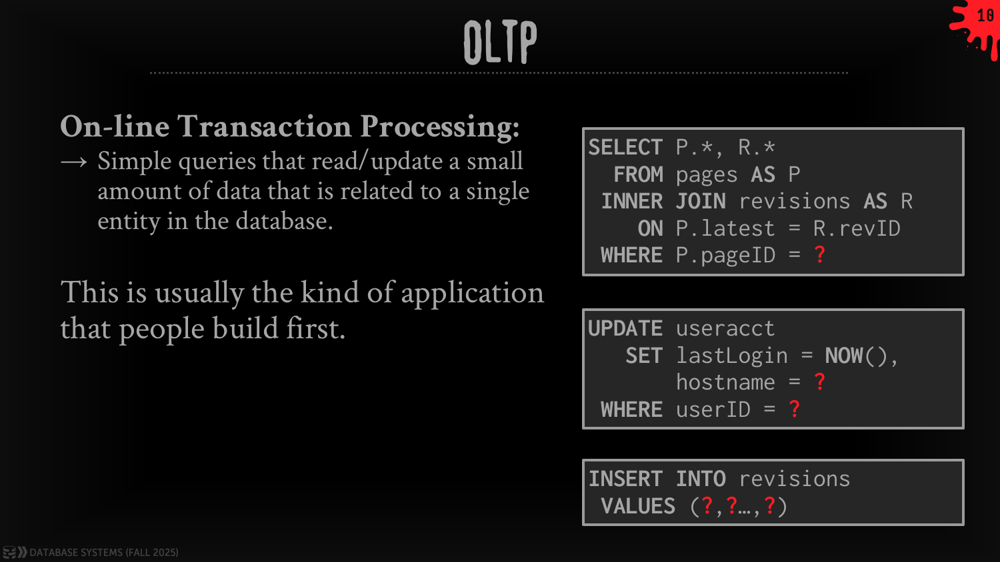

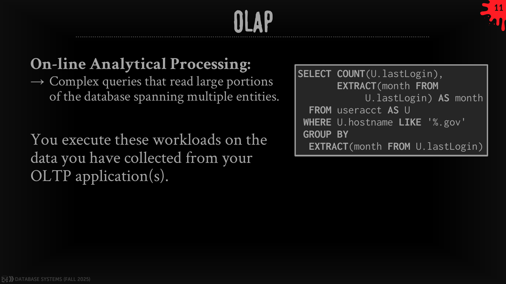

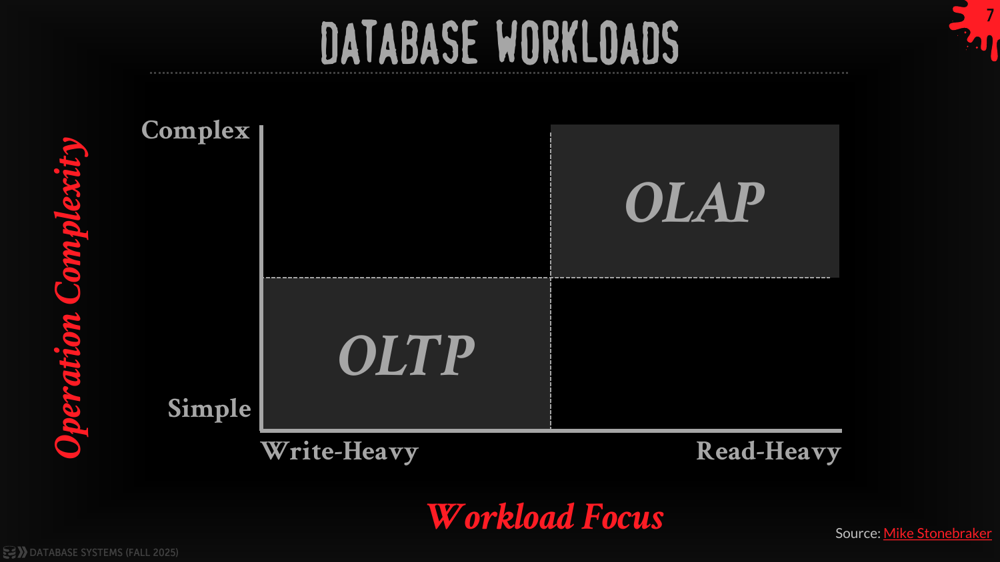

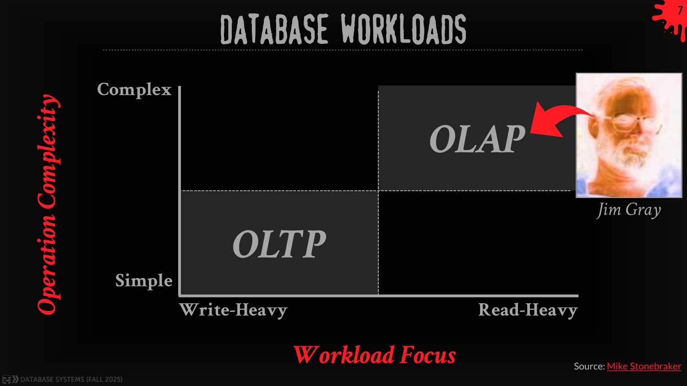

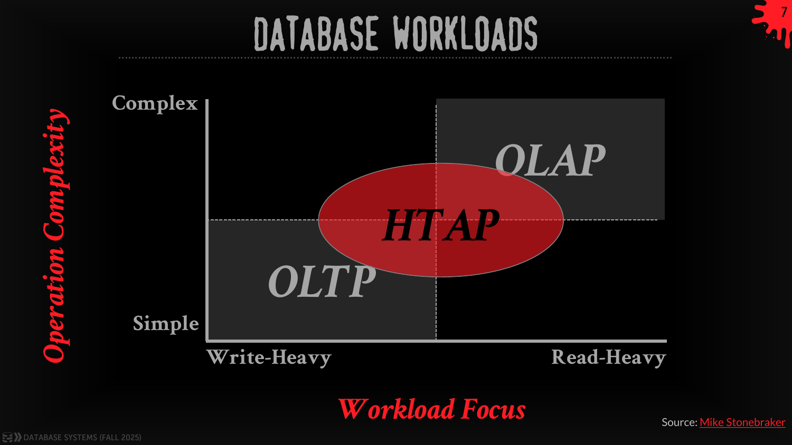

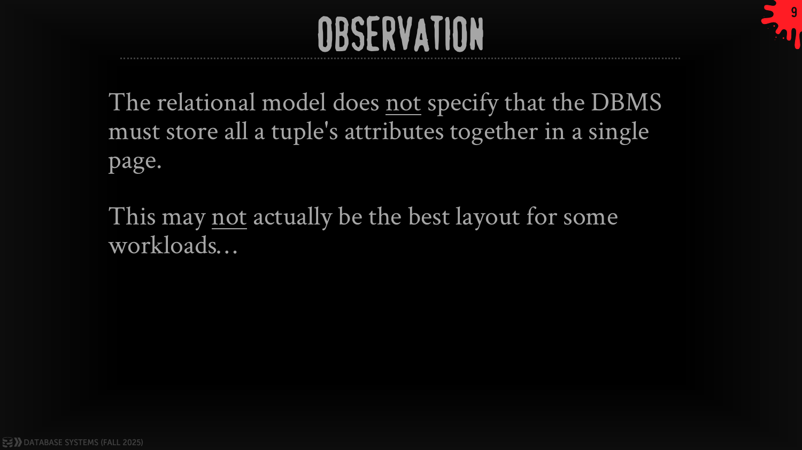

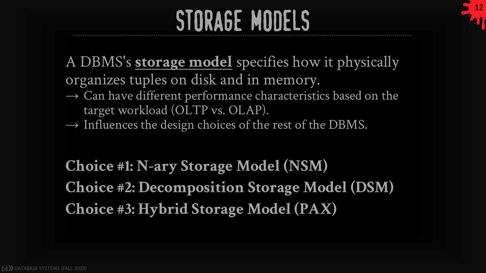

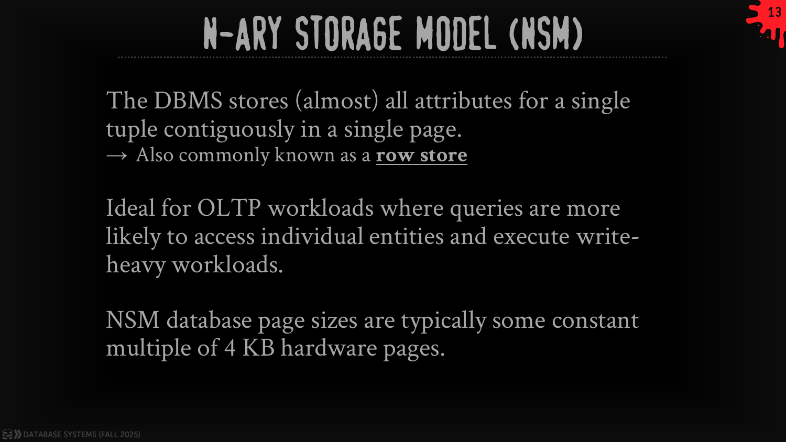

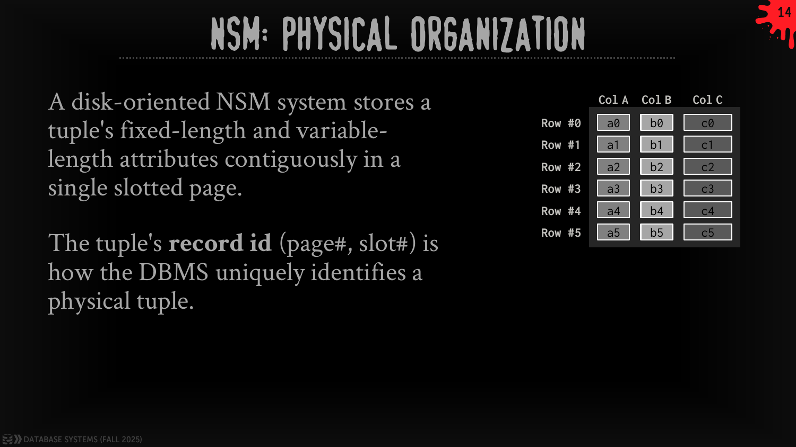

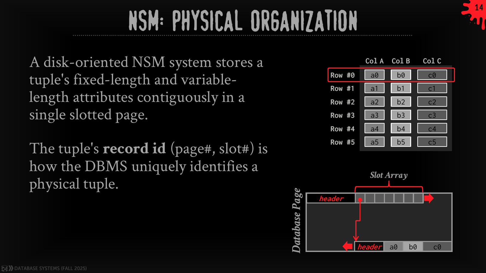

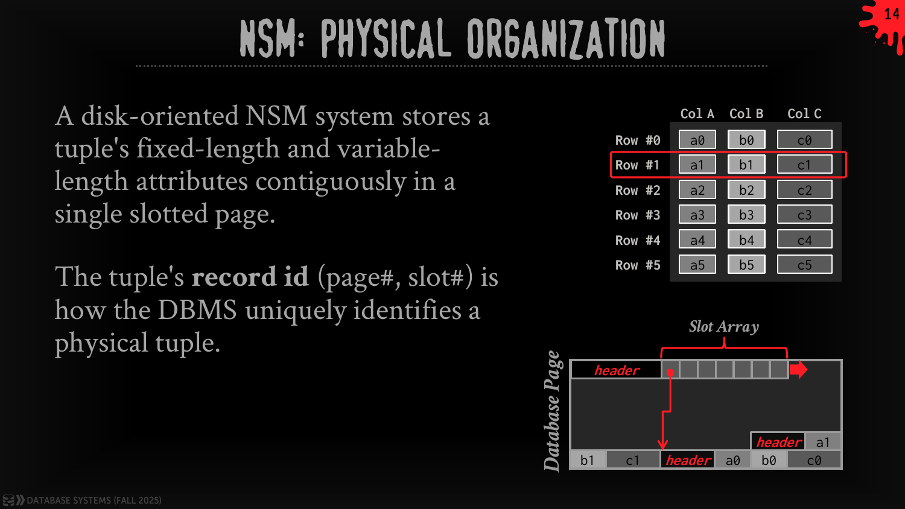


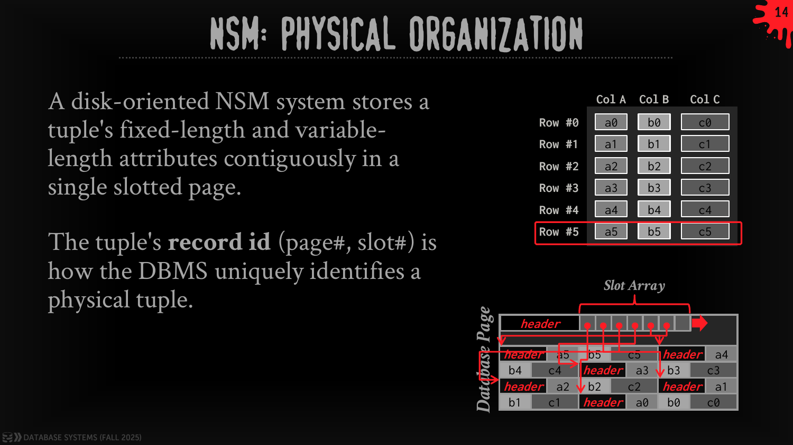

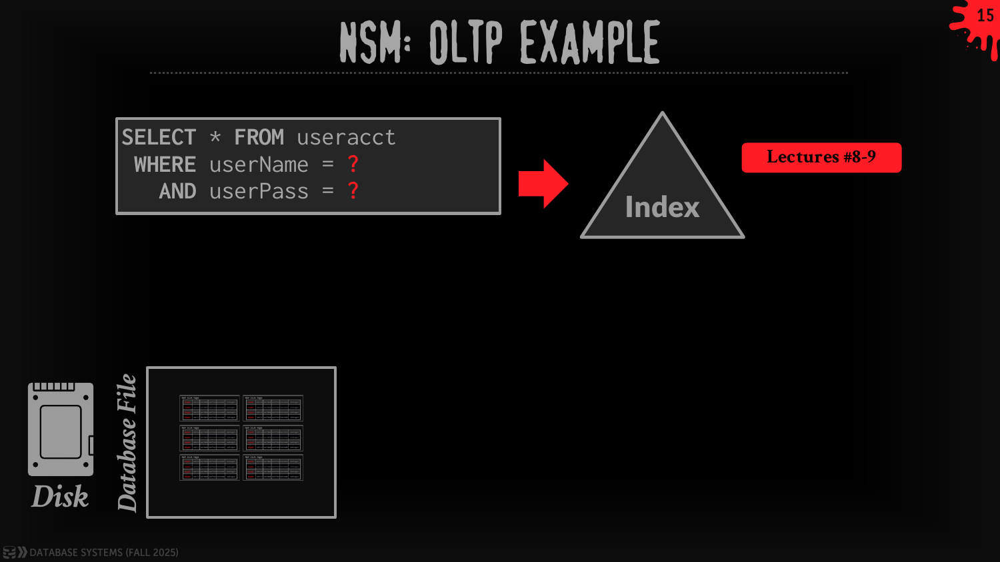

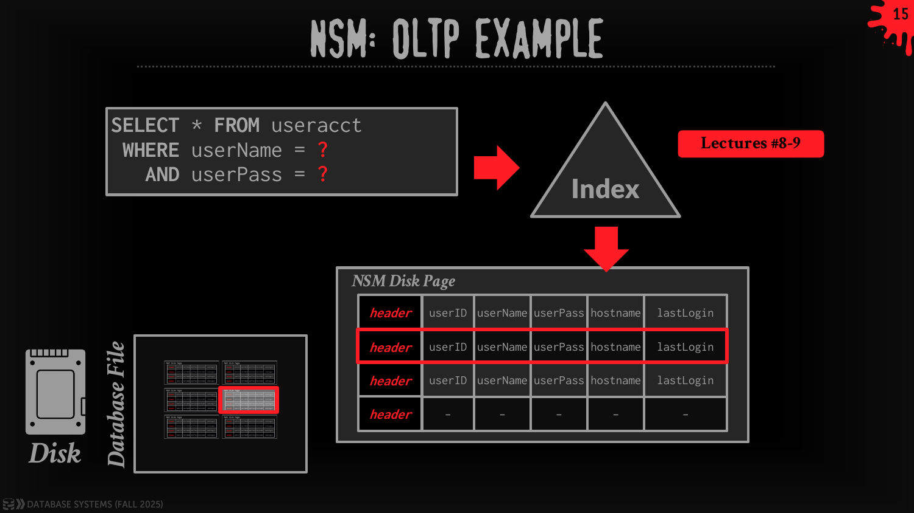

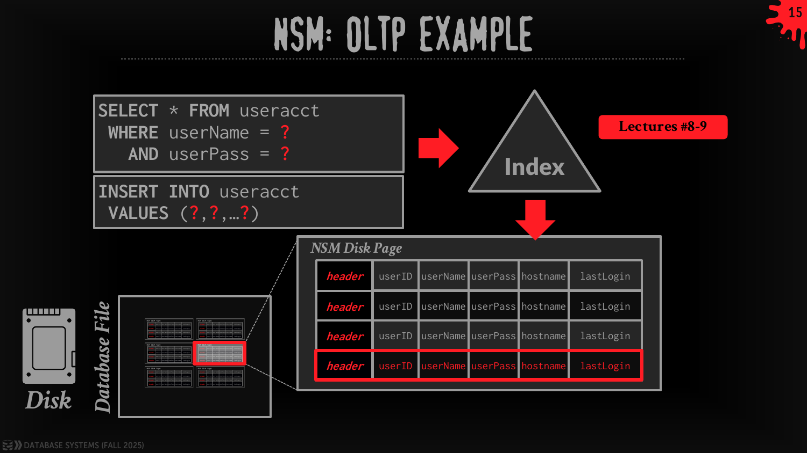


<details>
<summary>📎 本讲未被 📍 标注的幻灯片（共 5 页：封面、目录与行政页）</summary>


</details>
