# CMU 15-445 第 [12](index.md) 讲：连接算法（Joins Algorithms）

> **课程**：CMU 15-445/645 Database Systems（Fall 2025）· **主讲**：Andy Pavlo  
> **课程主页**：[CMU 15-445/645](https://15445.courses.cs.cmu.edu/fall2025/)  
> **材料**：课件 `12-joins.pdf`、官方 Lecture Notes `N12-joins.pdf`、课堂录音转写稿。  
> **说明**：正文以 PPT 与 Lecture Notes 为准，例题均重新计算。讲者引语的英文见脚注，依据转写稿修正明显的识别错误。“📍 PPT 第 X 页”指幻灯片右上角的编号，不是 PDF 阅读器页码。探测过滤器的 3 张幻灯片实际印为 64–66，夹在第 35 与第 37 页之间，本文保留这组异常编号。

## 摘要（Abstract）

关系[数据库](#数据库)把数据拆分到不同表中，减少重复；查询又需要通过[连接](#连接)，把分散的信息组合起来。逻辑上，这只是“找出满足条件的记录对”，物理上却可能意味着几千万次重复读[页](#页)。同一组输入，在一个简化的 I/O 模型下，从逐条反复扫描改为按批处理，成本就能从一个多小时降到一秒以内。

减少[连接](#连接)代价有一条逐步推进的路径：先让一次读[页](#页)服务更多记录，再利用[索引](#索引)直接查找；没有现成索引时，可以排序，用顺序排除不可能的匹配，也可以建立[哈希表](#哈希表)，用键值定位候选。哈希表超过内存后，再将两侧按相同规则[分区](#分区)，把大连接拆成多个内存内的小连接。重复键与[数据倾斜](#数据倾斜)决定了这些方法何时需要[回退](#回退)、重新分区或改用局部处理。
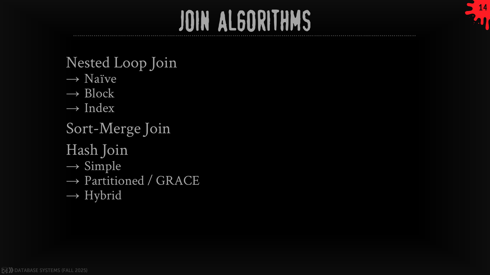


理解这些机制后，就能从扫描过程推导主要[连接](#连接)算法的 I/O 公式，跟踪排序归并对重复键的处理，解释 GRACE 为什么要让两侧[分区](#分区)对应，也能判断[索引](#索引)、内存、已有顺序和结果规模怎样改变算法选择。公式的前提与公式本身同样重要：忽略 CPU 的代价表，只能说明读写成本，不能替代对整个执行过程的判断。

## 课程地图

第 [12](index.md) 讲位于“查询处理”阶段，关注一个[连接](#连接)[算子](#算子)如何正确、高效地配对两个输入。


第 [3](../L03/index.md)、[4](../L04/index.md) 讲的[页](#页)与[缓冲池](#缓冲池)，决定记录如何读入、能保留多少；第 [6](../L06/index.md) 讲的行列存储，影响[连接](#连接)输出是否立即携带全部所需[属性](#属性)；第 [7](../L07/index.md)、[8](../L08/index.md)、[9](../L09/index.md) 讲的[哈希表](#哈希表)、[索引](#索引)和[布隆过滤器](#布隆过滤器)，为定位与过滤匹配提供工具。第 [11](../L11/index.md) 讲的外部排序和[哈希聚合](#哈希聚合)，则提供了处理超内存数据的分治方法；第 [5](../L05/index.md) 讲 [LSM 树](#LSM%20树)后台压实所用的多路归并，与第 [11](../L11/index.md) 讲的[外部归并排序](#外部归并排序)是同一套机制。
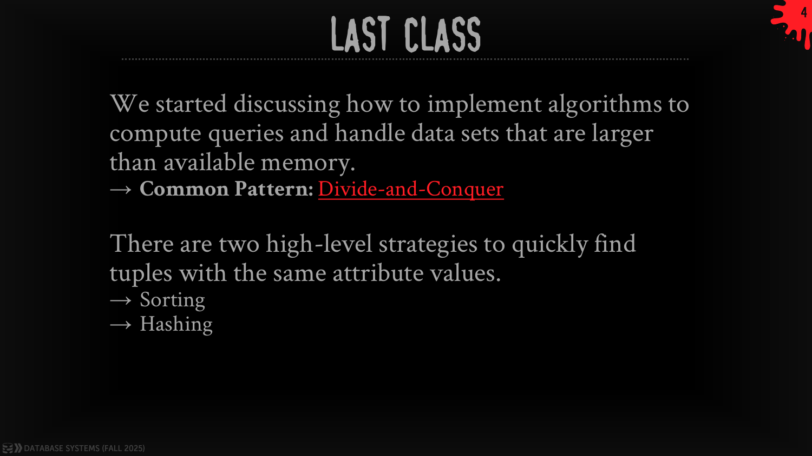


第 [13](../L13/index.md)、[14](../L14/index.md) 讲会把这些[算子](#算子)放进完整[执行引擎](#执行引擎)，讨论调用、数据传递和并行处理；第 [15](../L15/index.md)、[16](../L16/index.md) 讲再根据统计信息和成本，选择算法与[连接](#连接)顺序。讲次对应关系见[本学期官方课表](https://15445.courses.cs.cmu.edu/fall2025/schedule.html)。

## 1. 数据拆开存储之后，怎样重新配对
📍 *PPT 第 5–11 页*

### 1.1 [连接](#连接)要找的是满足条件的[元组](#元组)对
📍 *PPT 第 5–6、13 页*

假设把学生姓名、课程名称和成绩都放在一张表里。学生每选一门课，姓名就重复一次；一门课有多少学生，课程名称就重复多少次。把学生、课程和选课记录分别存储，可以减少这种重复，也让修改姓名、课程信息各有明确的位置。这是规范化（Normalization）所处理的问题之一。


存储上的分离，把重组数据的责任交给了查询。要列出某位学生选了哪些课，就要沿着学生 ID、课程 ID，把几张表里的相关记录连接起来。合理的分解应当允许通过连接恢复原来的信息；任意拆表再随意[连接](#连接)，可能产生原本不存在的组合。

第 [1](../L01/index.md)、[2](../L02/index.md) 讲已经介绍了[连接](#连接)（Join）的逻辑含义：取两边满足连接条件的[元组](#元组)，组合成结果。现在要解决的是，[数据库管理系统](#数据库管理系统)（Database Management System，DBMS）如何找到这些元组对。

这里集中讨论**[二元内等值连接](#二元内等值连接)（Binary Inner Equijoin）**：每次处理两个输入，只输出[连接](#连接)键相等的匹配对。“二元”说的是输入数量，“内连接”说的是不输出未匹配记录，“等值”说的是匹配条件。这几个维度不能混在一起：内连接也可以使用不等式条件。
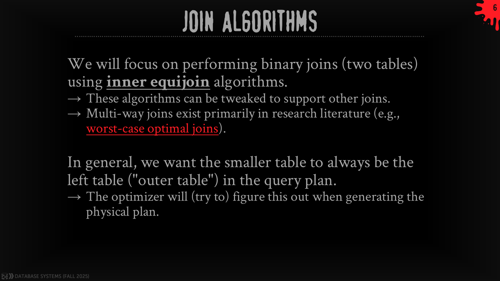


例如，`R.id = S.id` 要求两行的 ID 相同。[连接](#连接)键（Join Key）可以是一列，也可以是多列组成的[元组](#元组)；它不一定是[主键](#主键)，也不一定唯一。如果某个键在 R 中出现 a 次，在 S 中出现 b 次，该键就贡献 a × b 个匹配对。第 [2](../L02/index.md) 讲的包语义（Bag Semantics）仍然有效，普通 SQL 连接不会自动[去重](#去重)。

从[关系代数](#关系代数)看，可以把等值[连接](#连接)表达成 `σ_{R.id=S.id}(R × S)`。但执行时若先[物化](#物化)整个[笛卡尔积](#笛卡尔积)（Cross Product），就要先生成 m × n 个组合，再丢掉其中大部分。连接算法的价值，正是在生成结果之前排除不可能匹配的组合。若查询确实要求输出完整笛卡尔积，或者所有键都相同、所有组合都匹配，那么逐对输出本身的工作量就无法消失。
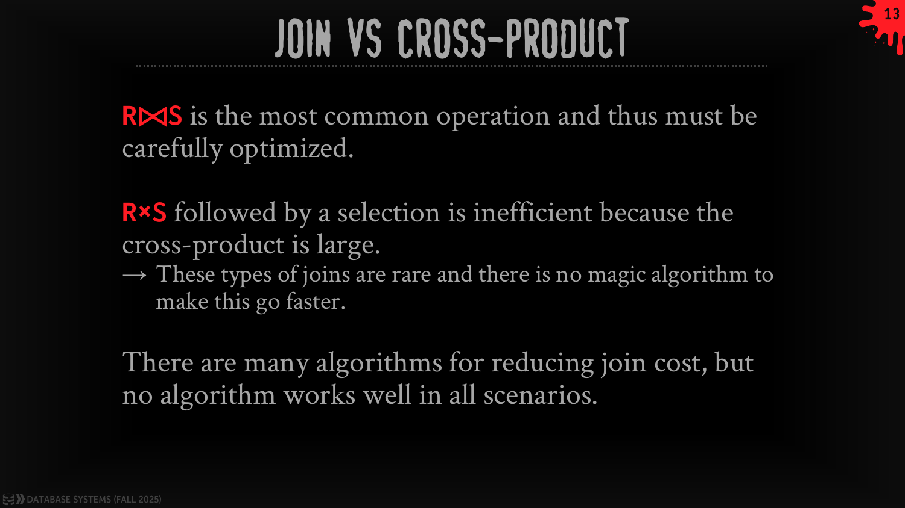


多个表通常通过若干个二元[连接](#连接)组合起来。例如，`(A ⋈ B) ⋈ C` 和 `A ⋈ (B ⋈ C)` 的中间结果可能差得很远。连接顺序由第 [15](../L15/index.md)、[16](../L16/index.md) 讲的查询优化器处理；这里先解决其中一个二元连接如何执行。多路连接（Multi-way Join）可以直接处理多个输入，最坏情况最优连接（Worst-case Optimal Join）就是一类面向多表连接的算法，对图模式查询等场景有价值，超出了本讲的展开范围。

### 1.2 [连接](#连接)[算子](#算子)处在一条数据处理路径上
📍 *PPT 第 7–9 页*

考虑这条查询：

```sql
SELECT R.id, S.cdate
FROM R JOIN S ON R.id = S.id
WHERE S.value > 100;
```

[查询计划](#查询计划)（Query Plan，见第 [11](../L11/index.md) 讲）把操作排列成树，数据从叶节点流向根节点。对应的数据流可以画成：

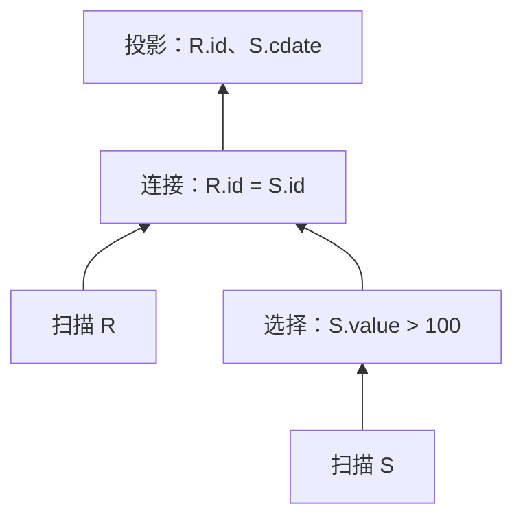

S 先经过选择，只把 `value > 100` 的记录交给[连接](#连接)；连接找到匹配对后，[投影](#投影)再保留结果需要的两列。根节点的输出就是查询结果。更复杂的计划还可能是有向无环图（Directed Acyclic Graph，DAG），但这棵树已经足以说明[算子](#算子)如何衔接。

[连接](#连接)算法接收到的输入，因而不一定是磁盘上的整张原始表，也可能是过滤后的数据流，或者另一个连接的输出。这一点直接影响后面的代价计算：输入[页](#页)数、[元组](#元组)数和所需列，应该对应实际交给这个[算子](#算子)的数据。

### 1.3 输出整行，还是保留取回数据的位置
📍 *PPT 第 9–11 页*

[连接](#连接)在逻辑上拼接两条记录，但物理上不必立即复制两边的全部[属性](#属性)。第 [11](../L11/index.md) 讲出现过的[早期物化](#早期物化)（Early Materialization）与[延迟物化](#延迟物化)（Late Materialization），在这里决定了中间结果有多宽，以及后续是否还要访问基表。

先看一个很小的输入。R 只有 `(123, abc)`，S 有以下两行，日期沿用原例的 `10/6/2025`：
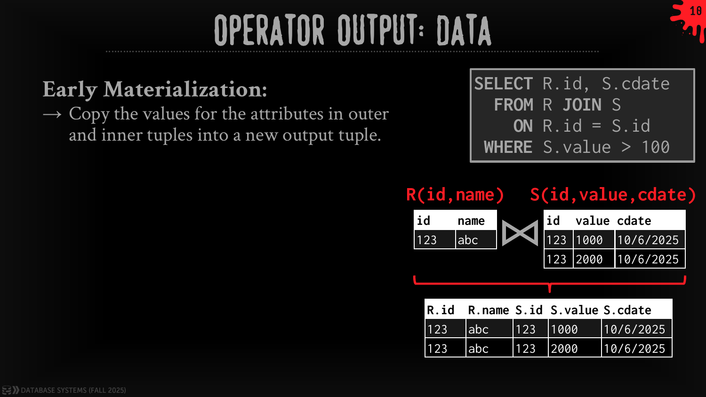


| S.id | S.value | S.cdate |
|---|---|---|
| 123 | 1000 | 10/6/2025 |
| 123 | 2000 | 10/6/2025 |

[早期物化](#早期物化)把需要的数据直接复制到输出中。若保留两表的全部[属性](#属性)，结果是：
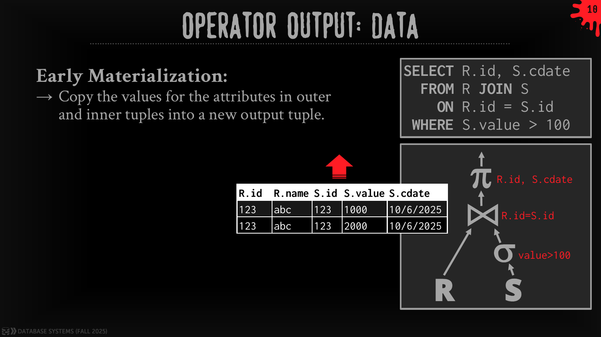


| R.id | R.name | S.id | S.value | S.cdate |
|---|---|---|---|---|
| 123 | abc | 123 | 1000 | 10/6/2025 |
| 123 | abc | 123 | 2000 | 10/6/2025 |

后续[算子](#算子)拿到这些[元组](#元组)，就能继续计算，无须再回原表取列。代价是中间元组较宽：`abc` 已经复制了两次；如果一条很宽的记录匹配许多行，重复复制的内容也会跟着增加。实际系统可以提前省略后面不会使用的[属性](#属性)，所以[早期物化](#早期物化)并不要求无条件复制所有列。
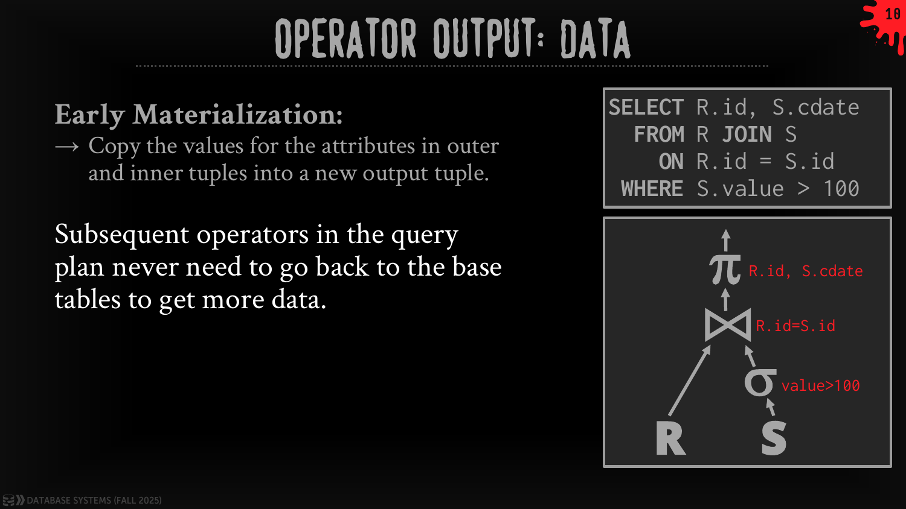


[延迟物化](#延迟物化)先传递[连接](#连接)键和[记录 ID](#记录%20ID)（record ID，RID，见第 [3](../L03/index.md) 讲）。记录 ID 提供的是找到原记录的位置，作用近似于 C 程序传递对象的引用：需要哪个字段，再沿着位置去取。原例的中间结果形式如下，`###` 表示具体记录的位置，不是键值：
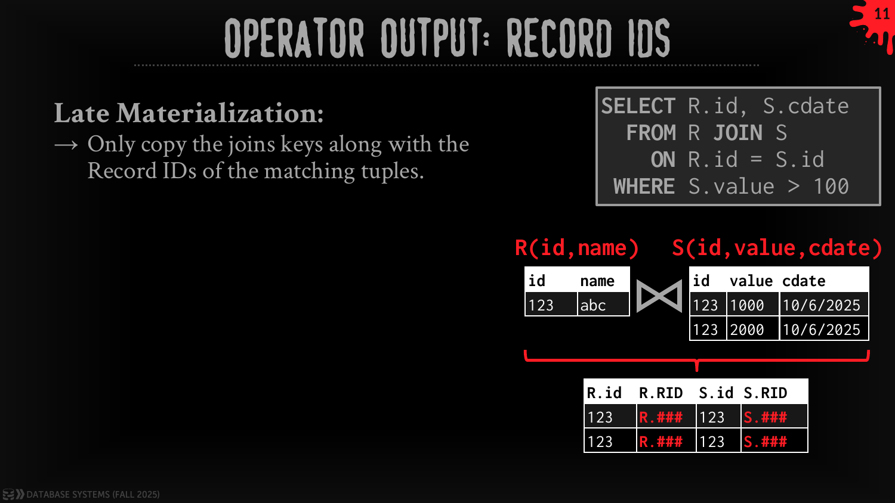


| R.id | R.RID | S.id | S.RID |
|---|---|---|---|
| 123 | R.### | 123 | S.### |
| 123 | R.### | 123 | S.### |

两行引用同一条 R 记录，引用两条不同的 S 记录。最后输出 `S.cdate` 时，再根据 S 的[记录 ID](#记录%20ID) 获取日期。
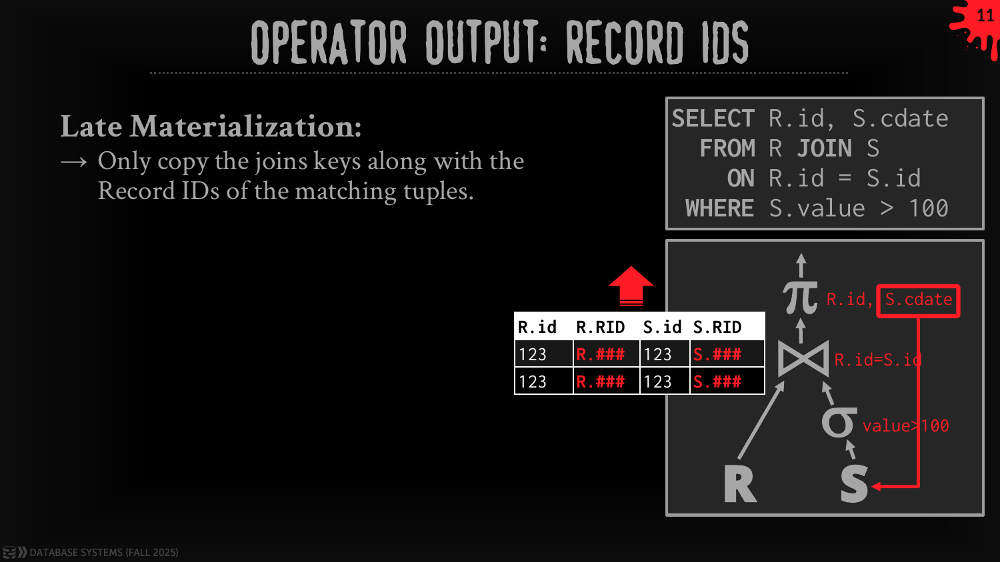


这尤其适合列存储（Column Store，见第 [6](../L06/index.md) 讲）。[连接](#连接)只需要 ID，就可以先不读名字、日期等列；如果连接淘汰了大量记录，后面只为少量幸存记录补齐数据。行存储（Row Store）读取一[页](#页)时往往已经把同一行的其他列带入内存，立即传递所需[属性](#属性)也可能很合算。
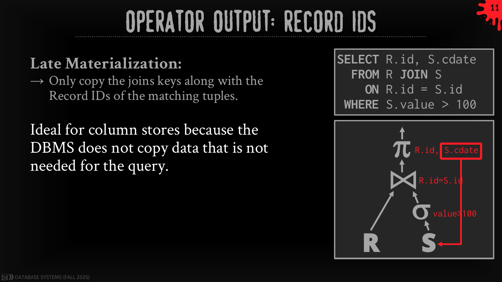


因此，[物化](#物化)策略要和存储布局、[连接](#连接)后的记录数、后续需要的列一起考虑。真实系统也可以混用两种方式：立即携带少数常用列，同时保留[记录 ID](#记录%20ID)，供后续按需取回其余列。

## 2. 衡量[连接](#连接)代价，要把[页](#页)和[元组](#元组)分开
📍 *PPT 第 12–14、17 页*

[连接](#连接)算法看起来都在比较记录，磁盘却按[页](#页)读写。一个算法比较了多少次，与它从磁盘读了多少页，是两本不同的账。

以下用页面 I/O（Page I/O）计价：读取一[页](#页)或写出一页各算一次 I/O。[缓冲池](#缓冲池)（Buffer Pool，见第 [4](../L04/index.md) 讲）用内存[帧](#帧)保存磁盘页，使已经读入的数据能够重复使用。符号约定如下：
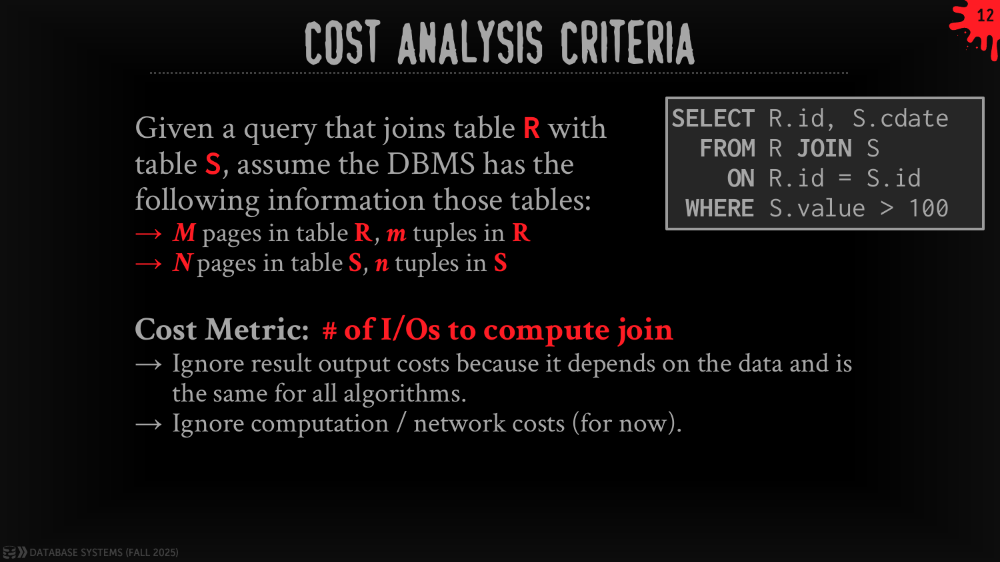


| 符号 | 含义 | 贯穿例题的数值 |
|---|---|---|
| R、S | 两个输入关系 | — |
| M、N | R、S 的[页](#页)数 | 1000、500 |
| m、n | R、S 的[元组](#元组)数 | 10 万、4 万 |
| B | 此次[连接](#连接)可使用的缓冲[帧](#帧)数 | 随例题指定为 100 或 102 |
| C | [索引](#索引)查找一次的平均 I/O 代价 | 由索引和数据决定 |

大写 M、N 数[页](#页)，小写 m、n 数[元组](#元组)。写出公式之前，先问[内表](#内表)是“每条[外表](#外表)记录扫描一次”，还是“每批[外表](#外表)页面扫描一次”，乘数就不容易弄错。

这个模型暂时忽略 CPU 计算与网络通信，只计算完成[连接](#连接)需要的输入读写和临时文件读写。单机磁盘[数据库](#数据库)常能从 I/O 数量看出主要差距；当数据已经在内存里，比较次数、哈希计算和内存访问就会重新成为关键，后面不能拿 I/O 相同推导出运行时间相同。

最终[连接](#连接)结果的写出成本也暂不计入。对同一查询、同一输出表示，各种正确算法应产生相同的匹配结果，因此这部分可以从比较中扣除。**中间[分区](#分区)文件和排序文件的读写仍然要算**，因为它们是某种算法额外付出的代价。

所有时间换算都采用例题的假设：每次 I/O 为 0.1 毫秒。因此 1 万次 I/O 折合 1 秒。这是为了比较算法设定的简化模型；连续读取、随机读取、缓存命中以及并发 I/O，在真实设备上的成本并不相同。

如果每[页](#页)为 4 KiB，两表共约 5.86 MiB，通常就概称为 6 MB。如此小的数据在现实中很可能全部驻留内存。故意限制内存、逐次计费，是为了暴露反复读盘的代价，而不是预言这两张小表在真实系统里一定需要多少时间。

## 3. 从嵌套循环出发，减少重复读盘
📍 *PPT 第 15–25 页*

### 3.1 朴素嵌套循环：每条记录都重新扫描内表
📍 *PPT 第 15–17 页*

**[嵌套循环连接](#嵌套循环连接)（Nested Loop Join）**枚举两边的[元组](#元组)对，检查[连接](#连接)条件，满足条件就输出。朴素版本（Naïve Nested Loop Join）可以写成：

```python
for r in R:
    for s in S:
        if r.id == s.id:
            emit(r, s)
```

外层循环遍历的关系叫**[外表](#外表)（Outer Table）**，内层循环遍历的关系叫**[内表](#内表)（Inner Table）**。这里的“外、内”来自循环层次，与 SQL 的外[连接](#连接)、内连接没有关系。图中通常把[外表](#外表)画在左边，但具体系统的图示约定可能不同，应以[算子](#算子)实际角色为准。
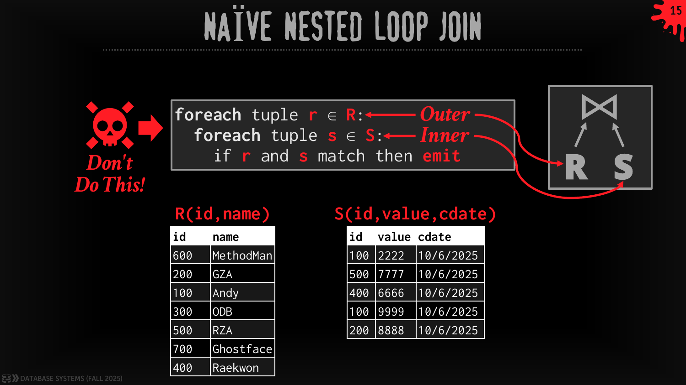


沿用输入中的一部分记录：R 里的 `(600, MethodMan)` 要检查 S 的所有记录，即使最终一条也匹配不到；轮到 `(200, GZA)`，又从头检查一遍。最昂贵的动作是一次次从磁盘读入相同的 S 页面。

如果[内表](#内表)没有可复用的缓存，读完整个[外表](#外表)花 M 次 I/O；[外表](#外表)有 m 条记录，每条记录各触发一次 N [页](#页)的[内表](#内表)扫描。因此：
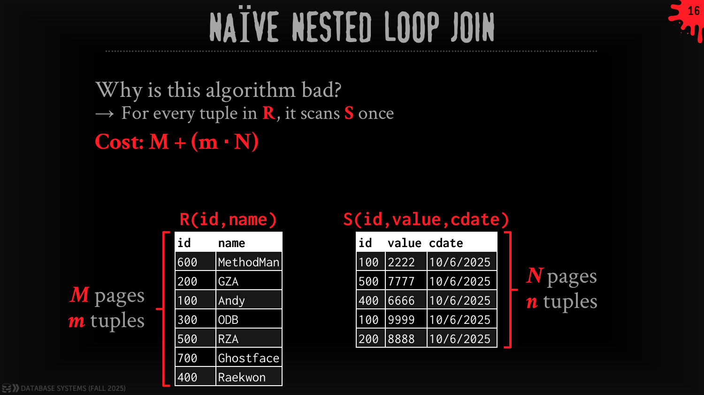


```math
\operatorname{Cost}_{\mathrm{naive}} = M + mN
```

这里的 mN 是“[外表](#外表)[元组](#元组)数 × [内表](#内表)[页](#页)数”，不是两表页数的乘积，也不是比较次数 mn。代入原例：
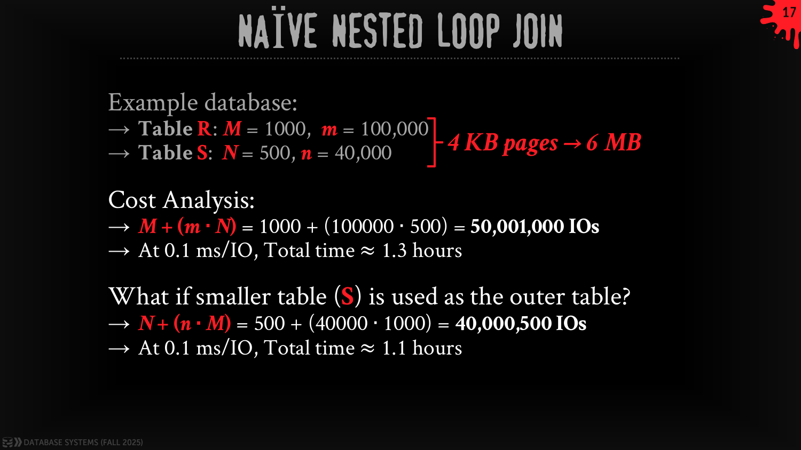


```math
\begin{aligned}
1000 + 100000 \times 500 &= 50{,}001{,}000\ \text{I/Os},\\
50{,}001{,}000 \times 0.1\ \text{ms}
&= 5000.1\ \text{s} \approx 1.39\ \text{h}.
\end{aligned}
```

把 S 放到外层，计算变成：

```math
\begin{aligned}
500 + 40000 \times 1000 &= 40{,}000{,}500\ \text{I/Os},\\
40{,}000{,}500 \times 0.1\ \text{ms}
&= 4000.05\ \text{s} \approx 1.11\ \text{h}.
\end{aligned}
```

交换方向省下约 1000 秒，但仍然很慢。PPT 把第一项写成约 1.3 小时，按给定数字精算应为约 1.39 小时，保留一位小数为 1.4 小时，与 Notes 一致。

“把较小的表放外侧”是有用的经验，但这里真正控制重复扫描次数的是[外表](#外表)的[元组](#元组)数，还要同时考虑另一边的[页](#页)数。不同表的行宽可能不同，不能只看“几行”或“几页”中的一个数就断定方向；把两个方向代入公式，才是直接的比较。
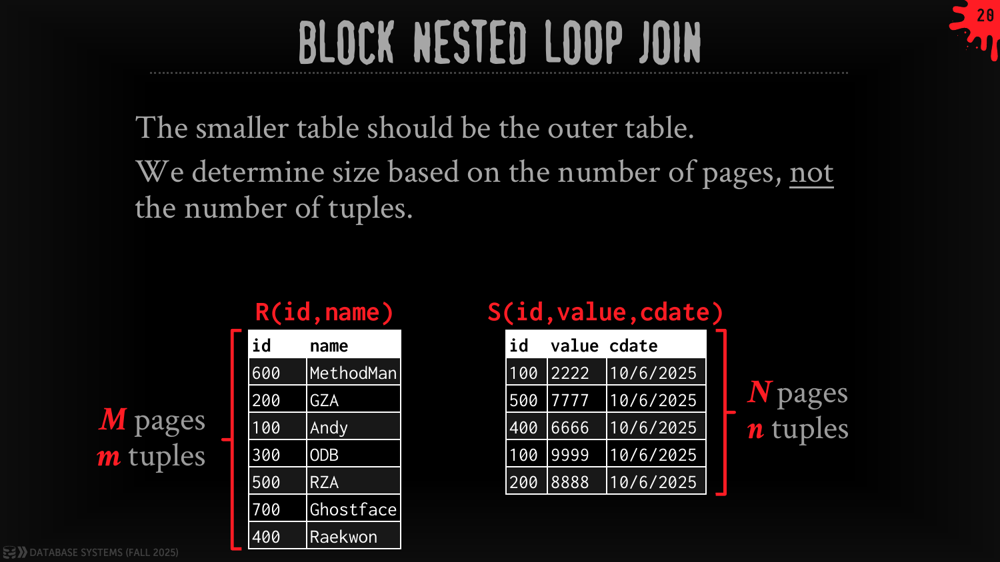


### 3.2 块嵌套循环：让一次读[页](#页)服务整页记录
📍 *PPT 第 18–20 页*

一[页](#页)已经读进内存，其中其他[元组](#元组)也就在手边。若只为[外表](#外表)的一条记录使用它，然后在下一条记录到来时再读一遍，就浪费了页面内部可以复用的数据。

**[块嵌套循环连接](#块嵌套循环连接)（Block Nested Loop Join）**把[外表](#外表)按块处理。先从最简单的一块一[页](#页)开始：取一页 R，再依次读取 S 的每一页；每得到一页 S，就比较两页中的全部[元组](#元组)。只有这页 R 与整个 S 都比较完，才换下一页 R。

```python
for page_r in pages(R):
    for page_s in pages(S):
        for r in page_r:
            for s in page_s:
                if r.id == s.id:
                    emit(r, s)
```

循环从 2 层变成 4 层，读盘次数反而下降了：S 现在每个[外表](#外表)[页](#页)扫描一次，扫描次数从 m 降到了 M。
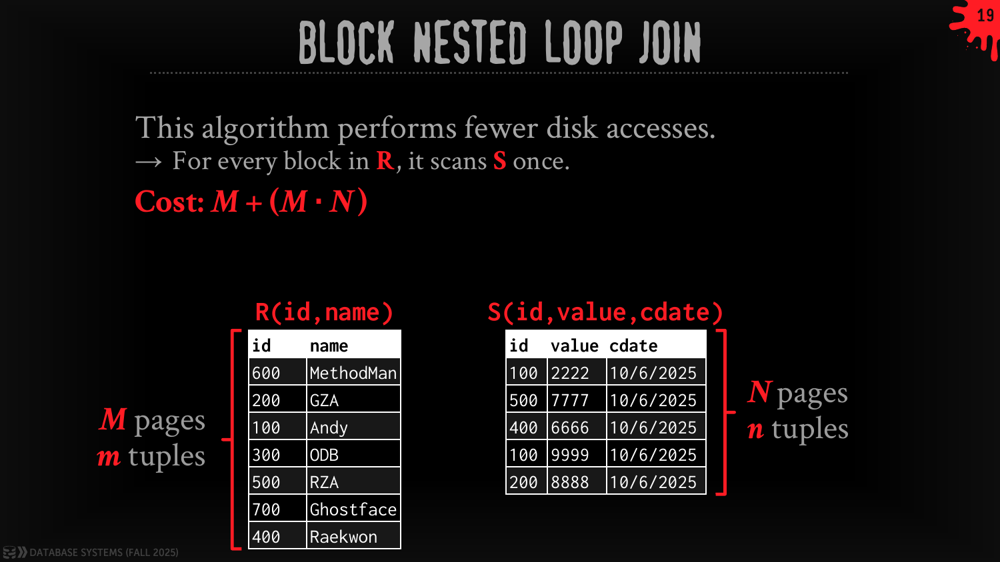


```math
\operatorname{Cost}_{\mathrm{block,\ 1\ page}} = M + MN
```

代入数字，R 作[外表](#外表)需要 `1000 + 1000 × 500 = 501000` 次 I/O，折合 50.1 秒；S 作[外表](#外表)需要 `500 + 500 × 1000 = 500500` 次 I/O，折合 50.05 秒。两种方向的乘积项相同，[页](#页)数较少的表放外侧，可以减少一次完整[外表](#外表)扫描的成本。

这个改进没有减少需要检查的[元组](#元组)对，总比较次数仍然是 mn。在每[页](#页)元组数固定时，它甚至没有改变渐近复杂度，但真实代价已经从约 5000 秒降到约 50 秒。Andy 对这类改进的判断很直接：“在[数据库](#数据库)里，常数因子很重要。”[^constants] 算法的数量级告诉我们增长趋势，页面复用决定了每一步究竟有多贵。

### 3.3 多给外表一些内存，内表就少扫描几遍
📍 *PPT 第 21–22 页*

既然一[页](#页)[外表](#外表)能让其中多条记录共享一次[内表](#内表)扫描，多页[外表](#外表)也可以共享。假设[连接](#连接)可用 B 个缓冲[帧](#帧)，最简单的分配方式是：[外表](#外表)占 B − 2 帧，[内表](#内表)逐页扫描占 1 帧，输出缓冲占 1 帧。
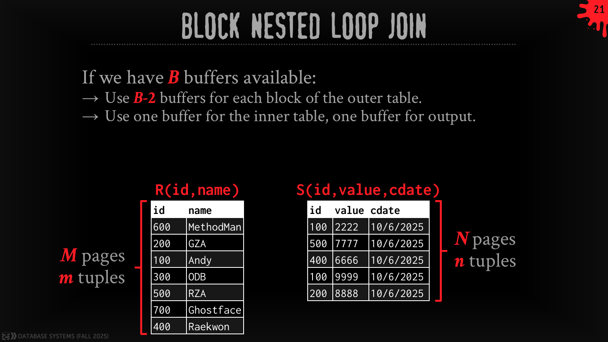


```text
Available buffer frames: B
+--------------------------------+------------+------------+
| R batch: B - 2 pages           | S: 1 page  | Output: 1  |
+--------------------------------+------------+------------+
             held fixed          replaced as   filled and
                                 S is scanned drained
```

[外表](#外表)这批页面要保留到[内表](#内表)扫描结束；[内表](#内表)缓冲反复装入下一[页](#页)。输出缓冲填满后可以交给上层[算子](#算子)，或者按执行方式写出再复用，[连接](#连接)结果不必全部装在这一页里。需要多页输出缓冲或异步读写的实现可以重新分配内存，但下面的公式采用这个基本安排。

[外表](#外表)总共 M [页](#页)，每批最多 B − 2 页，需要向上取整后的批次数。每批各扫描一次 S，得到：
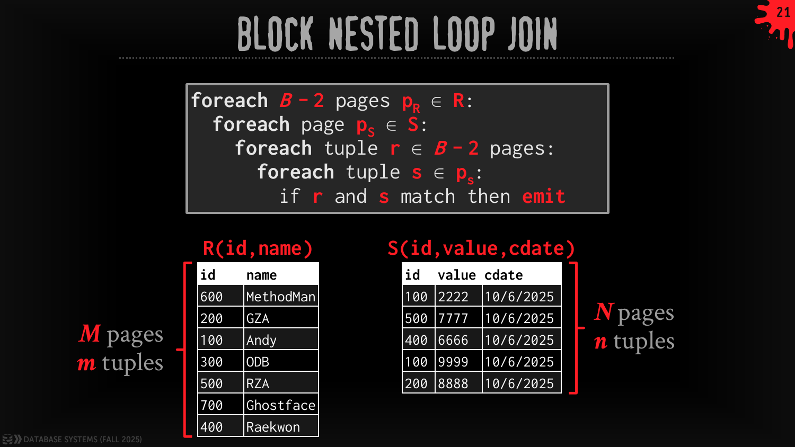


```math
\operatorname{Cost}_{\mathrm{BNL}}
= M + \left\lceil\frac{M}{B-2}\right\rceil N,
\qquad B \ge 3.
```

向上取整不能省：最后一批即使只有 1 页，也要完整扫描一遍[内表](#内表)。以 PPT 的 B = 102 为例，100 个[帧](#帧)留给[外表](#外表)：

| 步骤 | R 作[外表](#外表) | S 作[外表](#外表) |
|---|---|---|
| 每批[外表](#外表)容量 | 100 [页](#页) | 100 页 |
| [外表](#外表)批次数 | ⌈1000 / 100⌉ = 10 | ⌈500 / 100⌉ = 5 |
| [外表](#外表)总读取量 | 1000 页 | 500 页 |
| [内表](#内表)总读取量 | 10 × 500 = 5000 页 | 5 × 1000 = 5000 页 |
| 总 I/O | 6000 | 5500 |
| 模型耗时 | 0.60 秒 | 0.55 秒 |

如果整个[外表](#外表)能放进 B − 2 [帧](#帧)，批次数就降到 1：

```math
M \le B-2
\quad\Longrightarrow\quad
\operatorname{Cost}_{\mathrm{BNL}}=M+N
=1500\ \text{I/Os}=0.15\ \text{s}.
```

达到这个 I/O 代价，只要求[外表](#外表)整体驻留，[内表](#内表)可以继续逐[页](#页)流入。两表不必同时完整装入内存。PPT 写的是 `M < B − 2`，恰好相等时同样装得下，故这里写成 `≤`。

此时朴素循环与块循环在 I/O 上可能没有区别，因为需要的[页](#页)已经读入或可以复用；但 mn 次比较仍然存在。很小的内存块直接循环，能省去建立辅助结构的启动成本；两边记录都很多时，[哈希连接](#哈希连接)依然可能通过减少无效比较胜出。0.15 秒只表示这个模型里的读页成本。

### 3.4 [索引](#索引)嵌套循环：把一次全表扫描换成一次查找
📍 *PPT 第 23–25 页*

批处理让一次[内表](#内表)扫描服务更多记录，但仍然会检查许多不可能匹配的[元组](#元组)。如果[内表](#内表)[连接](#连接)键上已经有[索引](#索引)，就可以直接定位匹配记录。
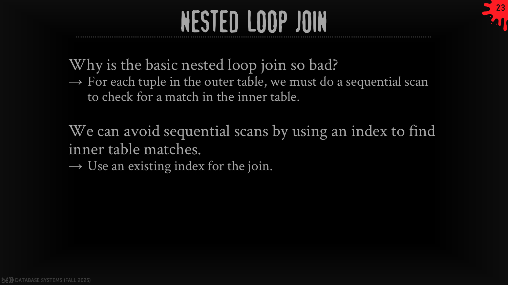


**[索引嵌套循环连接](#索引嵌套循环连接)（Index Nested Loop Join）**保持外层遍历不变，把内层全扫描替换成[索引](#索引)查找。例如，[外表](#外表)读到 `R.id = 100`，就在 `S.id` 的索引里找出所有值为 100 的记录，再依次输出匹配对。

```python
for r in R:
    for s in index_S.lookup_all(r.id):
        if r.id == s.id:
            emit(r, s)
```

要有[索引](#索引)的是**[内表](#内表)**。查找也必须返回全部匹配记录；如果索引键不唯一，找到第一条就停止会漏掉结果。

以 C 表示每次查找的平均 I/O 代价：
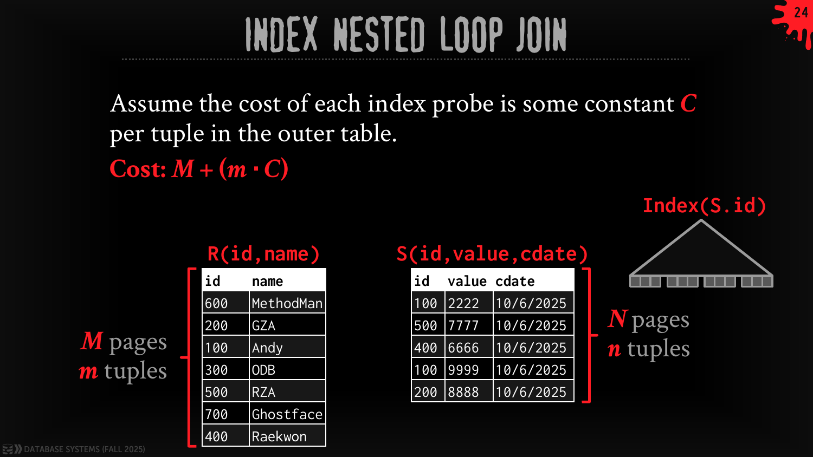


```math
\operatorname{Cost}_{\mathrm{INL}}=M+mC.
```

C 包括定位[索引](#索引)项，以及为了取得所需数据而付出的访问成本。[B+ 树](#B+%20树)（B+ Tree，见第 [8](../L08/index.md)、[9](../L09/index.md) 讲）通常需要沿树向下查找；遇到重复键，还可能沿[叶节点](#叶节点)继续扫描；如果索引不覆盖查询需要的列，还要访问相应的数据[页](#页)。树高、缓存命中率、重复值数量和数据页分布都会改变 C，所以不能给所有索引填同一个常数。

这个公式也解释了[索引](#索引)[连接](#连接)的优势场景：[外表](#外表)先被过滤到很少几行，逐行查索引通常只需很少几次访问；为此扫描整个[内表](#内表)、建立一个完整[哈希表](#哈希表)，反而可能多做大量工作。如果[外表](#外表)很大，反复的索引探测和随机取[页](#页)又可能变得昂贵。

DBMS 还可以为当前查询临时建立[索引](#索引)，用完再丢弃。这时总成本必须额外加上建索引的代价，`M + mC` 本身没有支付这笔费用。沿着这条思路继续走，就会得到后面的[哈希连接](#哈希连接)：专门为此次匹配建立一个适合等值查找的结构。

## 4. 排序让不可能匹配的记录提前退出
📍 *PPT 第 26–32 页*

### 4.1 排序归并连接（Sort-Merge Join）
📍 *PPT 第 26–27 页*

没有现成[索引](#索引)时，仍然可以先整理数据，再寻找匹配。排序提供的性质很直接：若 S 已经按 ID 递增排列，扫描到 400 时仍未遇到 300，那么后面也不会再遇到 300。系统据此就能结束对 `R.id = 300` 的搜索。

**[排序归并连接](#排序归并连接)（Sort-Merge Join）**先将两个输入按[连接](#连接)键排序，再用两个游标沿有序输入移动，寻找相同键的记录。游标（Cursor）可以理解为指向当前处理位置的指针。设两个游标当前的键分别是 r.key 和 s.key：
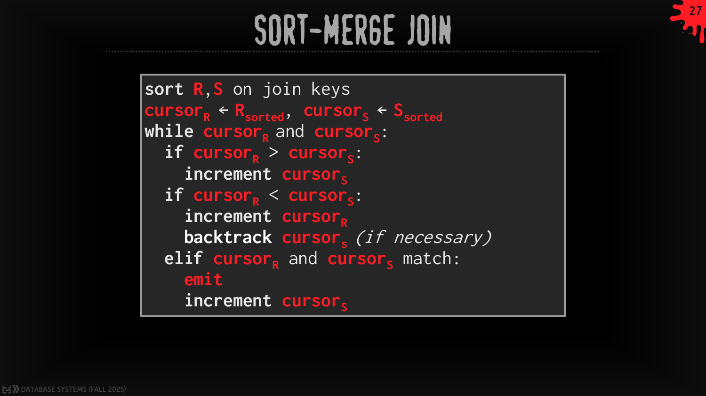


| 比较结果 | 可以确定的事实 | 下一步 |
|---|---|---|
| r.key < s.key | S 后面的键不会小于当前 s.key，当前 r 不可能再找到新匹配 | 推进 R 的游标 |
| r.key > s.key | R 后面的键不会小于当前 r.key，当前 s 不可能再找到新匹配 | 推进 S 的游标 |
| r.key = s.key | 找到了两个相同键的分组 | 输出组间的全部匹配对，再处理下一个键 |

这里有两层容易重名的“归并”。[外部归并排序](#外部归并排序)（External Merge Sort，见第 [11](../L11/index.md) 讲）把同一输入的多个有序段合成一个有序流，解决的是排序；[连接](#连接)的归并阶段把 R、S 中相同键的记录配对，解决的是连接。前者可以作为后者的准备工作，两种归并的输出含义不同。

### 4.2 重复键要求回到匹配组的起点
📍 *PPT 第 28 页*

下面使用原例排序后的数据。为了演示重复键，R 比前面的嵌套循环示例多了一条 `(200, GZA)`：
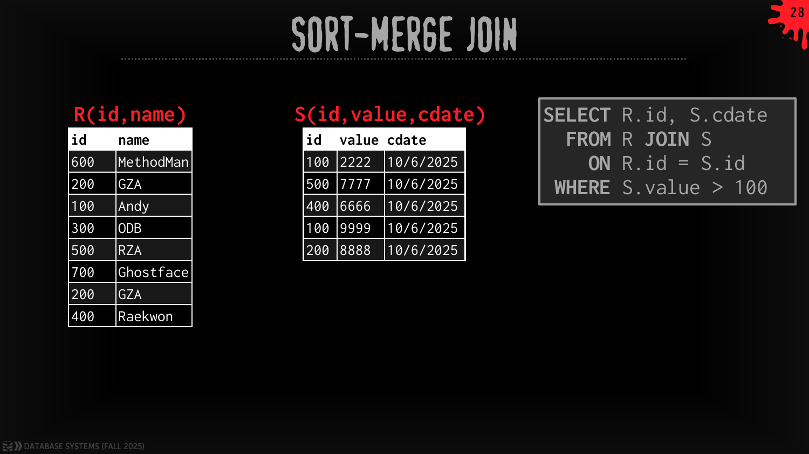


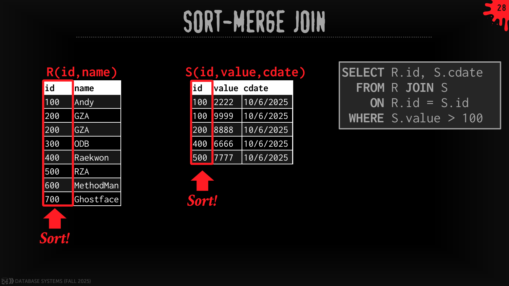


| R.id | R.name |
|---|---|
| 100 | Andy |
| 200 | GZA |
| 200 | GZA |
| 300 | ODB |
| 400 | Raekwon |
| 500 | RZA |
| 600 | MethodMan |
| 700 | Ghostface |

| S.id | S.value | S.cdate |
|---|---|---|
| 100 | 2222 | 10/6/2025 |
| 100 | 9999 | 10/6/2025 |
| 200 | 8888 | 10/6/2025 |
| 400 | 6666 | 10/6/2025 |
| 500 | 7777 | 10/6/2025 |

S 的所有 value 都大于 100，所以前置过滤没有删掉任何行。先固定 R 当前行，扫描 S 的相同键分组，过程如下：
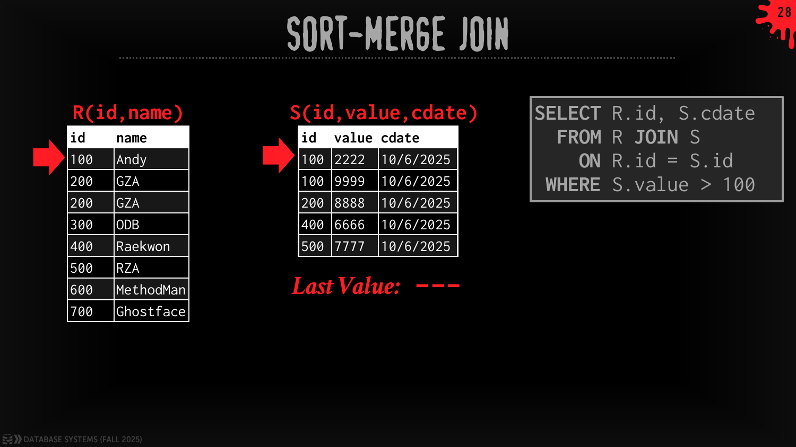

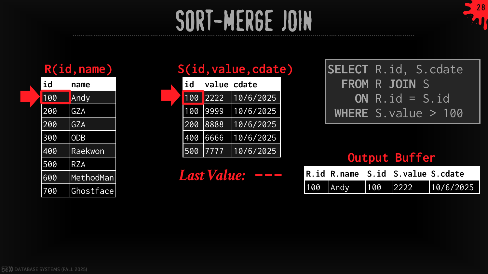


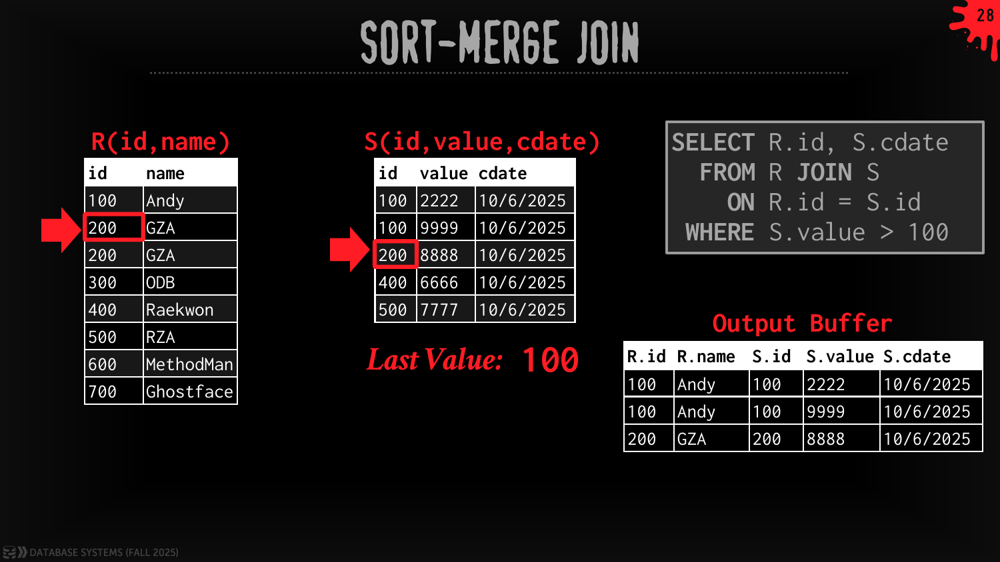

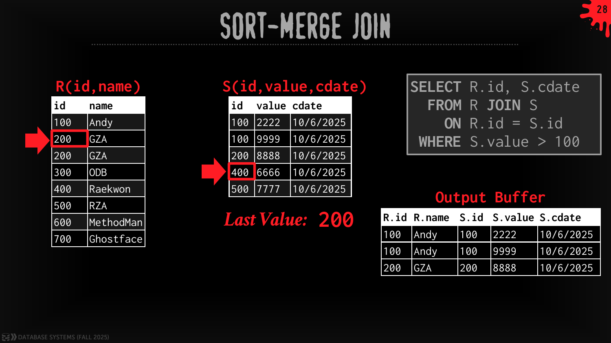


| 步骤 | R 当前行 | S 当前行 | 输出或移动的理由 |
|---|---|---|---|
| 1 | `(100, Andy)` | `(100, 2222)` | 键相同，输出；只推进 S |
| 2 | `(100, Andy)` | `(100, 9999)` | 再输出一对；S 前进到 200 |
| 3 | `(100, Andy)` | `(200, 8888)` | S 已越过 100，推进 R 到第 1 条 200 |
| 4 | 第 1 条 `(200, GZA)` | `(200, 8888)` | 输出；记住 S 中这个匹配组的起点，S 前进到 400 |
| 5 | 第 2 条 `(200, GZA)` | `(400, 6666)` | R 又出现 200，必须把 S [回退](#回退)到刚才的 200 |
| 6 | 第 2 条 `(200, GZA)` | `(200, 8888)` | 再输出一对；两条 R 记录各自都有匹配 |
| 7 | `(300, ODB)` | `(400, 6666)` | S 不会再出现 300，跳过 R 的 300 |
| 8 | `(400, Raekwon)` | `(400, 6666)` | 输出匹配对，随后处理 500 |
| 9 | `(500, RZA)` | `(500, 7777)` | 输出，S 到达末尾 |
| 10 | `(600, MethodMan)` | 已到末尾 | R 的键已超过最后匹配键 500，后面不再可能匹配 |

第 5 步就是**[回退](#回退)（Backtracking）**：为了给下一条相同键的[外表](#外表)记录寻找全部匹配，再次访问[内表](#内表)中已经经过的匹配组。记录一个“上次键值”能帮助判断是否需要[回退](#回退)，但真正执行时还要保存组起点的位置，或把这个组缓存在内存里。只知道键值为 200，却不知道记录在哪里，并不足以恢复扫描。
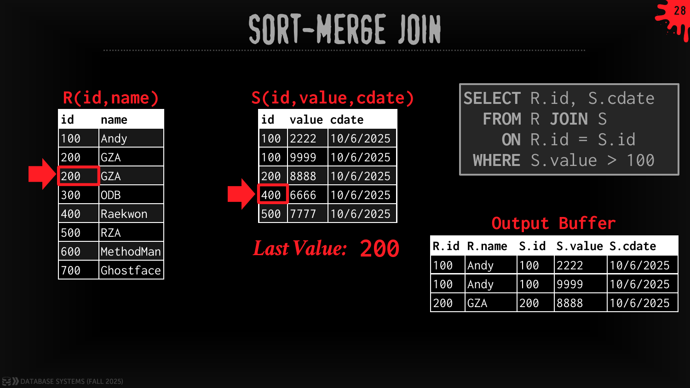

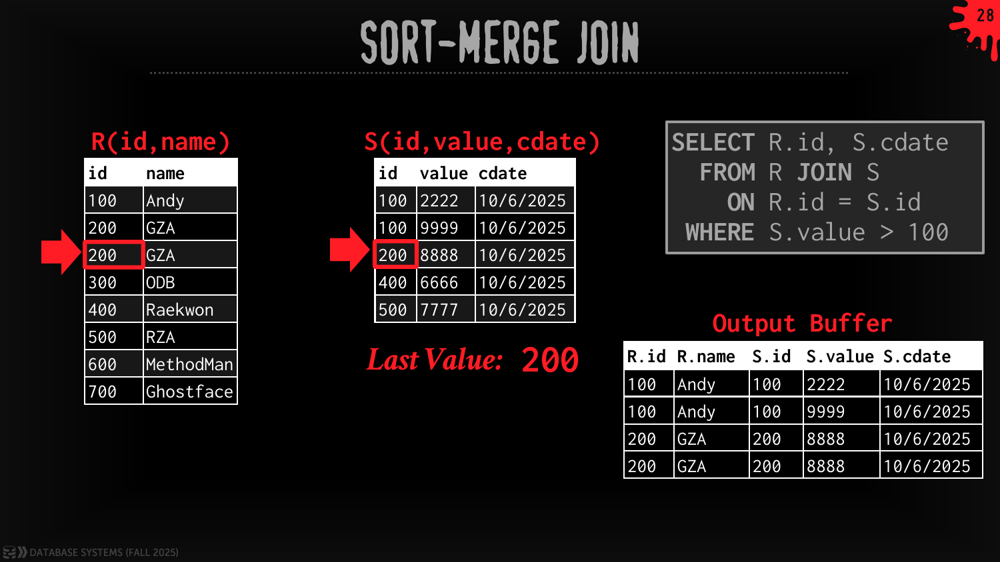

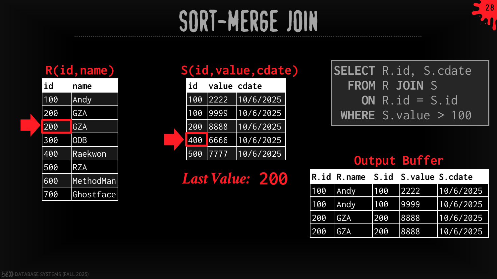


若 R 中也有两条 100，每条都必须分别匹配 S 的两条 100，总共输出 4 对。第二条 R.100 到来时，S 要回到**第一条** 100，不能只退回最后一条。一个组有 a 条 R 记录、b 条 S 记录，输出数量就是 ab。

原例完整[连接](#连接)输出为：
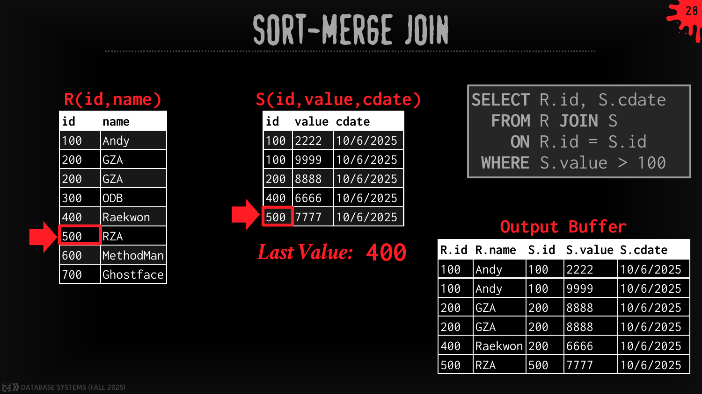

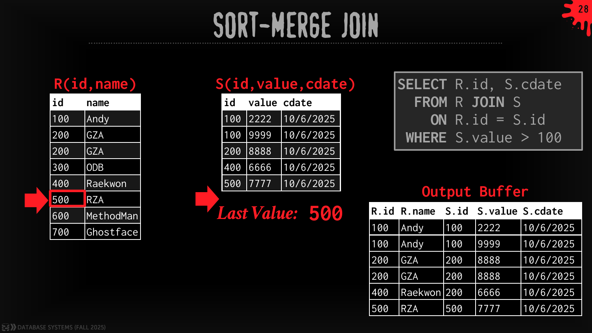


| R.id | R.name | S.id | S.value | S.cdate |
|---|---|---|---|---|
| 100 | Andy | 100 | 2222 | 10/6/2025 |
| 100 | Andy | 100 | 9999 | 10/6/2025 |
| 200 | GZA | 200 | 8888 | 10/6/2025 |
| 200 | GZA | 200 | 8888 | 10/6/2025 |
| 400 | Raekwon | 400 | 6666 | 10/6/2025 |
| 500 | RZA | 500 | 7777 | 10/6/2025 |

两条 200 的输出看起来相同，但代表两个不同的输入匹配对，普通[连接](#连接)应保留。PPT 动画把 Raekwon 那一行的 `S.id` 误写成 200；输入和等值条件都确定该值应为 400，上表已修正。

[主键](#主键)或唯一性约束可以简化这套机制。若[外表](#外表)[连接](#连接)键唯一，已经处理过的 S 匹配组不会再被下一条 R 记录需要；若[内表](#内表)键唯一，则一个 S 匹配组最多只有一行，可以保留这行去匹配连续的 R 重复键。要利用的是“哪一侧不会重复”的具体事实，不能因为某一侧唯一，就把另一侧的重复结果漏掉。

到达输入末尾也要服从同一原则：如果 S 已到末尾，但 R 后面还有与最后一组相同的键，仍要完成这些匹配。确认不再需要重放最后一个组，才可以停止。
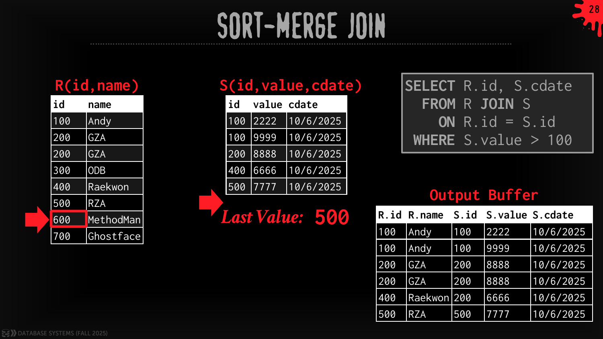


### 4.3 排序付多少代价，归并又付多少代价
📍 *PPT 第 29–31 页*

先看没有额外磁盘回读的归并阶段：R、S 的有序数据各读一次，成本就是 M + N。重复键组若缓存在内存中，重复比较也不一定增加磁盘读取；真正破坏这个 I/O 估计的是需要从磁盘重新读取已处理的分组。

若输入还没有排序，可以用第 [11](../L11/index.md) 讲的[外部归并排序](#外部归并排序)来计算准备成本。对 P [页](#页)输入、B 个缓冲[帧](#帧)，初始阶段生成 `⌈P/B⌉` 个有序段，每个段最多 B 页；随后每[趟](#趟)最多归并 B − 1 个段，因为还要保留 1 个输出缓冲。每趟读写全部 P 页，共 2P 次 I/O。

在各[趟](#趟)结果都写回磁盘的基本模型下：
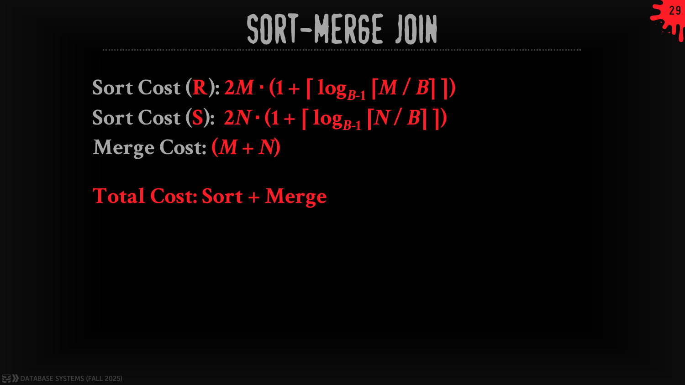


```math
\begin{aligned}
\operatorname{Sort}(P)
&=2P\left(1+\left\lceil
\log_{B-1}\left\lceil\frac{P}{B}\right\rceil
\right\rceil\right),\\
\operatorname{Cost}_{\mathrm{SMJ}}
&=\operatorname{Sort}(M)+\operatorname{Sort}(N)+M+N.
\end{aligned}
```

第一项中的 1 表示初始有序段生成阶段，对数部分计算后续归并[趟](#趟)数。[连接](#连接)阶段再把两个排好序的输入读回来，所以还有最后的 M + N。这里假设 P 为正且 B ≥ 3；已有顺序或把最后一趟排序直接接给连接的实现，可以省去部分读写，应按具体执行方式另算。

原例取 B = 100，与前面块嵌套循环的 B = 102 不同。R 初始生成 10 个有序段，S 初始生成 5 个，而一次可以归并 99 个段，所以两表都只需要“生成有序段 + 1 [趟](#趟)归并”：
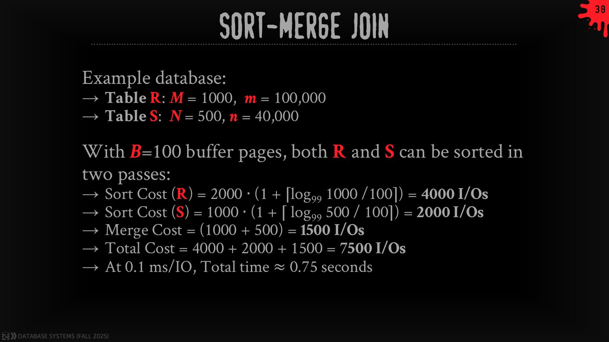


```math
\begin{aligned}
\operatorname{Sort}(R)
&=2\times1000\times
\left(1+\left\lceil\log_{99}\left\lceil1000/100\right\rceil\right\rceil\right)
=4000,\\
\operatorname{Sort}(S)
&=2\times500\times
\left(1+\left\lceil\log_{99}\left\lceil500/100\right\rceil\right\rceil\right)
=2000,\\
\operatorname{Merge}(R,S)&=1000+500=1500,\\
\operatorname{Cost}_{\mathrm{SMJ}}&=4000+2000+1500=7500\ \text{I/Os},\\
\operatorname{Time}&=7500\times0.1\ \text{ms}=0.75\ \text{s}.
\end{aligned}
```

“归并只需 M + N”依赖上述读取条件，不能当作无条件保证。如果两表所有[连接](#连接)键都相同，整个输入就是一个巨大匹配组，结果有 mn 行。匹配组装不下内存时，系统可能反复读取[内表](#内表)。PPT 和 Notes 用约 MN 的归并 I/O 来表达这种按页重复匹配的退化，于是总成本写成“排序成本 + MN”。具体重复读取次数还与组缓存、批处理方式和内存大小有关，这个简式不是所有实现的精确最坏上界。


最需要记住的界限是：排序能证明不同键不必比较，却不能免除同一个键组内部本来就需要的匹配。即使数据全部在内存中，显式输出 mn 个结果的 CPU 工作也仍然存在。

### 4.4 顺序可以在整个计划中复用
📍 *PPT 第 32、48 页*

[排序归并连接](#排序归并连接)最有吸引力的场景，是排序工作已经做过，或者接下来本来就要做。

输入可能来自前一个排序[算子](#算子)，也可能来自[连接](#连接)键[索引](#索引)的有序扫描。若两侧已经按兼容的键顺序排列，就能省掉排序阶段，直接归并。[聚簇索引](#聚簇索引)（Clustered Index，见第 [8](../L08/index.md)、[9](../L09/index.md) 讲）还可能让取数据的顺序接近物理存储顺序；普通索引虽能按键取记录，取回分散的数据[页](#页)却仍可能昂贵，因此“存在索引”和“获得有序输入很便宜”是两件需要分别评估的事。

如果最终查询有 `ORDER BY`，并且所需顺序与[连接](#连接)键顺序相符，那么归并连接产生的顺序可能继续供上层使用，省掉单独的排序。这个收益要放到整个[查询计划](#查询计划)里计算，不能只比较连接[算子](#算子)本身。后续算子也可能破坏顺序；没有 `ORDER BY` 时，用户不能依赖执行中偶然产生的结果顺序。

不等式条件还会改变“哪些记录已经不可能匹配”的判断。例如 `R.x < S.x` 中，一个 R 值可能匹配 S 的一整段范围，等值[连接](#连接)的移动规则不能原封不动照搬。某些范围连接可以利用排序，但要为具体[谓词](#谓词)设计范围边界与[回退](#回退)逻辑；任意复杂谓词并没有一个通用的线性归并保证。

## 5. 哈希连接：直接找到可能匹配的位置
📍 *PPT 第 33–35、46 页；探测[过滤器](#过滤器)原编号第 64–66 页*

### 5.1 构建与探测，代替逐对尝试
📍 *PPT 第 33–35 页*

排序为了让相同键相邻，必须建立全局顺序。对于等值[连接](#连接)，还可以利用一个更直接的性质：相同的键，经同一个[哈希函数](#哈希函数)处理，一定得到相同的哈希值。
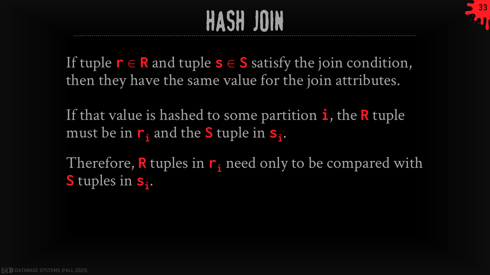


```math
r.\mathrm{key}=s.\mathrm{key}
\quad\Longrightarrow\quad
h(r.\mathrm{key})=h(s.\mathrm{key}).
```

反方向不成立，不同键可能发生哈希[冲突](#冲突)。这个性质足以把搜索范围缩到一个哈希[桶](#桶)或一段探测序列，再在其中核实完整的键值。

**[哈希连接](#哈希连接)（Hash Join）**为一侧输入建立按[连接](#连接)键查找的[哈希表](#哈希表)，再让另一侧逐行查询它。基本[哈希连接](#哈希连接)（Basic Hash Join，也称 Simple Hash Join）分成两个阶段：

| 阶段 | 处理对象 | 操作 | 结束时得到什么 |
|---|---|---|---|
| 构建（Build） | [构建侧](#构建侧)（Build Side），这里选 R | 扫描 R，把每条记录按[连接](#连接)键插入[哈希表](#哈希表) | 包含 R 全部候选记录的查找结构 |
| 探测（Probe） | [探测侧](#探测侧)（Probe Side），这里选 S | 扫描 S，按同一规则定位候选项并比较键值 | 满足连接条件的全部匹配对 |

第 [7](../L07/index.md) 讲已经讨论过[哈希表](#哈希表)（Hash Table）和线性探测（Linear Probing）。这里的哈希表键是[连接](#连接)[属性](#属性)，值可以保存所需的整行数据，也可以保存[记录 ID](#记录%20ID)，仍然取决于[物化](#物化)策略。一个键对应多条[构建侧](#构建侧)记录时，必须全部保留；用普通“键覆盖旧值”的字典插入方式会丢失连接结果。

下面的伪代码显式保留重复键，并强调最终仍要检查[连接](#连接)条件：
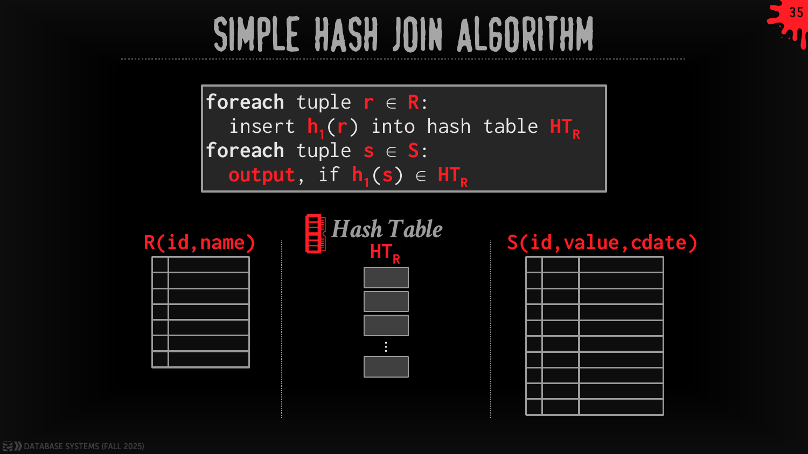

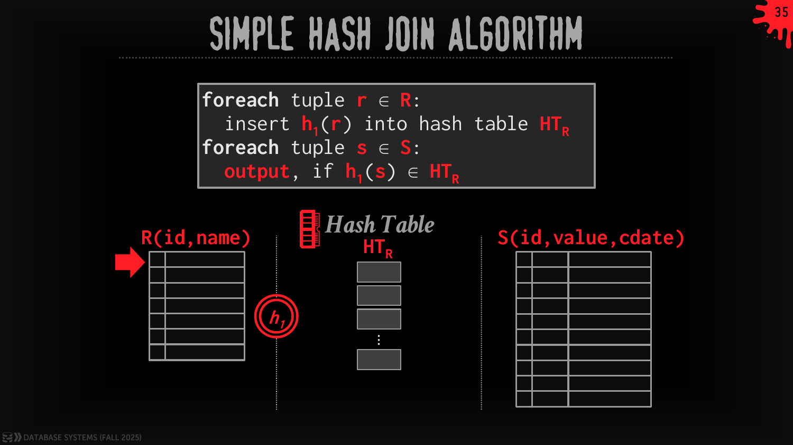

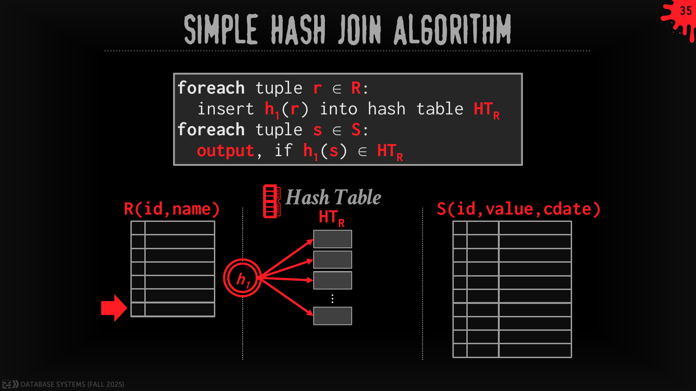


```python
for r in R:
    hash_table.insert(r.id, r)

for s in S:
    for r in hash_table.lookup_all(s.id):
        if r.id == s.id:
            emit(r, s)
```

这两段扫描先后执行。探测 S 的一条记录时，系统直接找到可能匹配的 R 记录，不再从头遍历整个 R。分布良好、[哈希表](#哈希表)装载适当的情况下，哈希定位平均很便宜；总工作还要加上输出全部匹配对的代价。把哈希值相同直接视为匹配，或者找到一条就停止，都会破坏正确性。
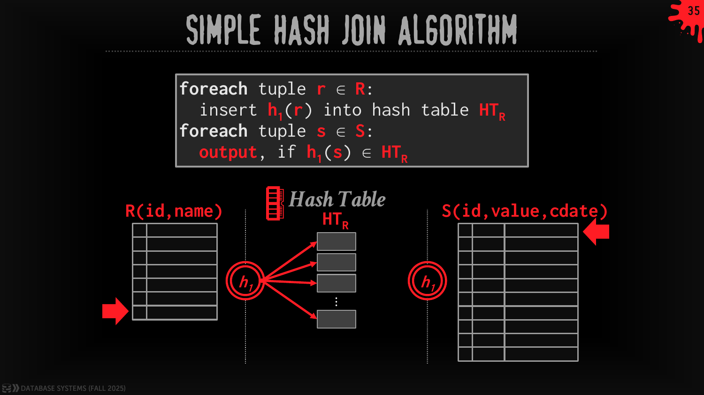

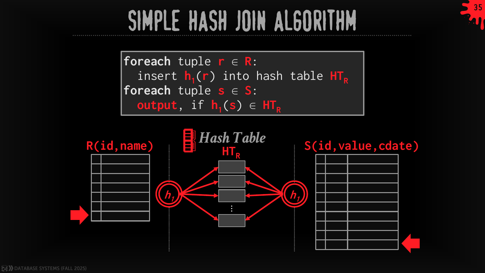


内存驻留的[哈希连接](#哈希连接)只需各扫描一次输入：

```math
\operatorname{Cost}_{\mathrm{basic\ hash}}=M+N.
```

在原例中仍是 1500 次 I/O，即模型中的 0.15 秒。它与[外表](#外表)完全驻留的块嵌套循环有相同的读[页](#页)代价，但通常省去了大量无效[元组](#元组)比较；代价表忽略 CPU，因此无法把这项差别直接显示出来。

### 5.2 应该装进内存的是构建侧[哈希表](#哈希表)
📍 *PPT 第 34–35、37、46 页*

基本[哈希连接](#哈希连接)的内存要求是不对称的：**[构建侧](#构建侧)的[哈希表](#哈希表)需要驻留，[探测侧](#探测侧)可以任意大**。[探测侧](#探测侧)逐[页](#页)读入，完成探测就能丢弃当前页，不需要把整个探测输入留下。

因此，通常选择预计占用内存较少的一侧来构建。如果原计划的[探测侧](#探测侧)很小、小到能建立驻留[哈希表](#哈希表)，就可以交换两侧角色，避免对较大的一侧建立哈希表。这里看的是实际哈希表的大小，既包括保留的键和值，也包括[桶](#桶)、空[槽](#槽)等额外开销；“原始表的[页](#页)能装下”不自动等于“对应哈希表能装下”。

已知输入大小时，可以预先分配[静态哈希](#静态哈希)表；如果输入来自前面的过滤或[连接](#连接)，[元组](#元组)数就可能估计不准，需要能扩容的[哈希表](#哈希表)、溢出空间，或者超出预算时转入[分区](#分区)处理。过度预留内存能减少扩容，却会挤占其他[算子](#算子)的空间。第 [15](../L15/index.md)、[16](../L16/index.md) 讲的基数估计（Cardinality Estimation）之所以重要，就在于估计误差会改变这里的内存与读盘行为。

线性探测的数组布局紧凑，结构和管理开销较小，是构建临时[连接](#连接)[哈希表](#哈希表)的常见选择。Andy 在本讲中尤其推荐它。具体效果仍取决于装载因子、键分布和[冲突](#冲突)处理：表过满时，探测序列变长，哈希定位的优势也会下降。

[哈希连接](#哈希连接)与[索引](#索引)嵌套循环的共同点，是对一个查找结构反复探测。差别主要在准备工作和用途：索引[连接](#连接)可以复用已有索引；[哈希连接](#哈希连接)为这次查询扫描[构建侧](#构建侧)，建立临时[哈希表](#哈希表)，再在查询结束后释放。前者可能只触碰少量匹配记录，后者更适合批量处理大量等值匹配。

哈希定位要求可哈希的等值条件。复合等值键可以把多列作为一个键处理；如果还有其他条件，例如 `R.id = S.id AND R.x < S.x`，可以先按 id 找候选，再检查不等式。只有 `R.x < S.x` 这样的条件时，相同哈希[桶](#桶)无法代表全部可能匹配的范围，不能直接套用这个算法。对于普通 SQL 的 `=`，`NULL` 也不因两侧都为空就构成匹配。

### 5.3 先用[布隆过滤器](#布隆过滤器)排除必然失败的探测
📍 *PPT 第 64–66 页（原编号异常，位于第 35 与第 37 页之间）*

哈希查找已经很快，但如果 S 中大量键根本不在 R 中，系统仍会为它们访问[哈希表](#哈希表)、检查槽位并比较键值。这些失败探测可以再提前筛掉一部分。

[布隆过滤器](#布隆过滤器)（Bloom Filter，见第 [8](../L08/index.md)、[9](../L09/index.md) 讲）用一个紧凑的位数组概括集合成员。插入一个键时，把它对应的若干位设为 1；查询时，只要其中有一位为 0，就能确定键不在集合里。若这些位全为 1，只能说“可能存在”，因为其他键也可能把这些位设成 1。

在构建 R 的[哈希表](#哈希表)时，同步把 R 的[连接](#连接)键加入[过滤器](#过滤器)。扫描 S 时，先检查过滤器：确定不存在就跳过该记录；可能存在才继续查哈希表，并核实真实键值。过滤器有假阳性（False Positive），但正确构建和使用时没有假阴性（False Negative），所以只会多做少量无效探测，不会漏掉真实匹配。
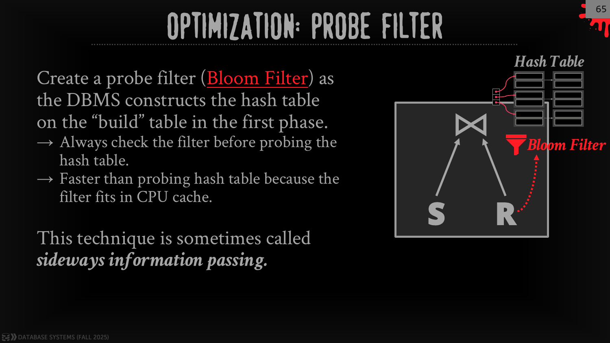


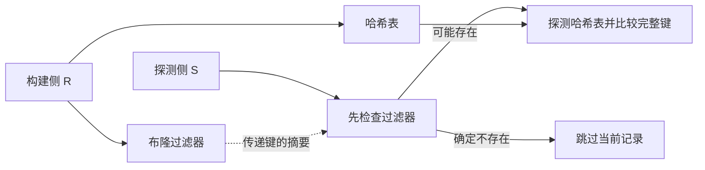

[过滤器](#过滤器)体积小，可能装入 CPU 缓存（CPU Cache）——处理器附近比主内存更快、容量也更小的一层存储。访问这份紧凑摘要，往往比随机访问较大的[哈希表](#哈希表)便宜。当大多数探测都会失败时，过滤器能省下许多内存访问；若几乎所有键都能匹配，就可能只增加一次检查。

这类**[侧向信息传递](#侧向信息传递)（Sideways Information Passing）**，指把从一侧输入收集的摘要传给另一侧，用来提前过滤数据。普通计划图表现的是数据自下而上流动，而这里还有一条从[构建侧](#构建侧)通向[探测侧](#探测侧)的辅助信息路径。

Notes 提到[过滤器](#过滤器)能减少磁盘 I/O，这需要结合它放置的位置理解：如果系统已经把 S 的每一[页](#页)读进来，[哈希表](#哈希表)又全部驻留内存，那么过滤器直接节省的是无效哈希探测，输入读页数仍然是 M + N。只有当过滤器还能帮助跳过后续取列、磁盘访问或[分区](#分区)写入等工作时，收益才会体现为磁盘 I/O 的减少。

## 6. [哈希表](#哈希表)放不下时，把[连接](#连接)拆成独立的小问题
📍 *PPT 第 37–46 页*

### 6.1 [分区](#分区)哈希连接（Partitioned / GRACE Hash Join）
📍 *PPT 第 37–40 页*

如果[构建侧](#构建侧)[哈希表](#哈希表)比内存大，直接让[缓冲池](#缓冲池)随意换出其中的页面，会破坏基本[哈希连接](#哈希连接)的优势。下一条探测记录可能跳到哈希表中的另一个位置，又要求读回另一[页](#页)；这会把原本便宜的内存查找变成大量随机 I/O。
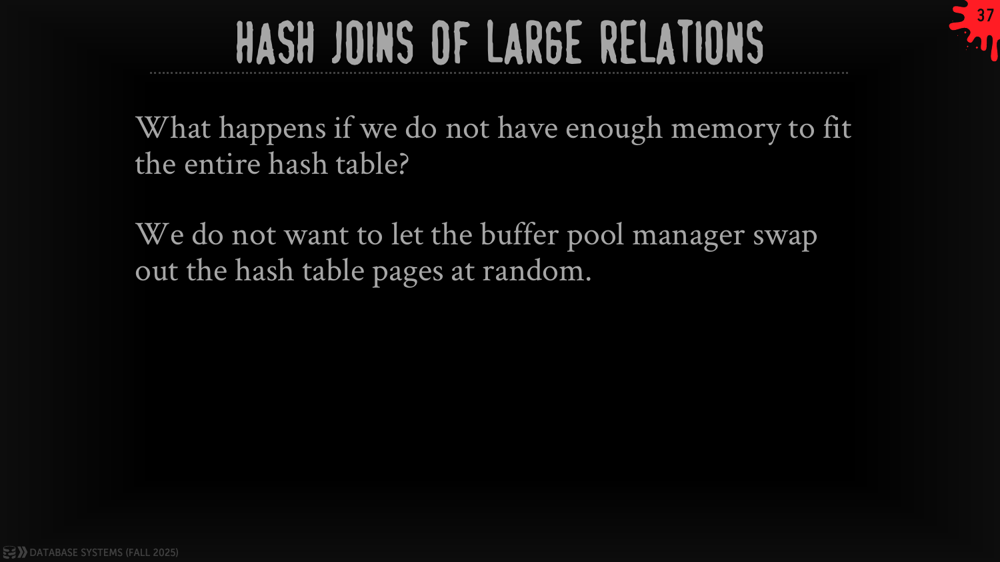


随机访问（Random Access）指接连访问彼此分散的位置；顺序访问（Sequential Access）则沿数据连续推进。磁盘读写通常更适合成批、连续地传输。让[哈希表](#哈希表)在磁盘上随探测换[页](#页)，数据访问顺序就难以控制；预先把相关数据分到同一批，才有机会让每批工作全部在内存中完成。

**[分区](#分区)[哈希连接](#哈希连接)（Partitioned Hash Join）**先按[连接](#连接)键把两个输入分别划分成对应的磁盘分区，再逐对分区执行内存连接。它也称 **[GRACE 哈希连接](#GRACE%20哈希连接)（GRACE Hash Join）**，名称来自 1980 年代日本东京大学的 GRACE [数据库](#数据库)机器。
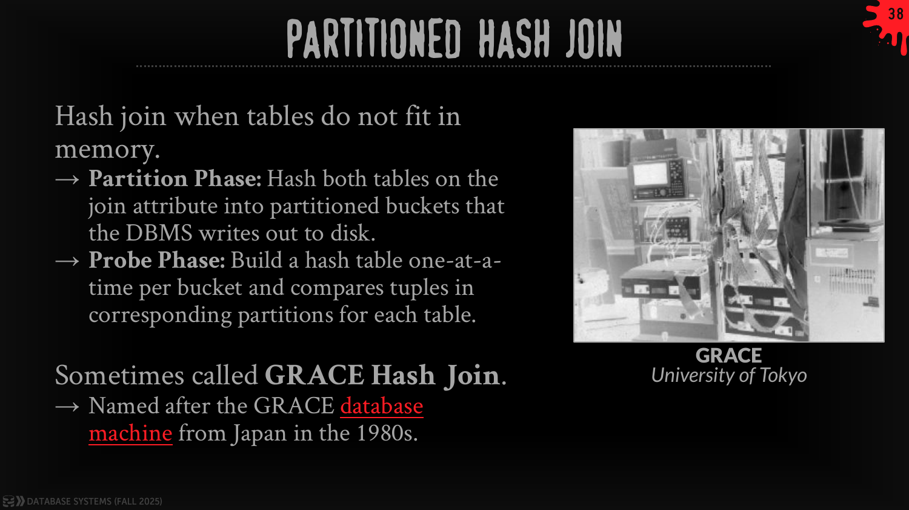


第 [11](../L11/index.md) 讲的外部排序、[哈希聚合](#哈希聚合)已经用过同一种分治思路：整个问题太大，就把它切成内存能处理的小问题。[连接](#连接)多了一项要求：两边要采用相同的[分区](#分区)规则，否则会把应该匹配的记录拆散。

设[分区](#分区)号为 `h₁(key) mod k`，两个输入都分为 k 个分区：

```text
R -- h1 --> R0     S -- h1 --> S0      join R0 with S0
            R1                 S1      join R1 with S1
            R2                 S2      join R2 with S2
            ...                ...
            R(k-1)             S(k-1)  join R(k-1) with S(k-1)
```

相同键经相同函数、相同取模规则，一定落在相同编号的[分区](#分区)中。因此 R₀ 只需要与 S₀ [连接](#连接)，完全不必检查 S₁、S₂。不同键可能落在同一分区，这只会留下额外候选，后续比较完整键就能排除。这个“匹配对不会跨分区”的性质，是分治不会漏结果的依据。

[分区](#分区)阶段依次扫描两个输入，把记录追加到相应分区的输出[页](#页)；页满就写到磁盘，再用缓冲接收下一页。一个分区是多页组成的临时数据集，并不等于一页，也不要求此时就有一个完整的内存[哈希表](#哈希表)。
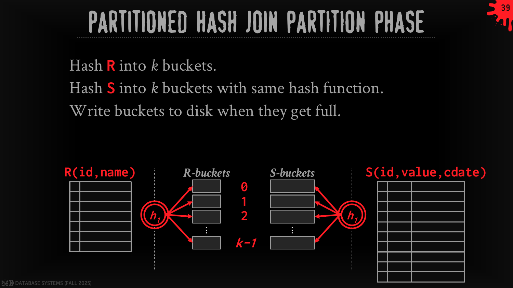


[连接](#连接)阶段只处理一个编号 i：读 Rᵢ 建立内存[哈希表](#哈希表)，再顺序读 Sᵢ，逐条探测并输出。这个[分区](#分区)对处理完后，释放哈希表，再处理下一对。分区定位用 h₁，分区内部查找可以用另一函数 h₂，或使用哈希值的其他位；不应把已经相同的分区编号直接当作能细分分区内部记录的散列值。
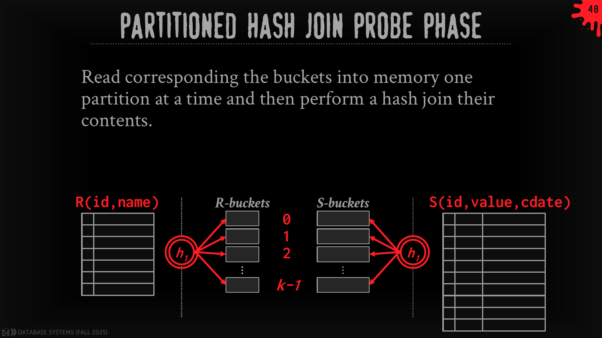

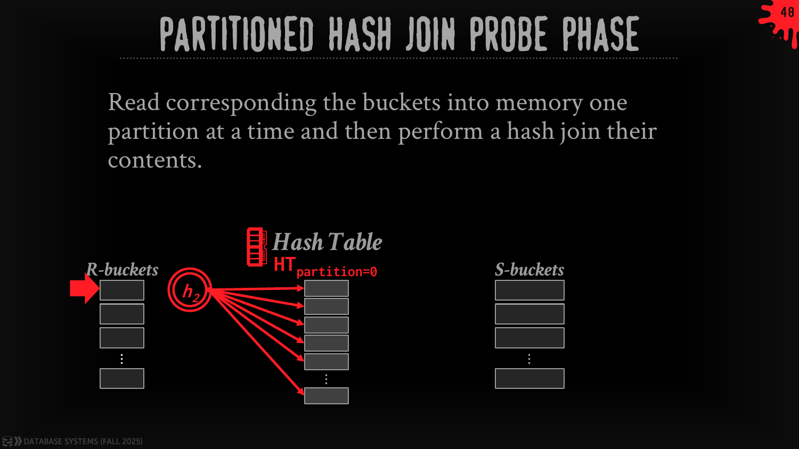

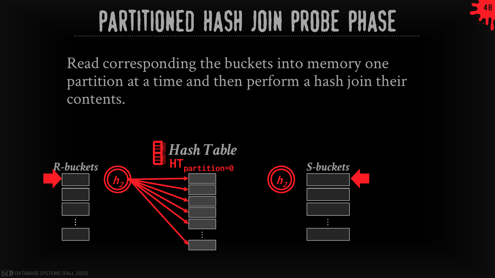


Notes 将第一阶段称作 Build；为避免和[分区](#分区)内部“构建[哈希表](#哈希表)”混淆，这里采用 PPT 的叫法：先 **Partition（分区）**，再对各分区执行 Build 与 Probe。

[数据库](#数据库)机器（Database Machine）指为数据库处理设计的专用硬件系统。GRACE 的名称也提醒我们，算法和存储设备一直在共同影响数据库设计。类似思路后来还出现在 Oracle Exadata、Teradata、Clustrix 和 Yellowbrick 等数据库一体机（Database Appliance）中，由厂商配合硬件特点组织数据库处理。专用硬件需要用额外性能收益补偿设计和部署成本，通用处理器性能的进步也会改变这笔账；GRACE 的[分区](#分区)方法则可以继续用于通用机器。


### 6.2 [分区](#分区)数受内存约束，但探测分区仍可逐[页](#页)读取
📍 *PPT 第 39–40、46 页*

[分区](#分区)数 k 不能任意取大。每个正在接收记录的分区需要输出缓冲，输入扫描也需要缓冲。在最简单的分区安排中，B 个[帧](#帧)里留 1 个读输入，其余最多支持 B − 1 个分区输出[页](#页)。

另一方面，[分区](#分区)又必须足够小，才能在[连接](#连接)阶段为构建分区建立驻留[哈希表](#哈希表)。如果暂时忽略哈希表额外空间，并假设键分布均匀，平均每个 R 分区约 M/k [页](#页)，于是得到一个粗略容量判断：

```math
k\le B-1,\qquad
\frac{M}{k}\lesssim B-2
\quad\Longrightarrow\quad
M\lesssim(B-1)(B-2).
```

这只是均匀分布、忽略开销时的一层[分区](#分区)容量估计。真正决定是否装得下的是最大的构建分区及其[哈希表](#哈希表)，而不是平均分区。系统还要为装载因子、记录表示和其他管理结构预留空间。

这个推导中的内存 B 是系统分给当前[算子](#算子)的预算。机器有多少总内存，与一个[连接](#连接)可以独占多少内存，是不同的问题：同一查询还有其他算子，系统也可能同时服务许多查询。

与基本[哈希连接](#哈希连接)一样，每次只要求一侧[分区](#分区)的[哈希表](#哈希表)装入内存。Sᵢ 可以比内存大，因为它仍然逐[页](#页)扫描。如果另一侧分区更小，也可以交换构建与探测角色。将“两张表都放不下”理解成“每对分区必须一起全部装下”，会不必要地高估内存需求。

### 6.3 [分区](#分区)过大时，先分清是[冲突](#冲突)还是相同键太多
📍 *PPT 第 41–42 页*

哈希[分区](#分区)并不保证等长。**[数据倾斜](#数据倾斜)（Data Skew）**在这里指记录分布明显不均，导致某些键或某些分区承载远多于其他部分的数据。遇到过大的构建分区，可以采用第 [11](../L11/index.md) 讲讲过的**[递归分区](#递归分区)（Recursive Partitioning）**：只对这个分区改用另一[哈希函数](#哈希函数)或另一组哈希位，继续细分。

原例是[分区](#分区) 1 过大，于是将它拆成 1′、1″、1‴。未超限的分区 0、k − 1 保持不变；S 中映射到分区 1 的记录，也必须沿相同规则细分：


```text
R -- h1 --> R0                         S -- h1 --> S0
            R1 -- h2 --> R1'                       S1 -- h2 --> S1'
                        R1''                                  S1''
                        R1'''                                 S1'''
            ...                                    ...
            R(k-1)                                 S(k-1)

Final pairs: (R0,S0), (R1',S1'), (R1'',S1''), (R1''',S1'''), ...
```

不同的第一层[分区](#分区)路径必须保留在身份里。例如 R₁ 的子分区编号为 0，并不意味着它能与另一父分区的子分区 0 [连接](#连接)；应该比较的是沿同一分区路径得到的对应数据。


两侧的处理可以发生在不同时间，但规则必须一致。若 R 的[分区](#分区) 1 已细分，之后扫描 S 时就可识别“这条记录本来应进入分区 1”，继续调用第二层函数，直接把它放进对应子分区。没溢出的分区无需陪着重做一遍。


换[哈希函数](#哈希函数)能解决的，是许多**不同键**偶然聚集到同一[分区](#分区)的问题。如果某一个键自身就出现了大量记录，所有这些记录无论经过什么正确的确定性哈希函数，仍然会一起落在同一个位置。继续换函数不能把同一个键均匀拆开，同时还维持原来的“同编号分区之间匹配”规则。

这时需要专门处理该键。若它在两侧的记录都很大，可以对这组记录使用块嵌套循环，把一批装入内存，再顺序扫描另一边。重复扫描仍然可能昂贵，但至少能用受控的顺序 I/O，避免无休止的[分区](#分区)或磁盘[哈希表](#哈希表)的随机换[页](#页)。

如果该键分别有 a、b 条记录，输出本来就有 ab 对。[数据倾斜](#数据倾斜)一方面使内存管理困难，另一方面可能让结果本身暴涨；这两个问题需要分别认识。排序可以避免哈希[分区](#分区)严重失衡，却同样不能消除必须生成的大量匹配结果。

相反，如果一个[分区](#分区)很小，系统也可以直接用内存嵌套循环完成它，不必为了几条记录再建立[哈希表](#哈希表)。一个大[连接](#连接)可以在不同分区采用不同的局部方法，正确性来自分区之间互不漏配，效率来自每个局部问题选了合适的处理方式。

### 6.4 3(M + N) 来自一次读、一次写、再读一次
📍 *PPT 第 43–44 页*

在一层[分区](#分区)就足够、所有分区都写出并且临时表示大小按原[页](#页)数估算的模型中，GRACE 的 I/O 很容易逐笔数清：

| 工作 | I/O 数量 | 原因 |
|---|---|---|
| 读取原始 R 和 S | M + N | 要知道每条记录属于哪个[分区](#分区) |
| 写出两侧分区文件 | M + N | 将分类结果保存到磁盘 |
| 逐对读回分区并[连接](#连接) | M + N | 构建局部[哈希表](#哈希表)，再扫描对应探测分区 |
| 合计 | 3(M + N) | 不包含最终结果写出 |

```math
\begin{aligned}
\operatorname{Cost}_{\mathrm{GRACE}}
&=2(M+N)+(M+N)=3(M+N),\\
&=3(1000+500)=4500\ \text{I/Os},\\
\operatorname{Time}&=4500\times0.1\ \text{ms}=0.45\ \text{s}.
\end{aligned}
```

因此，`3(M + N)` 是这个[分区](#分区)方案的代价，不是所有[哈希连接](#哈希连接)都必须支付的代价。基本[哈希连接](#哈希连接)没有分区文件，只有 M + N。

[递归分区](#递归分区)也不是免费的。如果一个已经写出的[分区](#分区)对共有 T [页](#页)，再把它读回、重新分区并写出，就多付约 2T 次 I/O；其他分区不必承担这笔费用。若全部数据都多经历一次完整分区，总成本就从约 `3(M + N)` 变为约 `5(M + N)`。直接在首次扫描中路由到子分区的实现，账目可能不同，应按真实的读写过程计算。

这也是为什么只给出 M、N 还不总能准确估算[连接](#连接)：分布是否均匀，决定了一层[分区](#分区)是否足够；需要重分区的又有多少数据，决定了额外 I/O。

### 6.5 混合哈希连接：让一个[分区](#分区)省去磁盘往返
📍 *PPT 第 45–46 页*

GRACE 把所有[分区](#分区)都写到磁盘，再逐对读回。但是，如果分区过程中还有足够内存，完全可以让某个构建分区始终驻留，顺便把它的[连接](#连接)做完。


**[混合哈希连接](#混合哈希连接)（Hybrid Hash Join）**把内存[哈希连接](#哈希连接)与[分区](#分区)[哈希连接](#哈希连接)结合起来：选定一个能驻留的构建分区，例如 R₀，在扫描 R 时直接建立它的[哈希表](#哈希表)，其余 R 分区正常写盘。随后扫描 S，属于 S₀ 的记录立即探测内存中的 R₀；其他 S 分区继续写盘，稍后按 GRACE 处理。

```text
Partition 0:      R0 stays in a hash table in memory
                 S0 streams through it and produces matches

Partitions 1..k-1:
                 write to disk -> read partition pair -> join
```

R₀ 不必先写再读，S₀ 也不必先写再读。设这两部分原本分别占 M₀、N₀ [页](#页)，理想情况下，相对于全部落盘的 GRACE，节省的 I/O 是：


```math
\operatorname{Cost}_{\mathrm{hybrid}}
\approx 3(M+N)-2(M_0+N_0).
```

两部分的原始读取仍然要做，所以减掉的是一次写出和一次读回，不能把它们的全部成本都扣除。极端情况下，整个[构建侧](#构建侧)的[哈希表](#哈希表)都能驻留，算法就接近基本[哈希连接](#哈希连接)；内存很紧时，则接近普通 GRACE。

这里的“混合”指驻留处理与磁盘[分区](#分区)处理结合，不要求把哈希与嵌套循环搭配。选择一个访问量大的分区驻留可能收益更多，但前提仍是它能装下；最大的热点分区如果已经超出预算，就不能靠“留在内存里”解决。

实现难点在于同时分配[分区](#分区)输出缓冲和驻留[哈希表](#哈希表)的空间，还要在实际数据偏离估计时处理溢出。这种设计增加了内存管理的复杂性，但已有成熟系统采用它：PostgreSQL 的[哈希连接](#哈希连接)实现明确以[混合哈希连接](#混合哈希连接)为基础，也会根据实际哈希表大小增加批次数。Notes 中“实践中少见”的概括与 PPT 列举的系统及这一实现不一致，不宜据此判断它缺少实际用途。[PostgreSQL 哈希连接源代码说明](https://doxygen.postgresql.org/nodeHashjoin_8c_source.html)

## 7. 选算法时，要把它省下和新增的工作一起计算
📍 *PPT 第 25、32、46–48 页*

### 7.1 用相同参数比较一次
📍 *PPT 第 17、22、30、44、47 [页](#页)*

统一取 R 为 1000 [页](#页)、10 万行，S 为 500 页、4 万行，每次 I/O 为 0.1 毫秒。下表的块嵌套循环和排序归并均采用 B = 100；GRACE 假设一层[分区](#分区)足够。R 固定作为[外表](#外表)或[构建侧](#构建侧)，方便对齐公式。


| 算法 | I/O 公式 | 代入结果 | I/O 时间模型 |
|---|---|---|---|
| 朴素嵌套循环 | M + mN | 50001000 | 约 1.39 小时 |
| 每块一[页](#页)的块嵌套循环 | M + MN | 501000 | 50.1 秒 |
| 多页块嵌套循环，B = 100 | M + ⌈M/(B−2)⌉N | 1000 + 11 × 500 = 6500 | 0.65 秒 |
| [索引](#索引)嵌套循环 | M + mC | 1000 + 100000C | 取决于 C |
| 排序归并，无额外归并读回 | Sort(M) + Sort(N) + M + N | 7500 | 0.75 秒 |
| GRACE，一层[分区](#分区) | 3(M + N) | 4500 | 0.45 秒 |

如果改变内存条件，让[构建侧](#构建侧)[哈希表](#哈希表)整体驻留，基本[哈希连接](#哈希连接)降为 1500 次 I/O，即 0.15 秒；如果让[外表](#外表)整体驻留，块嵌套循环也达到同一个读[页](#页)数。这两种情况需要更多可用内存，不能当作 B = 100 下已经成立的结果。

原材料的汇总表采用了不同设置：PPT 的块嵌套循环 0.55 秒来自 B = 102，并且将 S 作为[外表](#外表)；Notes 标明 B = 100、R 为[外表](#外表)，却写成 6.5 秒，正确换算是 0.65 秒。B = 100 时，98 [页](#页)一批，无论哪个方向在这个例子中都是 6500 次 I/O：另一方向为 `500 + ⌈500/98⌉ × 1000 = 6500`。比较前应先把缓冲预算和两侧角色对齐。

### 7.2 算法选择是对数据与后续工作的判断
📍 *PPT 第 25、32、46–48 页*

这些算法各自利用了不同条件：

| 已知条件 | 值得优先比较的方案 | 判断依据 |
|---|---|---|
| [外表](#外表)很小，[内表](#内表)有适用[索引](#索引) | 索引嵌套循环 | 少量定点查找可能免掉整个[内表](#内表)扫描 |
| 两侧都很小，或只剩很小的局部[分区](#分区) | 内存嵌套循环 | 建辅助结构的成本可能比直接比较更大 |
| 一侧[哈希表](#哈希表)能驻留，进行大量等值匹配 | 基本[哈希连接](#哈希连接) | 各读一次输入，并减少无效[元组](#元组)比较 |
| [构建侧](#构建侧)超出内存，键分布较均匀 | GRACE 或[混合哈希连接](#混合哈希连接) | 用顺序分区读写替代随机磁盘探测 |
| 输入已经有序，或后续需要同一键顺序 | [排序归并连接](#排序归并连接) | 复用顺序，减少整个计划的排序工作 |
| 少数键重复很多，分区严重失衡 | 比较排序方案，并为热点键单独处理 | 防止[递归分区](#递归分区)失效，同时核算巨大结果集 |
| 只有不能用于哈希的[连接](#连接)条件 | 嵌套循环，或适用的索引、范围连接方法 | 必须先检查算法能否正确处理该[谓词](#谓词) |

Andy 在本讲中给出的工程判断是：高效的等值[连接](#连接)应优先认真考虑[哈希方案](#哈希方案)，排序则在[数据倾斜](#数据倾斜)、已有顺序或需要有序结果时特别值得比较。这个判断是一种起点，最终还要计算整个计划的成本。例如，连接后只剩很少记录时，“先[哈希连接](#哈希连接)，再排序少量结果”可能比“先排序两个大输入，再连接”更便宜，即使查询最终有 `ORDER BY`。

“较小的一侧”也随算法改变含义。朴素循环关注[外表](#外表)驱动了多少次扫描，块循环关注有多少批页面，[索引](#索引)[连接](#连接)关注要做多少次查找，[哈希连接](#哈希连接)则关注构建结构占多少内存。把这些条件压成一句“小表永远在左边”，会失去决定代价的具体原因。


成熟的查询处理器通常会准备多种算法及其变体，由优化器根据记录数、行宽、键分布、[索引](#索引)、已有顺序和可用内存估算成本，再组合成执行计划。运行时还要应对估计偏差，例如[分区](#分区)数量不足、[哈希表](#哈希表)超出预算。[连接](#连接)算法提供了选择的可能，统计信息和成本估计决定系统能否选对。

## 小结
📍 *PPT 第 47–48 页*

[连接](#连接)代价的第一条主线是复用：逐条记录反复扫描[内表](#内表)过于昂贵，按[页](#页)、按批复用已读数据，可以大幅减少 I/O；有了[索引](#索引)，还能把完整扫描替换成针对性的查找。第二条主线是缩小候选范围：排序利用键的先后关系跳过无关数据，哈希利用相同键必落在相同位置的性质定位候选。

内存不足时，[分区](#分区)把一个大[连接](#连接)拆成多个可独立处理的小连接。理解这个方案，要同时守住两个条件：匹配记录必须落到对应分区，构建分区的[哈希表](#哈希表)必须在预算内。倾斜和重复键会挑战第二个条件；[递归分区](#递归分区)、热点键的块处理和[混合哈希连接](#混合哈希连接)，都是围绕这些限制调整读写方式。

第 [15](../L15/index.md)、[16](../L16/index.md) 讲会用这些代价与适用条件选择[连接](#连接)算法、安排多表连接顺序。下一讲第 [13](../L13/index.md) 讲“查询执行（上）”将讨论[算子](#算子)之间如何传递记录、组织调用，让整个[查询计划](#查询计划)真正运行起来。

## 术语速查表

### 数据库

**Database**：一组经过组织、相互关联、用来模拟现实世界某方面的数据。（本讲首次出现：摘要；引入于：第 1 讲）

### 连接

**Join**：在共同属性上取值相同的元组组合。（本讲首次出现：摘要；引入于：第 1 讲）

### 页

**Page**：定长的数据块，数据库中一切数据的存放单位。（本讲首次出现：摘要；引入于：第 3 讲）

### 索引

**Index**：按适合查找的方式组织键与记录定位信息的访问结构。（本讲首次出现：摘要；引入于：第 8 讲）

### 哈希表

**Hash Table**：用哈希函数把键映射到数组偏移量的无序关联数组。（本讲首次出现：摘要；引入于：第 7 讲）

### 分区

**Partition**：由分派规则归到一起的一组记录，可以占据多个页。（本讲首次出现：摘要；引入于：第 2 讲）

### 算子

**Operator**：执行扫描、过滤、连接、排序或聚合等处理工作的节点。（本讲首次出现：课程地图；引入于：第 11 讲）

### 缓冲池

**Buffer Pool**：由定长帧组成的一大块内存，用来存放从磁盘读入的页。（本讲首次出现：课程地图；引入于：第 3 讲）

### 属性

**Attribute**：关系中的一个命名分量，即表中的一列。（本讲首次出现：课程地图；引入于：第 1 讲）

### 布隆过滤器

**Bloom Filter**：用 m 位位图和 k 个哈希函数回答成员查询，无假阴性、可能有假阳性。（本讲首次出现：课程地图；引入于：第 9 讲）

### 哈希聚合

**Hash Aggregation**：使用分组键查找并更新哈希表中的聚合状态。（本讲首次出现：课程地图；引入于：第 11 讲）

### LSM 树

**Log-Structured Merge Tree**：由 MemTable 和分层 SSTable 组成的日志结构存储结构。（本讲首次出现：课程地图；引入于：第 5 讲）

### 外部归并排序

**External Merge Sort**：先生成内存可处理的有序片段，再逐趟归并为完整有序结果。（本讲首次出现：课程地图；引入于：第 11 讲）

### 执行引擎

**Execution Engine**：执行查询、向缓冲池请求页的组件。（本讲首次出现：课程地图；引入于：第 3 讲）

### 二元内等值连接

**Binary Inner Equijoin**：对两个输入，只输出连接键相等的元组对。（本讲首次出现：1.1；引入于：本讲）

### 元组

**Tuple**：关系中的一个元素，即表中的一行。（本讲首次出现：1.1；引入于：第 1 讲）

### 数据库管理系统

**Database Management System (DBMS)**：管理数据库的软件，负责数据的插入、删除和检索。（本讲首次出现：1.1；引入于：第 1 讲）

### 主键

**Primary Key**：唯一标识关系中一个元组的属性或属性组合。（本讲首次出现：1.1；引入于：第 1 讲）

### 去重

**Deduplication**：重复键只存一份，再关联多个记录位置。（本讲首次出现：1.1；引入于：第 8 讲）

### 关系代数

**Relational Algebra**：在关系上检索和操纵元组的一组基本运算。（本讲首次出现：1.1；引入于：第 1 讲）

### 物化

**Materialization**：把中间结果实际计算出来并保存，供后续使用。（本讲首次出现：1.1；引入于：第 2 讲）

### 笛卡尔积

**Product**：两个关系中元组的所有组合。（本讲首次出现：1.1；引入于：第 1 讲）

### 查询计划

**Query Plan**：用算子及其数据依赖关系描述查询如何执行的树或 DAG。（本讲首次出现：1.2；引入于：第 11 讲）

### 投影

**Projection**：只保留、重排或计算指定属性，对应 SQL 的 `SELECT` 列表。（本讲首次出现：1.2；引入于：第 1 讲）

### 早期物化

**Early Materialization**：较早把元组数据放入中间记录，与键一同传递和排序。（本讲首次出现：1.3；引入于：第 11 讲）

### 延迟物化

**Late Materialization**：先传递键与记录位置，需要时再读取和组合其余属性。（本讲首次出现：1.3；引入于：第 6 讲）

### 记录 ID

**Record ID**：表示元组物理位置的唯一标识，如页 ID 加槽号。（本讲首次出现：1.3；引入于：第 3 讲）

### 帧

**Frame**：缓冲池中能放一页的位置。（本讲首次出现：2；引入于：第 3 讲）

### 嵌套循环连接

**Nested Loop Join**：枚举两侧元组对并检查连接条件。（本讲首次出现：3.1；引入于：本讲）

### 外表

**Outer Table**：分别由外层、内层循环处理的输入角色。（本讲首次出现：3.1；引入于：本讲）

### 内表

**Inner Table**：分别由外层、内层循环处理的输入角色。（本讲首次出现：3.1；引入于：本讲）

### 块嵌套循环连接

**Block Nested Loop Join**：一批外表页面共享一次内表扫描。（本讲首次出现：3.2；引入于：本讲）

### 索引嵌套循环连接

**Index Nested Loop Join**：为每条外表记录，通过内表索引定位匹配项。（本讲首次出现：3.4；引入于：本讲）

### B+ 树

**B+ Tree**：内部节点导航、叶节点保存真实值的有序多路平衡树。（本讲首次出现：3.4；引入于：第 8 讲）

### 叶节点

**Leaf Node**：保存实际索引键值条目的底层节点。（本讲首次出现：3.4；引入于：第 8 讲）

### 排序归并连接

**Sort-Merge Join**：对有序输入定位相同键分组并输出全部匹配对。（本讲首次出现：4.1；引入于：本讲）

### 回退

**Backtracking**：为重复外表键重新访问内表匹配组。（本讲首次出现：4.2；引入于：本讲）

### 趟

**Pass**：对某一层全部待处理数据的一次完整处理。（本讲首次出现：4.3；引入于：第 11 讲）

### 聚簇索引

**Clustered Index**：使表记录的存储组织跟随某个索引键顺序。（本讲首次出现：4.4；引入于：第 8 讲）

### 谓词

**Predicate**：对每个元组得出真或假的条件。（本讲首次出现：4.4；引入于：第 1 讲）

### 过滤器

**Filter**：只回答“键是否（很可能）在集合中”、不给出位置的数据结构。（本讲首次出现：5；引入于：第 9 讲）

### 哈希连接

**Hash Join**：以连接键建立哈希查找结构，再探测匹配。（本讲首次出现：5.1；引入于：本讲）

### 构建侧

**Build Side**：分别用于建立哈希表和逐条查询该表的输入。（本讲首次出现：5.1；引入于：本讲）

### 探测侧

**Probe Side**：分别用于建立哈希表和逐条查询该表的输入。（本讲首次出现：5.1；引入于：本讲）

### 哈希函数

**Hash Function**：把任意长度的键映射为定长整数的确定性单向函数。（本讲首次出现：5.1；引入于：第 7 讲）

### 冲突

**Collision**：两个不同的键被映射到同一个位置。（本讲首次出现：5.1；引入于：第 7 讲）

### 桶

**Bucket**：可容纳多个键值对的存储单元，通常是一页。（本讲首次出现：5.1；引入于：第 7 讲）

### 槽

**Slot**：哈希表数组中的一个定长存储位置。（本讲首次出现：5.2；引入于：第 7 讲）

### 静态哈希

**Static Hashing**：槽数在分配时固定，装满后必须整体重建的哈希方案。（本讲首次出现：5.2；引入于：第 7 讲）

### 侧向信息传递

**Sideways Information Passing**：将一侧生成的摘要传给另一侧，以提前过滤数据。（本讲首次出现：5.3；引入于：本讲）

### 分区哈希连接

**Partitioned Hash Join**：先生成对应分区，再逐对完成内存连接。（本讲首次出现：6.1；引入于：本讲）

### GRACE 哈希连接

**GRACE Hash Join**：先生成对应分区，再逐对完成内存连接。（本讲首次出现：6.1；引入于：本讲）

### 数据倾斜

**Data Skew**：某些键或分区承担明显过多的数据。（本讲首次出现：6.3；引入于：本讲）

### 递归分区

**Recursive Partitioning**：对过大分区继续划分，并在两侧保持相同路由。（本讲首次出现：6.3；引入于：[第 11 讲](../L11/index.md)）

### 混合哈希连接

**Hybrid Hash Join**：部分分区驻留并立即连接，其余分区落盘后处理。（本讲首次出现：6.5；引入于：本讲）

### 哈希方案

**Hashing Scheme**：发生冲突后如何安放和查找键的规则。（本讲首次出现：7.2；引入于：第 7 讲）

[^constants]: 原话：“Constants matter in database world.”


<details>
<summary>📎 本讲未被 📍 标注的幻灯片（共 4 页：封面、目录与行政页）</summary>


</details>
