# CMU 15-445 第 [13](index.md) 讲：查询执行（上）（Query Execution I）

> **课程**：CMU 15-445/645 Database Systems（Fall 2025）· **主讲**：Andy Pavlo
> **课程主页**：https://15445.courses.cs.cmu.edu/fall2025/
> **材料**：课件 PPT、官方 Lecture Notes、课堂录音转写稿
> **说明**：正文以 PPT 与 Lecture Notes 为准。讲者原话的中文为意译，英文原文见脚注，依据课堂录音转写整理，已修正明显的语音识别错误。文中“📍 PPT 第 X 页”指幻灯片右上角印的编号。

## 摘要（Abstract）

排序、聚合和各种[连接](#连接)算法实现好之后，它们还只是一个个孤立的[算子](#算子)。一条 SQL 查询经过优化器，会变成一张由算子组成的[查询计划](#查询计划)，接下来的问题是：这些算子怎样协作，才能把数据从表里一路送到计划的根节点，交到发起查询的人手里。

这个问题可以一层层拆开。首先是[算子](#算子)之间每次交接多少数据：一次交一个[元组](#元组)的[迭代器模型](#迭代器模型（火山模型）)最简单，却要为每个元组付出一次函数调用；一次交出全部结果的[物化模型](#物化模型)把调用降到最少，却要把可能极大的中间结果整个放在内存里；[向量化模型](#向量化模型（批处理模型）)每次交一批，把两头的代价都压到可以接受的程度，成为今天分析型系统的标准做法。其次是由谁驱动交接：从根节点向下“拉”数据，还是由调度器从叶子向上“推”数据，这是与前者互相独立的另一个选择。再往下是计划的叶子，也就是[访问方法](#访问方法)：[顺序扫描](#顺序扫描)是兜底方案，[区域映射](#区域映射)等[数据跳过](#数据跳过)技术能让它少读很多[页](#页)；用哪个[索引](#索引)、要不要同时用多个索引，则取决于数据的分布。修改类查询复用这些[访问方法](#访问方法)，却因此撞上了[万圣节问题](#万圣节问题)。最后回到算子内部：每个元组都要把 `WHERE` 子句计算一遍，逐节点解释[表达式树](#表达式树)的开销，引出了[即时编译](#即时编译)、向量化求值、[常量折叠](#常量折叠)和[公共子表达式消除](#公共子表达式消除)。

读完本讲，你应该能够手工跟踪一条带[哈希连接](#哈希连接)的查询在[迭代器模型](#迭代器模型（火山模型）)中的 `Next()` 调用顺序，并指出[流水线](#流水线)的边界；说清三种[处理模型](#处理模型)各自把代价放在了哪里，以及[联机事务处理](#联机事务处理)和[联机分析处理](#联机分析处理)系统为什么会做出不同的选择；解释[区域映射](#区域映射)为什么能整[页](#页)跳过数据，[万圣节问题](#万圣节问题)为什么会让同一个人被加薪两次；看懂 PostgreSQL `EXPLAIN ANALYZE` 输出中与 [JIT](#即时编译) 编译有关的那几行在说什么。

## 课程地图

本讲属于课程的第四阶段“查询处理”。这一阶段的前两讲造好了零件，本讲和下一讲把零件装配成能运转的[执行引擎](#执行引擎)，最后两讲讨论如何挑选最好的装配方案。

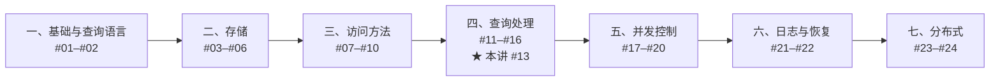

本讲几乎用到了前面每个阶段的成果。[顺序扫描](#顺序扫描)逐[页](#页)向[缓冲池](#缓冲池)（buffer pool，见第 [4](../L04/index.md) 讲）请求页面，再从[槽式页](#槽式页)（slotted page，见第 [3](../L03/index.md) 讲）里逐个取出[元组](#元组)；让扫描更快的手段，分别来自第 [4](../L04/index.md) 讲的[预取](#预取)与[扫描共享](#扫描共享)、第 [6](../L06/index.md) 讲的压缩和第 [8](../L08/index.md) 讲的[聚簇索引](#聚簇索引)；[索引扫描](#索引扫描)用到第 [7](../L07/index.md) 讲的[哈希表](#哈希表)和第 [8](../L08/index.md)、[9](../L09/index.md) 讲的 [B+ 树](#B+%20树)。[流水线阻断点](#流水线阻断点)的典型例子是第 [11](../L11/index.md) 讲的排序与聚合、第 [12](../L12/index.md) 讲[哈希连接](#哈希连接)的构建阶段；[算子](#算子)之间传整行还是只传几列，延续的是第 [6](../L06/index.md) 讲的行存储与列存储、第 [12](../L12/index.md) 讲的[早期物化](#早期物化)与[延迟物化](#延迟物化)。

往后看，第 [14](../L14/index.md) 讲在本讲单线程执行的基础上加入多个工作线程，讨论如何并行执行同一个[查询计划](#查询计划)；第 [15](../L15/index.md)、[16](../L16/index.md) 讲讨论查询优化器怎样在多个[索引](#索引)、多种[连接](#连接)顺序之间做出选择，本讲会多次把“选哪一个”的问题留给它们。[万圣节问题](#万圣节问题)的解法中“在[元组](#元组)上记下它被谁修改过”的思路，会在并发控制部分（第 [17](../L17/index.md)、[18](../L18/index.md)、[19](../L19/index.md)、[20](../L20/index.md) 讲）再次出现。

## 1. 从[算子](#算子)到[查询计划](#查询计划)
📍 *PPT 第 4–5 页*

第 [11](../L11/index.md)、[12](../L12/index.md) 讲实现了排序、聚合和三类[连接](#连接)算法。每个算法都假定输入已经准备好，结果交给“下一步”，至于输入从哪里来、结果交给谁，一直没有交代。[缓冲池](#缓冲池)、页面布局、[算子](#算子)实现都已经有了，缺的是把它们串起来执行一条查询的机制。

### 1.1 [查询计划](#查询计划)是一张[算子](#算子)图
📍 *PPT 第 5 页*

DBMS 把一条 SQL 语句转换成**[查询计划](#查询计划)（query plan）**：一张由**[算子](#算子)（operator）**组成的有向无环图（directed acyclic graph，DAG）。数据从叶子节点流向根节点，根节点的输出就是查询结果，交给发起查询的一方，可能是应用程序，可能是坐在终端前的人，也可能是系统内部的另一个查询。算子通常是一元或二元的，也就是有一个或两个子节点。多数系统实现的其实是树，树是 DAG 的特例；只有某个中间结果要被多个上层算子共用时，计划才需要真正的 DAG。

本讲贯穿始终的例子是：

```sql
SELECT R.id, S.cdate
  FROM R JOIN S
    ON R.id = S.id
 WHERE S.value > 100
```

它的计划有五个[算子](#算子)：两个叶子分别读取表 R 和表 S；S 的输出先经过选择 `σ_{value>100}`，再与 R 做[连接](#连接) `R ⋈_{R.id=S.id} S`；最后[投影](#投影) `π_{R.id, S.cdate}`。这张图只说明要做哪些运算、数据在逻辑上从下往上流，并没有说连接用哪种算法，也没有说数据在物理上怎样从一个算子到达下一个算子。同一个[查询计划](#查询计划)可以有很多种执行方式，本讲讨论的就是这些方式之间的区别。

### 1.2 流水线与流水线阻断点（Pipeline and Pipeline Breaker）
📍 *PPT 第 5 页*

假设[连接](#连接)用第 [12](../L12/index.md) 讲的[哈希连接](#哈希连接)实现，以 R 为构建侧（build side）、S 为探测侧（probe side）。一个 S [元组](#元组)被读出来之后，可以一口气走完剩下的路：它先接受 `value > 100` 的检查，通过之后用 `S.id` 去探测[哈希表](#哈希表)，找到匹配就被[投影](#投影)成结果输出，中途不需要停下来等任何别的元组。R 的元组则不同，它被读出来之后只走一步，插入哈希表，就停住了：在哈希表建完之前，连接[算子](#算子)不能拿它做任何事。

**[流水线](#流水线)（pipeline）**是一串[算子](#算子)，[元组](#元组)可以在它们之间连续流动，不需要中间存储。**[流水线阻断点](#流水线阻断点)（pipeline breaker）**是这样的算子：在它的子节点交出全部元组之前，它无法完成。
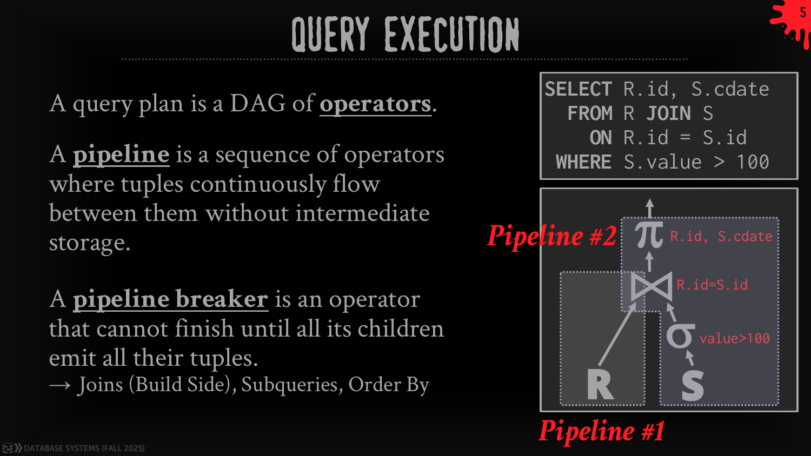


[哈希连接](#哈希连接)的构建侧就是阻断点。如果[哈希表](#哈希表)还没建完就开始探测，一个本该匹配的 R [元组](#元组)可能还没来得及插进去，探测就会漏掉它，得到假阴性（false negative），结果就错了。`ORDER BY` 也是阻断点：没读完全部输入，排序[算子](#算子)无法确定哪个元组排在第一。第三类是子查询：外层查询要使用子查询的结果，比如 `IN (SELECT …)` 里的那个集合，就得等它全部算完。同样的道理也适用于第 [11](../L11/index.md) 讲的聚合：就整个算子而言，读完所有输入之前不能宣告结束，所以它是阻断点；至于单个分组，只要输入有序、后面不会再出现同一个键，那一组就可以提前输出（第 [11](../L11/index.md) 讲 §7.2）。

以阻断点为界，例子里的计划被切成两条[流水线](#流水线)：

```text
                 π  R.id, S.cdate
                 │
                 ⋈  R.id = S.id
          build ┌┴──────────┐ probe
                │           │
                R           σ  value > 100
                            │
                            S

Pipeline #1:  R ──> ⋈ (build hash table)
Pipeline #2:  S ──> σ ──> ⋈ (probe) ──> π ──> result
```

[流水线](#流水线) #2 必须等[流水线](#流水线) #1 结束才能开始。

[流水线](#流水线)这个概念来自 1970 年代的硬件条件。那时从磁盘取一个[元组](#元组)代价很高，所以系统每读进一个元组，就把它沿着计划尽量往上送，一直送到[流水线](#流水线)的顶端（通常是一个阻断点），然后才回头去读下一个。已经进了内存的数据被用到了极致，中间结果也不必写回磁盘。下一节的三种[处理模型](#处理模型)，都可以看成是对“[流水线](#流水线)上每次送多少数据”这个问题的不同回答。

## 2. 处理模型：[算子](#算子)之间如何交接数据
📍 *PPT 第 6–17 页*

DBMS 的**[处理模型](#处理模型)（processing model）**规定系统如何执行一个[查询计划](#查询计划)，以及数据如何从一个[算子](#算子)移动到下一个算子。它由两条执行路径组成。一条是**[控制流](#控制流)（control flow）**，即 DBMS 如何调用一个算子，让它开始工作；另一条是**[数据流](#数据流)（data flow）**，即一个算子如何把结果交给下一个算子。

[算子](#算子)交出去的东西可以是完整的[元组](#元组)，也可以只是其中几列，分别对应第 [6](../L06/index.md) 讲的 N 元[存储模型](#存储模型)（N-ary storage model，NSM，即行存储）和分解存储模型（decomposition storage model，DSM，即列存储）。这也是第 [12](../L12/index.md) 讲[早期物化](#早期物化)与[延迟物化](#延迟物化)的区别：早期物化把所需的列一路带上去，此后不再[回表](#回表)；延迟物化只传最少的几列加上[记录 ID](#记录%20ID)（record ID，见第 [3](../L03/index.md) 讲），上层确实需要更多列时，再按 ID 回表去取。

决定[处理模型](#处理模型)性质的核心变量，是每次交接的数据量。取两个极端和一个折中，就得到三种模型：
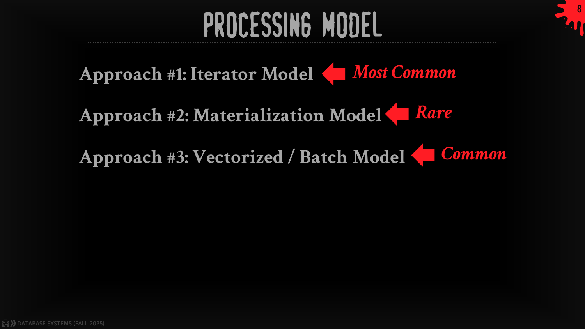


| 模型 | 每次交接 | 在实际系统中 |
|---|---|---|
| [迭代器模型](#迭代器模型（火山模型）)（iterator model） | 一个[元组](#元组) | 最常见 |
| [物化模型](#物化模型)（materialization model） | 全部元组 | 罕见 |
| [向量化模型](#向量化模型（批处理模型）) / [批处理模型](#向量化模型（批处理模型）)（vectorized / batch model） | 一批元组 | 常见 |

和第 [6](../L06/index.md) 讲的[存储模型](#存储模型)一样，这些选择在性能和工程复杂度上各有取舍，适合[联机事务处理](#联机事务处理)（OLTP）的未必适合[联机分析处理](#联机分析处理)（OLAP）。

### 2.1 迭代器模型（Iterator Model）
📍 *PPT 第 9–11 页*

在**[迭代器模型](#迭代器模型（火山模型）)**中，[查询计划](#查询计划)的每个[算子](#算子)都实现一个 `Next()` 函数。每次被调用，它要么返回一个[元组](#元组)，要么返回一个表示“没有更多元组”的结束标记（EOF，也可以是空指针）。算子内部是一个循环，反复调用子节点的 `Next()` 取得元组，处理之后交给调用自己的父节点。父节点一旦从某个子节点收到 EOF，就知道它不会再有数据，以后不再调用它。每个算子还有 `Open()` 和 `Close()` 两个函数，作用类似 C++ 类的构造函数和析构函数：`Open()` 做准备工作，比如打开一个文件句柄、在[索引](#索引)上初始化一个迭代器；`Close()` 释放执行期间临时分配的内存。

这个模型也叫**[火山模型](#迭代器模型（火山模型）)（Volcano model）**或[流水线](#流水线)模型（pipeline model）。“火山”指的是 Goetz Graefe 在 1980 年代末到 1990 年代初主持的研究系统 Volcano。它不仅规范了这套迭代器接口，还定义了如何把这些[算子](#算子)并行化、如何构建查询优化器，这两部分分别会在第 [14](../L14/index.md) 讲和第 [15](../L15/index.md)、[16](../L16/index.md) 讲出现。不过迭代器式的执行在 Volcano 之前早已存在，1970、80 年代的系统基本都是这样做的；Volcano 把它整理成了一套清晰的框架，名字也就这样流传了下来。

**一次 `Next()` 调用是怎样传下去的**

例子中五个[算子](#算子)的 `Next()` 如下，编号 ① 到 ⑤ 分别对应[投影](#投影)、[哈希连接](#哈希连接)、R 的扫描、选择和 S 的扫描：

```text
① for t in child.Next():
      emit(projection(t))

② for t1 in left.Next():
      buildHashTable(t1)
  for t2 in right.Next():
      if probe(t2): emit(t1⨝t2)

③ for t in R:
      emit(t)

④ for t in child.Next():
      if evalPred(t): emit(t)

⑤ for t in S:
      emit(t)
```

这里 `emit(t)` 的意思是“把 t 作为本次 `Next()` 的返回值交给调用者，下次被调用时从这里接着执行”，相当于 Python 生成器里的 `yield`。整个执行过程如下：
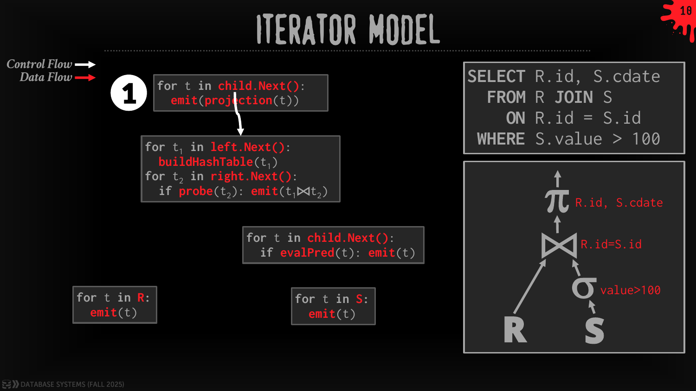

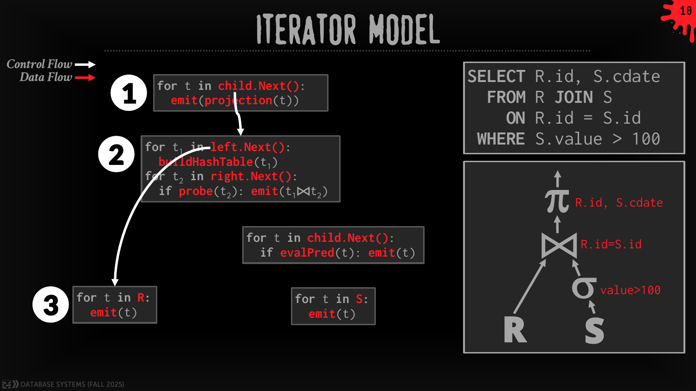

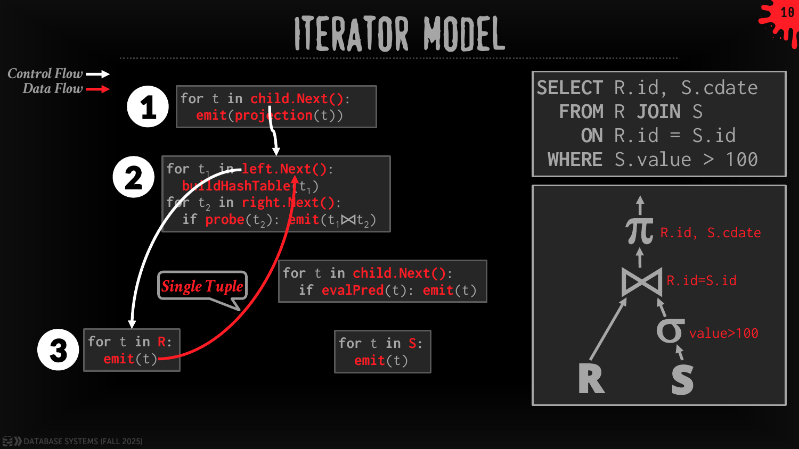

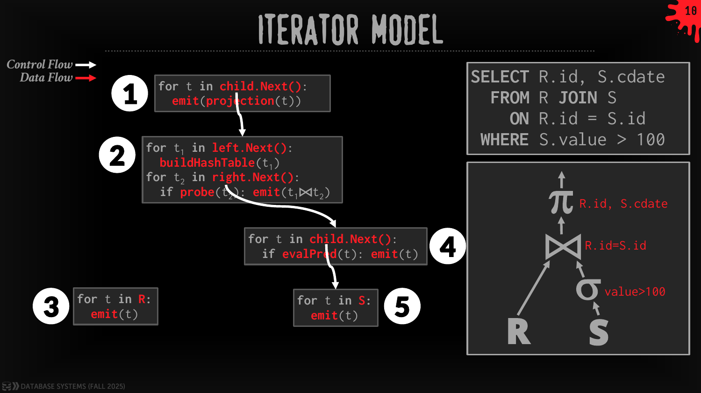

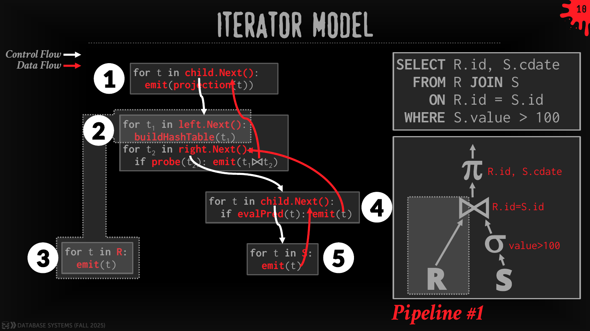

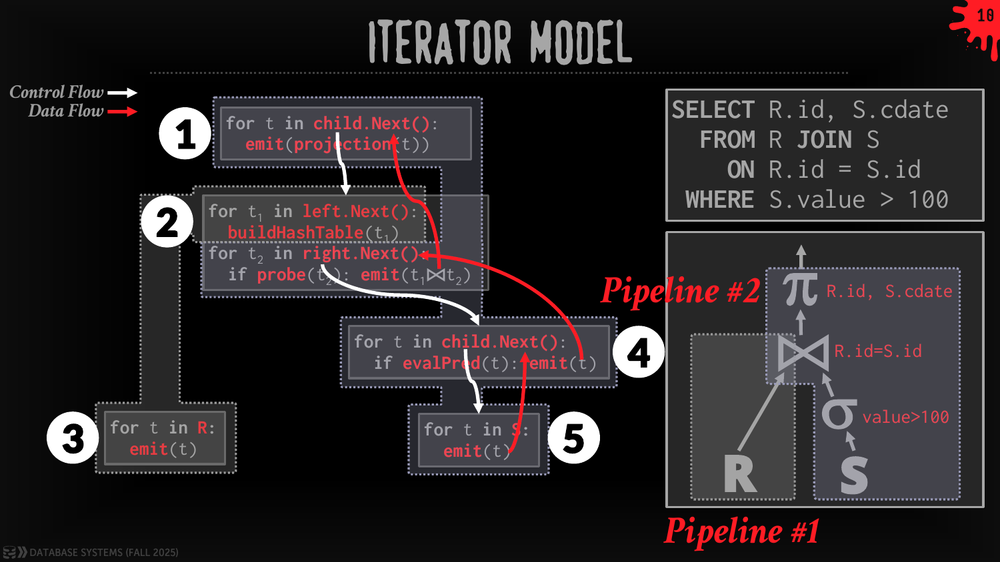


| 步 | 调用或返回 | 发生了什么 |
|---|---|---|
| 1 | [执行引擎](#执行引擎)调用 ① 的 `Next()` | 查询开始执行，引擎只和根节点打交道 |
| 2 | ① 调用 ② 的 `Next()` | [投影](#投影)需要一个[元组](#元组)，向[连接](#连接)索要 |
| 3 | ② 反复调用 ③ 的 `Next()` | 连接先进入构建阶段，每次从 R 取一个元组插入[哈希表](#哈希表)，直到 ③ 返回 EOF。这是[流水线](#流水线) #1 |
| 4 | ② 调用 ④ 的 `Next()` | 哈希表建完，进入探测阶段，转而向右子节点索要元组 |
| 5 | ④ 调用 ⑤ 的 `Next()` | 选择[算子](#算子)向 S 的扫描要一个元组，不满足 `value > 100` 就接着要，直到拿到满足条件的元组 |
| 6 | ④ 返回给 ② | 满足条件的 S 元组交给连接 |
| 7 | ② 探测哈希表 | 找到匹配，把连接后的元组返回给 ①；找不到就回到第 4 步 |
| 8 | ① 返回给引擎 | 投影之后，第一行结果产生 |
| 9 | 引擎再次调用 ① 的 `Next()` | ② 已处于探测阶段，直接从第 4 步继续。等到 ⑤ 返回 EOF，EOF 依次传回 ④、②、①，查询结束。第 4 步到第 8 步属于[流水线](#流水线) #2 |

有两处值得注意。第一，引擎对根节点的第一次 `Next()` 调用，要等 R 的全部[元组](#元组)都插入[哈希表](#哈希表)之后才会返回，[流水线阻断点](#流水线阻断点)在这里表现为一次很长的等待。第二，[控制流](#控制流)自上而下，[数据流](#数据流)自下而上：计划图上向上的箭头画的是数据在逻辑上的流向，而在[迭代器模型](#迭代器模型（火山模型）)的实现里，数据是被上层一次次“拉”上来的。第 3 节会看到另一种做法。
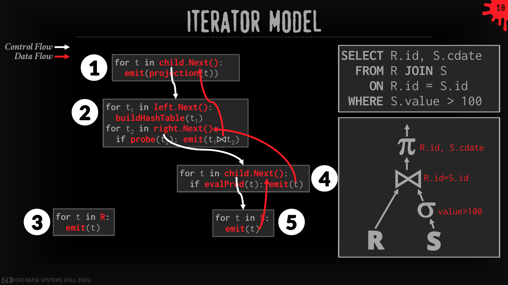


**被伪代码藏起来的状态**

上面的伪代码用 `for` 循环加 `emit` 写成，读起来像是一口气跑完的循环，可实际上每次 `emit` 之后函数就返回了，下一次被调用时必须从上次停下的地方继续。在 C 里，这意味着每个[算子](#算子)都要把自己的进度保存在一个结构体里。选择算子大致是这样的：

```c
typedef struct Operator Operator;

struct Operator {
    void   (*open)(Operator *self);
    Tuple *(*next)(Operator *self);   // returns NULL when exhausted (EOF)
    void   (*close)(Operator *self);
    Operator *child;                  // input operator
    Expr     *pred;                   // predicate, e.g. value > 100
};

// Next() of a selection: keep pulling from the child until a tuple qualifies
Tuple *filter_next(Operator *self) {
    Tuple *t;
    while ((t = self->child->next(self->child)) != NULL) {
        if (eval_pred(self->pred, t))
            return t;
    }
    return NULL;   // child is exhausted, so are we
}
```

选择[算子](#算子)恰好不需要额外的状态，它的进度全在子节点里。[顺序扫描](#顺序扫描)就要记住“上次扫到哪一[页](#页)的哪一个[槽](#槽)”；[哈希连接](#哈希连接)要记住自己处于构建阶段还是探测阶段，还要记住当前这个探测[元组](#元组)在哈希[桶](#桶)里已经匹配到了第几个，因为一个 S 元组可能和好几个 R 元组匹配，每次 `Next()` 只能交出其中一个。

这段代码还说明了[迭代器模型](#迭代器模型（火山模型）)的一个重要性质：父节点通过函数指针调用子节点，完全不关心子节点是什么[算子](#算子)（C++ 的虚函数在底层就是这样一张函数指针表）。R 的扫描可以一次读入一[页](#页)、再逐个交出[元组](#元组)，也可以先把整张表读进一块内存缓冲区、只维护一个游标；[连接](#连接)的右子节点可以是一个选择，也可以是另一个连接。无论哪种情况，上层的实现都不用改。每个算子只要实现了 `Next()`，就能和任何其他算子拼在一起，这就是[迭代器模型](#迭代器模型（火山模型）)易于组合的原因。

**优点与代价**

几乎所有 DBMS 都使用[迭代器模型](#迭代器模型（火山模型）)，行存储系统尤其如此，从 PostgreSQL、MySQL、SQLite 到 Oracle、SQL Server、DB2、MongoDB，数得上名字的系统有几十个。它流行的原因很实在。首先它容易实现，也容易调试：接上 gdb 之类的调试器，沿着一个个 `Next()` 单步走下去，就能看到数据怎样在[算子](#算子)之间移动。其次它很容易控制输出：对 `LIMIT 10`，在计划顶端放一个 limit 算子，拿到 10 个[元组](#元组)后不再调用 `Next()`，下面的扫描自然就停了，不会多读一个元组。[控制流](#控制流)和[数据流](#数据流)混在同一条调用链上，在这里反而成了便利。最后，它天然支持[流水线](#流水线)，每个元组在下一个元组被读取之前，能走多远就走多远。对 OLTP 来说，这个模型的开销很小，因为[事务](#事务)处理的查询通常只碰到少数几个元组。

代价在于函数调用本身。每个[元组](#元组)经过每个[算子](#算子)，都要付出一次 `Next()` 调用，而且是经过函数指针的间接调用：CPU 在执行到这条调用指令之前无法确定要跳到哪里，编译器也没法把被调函数内联（inline）进来做进一步的优化。单次调用的代价并不大，但一个分析查询要扫描十亿个元组、经过好几个算子时，就会累积成几十亿次调用，成为瓶颈。后面两种模型都是从减少调用次数入手的。

你可能会想到，右子树其实不必等左子树建完[哈希表](#哈希表)才开始干活。确实如此：如果用[排序归并连接](#排序归并连接)，两边完全可以同时各自排序，都排好之后再归并；即使是[哈希连接](#哈希连接)，也有一种对称哈希连接（symmetric hash join），两边各建一张哈希表，每来一个[元组](#元组)先插入自己这一侧的表，再去探测对方的表。不过对称哈希连接几乎没有系统采用。本讲只讨论单线程执行，多线程的并行执行留到第 [14](../L14/index.md) 讲。

### 2.2 物化模型（Materialization Model）
📍 *PPT 第 12–14 页*

既然每个[元组](#元组)一次调用太贵，最直接的办法就是走到另一个极端：每个[算子](#算子)只被调用一次，一次处理完全部输入，再把全部输出一次性交出。这就是**[物化模型](#物化模型)**，它可以看作[迭代器模型](#迭代器模型（火山模型）)的一种特化。每个算子实现一个 `Output()` 函数，它的返回值就是这个算子将会产生的所有元组，算子把自己的输出“[物化](#物化)”成一个完整的结果；执行结束后，DBMS 再也不需要回头找它要数据。同一个查询在[物化模型](#物化模型)下是这样的：

```text
① out = [ ]
  for t in child.Output():
      out.add(projection(t))
  return out

② out = [ ]
  for t1 in left.Output():
      buildHashTable(t1)
  for t2 in right.Output():
      if probe(t2): out.add(t1⨝t2)
  return out

③ out = [ ]
  for t in R:
      out.add(t)
  return out

④ out = [ ]
  for t in child.Output():
      if evalPred(t): out.add(t)
  return out

⑤ out = [ ]
  for t in S:
      out.add(t)
  return out
```

调用顺序和[迭代器模型](#迭代器模型（火山模型）)一样，先是 ①→②→③，再是 ②→④→⑤；区别在于每次返回的都是一个装着全部[元组](#元组)的缓冲区。③ 把 R 的所有元组装进 `out` 交给 ②，⑤ 把 S 的所有元组交给 ④，④ 过滤之后再把剩下的全部交给 ②。
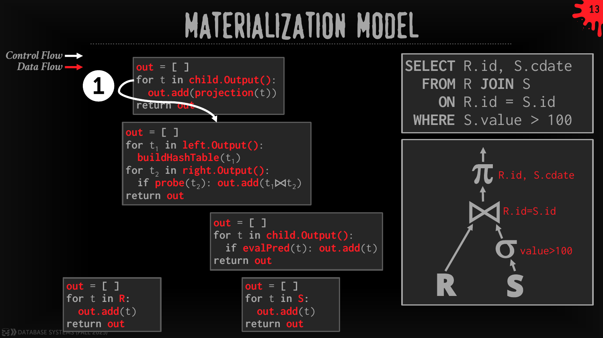

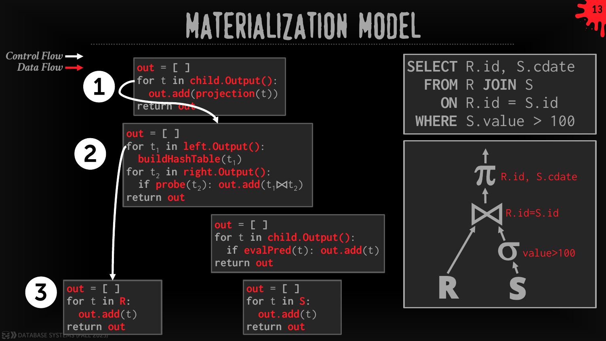

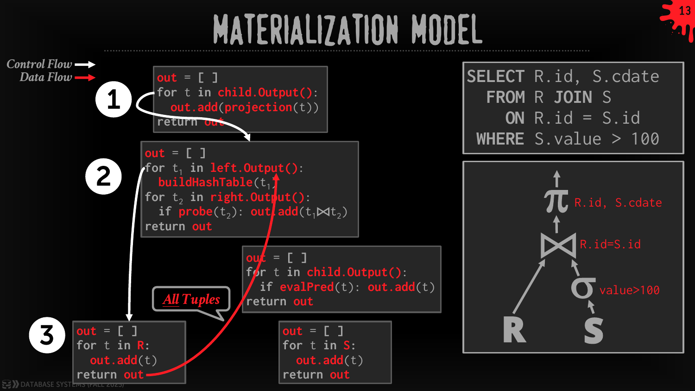

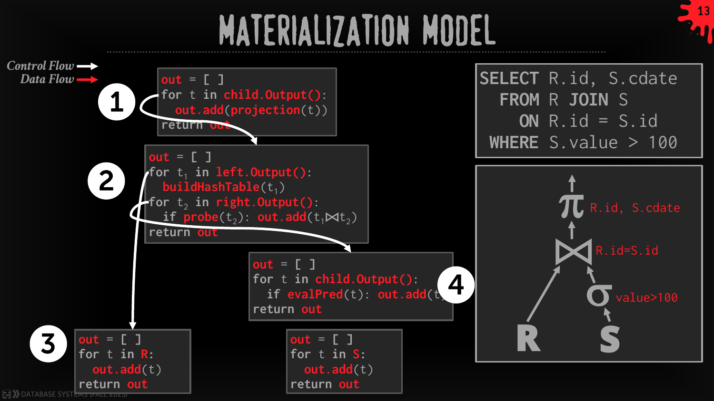

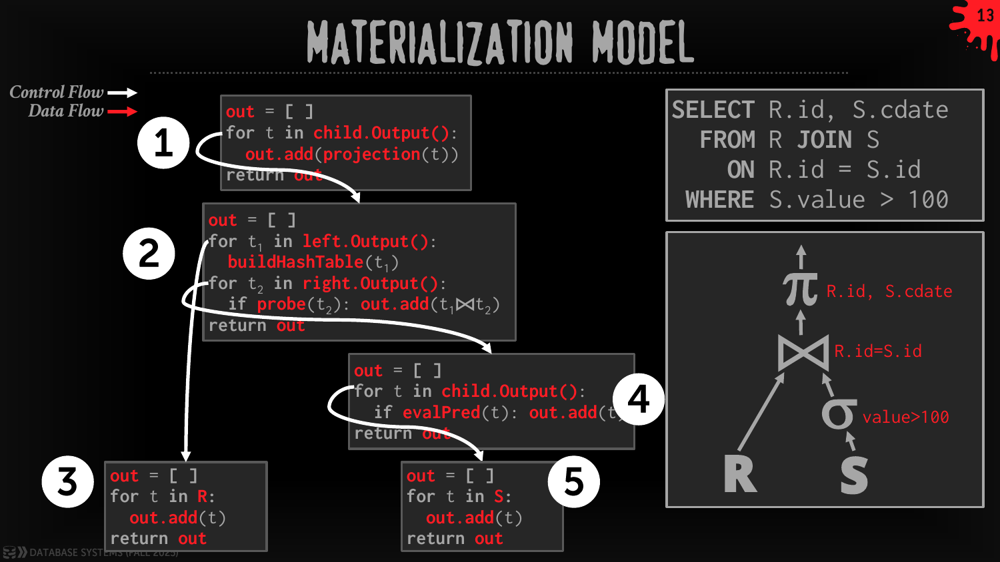

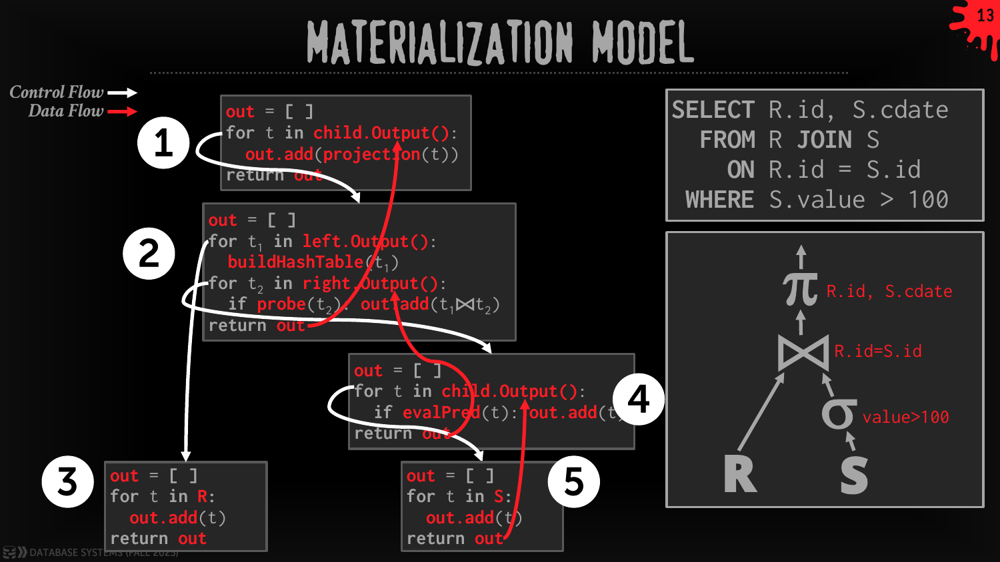


问题也就很明显了。设想 S 有十亿个[元组](#元组)，其中只有十个满足 `value > 100`：⑤ 要先把十亿个元组全部装进输出缓冲区交给 ④ 检查，④ 扔掉的几乎是全部。中间结果大到内存装不下时，还要溢出到磁盘，这一写一读全是白费。`LIMIT` 也失去了最自然的控制手段：顶端只要十个元组，下面的[算子](#算子)却已经把所有结果都算完了。

[物化模型](#物化模型)用两个办法缓解这个问题。一是把提示信息向下传递：DBMS 可以把 `LIMIT` 这类信息推给下层[算子](#算子)，让它们知道后面只需要多少[元组](#元组)，不必扫描太多。二是**[算子融合](#算子融合)（operator fusion）**，把相邻的算子合并进同一个循环。比如把 S 的扫描和选择合成一个算子：

```text
out = [ ]
for t in S:
    if evalPred(t): out.add(t)
return out
```

被丢弃的[元组](#元组)就根本不会进入任何缓冲区。[算子融合](#算子融合)在[迭代器模型](#迭代器模型（火山模型）)和[向量化模型](#向量化模型（批处理模型）)里同样可以用，但在[物化模型](#物化模型)里最为关键，因为这里每一步传递的数据量最大。融合也有边界。同一条[流水线](#流水线)内的[算子](#算子)往往都能融合，慕尼黑工业大学的 HyPer 等系统（3.3 节还会讲到）几乎能把一条[流水线](#流水线)里的所有[算子融合](#算子融合)成一段代码；但跨过[流水线阻断点](#流水线阻断点)就不行了，因为阻断点必须等下层全部完成。

**这个设计从哪里来**

乍看之下，一次交出全部结果的设计很不合常理，但它的设计者着眼的是列存储。[物化模型](#物化模型)最早出自 1990 年代荷兰国家数学与计算机科学研究中心（CWI）的 MonetDB，用来一次处理一整列，而不是一次处理一个[元组](#元组)。MonetDB 是分析型的列存储系统，它假定查询通常需要一列中的全部数据，但只需要少数几列，于是[算子](#算子)一次处理一整列，通过[投影](#投影)尽早丢掉用不到的列，只把需要的列往上传。一整列数据存放在一个连续的数组里，一次函数调用就能处理完，逐个元组调用 `Next()` 的开销也就省掉了。

它的软肋在中间结果：只要某一步的输出很大，DBMS 就得为它分配同样大的缓冲区。所以[物化模型](#物化模型)不适合中间结果庞大的 OLAP 查询，反倒更适合 OLTP。[事务](#事务)处理的查询一次只访问少量[元组](#元组)，中间结果很小，一次调用就拿到全部结果，执行和协调的开销、函数调用的次数都降到了最少。如果一个 OLTP 查询的计划只有一条[流水线](#流水线)、所有[算子](#算子)都能融合，它就收缩成一段直来直去的代码。对数据全部放在内存里的系统，这一点尤其重要，因为这时没有磁盘 I/O 来掩盖函数调用的开销。

采用[物化模型](#物化模型)的系统印证了这一点：H-Store 和 VoltDB 是内存中的 OLTP 系统，RavenDB 是与 MongoDB 类似、以[事务](#事务)处理为主的文档[数据库](#数据库)。德国的实验性系统 Hyrise 最初也采用[物化模型](#物化模型)，重写时改用了[向量化模型](#向量化模型（批处理模型）)。总的来说，[物化模型](#物化模型)简单，容易编写，也容易调试，数据量和中间结果不大时表现不错，一旦中间结果变大就会失控。

> 💬 **旁注**
> 用[物化模型](#物化模型)的系统很少。Andy 估计全世界大概只有五六个，还补了一句：其中两个是他写的。
>
> *原话：“There's maybe five or six systems that actually use it. And two of them I wrote, so there's not that many.”*

### 2.3 向量化模型（Vectorized / Batch Model）
📍 *PPT 第 15–17 页*

[迭代器模型](#迭代器模型（火山模型）)每次传一个[元组](#元组)，调用次数太多；[物化模型](#物化模型)每次传全部，缓冲区太大。**[向量化模型](#向量化模型（批处理模型）)**（也叫[批处理模型](#向量化模型（批处理模型）)）取二者之间：和[迭代器模型](#迭代器模型（火山模型）)一样，每个[算子](#算子)实现 `Next()`，但每次调用返回的是一批（batch）元组，也称一个向量（vector）。算子的内部循环一次处理多个元组。批的大小可以根据硬件或查询的特点调整，通常取 2 的幂，比如 1024 或 2048（DuckDB 的默认值是 2048），远小于[物化模型](#物化模型)的“全部”。一批数据包含一列或多列，每一列都带有自己的[NULL 位图](#NULL%20位图)（null bitmap），用一位标记每个值是否为 `NULL`，这样列本身就能存成紧凑的定长数组。

以 R 的扫描和选择[算子](#算子)为例，其余算子同理：
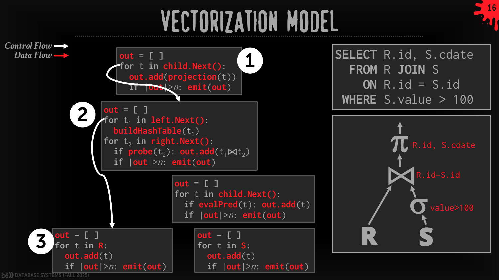


```text
③ out = [ ]
  for t in R:
      out.add(t)
      if |out|>n: emit(out)

④ out = [ ]
  for t in child.Next():
      if evalPred(t): out.add(t)
      if |out|>n: emit(out)
```

每个[算子](#算子)维护一个输出缓冲区，攒够 n 个[元组](#元组)（n 是目标批大小）才把整批交给上层。伪代码省略了两处细节：交出一批之后要清空缓冲区，输入耗尽时还要把不满一批的剩余元组交出去。[控制流](#控制流)和[迭代器模型](#迭代器模型（火山模型）)完全相同，只是每次返回的变成了一批元组。
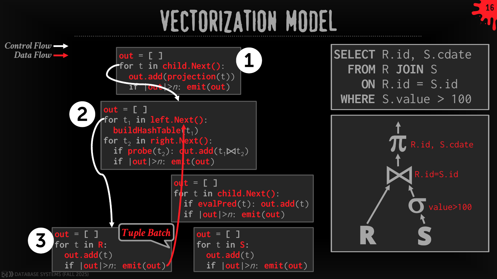


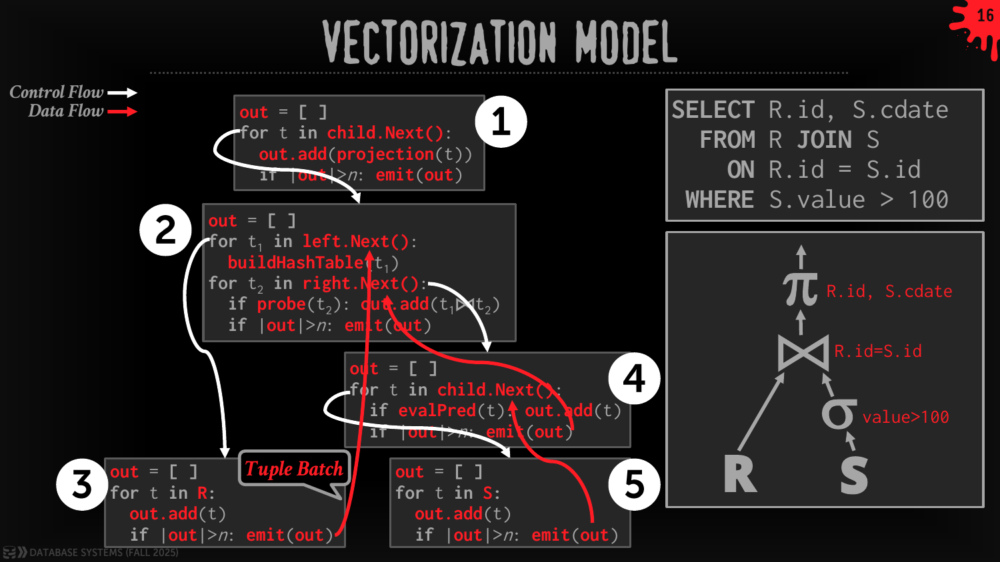


**调用次数少了多少**

扫描十亿个[元组](#元组)时，[迭代器模型](#迭代器模型（火山模型）)的扫描[算子](#算子)要被调用十亿次；批大小为 2048 时，只需要调用约 49 万次：

$$
\frac{10^9}{2048} \approx 488\,281
$$

调用次数少了三个数量级以上，每次调用的固定开销被一整批[元组](#元组)分摊掉了。

**为什么现代 CPU 喜欢批处理**

调用次数少只是一部分原因，更重要的是[算子](#算子)内部的代码变了样。对一批值计算 `value > 100`，可以写成这样一个紧凑的循环：

```c
// Evaluate `value > 100` over one batch, producing one flag per row
for (int i = 0; i < n; i++)
    match[i] = (value[i] > 100);
```

这种循环对现代 CPU 非常友好。首先，编译器知道怎样优化和向量化它：可以把它翻译成 SIMD（single instruction, multiple data，[单指令多数据](#单指令多数据)）指令，一条指令同时比较一个宽寄存器里的多个整数，比如一个 256 位寄存器能装下 8 个 32 位整数。其次，各次迭代之间既没有数据依赖，也没有控制依赖。现代 CPU 是乱序执行（out-of-order execution）的，只要后面的指令不依赖前面指令的结果，就可以提前执行；循环体里没有难以预测的分支，CPU 也不会因为猜错分支方向而作废已经做完的工作。最后，指令缓存始终是热的。CPU 会把最近执行过的代码放在一小块高速缓存里，[迭代器模型](#迭代器模型（火山模型）)每处理一个[元组](#元组)都要在几个[算子](#算子)的代码之间来回跳，[向量化模型](#向量化模型（批处理模型）)则是在同一段小循环里连续处理两千个元组，这段代码一直留在指令缓存里。批处理也便于把计算交给 GPU，因为 GPU 擅长对大量同类型的数据做相同的操作。

所以[向量化模型](#向量化模型（批处理模型）)非常适合 OLAP 查询：它大大减少了每个[算子](#算子)被调用的次数，又让 CPU 的能力集中用在真正的计算上。

**从 MonetDB 到 Snowflake**

这个想法今天看来理所当然，其实直到 2000 年代中期才出现。在此之前，1980、90 年代的分析型系统要么还在用[迭代器模型](#迭代器模型（火山模型）)，要么像 MonetDB 那样用[物化模型](#物化模型)。CWI 的研究者在 MonetDB 上看到了[物化模型](#物化模型)的问题，从 2003 年开始的 MonetDB/X100 项目提出了按批处理的向量化执行，并于 2005 年发表。这个项目在 2008 年衍生出公司 Vectorwise，后来被 Ingres 公司（今天的 Actian）收购；项目的核心成员 Marcin Żukowski 随后与两位来自 Oracle 的工程师共同创立了 Snowflake。DuckDB 同样出自 CWI。

今天，[向量化模型](#向量化模型（批处理模型）)已是分析型系统的标准做法，Snowflake、DuckDB、ClickHouse、Google BigQuery、Amazon Redshift、Databricks 都在使用。Andy 的判断是，过去十年里几乎每一个面向 OLAP [工作负载](#工作负载)的新[数据库](#数据库)系统都采用这种方式[^vec]，一些起初使用[迭代器模型](#迭代器模型（火山模型）)的系统，后来也放弃了它，改用[向量化模型](#向量化模型（批处理模型）)。

需要区分的是，“向量”这个词今天还有另一层流行的含义。搜索 vector database，得到的多是第 [1](../L01/index.md) 讲提到的[向量数据模型](#向量数据模型)：存放[嵌入向量](#嵌入向量)、支持[最近邻搜索](#最近邻搜索)的系统。两者毫无关系，这里的“向量”只是“一批值组成的数组”。

批处理也带来了新的工程问题，本课程不深入讨论。比如一批 2048 个[元组](#元组)经过选择[算子](#算子)后可能只剩几十个，这时是等下层送来更多数据、把这一批重新攒满再上交，还是带着一个稀疏的批直接往上走，两种做法各有利弊。

### 2.4 三种模型的比较
📍 *PPT 第 8、11、14、17 页*

| | [迭代器模型](#迭代器模型（火山模型）) | [物化模型](#物化模型) | [向量化模型](#向量化模型（批处理模型）) |
|---|---|---|---|
| 每次调用交出 | 一个[元组](#元组) | 全部元组 | 一批元组 |
| 调用次数 | 每个元组、每个[算子](#算子)一次 | 每个算子一次 | 每批、每个算子一次 |
| 中间结果占用的内存 | 最小 | 可能极大 | 一批的大小 |
| 输出控制（`LIMIT`） | 最容易 | 需要向下传递提示 | 容易，最多多算一批 |
| 适合的[工作负载](#工作负载) | OLTP，通用 | 中间结果小的 OLTP | OLAP |
| 代表系统 | PostgreSQL、MySQL、SQLite | MonetDB、H-Store、VoltDB | DuckDB、ClickHouse、Snowflake |

一个自然的问题是：同一个 DBMS 能不能同时支持几种[处理模型](#处理模型)，按查询挑选？理论上可以，但几乎没有系统这样做。同一个功能要维护好几份实现，还要保证它们能互相组合，Andy 认为这会成为工程上的噩梦，得不偿失。[^nightmare] 况且把[向量化模型](#向量化模型（批处理模型）)的批大小设为 1，它就退化成了[迭代器模型](#迭代器模型（火山模型）)，只是每个[元组](#元组)要多进出一次输出缓冲区，效率略低。

细心的读者会发现，Oracle、SQL Server 和 DB2 既在使用[迭代器模型](#迭代器模型（火山模型）)的系统之列，也在使用[向量化模型](#向量化模型（批处理模型）)的系统之列。这并不矛盾。这些系统诞生于 1970、80 年代，最初都是行存储加[迭代器模型](#迭代器模型（火山模型）)；列存储和 OLAP 流行起来之后，它们意识到对分析查询来说列存储加向量化更好，于是在同一个产品里另外实现了一套列存储引擎。按 Andy 的说法，这两套引擎在同一个二进制程序里，代码却基本是分开的；在一个引擎内部，[处理模型](#处理模型)并不切换。

## 3. 执行方向：拉取还是推送
📍 *PPT 第 18–21 页*

### 3.1 自顶向下的拉取（Pull）
📍 *PPT 第 18–19 页*

前面三种模型的例子有一个共同点：DBMS 在[查询计划](#查询计划)的根节点调用 `Next()`（或 `Output()`）开始执行，数据从叶子被“拉”上来。这是**计划处理方向（plan processing direction）**的第一种选择，称为[自顶向下](#拉取式（自顶向下）)（top-to-bottom）或[拉取式](#拉取式（自顶向下）)（pull-based），大多数 DBMS 的[执行引擎](#执行引擎)都是这样实现的。在这种方式下，[元组](#元组)总是通过函数调用在[算子](#算子)之间传递，只有[流水线阻断点](#流水线阻断点)例外，比如[哈希连接](#哈希连接)的构建侧会把收到的元组存进[哈希表](#哈希表)，而不是返回给谁。

1.1 节说过，计划图上的箭头只表示数据在逻辑上的流向。[拉取式](#拉取式（自顶向下）)实现里，控制权沿着调用链向下走，数据沿着返回值向上走，调度就藏在调用关系里：根节点调用子节点，子节点再调用它的子节点，“先执行谁”由 `Next()` 的传递顺序隐式决定，系统中没有一个地方能从全局看到整个查询的执行进度。

### 3.2 自底向上的推送（Push）
📍 *PPT 第 19–20 页*

另一种选择是[自底向上](#推送式（自底向上）)（bottom-to-top），也称[推送式](#推送式（自底向上）)（push-based）：从叶子节点开始，把数据推给父节点。这时不再有 `Next()` 调用链，取而代之的是一个更高层的调度器（scheduler）。它知道一个查询由哪些[流水线](#流水线)组成、[流水线](#流水线)之间有什么依赖，由它决定以什么顺序执行它们，这个顺序不必是机械的[自底向上](#推送式（自底向上）)。

例子里的计划在[推送式](#推送式（自底向上）)下变成两段代码：
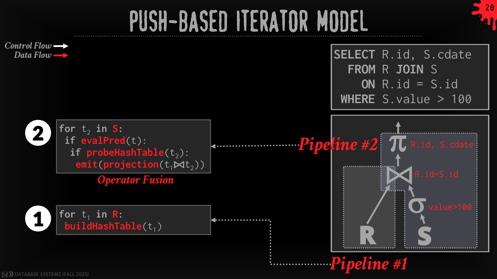


```text
① for t1 in R:
      buildHashTable(t1)

② for t2 in S:
      if evalPred(t):
          if probeHashTable(t2):
              emit(projection(t1⨝t2))
```

（`evalPred(t)` 中的 t 就是 t2。）

每条[流水线](#流水线)变成一段独立的代码，只管从某处读数据、向某处写数据，彼此之间没有函数调用。[流水线](#流水线) ② 把选择、探测和[投影](#投影)写进了同一个循环，这正是 2.2 节的[算子融合](#算子融合)：一个 S [元组](#元组)从被读出到被输出，始终待在同一个循环体里，不会被交给别的函数。

调度器知道[流水线](#流水线) ② 要用到 ① 建好的[哈希表](#哈希表)，所以先调度 ①。① 运行时把哈希表写进输出缓冲区，比如向[缓冲池](#缓冲池)申请页面来存放哈希表，写满一[页](#页)再要一页。① 结束后，调度器看到 ② 等待的数据已经就绪，于是调度 ②，并告诉它 ① 的输出在哪里。② 把结果写进自己的输出缓冲区；它结束后，调度器知道那里存放的就是最终结果，把它交给发起查询的一方。
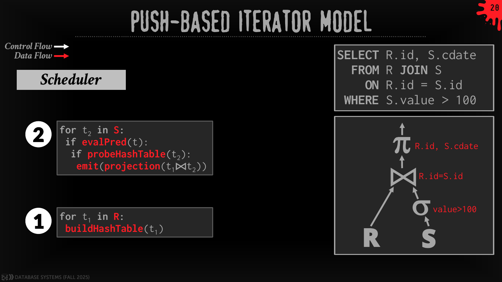

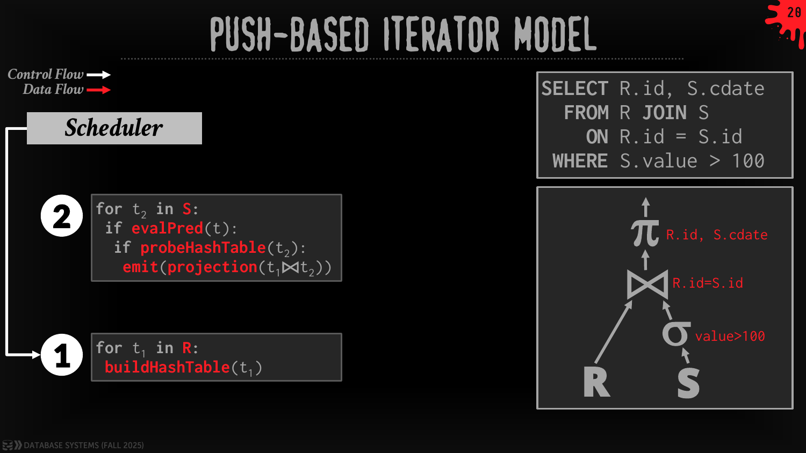

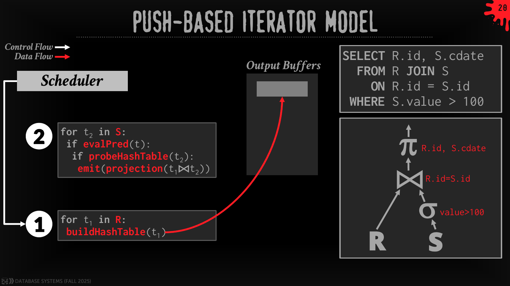

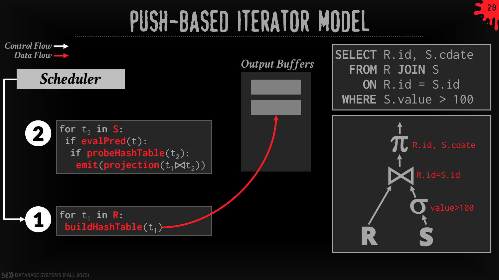

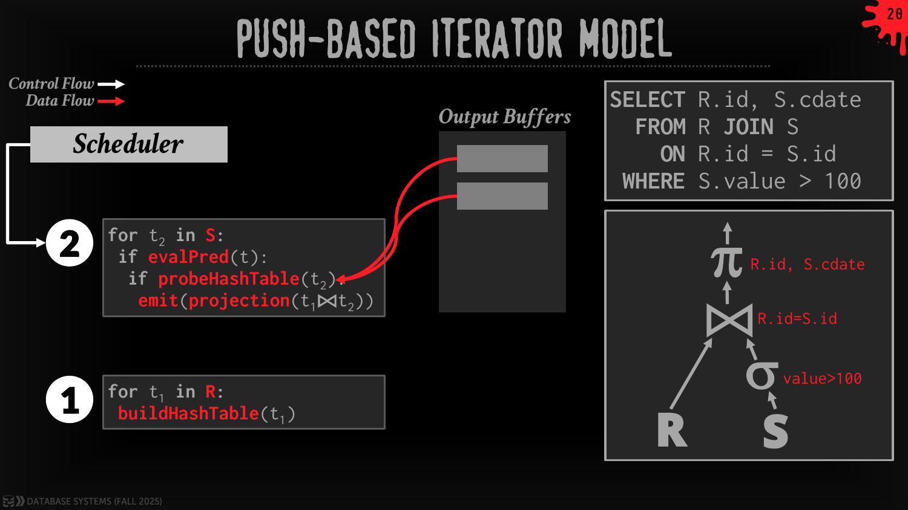

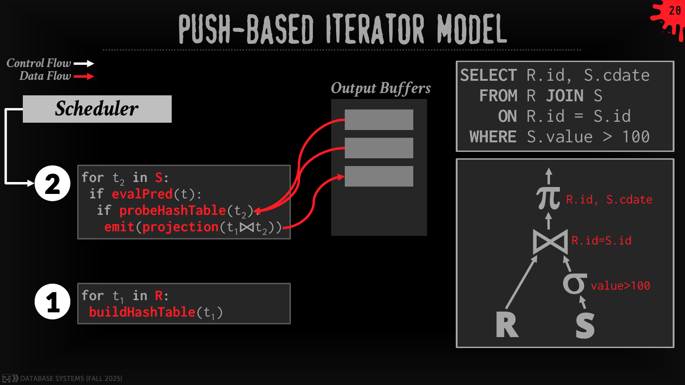

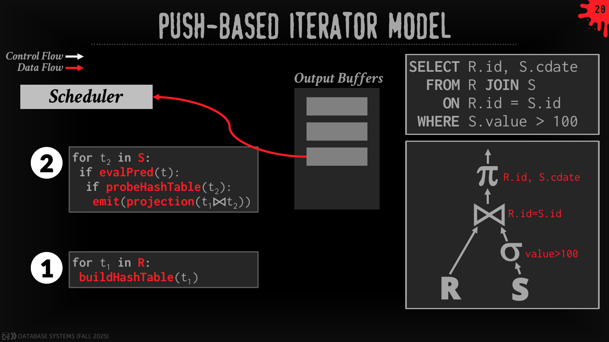


这样一来，[控制流](#控制流)和[数据流](#数据流)就分开了：调度器负责发出“执行这个任务”的指令，数据则经由缓冲区从一个任务传给下一个任务。调度器手里握着整个查询的全局视图，能自己决定[流水线](#流水线)的执行顺序，这一点在第 [14](../L14/index.md) 讲讨论并行执行时会变得很重要。

### 3.3 两种方向的取舍
📍 *PPT 第 21 页*

[拉取式](#拉取式（自顶向下）)是最常见的做法，它最大的好处是容易控制输出，`LIMIT` 只需停止调用 `Next()`。它的代价有三处。父[算子](#算子)必须阻塞，等子算子返回一个[元组](#元组)才能继续；`Next()` 通常实现为虚函数，每次调用都带着间接调用的额外开销；每次 `Next()` 调用还会带来分支开销，CPU 要预测程序接下来走哪条分支并提前执行，一旦猜错，已经开始执行的指令就要作废重来。

[推送式](#推送式（自底向上）)相对少见。它的好处是能更精细地控制流水线中的缓存和寄存器。寄存器是 CPU 内部数量很少、速度最快的存储单元。融合之后的[流水线](#流水线)里，一个[元组](#元组)从读出到输出都在同一个循环体内，它的各个字段可以一直留在寄存器中，不必写回内存，以 HyPer 为代表的德国系统正是这样做的。它的代价是：叶子节点只管尽快产出数据，系统未必能精确控制中间结果的大小；`LIMIT` 这样的输出控制，也不能再靠“不再调用”来实现；有些[算子](#算子)在这种方式下很难实现，典型的是[排序归并连接](#排序归并连接)。[拉取式](#拉取式（自顶向下）)可以把它写成一条[流水线](#流水线)，假定一侧已经排好序，再排序另一侧、边读边归并；[推送式](#推送式（自底向上）)则要把两侧的排序分别作为独立的任务，再调度第三个任务来做归并。

采用[推送式](#推送式（自底向上）)的系统有 HyPer、Umbra、CedarDB、Snowflake、DuckDB、ClickHouse 和 Firebolt。其中最著名、可能也是最早采用这种方式的，是慕尼黑工业大学的 HyPer；它的后继者 Umbra 延续了这种设计，CedarDB 则是基于 Umbra 的商业系统。DuckDB 起初使用[拉取式](#拉取式（自顶向下）)，后来认为[推送式](#推送式（自底向上）)更好，改了过来。今天主流的 OLAP 系统大多把[推送式](#推送式（自底向上）)和[向量化模型](#向量化模型（批处理模型）)结合使用。按 Andy 的说法，[推送式](#推送式（自底向上）)的许多好处，往往要先实现过一遍[拉取式](#拉取式（自顶向下）)才能体会到。

**两个独立的选择**

执行方向和[处理模型](#处理模型)是两个互相独立的设计选择：[处理模型](#处理模型)决定一次交接多少数据，执行方向决定由谁来驱动交接。把本讲提到的系统放进去，可以得到这样一张表：

| | 拉取（[自顶向下](#拉取式（自顶向下）)） | 推送（[自底向上](#推送式（自底向上）)） |
|---|---|---|
| 一次一个[元组](#元组) | PostgreSQL、MySQL、SQLite | HyPer、Umbra、CedarDB |
| 一次一批元组 | DataFusion、早期的 DuckDB | DuckDB、ClickHouse、Snowflake、Firebolt |

HyPer、Umbra 和 CedarDB 同时属于[迭代器模型](#迭代器模型（火山模型）)和[推送式](#推送式（自底向上）)，这正是“[推送式](#推送式（自底向上）)[迭代器模型](#迭代器模型（火山模型）)”（push-based iterator model）这个名字的含义：它仍然一次处理一个[元组](#元组)，只是驱动的方向反了过来。

## 4. [访问方法](#访问方法)：[查询计划](#查询计划)的叶子从哪里取数据
📍 *PPT 第 22–31 页*

到目前为止，我们讨论的都是[算子](#算子)之间怎样传递数据，却一直默认叶子节点“自然会”产出[元组](#元组)。叶子节点具体怎样从表里取数据，由**[访问方法](#访问方法)（access method）**决定。[关系代数](#关系代数)里没有与之对应的运算符：关系代数只定义对关系做选择、[投影](#投影)、[连接](#连接)，数据在物理上如何取出，不在它要表达的范围之内。到了实现层面，这个问题就绕不开了。基本的[访问方法](#访问方法)有三种：[顺序扫描](#顺序扫描)、[索引扫描](#索引扫描)（有许多变体）和[多索引扫描](#多索引扫描)。
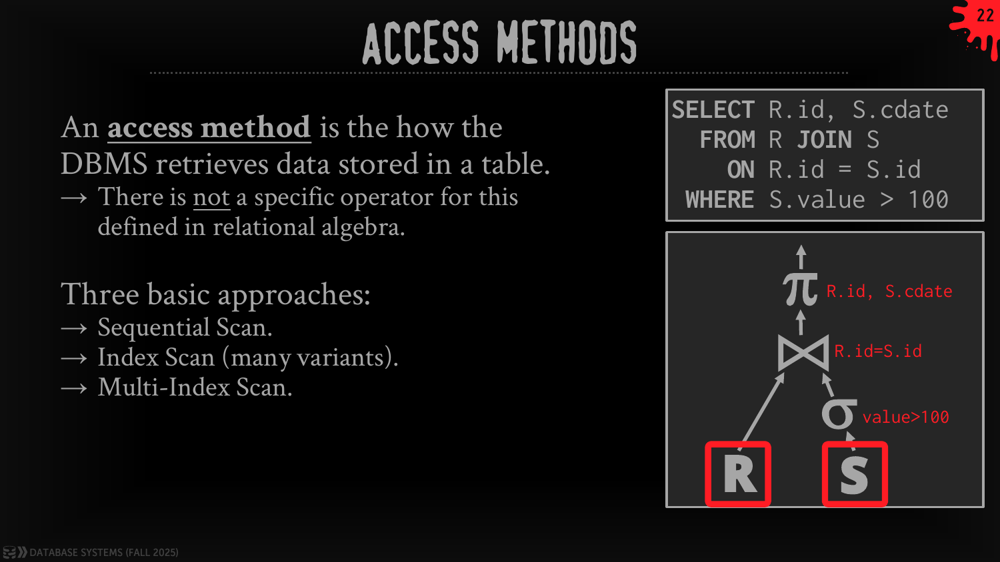


### 4.1 顺序扫描（Sequential Scan）
📍 *PPT 第 23 页*

```text
for page in table.pages:
    for t in page.tuples:
        // Do Something!
```

**[顺序扫描](#顺序扫描)**逐[页](#页)处理整张表：对表中的每一页，先从[缓冲池](#缓冲池)取出这一页，再遍历页上的每个[元组](#元组)，判断是否要把它交给下一个[算子](#算子)。对第 [3](../L03/index.md) 讲的[堆文件](#堆文件)（heap file）来说，就是从[页目录](#页目录)（page directory）找到第一页，然后一页一页读下去。按照[迭代器模型](#迭代器模型（火山模型）)的要求，扫描算子内部维护一个游标（cursor），记录上次检查到哪一页的哪一个[槽](#槽)（slot），下一次 `Next()` 从那里接着往下找。

[顺序扫描](#顺序扫描)是兜底方案：没有任何[索引](#索引)可用时，总可以把表一[页](#页)一页读完。它几乎总是效率最低的[访问方法](#访问方法)，但它又是分析查询最常用的方法，所以值得下大力气优化。

### 4.2 让顺序扫描更快
📍 *PPT 第 24 页*

逐个[元组](#元组)处理的[顺序扫描](#顺序扫描)有两个短处，一是函数调用的开销，二是无法利用并行和向量指令。加速它的手段大多已经在前面几讲出现过：

| 优化 | 核心想法 | 出处 |
|---|---|---|
| 数据编码 / 压缩 | 用[游程编码](#游程编码)、[字典编码](#字典编码)等方式利用重复值，读一[页](#页)就能得到更多[元组](#元组) | 第 [6](../L06/index.md) 讲 |
| [预取](#预取) / [扫描共享](#扫描共享) / [缓冲池](#缓冲池)旁路 | 预取是在[顺序扫描](#顺序扫描)时提前把后面几页读进内存，扫描不必停下来等磁盘；扫描共享是让扫描同一张表的多个查询共用一次扫描；缓冲池旁路是让扫描[算子](#算子)把读来的页放在自己的私有内存里，不进缓冲池，以免一次大扫描把缓冲池里的热页全冲掉（[顺序泛洪](#顺序泛洪)） | 第 [4](../L04/index.md) 讲 |
| 任务并行 / 多线程 | 多个线程同时扫描表的不同部分 | 第 [14](../L14/index.md) 讲 |
| 聚簇 / 排序 | 堆中的元组按[聚簇索引](#聚簇索引)指定的顺序存放；数据有序时可以二分查找，[排序归并连接](#排序归并连接)也更高效 | 第 [8](../L08/index.md) 讲 |
| [延迟物化](#延迟物化) | 列存储系统推迟把各列拼成元组，每个算子只向上传递下一步所需的最少信息（[记录 ID](#记录%20ID)、列内偏移等）；它只对列存储有用 | 第 [12](../L12/index.md) 讲 |
| [物化视图](#物化视图) / 结果缓存 | 预先算好并保存结果，下次直接读取 | 本节 |
| [数据跳过](#数据跳过) | 事先判断哪些数据不可能满足条件，干脆不读 | 4.3 节 |
| 数据并行 / 向量化 | 用 SIMD 指令一次处理多个值 | 第 [14](../L14/index.md) 讲 |
| [代码特化](#代码特化) / 编译 | 为具体的查询生成专门的代码并编译，不再逐步解释执行 | 6.2 节 |

（PPT 上这两项标注的是第 [5](../L05/index.md)、[6](../L06/index.md) 讲，与本学期课表的编号不一致；按本学期的课表，它们分别在第 [6](../L06/index.md) 讲和第 [4](../L04/index.md) 讲。）

结果缓存和[物化视图](#物化视图)本课程不展开，这里只说清它们是什么。**结果缓存（result caching）**是说，如果同一条查询反复执行，而数据没有变化，就直接返回上次的结果，实际系统里很少这样做。**[物化视图](#物化视图)（materialized view）**则由应用明确告诉系统：这条查询会反复执行，请预先算好结果保存下来；之后执行同一条查询，或者能用这个[视图](#视图)回答的查询，直接读取保存的结果。难点在于保持它的新鲜度。高端系统能做增量维护，比如视图保存的是某一列的总和，每插入一个新[元组](#元组)，只需把新值加到总和上，而不必重新扫描全表。PostgreSQL 做不到这一点，甚至不会自动刷新[物化视图](#物化视图)，需要用户显式执行 `REFRESH MATERIALIZED VIEW`。Andy 坦言，复杂的[物化视图](#物化视图)维护是[数据库](#数据库)系统里他最不熟悉的部分，因为它非常棘手，做得好的系统也很少。

### 4.3 数据跳过（Data Skipping）
📍 *PPT 第 25–26 页*

前面那些优化都是让“读”变得更快，[数据跳过](#数据跳过)则是尽量不读：如果事先就知道某些数据不可能满足查询，就不必去读它们。方法有两类。

**[近似查询](#近似查询)（approximate query）**是有损的：在表的一个采样子集上执行查询，得到近似的结果。它主要用于计算聚合，并且只用在允许少量误差的场合。比如统计一个网站某个月的访客数，网站每月有几百万访客时，精确到个位没有什么意义，精确到千位就足够了。所以一些高端系统在 `COUNT`、`MIN`、`MAX`、`SUM`、`AVG` 这些标准[聚合函数](#聚合函数)之外，还提供近似计数、近似最值之类的函数，它们基于采样计算，好的实现还能给出结果精度的统计保证。提供[近似查询](#近似查询)的系统有 BlinkDB、Redshift、ComputeDB、XDB、Oracle、Snowflake、Google BigQuery 和 Databricks。

**[区域映射](#区域映射)（zone map）**是无损的：为每一[页](#页)（或每一块数据）预先计算每个[属性](#属性)的一组聚合值，DBMS 读一页之前先查它的[区域映射](#区域映射)，判断这一页里是否可能有满足条件的[元组](#元组)。例如：
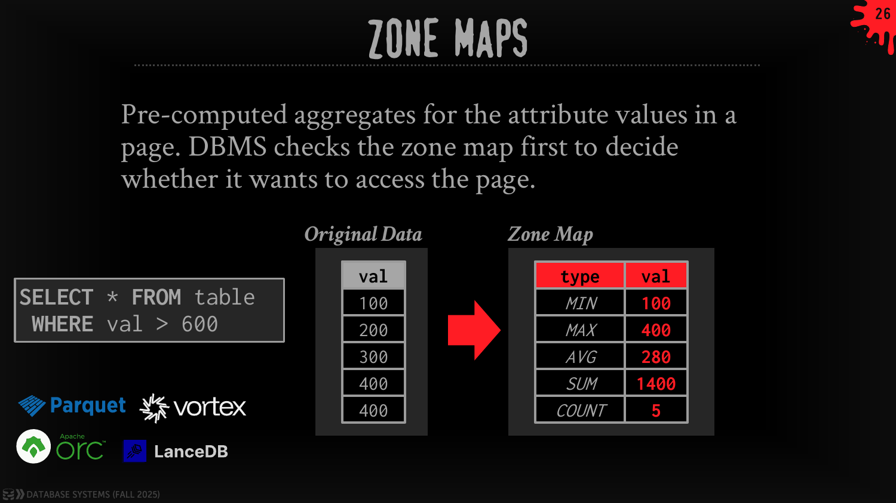


```text
 Original Data          Zone Map
 ┌─────┐               ┌───────┬──────┐
 │ val │               │ type  │ val  │
 ├─────┤               ├───────┼──────┤
 │ 100 │               │ MIN   │ 100  │
 │ 200 │      ──>      │ MAX   │ 400  │
 │ 300 │               │ AVG   │ 280  │
 │ 400 │               │ SUM   │ 1400 │
 │ 400 │               │ COUNT │ 5    │
 └─────┘               └───────┴──────┘
```

对查询 `SELECT * FROM table WHERE val > 600`，[区域映射](#区域映射)显示这一[页](#页)的最大值只有 400，不可能有任何值大于 600，于是整页都不用读。[区域映射](#区域映射)的作用类似一个[过滤器](#过滤器)：它不能告诉你想要的数据在哪里，只能告诉你哪些数据块里一定没有。

[区域映射](#区域映射)单独存放在另外的[页](#页)里，一个[区域映射](#区域映射)页可以容纳许多数据页的条目，所以查[区域映射](#区域映射)的代价远小于读取它所概括的那些数据页，[顺序扫描](#顺序扫描)要检查的总页数因此大大减少。在云[数据库](#数据库)系统里，数据常常要经过网络读取，每少读一页省下的代价更大，[区域映射](#区域映射)也就更有价值。

[区域映射](#区域映射)的效果取决于两个因素。一是区域的粒度：一个区域覆盖的数据越多，最小值和最大值之间的范围越宽，越难排除；覆盖的数据越少，排除得越准，但[区域映射](#区域映射)本身的条目也越多。二是数据的分布：如果 `val` 的值在表中随机分布，几乎每一[页](#页)都会同时含有很小和很大的值，每一页的范围都覆盖了整个值域，什么也跳不过；如果表大致按 `val` 排序或聚簇，每一页的范围都很窄，大部分页都能被跳过。这也是 4.2 节里聚簇与排序值得做的另一个原因。

最常存的统计量是最小值、最大值、空值个数和不同值的个数，原则上可以放进任何聚合。Parquet、ORC、Vortex、LanceDB 等文件格式都支持这类结构，Oracle、Vertica、SingleStore、Netezza、Snowflake、Google BigQuery 等系统也都在用。“zone map”是 Oracle 的叫法，它也被称为小型[物化](#物化)聚合（small materialized aggregates，SMA），这个名字来自 Guido Moerkotte 1998 年发表在 VLDB 上的论文。它看上去理所当然，却直到 1990 年代末才被明确提出。
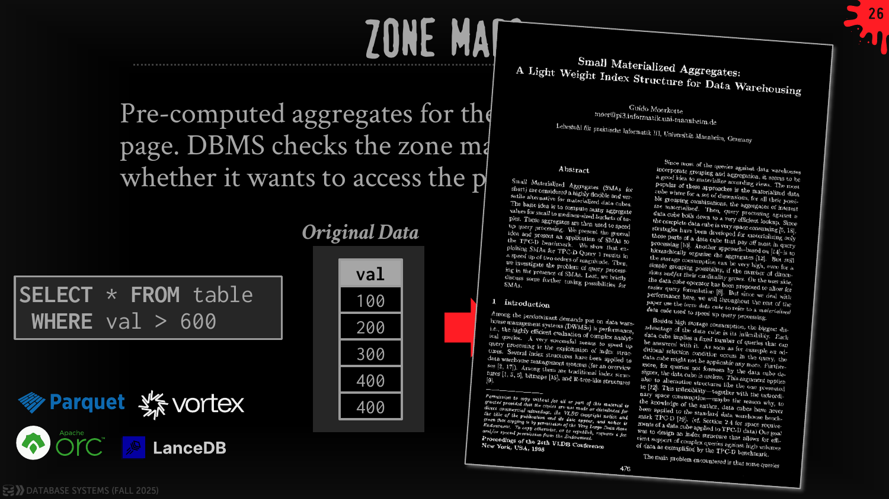


两种方法怎么选？[近似查询](#近似查询)会得到不精确的结果，这是否可以接受，取决于数据在业务中的意义，而这恰恰是 DBMS 无从知道的：统计网站访客可以接受误差，查询自己的银行账户余额时，没有人愿意看到一个近似值。所以[近似查询](#近似查询)必须由用户显式要求，比如调用近似版本的[聚合函数](#聚合函数)。[区域映射](#区域映射)不改变结果，只会让查询更快，几乎没有理由不用，所以几乎所有系统都会使用它。

> 💬 **旁注**
> SMA 论文的作者 Guido Moerkotte 是 Thomas Neumann 的博士导师，而 Neumann 正是 HyPer 和 Umbra 的主导者，也就是本讲里反复出现的那批德国系统背后的人。Andy 对此的感叹是：德国人真是厉害得离谱。
>
> *原话：“So this is his PhD advisor. So the Germans are ridiculous.”*

### 4.4 索引扫描（Index Scan）
📍 *PPT 第 27–28 页*

**[索引扫描](#索引扫描)**是 DBMS 选择一个[索引](#索引)，用它找出查询需要的[元组](#元组)。真正的难点在于选哪个：`WHERE` 子句引用了好几列，而这些列上各有索引时，用哪个最好？这取决于索引包含哪些[属性](#属性)、查询引用了哪些属性、属性的值域、[谓词](#谓词)的构成方式，以及索引的键是否唯一。比如等值条件和范围条件能用的索引不同，唯一键上的等值查找最多只返回一个元组。在这些因素之间权衡是查询优化器的工作，第 [15](../L15/index.md) 讲再详细讨论，这里先假定已经有人替我们选好了索引。

看一个例子。表 `students` 有 100 个[元组](#元组)，`age` 和 `dept` 两列上各有一个[索引](#索引)：

```sql
SELECT * FROM students
 WHERE age < 30
   AND dept = 'CS'
   AND country = 'US'
```

情形一：有 99 人小于 30 岁，但只有 2 人在 CS 系。这时用 `age` [索引](#索引)几乎筛不掉任何人，和[顺序扫描](#顺序扫描)差不多；用 `dept` 索引可以直接定位那 2 个人，再逐个检查他们的年龄和国家。

情形二：有 99 人在 CS 系，只有 2 人小于 30 岁。这时应该反过来用 `age` [索引](#索引)。

查询和[索引](#索引)都没有变，最优选择完全由数据的分布决定。满足一个[谓词](#谓词)的[元组](#元组)所占的比例，称为这个谓词的**[选择率](#选择率)（selectivity）**，比例越小，用对应的索引越划算，第 [15](../L15/index.md)、[16](../L16/index.md) 讲会讨论优化器怎样估计它。

选定[索引](#索引)之后，扫描[算子](#算子)通过索引对外提供的接口去取数据。[B+ 树](#B+%20树)、[跳表](#跳表)和[字典树](#字典树)支持范围扫描，哈希索引只支持等值查找。`age < 30` 是范围条件，如果 `age` 上只有一个哈希索引，就不能用它来回答这个[谓词](#谓词)，只能换别的索引。

### 4.5 多索引扫描（Multi-Index Scan）
📍 *PPT 第 29–31 页*

有多个可用的[索引](#索引)时，DBMS 不一定只能挑一个。**[多索引扫描](#多索引扫描)**先用每个匹配的索引分别求出满足相应[谓词](#谓词)的[记录 ID](#记录%20ID) 集合，再按照谓词之间的逻辑关系把这些集合合并起来，`AND` 取交集，`OR` 取并集，最后只按合并后的记录 ID [回表](#回表)取出[元组](#元组)，并检查剩下的谓词。对上面的查询：
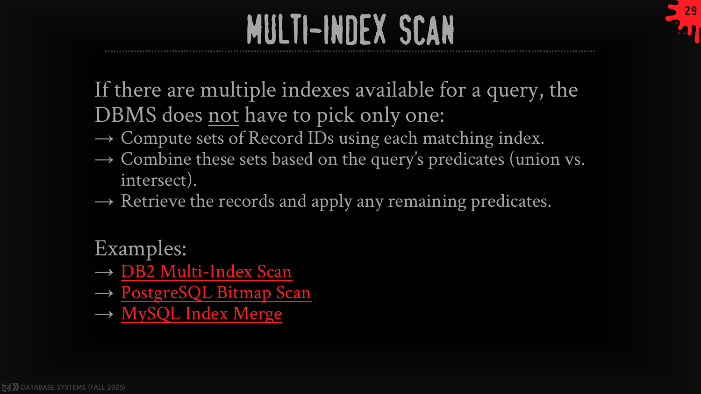

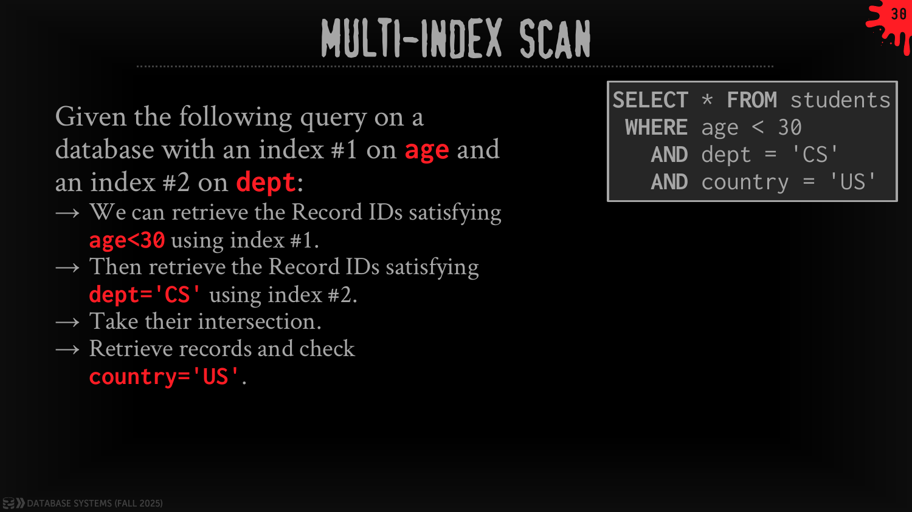


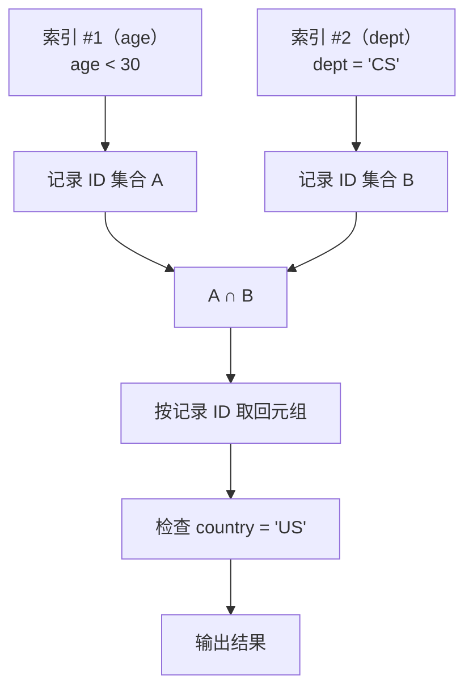

`country` 列上没有[索引](#索引)，所以这个条件只能在取回[元组](#元组)之后检查。
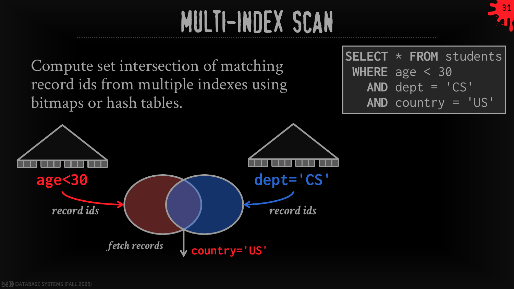


集合运算可以用位图（bitmap）、[哈希表](#哈希表)或[布隆过滤器](#布隆过滤器)（Bloom filter，见第 [8](../L08/index.md)、[9](../L09/index.md) 讲）来实现。以位图为例，每一位对应表中的一个[元组](#元组)，满足条件就置 1；两张位图求交集就是按位与，在 C 里相当于对两个整数数组逐元素做 `&`，非常快。PostgreSQL 把这种扫描叫作位图扫描（bitmap scan），DB2 叫[多索引扫描](#多索引扫描)（multi-index scan），MySQL 叫[索引](#索引)合并（index merge），做的都是同一件事。

## 5. 修改类查询
📍 *PPT 第 32–35 页*

### 5.1 INSERT、UPDATE 与 DELETE [算子](#算子)
📍 *PPT 第 32–33 页*

修改[数据库](#数据库)的[算子](#算子)（`INSERT`、`UPDATE`、`DELETE`）负责修改目标表及其所有[索引](#索引)。约束检查可以在算子内部立即进行，也可以推迟到查询或[事务](#事务)的稍后阶段。这些算子的输出可以是[记录 ID](#记录%20ID)，也可以是[元组](#元组)数据，后者对应 SQL 的 `RETURNING` 子句，比如 `DELETE … RETURNING *` 会返回被删除的那些行。

修改[算子](#算子)并不自己去找数据。`UPDATE` 和 `DELETE` 要修改哪些[元组](#元组)，由它们的子算子找出来，这些子算子正是第 4 节的[顺序扫描](#顺序扫描)、[索引扫描](#索引扫描)或[多索引扫描](#多索引扫描)，它们把目标元组的[记录 ID](#记录%20ID) 交给修改算子。这样，“找出满足 `WHERE` 条件的元组”这件事只需要实现一次，查询和修改共用。代价是修改算子必须记住自己已经处理过哪些元组，原因在下一节。
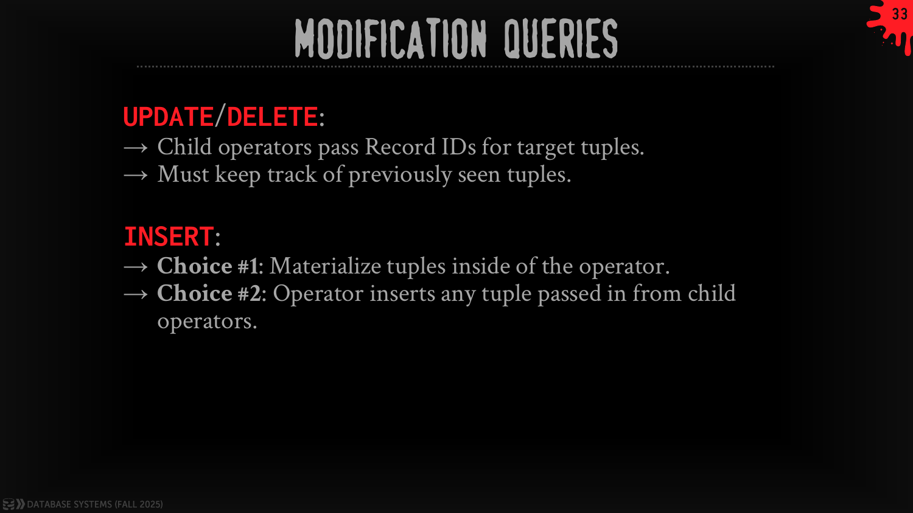


`INSERT` 有两种实现方式。一种是在[算子](#算子)内部[物化](#物化)要插入的[元组](#元组)，比如 `INSERT INTO t VALUES (…)` 里写明的那几行，由插入算子自己持有。另一种是算子插入子算子传上来的任何元组。第二种更灵活：插入算子不关心元组来自哪里，只要子算子按约定的接口交出元组，它都能写进目标表，`INSERT INTO … SELECT …`、`CREATE TABLE … AS SELECT …` 和临时表都可以用这种方式组合出来。

其他修改操作也建立在同样的基础上。`MERGE` 和 upsert（有则更新、无则插入）本质上是先扫描，再根据是否找到匹配来决定更新还是插入；`TRUNCATE` 清空整张表，最简单的做法是删掉表再重建，不需要逐个[元组](#元组)处理。

### 5.2 万圣节问题（Halloween Problem）
📍 *PPT 第 34–35 页*

复用扫描[算子](#算子)会带来一个意想不到的问题。考虑下面这条语句，它给所有薪水低于 1100 的人加薪 100：

```sql
CREATE INDEX idx_salary
    ON people (salary);

UPDATE people
   SET salary = salary + 100
 WHERE salary < 1100
```

计划有两层，下层是 salary [索引](#索引)上的[索引扫描](#索引扫描)，上层是更新[算子](#算子)：

```text
for t in child.Next():
    removeFromIndex(idx_salary, t.salary, t)
    updateTuple(t.salary = t.salary + 100)
    insertIntoIndex(idx_salary, t.salary, t)

for t in Index_people:
    if t.salary < 1100:
        emit(t)
```

更新[算子](#算子)每拿到一个[元组](#元组)，先从[索引](#索引)中删掉它的旧索引项，然后修改元组，再按新的薪水把它重新插入索引。索引的叶节点按 salary 从小到大排列，[索引扫描](#索引扫描)从最左边的叶节点开始向右走。下面是执行过程中的几张快照，叶节点里只画出了 Andy 的索引项：

```text
(1) 游标在第 1 个叶节点读到 (999, Andy)；999 < 1100，交给 UPDATE

    [(999,Andy) ...] [ ... ] [ ... ] [ ... ]
      ^ 游标

(2) UPDATE 删除旧索引项，把薪水改为 1099，把 (1099, Andy) 插入第 3 个叶节点

    [ ... ] [ ... ] [(1099,Andy) ...] [ ... ]
      ^ 游标仍在这里，继续向右

(3) 游标向右移动，在第 3 个叶节点再次读到 (1099, Andy)；1099 < 1100，再次交给 UPDATE

    [ ... ] [ ... ] [(1099,Andy) ...] [ ... ]
                      ^ 游标

(4) UPDATE 又加了 100，得到 (1199, Andy)；1199 不小于 1100，扫描不会再交出它
```

加薪本该只发生一次，Andy 却被加了两次。问题出在更新改变了[元组](#元组)在[索引](#索引)中的物理位置：索引按薪水排序，薪水变了，索引项就从左边的[叶节点](#叶节点)搬到了右边，而扫描游标恰好还没有走到那里。逻辑上始终只有一个 Andy，但在这条查询执行期间，他在物理上先后出现在两个不同的位置；一个只看物理位置的朴素扫描，分辨不出这两次看到的是同一个逻辑元组。
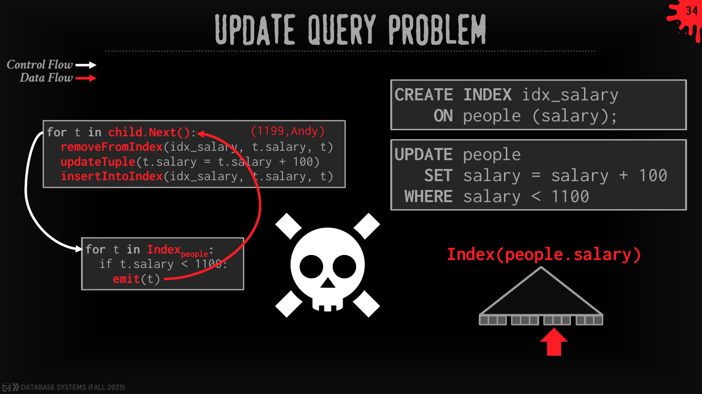


情况还可能更糟。设想有人的薪水是 500：他每被加一次薪，[索引](#索引)项就向右搬一段，又被游标追上，于是被加到 600、700，一直加到 1100 才停下。这条 `UPDATE` 的实际效果变成了“把每个人的薪水一直往上加，直到不低于 1100 为止”，和语句的本意相去甚远。

这就是**[万圣节问题](#万圣节问题)（Halloween Problem）**，也叫更新查询问题（update query problem）：更新操作改变了[元组](#元组)的物理位置，使扫描[算子](#算子)多次访问同一个元组。它可能发生在[索引扫描](#索引扫描)上，也可能发生在聚簇表上，只要扫描的顺序依赖于被修改的列，更新就有可能把元组挪到扫描的前方。即使是普通的堆表也不能完全幸免：PostgreSQL 的 `UPDATE` 会把新版本的元组写到堆中的新位置，那里可能是[顺序扫描](#顺序扫描)还没有到达的[页](#页)。这个问题最早由 IBM 的研究者在 1976 年开发 System R（最早的关系[数据库](#数据库)系统之一）时发现，那天正好是万圣节。

解决办法是为每条查询记录它已经修改过的[记录 ID](#记录%20ID)。在上面的例子里，搬家的只是[索引](#索引)项，它指向的堆中[元组](#元组)还在原地，记录 ID 始终不变，所以更新[算子](#算子)每拿到一个元组，只要先查一下它的记录 ID 是否已经在“本条语句修改过”的集合里，在就跳过。这个集合可以放在一个单独的缓冲区里，也可以直接在[元组头](#元组头)部做标记，写明“本条语句已经修改过它”。PostgreSQL 的更新会产生一个位于新位置、记录 ID 也不同的新版本，按记录 ID 查集合就不管用了，所以它采用后一种思路：元组头部记着写入它的是哪一条命令，扫描时会忽略由本条命令写入的新版本。这种在元组上记录版本信息的做法，会在并发控制部分（第 [17](../L17/index.md)、[18](../L18/index.md)、[19](../L19/index.md)、[20](../L20/index.md) 讲）再次出现。

> 💬 **旁注**
> 这个问题和万圣节本身毫无关系。按 Andy 的讲法，研究者们发现它的那天恰好是万圣节，一时想不出办法，就决定先去喝一杯过节，问题留到下一周才解决，名字就这样留了下来。
>
> *原话：“It has nothing to do with Halloween. The original use case wasn't Halloween.”*

## 6. 表达式求值
📍 *PPT 第 36–39 页*

### 6.1 表达式树（Expression Tree）
📍 *PPT 第 36–37 页*

到这里，[算子](#算子)之间怎样传数据、叶子怎样取数据、修改怎样落到表上，都有了答案。剩下的是算子内部的工作：选择算子要判断每个[元组](#元组)是否满足 `WHERE` 子句，[连接](#连接)算子要判断两个元组是否满足连接条件。DBMS 把 `WHERE` 子句表示成一棵**[表达式树](#表达式树)（expression tree）**，树上的节点代表不同类型的表达式：比较（`=`、`<`、`>`、`!=`），合取（`AND`）与析取（`OR`），算术运算（`+`、`-`、`*`、`/`、`%`），常量值与参数值，元组[属性](#属性)引用，以及函数调用。整个[查询计划](#查询计划)是一棵算子树，每个算子身上又挂着自己的[表达式树](#表达式树)。本讲例子中的连接条件和选择条件合起来，就是这样一棵树：

```text
AND
├── =
│   ├── Attribute(R.id)
│   └── Attribute(S.id)
└── >
    ├── Attribute(value)
    └── Constant(100)
```

**一次求值的过程**

来看一个带参数的例子。[预处理语句](#预处理语句)（prepared statement）有点像 C 里带参数的宏：`PREPARE` 给一条含参数占位符 `$1` 的查询起一个名字，DBMS 只需为它运行一次优化器，把[查询计划](#查询计划)缓存起来；之后每次 `EXECUTE`，只要把参数代进去执行，不必重新优化。

```sql
PREPARE xxx AS
SELECT * FROM S
 WHERE S.val = $1 + 9

EXECUTE xxx(991)
```

缓存计划并非没有代价。`PREPARE` 时还不知道参数值，而对不同的参数值，最优计划可能不同，一份缓存的计划未必适合每一次执行。各个系统的处理方式不同，例如 PostgreSQL 对一条[预处理语句](#预处理语句)的前五次执行都针对具体的参数值生成计划，之后才考虑是否改用一份与参数值无关的通用计划。

执行时，[算子](#算子)为[表达式树](#表达式树)准备一个[执行上下文](#执行上下文)（execution context），里面有三样东西：当前[元组](#元组) `(123, 1000)`，查询参数 `(int:991)`，以及表的模式 `S→(int:id, int:val)`。[表达式树](#表达式树)中不同的节点需要上下文里不同的信息，这些信息事先准备好，就不必在每个元组上重复查找。求值从根节点开始做深度优先遍历，每个节点求出的值写在右边：
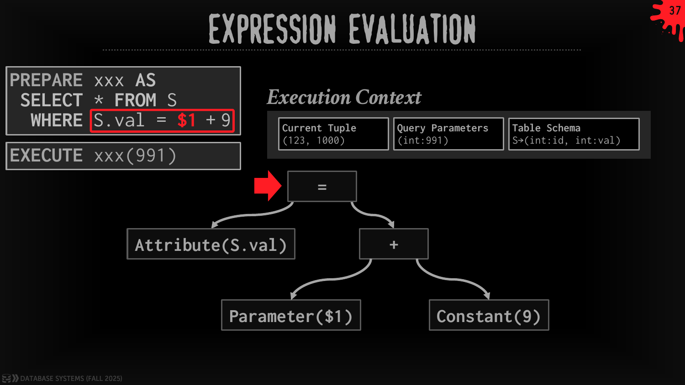


```text
=                        → true
├── Attribute(S.val)     → 1000
└── +                    → 1000
    ├── Parameter($1)    → 991
    └── Constant(9)      → 9
```

`=` 需要两边的值，先求左边：`Attribute(S.val)` 从表模式得知 val 是第二个[属性](#属性)、类型是整数，据此从当前[元组](#元组)中取出 1000。再求右边的 `+`：`Parameter($1)` 从查询参数中取出 991，`Constant(9)` 直接给出 9，相加得 1000。回到根节点，1000 = 1000，结果为 true，调用这棵树的选择[算子](#算子)据此把当前元组交给上层。

### 6.2 为什么逐节点解释很慢
📍 *PPT 第 38 页*

这棵树要对每个[元组](#元组)完整地走一遍。扫描十亿个元组，就要遍历它十亿次；而每到一个节点，DBMS 都要先弄清这个节点是什么类型、该做什么操作，再通过指针跳到它的子节点。用遍历树的方式计算[谓词](#谓词)，对 CPU 来说糟糕透了。它的毛病和[迭代器模型](#迭代器模型（火山模型）)如出一辙，都是大量的间接跳转和分支，只不过这一次发生在[算子](#算子)内部：[向量化模型](#向量化模型（批处理模型）)好不容易把算子之间的 `Next()` 调用摊薄了，每个元组却仍要在[表达式树](#表达式树)上走一遍。

更好的办法是直接计算表达式。对 `SELECT * WHERE s.val = 1;`，整棵树表达的意思不过是：
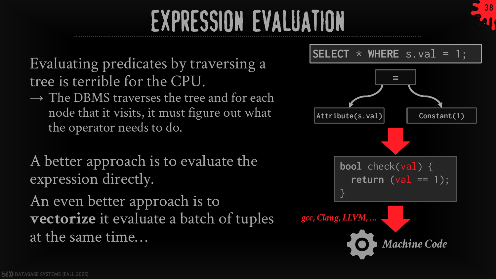


```c
bool check(val) {
  return (val == 1);
}
```

如果能为这条查询生成这样一个函数，交给 gcc、Clang、LLVM 这类编译器编译成机器码，执行时直接调用它，树遍历的开销就全部省掉了。这种做法叫作[代码特化](#代码特化)（code specialization）或查询编译（query compilation）；在查询执行时才生成并编译代码，称为**[即时编译](#即时编译)（just-in-time compilation，[JIT](#即时编译)）**。有的系统只编译表达式求值之类的局部，比如 PostgreSQL；有的把整个[查询计划](#查询计划)编译成一个程序，比如 HyPer 和 Umbra。编译本身也要花时间，所以 DBMS 会根据内部的代价模型，决定是否为一条查询启用代码生成。

更进一步是向量化求值，一次对一批[元组](#元组)计算表达式。对一整批 `val` 检查是否等于 1，正是 2.3 节那种紧凑的循环，编译器可以自动把它翻译成 SIMD 指令，也可以用编译器提供的内建函数（intrinsics）手写 SIMD 代码。

**PostgreSQL 与 DuckDB 的对比**

Andy 在课上用一个演示说明了这些选择的实际分量。演示用的是一张填满随机数据的表 `fake_data`，查询带有一个需要逐行检查的 `WHERE` 条件，相关的列上没有[索引](#索引)，只能[顺序扫描](#顺序扫描)。为了排除干扰，先把整张表预热进[缓冲池](#缓冲池)，再关闭并行扫描，让查询单线程执行：

```sql
-- A sketch of the demo steps; the exact query is not recorded here
-- pg_prewarm is an extension: CREATE EXTENSION pg_prewarm;
SELECT pg_prewarm('fake_data');           -- load the whole table into the buffer pool
SET max_parallel_workers_per_gather = 0;  -- single-threaded execution
SET jit = off;                            -- no JIT compilation
EXPLAIN (ANALYZE, BUFFERS)
SELECT ... FROM fake_data WHERE ...;      -- a predicate checked on every row
```

`EXPLAIN` 输出执行计划；`ANALYZE` 表示真正执行这条查询并报告耗时；`BUFFERS` 报告读取了多少[页](#页)，其中 `shared hit` 是在[缓冲池](#缓冲池)中命中的页数，全部命中就说明数据都来自内存，计时不受磁盘干扰。

按录音整理，现场的结果是这样的。关闭 [JIT](#即时编译) 时，查询耗时约 4 秒。执行 `SET jit = on;` 再运行，耗时降到约 2.7 秒，`EXPLAIN` 的输出里多出一段 [JIT](#即时编译) 统计，列出生成了几个函数，以及代码生成、内联、优化、生成机器码各花了多少时间。PostgreSQL 在执行之前先把 `WHERE` 子句翻译成 LLVM 的中间表示并编译，付出一笔前期成本，换来执行阶段的加速，这笔交易是划算的。PostgreSQL 从 11 版（2018 年）开始支持 [JIT](#即时编译)，是否启用由它的代价模型决定：它大致知道编译要花多久，也估计了查询要执行多久，只有当查询的估计代价超过阈值（参数 `jit_above_cost`）时才会编译。

在同一份数据上单线程执行同一条查询，DuckDB 不到 1 秒就完成了，而它根本不做 [JIT](#即时编译) 编译。PostgreSQL 是行存储加[迭代器模型](#迭代器模型（火山模型）)加[拉取式](#拉取式（自顶向下）)，DuckDB 是列存储加[向量化模型](#向量化模型（批处理模型）)加[推送式](#推送式（自底向上）)。对这种扫描大量数据的分析查询，存储和执行模型的选择，比在旧架构上加装编译器影响更大。Andy 的评价是，PostgreSQL 为 [JIT](#即时编译) 加入的这一整套机制，编写和调试都不容易，是一项重大的工程投入，而 DuckDB 照样把它远远甩在身后。[^duckdb] 这并不说明 PostgreSQL 的设计错了：行存储加[迭代器模型](#迭代器模型（火山模型）)适合 OLTP，本来就不是为这类分析查询设计的；一个从一开始就为 OLAP 设计的系统，在这里自然会好得多。

（建议回看视频：约 PPT 第 38 页附近的现场演示。）

### 6.3 常量折叠与公共子表达式消除
📍 *PPT 第 39 页*

除了编译，还可以直接改写[表达式树](#表达式树)。这些技巧和编译器课程里的优化属于同一类，只是在[数据库](#数据库)里效果更明显，因为同一个表达式要对上亿个[元组](#元组)重复计算。

**[常量折叠](#常量折叠)（constant folding）**找出只依赖常量、与[元组](#元组)无关的子表达式，只计算一次，用结果替换它：
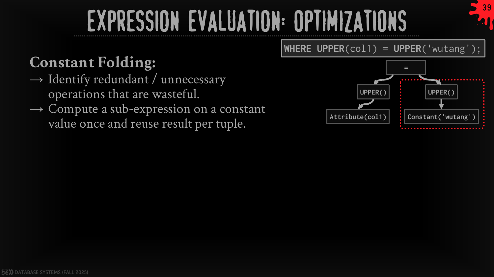


```sql
WHERE UPPER(col1) = UPPER('wutang');
```

右边的 `UPPER('wutang')` 与[元组](#元组)无关，如果不折叠，扫描十亿个元组就要调用它十亿次；折叠之后，右子树直接换成常量 `'WUTANG'`：

```text
Before                         After
=                              =
├── UPPER()                    ├── UPPER()
│   └── Attribute(col1)        │   └── Attribute(col1)
└── UPPER()                    └── Constant('WUTANG')
    └── Constant('wutang')
```

**[公共子表达式消除](#公共子表达式消除)（common subexpression elimination）**找出在树中重复出现的子表达式，只计算一次，其他地方复用它的结果：

```sql
WHERE STRPOS('x', col1) < 2
   OR STRPOS('x', col1) > 8
```

`STRPOS('x', col1)` 在两个分支里各出现一次。改写后，`Op(>)` 不再拥有一棵自己的 `STRPOS()` 子树，而是直接指向 `Op(<)` 下方的那个 `STRPOS()` 节点，每个[元组](#元组)只计算一次。这时表达式的结构不再是树，而是一张 DAG：

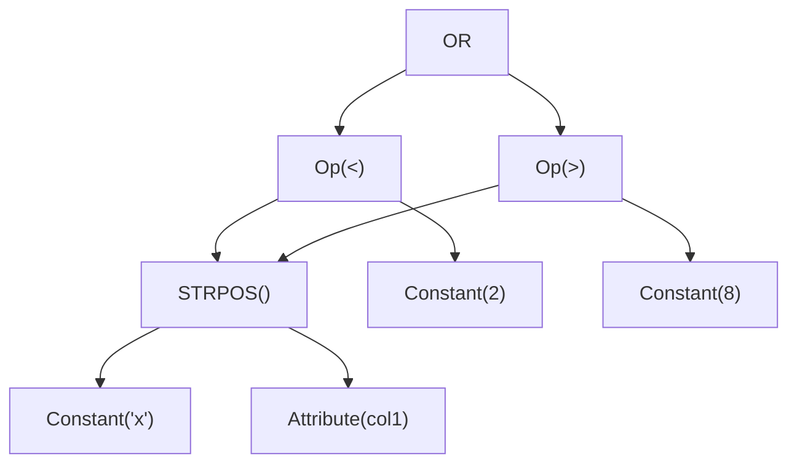

DBMS 会自动完成这些改写，用户不必改动自己的 SQL，这和优化器替用户寻找最好的执行方式是同一个道理（第 [15](../L15/index.md) 讲）。

你可能会问：LLVM、gcc、Clang 本身就会做[常量折叠](#常量折叠)和[公共子表达式消除](#公共子表达式消除)，DBMS 为什么还要自己做？原因是并非每条查询都会走编译这条路。PostgreSQL 的 [JIT](#即时编译) 到 2018 年才加入，也不是每条查询都会被编译，解释执行的[表达式树](#表达式树)仍然需要这些优化。即使是编译整个查询的系统，也不一定每次都等 LLVM：Umbra 这类系统为了让查询尽早开始执行，会先用一种极快的方式直接生成机器码并立即运行，同时在后台调用 LLVM 做充分优化的编译；如果后台编译在查询结束之前完成，就把正在运行的代码替换成优化后的版本。最先运行的那份代码没有经过 LLVM 的优化，所以 DBMS 自己的这些改写仍然有意义。

## 小结
📍 *PPT 第 40–41 页*

本讲从一个问题出发：一堆已经写好的[算子](#算子)，怎样协作执行一条查询。答案分成几层。在算子之间，[处理模型](#处理模型)决定每次交接多少数据：[迭代器模型](#迭代器模型（火山模型）)一次一个[元组](#元组)，简单、易组合、容易控制输出，代价是每个元组都要付出一次函数调用；[物化模型](#物化模型)一次交出全部，调用最少，却要承担整个中间结果的内存；[向量化模型](#向量化模型（批处理模型）)一次一批，兼顾了两端，还让算子内部变成 CPU 擅长的紧凑循环，因此成为 OLAP 系统的标准做法。执行方向是与之独立的另一个选择：[拉取式](#拉取式（自顶向下）)实现简单、便于控制输出，[推送式](#推送式（自底向上）)借助调度器和[算子融合](#算子融合)，把数据留在缓存和寄存器里。在计划的叶子上，[顺序扫描](#顺序扫描)是兜底方案，[区域映射](#区域映射)让它跳过不可能匹配的数据；[索引扫描](#索引扫描)和[多索引扫描](#多索引扫描)的优劣，取决于数据的分布。修改类查询复用这些[访问方法](#访问方法)，但必须防范[万圣节问题](#万圣节问题)。在算子内部，逐节点解释[表达式树](#表达式树)的开销，可以用编译、向量化求值、[常量折叠](#常量折叠)和[公共子表达式消除](#公共子表达式消除)压下来。

同一个[查询计划](#查询计划)可以有很多种执行方式，怎样选取决于[工作负载](#工作负载)。对 OLAP，Andy 的建议是一定要用[向量化模型](#向量化模型（批处理模型）)，至于推送还是拉取，取决于团队能承受多大的工程复杂度，两者各有取舍，没有绝对的优劣。对 OLTP，应当尽可能使用[索引扫描](#索引扫描)；如果每条查询读的数据不多、数据又全在内存里，[物化模型](#物化模型)可能是更好的选择。[表达式树](#表达式树)灵活但慢，[JIT](#即时编译) 编译有时能让它快起来。本讲留下的许多“选哪一个”的问题，比如用哪个[索引](#索引)，要靠第 [15](../L15/index.md)、[16](../L16/index.md) 讲的查询优化器来回答；要不要编译则属于[执行引擎](#执行引擎)自身的工程取舍，第 [25](../L25/index.md) 讲会连同其他权衡一起回顾。

本讲的执行都是单线程的。下一讲讨论并行查询执行：怎样让多个工作线程同时执行同一个[查询计划](#查询计划)，再把它们的结果合并成最终结果。
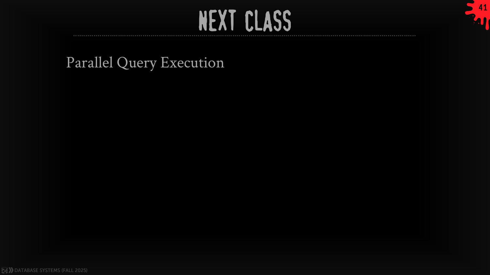


## 术语速查表

### 连接

**Join**：在共同属性上取值相同的元组组合。（本讲首次出现：摘要；引入于：第 1 讲）

### 算子

**Operator**：执行扫描、过滤、连接、排序或聚合等处理工作的节点。（本讲首次出现：摘要；引入于：第 11 讲）

### 元组

**Tuple**：关系中的一个元素，即表中的一行。（本讲首次出现：摘要；引入于：第 1 讲）

### 页

**Page**：定长的数据块，数据库中一切数据的存放单位。（本讲首次出现：摘要；引入于：第 3 讲）

### 索引

**Index**：按适合查找的方式组织键与记录定位信息的访问结构。（本讲首次出现：摘要；引入于：第 8 讲）

### 哈希连接

**Hash Join**：以连接键建立哈希查找结构，再探测匹配。（本讲首次出现：摘要；引入于：第 12 讲）

### 联机事务处理

**Online Transaction Processing (OLTP)**：大量快速、简单、每次只涉及单个实体少量数据的操作。（本讲首次出现：摘要；引入于：第 1 讲）

### 联机分析处理

**On-Line Analytical Processing (OLAP)**：读取大量数据、跨实体计算聚合的复杂只读查询。（本讲首次出现：摘要；引入于：第 6 讲）

### 执行引擎

**Execution Engine**：执行查询、向缓冲池请求页的组件。（本讲首次出现：课程地图；引入于：第 3 讲）

### 缓冲池

**Buffer Pool**：由定长帧组成的一大块内存，用来存放从磁盘读入的页。（本讲首次出现：课程地图；引入于：第 3 讲）

### 槽式页

**Slotted Page**：用槽数组记录元组页内偏移、元组从页尾向前存放的页布局。（本讲首次出现：课程地图；引入于：第 3 讲）

### 预取

**Pre-Fetching**：根据查询计划在页被需要之前提前读入。（本讲首次出现：课程地图；引入于：第 4 讲）

### 扫描共享

**Scan Sharing**：多个查询共用同一个扫描游标，共享读页的 I/O。（本讲首次出现：课程地图；引入于：第 4 讲）

### 聚簇索引

**Clustered Index**：使表记录的存储组织跟随某个索引键顺序。（本讲首次出现：课程地图；引入于：第 8 讲）

### 哈希表

**Hash Table**：用哈希函数把键映射到数组偏移量的无序关联数组。（本讲首次出现：课程地图；引入于：第 7 讲）

### B+ 树

**B+ Tree**：内部节点导航、叶节点保存真实值的有序多路平衡树。（本讲首次出现：课程地图；引入于：第 8 讲）

### 早期物化

**Early Materialization**：较早把元组数据放入中间记录，与键一同传递和排序。（本讲首次出现：课程地图；引入于：第 11 讲）

### 延迟物化

**Late Materialization**：先传递键与记录位置，需要时再读取和组合其余属性。（本讲首次出现：课程地图；引入于：第 6 讲）

### 查询计划

**Query Plan**：由算子组成的有向无环图（通常是树），数据从叶子流向根，根的输出即查询结果。（本讲首次出现：1.1；引入于：[第 11 讲](../L11/index.md)）

### 投影

**Projection**：只保留、重排或计算指定属性，对应 SQL 的 `SELECT` 列表。（本讲首次出现：1.1；引入于：第 1 讲）

### 流水线

**Pipeline**：一串算子，元组在其间连续流动，不需要中间存储。（本讲首次出现：1.2；引入于：本讲）

### 流水线阻断点

**Pipeline Breaker**：在子节点交出全部元组之前无法完成的算子，如哈希连接的构建侧、排序。（本讲首次出现：1.2；引入于：本讲）

### 处理模型

**Processing Model**：规定 DBMS 如何执行查询计划、数据如何在算子之间移动。（本讲首次出现：2；引入于：本讲）

### 控制流

**Control Flow**：DBMS 如何调用算子。（本讲首次出现：2；引入于：本讲）

### 数据流

**Data Flow**：算子如何交出结果。（本讲首次出现：2；引入于：本讲）

### 存储模型

**Storage Model**：DBMS 在磁盘和内存中物理组织元组的方式。（本讲首次出现：2；引入于：第 6 讲）

### 回表

**Table Lookup**：根据索引中的定位信息读取表记录。（本讲首次出现：2；引入于：第 8 讲）

### 记录 ID

**Record ID**：表示元组物理位置的唯一标识，如页 ID 加槽号。（本讲首次出现：2；引入于：第 3 讲）

### 迭代器模型（火山模型）

**Iterator (Volcano) Model**：每个算子实现 `Next()`，每次返回一个元组。（本讲首次出现：2.1；引入于：本讲）

### 槽

**Slot**：哈希表数组中的一个定长存储位置。（本讲首次出现：2.1；引入于：第 7 讲）

### 桶

**Bucket**：可容纳多个键值对的存储单元，通常是一页。（本讲首次出现：2.1；引入于：第 7 讲）

### 事务

**Transaction**：应用希望作为整体处理的一组数据库操作，后续会进一步形式化。（本讲首次出现：2.1；引入于：第 10 讲）

### 排序归并连接

**Sort-Merge Join**：对有序输入定位相同键分组并输出全部匹配对。（本讲首次出现：2.1；引入于：第 12 讲）

### 物化模型

**Materialization Model**：每个算子一次处理全部输入，一次交出全部输出。（本讲首次出现：2.2；引入于：本讲）

### 算子融合

**Operator Fusion**：把相邻算子合并进同一个循环，避免传递中间结果。（本讲首次出现：2.2；引入于：本讲）

### 物化

**Materialization**：把中间结果实际计算出来并保存，供后续使用。（本讲首次出现：2.2；引入于：第 2 讲）

### 数据库

**Database**：一组经过组织、相互关联、用来模拟现实世界某方面的数据。（本讲首次出现：2.2；引入于：第 1 讲）

### 向量化模型（批处理模型）

**Vectorized / Batch Model**：每个算子实现 `Next()`，每次返回一批元组。（本讲首次出现：2.3；引入于：本讲）

### NULL 位图

**Null Bitmap**：元组头中每个属性一位、标记其是否为 NULL 的位图。（本讲首次出现：2.3；引入于：第 3 讲）

### 单指令多数据

**SIMD**：用一条指令对多个数据位置执行同类操作。（本讲首次出现：2.3；引入于：第 8 讲）

### 工作负载

**Workload**：一个应用发给数据库的查询的整体特征。（本讲首次出现：2.3；引入于：第 1 讲）

### 向量数据模型

**Vector Data Model**：以一维数组表示数据、用于最近邻搜索的模型。（本讲首次出现：2.3；引入于：第 1 讲）

### 嵌入向量

**Embedding**：模型把文本映射成的定长浮点数组，语义相近则距离相近。（本讲首次出现：2.3；引入于：第 1 讲）

### 最近邻搜索

**Nearest-Neighbor Search**：找出与给定向量距离最近的若干个向量。（本讲首次出现：2.3；引入于：第 1 讲）

### 拉取式（自顶向下）

**Pull-Based (Top-to-Bottom)**：从根节点调用 `Next()`，把数据从叶子拉上来。（本讲首次出现：3.1；引入于：本讲）

### 推送式（自底向上）

**Push-Based (Bottom-to-Top)**：由调度器从叶子开始执行流水线，把数据推给父节点。（本讲首次出现：3.2；引入于：本讲）

### 访问方法

**Access Methods**：DBMS 从表中取出数据的方式。（本讲首次出现：4；引入于：[第 07 讲](../L07/index.md)）

### 关系代数

**Relational Algebra**：在关系上检索和操纵元组的一组基本运算。（本讲首次出现：4；引入于：第 1 讲）

### 顺序扫描

**Sequential Scan**：逐页读取整张表，检查每个元组。（本讲首次出现：4.1；引入于：本讲）

### 堆文件

**Heap File**：页的无序集合，元组以任意顺序存放。（本讲首次出现：4.1；引入于：第 3 讲）

### 页目录

**Page Directory**：记录各数据库对象的页位置及空闲空间等元数据的特殊页。（本讲首次出现：4.1；引入于：第 3 讲）

### 物化视图

**Materialized View**：预先计算并保存的查询结果，需要维护其新鲜度。（本讲首次出现：4.2；引入于：本讲）

### 游程编码

**Run-Length Encoding (RLE)**：把连续相同的值压成（值, 偏移, 长度）三元组。（本讲首次出现：4.2；引入于：第 6 讲）

### 字典编码

**Dictionary Encoding**：用定长编码替换原值，另存编码到原值的字典。（本讲首次出现：4.2；引入于：第 6 讲）

### 顺序泛洪

**Sequential Flooding**：顺序扫描读入的一次性页挤出常用页的现象。（本讲首次出现：4.2；引入于：第 4 讲）

### 代码特化

**Code Specialization**：为已知类型或比较规则生成、选择专用执行代码。（本讲首次出现：4.2；引入于：第 11 讲）

### 视图

**View**：用查询定义的虚拟表，用来实现外模式。（本讲首次出现：4.2；引入于：第 1 讲）

### 数据跳过

**Data Skipping**：事先判断哪些数据不可能满足查询，从而不去读它。（本讲首次出现：4.3；引入于：本讲）

### 近似查询

**Approximate Query**：在采样子集上执行查询，得到有误差的结果。（本讲首次出现：4.3；引入于：本讲）

### 区域映射

**Zone Map**：为每页预先计算的聚合值（最小值、最大值等），用来判断能否跳过该页。（本讲首次出现：4.3；引入于：本讲）

### 聚合函数

**Aggregate Function**：把一个包里的多个值压成一个标量，如 `AVG`、`COUNT`。（本讲首次出现：4.3；引入于：第 2 讲）

### 属性

**Attribute**：关系中的一个命名分量，即表中的一列。（本讲首次出现：4.3；引入于：第 1 讲）

### 过滤器

**Filter**：只回答“键是否（很可能）在集合中”、不给出位置的数据结构。（本讲首次出现：4.3；引入于：第 9 讲）

### 索引扫描

**Index Scan**：选择一个索引来找出查询需要的元组。（本讲首次出现：4.4；引入于：本讲）

### 选择率

**Selectivity**：满足某个谓词的元组所占的比例。（本讲首次出现：4.4；引入于：[第 01 讲](../L01/index.md)）

### 谓词

**Predicate**：对每个元组得出真或假的条件。（本讲首次出现：4.4；引入于：第 1 讲）

### 跳表

**Skip List**：用抛硬币决定各键出现在哪几层的多层有序链表，期望 O(log n)。（本讲首次出现：4.4；引入于：第 9 讲）

### 字典树

**Trie**：以键的各位数字为路径的树，操作代价 O(k)，形状与插入顺序无关。（本讲首次出现：4.4；引入于：第 9 讲）

### 多索引扫描

**Multi-Index Scan**：用多个索引分别求记录 ID 集合，按谓词取交集或并集后再取元组。（本讲首次出现：4.5；引入于：本讲）

### 布隆过滤器

**Bloom Filter**：用 m 位位图和 k 个哈希函数回答成员查询，无假阴性、可能有假阳性。（本讲首次出现：4.5；引入于：第 9 讲）

### 万圣节问题

**Halloween Problem**：更新改变了元组的物理位置，使扫描多次访问同一个元组。（本讲首次出现：5.2；引入于：本讲）

### 叶节点

**Leaf Node**：保存实际索引键值条目的底层节点。（本讲首次出现：5.2；引入于：第 8 讲）

### 元组头

**Tuple Header**：元组开头存放可见性信息、NULL 位图等元数据的部分。（本讲首次出现：5.2；引入于：第 3 讲）

### 表达式树

**Expression Tree**：用树表示 `WHERE` 子句等表达式，节点是比较、运算、常量、属性引用等。（本讲首次出现：6.1；引入于：本讲）

### 预处理语句

**Prepared Statement**：预先命名并优化的带参数查询，执行时代入参数。（本讲首次出现：6.1；引入于：本讲）

### 执行上下文

**Execution Context**：求值时所需的当前元组、查询参数和表模式。（本讲首次出现：6.1；引入于：本讲）

### 即时编译

**Just-in-Time Compilation (JIT)**：在查询执行时为它生成并编译专门的代码。（本讲首次出现：6.2；引入于：本讲）

### 常量折叠

**Constant Folding**：把只依赖常量的子表达式预先算好，替换为常量。（本讲首次出现：6.3；引入于：本讲）

### 公共子表达式消除

**Common Subexpression Elimination**：重复出现的子表达式只计算一次，结果复用。（本讲首次出现：6.3；引入于：本讲）

[^vec]: 原话：“Pretty much every new database system that does OLAP, targeting OLAP workloads, in the last ten years is going to be doing this approach.”

[^nightmare]: 原话：“Nobody would do that because now you're maintaining different variations of the same thing, and that becomes an engineering nightmare. It's just not worth it.”

[^duckdb]: 原话：“So all the extra machinery that Postgres is doing to JIT things, which is not a trivial thing to write and debug, that's a major engineering effort to add, DuckDB still crushes it.”

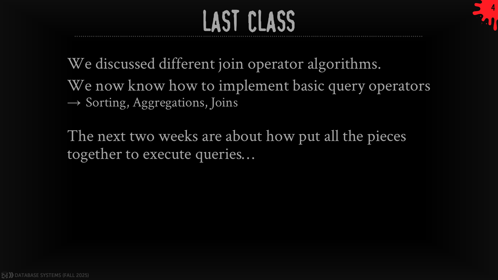

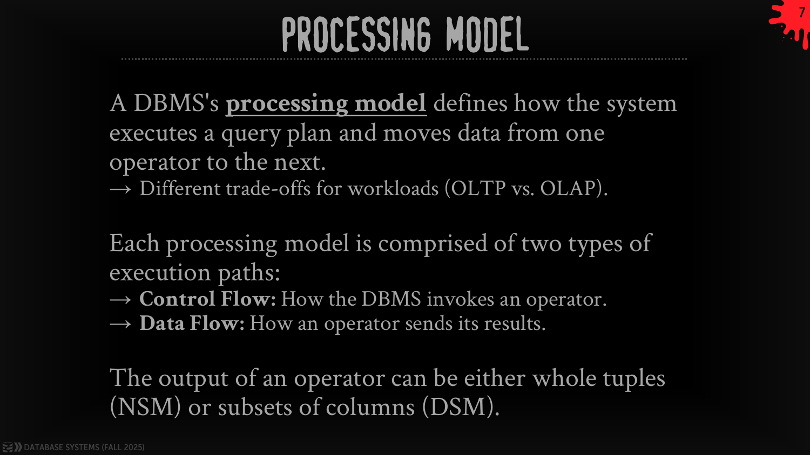

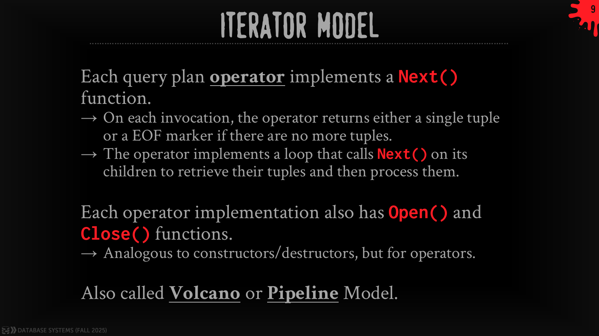

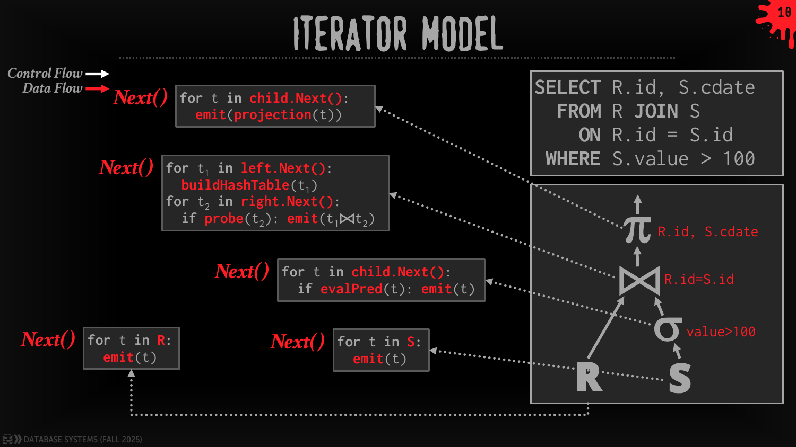

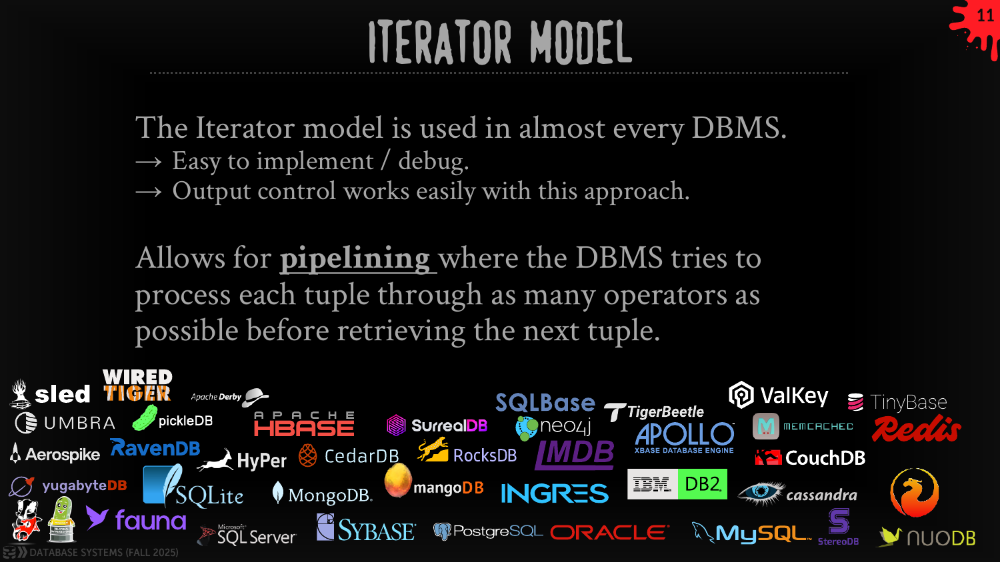

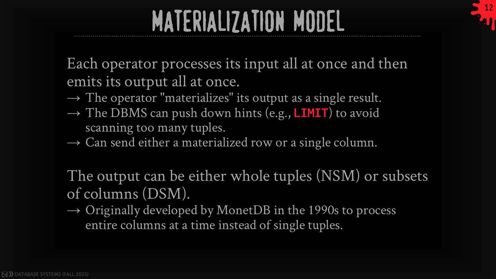

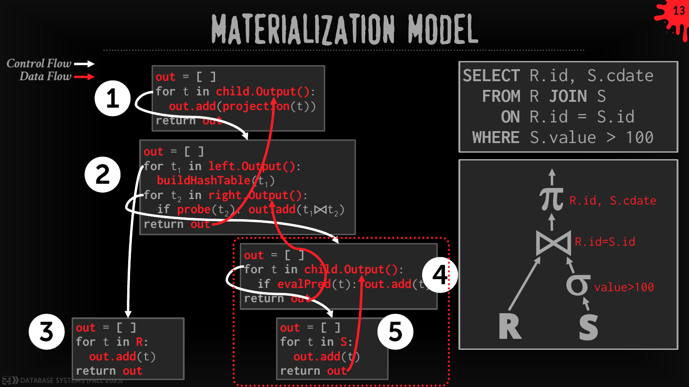

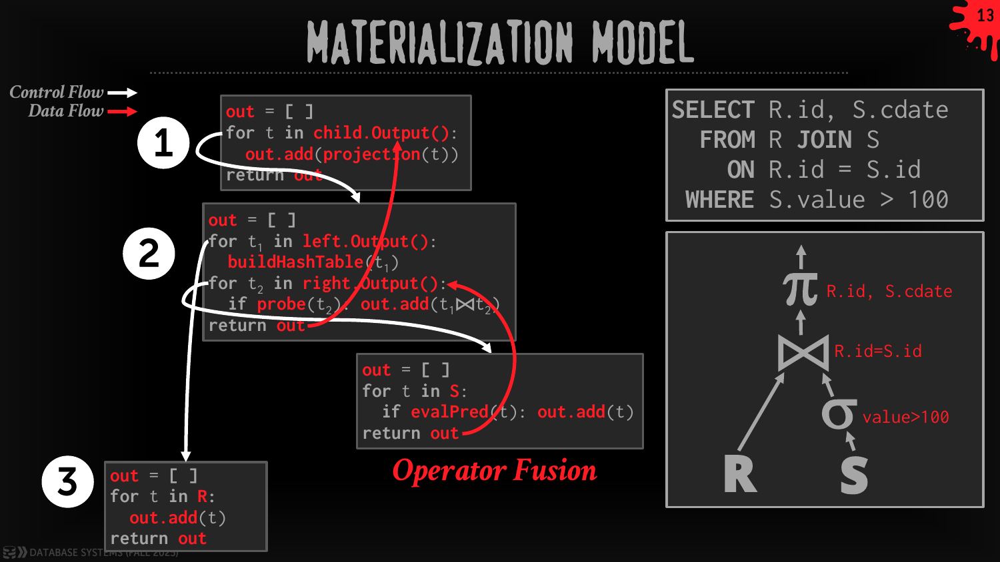

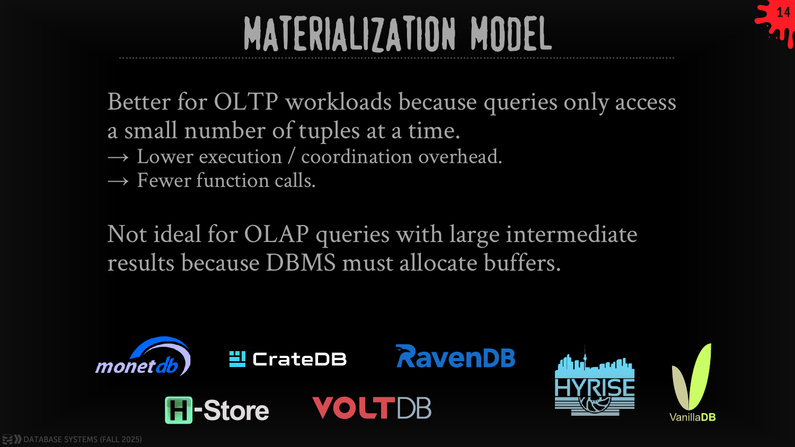


<details>
<summary>📎 本讲未被 📍 标注的幻灯片（共 4 页：封面、目录与行政页）</summary>


</details>
