# CMU 15-445 第 [14](index.md) 讲：查询执行（下）（Query Execution II）

> **课程**：CMU 15-445/645 Database Systems（Fall 2025）· **主讲**：Andy Pavlo
> **课程主页**：https://15445.courses.cs.cmu.edu/fall2025/
> **材料**：课件 PPT、官方 Lecture Notes、课堂录音转写稿
> **说明**：正文以 PPT 与 Lecture Notes 为准。讲者原话的中文为意译，英文原文见脚注，依据课堂录音转写整理，已修正明显的语音识别错误。文中“📍 PPT 第 X 页”指幻灯片右上角印的编号。

## 摘要（Abstract）

第 [13](../L13/index.md) 讲把[算子](#算子)组装成[查询计划](#查询计划)时，默认整份计划由一个[工作者](#工作者)从头执行到尾。在主频停止增长、核数不断增加的今天，这相当于让一台几十核的服务器只用一个核回答查询。拿掉这个假设之后，问题变成：同一台机器上的[数据库](#数据库)系统，怎样同时调动多个 CPU 核和多块磁盘。

要并行，先得有执行任务的[工作者](#工作者)，于是有了[进程模型](#进程模型)：每个[工作者](#工作者)是一个进程、一个线程，或者干脆由宿主应用提供线程。有了[工作者](#工作者)，就要决定它们做什么。让不同查询同时运行（[查询间并行](#查询间并行)）主要提高吞吐量，单条大查询依旧慢，于是需要把一条查询拆给多个[工作者](#工作者)（[查询内并行](#查询内并行)）。拆分的方式有按数据切分的[水平并行](#算子内并行（水平并行）)、按[算子](#算子)切分的[垂直并行](#算子间并行（垂直并行）)，以及两者的组合；无论怎样拆，都要靠[交换算子](#交换算子)把多路数据流合并或重新分配，同时让计划的其余部分照旧使用 `Next()` 接口。当瓶颈从 CPU 移到磁盘时，增加[工作者](#工作者)无济于事，数据本身也要分散到多块存储设备上，这就引出[条带化](#条带化)、[镜像](#镜像)和[分区](#分区)，以及性能、[持久性](#持久性)、容量三者之间的取舍。

读完之后，你应该能说清 PostgreSQL 为什么至今仍用一个进程服务一个连接；能画出一条两表[哈希连接](#哈希连接)在三个[工作者](#工作者)上的并行执行计划，并指出其中哪个[交换算子](#交换算子)必须等齐所有输入、为什么；能判断一段计划适合[水平并行](#算子内并行（水平并行）)还是[流水线并行](#流水线并行)；也能说出 RAID 0 和 RAID 1 分别牺牲了什么。

## 课程地图

本讲处在课程的第四阶段“查询处理”。第 [11](../L11/index.md)、[12](../L12/index.md) 讲解决单个[算子](#算子)怎样算，第 [13](../L13/index.md) 讲把算子组装成[查询计划](#查询计划)，接下来的问题是：同一份计划怎样交给多个[工作者](#工作者)同时执行。


第 [13](../L13/index.md) 讲建立的图景是：[查询计划](#查询计划)是一棵[算子](#算子)树，每个算子都实现同一个接口（在迭代器模型里就是 `Next()`），所以任何算子都能接在任何算子下面，数据从叶子流向根。比如 `SELECT R.id, S.cdate FROM R JOIN S ON R.id = S.id WHERE S.value > 100` 的计划是 `π_{R.id, S.cdate}(R ⋈_{R.id=S.id} σ_{value>100}(S))`。这套接口保持不变，改变的只有一件事：计划不再由一个[工作者](#工作者)独自执行。
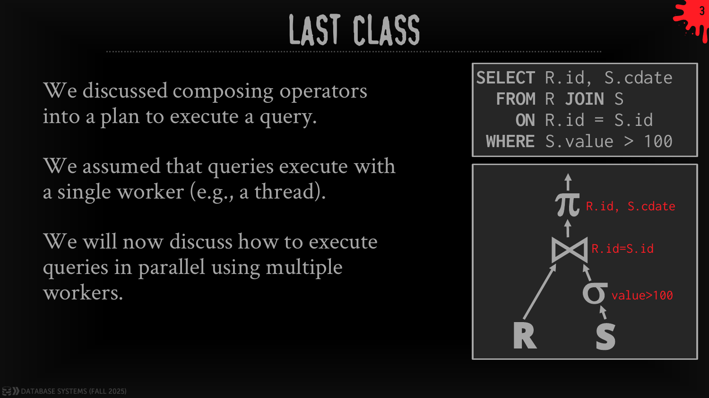


下文会用到前面几讲的这些概念：第 [12](../L12/index.md) 讲 Grace [哈希连接](#哈希连接)的[分区](#分区)思想，以及哈希连接的构建、探测两个阶段；第 [13](../L13/index.md) 讲的[流水线](#流水线)（pipeline）与[流水线阻断点](#流水线阻断点)（pipeline breaker）；第 [10](../L10/index.md) 讲的[闩](#闩)（latch）；第 [4](../L04/index.md) 讲[缓冲池](#缓冲池)的[扫描共享](#扫描共享)；第 [3](../L03/index.md) 讲顺序访问与随机访问的差别和[页目录](#页目录)；第 [5](../L05/index.md) 讲 [LSM 树](#LSM%20树)的后台压实；第 [6](../L06/index.md) 讲的行存储与列存储。往后看，第 [15](../L15/index.md)、[16](../L16/index.md) 讲的[查询优化](#查询优化)要决定计划的形状（[左深树](#左深树)还是[浓密树](#浓密树)）；第 [17](../L17/index.md) 讲起的并发控制处理多条查询同时修改数据的问题；第 [21](../L21/index.md) 讲的预写日志会说明为什么日志常被放在单独的磁盘上；第 [23](../L23/index.md)、[24](../L24/index.md) 讲把这里的思路推广到多台机器，[分区](#分区)和复制在那里成为主角。

## 1. 为什么需要并行

📍 *PPT 第 3–5 页*

### 1.1 一个[工作者](#工作者)撑不满一台机器

📍 *PPT 第 3–4 页*

让一个[工作者](#工作者)执行整份[查询计划](#查询计划)，在二十年前是合理的默认做法。那时的处理器靠不断提高主频变快，同一段单线程代码换一颗新 CPU 就自动提速。这条路在 2005 年前后走到了头。SpiralDB 的客座讲者在课上回顾了这段历史：登纳德缩放（Dennard scaling）大约在 2005 年失效，此后单个核不再变快，今天 CPU 的主频和二十年前差不多是同一个量级；摩尔定律之所以还能延续，是因为多出来的晶体管变成了更多的核。[^1]（登纳德缩放说的是，晶体管按比例缩小时功率密度保持不变，因此可以提高主频而不增加发热。它失效之后，再提主频芯片就会过热，厂商只好把晶体管拿去堆核。）

后果很直接。今天一台普通笔记本大约有 8 个核，高端的 AMD 服务器已经有上百个核；Andy 甚至说，你的手机拥有的核数都比 1980 年代的[数据库](#数据库)服务器多。一条只能跑在一个核上的查询，在这样的机器上只用到了一小部分算力。

把[数据库](#数据库)分散到多份**资源（resource）**上，有三个理由：
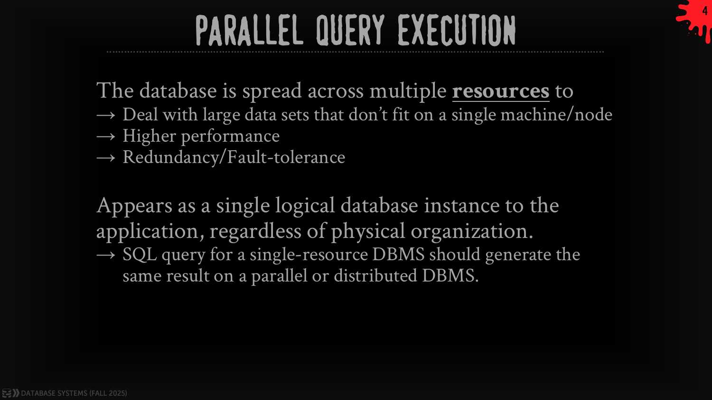


- 数据太大，一份资源装不下。这里的“一份资源”可以是一个 CPU 核、一块磁盘、一段内存区域，也可以是一整台机器。
- 性能更高，因为多份资源可以同时工作。
- 冗余与容错：数据复制到多块盘或多台机器上，坏掉一份还有备份。

资源分两类：计算资源（CPU 核、CPU 插槽、GPU、更多的机器）和存储资源（磁盘、内存）。第 2 到第 4 节讨论怎样用好计算资源，第 5 节讨论存储资源。

无论数据在物理上怎样分散，对应用程序而言它始终是**一个逻辑[数据库](#数据库)实例**：同一条 SQL 查询在单机的 DBMS 上得到什么结果，在并行或[分布式 DBMS](#分布式%20DBMS) 上也应当得到同样的结果。这是第 [1](../L01/index.md) 讲[数据独立性](#数据独立性)（data independence）的又一次回报。SQL 只声明要什么，不写数据在哪里、该发往何处，于是开发者可以在笔记本上用 SQLite 或 PostgreSQL 写好查询，部署到生产环境后，同一条查询照样能在一个庞大的分布式系统上运行。怎样拆分、数据往哪里送，都由 DBMS 生成的[查询计划](#查询计划)决定。用 Andy 的话说，写 SQL 的人和应用程序看到的始终是一个逻辑数据库，并不知道它在物理上可能已被拆成许多块。[^2]

> 💬 **旁注**
> 2025 年 10 月 20 日，AWS 在美国东部（us-east-1）区域发生了一次大范围故障，大量网站和应用随之瘫痪。起因在 DynamoDB：它的 DNS 记录被一个自动化系统中的竞态条件清空，应用找不到 DynamoDB 的服务地址。Andy 特意纠正了“[数据库](#数据库)宕机了”这个说法：数据库本身并没有宕机，宕掉的是通往它的 DNS。他借此强调，数据库是几乎所有现代应用的底座，一个数据库连不上，就能拖垮半个互联网。要防这种事，可以在 AWS 之外再部署一套冗余系统，只是这样做又贵又难，大多数公司并不会做。DynamoDB 是一个使用一致性哈希的分布式键值存储，学期后面讲分布式数据库时还会遇到它。
>
> *原话：“The database itself didn't go down. The DNS getting to it went down.”*

### 1.2 并行[数据库](#数据库)与分布式数据库

📍 *PPT 第 5 页*

多份资源可以离得很近，也可以离得很远，两种情况下系统面对的问题截然不同：
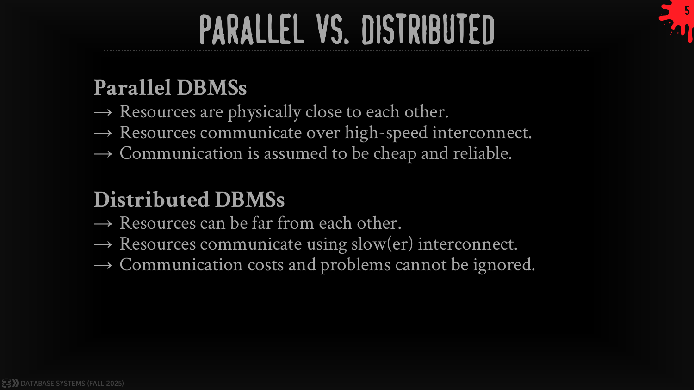


| | [并行 DBMS](#并行%20DBMS)（Parallel DBMS） | [分布式 DBMS](#分布式%20DBMS)（Distributed DBMS） |
|---|---|---|
| 资源之间的距离 | 物理上彼此靠近 | 可能相距很远 |
| 互联方式 | 高速互联 | 较慢的互联，常常经过公共网络 |
| 对通信的假设 | 廉价且可靠 | 通信的代价和故障都不能忽略 |

下文只讨论**[并行 DBMS](#并行%20DBMS)**，而且进一步限定在一台机器内部：资源是同一台机器上的 CPU 核、内存，以及挂在同一条 PCIe 总线上的磁盘。这种情况下，“可靠”的意思是请求一定有回应：向磁盘读一[页](#页)，除非磁盘坏了（Andy 的说法是“着火了”），数据总会回来。于是我们可以假设发给某个[工作者](#工作者)的消息一定送达，问题因此简单了许多。

**[分布式 DBMS](#分布式%20DBMS)** 的资源可能分布在同一数据中心的不同机架、不同可用区，甚至不同大洲的数据中心。消息的延迟高，而且可能丢失，系统的每一步都要为“对方没有回应”做准备。这些问题留到第 [23](../L23/index.md)、[24](../L24/index.md) 讲。

好在两者并非两套理论。下文的并行技术，也就是在计划的哪里切分数据、在哪里合并结果，并不依赖于[工作者](#工作者)是线程、进程还是另一台机器上的节点（见 3.1 节），扩展到多台机器时同样适用。那时每个节点运行着自己的一组[工作者](#工作者)，采用哪种[进程模型](#进程模型)由节点自己决定。

> 💬 **旁注**
> 讲到分布式系统的延迟时，Andy 举了一个极端情况：数据中心开到太空里去。这个例子有现实原型。英伟达支持的初创公司 Starcloud 当时正准备把一块 H100 GPU 送入轨道，卫星在 2025 年 11 月发射成功。地面与轨道之间的通信延迟高、时断时续，正是分布式[数据库](#数据库)最不愿面对的环境。
>
> *原话：“Worst case scenario, data centers running in space, right?”*

## 2. 谁来执行：进程模型（Process Model）

📍 *PPT 第 7–13 页*

### 2.1 [工作者](#工作者)（Worker）

📍 *PPT 第 7–8 页*

要让多份计算资源同时干活，首先要回答：DBMS 内部由什么东西执行任务？

DBMS 的**[进程模型](#进程模型)（process model）**规定系统以怎样的架构支持并发的请求和查询。**[工作者](#工作者)（worker）**是 DBMS 中负责代表客户端执行任务并返回结果的组件。应用程序可能同时发来多个请求，也可能发来一个大请求，它们都要分给不同的[工作者](#工作者)去做。

[工作者](#工作者)执行的不只是用户的查询。第 [5](../L05/index.md) 讲的[日志结构存储](#日志结构存储)需要在后台不断压实（compaction）[SSTable](#SSTable)，承担这项工作的也是[工作者](#工作者)；DBMS 调度任务时，要把这些后台任务和查询一起考虑。

这里说“[工作者](#工作者)”而不说“线程”，是因为[工作者](#工作者)的具体形态取决于[进程模型](#进程模型)。常见的方案有三种：

1. [每工作者一进程](#每工作者一进程)（Process per DBMS Worker）；
2. [每工作者一线程](#每工作者一线程)（Thread per DBMS Worker），这是最常见的一种；
3. [嵌入式 DBMS](#嵌入式%20DBMS)（Embedded DBMS）。

第三种严格说来不算一种[进程模型](#进程模型)，而是一种部署方式：DBMS 不自己创建[工作者](#工作者)，由调用它的应用程序提供。

### 2.2 每工作者一进程（Process per Worker）

📍 *PPT 第 9 页*

最基本的方案是**[每工作者一进程](#每工作者一进程)**：每个[工作者](#工作者)都是一个独立的操作系统进程。进程由 `fork()` 之类的系统调用创建，拥有自己的地址空间；什么时候运行哪个进程，由操作系统的调度器决定。

[连接](#连接)的建立过程如下：

```text
              ① 连接
 应用程序 ────────────────▶ 分派器（Dispatcher）
    │                          │ ② 选定一个工作者进程
    │                          ▼
    │    ③ 之后的 SQL 命令   ┌────┬────┬────┐
    └─────────────────────▶ │ W1 │ W2 │ W3 │ ──▶ 数据库
                             └────┴────┴────┘
                               工作者进程
```

应用程序先连到前台的**[分派器](#分派器)（dispatcher）**，[分派器](#分派器)为这条连接选定一个[工作者](#工作者)进程，此后应用程序直接与这个[工作者](#工作者)通信，由它执行发来的 SQL。PostgreSQL 就是这样组织的：在自己的电脑上运行 PostgreSQL，会看到一串进程，其中的主进程（传统上叫 postmaster）负责接受连接，它为每个新连接 fork 出一个后端进程，这条连接上的查询从此都由那个进程执行。

进程之间不共享地址空间，这带来一个问题：[缓冲池](#缓冲池)这类全局数据结构放在哪里？如果每个进程各有一份，同一个[页](#页)就会在内存里被缓存很多份。解决办法是把全局数据结构放进**[共享内存](#共享内存)（shared memory）**，让所有[工作者](#工作者)进程都能访问；另一种做法是用管道、信号等进程间通信（Inter-Process Communication，IPC）机制互相传递消息，开销更大。PostgreSQL 用的是[共享内存](#共享内存)。

[进程模型](#进程模型)的优点是隔离：一个[工作者](#工作者)进程崩溃，不会直接带垮其他进程。不过有了[共享内存](#共享内存)，这层隔离就打了折扣。崩溃的进程可能已经把[共享内存](#共享内存)写坏，其他进程无法判断自己看到的[缓冲池](#缓冲池)是否还可信。PostgreSQL 的做法是，一旦某个后端进程异常退出，就让其余后端进程全部退出，重新初始化之后再恢复服务（参数 `restart_after_crash` 默认开启）。进程隔离真正保住的，是这种“收拾残局”的能力：主进程还活着，系统可以自己重启，不需要人工介入。

那么 DB2、Oracle、PostgreSQL 当初为什么选择进程？原因在历史。今天在 Linux 上创建线程调用的是 `pthread_create()`，其中的 p 指 POSIX。POSIX 线程标准直到 1990 年代中期才确立；在此之前，BSD、HP-UX、AIX、Solaris 等 Unix 各有各的线程库，接口和语义都不相同，想在多个 Unix 上支持多线程，就得为每个平台各写一套。`fork()` 则早有统一的定义，一个进程在 AIX 上和在 Linux 上的行为基本一致。1980 年代到 1990 年代初开发的[数据库](#数据库)系统因此都选择了进程。Andy 提到，PostgreSQL 的源码里至今布满针对不同 Unix 版本的 `#ifdef`，那是那个年代为移植性付出的代价。

这个选择一旦做出就很难更改。进程与线程的差别渗透在整个代码库里，把进程改成线程近乎重写，所以从 PostgreSQL 分叉出来的系统基本都继承了[进程模型](#进程模型)。

### 2.3 每工作者一线程（Thread per Worker）

📍 *PPT 第 10、13 页*

现代的做法是**[每工作者一线程](#每工作者一线程)**：整个 DBMS 只有一个进程，里面运行多个[工作者](#工作者)线程。两种模型的差别用 C 写出来是这样的：

```c
// Process per worker: the child gets its own copy of the address space
pid_t pid = fork();
if (pid == 0) {
    serve_connection(conn);
    _exit(0);
}

// Thread per worker: the new thread shares one address space with all others
pthread_t tid;
pthread_create(&tid, NULL, serve_connection_thread, conn);
```

`fork()` 之后，子进程得到父进程地址空间的一份副本，此后双方各写各的，互不可见；`pthread_create()` 创建的线程与其他线程共享同一个地址空间，一个线程写下的数据，其他线程立刻可以读到。所有[工作者](#工作者)线程因此可以直接读写同一个[缓冲池](#缓冲池)、同一张[哈希表](#哈希表)，不必再管理[共享内存](#共享内存)。代价是对共享数据结构的并发访问要用[闩](#闩)（latch，见第 [10](../L10/index.md) 讲）保护。

[分派器](#分派器)（dispatcher）在这里可有可无。一种做法是由[分派器](#分派器)线程接收请求，再转交给[工作者](#工作者)线程；另一种做法沿用[进程模型](#进程模型)的套路，[分派器](#分派器)只负责给应用程序指派一个专属的[工作者](#工作者)，此后两者直接通信，避免所有请求都挤过同一个[分派器](#分派器)。
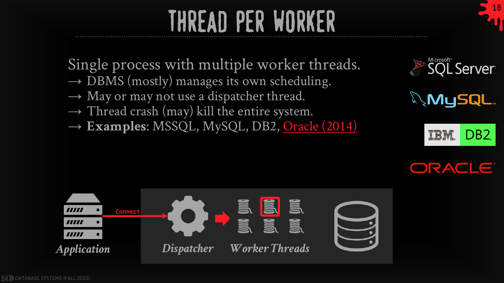

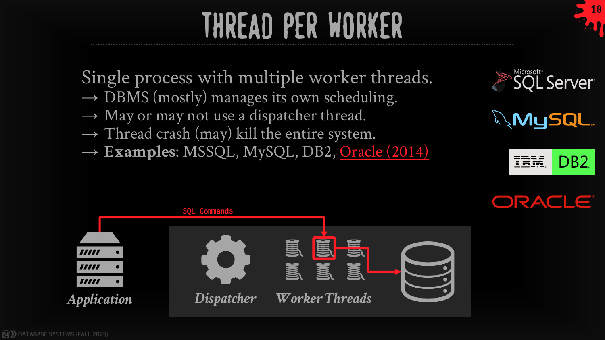


多线程架构有两个直接的好处。第一，**上下文切换（context switch）**的开销更小。操作系统在两个进程之间切换时，要连同地址空间一起切换（更换页表，缓存地址翻译结果的 TLB 也随之失效）；同一进程内两个线程之间切换，只需保存和恢复寄存器等少量状态。第二，不用自己管理[共享内存](#共享内存)。
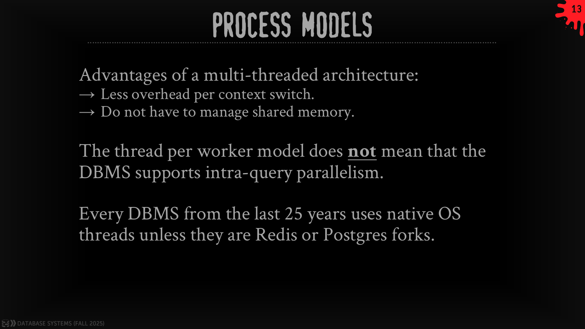


更重要的是，DBMS 可以（在很大程度上）自己掌握调度。它不会每来一条命令就调用一次 `pthread_create()`，而是预先建好一个**线程池（thread pool）**，把任务分给池中的线程。进一步，DBMS 可以采用非抢占式的调度：[工作者](#工作者)执行到合适的位置主动让出（yield），回到 DBMS 自己的调度器，由调度器决定下一步运行什么，协程（coroutine）就是这种思路。暂停和恢复一个线程，比暂停和恢复一个进程轻量得多。[进程模型](#进程模型)里也能做到这些，但要额外搭建不少机制，处处和操作系统较劲，所以采用[进程模型](#进程模型)的系统大多把调度交给操作系统。

多线程的代价是隔离变差：一个线程发生段错误（segfault），整个进程随之崩溃，所有[工作者](#工作者)一起停下。从这个角度看，多线程的 DBMS 更脆弱。Andy 对此的评论是：你当然不会在[数据库](#数据库)系统里写 bug，也就不会崩溃，只是说起来容易做起来难。[^3]

权衡之下，几乎所有系统都选择了多线程，因为工程负担更小，性能也更好。过去 25 年里出现的 DBMS，除了 Redis 和 PostgreSQL 的分支，都使用操作系统原生线程（Lecture Notes 的说法是过去 20 年）。SQL Server、MySQL 都采用这种模型，DB2 和 Oracle 后来也改为支持它，Oracle 在 2014 年加入了多线程支持。

同一个系统里既用进程又用线程，是否可取？Andy 的回答是一般不可取。可以做的是把前台的[分派器](#分派器)单独放在一个进程里，[工作者](#工作者)线程放在另一个进程里，这样[分派器](#分派器)甚至可以挪到另一台机器上；但在单机系统里，没有人把两种模型混着用，一律是[每工作者一线程](#每工作者一线程)。PostgreSQL 社区也讨论过改用线程，这从侧面说明，[进程模型](#进程模型)今天更多是历史遗留。

最后要记住一点：**[每工作者一线程](#每工作者一线程)并不意味着 DBMS 支持[查询内并行](#查询内并行)**。一个 DBMS 可以有上千个[工作者](#工作者)线程，却让每条查询只由其中一个执行。3.2 节会看到这样的例子。

### 2.4 嵌入式 DBMS（Embedded DBMS）

📍 *PPT 第 11 页*

**[嵌入式 DBMS](#嵌入式%20DBMS)** 不作为独立的服务器运行，而是作为一个库链接进应用程序，与应用程序运行在同一个地址空间里。DBMS 自己不调用 `fork()`，也不调用 `pthread_create()`，线程和调度（主要）由应用程序负责。
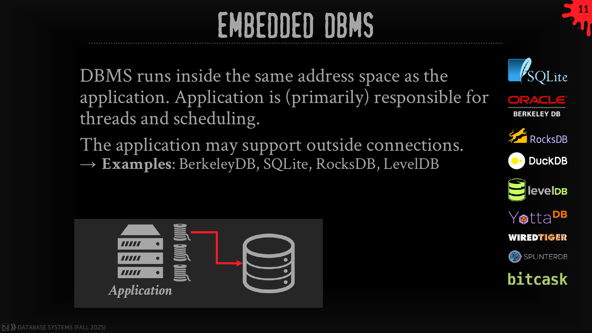


以 SQLite 为例。Web 服务器把 SQLite 库链接进自己的程序，处理请求的线程需要读数据时，调用 SQLite 的函数：

```c
// The calling thread itself runs the query inside the SQLite library
sqlite3_exec(db, "SELECT name FROM artist", callback, NULL, &errmsg);
```

这个调用和调用 `qsort()` 没有本质区别：执行查询的就是调用它的那个线程。线程进入 SQLite 库，读写[数据库](#数据库)文件，拿到结果后沿着调用栈返回应用程序。SQLite 自己没有线程池，也没有后台[工作者](#工作者)，它能用的[工作者](#工作者)只有应用程序调用它时带进来的线程。

```text
┌─────────────── 同一个进程，同一个地址空间 ───────────────┐
│  应用程序线程 T1 ─┐                                        │
│  应用程序线程 T2 ─┼──▶ DBMS 库函数 ──▶ 数据库文件          │
│  应用程序线程 T3 ─┘                                        │
└────────────────────────────────────────────────────────────┘
```

BerkeleyDB 是最早采用这种方式的系统之一，出自加州大学伯克利分校，2006 年被 Oracle 收购。SQLite、RocksDB、LevelDB、WiredTiger、SplinterDB、YottaDB、Bitcask 也都以嵌入方式使用。DuckDB 的情况略有不同：在命令行里启动 DuckDB 时，那个命令行程序就是嵌入 DuckDB 的应用程序，但 DuckDB 也可以自己创建线程来并行执行查询，并不完全依赖应用程序提供的线程。

嵌入 DBMS 的应用程序也可以对外接受连接，这时它就成了一个包着嵌入式引擎的服务器。MongoDB 与 WiredTiger 就是这种关系：WiredTiger 作为存储引擎嵌在 MongoDB 的服务器进程里，客户端连接的是 MongoDB。

三种方式对比如下：

| | [每工作者一进程](#每工作者一进程) | [每工作者一线程](#每工作者一线程) | [嵌入式 DBMS](#嵌入式%20DBMS) |
|---|---|---|---|
| [工作者](#工作者)是什么 | 操作系统进程 | 同一进程中的线程 | 应用程序自己的线程 |
| 谁创建[工作者](#工作者) | DBMS（`fork()`） | DBMS（线程池） | 应用程序 |
| 谁调度 | 主要靠操作系统 | 主要由 DBMS 自己 | 主要由应用程序 |
| 怎样共享全局数据 | [共享内存](#共享内存)或进程间通信 | 直接读写同一地址空间，用[闩](#闩)保护 | 同一地址空间 |
| 一个[工作者](#工作者)崩溃 | 其他进程不会被直接带垮 | 可能拖垮整个 DBMS | 连同应用程序一起崩溃 |
| 例子 | PostgreSQL，早期的 DB2、Oracle | SQL Server、MySQL、DB2、Oracle | SQLite、BerkeleyDB、RocksDB、LevelDB、DuckDB |

### 2.5 调度（Scheduling）

📍 *PPT 第 12 页*

有了一池[工作者](#工作者)，还要决定它们各做什么。对每一份[查询计划](#查询计划)，DBMS 都要决定在哪里、在什么时候、以什么方式执行它，具体包括：

- 用多少个任务？也就是把这条查询拆成几份，这个数字叫**[并行度](#并行度)（degree of parallelism）**。
- 用多少个 CPU 核？
- 每个任务放在哪个核上？同一份数据反复在同一个核上处理，CPU 缓存里的内容就能复用；在有多个 CPU 插槽的服务器上，内存分别挂在不同的插槽下面，任务离它要读的内存越近越快。
- 任务的输出放在哪里？放在消费者附近的内存里，还是内存不够，只能写到磁盘上？

回答这些问题需要知道当前有多少查询在运行、数据在哪里、从磁盘取数据有多慢，这些信息都在 DBMS 手里，操作系统一概不知。操作系统只看到一堆线程或进程，不知道哪个在构建[哈希表](#哈希表)、哪个在等待构建完成、哪条查询快要结束。因此 **DBMS 几乎总是比操作系统知道得更多**。Andy 的结论是：不要让操作系统替你调度任何东西。[数据库](#数据库)系统知道查询是什么、要执行哪些任务、手上有哪些资源，由它来决定怎样调度永远更有条件，绝不应该依赖操作系统做这件事。[^4] 第 [3](../L03/index.md)、[4](../L04/index.md) 讲讨论[缓冲池](#缓冲池)为什么不交给操作系统的 `mmap` 管理时，得出的是同一个结论。

实际系统的差距很大。Oracle、SQL Server、DB2 这些昂贵的企业级系统在调度上做得非常精细；PostgreSQL 则让操作系统掌舵，把调度全部交给操作系统[^5]；MySQL 也基本如此。

## 3. 并行执行的两个层次

📍 *PPT 第 14–15 页*

### 3.1 查询间并行与查询内并行

📍 *PPT 第 14 页*

有了[工作者](#工作者)和调度，还有一个问题没有回答：这些[工作者](#工作者)执行的是同一条查询，还是每人各执行一条？两种都可以，它们对应并行执行的两个层次。

**并行执行**指 DBMS 同时执行多个任务，以提高硬件利用率。这些同时活跃的任务不必属于同一条查询。
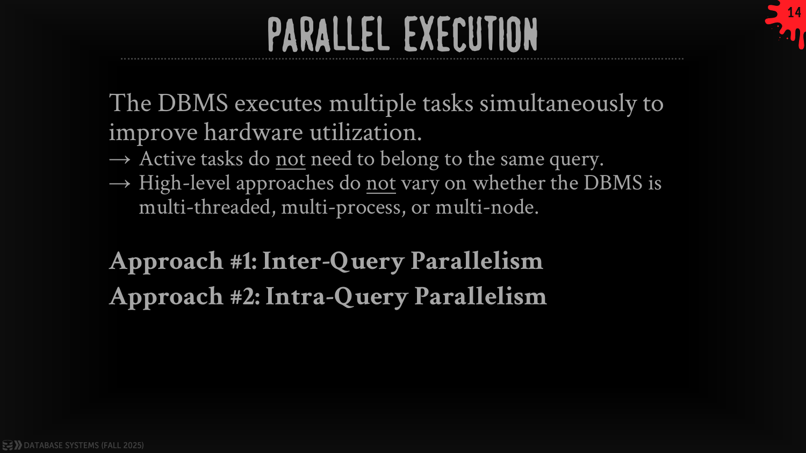


- **[查询间并行](#查询间并行)（inter-query parallelism）**：不同的查询同时执行，提高系统整体的吞吐量；查询不必排队等前面的查询结束，平均的等待时间也随之缩短。
- **[查询内并行](#查询内并行)（intra-query parallelism）**：同一条查询的[算子](#算子)并行执行，缩短单条长查询的延迟。

两者并不互斥。从这里开始讨论的技术，都与[工作者](#工作者)是线程、进程还是另一台机器上的节点无关：在计划的哪里切分数据、在哪里合并结果，这些思路在多线程、多进程、多节点的系统里都是一样的。

### 3.2 查询间并行（Inter-Query Parallelism）

📍 *PPT 第 15 页*

[查询间并行](#查询间并行)的调度通常很简单，大多数 DBMS 采用先来先服务：查询一到就开始执行。引入[事务](#事务)之后可以更讲究一些，比如根据一个事务之前已经执行了多少条查询，调高或调低它的优先级。
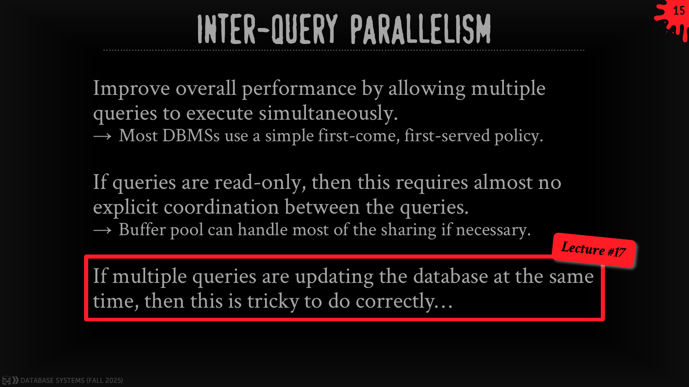


如果所有查询都是只读的，查询之间几乎不需要显式协调。一条查询开始执行之后，不必和别的查询交换数据，也不必关心别的查询在做什么。内部数据结构仍然要用[闩](#闩)（latch）保护，免得多条查询同时修改时把它弄坏；多条查询读同一张表时，[缓冲池](#缓冲池)的[扫描共享](#扫描共享)（第 [4](../L04/index.md) 讲）可以让它们共用同一批读进来的[页](#页)，减少浪费的 I/O。

如果多条查询同时更新[数据库](#数据库)，事情就难得多：谁先写、谁能看到谁写下的内容，都要仔细规定。这是第 17 到第 [20](../L20/index.md) 讲的并发控制要解决的问题。

[查询间并行](#查询间并行)解决不了单条大查询的问题。MySQL 就是只支持[查询间并行](#查询间并行)的系统：它可以同时执行许多条查询，但每条查询只由一个[工作者](#工作者)执行。用 Andy 的话说，在一台有 1000 个核的机器上运行一条 MySQL 查询，它最终仍然只跑在一个核上。[^6] MySQL 采用的是[每工作者一线程](#每工作者一线程)，却不支持[查询内并行](#查询内并行)，这正是 2.3 节末尾提醒的情形。PostgreSQL 则两者都支持：多条查询可以同时运行，每条查询也可以由多个[工作者](#工作者)共同执行。

## 4. 把一条查询拆给多个[工作者](#工作者)：查询内并行（Intra-Query Parallelism）

📍 *PPT 第 16–25 页*

### 4.1 生产者与消费者

📍 *PPT 第 16、18 页*

[查询内并行](#查询内并行)（intra-query parallelism）把一条查询的[算子](#算子)放到多个[工作者](#工作者)上执行。理解它的方式是**[生产者/消费者](#生产者/消费者)（producer/consumer）**模型：每个算子既是生产者，为上面的算子产出数据，又是消费者，消费下面的算子产出的数据。计划中不同部分的[工作者](#工作者)把结果向上推送；取决于[流水线](#流水线)怎样划分，上层的[工作者](#工作者)可以边收边算，也可能要等整条流水线结束才能开始。

拆分一条查询有两个基本方向：

- **[算子](#算子)内并行（intra-operator parallelism）**，又称[水平并行](#算子内并行（水平并行）)：同一个算子复制出多个实例，各自处理一部分数据。
- **[算子间并行](#算子间并行（垂直并行）)（inter-operator parallelism）**，又称[垂直并行](#算子间并行（垂直并行）)：不同的算子由不同的[工作者](#工作者)同时执行。

两者并不互斥，组合起来就是**[浓密并行](#浓密并行)（bushy parallelism）**。三者的普及程度差别很大：[水平并行](#算子内并行（水平并行）)最常见，[垂直并行](#算子间并行（垂直并行）)较少见，[浓密并行](#浓密并行)主要出现在高端系统里。Andy 的说法是，只要有人说自己是并行[数据库](#数据库)，十次里有九次，甚至一百次里有九十九次，指的都是[水平并行](#算子内并行（水平并行）)。[^7] 由于 SQL 是声明式的，用户不需要、也没办法在查询里指定用哪一种，DBMS 会根据可用的硬件和查询的内容自行选择和组合。
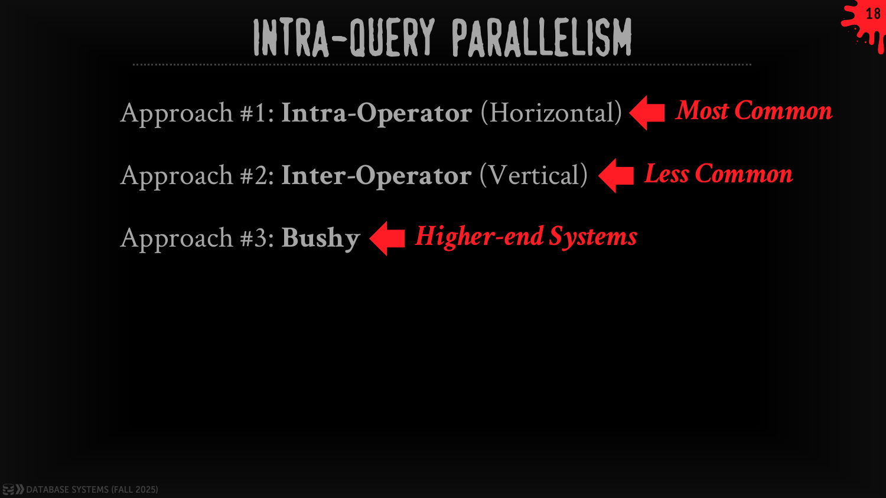


每一种关系[算子](#算子)都有并行版本，实现路线有两条。一条是让多个线程访问同一个集中的数据结构，比如多个线程往同一张[哈希表](#哈希表)里插入；另一条是先把数据[分区](#分区)，让每个线程只处理自己那一份。前者省去了[分区](#分区)的开销，但线程之间要争用同一个结构，需要[闩](#闩)来协调；后者要多付出一趟[分区](#分区)的代价，换来线程之间几乎不必协调。

### 4.2 从 Grace [哈希连接](#哈希连接)看水平并行

📍 *PPT 第 17 页*

[分区](#分区)路线最干净的例子是第 [12](../L12/index.md) 讲的 Grace [哈希连接](#哈希连接)。它先用同一个[哈希函数](#哈希函数) `h₁` 把 R 和 S 按连接键 `id` 各分成若干个桶。能连接上的两个[元组](#元组)连接键相同，哈希值也相同，必然落进编号相同的桶里。于是 R 的第 i 层桶只需要和 S 的第 i 层桶做[连接](#连接)，不同层之间互不相干。

既然各层互不相干，就可以每层交给一个[工作者](#工作者)：
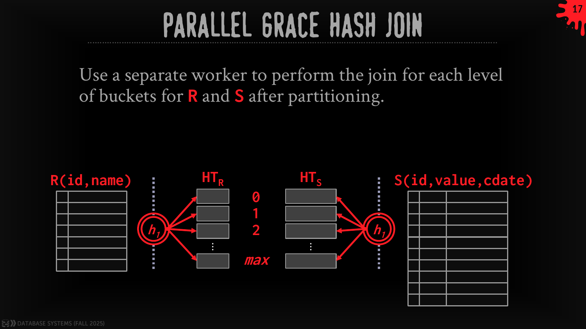

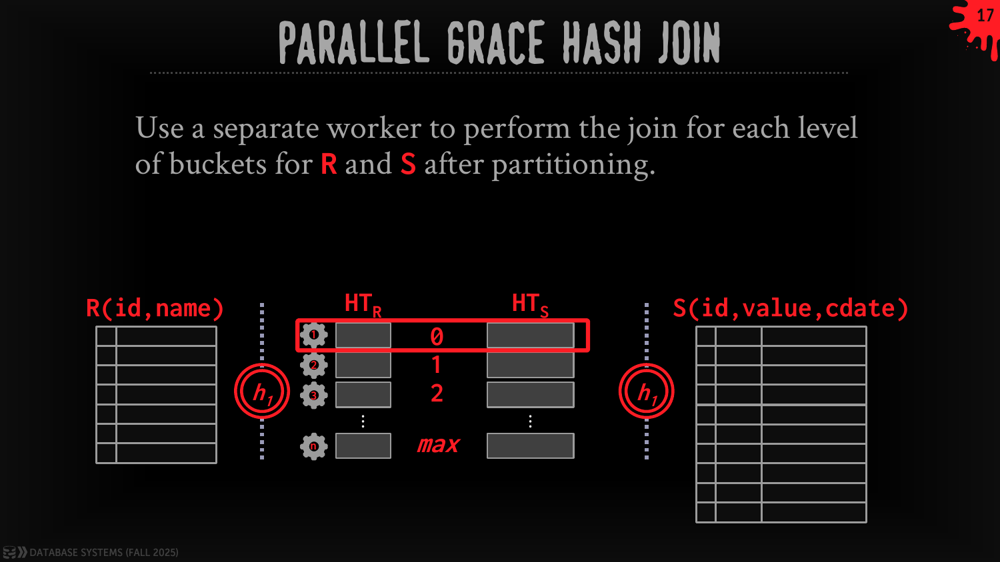


```text
          R(id, name)                    S(id, value, cdate)
               │ 用 h₁(id) 分桶                 │ 用 h₁(id) 分桶
               ▼                                ▼
 工作者 1：  HT_R 第 0 层     ⋈     HT_S 第 0 层
 工作者 2：  HT_R 第 1 层     ⋈     HT_S 第 1 层
 工作者 3：  HT_R 第 2 层     ⋈     HT_S 第 2 层
   ⋮              ⋮                      ⋮
 工作者 n：  HT_R 第 max 层   ⋈     HT_S 第 max 层
```

[分区](#分区)这一趟本身也可以并行：多个[工作者](#工作者)各读 R 的一部分，各自按 `h₁` 把[元组](#元组)写进对应的桶。到了[连接](#连接)阶段，[工作者](#工作者)之间完全不需要通信。第 [11](../L11/index.md)、[12](../L12/index.md) 讲反复使用的“分而治之”，在这里顺带换来了并行。其他[算子](#算子)也是如此：[外部归并排序](#外部归并排序)可以让每个[工作者](#工作者)各自排好一段，最后再归并；[哈希聚合](#哈希聚合)按分组键[分区](#分区)之后，每个[分区](#分区)的聚合互不相干。

### 4.3 交换算子（Exchange Operator）

📍 *PPT 第 19 页*

**[算子](#算子)内并行**的一般形式是：把一个算子分解为多个独立的实例，称为**片段（fragment）**，它们执行相同的功能，处理数据中互不相交的子集。
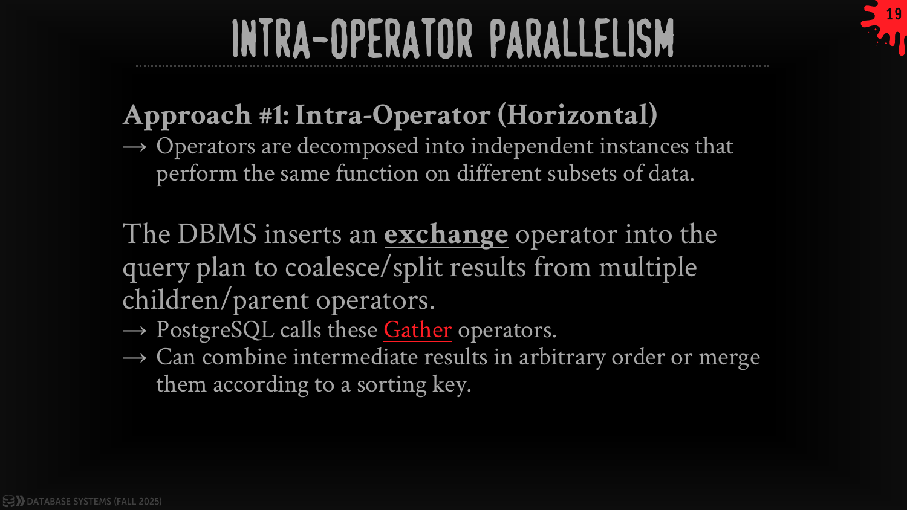


这带来一个接口上的问题。在第 [13](../L13/index.md) 讲的迭代器模型里，每个[算子](#算子)向它的子算子要数据；现在同一个位置上有三个实例在并行产出结果，上面的算子该向谁要？DBMS 的办法是在计划中插入一个**[交换算子](#交换算子)（exchange operator）**，由它把多个子算子的结果合并成一路，或者把一路数据拆给多个父算子。

最简单的例子是 `SELECT * FROM A WHERE A.value > 99`。它的计划只有[顺序扫描](#顺序扫描)和过滤两个[算子](#算子)，并行化之后变成这样：

```text
                         Exchange
               Next ↙       ↓ Next       ↘ Next
                 σ            σ            σ          value > 99
                 ↓ Next       ↓ Next       ↓ Next
                 A₁           A₂           A₃
              [工作者 1]   [工作者 2]   [工作者 3]
                 └──── 表 A 的页 1–5 分给三个工作者 ────┘
```

[交换算子](#交换算子)的上方仍然只看到一个子[算子](#算子)：它照常调用 `Exchange.Next()`，一次拿到一个[元组](#元组)。[交换算子](#交换算子)则在内部同时调用三个片段的 `Next()`，三个片段各自从分给自己的[页](#页)里读数据。并行被封装在[交换算子](#交换算子)里面，计划的其余部分完全不必知道。这正是[交换算子](#交换算子)的巧妙之处：第 [13](../L13/index.md) 讲的算子接口一个字都不用改，一份串行计划只要在合适的位置插入[交换算子](#交换算子)，就能变成并行计划。

[交换算子](#交换算子)在[关系代数](#关系代数)里没有对应物。Andy 强调，它和[关系模型](#关系模型)、关系代数都对不上号，是为了实现并行而在实现层面引入的东西。[^8] 编程语言里类似的概念叫 gather、merge 或 scatter-gather。PostgreSQL 把它叫作 Gather：Gather 按到达的先后顺序合并各路结果；Gather Merge 则在各路输入都已按某个键排好序时，按这个键把它们归并起来，这与[外部归并排序](#外部归并排序)的归并阶段（第 [11](../L11/index.md) 讲）是同一个道理。

### 4.4 一个完整的例子：并行[哈希连接](#哈希连接)

📍 *PPT 第 20 页*

下面用一条两表[连接](#连接)，看[交换算子](#交换算子)在完整计划中的位置：

```sql
SELECT A.id, B.value
  FROM A JOIN B
    ON A.id = B.id
 WHERE A.value < 99
   AND B.value > 100
```

串行计划是 `π_{A.id, B.value}(σ_{A.value<99}(A) ⋈_{A.id=B.id} σ_{B.value>100}(B))`，[连接](#连接)用[哈希连接](#哈希连接)实现：先以 A 为构建侧建[哈希表](#哈希表)，再用 B 去探测。

假设有三个[工作者](#工作者)（worker）。第一步把表 A 切成三个互不相交的子集 A₁、A₂、A₃。怎么切都可以：按[页](#页)切（你读这几页，我读那几页），按值的范围切，或者按[连接](#连接)键的哈希值切。
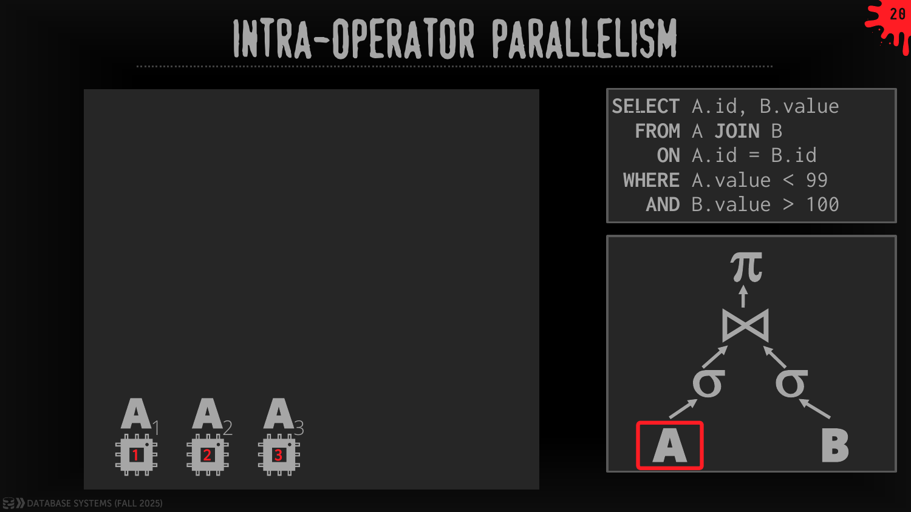


**阶段一：构建。** 三个[工作者](#工作者)各自扫描一份 A，过滤掉不满足 `A.value < 99` 的[元组](#元组)，再把剩下的插入[哈希表](#哈希表)：
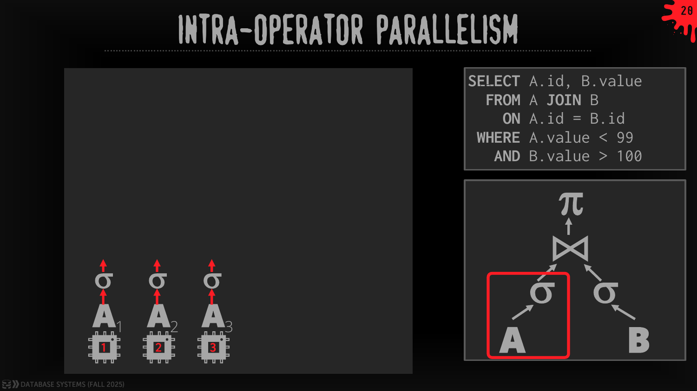


```text
                     ⋈                  ← 构建侧就绪，连接可以开始探测
                     ▲
                  Exchange              ← 等三个工作者都报告“完成”
             ┌───────┼───────┐
          Build HT Build HT Build HT    ← 三者插入的是同一张全局哈希表
             │       │       │
             σ       σ       σ          A.value < 99
             │       │       │
             A₁      A₂      A₃
         [工作者 1][工作者 2][工作者 3]
```

三个实例插入的是同一张全局[哈希表](#哈希表)，走的是 4.1 节说的“集中数据结构”路线，因此插入时要有[闩](#闩)保护（或者使用不需要闩的并发哈希表）。数据已经进了哈希表，所以从 Build HT 通向[交换算子](#交换算子)（exchange operator）的并不是[元组](#元组)，而是一个控制信号：“我这一份处理完了”。[交换算子](#交换算子)要等齐三个信号，才通知上面的[连接](#连接)[算子](#算子)构建侧已经就绪。
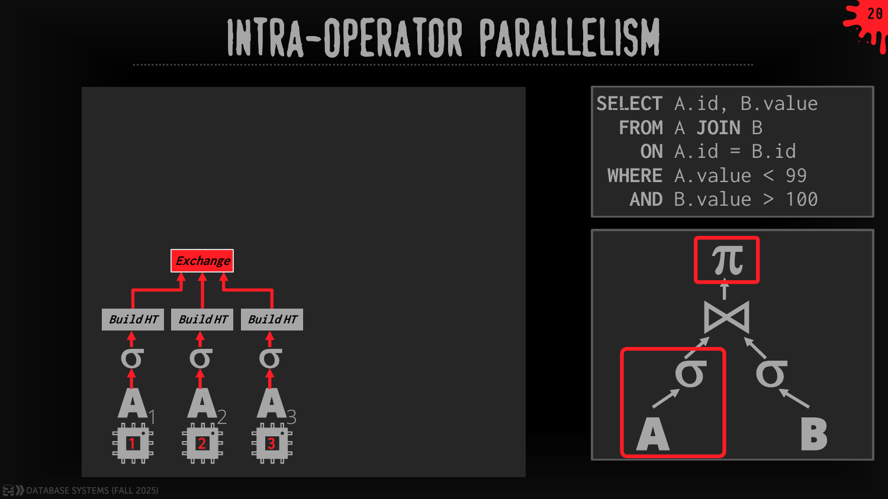

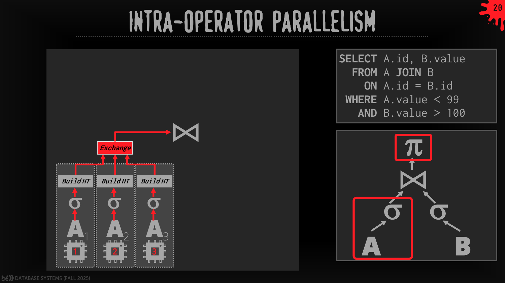


**阶段二：探测。** 构建完成后，DBMS 调度三个[工作者](#工作者)（可以就是刚才那三个）处理 B 的三个子集：
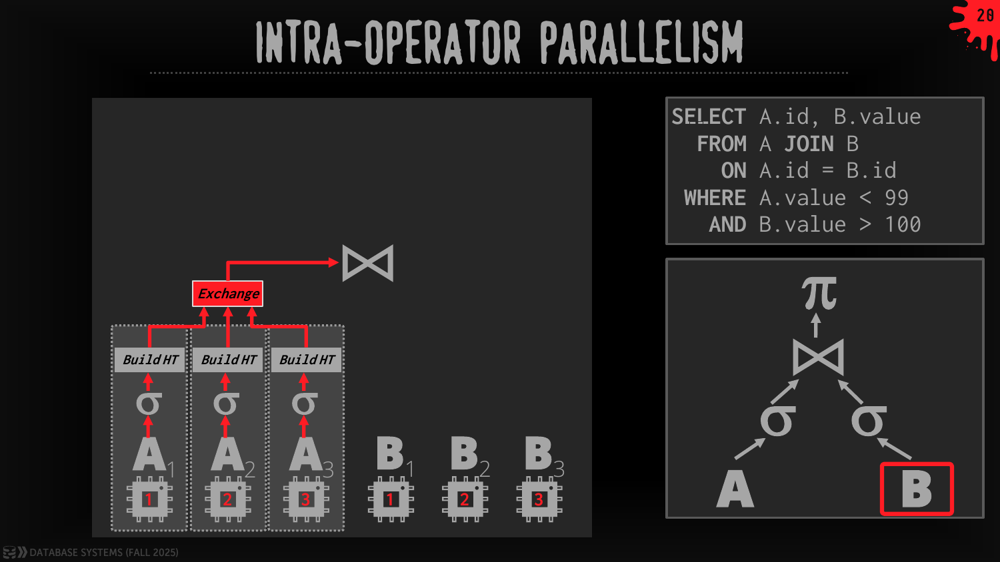


```text
                        Exchange           ← 汇集三路结果，输出给客户端
                   ┌───────┼───────┐
                   π       π       π       A.id, B.value
                   └───────┼───────┘
                           ⋈               ← 另一侧输入是阶段一的 Exchange
                   ┌───────┼───────┐
               Probe HT Probe HT Probe HT  ← 都去查阶段一建好的那张哈希表
                   │       │       │
                   σ       σ       σ       B.value > 100
                   │       │       │
                   B₁      B₂      B₃
               [工作者 1][工作者 2][工作者 3]
```

每个[工作者](#工作者)扫描自己那一份 B，过滤之后拿着 `B.id` 去[哈希表](#哈希表)里找匹配，找到就做[投影](#投影)，把结果交给顶层的[交换算子](#交换算子)，由它汇成一路输出。图中三路探测汇进同一个 ⋈，只是表明它们属于同一个[连接](#连接)[算子](#算子)；实际执行时，每个[工作者](#工作者)沿着 B_i → σ → 探测 → π 这条[流水线](#流水线)一路做下去，三个[工作者](#工作者)之间并不交换数据。
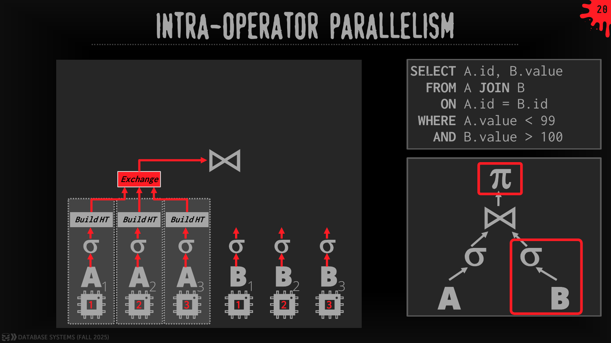

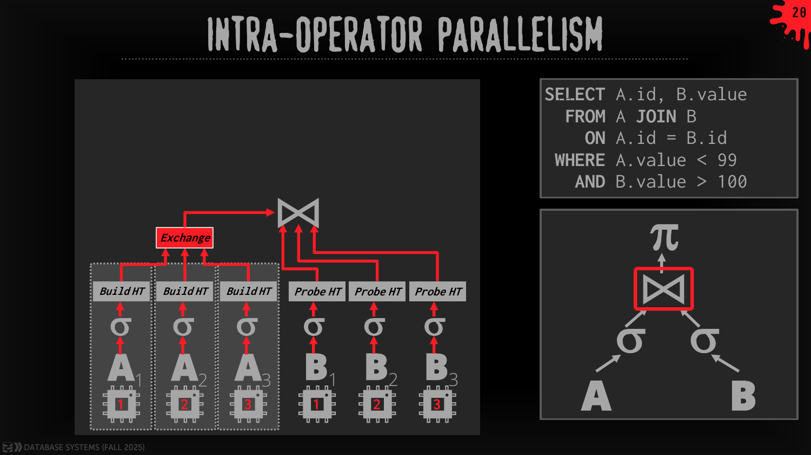

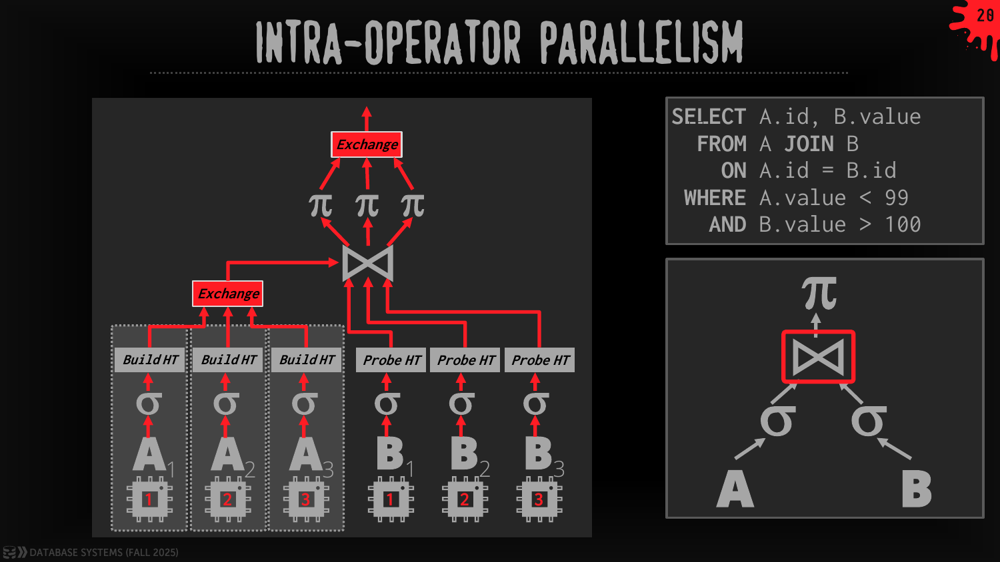

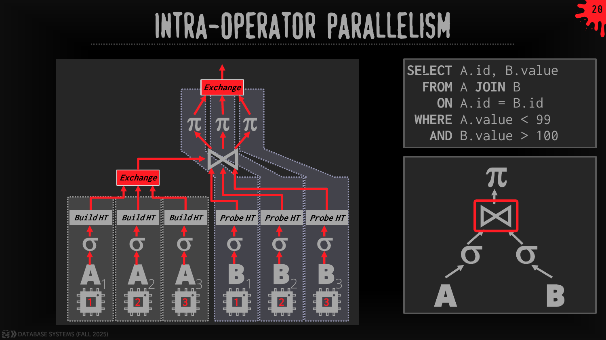


把两个阶段排到同一条时间线上，构建侧[交换算子](#交换算子)的作用就清楚了：

| 时刻 | [工作者](#工作者) 1 | [工作者](#工作者) 2 | [工作者](#工作者) 3 | 构建侧 Exchange | 顶层 Exchange |
|---|---|---|---|---|---|
| t₁ | 扫描 A₁ → σ → 插入 | 扫描 A₂ → σ → 插入 | 扫描 A₃ → σ → 插入 | 等待（0/3） | 空闲 |
| t₂ | 完成 | 完成 | 仍在插入 | 等待（2/3） | 空闲 |
| t₃ | 空闲 | 空闲 | 完成 | 放行（3/3） | 空闲 |
| t₄ | 扫描 B₁ → σ → 探测 → π | 扫描 B₂ → σ → 探测 → π | 扫描 B₃ → σ → 探测 → π | — | 边收边输出 |
| t₅ | 完成 | 完成 | 完成 | — | 三路都结束，查询完成 |

t₂ 时刻，[工作者](#工作者) 1、2 已经空闲，为什么不让它们先开始探测？假设 A₃ 里有一条 `id = 42` 的[元组](#元组)，[工作者](#工作者) 3 还没来得及把它插进[哈希表](#哈希表)，而 B₁ 里恰好有一条 `id = 42`、`value > 100` 的元组。如果[工作者](#工作者) 1 此刻就去探测，会在哈希表里找不到 42，这一行[连接](#连接)结果就永远丢了。这种“本该匹配却没找到”的错误叫**假阴性（false negative）**。构建侧的[交换算子](#交换算子)正是为了排除它，才必须等齐所有输入。

这个位置不是偶然的。[哈希连接](#哈希连接)的构建侧是第 [13](../L13/index.md) 讲所说的[流水线阻断点](#流水线阻断点)（pipeline breaker）：[哈希表](#哈希表)建完之前，探测侧不能输出任何结果。[交换算子](#交换算子)正好放在阻断点上，把计划切成“构建 A”和“探测 B”两条[流水线](#流水线)。[查询计划](#查询计划)中还有一份元数据记录这些流水线及其依赖关系，调度器据此知道，必须先调度处理 A 的三个片段，再调度处理 B 的片段。

### 4.5 交换算子一定要等齐所有输入吗

📍 *PPT 第 19–20 页*

按最基本的定义，[交换算子](#交换算子)（exchange operator）是一道**屏障（barrier）**：收到子[算子](#算子)的全部数据之前，它上面的算子不能开始执行。一个自然的疑问是：为什么非得这样？把已经收到的部分结果先送上去不行吗？

答案取决于[交换算子](#交换算子)上面是什么，上一节的两个[交换算子](#交换算子)正好是两种情况。构建侧的[交换算子](#交换算子)上面是探测，提前放行会产生假阴性，所以必须阻塞。顶层的[交换算子](#交换算子)上面是客户端，每一条连接结果都是最终结果的一部分，收到一条送出一条毫无问题；它要等齐的只是“查询结束”这件事，而不是数据本身。PostgreSQL 的 Gather 就是这样工作的：[工作者](#工作者)产出一条，它就向上交一条。

所以，[交换算子](#交换算子)是不是屏障，由它所在的位置决定：位于[流水线阻断点](#流水线阻断点)上的必须阻塞，其余的可以边收边送。可以边收边送的地方，也为 4.7 节的[流水线并行](#流水线并行)留出了空间。

### 4.6 三种交换算子

📍 *PPT 第 21 页*

到目前为止，[交换算子](#交换算子)都在做同一件事：把多路合成一路。一般来说[交换算子](#交换算子)有三种（名称沿用 SQL Server 的术语）：

```text
① Gather（汇集）

               ↑
            Gather
          ↗   ↑   ↖
        Op    Op    Op

② Distribute（分发）

        Op    Op    Op
          ↖   ↑   ↗
          Distribute
               ↑

③ Repartition（重分区）

          Op        Op
            ↖      ↗
          Repartition
          ↗    ↑    ↖
        Op     Op     Op
```

- **Gather（[汇集](#汇集)）**：把多个[工作者](#工作者)的结果合并成一路输出。它是[并行 DBMS](#并行%20DBMS) 里最常用的一种，4.4 节的两个[交换算子](#交换算子)都是它。
- **Distribute（[分发](#分发)）**：把一路输入拆成多路输出，交给多个并行的[工作者](#工作者)。比如下面是一个只能串行执行的[算子](#算子)，上面的算子要并行处理，就在两者之间放一个 Distribute。
- **Repartition（重[分区](#分区)）**：把多路输入重新洗牌（shuffle）成多路输出。它的一个用途是改变数据的切分方式：数据原先按[页](#页)切给各[工作者](#工作者)，而下一个算子（比如[连接](#连接)或聚合）要求相同键的[元组](#元组)落在同一个[工作者](#工作者)手里，Repartition 就按键的哈希值把数据重新分配一遍。

Repartition 的输入路数和输出路数不必相等，上图就是三路进、两路出。为什么要主动降低[并行度](#并行度)？因为协调不是免费的：数据在[工作者](#工作者)之间搬运、交接，都要付出代价。假设计划的下半部分要扫描大量数据，用 10 个[工作者](#工作者)；过滤掉绝大部分[元组](#元组)之后，剩下的数据只值得两个[工作者](#工作者)处理，这时就可以用 Repartition 把 10 路合成 2 路，在并行带来的收益和通信带来的开销之间取得平衡。

有些系统把这件事做到了极致。Google 的 BigQuery（其底层是 Dremel）在每一条[流水线](#流水线)、每一个执行阶段之后都做一次 Repartition，好处是每到一个阶段都能根据实际的数据量，重新决定下一阶段用多少个节点，随时扩大或缩小规模。这是分布式系统的做法，但同样的思路在单机上也适用。

### 4.7 [算子](#算子)间并行（Inter-Operator Parallelism）

📍 *PPT 第 22–23 页*

[水平并行](#算子内并行（水平并行）)按数据切分，每个[工作者](#工作者)执行同一段计划。另一种思路是按[算子](#算子)切分：不同的算子由不同的[工作者](#工作者)同时执行，数据从一个阶段直接流向下一个阶段，中间不[物化](#物化)。这就是**[算子间并行](#算子间并行（垂直并行）)（inter-operator parallelism）**，也叫**[流水线并行](#流水线并行)（pipelined parallelism）**。多个片段的中间结果仍然需要[交换算子](#交换算子)来合并。

它不如[水平并行](#算子内并行（水平并行）)常见，原因在[流水线阻断点](#流水线阻断点)（pipeline breaker）。阻断点上面的[算子](#算子)必须等下面全部算完才能开始，给它单独配一个[工作者](#工作者)，这个[工作者](#工作者)只能空转等待。[垂直并行](#算子间并行（垂直并行）)只在数据能够边产生边消费的地方才有意义。

看一个例子。查询里调用了一个很慢的用户自定义函数（user-defined function，UDF）：

```sql
SELECT SLOW_UDF(B.value)
  FROM A JOIN B
    ON A.id = B.id
 WHERE A.value < 99
   AND B.value > 100
```

`SLOW_UDF` 可以想象成对数据反复求哈希之类的昂贵计算。我们不希望等[连接](#连接)全部完成再开始算它，于是把连接和[投影](#投影)分给两个[工作者](#工作者)：
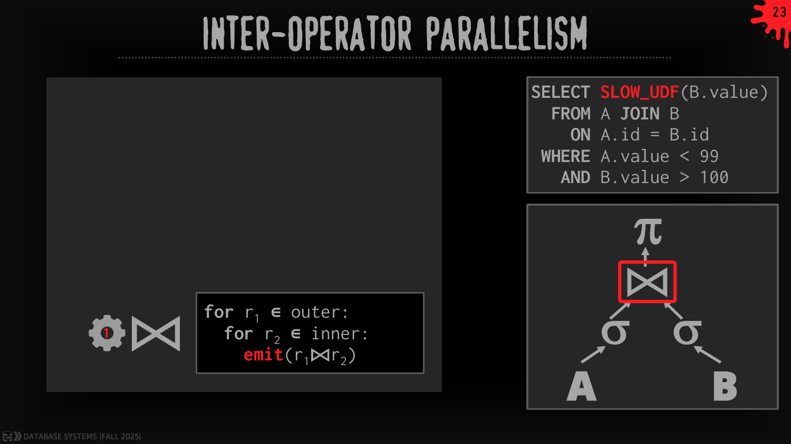

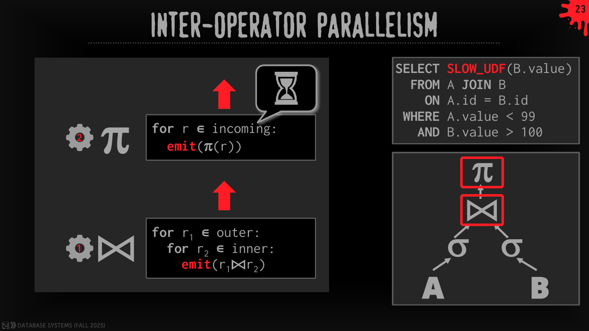


```text
[工作者 2]  π   for r ∊ incoming:
                  emit(π(r))            ⌛ 暂时没有新元组时就等着
               ▲
               │  连接结果一产生就交上来
[工作者 1]  ⋈   for r₁ ∊ outer:
                  for r₂ ∊ inner:
                    emit(r₁⋈r₂)
```

[工作者](#工作者) 1 专心做[连接](#连接)，每找到一对匹配就发出（emit）一个[元组](#元组)；[工作者](#工作者) 2 不断读取输入流，对每个元组调用 `SLOW_UDF`。如果[工作者](#工作者) 2 处理完了目前收到的所有元组，而[工作者](#工作者) 1 还在算，它就阻塞等待，直到[工作者](#工作者) 1 送来新元组，或者通知它不会再有数据了。

一个自然的疑问是：[投影](#投影)本来就可以直接写进[连接](#连接)的循环体里，为什么要拆开？确实可以，而且融合在一个循环里更便宜，因为拆开之后，每个[元组](#元组)都要复制一次、在两个[工作者](#工作者)之间交接一次。拆开的好处是两段计算可以重叠。设每产生一条连接结果需要时间 J，对它执行 `SLOW_UDF` 需要时间 U。融合执行时，每条结果耗时 J + U；拆开后两个[工作者](#工作者)同时忙碌，稳定状态下每条结果大约耗时 max(J, U)，再加上交接的开销。只有当 U 足够大、交接开销相对较小时，拆开才划算。

[垂直并行](#算子间并行（垂直并行）)的主场是**[流处理系统](#流处理系统)（stream processing system）**，比如 Flink、Storm、Heron、Spark，以及 Kafka、Pulsar 这类流数据平台。它们面对的不是一张大小固定的表，而是源源不断插入的新数据。一条查询要一直运行下去，每隔 5 秒输出一次结果，或者在某个条件触发时输出，比如某只股票的价格超过 100。输入永远不会结束，等所有数据都到齐再往下算是不可能的，只能让各个[算子](#算子)同时运行，让数据一路流过去。

### 4.8 浓密并行（Bushy Parallelism）

📍 *PPT 第 24–25 页*

**[浓密并行](#浓密并行)（bushy parallelism）**是[算子](#算子)内并行和[算子间并行](#算子间并行（垂直并行）)的混合：多个[工作者](#工作者)同时执行[查询计划](#查询计划)中不同片段的多个算子，片段之间仍然用[交换算子](#交换算子)合并中间结果。教科书喜欢把它讲成一种独立的并行方式，Andy 则认为它只是前两种同时使用而已。[^9]

例子是四张表的[连接](#连接)：

```sql
SELECT *
  FROM A
  JOIN B
  JOIN C
  JOIN D
```

这里没有写[连接](#连接)条件，按语义是四张表的[笛卡尔积](#笛卡尔积)，不过这个例子关心的是计划的形状。计划采用 `(A ⋈ B) ⋈ (C ⋈ D)`：
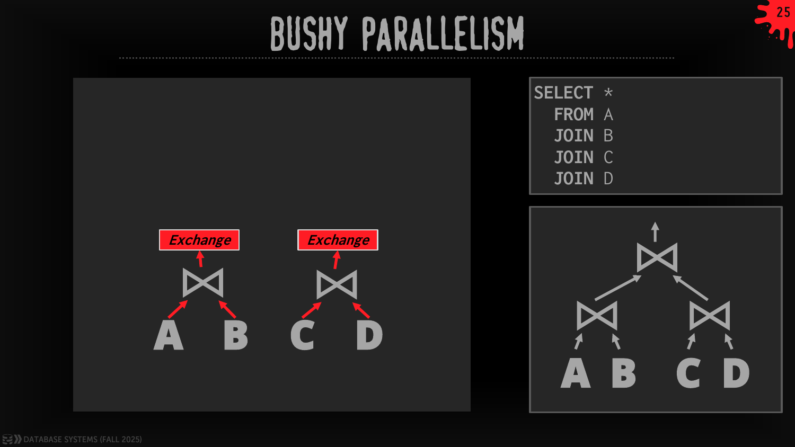


```text
                        Exchange
                      ↗          ↖
       [工作者 3]   ⋈               ⋈   [工作者 4]
                   ↑ ↖            ↗ ↑
                   │   ╲        ╱   │
                   │     ╲    ╱     │
                   │       ╳        │
                   │     ╱    ╲     │
                   │   ╱        ╲   │
                Exchange        Exchange
                   ↑                ↑
       [工作者 1]   ⋈                ⋈   [工作者 2]
                  ↗ ↖              ↗ ↖
                 A   B            C   D
```

四个[工作者](#工作者)的分工同时体现了两种并行：
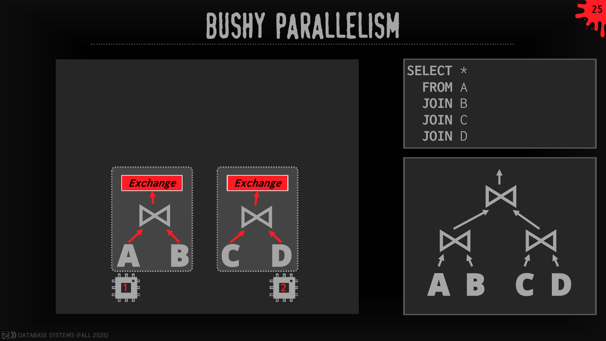


- [工作者](#工作者) 1 计算 `A ⋈ B`，[工作者](#工作者) 2 同时计算 `C ⋈ D`。它们执行的是计划中不同的片段，属于不同[算子](#算子)同时运行。
- 顶层的[连接](#连接)由[工作者](#工作者) 3 和[工作者](#工作者) 4 分担。两者做的是同一个连接，各处理一部分数据，属于[水平并行](#算子内并行（水平并行）)。为此，下层的两个[交换算子](#交换算子)各自把输出分成两路，分别送给[工作者](#工作者) 3 和[工作者](#工作者) 4。
- 最上面的[交换算子](#交换算子)把两路结果[汇集](#汇集)成最终输出。
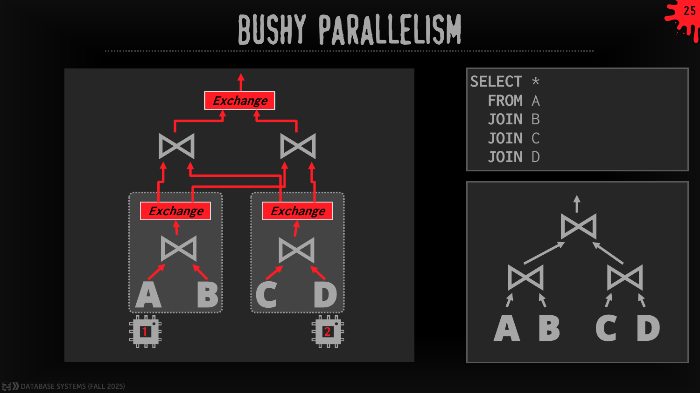

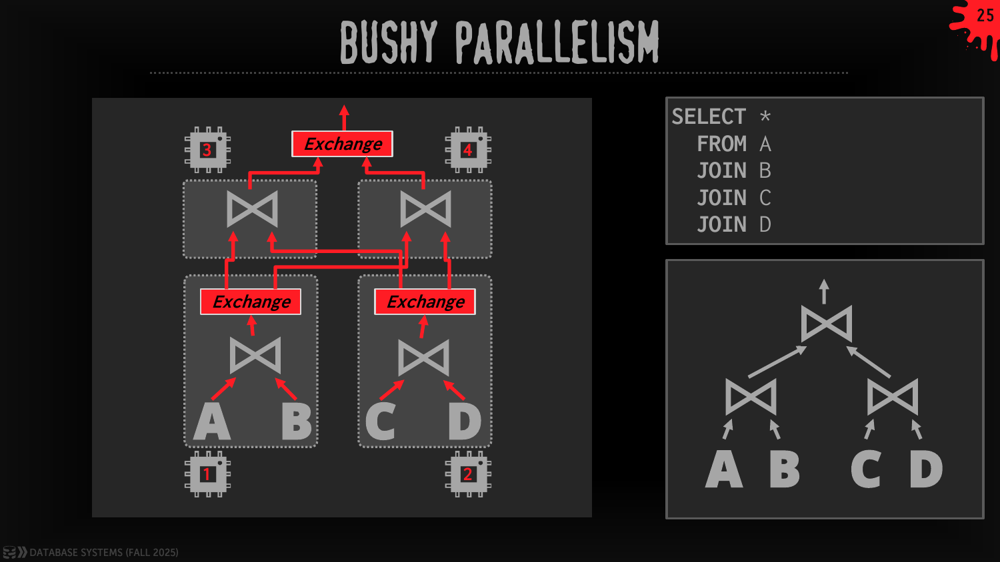


[浓密并行](#浓密并行)出现在 SQL Server、DB2、Oracle 这类动辄价值数百万美元的高端系统里。

这个计划本身是最优的吗？答案取决于数据。先[连接](#连接) A 和 B，再连 C，最后连 D，完全可能更好。像 `(A ⋈ B) ⋈ (C ⋈ D)` 这样两棵子树都含有连接的计划叫**[浓密树](#浓密树)（bushy tree）**，某些情况下它确实更优；但大多数系统只生成**[左深树](#左深树)（left-deep tree）**形状的计划，即 `((A ⋈ B) ⋈ C) ⋈ D` 这一类，每次连接的右输入都是一张基表。原因是[浓密树](#浓密树)的搜索空间太大。n 张表连接时，[左深树](#左深树)的个数等于表的排列数；允许任意形状时，还要再乘以 n − 1 个连接节点能构成的二叉树形状数（卡特兰数）：

$$
\text{左深树：}\; n! \qquad\qquad \text{任意形状：}\; n! \cdot \frac{1}{n}\binom{2n-2}{n-1} = \frac{(2n-2)!}{(n-1)!}
$$

n = 4 时分别是 24 和 120；n = 10 时分别约为 363 万和 176 亿。怎样在这样的空间里找到好的计划，是第 [15](../L15/index.md)、[16](../L16/index.md) 讲的内容。

## 5. 瓶颈在磁盘时：I/O 并行（I/O Parallelism）

📍 *PPT 第 26–30 页*

### 5.1 更多的[工作者](#工作者)未必更快

📍 *PPT 第 26 页*

第 2 到第 4 节都默认瓶颈在 CPU：核多了，[工作者](#工作者)多了，查询就快了。但查询说到底要从磁盘读[页](#页)、往磁盘写页。如果磁盘始终是瓶颈，增加[工作者](#工作者)不会让 DBMS 变快。
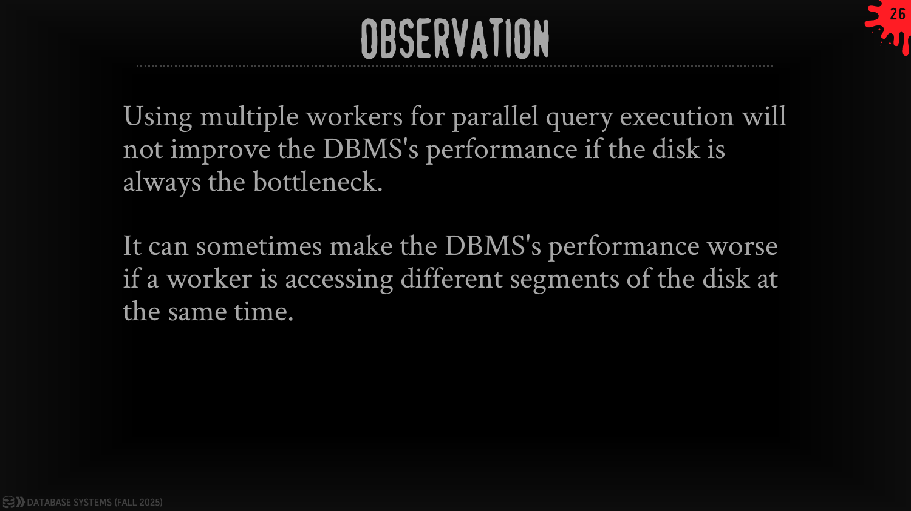


情况甚至可能变坏。回忆第 [3](../L03/index.md) 讲：机械硬盘上顺序访问远快于随机访问，因为随机访问的每一次读写都要先移动磁头。一个[工作者](#工作者)[顺序扫描](#顺序扫描)一张表，磁头一路向前；三个[工作者](#工作者)同时扫描磁盘上三个不同的区域，磁头就要在三处之间来回跳，三次顺序读变成了一连串随机读。

近五年来，基于 NVMe 接口的固态盘（直接挂在 PCIe 总线上、速度极快的本地 SSD）已经快到让 CPU 在很多时候重新成为瓶颈。但数据如果放在 Amazon S3 这类远程对象存储上，存储始终比 CPU 慢得多。无论哪种情况，只要瓶颈在存储，办法就是把数据分散到多块存储设备上，让它们同时工作。

### 5.2 数据放在哪几块盘上

📍 *PPT 第 27、29 页*

**[I/O 并行](#I/O%20并行)（I/O parallelism）**把 DBMS 的数据分散到多块存储设备上，以提高磁盘带宽。分法有很多种，各有取舍：
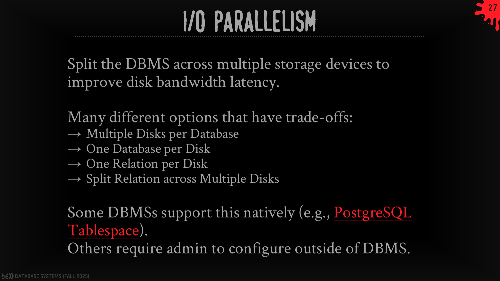


- 一个[数据库](#数据库)使用多块磁盘；
- 每个数据库一块磁盘；
- 每张表（关系）一块磁盘；
- 一张表拆开放在多块磁盘上。

有些 DBMS 原生支持这些做法，比如 PostgreSQL 的**[表空间](#表空间)（tablespace）**：一个[表空间](#表空间)对应一个目录，这个目录可以放在任意一块盘上，建表时可以指明表放在哪个[表空间](#表空间)里。高端系统控制得更细，比如 Oracle 可以精确指定每张表放在哪里，也可以把预写日志（第 [21](../L21/index.md) 讲的主题，暂时可以理解为记录所有修改的恢复日志）放在一块盘上、表数据放在另一块盘上，让日志的顺序写入和表的读写互不干扰。另一些 DBMS 本身没有“数据物理上放在哪里”的概念，比如 MySQL，管理员只能在 DBMS 之外配置，比如用符号链接把某些文件指到另一块盘上。这时 DBMS 并不知道自己读写的文件位于哪块设备、这块设备有什么特性。

以[数据库](#数据库)为单位分配磁盘最容易。有些 DBMS 允许为每个数据库单独指定磁盘位置，[缓冲池管理器](#缓冲池管理器)在把[页](#页)映射到磁盘位置时（第 [3](../L03/index.md) 讲的[页目录](#页目录)），多考虑一层“在哪块盘上”即可；如果 DBMS 把每个数据库存放在单独的目录里，在文件系统层面把不同的目录挂到不同的磁盘上也很方便。不过，如果一个[事务](#事务)可以同时修改多个数据库，恢复日志可能仍然要共用一份，因为这个事务的所有修改要作为一个整体记录下来。

### 5.3 多磁盘并行：条带化与镜像

📍 *PPT 第 28 页*

多磁盘并行把数据存放在多块磁盘上，希望同时提高性能和[持久性](#持久性)。设逻辑上有一个 6 [页](#页)的文件，要放到 3 块磁盘上，有两个极端：
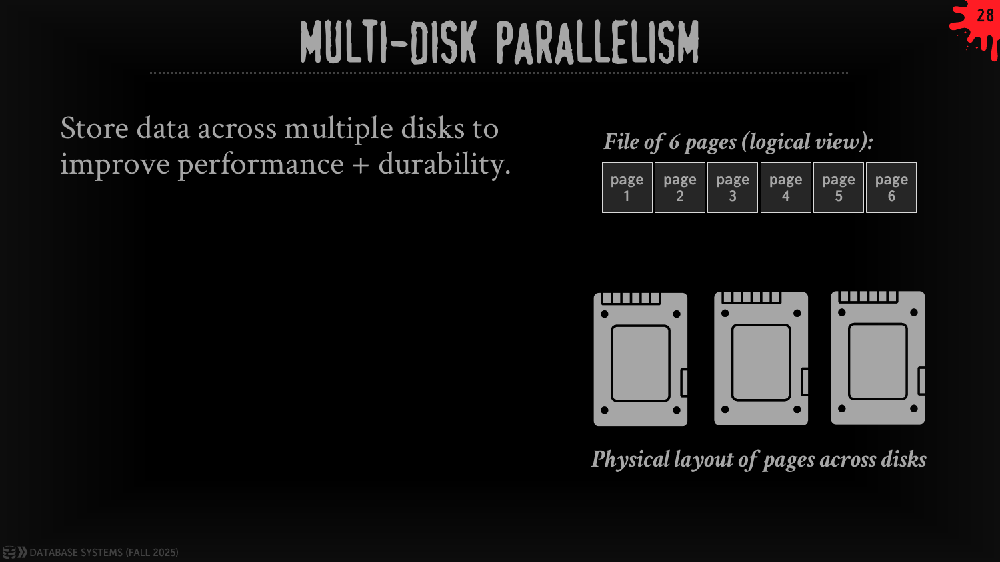


```text
逻辑视图：  [页1][页2][页3][页4][页5][页6]

条带化（RAID 0）                  镜像（RAID 1）
 磁盘1    磁盘2    磁盘3            磁盘1    磁盘2    磁盘3
 [页1]    [页2]    [页3]            [页1]    [页1]    [页1]
 [页4]    [页5]    [页6]            [页2]    [页2]    [页2]
                                     ⋮        ⋮        ⋮
```

RAID 是独立磁盘冗余阵列（Redundant Array of Independent Disks）的缩写。

**[条带化](#条带化)（striping，RAID 0）**按轮转（round-robin）方式分配：[页](#页) 1 放磁盘 1，页 2 放磁盘 2，页 3 放磁盘 3，页 4 再回到磁盘 1。每一页只存在于一块盘上，读写都只涉及一块盘。多个[工作者](#工作者)访问不同的页时，请求自然分散到三块盘上并行完成（暂且不考虑把数据送进内存的总线带宽）。代价是没有任何冗余：坏掉一块盘，就丢掉三分之一的[数据库](#数据库)。要是那块盘上存着银行账户的余额，这就是一场灾难。

**[镜像](#镜像)（mirroring，RAID 1）**把每一[页](#页)完整地写到每一块盘上。只有三块盘都通过 `fsync` 确认写入之后，才向 DBMS 报告写入成功（`fsync` 是要求操作系统把文件的修改真正写到存储设备上、写完才返回的系统调用）。读很快：任何一页都可以从任何一块盘上读，上面放一个负载均衡器把读请求分摊到三块盘即可。写变慢了：同一页要写三次，而且要等最慢的那块盘写完。

实践中常用介于两者之间的方案。以奇偶校验为例：3 块盘里，磁盘 1 存[页](#页) 1，磁盘 2 存页 2，磁盘 3 存两者按位异或的结果 `页1 ⊕ 页2`。任何一块盘坏掉，都能用另外两块盘上的内容异或出来，比如 `页1 = 页2 ⊕ (页1 ⊕ 页2)`。这样只花三分之一的容量，就能扛住一块盘的故障。RAID 4 用的就是这种布局；RAID 5 的原理相同，只是把校验块轮流放在各块盘上，免得所有写入都挤向同一块校验盘。把这个思路推广，把数据切成 k 块，再算出 m 块校验块，使得任意丢失 m 块都能恢复，这就是**[纠删码](#纠删码)（erasure code）**。

实现这些布局有两种途径：

- **基于硬件**：I/O 控制器把多块物理设备呈现为一块逻辑设备，对 DBMS 完全透明，RAID 卡就是如此。DBMS 以为自己在读写一块盘，自然无法根据多块盘的特性安排[工作者](#工作者)。
- **基于软件**：DBMS 自己实现各种存储布局，可以在文件或对象这一级使用[纠删码](#纠删码)。这里指的不是文件系统层面的软件 RAID（那对 DBMS 同样透明），而是在 DBMS 内部由它自己的代码决定每一[页](#页)存在哪里。DBMS 知道数据在哪块盘上，也知道丢失某一块盘意味着什么，因此能做出更好的安排。这种方式更快，也更灵活，不过通常只有 Oracle 这类昂贵的系统才提供。

### 5.4 性能、[持久性](#持久性)、容量不可兼得

📍 *PPT 第 28 页*

比较[条带化](#条带化)和[镜像](#镜像)，会发现存储方案要在三个目标之间取舍：
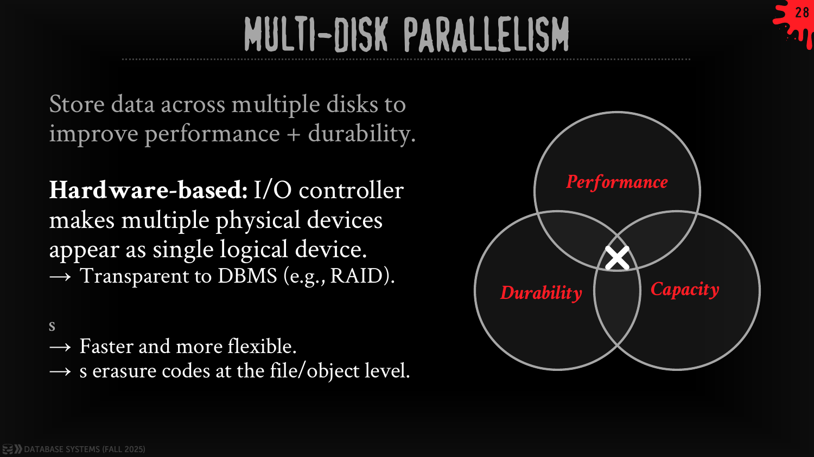


| | 性能 | [持久性](#持久性) | 容量 |
|---|---|---|---|
| [条带化](#条带化)（RAID 0） | 读写都能分散到各盘 | 坏一块盘就丢数据 | 三块盘的空间全部可用 |
| [镜像](#镜像)（RAID 1） | 读能分散，写要等所有盘 | 坏两块盘仍不丢数据 | 只相当于一块盘 |
| 奇偶校验 | 读能分散，写要同时更新校验块 | 能扛住一块盘的故障 | 三分之二可用 |

三者最多兼顾其二。[镜像](#镜像)的容量代价尤其直观：[数据库](#数据库)有 1 TB，每块盘就都得装得下 1 TB，没法用几块小盘拼出来。

在[数据库](#数据库)的世界里，真正在乎数据的人通常也有钱，容量可以靠多买盘解决，真正的取舍发生在[持久性](#持久性)和性能之间。Visa、MasterCard 这样的大型金融公司对这两者都极其看重，容量反而不是问题。当然，系统跑在昂贵的硬件上，也意味着不该往里面堆无用的数据。这些讨论主要针对[事务](#事务)型负载。在云上，大家把数据放在 S3 上：容量近乎无限，持久性由云厂商负责，性能则取决于读取时能达到多高的[并行度](#并行度)，以及在本地缓存多少数据。SpiralDB 的客座讲者对对象存储的判断更进一步：只要并行发出足够多的请求，S3 这类对象存储的总吞吐量几乎没有上限，瓶颈会转移到本机的网卡上。这其实是把 [I/O 并行](#I/O%20并行)推到了云的尺度：数据分散在对象存储背后成千上万块盘上，[条带化](#条带化)的工作由存储服务替你完成。

这组取舍和第 [23](../L23/index.md)、[24](../L24/index.md) 讲分布式系统里的取舍非常相似。把数据放到多个节点上，要么更快但保证更弱，要么更安全但更慢，因为每次写入都要等所有副本同步。

> 💬 **旁注**
> Andy 对“在乎数据的人都有钱”这个说法，自己也打了个折扣：现实中绝大多数[数据库](#数据库)和 Web 服务器跑在同一台机器上。这本来是不该做的事，但人人都这么做，因为如果只是一个 WordPress 博客，谁在乎呢？
>
> *原话：“99% of the databases are running on the same box as the web server, which you're not supposed to do, but everyone does because if it's WordPress, who cares, right?”*

### 5.5 [分区](#分区)（Partitioning）

📍 *PPT 第 30 页*

前面几节一直在说“把数据切成互不相交的子集”：4.4 节把表 A 切成三份交给三个[工作者](#工作者)，5.2 节把表放到不同的盘上。把这件事做成 DBMS 的正式功能，就是**[分区](#分区)（partitioning）**：把一张逻辑表切分成互不相交的物理片段，分别存储和管理。DBMS 完全掌握数据写到哪里，知道哪块盘上有什么，因此能决定怎样切分最有利，再把各个片段放到不同的存储设备上。

[分区](#分区)（理想情况下）对应用程序透明：应用程序只访问逻辑表，不需要关心数据在物理上怎样存放，SQL 一个字都不用改。这又一次体现了第 [1](../L01/index.md) 讲的[数据独立性](#数据独立性)。

按行切分叫水平[分区](#分区)，可以按值的范围切，也可以按哈希值切；按列切分叫垂直[分区](#分区)。第 [6](../L06/index.md) 讲的列存储其实就是把垂直[分区](#分区)推到极致：每一列单独存放在自己的[页](#页)里。[分区](#分区)方式和并行执行直接相关：如果表已经按[连接](#连接)键的哈希值分好区，4.2 节那种互不相干的并行连接就是现成的；如果[分区](#分区)方式与查询的需要不一致，就要靠 4.6 节的 Repartition 在执行时重新洗牌。[分区](#分区)也是分布式[数据库](#数据库)横向扩展到多台机器的主要手段，第 [23](../L23/index.md)、[24](../L24/index.md) 讲会详细讨论。

## 6. 换一种硬件：GPU 上的查询执行

📍 *PPT 第 6 页*

前面的一切都是在 CPU 上讨论的。换成 GPU，这些结论还成立吗？SpiralDB（一家围绕开源列式文件格式 Vortex 构建[数据库](#数据库)的公司）的客座讲者在课上回答了这个问题。他们的查询引擎既要在 CPU 上以向量化方式执行，也要能直接在 GPU 上执行。在他看来，[算子](#算子)、[流水线](#流水线)这些构件都相当经典，第 [13](../L13/index.md) 讲的向量化执行模型已经存在了大约二十年；移植到 GPU 上时，最主要的新约束是 GPU 希望每个算子的输出大小固定且事先已知。[^10] 这个约束改变了“什么算[流水线阻断点](#流水线阻断点)”的判断：执行一个算子之前，必须先知道它的实际输出有多大。

原因在于 GPU 的工作方式。GPU 上成千上万个线程同时写输出，每个线程都必须事先知道自己该写到输出缓冲区的哪个位置，缓冲区本身也要预先分配好。CPU 上的过滤[算子](#算子)可以边算边往动态数组末尾追加，GPU 上往往要先算出每一段会产出多少行，才能开始真正写入。其余的约束，比如尽量避免数据之间的依赖，在 CPU 上使用 SIMD（[单指令多数据](#单指令多数据)，一条指令同时处理多个数据，见第 [8](../L08/index.md) 讲）时也同样存在。

Andy 的补充是：这里讨论的一切，无论是在 GPU、FPGA、CPU 还是将来出现的什么硬件上实现，核心概念都一样，只是硬件实现不同。[^11] 讲者则用线性规划作比方。线性规划是在一组线性不等式约束下求线性目标函数最优值的问题，最优解总落在可行域（一个多边形或多面体）的某个顶点上。硬件的变化改变的是约束条件，约束一变，最优解就可能跳到另一个顶点上。[^12] [数据库](#数据库)领域里真正的新思想很少，但硬件变化很大，同样的一组思想，在新的约束下可能组合出与过去大不相同的设计。

## 小结

📍 *PPT 第 31–32 页*

整条线索从一个硬件事实出发：单个核不再变快，核的数量却在增长，让一个[工作者](#工作者)执行整条查询会浪费机器。要利用多个核，DBMS 先要有[工作者](#工作者)，[进程模型](#进程模型)决定[工作者](#工作者)是进程、线程还是宿主应用的线程；今天几乎所有系统都选择线程，PostgreSQL 的[进程模型](#进程模型)是 POSIX 线程标准化之前留下的遗产。有了[工作者](#工作者)，[查询间并行](#查询间并行)让多条查询同时运行，提高吞吐量；[查询内并行](#查询内并行)把一条查询拆给多个[工作者](#工作者)，缩短延迟。拆分的主力是[水平并行](#算子内并行（水平并行）)，[交换算子](#交换算子)负责合并和重新分配数据流，同时让计划的其余部分沿用原来的 `Next()` 接口；它是否需要等齐所有输入，取决于它是否位于[流水线阻断点](#流水线阻断点)上。[垂直并行](#算子间并行（垂直并行）)只在数据能边产生边消费的地方有用，是[流处理系统](#流处理系统)的主场。瓶颈转移到存储时，就要靠 [I/O 并行](#I/O%20并行)和[分区](#分区)，而存储方案总要在性能、[持久性](#持久性)、容量之间取舍。

并行执行很重要，几乎所有主流 DBMS 都支持它，但很难做对。难点正好对应前面的几个部分：[交换算子](#交换算子)带来的协调开销（4.6、4.7 节），[并行度](#并行度)与任务放置的调度（2.5 节），多个[工作者](#工作者)同时读写共享数据带来的并发问题（3.2 节），以及[工作者](#工作者)争抢同一块磁盘、同一份内存带宽的资源争用（5.1 节）。多个[工作者](#工作者)还有一个不那么显眼的用处：一个[工作者](#工作者)在等磁盘或网络时，其他[工作者](#工作者)可以继续干活，从而掩盖 I/O 延迟。第 [17](../L17/index.md) 讲开始的并发控制会进一步利用 DBMS 对[工作者](#工作者)的完全掌控，决定哪条查询什么时候可以运行、谁必须等谁先提交。这些决定之所以应当由 DBMS 而不是操作系统来做，理由始终是同一个：DBMS 知道每条查询要做什么。

[浓密树](#浓密树)的例子留下了一个问题：同一条查询有许多种执行计划，DBMS 该选哪一种？这就是接下来两讲的[查询优化](#查询优化)。第 [15](../L15/index.md) 讲讨论逻辑计划与物理计划，以及怎样在计划的搜索空间里搜索；第 [16](../L16/index.md) 讲讨论怎样用代价模型比较不同的计划。Andy 提前给出了他的判断：这是众所周知的事，每个系统的查询优化器都很糟糕，区别只在于比别人糟糕多少。[^13] 原因在于优化器必须在执行之前做出决定，手上只有关于数据的摘要和统计信息。

## 术语速查表

### 算子

**Operator**：执行扫描、过滤、连接、排序或聚合等处理工作的节点。（本讲首次出现：摘要；引入于：第 11 讲）

### 查询计划

**Query Plan**：由算子组成的有向无环图（通常是树），数据从叶子流向根，根的输出即查询结果。（本讲首次出现：摘要；引入于：第 11 讲）

### 数据库

**Database**：一组经过组织、相互关联、用来模拟现实世界某方面的数据。（本讲首次出现：摘要；引入于：第 1 讲）

### 持久性

**Durability**：已写入的数据能在故障中保存下来。（本讲首次出现：摘要；引入于：第 1 讲）

### 哈希连接

**Hash Join**：以连接键建立哈希查找结构，再探测匹配。（本讲首次出现：摘要；引入于：第 12 讲）

### 流水线

**Pipeline**：一串算子，元组在其间连续流动，不需要中间存储。（本讲首次出现：课程地图；引入于：第 13 讲）

### 流水线阻断点

**Pipeline Breaker**：在子节点交出全部元组之前无法完成的算子，如哈希连接的构建侧、排序。（本讲首次出现：课程地图；引入于：第 13 讲）

### 闩

**Latch**：保护内部数据结构临界区的短期同步机制。（本讲首次出现：课程地图；引入于：第 4 讲）

### 缓冲池

**Buffer Pool**：由定长帧组成的一大块内存，用来存放从磁盘读入的页。（本讲首次出现：课程地图；引入于：第 3 讲）

### 扫描共享

**Scan Sharing**：多个查询共用同一个扫描游标，共享读页的 I/O。（本讲首次出现：课程地图；引入于：第 4 讲）

### 页目录

**Page Directory**：记录各数据库对象的页位置及空闲空间等元数据的特殊页。（本讲首次出现：课程地图；引入于：第 3 讲）

### LSM 树

**Log-Structured Merge Tree**：由 MemTable 和分层 SSTable 组成的日志结构存储结构。（本讲首次出现：课程地图；引入于：第 5 讲）

### 查询优化

**Query Optimization**：DBMS 为声明式查询找出最高效执行策略的过程。（本讲首次出现：课程地图；引入于：第 1 讲）

### 数据独立性

**Data Independence**：应用与底层数据表示相互隔离，一层改变不影响另一层。（本讲首次出现：1.1；引入于：第 1 讲）

### 并行 DBMS

**Parallel DBMS**：资源彼此靠近、通信被假定为廉价可靠的数据库系统。（本讲首次出现：1.2；引入于：本讲）

### 分布式 DBMS

**Distributed DBMS**：资源可能相距很远、通信代价与故障不可忽略的数据库系统。（本讲首次出现：1.2；引入于：本讲）

### 页

**Page**：定长的数据块，数据库中一切数据的存放单位。（本讲首次出现：1.2；引入于：第 3 讲）

### 进程模型

**Process Model**：DBMS 支持并发请求与查询的架构方式。（本讲首次出现：2.1；引入于：本讲）

### 工作者

**Worker**：代表客户端执行任务并返回结果的 DBMS 组件。（本讲首次出现：2.1；引入于：[第 10 讲](../L10/index.md)）

### 日志结构存储

**Log-Structured Storage**：只追加 PUT/DELETE 记录、从不原地修改的页布局。（本讲首次出现：2.1；引入于：第 5 讲）

### SSTable

**Sorted String Table**：MemTable 写满后落盘形成的按键有序、不可修改的文件。（本讲首次出现：2.1；引入于：第 5 讲）

### 每工作者一进程

**Process per Worker**：每个工作者是一个独立的操作系统进程。（本讲首次出现：2.2；引入于：本讲）

### 分派器

**Dispatcher**：接受连接并把它分配给工作者的前台组件。（本讲首次出现：2.2；引入于：本讲）

### 共享内存

**Shared Memory**：多个进程都能访问的内存区域，用来存放全局数据结构。（本讲首次出现：2.2；引入于：本讲）

### 连接

**Join**：在共同属性上取值相同的元组组合。（本讲首次出现：2.2；引入于：第 1 讲）

### 每工作者一线程

**Thread per Worker**：单个进程内以多个线程充当工作者。（本讲首次出现：2.3；引入于：本讲）

### 哈希表

**Hash Table**：用哈希函数把键映射到数组偏移量的无序关联数组。（本讲首次出现：2.3；引入于：第 7 讲）

### 嵌入式 DBMS

**Embedded DBMS**：作为库运行在应用程序地址空间内、由应用提供线程的 DBMS。（本讲首次出现：2.4；引入于：本讲）

### 并行度

**Degree of Parallelism**：一条查询或一个算子被拆成的并行任务数。（本讲首次出现：2.5；引入于：本讲）

### 查询间并行

**Inter-Query Parallelism**：多条查询同时执行，提高吞吐量。（本讲首次出现：3.1；引入于：本讲）

### 查询内并行

**Intra-Query Parallelism**：一条查询的算子并行执行，缩短延迟。（本讲首次出现：3.1；引入于：本讲）

### 事务

**Transaction**：应用希望作为整体处理的一组数据库操作，后续会进一步形式化。（本讲首次出现：3.2；引入于：第 10 讲）

### 生产者/消费者

**Producer/Consumer**：每个算子既为上层产出数据，又消费下层的数据。（本讲首次出现：4.1；引入于：本讲）

### 算子内并行（水平并行）

**Intra-Operator (Horizontal) Parallelism**：同一算子的多个实例处理互不相交的数据子集。（本讲首次出现：4.1；引入于：本讲）

### 算子间并行（垂直并行）

**Inter-Operator (Vertical) Parallelism**：不同算子由不同工作者同时执行。（本讲首次出现：4.1；引入于：本讲）

### 浓密并行

**Bushy Parallelism**：算子内并行与算子间并行的组合。（本讲首次出现：4.1；引入于：本讲）

### 哈希函数

**Hash Function**：把任意长度的键映射为定长整数的确定性单向函数。（本讲首次出现：4.2；引入于：第 7 讲）

### 元组

**Tuple**：关系中的一个元素，即表中的一行。（本讲首次出现：4.2；引入于：第 1 讲）

### 外部归并排序

**External Merge Sort**：先生成内存可处理的有序片段，再逐趟归并为完整有序结果。（本讲首次出现：4.2；引入于：第 11 讲）

### 哈希聚合

**Hash Aggregation**：使用分组键查找并更新哈希表中的聚合状态。（本讲首次出现：4.2；引入于：第 11 讲）

### 交换算子

**Exchange Operator**：在计划中合并或拆分多路数据流、封装并行的算子。（本讲首次出现：4.3；引入于：本讲）

### 顺序扫描

**Sequential Scan**：逐页读取整张表，检查每个元组。（本讲首次出现：4.3；引入于：第 13 讲）

### 关系代数

**Relational Algebra**：在关系上检索和操纵元组的一组基本运算。（本讲首次出现：4.3；引入于：第 1 讲）

### 关系模型

**Relational Model**：以关系描述数据、以值表达联系、以声明式接口操纵数据的数据模型。（本讲首次出现：4.3；引入于：第 1 讲）

### 投影

**Projection**：只保留、重排或计算指定属性，对应 SQL 的 `SELECT` 列表。（本讲首次出现：4.4；引入于：第 1 讲）

### 汇集

**Gather**：多路合一路。（本讲首次出现：4.6；引入于：本讲）

### 分发

**Distribute**：一路拆多路。（本讲首次出现：4.6；引入于：本讲）

### 重分区

**Repartition**：多路重新洗牌成多路。（本讲首次出现：4.6；引入于：本讲）

### 流水线并行

**Pipelined Parallelism**：算子间并行的别名，数据边产生边交给下一阶段。（本讲首次出现：4.7；引入于：本讲）

### 流处理系统

**Stream Processing System**：在不断到来的数据流上持续执行查询的系统。（本讲首次出现：4.7；引入于：本讲）

### 物化

**Materialization**：把中间结果实际计算出来并保存，供后续使用。（本讲首次出现：4.7；引入于：第 2 讲）

### 浓密树

**Bushy Tree**：两侧子树都可含连接的计划。（本讲首次出现：4.8；引入于：本讲）

### 左深树

**Left-Deep Tree**：每次连接的右输入都是基表的计划。（本讲首次出现：4.8；引入于：本讲）

### 笛卡尔积

**Product**：两个关系中元组的所有组合。（本讲首次出现：4.8；引入于：第 1 讲）

### I/O 并行

**I/O Parallelism**：把数据分散到多块存储设备上以提高带宽。（本讲首次出现：5.2；引入于：本讲）

### 表空间

**Tablespace**：可指定存放位置的存储区域，表可以建在指定的表空间里。（本讲首次出现：5.2；引入于：本讲）

### 缓冲池管理器

**Buffer Pool Manager**：负责在磁盘与内存之间搬运页、并让系统以为数据全在内存中的组件。（本讲首次出现：5.2；引入于：第 4 讲）

### 条带化

**Striping (RAID 0)**：数据轮转分布到多块盘上，每页只存一份。（本讲首次出现：5.3；引入于：本讲）

### 镜像

**Mirroring (RAID 1)**：每块盘都存一份完整副本。（本讲首次出现：5.3；引入于：本讲）

### 纠删码

**Erasure Code**：由 k 块数据算出 m 块校验，任意丢失 m 块都能恢复。（本讲首次出现：5.3；引入于：本讲）

### 分区

**Partitioning**：把一张逻辑表切成互不相交的物理片段分别存储和管理。（本讲首次出现：5.5；引入于：[第 02 讲](../L02/index.md)）

### 单指令多数据

**SIMD**：用一条指令对多个数据位置执行同类操作。（本讲首次出现：6；引入于：第 8 讲）

[^1]: 原话：“2005 was about when Dennard scaling ended. So that was the end of cores get faster, like CPUs today are kind of the same gigahertz-ish as CPUs from 20 years ago. But Moore's law continued because we moved to sort of multi-processor CPUs.”

[^2]: 原话：“Because again, from our perspective, when we're writing SQL queries and the application is writing SQL queries, it sees a single logical database, doesn't know that it may be physically broken up into different pieces.”

[^3]: 原话：“So obviously you don't write bugs in your database system, so you don't crash. But that's easier said than done.”

[^4]: 原话：“And this is why you don't want the OS to try to schedule anything for you, because since the database system knows what the query is or the tasks are that it has to execute and knows what resources are available to it, it's always in a better position to decide what it should actually do to schedule these things, and that we should never rely on the OS to do any of this.”

[^5]: 原话：“Postgres just let the OS take the wheel and let the OS schedule everything for you.”

[^6]: 原话：“So if I run one query in MySQL and I have 1000 cores, at the end of the day, it's still going to run on one core.”

[^7]: 原话：“Anytime someone says they have a parallel DBMS, nine times out of ten or 99 times out of 100, they're doing the first one, the horizontal parallelism.”

[^8]: 原话：“So there's no mapping of this to the relational model, relational algebra. This is something we're going to introduce in our implementation to allow us to achieve this parallelism.”

[^9]: 原话：“And then the textbook talks about this thing called bushy parallelism. They make it sound like its own separate thing, but it's just a combination of the two of them at the same time.”

[^10]: 原话：“The main thing is that for GPUs, you really want to have fixed known output size. And so it puts a little bit of extra constraint on how you think about what is a pipeline breaker and what do you need to know.”

[^11]: 原话：“Whether they're doing it on GPUs, FPGAs, CPUs, whatever comes next, the core concepts are the same. Just the hardware implementation is different.”

[^12]: 原话：“A bunch of the constraints change because of hardware and it pushes you to a different vertex. Like the answer is, the optimum is always a vertex. And so it can be pretty different from stuff that existed before just because hardware shifted.”

[^13]: 原话：“It's well known. Everybody's query optimizer is terrible. Everybody does a terrible job at this. The question is, how worse are you compared to other database systems, right?”

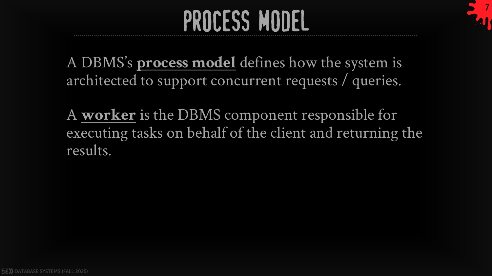

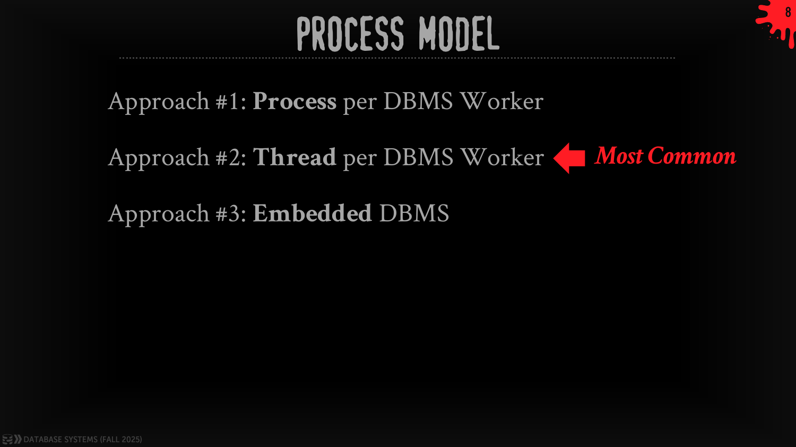

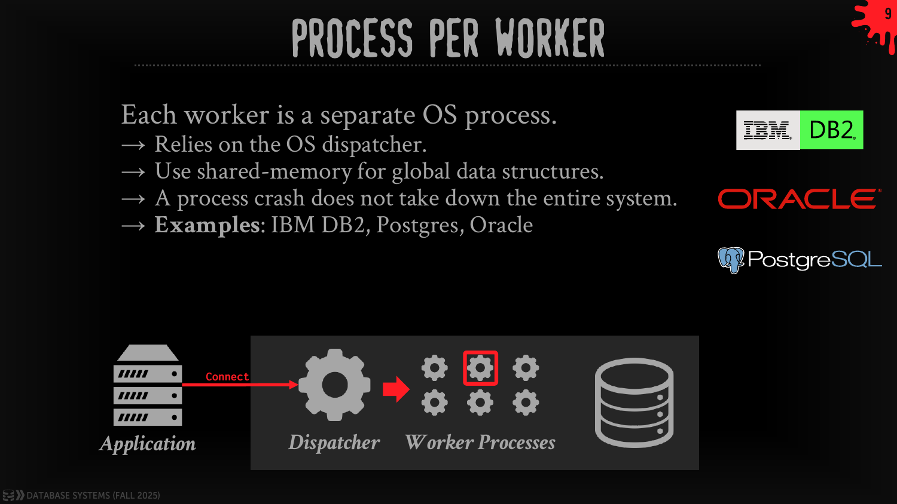

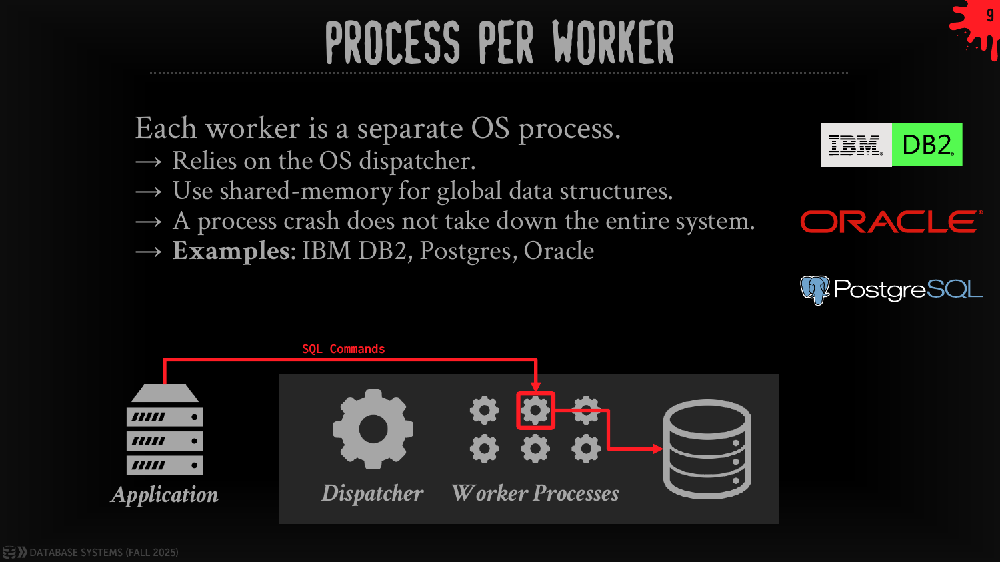

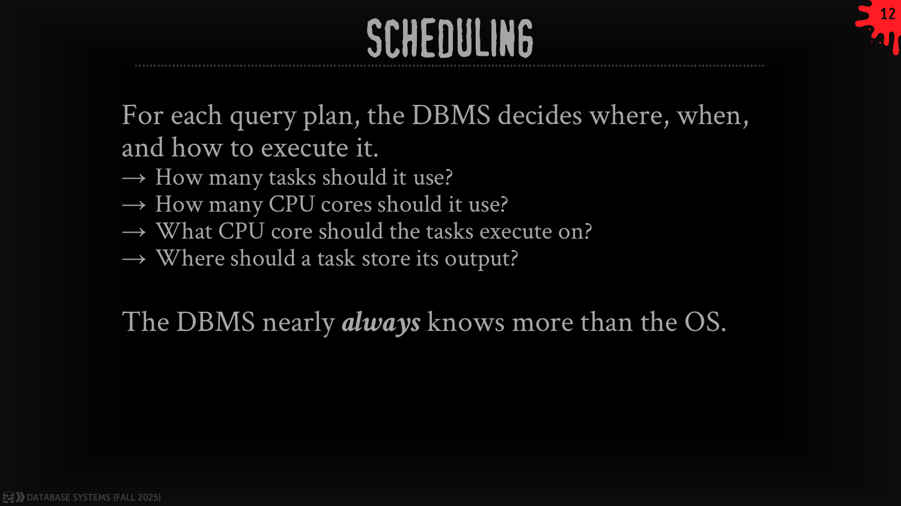

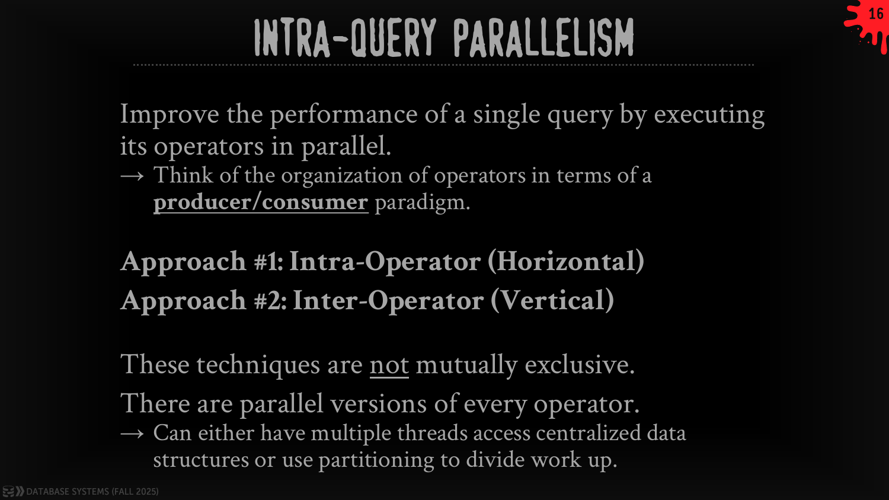

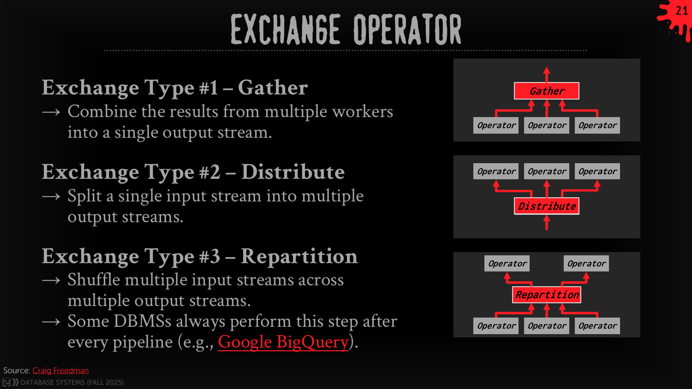

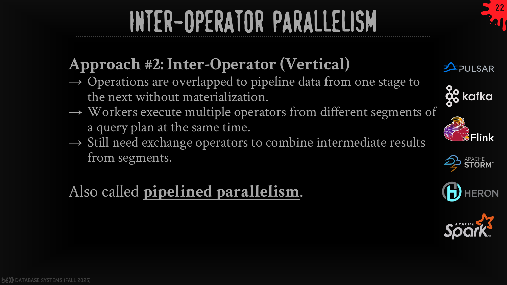

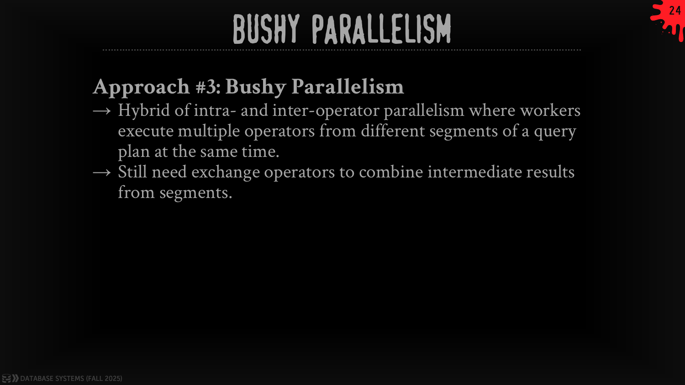

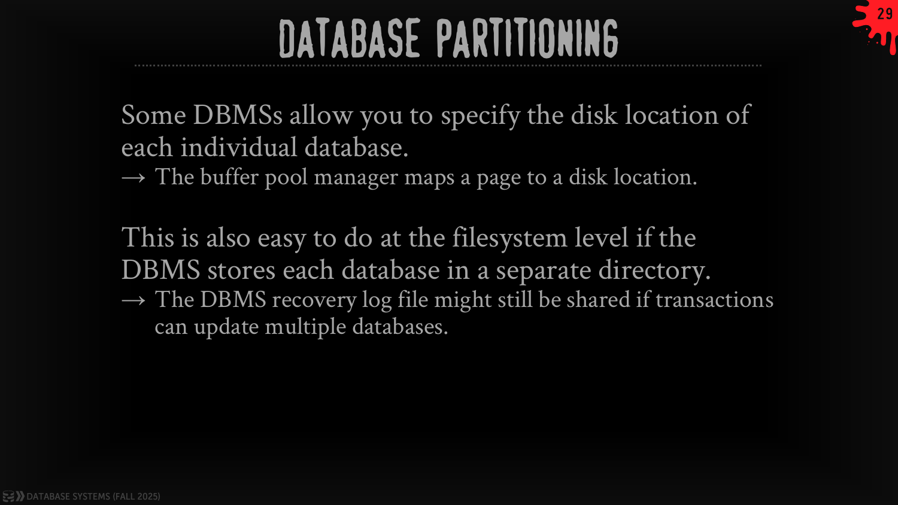

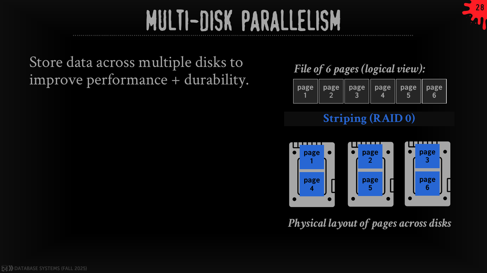

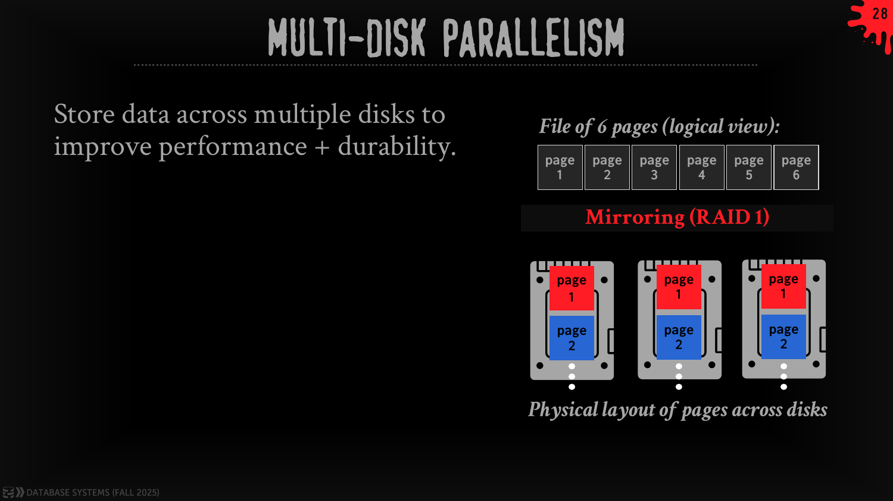

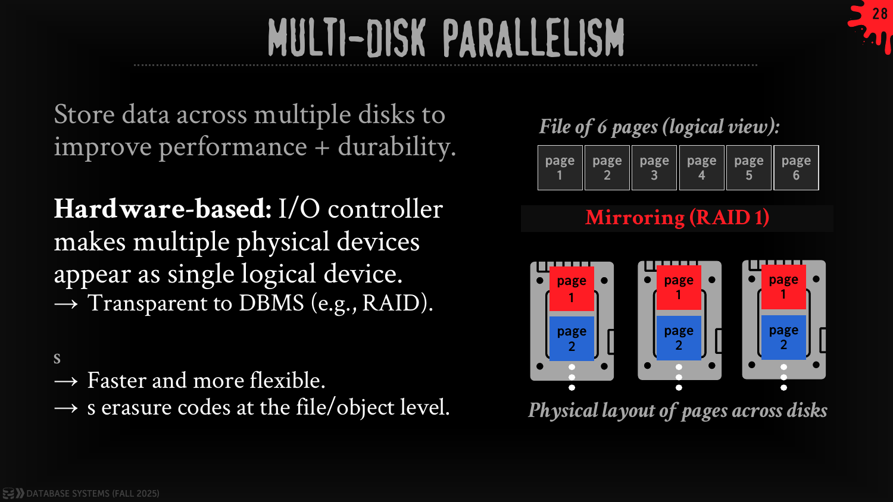

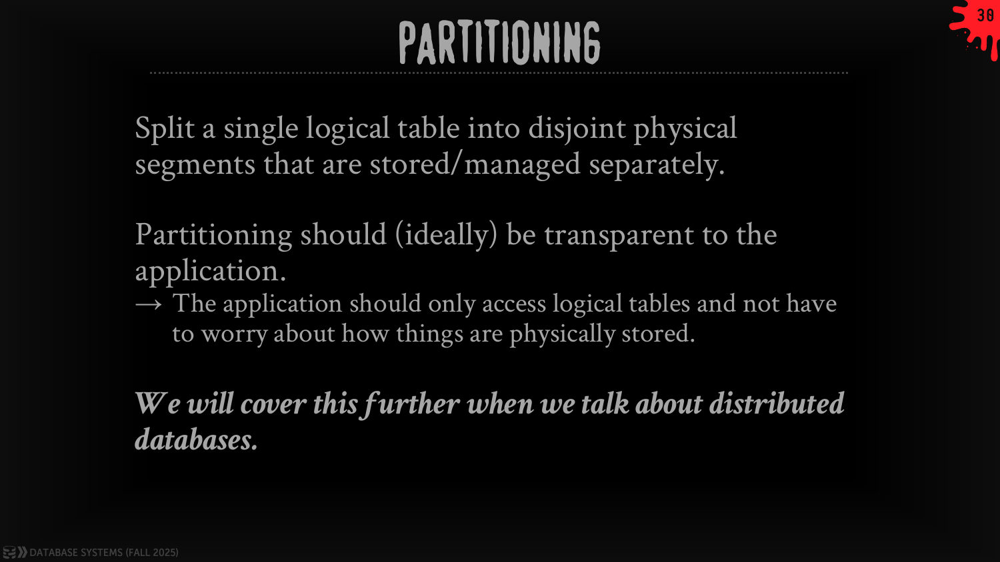

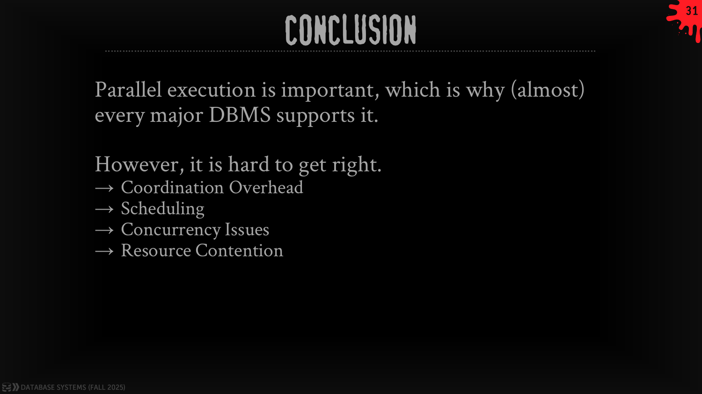

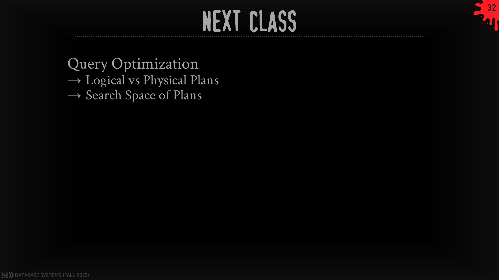

<details>
<summary>📎 本讲未被 📍 标注的幻灯片（共 3 页：封面、目录与行政页）</summary>

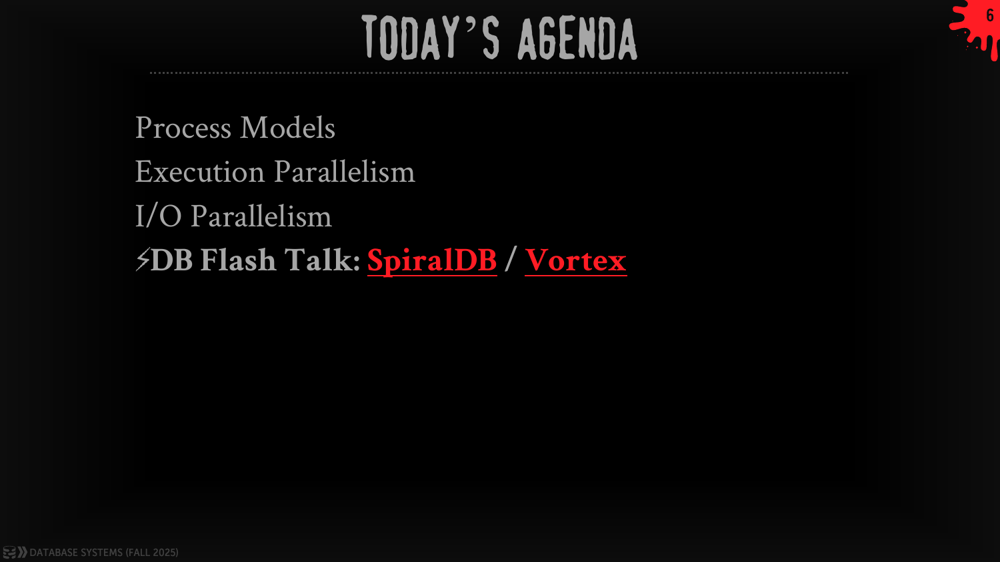

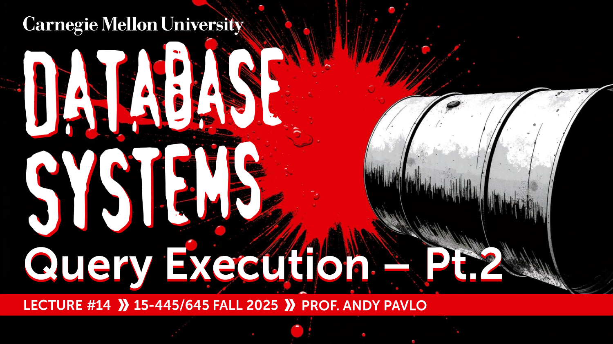


</details>
