# CMU 15-445 第 [17](index.md) 讲：并发控制理论（Concurrency Control Theory）

> **课程**：CMU 15-445/645 Database Systems（Fall 2025）· **主讲**：Andy Pavlo  
> **课程主页**：[CMU 15-445/645 · Fall 2025](https://15445.courses.cs.cmu.edu/fall2025/)  
> **材料**：课件 PPT（`17-concurrencycontrol.pdf`）、官方 Lecture Notes（`N17-concurrencycontrol.pdf`）、课堂录音转写稿  
> **说明**：正文以 PPT 与 Lecture Notes 为准。讲者原话的中文为意译，英文原文见脚注，依据课堂录音转写整理，已修正明显的语音识别错误。文中“📍 PPT 第 X 页”指幻灯片右上角印的编号，动画分步页共用编号。

## 摘要（Abstract）

[数据库](#数据库)能够正确执行一条 SQL，还不足以保证一笔业务正确。两个付款程序各自读到 100 美元，再各自写回 75 美元，就会丢掉一次扣款；转账写到一半时机器崩溃，也可能留下只有一边账户更新的状态。[事务](#事务)把相关操作组织成一个整体，用[原子性](#原子性)、[一致性](#一致性)、[隔离性](#隔离性)和[持久性](#持久性)描述系统应承担的责任。

[日志](#日志)与[影子分页](#影子分页)解决修改如何[撤销](#撤销)、成功结果如何恢复，并发控制则决定多个[事务](#事务)能怎样交错。把所有[事务](#事务)串行执行容易保证隔离，却浪费并行机会；[可串行化](#可串行化)允许交错，只要求执行效果等价于某个串行顺序。将[冲突](#冲突)读写的先后要求画成[依赖图](#依赖图／优先图)，图中无环就能得到一个[冲突等价](#冲突等价)的串行顺序；有环时，还需要分清它否定的是[冲突可串行化](#冲突可串行化)，还是更宽的正确性概念。

读完后，应能完整解释[丢失更新](#丢失更新)、[不可重复读](#不可重复读)和[脏读](#脏读)，计算转账与计息交错的结果，为给定调度建立[依赖图](#依赖图／优先图)并求出串行顺序，也能用读取来源和最终写入者检验[盲写](#盲写)例子的[视图等价](#视图等价)。更重要的是，能够区分三个容易混淆的问题：结果是否恰好相同、读写调度是否[可串行化](#可串行化)，以及[提交](#提交)与[回滚](#回滚)是否安全。

## 课程地图

从第 [17](index.md) 讲开始，课程进入并发控制阶段：已经能够读写数据、执行查询的系统，还需要保证多个用户同时操作以及机器中途崩溃时，数据依然可信。
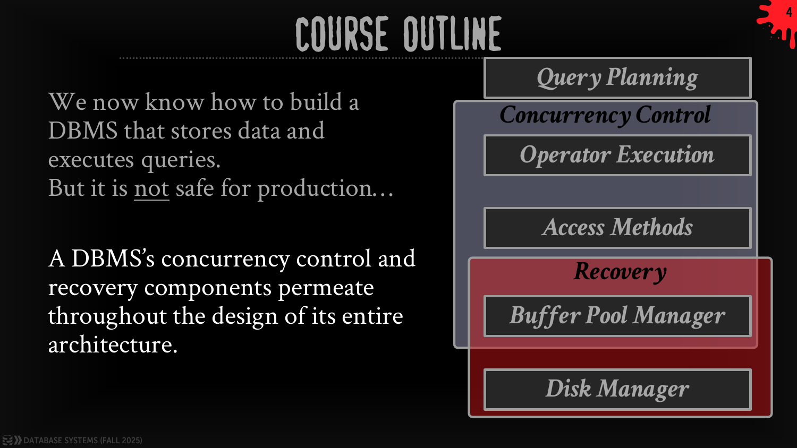


第 [3](../L03/index.md)、[4](../L04/index.md) 讲解决了[页](#页)的组织与[缓冲池](#缓冲池)管理，第 [7](../L07/index.md)、[8](../L08/index.md)、[9](../L09/index.md)、[10](../L10/index.md) 讲建立了[访问方法](#访问方法)，第 [11](../L11/index.md)、[12](../L12/index.md)、[13](../L13/index.md)、[14](../L14/index.md)、[15](../L15/index.md)、[16](../L16/index.md) 讲把 SQL 一路变成可执行的[查询计划](#查询计划)。这条路径已经完整，但它还没有回答：两笔转账能否同时修改同一个账户？一笔转账只写出了一半，机器就断电，该保留什么？并发控制与恢复会深入已有的各层，例如限制执行器何时能访问一条记录，也限制缓冲池何时能把[脏页](#脏页)写回磁盘。
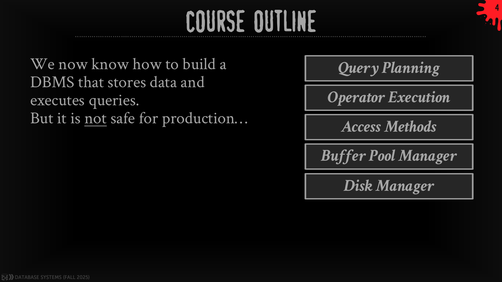


第 [10](../L10/index.md) 讲的[闩](#闩)（latch）保护[索引](#索引)内部结构的一次短操作；这里开始保护的是一次业务操作跨越多条读写的整体含义。第 [18](../L18/index.md) 讲的两阶段锁、第 [19](../L19/index.md) 讲的时间戳排序与[乐观并发控制](#乐观并发控制)、第 [20](../L20/index.md) 讲的多版本并发控制，都需要以本讲的正确性标准为依据。第 [21](../L21/index.md)、[22](../L22/index.md) 讲再把[事务](#事务)的承诺延伸到崩溃之后，第 [23](../L23/index.md)、[24](../L24/index.md) 讲延伸到多台机器。

## 1. 从一笔付款看[数据库](#数据库)还缺什么

📍 *PPT 第 4–9 页*

### 1.1 每个读写都成功，整笔业务仍然可能失败

📍 *PPT 第 5–6 页*

账户 A 中有 100 美元，需要支付 25 美元。应用读取余额，检查余额是否大于 25 美元，完成付款，再把余额减去 25，写回 75 美元。只看单次执行，这段程序很容易理解。困难藏在它执行了一半的时候。

假如收款方已经入账，而付款方的余额还没写回，系统就崩溃了，[数据库](#数据库)会留下“付了钱，余额却没减少”的状态。如果两边账户都由同一个数据库管理，就应当把它们的修改视为一个整体：成功时两边都更新，失败时两边都不留下这次修改。
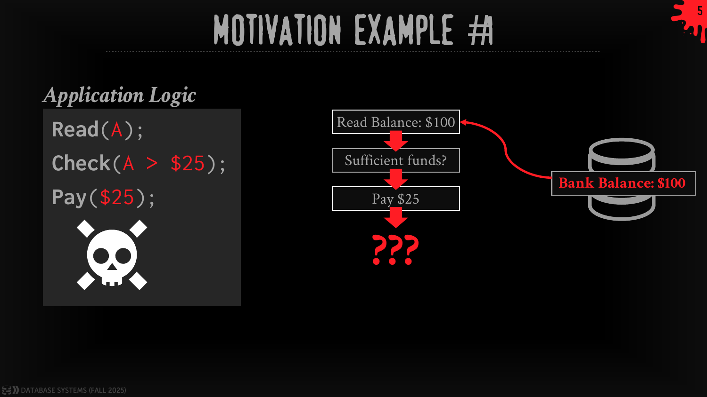


机器不崩溃，也可能出错。假设两次付款同时从 A 支付 25 美元，它们都在对方写回之前读到了 100：

| 时间 ↓ | 付款 T₁ | 付款 T₂ | [数据库](#数据库)中的 A |
|---|---|---|---|
| 1 | 读取 A，得到 100 | | 100 |
| 2 | | 读取 A，得到 100 | 100 |
| 3 | 检查通过，支付 25；在本地算出 75 | | 100 |
| 4 | | 检查通过，支付 25；在本地算出 75 | 100 |
| 5 | 写回 75 | | 75 |
| 6 | | 写回 75 | 75 |

实际付出了 50 美元，余额却只减少了 25。两个写操作都成功，第二次写入甚至与第一次写入的数值完全相同，但一次扣款的效果消失了。这是**[丢失更新](#丢失更新)（Lost Update）**：一个[事务](#事务)的更新效果被另一个[事务](#事务)覆盖。
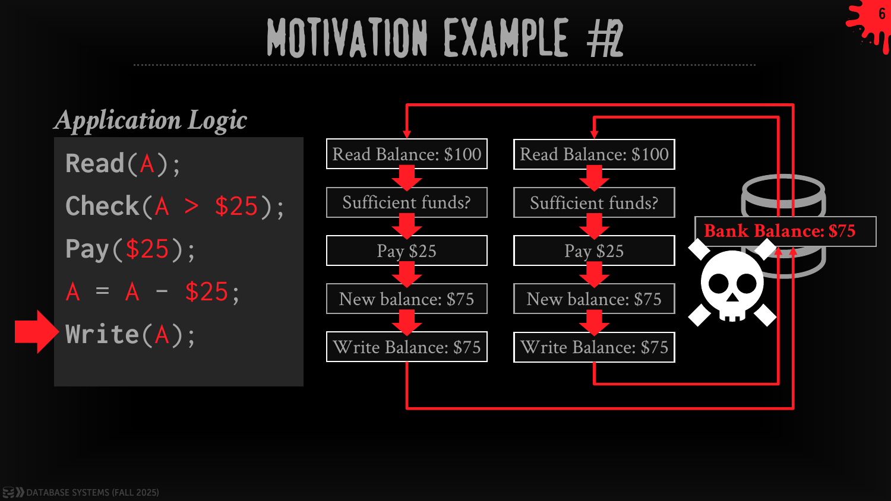


问题出在“读到余额”和“根据余额写回”之间还有一段时间。即使[数据库](#数据库)保证一次读取或一次写入不会读到半个整数，也无法保证这整段业务操作正确。需要扩大保护的范围。

**[事务](#事务)（Transaction）是一组为完成某个业务功能而执行的[数据库](#数据库)操作，也是数据库对修改作出整体承诺的单位。** 一次付款可以包含多条 SQL；一条 SQL 也可以独自构成[事务](#事务)。我们关心的是这组操作的完整效果，而不只是每条语句能否运行。

### 1.2 一个正确但昂贵的起点：排队，再复制[数据库](#数据库)

📍 *PPT 第 7–8 页*

可以先构造一个容易推理的系统：所有[事务](#事务)排队，每次只执行一个；[事务](#事务)开始前复制整个[数据库](#数据库)，只修改副本。成功后把副本变成正式数据库，失败时丢弃副本。

排队消除了[事务](#事务)之间的交错，副本保留了失败之前的完整状态。这两个设计恰好分别应对[并发](#并发)和中途失败。不过，最后“把副本变成正式[数据库](#数据库)”必须是可靠的原子切换。逐页把副本复制回原文件，中途仍然可能崩溃，问题就又回来了。可行的思路是先持久保存新数据，再原子地切换一个指向完整版本的入口；具体持久化要求会在第 [21](../L21/index.md) 讲展开。

这个方案的成本也很直观：改动一条记录可能要复制整个[数据库](#数据库)，后面的[事务](#事务)还必须等待前面的[事务](#事务)结束。即使只复制修改过的[页](#页)，单个[事务](#事务)等待磁盘或网络时，其他工作也无法利用空闲资源。

第 [14](../L14/index.md) 讲讨论过并行查询执行；[事务](#事务)之间同样存在利用多核处理器和重叠 I/O 的机会。**[并发](#并发)（Concurrency）**表示多个[事务](#事务)的执行在时间上重叠；它们可以在单核上交替推进，也可以在多核上真正同时运行。允许[并发](#并发)有望提高吞吐量，减少排队等待，但还要照顾**[公平性](#公平性)（Fairness）**，避免某个[事务](#事务)始终得不到资源，陷入**[饥饿](#饥饿)（Starvation）**。

正确性为这些优化划定了范围。Andy 的建议是：“先把系统做正确，再设法在不放松正确性保证的前提下优化它。”[^andy-correctness] [数据库](#数据库)一旦把错误结果作为成功返回，之后补一个更快的实现，无法替用户找回已经丢失的业务事实。

### 1.3 中间状态可以暂时不完整，但不能成为最终事实

📍 *PPT 第 9 页*

转账需要先改一个账户，再改另一个账户。两次修改之间，钱可能暂时只从一边扣除，另一边还没有增加。这种临时不一致难以避免，因为两个独立对象通常无法靠一条机器指令一起修改。

[事务](#事务)机制应当把这种中间状态限制在安全范围内：不能让它变成一个成功[提交](#提交)的残缺结果，也不能在崩溃恢复后永久留下它。[并发](#并发)执行时，还要控制其他[事务](#事务)如何观察这些修改，防止其他[事务](#事务)拿着中间状态继续计算并[提交](#提交)错误结果。

保护范围有一个实际边界：[数据库](#数据库)只能[撤销](#撤销)自己管理的数据。[事务](#事务)执行期间发出了一封邮件，之后即使数据库[回滚](#回滚)，邮件也不会自动消失。同理，如果“付款”调用的是另一个独立的外部服务，单个数据库的[事务](#事务)就不能包办那个服务的[回滚](#回滚)。前面的账户例子以相关账户都处于同一[事务](#事务)管理范围内为前提；跨系统协作需要额外机制。

## 2. 用[事务](#事务)和 ACID 说明系统承诺什么

📍 *PPT 第 10–13、16–17、45–47 [页](#页)*

### 2.1 先把应用程序抽象成读写序列

📍 *PPT 第 10 页*

为了研究交错顺序，可以暂时忘记对象的物理布局，把[数据库](#数据库)视为一个固定的命名对象集合：A、B、C……。对象可以是一条[属性](#属性)、一个[元组](#元组)、一[页](#页)或一张表；在一次分析里，先选定同一种粒度，不把父子对象重叠访问的问题混进来。
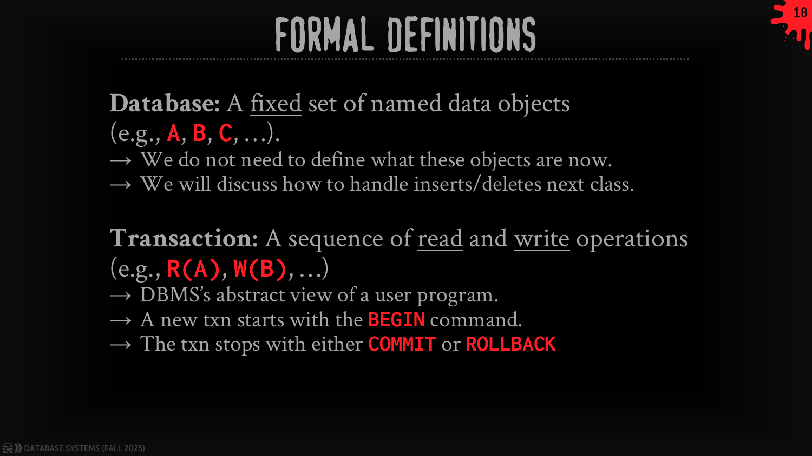


对象集合固定，意味着这里先处理已经存在的对象，不处理插入和删除。这个缺口要到第 [19](../L19/index.md) 讲的谓词锁与索引锁才补上，那里会说明查询一个范围时，新插入的对象为什么也必须纳入保护。

[事务](#事务)则写成读写操作的序列：`R₁(A)` 表示 T₁ 读取 A，`W₁(A)` 表示 T₁ 写入 A。读取把[数据库](#数据库)中的值交给[事务](#事务)；计算可以发生在应用的本地变量里，直到写入才改变数据库。比如 `A = A - 100`，在这种模型里拆成读取 A、本地减法、写回 A，其中真正影响[并发](#并发)关系的是读与写。

这个抽象很像观察一段 C 程序如何访问[共享内存](#共享内存)：先记下它读取和写入了哪些位置，再研究不同执行顺序。[数据库](#数据库)并不需要知道某个整数代表余额还是库存，才能发现两个[事务](#事务)都在改它。

### 2.2 开始、提交与中止：[事务](#事务)边界由应用指定

📍 *PPT 第 10、13 页*

应用通常用 `BEGIN` 开始[事务](#事务)，用 `COMMIT` 请求[提交](#提交)，用 `ROLLBACK` 主动[回滚](#回滚)。**[提交](#提交)（Commit）**表示[事务](#事务)成功完成，系统接受它的整体修改；**[中止](#中止)（Abort）**表示[事务](#事务)不能成功完成，需要取消其修改。**[回滚](#回滚)（Rollback）**是[撤销](#撤销)这些修改的过程，也常用来指发起[撤销](#撤销)的命令。

```sql
BEGIN;
UPDATE accounts SET balance = balance - 100 WHERE id = 'A';
UPDATE accounts SET balance = balance + 100 WHERE id = 'B';
COMMIT;
```

这里假设 A、B 两个账户存在，其他业务条件也已经满足。两条更新应当共同成功或共同[撤销](#撤销)；如果应用把它们划成两个独立[事务](#事务)，[数据库](#数据库)就只能分别保证每一个[事务](#事务)。

发出 `COMMIT` 是请求，不保证请求一定成功。应用可以因为余额不足而[中止](#中止)，[数据库](#数据库)也可以因为[并发](#并发)[冲突](#冲突)、约束失败等原因拒绝[提交](#提交)。应用必须能处理[事务](#事务)失败，再根据业务决定是否重试；自动重试尤其不能把外部付款、发送邮件等副作用重复执行一遍。

只有一条 SQL 也可能[中止](#中止)。开启**[自动提交](#自动提交)（Autocommit）**时，每条独立语句通常构成一个隐式[事务](#事务)，可以理解为系统为它补上开始和结束。单条语句仍可能修改多行、遭遇[冲突](#冲突)或违反约束，因此它同样需要[事务](#事务)保证。

### 2.3 ACID 的四个字母分别约束什么

📍 *PPT 第 11–13、16–17、45–47 [页](#页)*

**[原子性](#原子性)（Atomicity）**要求[事务](#事务)的操作作为一个整体生效：要么全部成功，要么不留下这次[事务](#事务)的修改。它承诺的是应用看到的结果；内部完全可以先做一部分工作，再通过[撤销](#撤销)实现“没有做过”的效果。


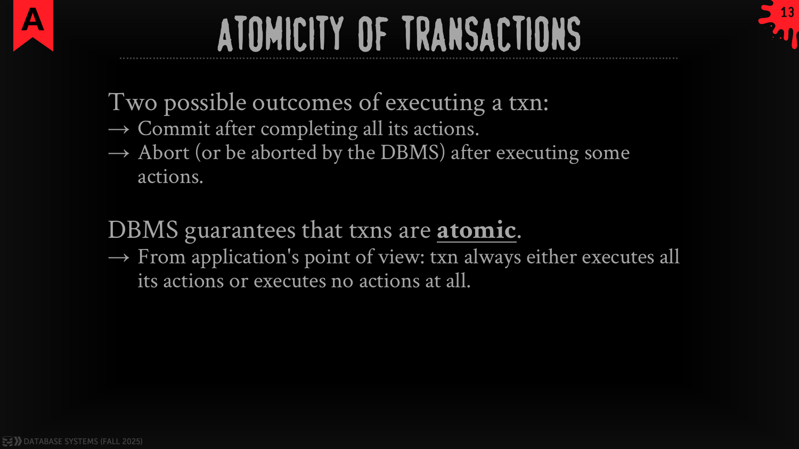


**[一致性](#一致性)（Consistency）**要求[事务](#事务)把一个满足规则的[数据库](#数据库)状态变成另一个满足规则的状态。这里有一个必要前提：[事务](#事务)本身正确表达了业务规则。数据库可以保证完整执行一段程序，却不能把错误的业务程序自动改正确。

**[隔离性](#隔离性)（Isolation）**约束[并发](#并发)[事务](#事务)如何相互影响。以完整的[可串行化](#可串行化)目标来说，每个[事务](#事务)都应当能够按“其他[事务](#事务)在它之前或之后完整执行”来理解自己的执行，而不必推演任意交错造成的中间状态。第 [18](../L18/index.md) 讲先给出两阶段锁，隔离级别要到第 [19](../L19/index.md) 讲第 8 节才展开。
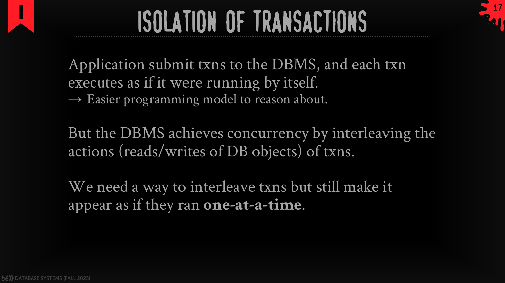


**[持久性](#持久性)（Durability）**要求已经成功[提交](#提交)的修改在系统崩溃、重启之后仍然成立。内存里的结果会随断电消失，因此系统必须在宣布[提交](#提交)成功之前，把足够的恢复依据保存到不会因普通断电丢失的存储中。若连存储设备也损毁，就要依靠额外的副本或备份，这会把问题带到分布式系统。
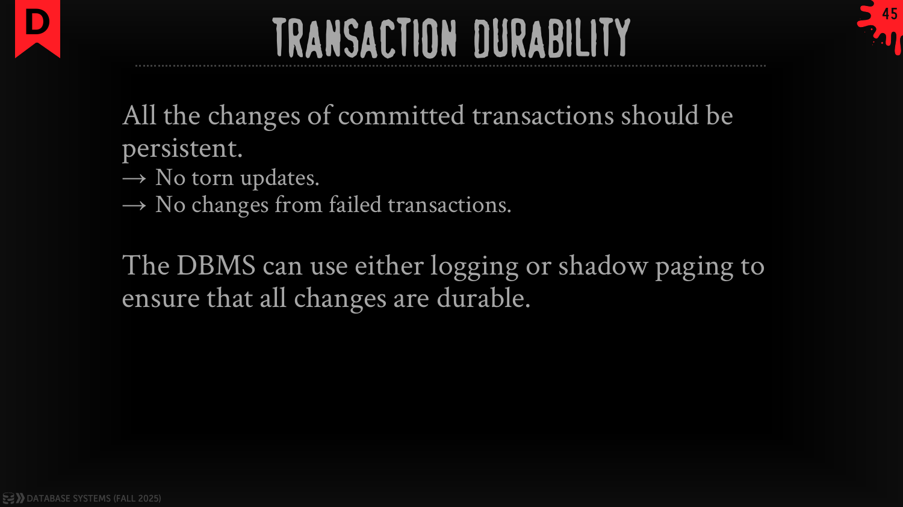


把这四项放回转账例子，区别就很清楚：[原子性](#原子性)管两边能否一起完成；[一致性](#一致性)管转账是否遵守余额和金额规则；[隔离性](#隔离性)管其他转账或查询会怎样观察它；[持久性](#持久性)管已经承认成功的转账能否经受重启。

### 2.4 一致性需要业务规则，复制一致性还有另一层含义

📍 *PPT 第 16 页*

[数据库](#数据库)只知道 `age` 是整数，无法自行推断它不应为负。应用要把这种规则明确表达出来，例如：

```sql
CREATE TABLE people (
    id INTEGER PRIMARY KEY,
    age INTEGER NOT NULL CHECK (age >= 0)
);
```

[主键](#主键)、[外键](#外键)、`NOT NULL`、`CHECK` 等完整性约束在前面的[关系模型](#关系模型)与 SQL 中已经出现过。[事务](#事务)的[一致性](#一致性)承诺，要与这些已声明的约束以及应用自身维护的业务不变量共同理解。是否允许临时违反某项约束，还取决于它何时检查；[事务](#事务)模型允许存在中间状态，不等于每个[数据库](#数据库)都会把所有约束检查推迟到[提交](#提交)时。
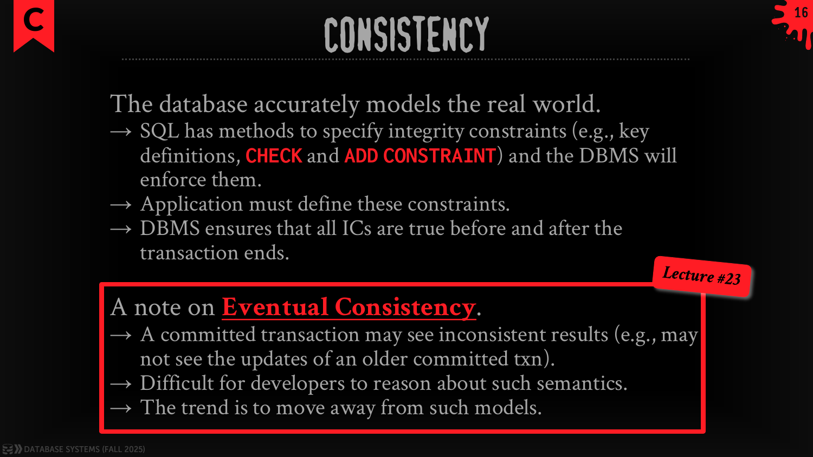


分布式系统里的**[最终一致性](#最终一致性)（Eventual Consistency）**则谈的是副本传播：一个节点接受修改后，另一个节点可能暂时仍返回旧值；在不再出现新修改且更新传播完成后，副本最终收敛。例如，刚在一个节点更新资料，立即去另一个节点读取，却看见更新前的内容。

这与 ACID 中“是否满足业务规则”的[一致性](#一致性)有关联，但并非同一个定义。前者主要讨论多份数据在什么时候对外呈现什么值，后者讨论[事务](#事务)前后的状态是否合法。Andy 对[最终一致性](#最终一致性)的主要批评，是它把处理陈旧读和跨节点时序的负担交给了应用程序；这个取舍将在第 [23](../L23/index.md)、[24](../L24/index.md) 讲展开。

## 3. [事务](#事务)做了一半，怎样撤销或恢复

📍 *PPT 第 13–15、45 页*

### 3.1 日志：留下足够的信息，才能重建正确状态

📍 *PPT 第 13–14 页*

[回滚](#回滚)需要知道已经改了什么。**[日志](#日志)（Logging）**让[数据库](#数据库)按照一定顺序记录修改及恢复所需的信息。这里的[日志](#日志)承担恢复责任，与随手打印调试信息的文本日志不同。它也与第 [5](../L05/index.md) 讲[日志结构存储](#日志结构存储)的“顺序追加”思路有关，但二者解决的问题不完全相同。
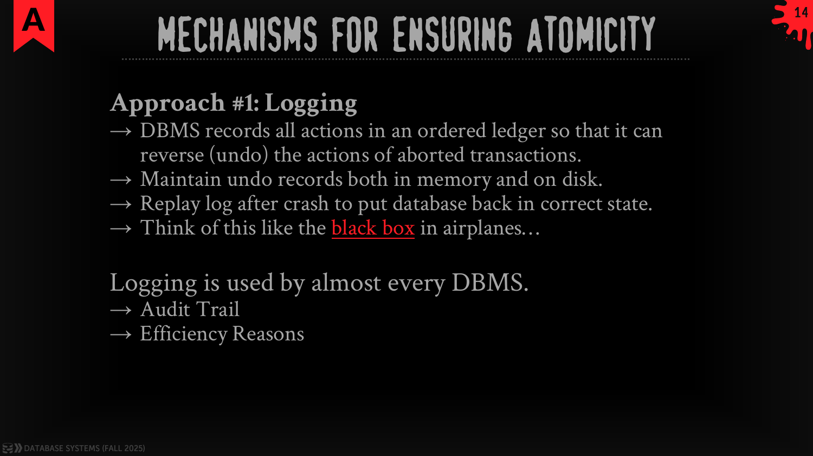


**[撤销](#撤销)（Undo）**取消一个未成功[事务](#事务)的修改；**[重做](#重做)（Redo）**重新施加应当保留、但尚未完整进入数据文件的修改。例如，把余额从 100 改为 75，记录旧值 100 可以帮助[撤销](#撤销)，记录新值 75 可以帮助[重做](#重做)。实际[日志](#日志)未必都完整保存新旧记录，采用何种形式取决于恢复算法。

[日志](#日志)可以记录 SQL、操作，也可以记录数据本身。记录页面中哪些字节变了，可以直接修复相应位置；记录某个逻辑操作，则需要重新执行它。**[生理日志](#生理日志)（Physiological Logging）**把页面定位与[页](#页)内逻辑操作结合起来。如果一个耗时很长的聚合最后只写出一个结果，记录结果修改可能避免在恢复时重算整个聚合；重放查询则必须解决读取状态、执行顺序和非确定性等问题。第 [21](../L21/index.md) 讲会区分这些形式。

[缓冲池](#缓冲池)（buffer pool，见第 [4](../L04/index.md) 讲）原本只需考虑页面是否脏、是否能淘汰；加入[事务](#事务)后，还要考虑恢复记录有没有先保存。**[预写日志](#预写日志)（Write-Ahead Log，WAL）**的关键顺序是：修改后的数据[页](#页)写入持久存储之前，对应的[日志](#日志)记录必须先持久化。数据可以先在内存中修改，WAL 并不要求每改一个内存字节都立即访问磁盘。

```text
修改缓冲池中的页，并产生恢复日志
                |
                v
先把相应日志持久化
                |
                v
再允许把修改后的页写入数据文件
```

如果先把新数据写出去，却没有留下恢复依据，崩溃后就可能既不知道旧值是什么，也不知道这些修改属于哪个未完成[事务](#事务)。先保存[日志](#日志)，为恢复保留了判断和修复的依据。顺序追加[日志](#日志)还可以把许多零散修改的恢复记录集中写出，降低正常运行时的 I/O 成本。

[日志](#日志)也能提供操作追踪线索，但恢复[日志](#日志)与长期业务审计不是完全相同的需求：恢复记录可能被回收，审计系统还需要自己的保留策略。

### 3.2 日志已经写出，并不等于[事务](#事务)已经提交

📍 *PPT 第 14、45 页*

大[事务](#事务)可能修改的数据远远超过内存容量，[数据库](#数据库)不能一直把所有[脏页](#脏页)和[日志](#日志)留在内存里等到最后。因此，[事务](#事务)结束之前，部分[日志](#日志)和部分数据[页](#页)就可能已经进入磁盘。

恢复时要区分两类事实：哪些修改有持久记录，哪些[事务](#事务)已经获得持久的[提交](#提交)决定。前者不能替代后者。按照具体恢复算法，系统会补齐成功[事务](#事务)应保留的修改，并消除失败[事务](#事务)不应留下的修改；某些算法还会先[重做](#重做)历史，再[撤销](#撤销)未完成[事务](#事务)。

| 崩溃时的情况 | 恢复要保证的结果 |
|---|---|
| [修改日志](#修改日志)已持久化，数据[页](#页)尚未写出，[事务](#事务)也未[提交](#提交) | 不能仅凭[日志](#日志)存在就把[事务](#事务)认作成功 |
| 成功[提交](#提交)的依据已持久化，部分数据页尚未写出 | 可以利用[日志](#日志)补齐应当保留的修改 |
| 未[提交](#提交)[事务](#事务)的部分修改已进入数据页 | 必须消除这些不应留下的修改 |
| [数据库](#数据库)已[提交](#提交)，但成功回复尚未到达客户端 | [事务](#事务)可能已成功；客户端没有收到回复，不代表[事务](#事务)已失败 |

最后一种情况把[数据库](#数据库)状态与客户端知识区分开了。数据库可以确定自己已经[提交](#提交)，客户端却只看见连接中断。此时应用需要查询业务状态，或通过能识别重复请求的设计处理重试，不能仅因“没收到回复”就再执行一次不可重复的业务。

[日志](#日志)也不能无限回放。**[检查点](#检查点)（Checkpoint）**记录恢复进度所需的状态，使系统不必每次从最早的[日志](#日志)开始恢复。若每做一次[检查点](#检查点)就暂停所有[事务](#事务)，[检查点](#检查点)本身会变成停机操作；**[模糊检查点](#模糊检查点)（Fuzzy Checkpoint）**允许[事务](#事务)在[检查点](#检查点)期间继续运行，代价是恢复时必须处理跨越[检查点](#检查点)的[事务](#事务)。第 [22](../L22/index.md) 讲的 ARIES 算法会把这些情况系统地连接起来。

### 3.3 影子分页：保留旧版本，把恢复工作提前到运行时

📍 *PPT 第 7、15 页*

开头复制[数据库](#数据库)的思路，可以细化为**[影子分页](#影子分页)（Shadow Paging）**：保留已[提交](#提交)的旧页面，让[事务](#事务)在页面副本上修改；成功[提交](#提交)时，再切换到能找到完整新版本的入口。[事务](#事务)失败时，旧版本仍然有效，未[提交](#提交)的新页面可以被忽略或回收。
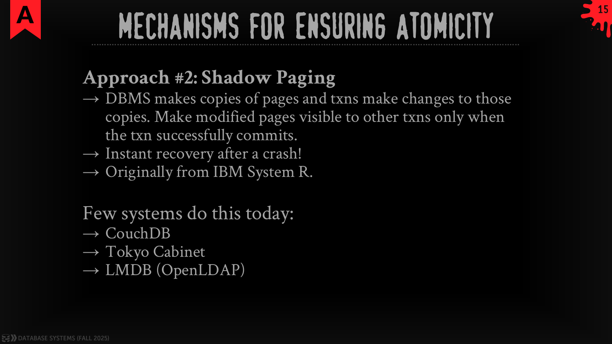


这里不必把每个字节都原地改回去，恢复路径因而很短。但“切换入口”要求新页面先可靠保存，入口切换本身也必须能经受崩溃。它不是随意改一个内存指针就获得了[持久性](#持久性)。

| 比较维度 | [日志](#日志)方案 | [影子分页](#影子分页)方案 |
|---|---|---|
| 正常修改时 | 记录恢复信息，通常适合顺序追加 | 复制修改涉及的[页](#页)，并维护新的页面关系 |
| 失败后的处理 | 按恢复算法[重做](#重做)或[撤销](#撤销)相关修改 | 找到最后成功[提交](#提交)的版本，忽略未[提交](#提交)副本 |
| 主要代价 | [日志](#日志)写入及恢复时的分析、重放 | 运行时的复制、页面管理与版本切换 |
| 核心取舍 | 让常态[事务](#事务)处理高效，承担相应恢复工作 | 用运行时的维护成本换取简单、快速的恢复 |

在简单的单写者实现中，[影子分页](#影子分页)可以不再为同一目的额外写恢复[日志](#日志)，减少一类写入；但这不保证总 I/O 更少，因为复制页面和维护入口本身也要写数据。开头的示范系统还强制所有[事务](#事务)串行，这是一项额外限制，不能把它直接当成所有[影子分页](#影子分页)实现的共同定义。

IBM System R 曾采用这一思路，CouchDB、Tokyo Cabinet 和 LMDB 也是相关实例。Andy 对通用[数据库](#数据库)的设计取向明显偏向[日志](#日志)：系统大部分时间在正常处理[事务](#事务)，应优先优化常态成本，再用[检查点](#检查点)等机制缩短恢复。若业务特别看重频繁故障后的恢复速度，权衡可能不同；“恢复很快”与“平时运行很快”需要分别衡量。

[原子性](#原子性)与[持久性](#持久性)因此紧密相连：同一套恢复机制既要清除未完成[事务](#事务)，又要保住已[提交](#提交)[事务](#事务)。不过，恢复正确仍然不能阻止两个成功[事务](#事务)相互覆盖。接下来要解决的是，系统活着的时候，该允许哪些交错。

## 4. 并发执行怎样才算“像独自运行”

📍 *PPT 第 17–29 页*

### 4.1 先求出串行执行允许出现的结果

📍 *PPT 第 19–23 页*

设 A、B 两个账户最初各有 1,000 美元。T₁ 从 A 向 B 转账 100 美元，T₂ 为两个账户各增加 6% 的利息。

| T₁：转账 | T₂：计息 |
|---|---|
| `BEGIN` | `BEGIN` |
| `A = A - 100` | `A = A * 1.06` |
| `B = B + 100` | `B = B * 1.06` |
| `COMMIT` | `COMMIT` |

这张表列的是两个[事务](#事务)各自的程序，不表示两列按行同时执行。后面的调度表才规定时间顺序。
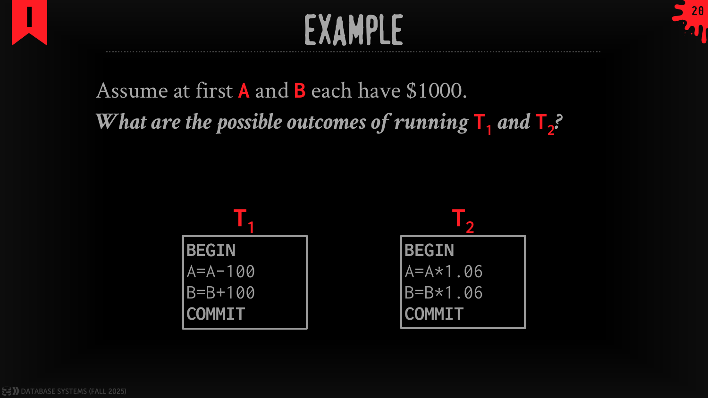


让一个[事务](#事务)完整执行结束，再执行另一个[事务](#事务)，称为**[串行调度](#串行调度)（Serial Schedule）**。这里只有两个[事务](#事务)，因此串行顺序只有两种。

先转账，再计息：

```math
A = (1000-100)\times 1.06 = 954
```

```math
B = (1000+100)\times 1.06 = 1166
```

先计息，再转账：

```math
A = 1000\times 1.06-100 = 960
```

```math
B = 1000\times 1.06+100 = 1160
```

两种顺序的总额都是 `2,000 × 1.06 = 2,120`，但各账户余额不同。原因是转账改变了那 100 美元应当在哪个账户获得 6 美元利息。两种结果都可以合法：`(954, 1166)` 或 `(960, 1160)`。[数据库](#数据库)不需要把它们强行变成同一个结果。

由此得到的正确性目标是：[并发](#并发)执行的效果应当对应某一个串行顺序。总额为 2,120 是这个例子中有用的检查条件，却不足以完整描述正确性；随意造出另一对总和为 2,120 的余额，也不意味着它能由这两个[事务](#事务)串行执行得到。[^slide-arithmetic]
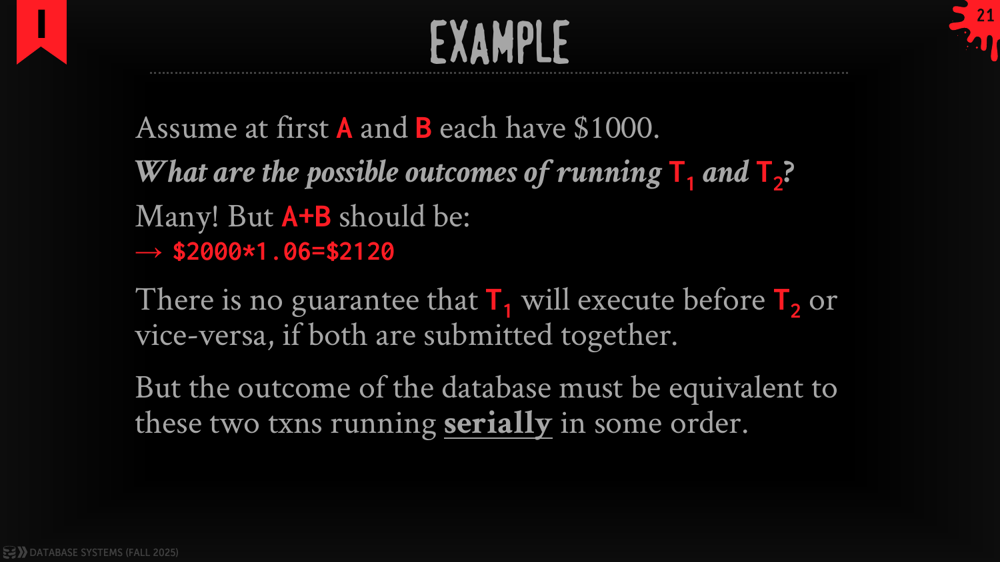


### 4.2 好的交错保留顺序，坏的交错把一笔转账拆开计息

📍 *PPT 第 24–27 页*

[事务](#事务)可能因为等待磁盘[页](#页)、网络响应或应用的下一步计算而暂停。让另一个[事务](#事务)利用这段时间，能提高资源利用率。但能否交替执行，要看它们对同一对象的作用顺序。

先看一种好的交错。为突出主要变化，表中把一次“读取、计算、写回”暂时合并为一个赋值操作；稍后再拆成读写。
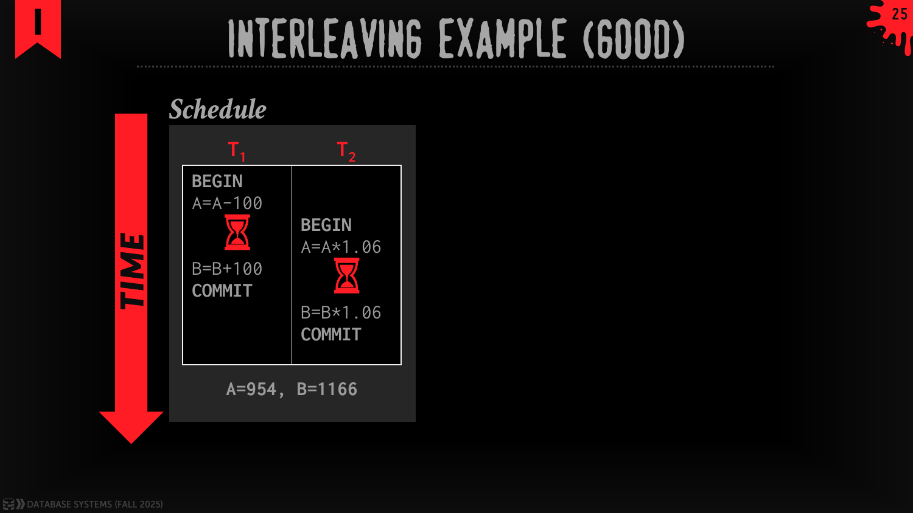


| 时间 ↓ | T₁：转账 | T₂：计息 | 当前 A | 当前 B |
|---|---|---|---|---|
| 1 | `BEGIN` | | 1000 | 1000 |
| 2 | `A = A - 100` | | 900 | 1000 |
| 3 | | `BEGIN` | 900 | 1000 |
| 4 | | `A = A * 1.06` | 954 | 1000 |
| 5 | `B = B + 100` | | 954 | 1100 |
| 6 | `COMMIT` | | 954 | 1100 |
| 7 | | `B = B * 1.06` | 954 | 1166 |
| 8 | | `COMMIT` | 954 | 1166 |

对 A 来说，T₁ 在前、T₂ 在后；对 B 也一样。因此，尽管两笔[事务](#事务)交替运行，效果仍对应 `T₁ → T₂`。第 4 步和第 5 步作用于不同对象，可以交换，而不改变彼此读取和写入的内容。
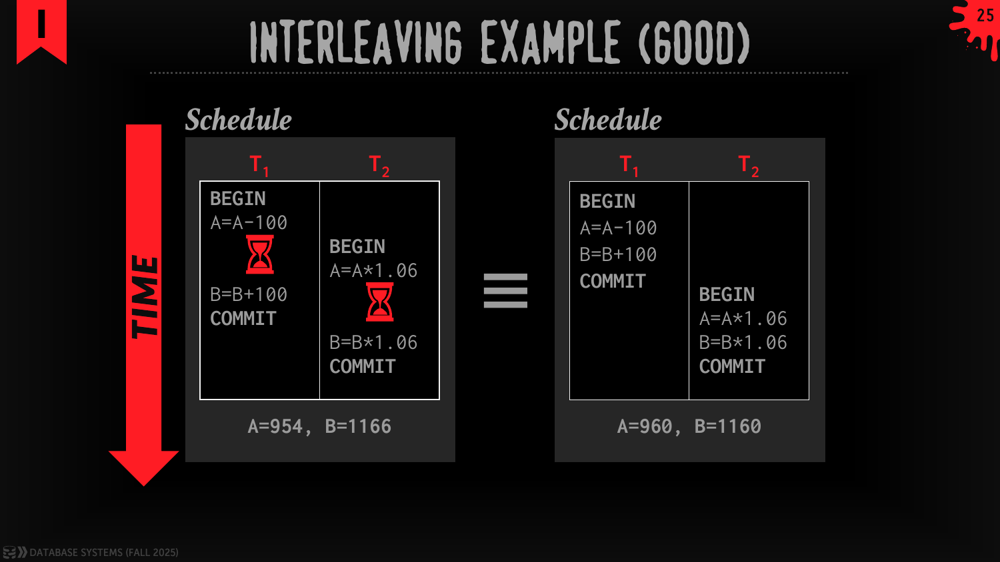

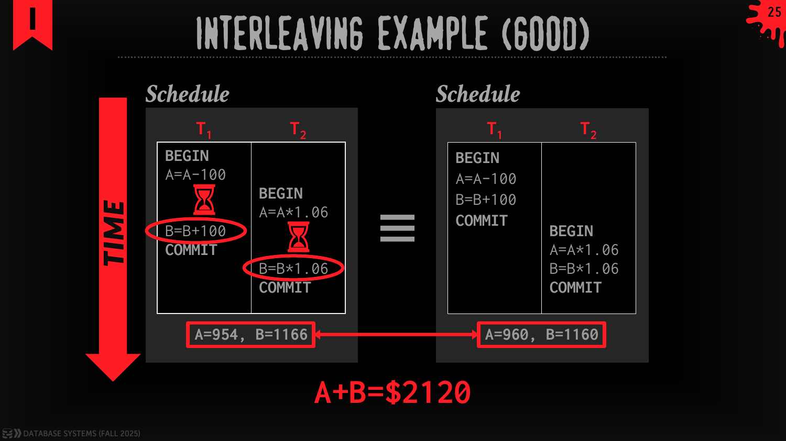


现在只把 T₂ 对 B 的计息提前：

| 时间 ↓ | T₁：转账 | T₂：计息 | 当前 A | 当前 B |
|---|---|---|---|---|
| 1 | `BEGIN` | | 1000 | 1000 |
| 2 | `A = A - 100` | | 900 | 1000 |
| 3 | | `BEGIN` | 900 | 1000 |
| 4 | | `A = A * 1.06` | 954 | 1000 |
| 5 | | `B = B * 1.06` | 954 | 1060 |
| 6 | | `COMMIT` | 954 | 1060 |
| 7 | `B = B + 100` | | 954 | 1160 |
| 8 | `COMMIT` | | 954 | 1160 |

这次得到 `(954, 1160)`，总额为 2,114 美元。转出的 100 美元已经不在 A 里，又尚未进入 B，于是两个账户计息时都没有为它计算利息，恰好少了 `100 × 6% = 6` 美元。

从顺序看，对 A 是 T₁ 在前，对 B 却是 T₂ 在前。不存在一个完整的[事务](#事务)顺序能同时满足这两个要求。错误因此超出了“算错了一个数”的层面：这段执行根本无法解释为两笔完整业务依次发生。
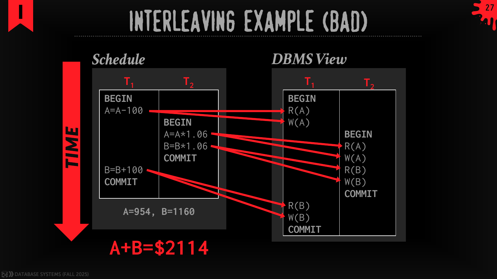


上面的好交错先只证明了读写效果可对应串行执行，它让 T₂ 在 T₁ [提交](#提交)前读到了修改。如果 T₁ 随后[中止](#中止)，还需要额外处理恢复依赖。[可串行化](#可串行化)与失败时的安全性是两项需要配合的保证，不能从其中一项直接推出另一项。

### 4.3 可串行化保留了多少调度自由

📍 *PPT 第 27–29 页*

**[执行调度](#执行调度)（Execution Schedule，简称 Schedule）**是多个[事务](#事务)的操作在[数据库](#数据库)中实际发生的顺序。它必须保留每个[事务](#事务)内部原有的操作次序，但允许不同[事务](#事务)的操作相互穿插。

**[等价调度](#等价调度)（Equivalent Schedules）**要求在所采用的等价标准下，两个调度对任意相同初始[数据库](#数据库)状态产生相同的效果。“任意”很关键：不能只挑一个恰好让错误抵消的初始值。还要关注[事务](#事务)读取到了什么；只比较最终数据文件，会漏掉只读[事务](#事务)算出错误答案的情况。接下来的[冲突等价](#冲突等价)、[视图等价](#视图等价)，会把“相同效果”具体化。

**[可串行化](#可串行化)调度（Serializable Schedule）**是与某个[串行调度](#串行调度)等价的调度。如果每个[事务](#事务)单独执行都能保持[数据库](#数据库)一致，那么按任意串行顺序依次执行也能保持一致；与该串行执行等价的交错，由此获得正确性依据。
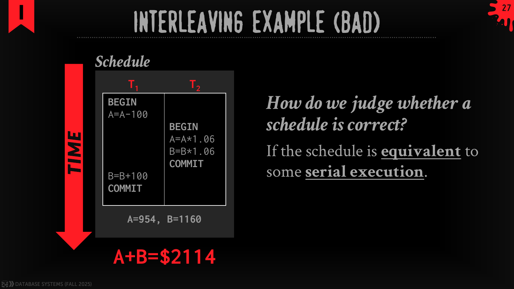

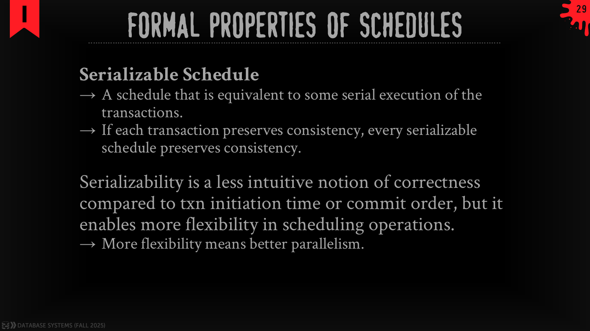


“某个”给了系统很大的自由。T₁ 先开始，未必就要在等价串行顺序中排第一；先发出[提交](#提交)请求，也不是一般[可串行化](#可串行化)的[排序规则](#排序规则)。应用不能根据[事务](#事务)到达[数据库](#数据库)的先后，自行推断串行化顺序。

若还要求尊重现实时间中已经完成的先后关系，就需要更强的**[严格可串行化](#严格可串行化)（Strict Serializability）**：例如 T₁ 已经完成，T₂ 才开始，等价串行顺序必须把 T₁ 放在 T₂ 前面。它仍不要求两个执行时间重叠的[事务](#事务)，必须按开始时间排序。Spanner 把这一性质称为**外部一致性（external consistency）**，在它的语境里二者指的是同一件事，不能把它理解成“先开始者总先[提交](#提交)”。[Google 的说明](https://cloud.google.com/blog/products/databases/strict-serializability-and-external-consistency-in-spanner)讨论了它的实现方式与边界。

有了判断目标，还缺一种能由[数据库](#数据库)自动执行的检查方法。系统很难从任意应用代码里理解“少了 6 美元”的业务含义，但它可以识别读写之间的相互影响。

## 5. [冲突](#冲突)怎样变成可见的异常

📍 *PPT 第 30–34 页*

### 5.1 [冲突](#冲突)表示顺序有影响，不表示已经出错

📍 *PPT 第 30 页*

**[冲突](#冲突)（Conflict）**发生在满足以下条件的一对操作之间：它们来自不同[事务](#事务)，访问同一个对象，并且至少有一个是写操作。

| 先发生的操作 | 后发生的操作 | 是否[冲突](#冲突) | 顺序可能影响什么 |
|---|---|---|---|
| `R₁(A)` | `R₂(A)` | 否 | 两次读取本身都不改变 A |
| `R₁(A)` | `W₂(A)` | 是 | T₁ 读到更新前还是更新后的值 |
| `W₁(A)` | `R₂(A)` | 是 | T₂ 是否读到 T₁ 的修改 |
| `W₁(A)` | `W₂(A)` | 是 | 最后留下哪个写入结果 |
| `W₁(A)` | `W₂(B)` | 否 | 两次操作作用于不同对象 |

读—写与写—读的区别来自谁先发生。[冲突](#冲突)关系提醒我们，这一对操作不能随意交换。它本身不是异常：串行执行 T₁ 再执行 T₂，两者仍然可以写同一个对象。我们要控制的是不同对象上的顺序能否共同构成一个完整的[事务](#事务)顺序。

### 5.2 不可重复读：一次[事务](#事务)里读到了两个版本

📍 *PPT 第 31 页*

**[不可重复读](#不可重复读)（Unrepeatable Read）**指同一[事务](#事务)重复读取同一对象，因另一个[事务](#事务)的修改而得到不同值。

| 时间 ↓ | T₁ | T₂ |
|---|---|---|
| 1 | `BEGIN`；读取 A，得到 10 | |
| 2 | | `BEGIN`；读取 A，得到 10 |
| 3 | | 把 A 写成 19；`COMMIT` |
| 4 | 再次读取 A，得到 19；`COMMIT` | |

若 T₁ 完整地排在 T₂ 前面，两次应都读到 10；若完整地排在 T₂ 后面，两次应都读到 19。读到“先 10、后 19”无法对应其中任何一种串行执行。
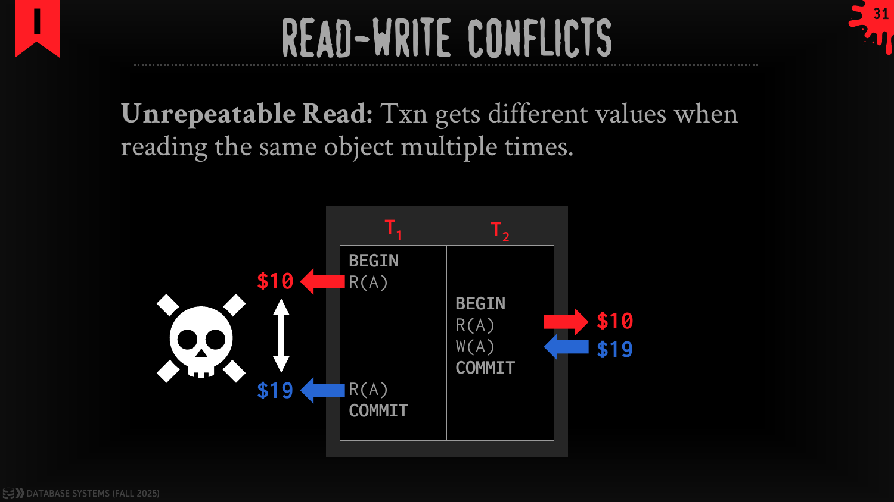


T₂ 在第二次读取之前已经[提交](#提交)，并不能解决这个问题。[提交](#提交)意味着它的修改成功了，却没有让 T₁ 的两次观察属于同一个串行位置。

### 5.3 脏读：拿着还可能被撤销的值继续计算

📍 *PPT 第 32 页*

**[脏读](#脏读)（Dirty Read）**指一个[事务](#事务)读到了另一个尚未[提交](#提交)[事务](#事务)写入的数据。

| 时间 ↓ | T₁ | T₂ |
|---|---|---|
| 1 | `BEGIN`；读取 A，得到 10 | |
| 2 | 把 A 写成 12 | |
| 3 | | `BEGIN`；读取 A，得到 12 |
| 4 | | 把 A 写成 14；`COMMIT` |
| 5 | `ROLLBACK` | |

T₂ 的计算建立在 12 上，但 T₁ 最后失败，这个 12 本不应成为成功业务的依据。问题尤其严重在 T₂ 已经[提交](#提交)：系统承诺了它的修改，却随后发现它依赖一个被[撤销](#撤销)的事实。
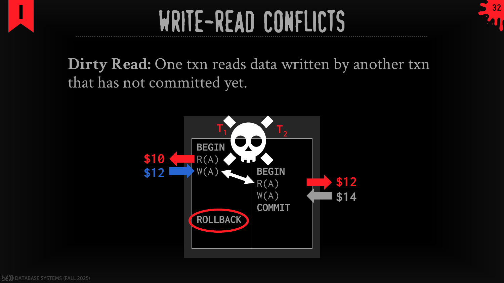


不能简单地说“把 A 改回 10 就好了”，那会抹掉已经[提交](#提交)的 T₂；也不能只因最终写出了 14，就推断 T₂ 的计算不受 12 影响。它可能根据 12 选择了不同分支，或决定是否执行更新。[数据库](#数据库)若只掌握读写关系，就必须把这项依赖认真对待。

这也说明为什么[依赖图](#依赖图／优先图)判定不能独自包办完整[事务](#事务)安全。该例的读写依赖可以只有 `T₁ → T₂`，并没有环，但[提交](#提交)与[回滚](#回滚)顺序仍然有问题。第 [18](../L18/index.md) 讲会进一步讨论可恢复性以及防止这类依赖扩散的协议。

### 5.4 写入相互覆盖：两个完整版本拼成了一个混合版本

📍 *PPT 第 33 页*

现在令 T₁ 把 A、B 写成 `(10, Alice)`，T₂ 把它们写成 `(19, Bob)`。它们没有先读取这些对象，直接写入预定的值，这叫**[盲写](#盲写)（Blind Write）**：写入不依赖事先读出该对象的旧值。

| 时间 ↓ | T₁ | T₂ |
|---|---|---|
| 1 | `BEGIN`；`W(A = 10)` | |
| 2 | | `BEGIN`；`W(A = 19)` |
| 3 | | `W(B = Bob)`；`COMMIT` |
| 4 | `W(B = Alice)`；`COMMIT` | |

最终得到 `(19, Alice)`。串行顺序 `T₁ → T₂` 会留下 `(19, Bob)`，反过来会留下 `(10, Alice)`；混合结果不属于任何一种。

这里的根源依旧是方向相反：A 上 T₂ 覆盖 T₁，B 上 T₁ 覆盖 T₂。其中覆盖他人尚未[提交](#提交)写入的动作，称为**[脏写](#脏写)（Dirty Write）**。这些交错写入丢掉了各[事务](#事务)原本要共同保留的更新效果；开头两次扣款都写回 75，则展示了更常见的“读取旧值、各自计算、覆盖更新”的[丢失更新](#丢失更新)形态。两个例子共同说明，保护单个写操作还不足以保护[事务](#事务)的整体效果。
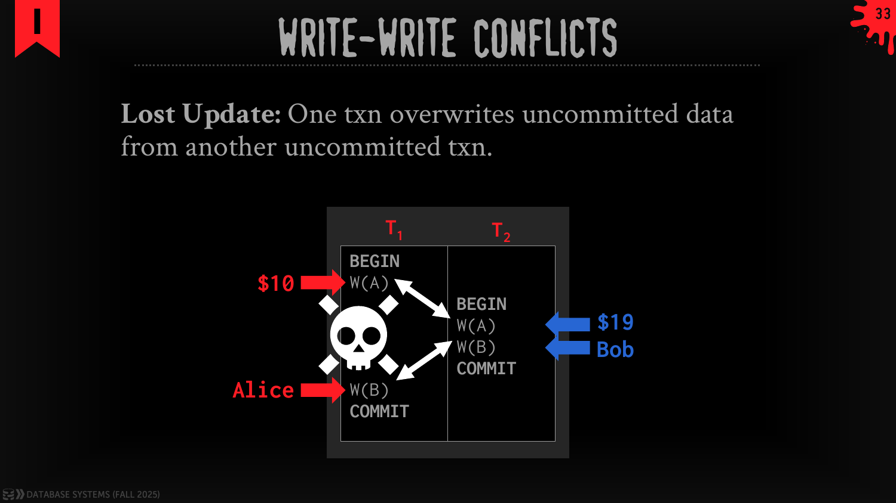


### 5.5 固定对象之外，还有范围和跨对象规则

📍 *PPT 第 30 页*

前面只研究固定对象的读写。**[幻读](#幻读)（Phantom Read）**把问题扩展到查询结果集合：[事务](#事务)按条件扫描一次，另一[事务](#事务)插入或删除了符合条件的记录，再扫描时，结果中的记录集合变了。只保护第一次扫描已经找到的那些行，可能保护不到后来才出现的行，这个缺口到第 [19](../L19/index.md) 讲才补上。

**[写偏斜](#写偏斜)（Write Skew）**则可能发生在[事务](#事务)读取相关数据、分别修改不同对象时：各自依据读到的状态作出决定，合起来却破坏了跨对象的业务约束。它不必表现为两个[事务](#事务)写同一行，因此仅检查写—写覆盖还不够，第 [20](../L20/index.md) 讲会结合多版本并发控制解释它。

这些异常有助于识别症状，但逐个检查症状不适合作为通用正确性证明。更直接的办法，是把所有[冲突](#冲突)施加的顺序要求汇总起来。

## 6. 把读写关系变成依赖图

📍 *PPT 第 34–39 页*

### 6.1 冲突可串行化：只交换不影响彼此的操作

📍 *PPT 第 34–35 页*

相邻的两个操作，如果来自不同[事务](#事务)、彼此不[冲突](#冲突)，交换它们通常不会改变读取来源或写入效果。两个[事务](#事务)分别写 A 和 B，可以交换；两个[事务](#事务)都读 A，也可以交换。相邻的[冲突](#冲突)操作则不能凭空换序，因为这可能改变谁读到谁的修改，或谁覆盖谁。

**[冲突等价](#冲突等价)（Conflict Equivalence）**要求两个调度包含相同[事务](#事务)的相同操作，并且每一对[冲突](#冲突)操作的相对次序都保持不变。**[冲突可串行化](#冲突可串行化)（Conflict Serializability）**则要求一个调度与某个[串行调度](#串行调度)[冲突等价](#冲突等价)。

因此，可以不断交换相邻、来自不同[事务](#事务)且不[冲突](#冲突)的操作。如果最后能够把每个[事务](#事务)的操作聚在一起，形成完整的串行顺序，原调度就是[冲突可串行化](#冲突可串行化)的。第 4.2 节的好交错正有这种性质：计息对 A 的访问与转账对 B 的访问互不影响，可以调整它们的相对位置。

这个过程表达了正确性依据，但逐次尝试交换很不方便。我们真正想知道的是：所有不能交换的操作，共同要求[事务](#事务)按什么顺序排列。

### 6.2 每条边都是一个必须满足的先后要求

📍 *PPT 第 36 页*

**[依赖图](#依赖图／优先图)（Dependency Graph）**以[事务](#事务)为节点，将[冲突](#冲突)操作施加的顺序写成有向边，也称**[优先图](#依赖图／优先图)（Precedence Graph）**。

若 Tᵢ 的某个操作先发生，Tⱼ 的某个操作后发生，并且两者[冲突](#冲突)，就画一条 `Tᵢ → Tⱼ`。这条边表示：任何与原调度[冲突等价](#冲突等价)的串行顺序，都必须把 Tᵢ 放在 Tⱼ 前面。即使[冲突](#冲突)来自读—写，后读写的[事务](#事务)并没有“读取前者产生的数据”，它仍然是一项顺序约束。

构图时，先按对象找出来自不同[事务](#事务)、至少含一个写操作的先后操作对，再把它们归并到[事务](#事务)间的边。同一方向由多个[冲突](#冲突)证明，只需保留一条边；纯读—读不画边，同一[事务](#事务)内部也不画自环。

**一个调度[冲突可串行化](#冲突可串行化)，当且仅当它的[依赖图](#依赖图／优先图)没有有向环。**

这个结论可以直接理解。有环时，假如得到 `T₁ → T₂ → T₃ → T₁`，就要求 T₁ 在 T₂ 前，T₂ 在 T₃ 前，T₃ 又在 T₁ 前，完整[事务](#事务)不可能按这种顺序排队。无环时，可以做**[拓扑排序](#拓扑排序)（Topological Sort）**：不断选出没有入边的节点，将它放到序列末尾并移除。得到的顺序保留了所有边所要求的先后关系，因此保留了所有[冲突](#冲突)操作的次序。

这就是“无环”足以证明正确性的原因。排序不必与[事务](#事务)开始或[提交](#提交)的时间线相同；它描述的是解释读写效果的逻辑顺序。

### 6.3 两个[事务](#事务)形成环：对 A、B 的要求互相矛盾

📍 *PPT 第 37 页*

把前面的混合交错写成完整读写序列。下表中空白表示该[事务](#事务)没有在这一步执行操作，时间自上而下。

| 时间 ↓ | T₁ | T₂ |
|---|---|---|
| 1 | `BEGIN` | `BEGIN` |
| 2 | `R(A)` | |
| 3 | `W(A)` | |
| 4 | | `R(A)` |
| 5 | | `W(A)` |
| 6 | | `R(B)` |
| 7 | | `W(B)` |
| 8 | `R(B)` | |
| 9 | `W(B)` | |
| 10 | `COMMIT` | `COMMIT` |

同一行的两个开始或[提交](#提交)动作不表示[数据库](#数据库)必须同时执行它们；它们不参与下面的读写[冲突](#冲突)判定。

| 构图步骤 | 找到的先后[冲突](#冲突)对 | 新增的顺序要求 |
|---|---|---|
| 检查 A | `R₁(A)` 在 `W₂(A)` 前；`W₁(A)` 在 `R₂(A)` 前；`W₁(A)` 在 `W₂(A)` 前 | `T₁ → T₂` |
| 检查 B | `R₂(B)` 在 `W₁(B)` 前；`W₂(B)` 在 `R₁(B)` 前；`W₂(B)` 在 `W₁(B)` 前 | `T₂ → T₁` |
| 合并要求 | 两个方向同时存在 | 出现有向环 |

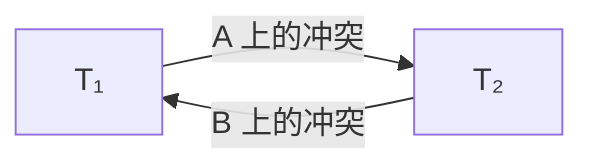

选择 A 上的任意一对[冲突](#冲突)，就已经足以建立第一条边；其余同向[冲突](#冲突)是补充证据。B 上的反向边才使两项要求无法兼容。由此可判定，这个调度不具有[冲突可串行化](#冲突可串行化)性质。

### 6.4 三个[事务](#事务)没有环：从图中读出串行顺序

📍 *PPT 第 38 页*

再看一个交错更明显、却可以接受的例子。T₁ 访问 A 和 B；T₃ 只访问 A；T₂ 只访问 B。

| 时间 ↓ | T₁ | T₂ | T₃ |
|---|---|---|---|
| 1 | `BEGIN` | | |
| 2 | `R(A)` | | |
| 3 | `W(A)` | | `BEGIN` |
| 4 | | | `R(A)` |
| 5 | | | `W(A)` |
| 6 | | `BEGIN` | `COMMIT` |
| 7 | | `R(B)` | |
| 8 | | `W(B)` | |
| 9 | `R(B)` | `COMMIT` | |
| 10 | `W(B)` | | |
| 11 | `COMMIT` | | |

检查 A，T₁ 的相关操作在 T₃ 之前，得到 `T₁ → T₃`。检查 B，T₂ 的相关操作在 T₁ 之前，得到 `T₂ → T₁`。T₂ 与 T₃ 访问不同对象，没有直接[冲突](#冲突)。

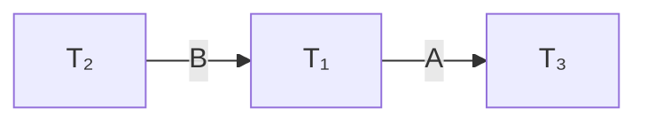

[拓扑排序](#拓扑排序)可以一步步完成：

| 步骤 | 当前没有入边的[事务](#事务) | 取出后得到的串行前缀 |
|---|---|---|
| 1 | T₂ | T₂ |
| 2 | T₁ | T₂ → T₁ |
| 3 | T₃ | T₂ → T₁ → T₃ |

因此，调度[冲突等价](#冲突等价)于串行执行 `T₂ → T₁ → T₃`。T₁ 实际最先开始，却排在串行顺序的中间；T₃ 实际先于 T₁ [提交](#提交)，却在逻辑顺序里排在 T₁ 后面。这正是[可串行化](#可串行化)允许的自由。

这个例子仍是对读写调度的理论分析：T₃ 在 T₁ [提交](#提交)前读取其修改并[提交](#提交)，实际系统还必须处理可能的[中止](#中止)问题。图上无环证明了存在等价串行顺序，没有证明这一[提交](#提交)次序也适合故障恢复。

### 6.5 只读[事务](#事务)也可能需要被判为错误

📍 *PPT 第 39 页*

设 T₁ 从 A 向 B 转账 10，T₂ 只求 A、B 的总和。用 `a`、`b` 表示初始余额，交错如下：
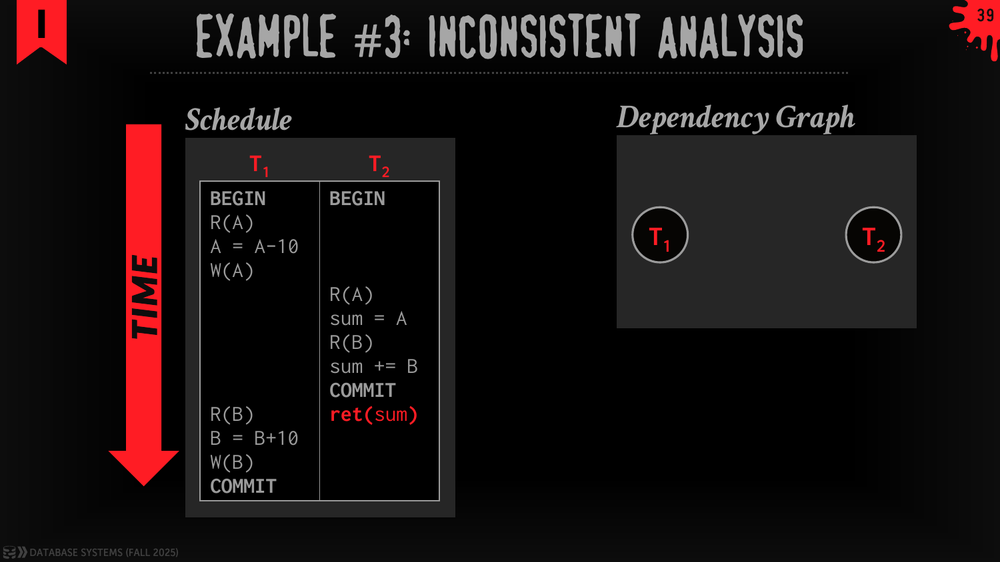


| 时间 ↓ | T₁：转账 | T₂：求和 |
|---|---|---|
| 1 | `BEGIN`；`R(A)` | `BEGIN` |
| 2 | `A = A - 10`；`W(A)` | |
| 3 | | `R(A)`；`sum = A` |
| 4 | | `R(B)`；`sum += B` |
| 5 | | `COMMIT`；返回 `sum` |
| 6 | `R(B)`；`B = B + 10`；`W(B)` | |
| 7 | `COMMIT` | |

T₂ 读到转账后的 A，即 `a - 10`，却读到转账前的 B，即 `b`，返回 `a + b - 10`。无论它在完整转账之前还是之后求和，都应得到 `a + b`。

最终[数据库](#数据库)只有 T₁ 的完整转账结果，完全可以是正确的；已经返回给用户的总额却错了。这种**[不一致分析](#不一致分析)（Inconsistent Analysis）**说明，只比较最后写入数据库的内容，会漏掉读取结果中的错误。

[依赖图](#依赖图／优先图)无需知道“转账”或“求和”的意义，就能发现问题：`W₁(A)` 在 `R₂(A)` 前，产生 `T₁ → T₂`；`R₂(B)` 在 `W₁(B)` 前，产生 `T₂ → T₁`。两条边再次形成环。
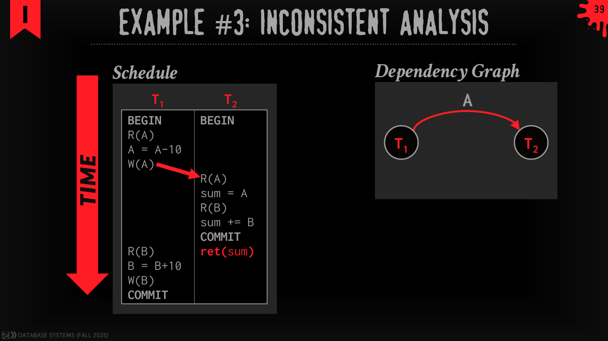

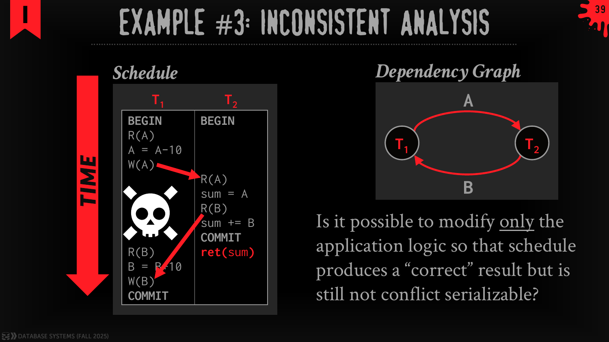


## 7. [冲突](#冲突)判定为什么会放弃一些可接受的交错

📍 *PPT 第 39–44 页*

### 7.1 视图等价保留读取来源和最终写入者

📍 *PPT 第 40、43 页*

[冲突等价](#冲突等价)要求每一对[冲突](#冲突)操作都保持顺序，这是一个容易检查的标准。有些写入却从未被任何[事务](#事务)读取，最后又被新的写入覆盖。强行保留这些写入之间的全部顺序，可能比真正需要的更严格。

**[视图等价](#视图等价)（View Equivalence）**关注每次读取看到谁的值，以及每个对象最终由谁写入。对于包含相同[事务](#事务)、相同操作的两个调度，要同时满足：
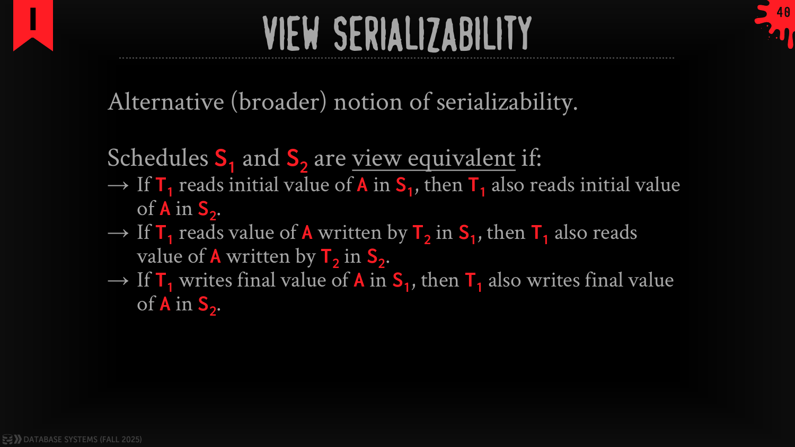


1. 某次读取若在第一个调度中读到对象的初始值，在第二个调度中也必须读到初始值。
2. 某次读取若在第一个调度中读到某个[事务](#事务)某次写入的值，在第二个调度中也必须保留同样的读取来源。
3. 每个对象的最终写入者必须保持一致。

**[视图可串行化](#视图可串行化)（View Serializability）**表示一个调度与某个[串行调度](#串行调度)[视图等价](#视图等价)。这里的“视图”指[事务](#事务)观察到的读写关系，与 SQL 的 `CREATE VIEW` 没有直接关系。

读取来源比偶然读到相同的数值更严格：两个不同[事务](#事务)都可能写入 10，但“读到了 T₁ 写的 10”与“读到了 T₂ 写的 10”并非同一项来源关系。这个标准仍然工作在读写模型内，不要求[数据库](#数据库)理解每个数值的业务意义。

### 7.2 一个有环、却视图可串行化的[盲写](#盲写)例子

📍 *PPT 第 41–42 页*

T₁ 读取 A 后再写 A；T₂、T₃ 都直接[盲写](#盲写) A。下面的交错保留了课件的操作顺序：

| 时间 ↓ | T₁ | T₂ | T₃ |
|---|---|---|---|
| 1 | `BEGIN` | | |
| 2 | `R(A)`，读到初始值 | `BEGIN` | |
| 3 | | `W(A)` | |
| 4 | | | `BEGIN` |
| 5 | `W(A)` | | |
| 6 | | | `W(A)` |
| 7 | `COMMIT` | `COMMIT` | `COMMIT` |

按[冲突](#冲突)规则构图：

| [冲突](#冲突)证据 | 产生的边 |
|---|---|
| `R₁(A)` 先于 `W₂(A)` | `T₁ → T₂` |
| `W₂(A)` 先于 `W₁(A)` | `T₂ → T₁` |
| `R₁(A)`、`W₁(A)` 都先于 `W₃(A)` | `T₁ → T₃` |
| `W₂(A)` 先于 `W₃(A)` | `T₂ → T₃` |

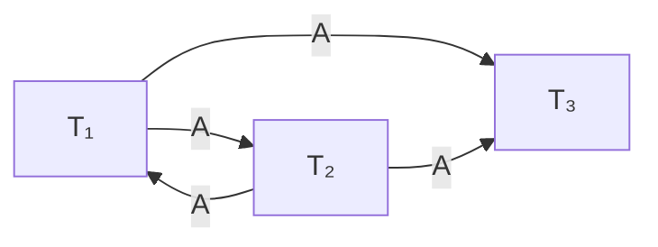

T₁、T₂ 之间有环，因此它不[冲突可串行化](#冲突可串行化)。现在换用[视图等价](#视图等价)，比较串行顺序 `T₁ → T₂ → T₃`：

| 时间 ↓ | T₁ | T₂ | T₃ |
|---|---|---|---|
| 1 | `BEGIN`；`R(A)`，读到初始值 | | |
| 2 | `W(A)`；`COMMIT` | | |
| 3 | | `BEGIN`；`W(A)`；`COMMIT` | |
| 4 | | | `BEGIN`；`W(A)`；`COMMIT` |

两个调度中唯一的读取都是 T₁ 读取 A 的初始值，最终写入者都是 T₃。T₂ 写出的中间值没有被读取，也不是最终留下的值；改变它与 T₁ 写入的先后关系，并没有改变任何读取来源或最终写入者。三个条件全部满足，所以原调度[视图可串行化](#视图可串行化)。

这解释了[盲写](#盲写)为什么能带来额外空间。不过，有[盲写](#盲写)并不能直接判定调度[视图可串行化](#视图可串行化)；仍然要核对每一次读取和每个对象的最终写入者。第 5.4 节的 `(19, Alice)` 就不能仅凭两个[事务](#事务)都[盲写](#盲写)而获得正确性保证。

[依赖图](#依赖图／优先图)有环的精确结论因此是“不能[冲突可串行化](#冲突可串行化)”。把它扩大成“不可能对应任何可接受的串行效果”，就会错过这个例子。

### 7.3 业务只看计数，不等于满足视图等价

📍 *PPT 第 39–40、43 页*

回到第 6.5 节。如果 T₂ 不再求余额总和，而是统计 A、B 中余额非负的账户数，情况会有所变化。其本地计算变为：读取 A，若 `A >= 0` 则计数加 1；读取 B，若 `B >= 0` 则再加 1，最后返回计数。
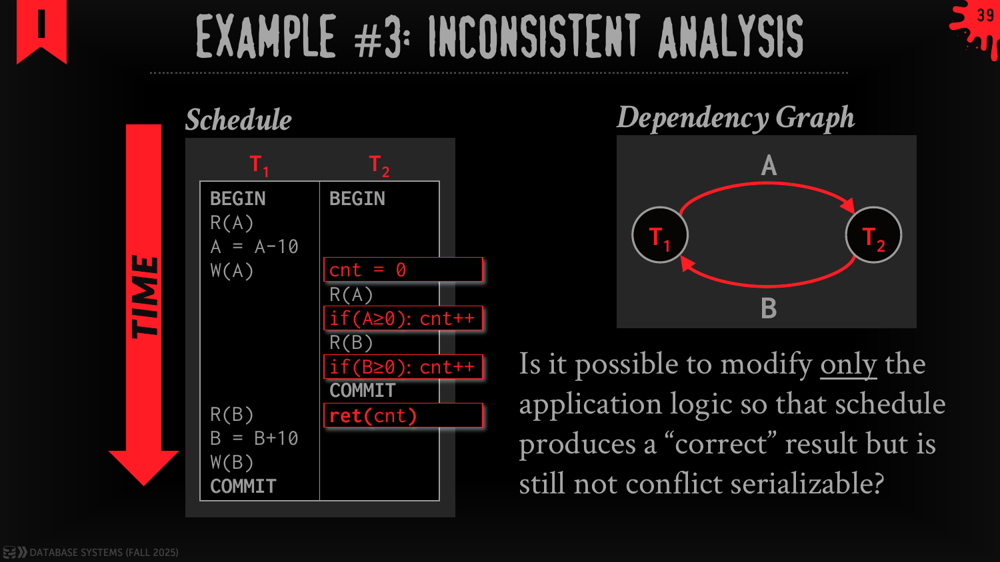


假设转账前后两个账户都保持非负，那么 T₂ 无论读到哪一个中间余额，都会返回 2。在这一业务条件下，交错执行给出了应用所关心的正确答案。如果转账使余额跨过 0，这个结论就不能照搬；决定可接受性的还有[谓词](#谓词)及数据条件。

这属于依靠应用语义放宽要求。按前面正式的[视图等价](#视图等价)定义，该读写调度依然不能[视图可串行化](#视图可串行化)：T₂ 从 A 读到 T₁ 的写入，要求 T₁ 排在它前面；它又从 B 读到初始值，要求 T₁ 排在它后面。即使返回的计数相同，这两个读取来源仍然无法由一个串行顺序同时保留。

因此，需要区分“[冲突可串行化](#冲突可串行化)”“[视图可串行化](#视图可串行化)”和“在特定业务解释下结果可接受”。计数例子展示的是第三层，[盲写](#盲写)例子才展示第二层比第一层更宽的地方。[视图可串行化](#视图可串行化)也没有囊括所有应用可能接受的执行。

### 7.4 更大的调度集合，伴随着更难的判定

📍 *PPT 第 34、43–44 页*

这几类调度之间的包含关系可以画成：

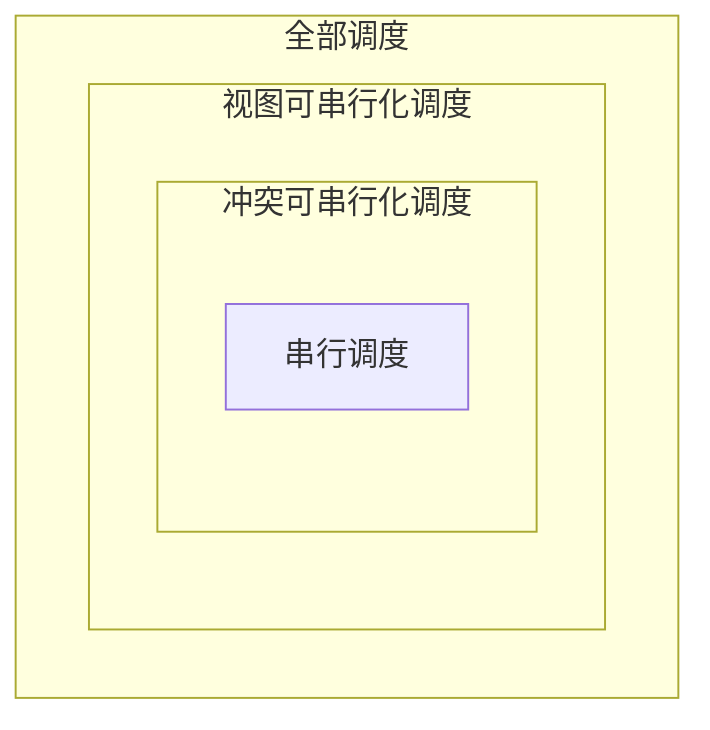

串行执行天然满足[冲突可串行化](#冲突可串行化)；保持所有[冲突](#冲突)顺序，也会保持读取来源和最终写入者，所以[冲突可串行化](#冲突可串行化)又蕴含[视图可串行化](#视图可串行化)。前面的好交错说明，不必串行执行也能[冲突可串行化](#冲突可串行化)；[盲写](#盲写)例子说明，不必[冲突可串行化](#冲突可串行化)也能[视图可串行化](#视图可串行化)。

[数据库](#数据库)实现偏爱能高效执行的充分条件。[冲突可串行化](#冲突可串行化)可以通过[依赖图](#依赖图／优先图)判环来判断，并能由相应运行时协议保证。一般的[视图可串行化](#视图可串行化)判定则是 NP 完全问题：目前没有已知的通用多项式时间算法。这个复杂度结论可参见相关[研究论文的概述](https://arxiv.org/abs/2403.17665)。这里不需要掌握复杂度证明，只需理解：多接受一些交错，并不意味着能够以同样低的成本决定哪些交错应该接受。
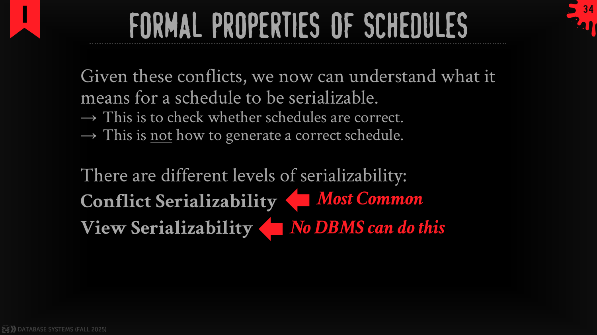

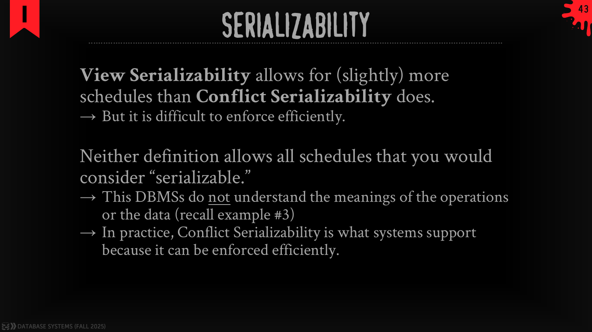


如果再要求系统理解“两个账户始终非负，所以只数账户没关系”，还多了一层应用语义问题。通用[数据库](#数据库)无法假定任意客户端程序会怎样使用读取结果。工程上选择[冲突](#冲突)关系，是用可实现、可分析的规则换取可靠的保证；其代价是放弃一部分本来可能无害的执行。

## 8. 从判断一张调度表，走向运行中的[数据库](#数据库)

📍 *PPT 第 18、34、43、45–49 [页](#页)*

### 8.1 悲观协议与乐观协议：在不同时间处理[冲突](#冲突)

📍 *PPT 第 18、34 页*

到目前为止，我们拿到的都是已经给定的完整调度。现实中，T₁ 刚开始，T₂ 又到达，T₃ 下一步访问哪个对象可能还没有决定。应用甚至要先读一个值，才能决定接下来执行哪条 SQL。[数据库](#数据库)没有完整的未来调度可以预先分析。

**[并发控制协议](#并发控制协议)（Concurrency Control Protocol）**是在运行时决定多个[事务](#事务)如何交错访问数据的规则。理论判定告诉我们哪些结果可接受，协议负责在信息逐步到达的过程中产生这样的执行。
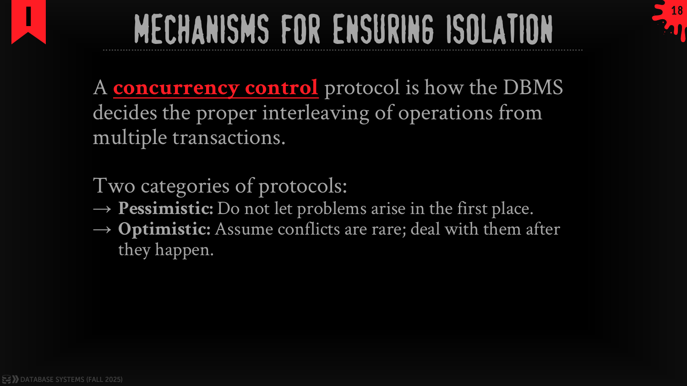


**[悲观并发控制](#悲观并发控制)（Pessimistic Concurrency Control）**预先限制可能导致问题的操作，例如在访问对象前取得相应的[锁](#锁)；如果所需访问暂时不安全，就等待或[中止](#中止)。它提前支付协调成本，以避免后面出现不允许的交错。第 [18](../L18/index.md) 讲的两阶段锁是重要例子。

**[乐观并发控制](#乐观并发控制)（Optimistic Concurrency Control，OCC）**基于[冲突](#冲突)较少的预期，让[事务](#事务)先完成大部分工作，再验证它与其他[事务](#事务)能否共同成立；验证失败就[中止](#中止)或重试。[事务](#事务)产生的临时写入仍要受到控制，不能因为“乐观”就把错误结果作为成功结果发布。第 [19](../L19/index.md) 讲会展开其读、验证、写等阶段。

两者的取舍可以从工作是否会被浪费来理解。预先等待可能延误原本可以并行的[事务](#事务)；事后验证则可能让一个做了大量工作的[事务](#事务)从头再来。[冲突](#冲突)频率、[事务](#事务)长度和访问分布，会影响哪一种方式更合适。

这里的[依赖图](#依赖图／优先图)也不要与第 [18](../L18/index.md) 讲的等待图混淆。[依赖图](#依赖图／优先图)的边记录读写形成的串行顺序要求，用于讨论[可串行化](#可串行化)；等待图的边记录谁在等待谁的资源，用于发现[死锁](#死锁)。两者都可能检查环，但环所说明的问题不同。

### 8.2 提前知道更多业务信息，能否减少协调

📍 *PPT 第 39、43 页*

运行时的困难有一部分来自信息不足。若系统能够提前获得[事务](#事务)逻辑或访问集合，就可以尝试更主动的安排。存储过程把一段[事务](#事务)程序交给[数据库](#数据库)运行，通常比“客户端读一次、想一会儿、再发下一条 SQL”提供更多结构信息；但代码可见，也不意味着任意分支、外部输入和业务规则都能自动被准确推断。

还可以先试执行、记录读写意图，暂不把它们作为成功[事务](#事务)对外发布，之后在确定的条件下验证或重放，检查原来的决定是否仍然有效。这是一类获取和验证执行信息的思路；它与[影子分页](#影子分页)的页面复制属于不同层次，也不能仅凭“重新执行”就保证确定性或[可串行化](#可串行化)。验证规则、顺序约束和[提交](#提交)机制仍然必须完整。

若应用愿意显式暴露业务结构，还能减少一些跨节点协调。比如销售不区分座位的门票，先把 100 张票分成两个互不重叠的额度：东部 50 张，西部 50 张。每一边只要不超过自己的额度，就不必为每张票都跨区域沟通；额度用尽、需要重新分配时再协调。这类思路称为**[额度托管事务](#额度托管事务)（Escrow Transactions）**。

关键在于把“全局售出票数不得超过库存”的约束，分解成两个可在本地维护的上限。额度转移仍须可靠，且总额度不能凭空增加。这里只介绍它体现的设计原则；完整的分布式协议超出了本讲范围。

这也回答了“能否告诉[数据库](#数据库)某些交错可以接受”：可以通过更有结构的[事务](#事务)接口或业务设计表达额外信息，但普通的通用读写接口不会自动提供这种语义。业务知识确实能换取更多并行空间，前提是把知识变成系统能执行并验证的约束。

### 8.3 并发控制与恢复必须共同兑现 ACID

📍 *PPT 第 45–48 页*

现在可以把开头的承诺放回系统各部分。它们不是四个互不相干的开关：一个[事务](#事务)若读到了后来被[撤销](#撤销)的值，既牵涉隔离，也牵涉恢复；一个[提交](#提交)若只有内存中的决定，正常运行时看起来正确，断电后仍然无法兑现。

| 承诺 | 主要依靠的机制 | 必须配合的部分 |
|---|---|---|
| [原子性](#原子性) | [撤销](#撤销)、恢复或影子版本 | 并发控制约束其他[事务](#事务)对未完成修改的依赖 |
| [一致性](#一致性) | 已声明的完整性约束与正确的业务逻辑 | 隔离与[原子性](#原子性)共同保证这些规则在[并发](#并发)、失败时仍成立；复制系统还要协调副本状态 |
| [隔离性](#隔离性) | [并发控制协议](#并发控制协议) | 恰当的[事务](#事务)边界与隔离级别 |
| [持久性](#持久性) | 持久[日志](#日志)、数据[页](#页)与恢复机制，或可靠的版本切换 | 超出单机存储故障范围时，需要复制与备份等保护 |

成功[提交](#提交)后不应留下半笔修改，失败[事务](#事务)也不应残留为永久事实。这是[原子性](#原子性)与[持久性](#持久性)共同作用的结果；只有并发控制而没有恢复，或只有[日志](#日志)而没有正确的隔离，都无法完成整个承诺。

在[事务](#事务)边界和隔离要求确定后，[数据库](#数据库)会自动实施相应协议。例如，采用[锁](#锁)协议的系统在执行过程中安排加锁、释放锁和等待，应用通常不必为每次底层读写手工编排这些动作。应用仍然负责业务约束、失败处理，以及选用满足需求的隔离级别。一个配置选项的名称，不能替代对它实际保证的理解。

[事务](#事务)的价值也正在这种分工里。2012 年的 [Spanner 论文](https://research.google/pubs/spanner-googles-globally-distributed-database-2/)讨论过放弃跨行[事务](#事务)给应用带来的负担，并主张先提供[事务](#事务)，让应用在实际出现瓶颈时解决性能问题。它把难题集中到数据库实现中，使大量应用可以共享一套经过推敲的正确性机制，而不必各自重新发明。

## 小结

📍 *PPT 第 46–49 页*

从两次扣款覆盖余额，到转账中途被计息，再到只读查询返回错误总额，问题始终围绕同一件事：业务需要完整的操作，计算机却按细小步骤读写共享数据。[事务](#事务)用 ACID 说明系统应承担的责任，[日志](#日志)或[影子分页](#影子分页)应对失败，并发控制约束多笔[事务](#事务)的交错。

[可串行化](#可串行化)为[并发](#并发)建立了一个可理解的目标：执行效果应当能够解释为某个完整的串行顺序。[冲突可串行化](#冲突可串行化)把这个目标收敛为读写先后关系，[依赖图](#依赖图／优先图)无环就能构造相应的串行顺序。[视图可串行化](#视图可串行化)放宽了一部分中间写入的顺序要求；应用语义还可能接受更多执行，但判定与实现也随之复杂。读写调度[可串行化](#可串行化)，并不自动证明[提交](#提交)、[回滚](#回滚)和崩溃处理已经安全，这几条线将在第 [18](../L18/index.md)、[19](../L19/index.md)、[20](../L20/index.md)、[21](../L21/index.md)、[22](../L22/index.md) 讲逐步合起来。

下一讲将用两阶段锁在运行时约束交错，并通过隔离级别讨论哪些保证可以放松、放松后会出现什么现象。


## 术语速查表

### 数据库

**Database**：一组经过组织、相互关联、用来模拟现实世界某方面的数据。（本讲首次出现：摘要；引入于：第 1 讲）

### 页

**Page**：定长的数据块，数据库中一切数据的存放单位。（本讲首次出现：课程地图；引入于：第 3 讲）

### 缓冲池

**Buffer Pool**：由定长帧组成的一大块内存，用来存放从磁盘读入的页。（本讲首次出现：课程地图；引入于：第 3 讲）

### 访问方法

**Access Methods**：DBMS 从表中取出数据的方式。（本讲首次出现：课程地图；引入于：第 7 讲）

### 查询计划

**Query Plan**：由算子组成的有向无环图（通常是树），数据从叶子流向根，根的输出即查询结果。（本讲首次出现：课程地图；引入于：第 11 讲）

### 脏页

**Dirty Page**：标记页在内存中被改过；这样的页淘汰前必须写回。（本讲首次出现：课程地图；引入于：第 4 讲）

### 闩

**Latch**：保护内部数据结构临界区的短期同步机制。（本讲首次出现：课程地图；引入于：第 4 讲）

### 索引

**Index**：按适合查找的方式组织键与记录定位信息的访问结构。（本讲首次出现：课程地图；引入于：第 8 讲）

### 丢失更新

**Lost Update**：一个事务的更新效果被另一个事务覆盖。（本讲首次出现：1.1；引入于：本讲）

### 事务

**Transaction**：为完成业务功能而共同执行、整体成功或失败的一组数据库操作。（本讲首次出现：1.1；引入于：[第 10 讲](../L10/index.md)）

### 并发

**Concurrency**：多个事务的执行时间重叠，可以交替或同时推进。（本讲首次出现：1.2；引入于：本讲）

### 公平性

**Fairness**：避免事务在资源竞争中长期得不到执行机会。（本讲首次出现：1.2；引入于：本讲）

### 饥饿

**Starvation**：一个事务因持续得不到资源而无法推进。（本讲首次出现：1.2；引入于：[第 10 讲](../L10/index.md)）

### 属性

**Attribute**：关系中的一个命名分量，即表中的一列。（本讲首次出现：2.1；引入于：第 1 讲）

### 元组

**Tuple**：关系中的一个元素，即表中的一行。（本讲首次出现：2.1；引入于：第 1 讲）

### 共享内存

**Shared Memory**：多个进程都能访问的内存区域，用来存放全局数据结构。（本讲首次出现：2.1；引入于：第 14 讲）

### 提交

**Commit**：数据库接受事务成功完成及其整体修改。（本讲首次出现：2.2；引入于：本讲）

### 中止

**Abort**：事务不能成功完成，需要取消其修改。（本讲首次出现：2.2；引入于：本讲）

### 回滚

**Rollback**：撤销事务修改的过程或发起撤销的命令。（本讲首次出现：2.2；引入于：本讲）

### 自动提交

**Autocommit**：将独立 SQL 语句作为隐式事务执行并结束的模式。（本讲首次出现：2.2；引入于：本讲）

### 原子性

**Atomicity**：事务的修改全部生效或全部不留下。（本讲首次出现：2.3；引入于：本讲）

### 一致性

**Consistency**：正确事务把满足规则的数据库状态变成另一个合法状态。（本讲首次出现：2.3；引入于：本讲）

### 隔离性

**Isolation**：约束并发事务如何观察和影响彼此。（本讲首次出现：2.3；引入于：本讲）

### 持久性

**Durability**：已成功提交的修改在约定故障范围内能够保留或恢复。（本讲首次出现：2.3；引入于：[第 01 讲](../L01/index.md)）

### 最终一致性

**Eventual Consistency**：更新传播可能延迟，但满足相应条件后副本最终收敛。（本讲首次出现：2.4；引入于：本讲）

### 主键

**Primary Key**：唯一标识关系中一个元组的属性或属性组合。（本讲首次出现：2.4；引入于：第 1 讲）

### 外键

**Foreign Key**：值必须对应另一关系中某个元组（通常是其主键）的属性。（本讲首次出现：2.4；引入于：第 1 讲）

### 关系模型

**Relational Model**：以关系描述数据、以值表达联系、以声明式接口操纵数据的数据模型。（本讲首次出现：2.4；引入于：第 1 讲）

### 日志

**Logging**：按序记录修改及恢复所需的信息。（本讲首次出现：3.1；引入于：本讲）

### 撤销

**Undo**：消除不应保留的事务修改。（本讲首次出现：3.1；引入于：本讲）

### 重做

**Redo**：重新施加应保留但尚未完整进入数据文件的修改。（本讲首次出现：3.1；引入于：本讲）

### 生理日志

**Physiological Logging**：用页面定位结合页内逻辑操作来描述修改。（本讲首次出现：3.1；引入于：本讲）

### 预写日志

**Write-Ahead Log，WAL**：对应日志先持久化，再允许修改后的数据页落盘。（本讲首次出现：3.1；引入于：本讲）

### 日志结构存储

**Log-Structured Storage**：只追加 PUT/DELETE 记录、从不原地修改的页布局。（本讲首次出现：3.1；引入于：第 5 讲）

### 检查点

**Checkpoint**：为缩短故障恢复范围而记录的恢复状态。（本讲首次出现：3.2；引入于：本讲）

### 模糊检查点

**Fuzzy Checkpoint**：允许事务继续执行的检查点机制。（本讲首次出现：3.2；引入于：本讲）

### 修改日志

**Mod Log**：InnoDB 压缩页上暂存修改、推迟解压的区域。（本讲首次出现：3.2；引入于：第 6 讲）

### 影子分页

**Shadow Paging**：在页面副本上修改，成功后可靠地切换已提交版本。（本讲首次出现：3.3；引入于：本讲）

### 串行调度

**Serial Schedule**：不交错不同事务的操作，一个事务结束后再执行下一个。（本讲首次出现：4.1；引入于：本讲）

### 执行调度

**Execution Schedule**：保持事务内部顺序的多个事务操作执行次序。（本讲首次出现：4.3；引入于：本讲）

### 等价调度

**Equivalent Schedules**：在所采用标准下，对相同初始状态产生相同效果的调度。（本讲首次出现：4.3；引入于：本讲）

### 可串行化

**Serializability**：调度与某个完整的串行执行等价。（本讲首次出现：4.3；引入于：本讲）

### 严格可串行化

**Strict Serializability**：可串行化之外，还尊重已完成事务与后来开始事务的现实时间先后。（本讲首次出现：4.3；引入于：本讲）

### 排序规则

**Collation**：决定字符串比较和排序结果的规则。（本讲首次出现：4.3；引入于：第 2 讲）

### 冲突

**Conflict**：不同事务访问同一对象、且至少一方写入的一对操作。（本讲首次出现：5.1；引入于：[第 07 讲](../L07/index.md)）

### 不可重复读

**Unrepeatable Read**：同一事务重复读取同一对象，因并发修改而得到不同值。（本讲首次出现：5.2；引入于：本讲）

### 脏读

**Dirty Read**：读取另一个事务尚未提交的写入。（本讲首次出现：5.3；引入于：本讲）

### 盲写

**Blind Write**：不依赖事先读取该对象旧值的写入。（本讲首次出现：5.4；引入于：[第 05 讲](../L05/index.md)）

### 脏写

**Dirty Write**：覆盖另一个事务尚未提交的写入。（本讲首次出现：5.4；引入于：本讲）

### 幻读

**Phantom Read**：重复按条件查询时，符合条件的记录集合因并发变化而改变。（本讲首次出现：5.5；引入于：本讲）

### 写偏斜

**Write Skew**：事务基于相关读取分别写入，合起来违反跨对象约束。（本讲首次出现：5.5；引入于：本讲）

### 冲突等价

**Conflict Equivalence**：相同事务的相同操作中，每对冲突操作的相对顺序都相同。（本讲首次出现：6.1；引入于：本讲）

### 冲突可串行化

**Conflict Serializability**：与某个串行调度冲突等价。（本讲首次出现：6.1；引入于：本讲）

### 依赖图／优先图

**Dependency Graph / Precedence Graph**：用事务节点及冲突先后边表达串行顺序要求。（本讲首次出现：6.2；引入于：本讲）

### 拓扑排序

**Topological Sort**：为无环有向图安排满足所有边方向的节点顺序。（本讲首次出现：6.2；引入于：本讲）

### 不一致分析

**Inconsistent Analysis**：一次分析读取了互不一致的中间状态并得出错误结果。（本讲首次出现：6.5；引入于：本讲）

### 视图等价

**View Equivalence**：保持每次读取来源以及每个对象最终写入者相同。（本讲首次出现：7.1；引入于：本讲）

### 视图可串行化

**View Serializability**：与某个串行调度视图等价。（本讲首次出现：7.1；引入于：本讲）

### 谓词

**Predicate**：对每个元组得出真或假的条件。（本讲首次出现：7.3；引入于：第 1 讲）

### 并发控制协议

**Concurrency Control Protocol**：运行时约束多个事务操作如何交错的规则。（本讲首次出现：8.1；引入于：[第 10 讲](../L10/index.md)）

### 悲观并发控制

**Pessimistic Concurrency Control**：提前限制可能导致问题的访问。（本讲首次出现：8.1；引入于：本讲）

### 乐观并发控制

**Optimistic Concurrency Control，OCC**：先执行主要工作，再验证能否安全提交。（本讲首次出现：8.1；引入于：本讲）

### 锁

**Lock**：协调事务访问数据库逻辑内容的机制。（本讲首次出现：8.1；引入于：第 4 讲）

### 死锁

**Deadlock**：工作者互相等待对方的资源，形成无法前进的环。（本讲首次出现：8.1；引入于：第 10 讲）

### 额度托管事务

**Escrow Transactions**：将可分配的全局额度拆成局部额度，以减少协调。（本讲首次出现：8.2；引入于：本讲）

[^andy-correctness]: 原话：“You're better off building a correct system first and then figure out how to optimize it without relaxing those correctness guarantees.” 已删除转写中重复的 “out”。

[^slide-arithmetic]: PPT 第 23 页把两种串行顺序用等号并列，它们只是都满足总额 2,120，并不在完整数据库状态上等价。第 25 页右侧展示的是先 T₁ 后 T₂，却把结果标成了 `(960, 1160)`；按所列操作计算应为 `(954, 1166)`，与左侧好交错相同。Notes 第 4 页 Figure 1 复用了这一图示。正文已按实际运算修正。

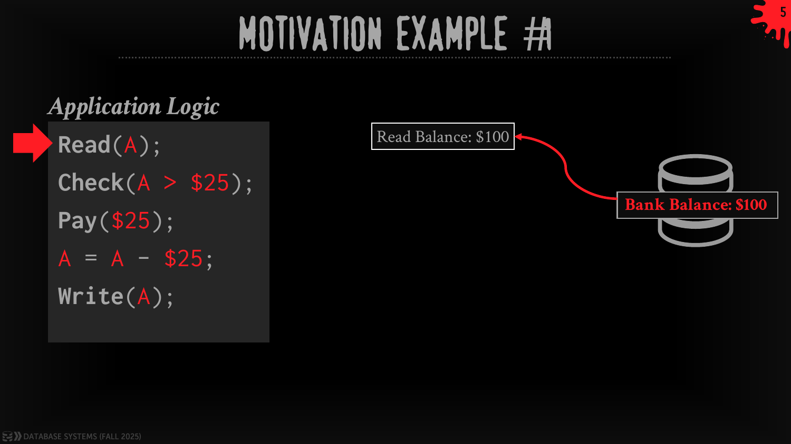

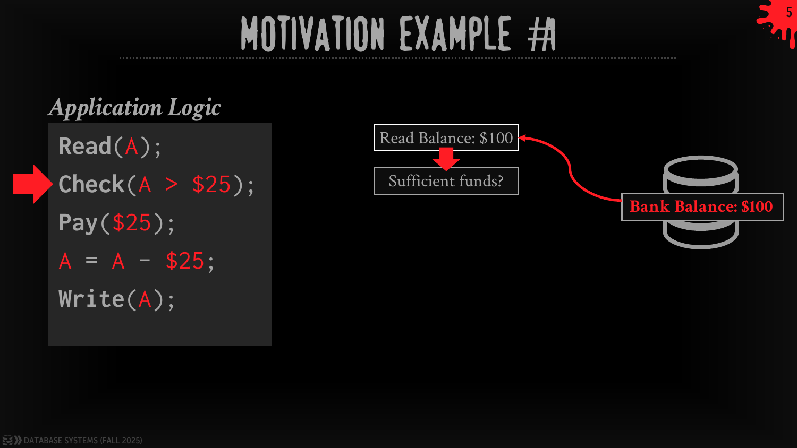

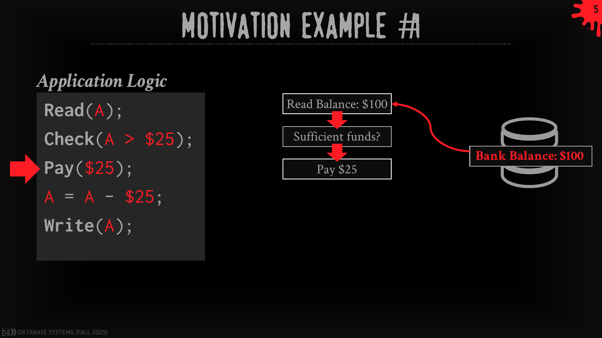

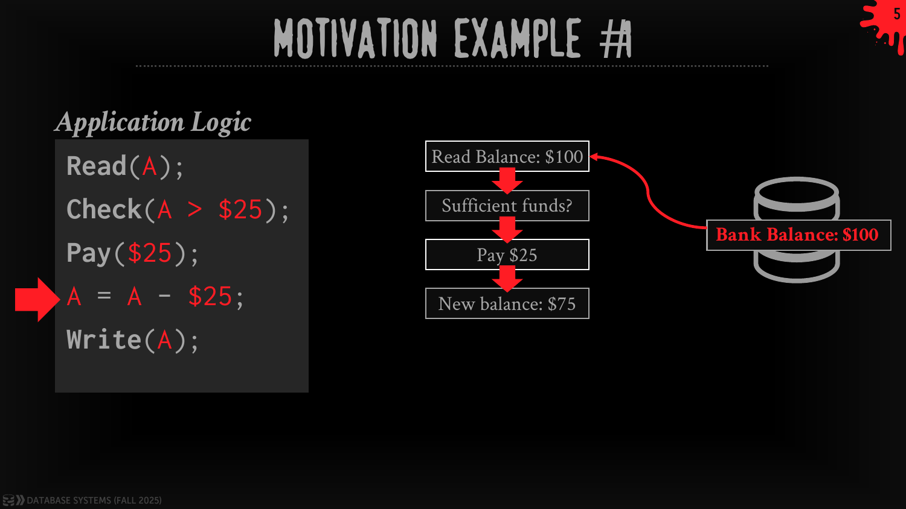

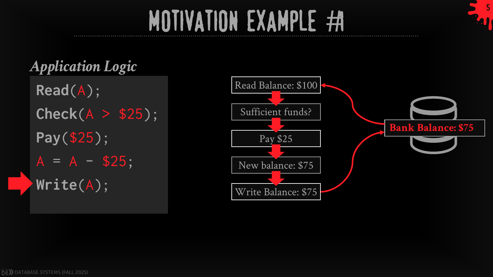

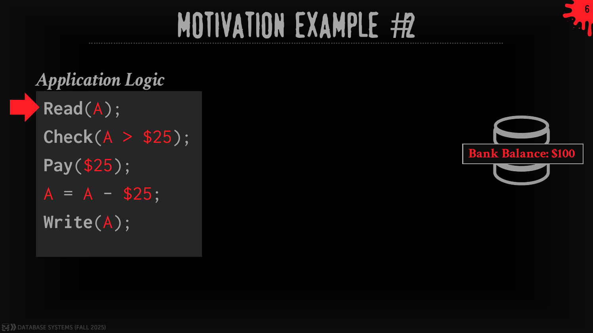

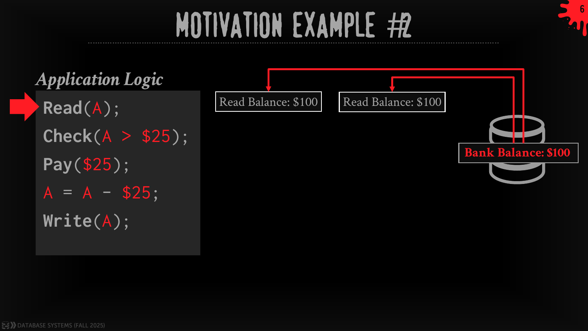

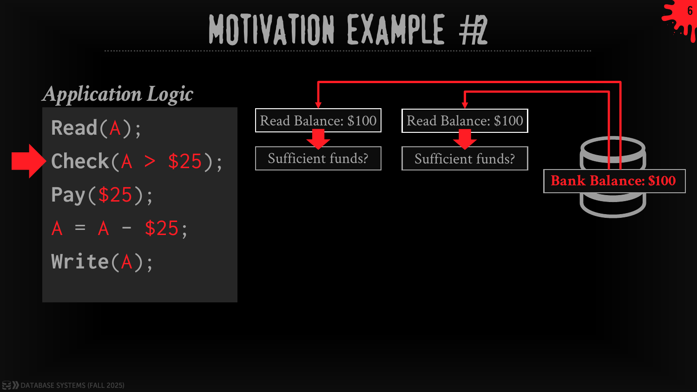

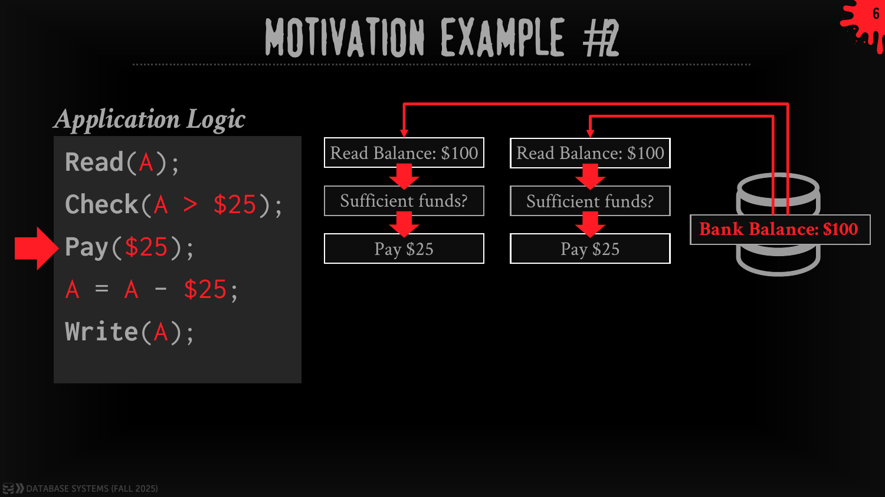

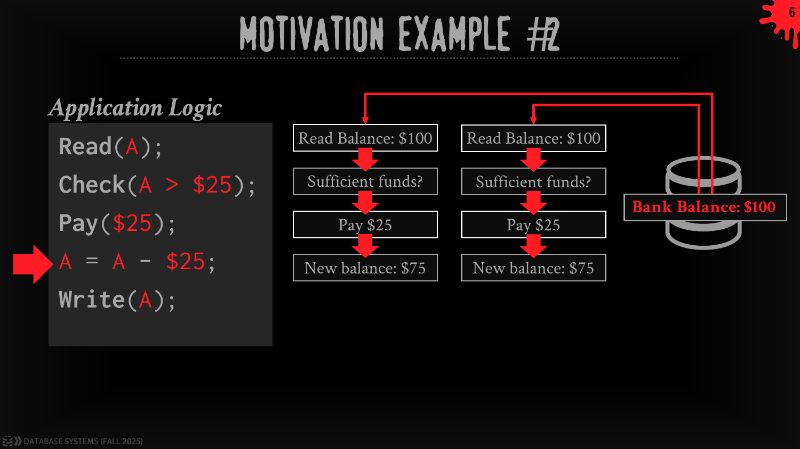

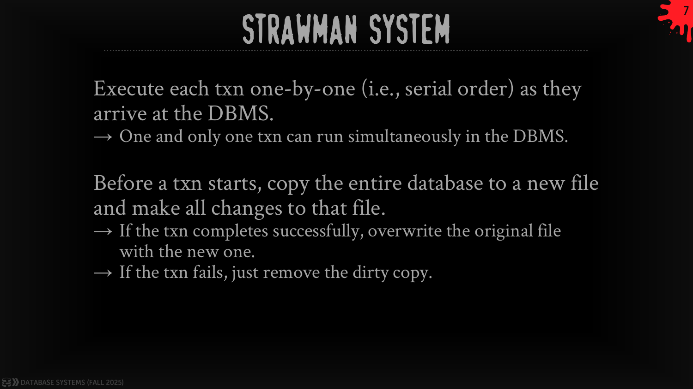

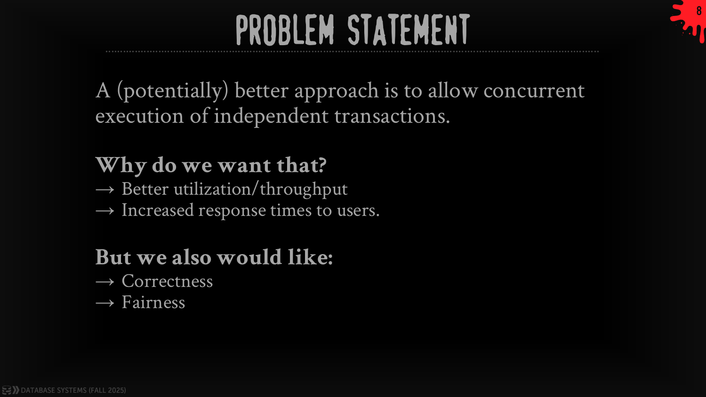

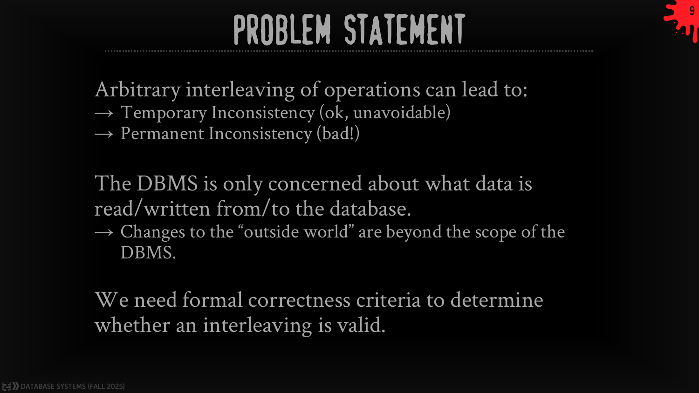

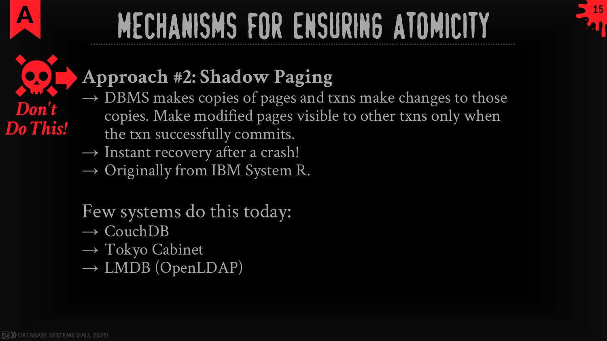

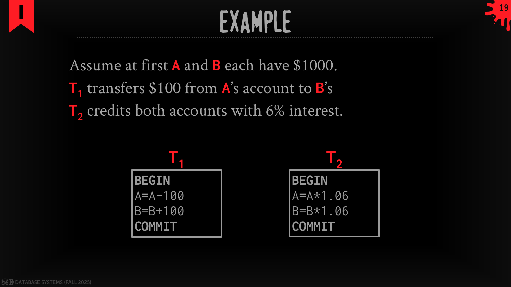

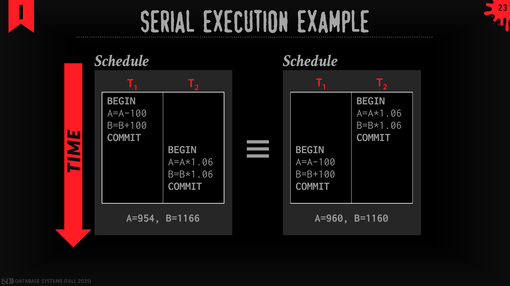


<details>
<summary>📎 本讲未被 📍 标注的幻灯片（共 5 页：封面、目录与行政页）</summary>


</details>
