# CMU 15-445 第 [20](index.md) 讲：多版本并发控制（Multi-Version Concurrency Control）

> **课程**：CMU 15-445/645 Database Systems（Fall 2025）· **主讲**：Andy Pavlo
> **课程主页**：https://15445.courses.cs.cmu.edu/fall2025/
> **材料**：课件 PPT、官方 Lecture Notes、课堂录音转写稿
> **说明**：正文以 PPT 与 Lecture Notes 为准。讲者原话的中文为意译，英文原文见脚注，依据课堂录音转写整理，已修正明显的语音识别错误。文中“📍 PPT 第 X 页”指幻灯片右上角印的编号。

## 摘要（Abstract）

第 [17](../L17/index.md)、[18](../L18/index.md)、[19](../L19/index.md) 讲的[并发控制协议](#并发控制协议)有一个共同的前提：每个[元组](#元组)在[数据库](#数据库)里只有一份。[两阶段锁](#两阶段锁)让读者和写者轮流使用这一份数据；[乐观并发控制](#乐观并发控制)先在[私有工作区](#私有工作区)里修改副本，[提交](#提交)时再覆盖回去。只要数据只有一份，读和写就免不了互相等待，或者让对方作废重来。[多版本并发控制](#多版本并发控制)（[MVCC](#多版本并发控制)）换掉了这个前提：写操作从不覆盖旧数据，而是为逻辑元组追加一个新的[物理版本](#物理版本)，每个[事务](#事务)按自己的[时间戳](#时间戳)去找它应该看到的那个版本。于是写者不再阻塞读者，读者也不再阻塞写者。

前提一换，一连串新问题随之而来。[事务](#事务)怎样判断哪个版本对自己可见？答案是每个版本上的开始、结束[时间戳](#时间戳)，加上一张记录事务是否[提交](#提交)的[事务状态表](#事务状态表)，以及事务开始时拍下的[快照](#快照)。这套可见性规则天然给出一种[隔离级别](#隔离级别)，即[快照隔离](#快照隔离)，它挡住了[脏读](#脏读)、[不可重复读](#不可重复读)和[幻读](#幻读)，却放过了[写偏斜](#写偏斜)。接下来，版本放在哪里，存整份拷贝还是只存改动的列？版本越积越多，由谁、在什么时候清理？版本的位置不断变化，[索引](#索引)该指向哪里？逻辑上删掉一个[元组](#元组)，又怎样在[版本链](#版本链)上留下记号？这些问题的答案牵动了存储、索引、查询执行乃至[日志](#日志)与恢复，所以 [MVCC](#多版本并发控制) 远不止是一个[并发控制协议](#并发控制协议)。

读完本讲，读者应当能够：用[时间戳](#时间戳)、[事务状态表](#事务状态表)和[快照](#快照)手工判断某个版本对某个[事务](#事务)是否可见；解释[快照隔离](#快照隔离)为什么会出现[写偏斜](#写偏斜)；比较仅追加、时间旅行、增量三种版本存储方案，以及[版本链](#版本链)的两种方向；说明[后台清理](#后台清理)、[协作式清理](#协作式清理)和[事务级回收](#事务级回收)各自适用的条件；解释[二级索引](#二级索引)存[物理指针](#物理指针)还是[逻辑指针](#逻辑指针)，为什么会促使 Uber 在 2016 年把[数据库](#数据库)从 PostgreSQL 换回 MySQL；并看懂 PostgreSQL、MySQL、Oracle 等真实系统在这几个设计决策上的取舍。

## 课程地图

本讲是[并发](#并发)控制阶段的最后一讲，讲的也是这一阶段在真实系统里用得最多的方案。

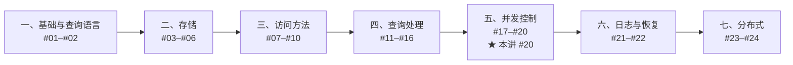

本讲直接建立在前三讲之上。第 [17](../L17/index.md) 讲定义了[事务](#事务)、调度和[冲突可串行化](#冲突可串行化)，第 3 节分析[写偏斜](#写偏斜)时会再次用到依赖图。第 [18](../L18/index.md) 讲的[两阶段锁](#两阶段锁)用[共享锁](#共享锁)和[排他锁](#排他锁)让[冲突](#冲突)的操作排队，并用[等待图](#等待图)检测[死锁](#死锁)；第 4 节会把它放到多版本数据之上，并在 PostgreSQL 里观察[死锁检测](#死锁检测)器[中止](#中止)一个事务。第 [19](../L19/index.md) 讲的[时间戳排序](#时间戳排序)为事务分配[时间戳](#时间戳)来决定串行顺序；[乐观并发控制](#乐观并发控制)（Optimistic Concurrency Control，OCC）让事务先在[私有工作区](#私有工作区)（private workspace）里修改[元组](#元组)的副本，验证通过后再写回全局[数据库](#数据库)。那一讲的结尾讨论了[幻读](#幻读)（phantom read），即事务重读一个范围时发现多出或少了几行，也讨论了[隔离级别](#隔离级别)（isolation level）。[MVCC](#多版本并发控制) 的可见性规则从时间戳出发，而它对幻读和隔离级别的影响是第 3 节的主题。
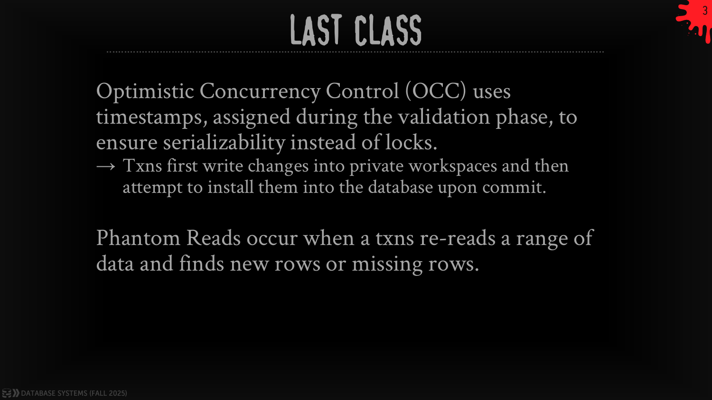


前面几个阶段的概念也会用到：[记录 ID](#记录%20ID)（record ID，第 [3](../L03/index.md) 讲，由[页](#页)号和[槽](#槽)号组成）、[缓冲池](#缓冲池)（buffer pool，第 [4](../L04/index.md) 讲）、[索引组织存储](#索引组织存储)与 [LSM 树](#LSM%20树)（第 [5](../L05/index.md) 讲）、[哈希表](#哈希表)删除时留下的[墓碑](#墓碑)（第 [7](../L07/index.md) 讲）、[B+ 树](#B+%20树)中重复键的处理（第 [8](../L08/index.md)、[9](../L09/index.md) 讲），以及[闩](#闩)（latch）与[锁](#锁)（lock）的区别（第 [10](../L10/index.md) 讲）。

往后看，[增量存储](#增量存储)里保存旧值的[回滚段](#回滚段)，也是第 [21](../L21/index.md)、[22](../L22/index.md) 讲[日志](#日志)与恢复中[撤销](#撤销)（undo）操作要用到的数据；第 [23](../L23/index.md)、[24](../L24/index.md) 讲的分布式[数据库](#数据库)，比如 PPT 第 33 页里出现的 CockroachDB，同样建立在多版本之上。

## 1. 让读和写不再互相等待

📍 *PPT 第 3–5 页*

### 1.1 只有一份数据的代价

📍 *PPT 第 3–4 页*

在[两阶段锁](#两阶段锁)（Two-Phase Locking，第 [18](../L18/index.md) 讲）下，读一个对象先要拿[共享锁](#共享锁)，写一个对象先要拿[排他锁](#排他锁)，两种[锁](#锁)互不兼容。设想一条统计全表销售额的查询要扫描几千万行，按[严格两阶段锁](#严格两阶段锁)，它一路拿到的共享锁要一直持有到[事务](#事务)结束，在这段时间里，任何想修改其中某一行的事务都只能排队；反过来，一个正在修改某行的事务，也会让所有想读这一行的查询停下来等它。[乐观并发控制](#乐观并发控制)（第 [19](../L19/index.md) 讲）不加锁，却把[冲突](#冲突)推迟到了验证阶段：事务读过的对象越多，验证时撞上别人的修改而被迫[中止](#中止)的可能就越大，而读得最多的往往正是长时间运行的分析查询。

这些代价出自同一个原因：每个[元组](#元组)在[数据库](#数据库)里只有一份。读者要保证自己读的东西在读的过程中不被改掉，写者要保证改了一半的东西不被别人看到，两者争的是同一块存储。

OCC 其实已经朝另一个方向走了半步：写[事务](#事务)不直接修改共享数据，而是先把要改的[元组](#元组)复制到[私有工作区](#私有工作区)里再改。[多版本并发控制](#多版本并发控制)走完了剩下的半步。新的副本不再藏在私有工作区，而是直接放进全局[数据库](#数据库)，所有事务在物理上都能碰到它；只是在创建它的事务[提交](#提交)之前，别的事务在逻辑上看不见它。

### 1.2 逻辑[元组](#元组)与物理版本

📍 *PPT 第 4 页*

**[多版本并发控制](#多版本并发控制)**（Multi-Version Concurrency Control，[MVCC](#多版本并发控制)）是指 DBMS 为[数据库](#数据库)中的每个[逻辑对象](#逻辑对象)维护多个[物理版本](#物理版本)。[逻辑对象](#逻辑对象)（logical object）是应用眼中的“一行数据”，通常用[主键](#主键)来识别，比如 `id = 1` 的那个账户；[物理版本](#物理版本)（physical version）是这行数据在存储中实际存在的一份拷贝。[事务](#事务)写一个对象时，DBMS 从不覆盖已有的任何版本，而是为它创建一个新版本；事务读一个对象时，读的是自己开始时已经存在的最新版本。一个版本对某个事务是否可见，由[时间戳](#时间戳)决定，任何时刻，一个事务对同一个[逻辑对象](#逻辑对象)只能看到一个版本。
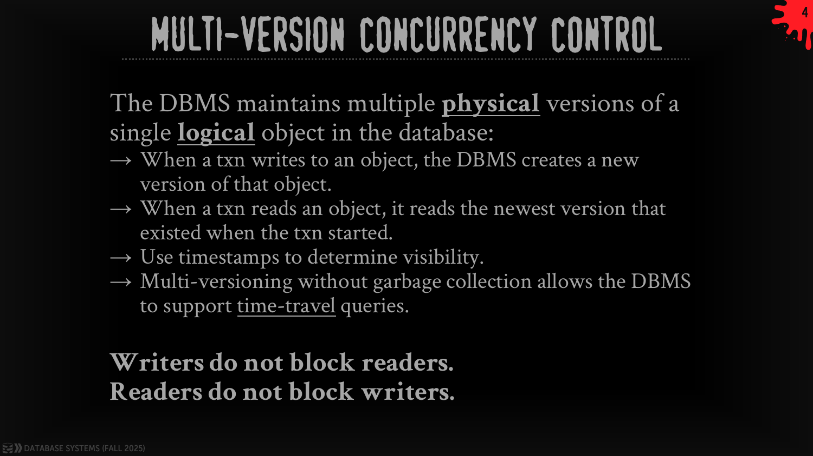


用 C 语言的眼光看，这相当于把“原地修改一个 `struct`”换成“`malloc` 一个新的 `struct`，把改动写进新的这份，再把它挂在旧的旁边”。旧的那份不会马上 `free`，因为可能还有别的[事务](#事务)正在读它。

[MVCC](#多版本并发控制) 最重要的两个性质由此直接得到：**写者不阻塞读者，读者也不阻塞写者**（writers do not block readers, readers do not block writers）。写者造新版本时，读者照样读旧版本；读者读旧版本时，写者照样可以造新版本。只读[事务](#事务)因此不需要任何[锁](#锁)，就能读到[数据库](#数据库)的一个一致[快照](#快照)。写者和写者之间仍然可能互相阻塞：两个事务同时修改同一个[逻辑对象](#逻辑对象)时，最终只能有一个成功地在它后面接上新版本，第 2 节的例子会展示这一点。

### 1.3 不清理旧版本的副产品：时间旅行查询

📍 *PPT 第 4 页*

旧版本不再被任何[事务](#事务)需要时，通常要被清理掉（第 6 节）。如果干脆不清理，保留全部历史，DBMS 就能回答“过去某个时刻[数据库](#数据库)是什么样子”这类问题，这叫**[时间旅行查询](#时间旅行查询)**（time-travel query）。SQL:2011 标准为此规定的写法是：

```sql
SELECT * FROM foo FOR SYSTEM_TIME AS OF TIMESTAMP '2025-11-01 09:00:00';
```

各家系统的具体语法不尽相同。不写这样的子句时，查询看到的永远是最新版本。

这种需求主要来自金融行业：接受审计时，公司需要说明做出某笔交易的那一刻，[数据库](#数据库)里的数据是什么样子。Oracle、SQL Server 等商业数据库都提供这类功能，保存全部历史所需的存储空间自然也由用户承担。早期的 POSTGRES 就支持[时间旅行查询](#时间旅行查询)，到了 1990 年代，开发者发现用户并不怎么需要它，而数据库越来越大、空间越来越紧张，于是去掉了这个功能，此后旧版本就必须被清理。

### 1.4 一个 1978 年的想法

📍 *PPT 第 5 页*

多版本的协议最早出现在 1978 年 MIT 的一篇博士论文里。按 Andy 的说法，那篇论文关心的更多是操作系统和分布式系统，而不是[数据库](#数据库)；到 1980 年代初，数据库领域才意识到这正是[事务](#事务)处理需要的东西。最早的两个实现是 DEC 的 Rdb/VMS 和 InterBase，作者都是 Jim Starkey，他后来参与创办了 NuoDB。

DEC（Digital Equipment Corporation）是 1980 年代炙手可热的计算机公司，VAX 系列计算机就出自它，Rdb/VMS 正是为 VAX 上的 VMS 系统开发的。DEC 后来被 Compaq 收购，Compaq 又被 HP 收购；Rdb/VMS 则被 Oracle 买下，今天叫 Oracle Rdb。它和人们平时说的 Oracle [数据库](#数据库)是两个产品，后者是 Oracle 公司自己的旗舰数据库，而按 Andy 的说法，Oracle Rdb 基本处于维护状态，没有人会拿它来开始一个新项目。InterBase 后来开源，开源版本叫 Firebird，至今仍有人使用，商业版的 InterBase 也还在出售。

> 💬 **旁注**
> Firefox 这个名字和 Firebird [数据库](#数据库)有一段渊源。Mozilla 的浏览器最初叫 Phoenix，因为与别家的商标冲突改名为 Firebird，又因为与这个开源数据库重名，最后才定名为 Firefox。
>
> *原话：“Then they were going to call it Firebird. And then because this database system exists, they couldn't call it that.”*

## 2. 该读哪一个版本

📍 *PPT 第 6–7 页*

### 2.1 开始[时间戳](#时间戳)与结束时间戳

📍 *PPT 第 6 页*

有了多个版本，第一个问题是：[事务](#事务)读 A 时，怎么知道该读哪一个？

[MVCC](#多版本并发控制) 给每个版本记两个[时间戳](#时间戳)：**[开始时间戳](#开始时间戳)**（begin timestamp，begin-ts）和**[结束时间戳](#结束时间戳)**（end timestamp，end-ts）。它们圈出这个版本在[事务](#事务)时间轴上的有效区间 begin-ts, end-ts)，左闭右开；end-ts 为空（记作 ∞）表示它是目前最新的版本。事务在 `BEGIN` 时领到一个时间戳，读 A 时去找区间包含自己时间戳的那个版本。写 A 时，事务新建一个版本，把它的 begin-ts 设为自己的时间戳，同时把原来最新版本的 end-ts 也改成自己的时间戳，表示旧版本的有效期到此为止。

PPT 把版本写成 A0、A1 这样带下标的名字，只是为了讲解方便，真实系统并不存版本号，存的就是这两个[时间戳](#时间戳)。

下面是 PPT 第 6 页的例子。[数据库](#数据库)里起初只有一个版本 A0，由[时间戳](#时间戳)为 0 的某个[事务](#事务)写入，值为 123。
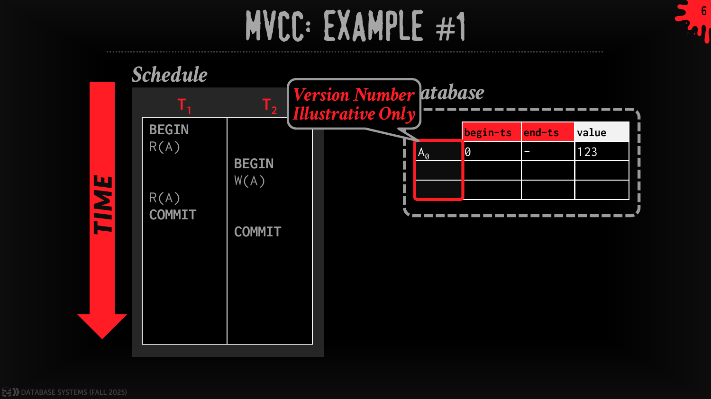

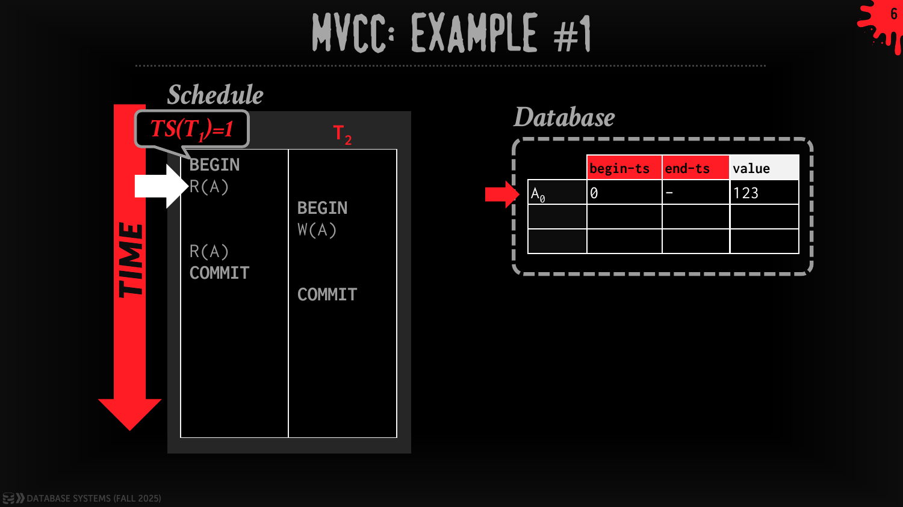

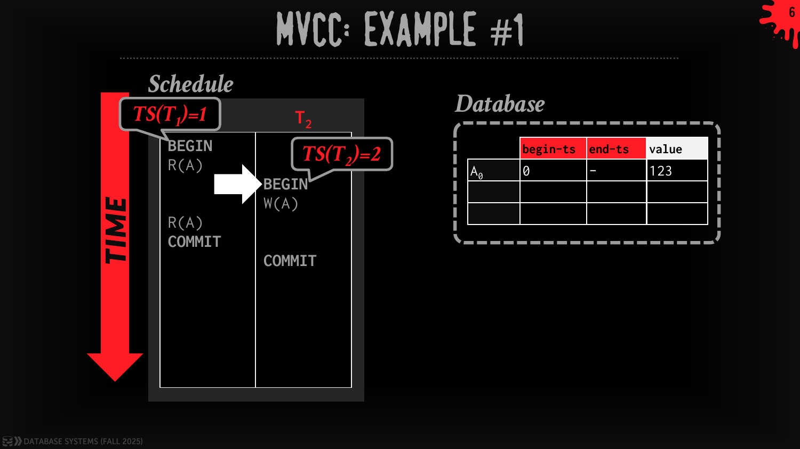

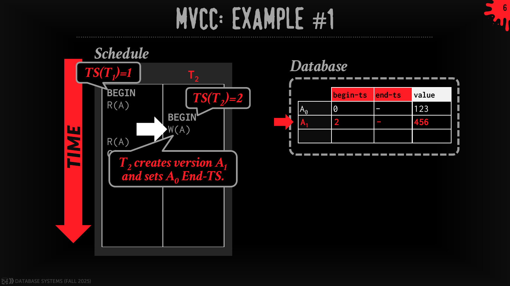


| 步骤 | T1（TS = 1） | T2（TS = 2） | A 的各个版本 begin-ts, end-ts) | 说明 |
|---|---|---|---|---|
| 1 | `BEGIN` | | A0：[0, ∞)，123 | |
| 2 | `R(A)` | | 同上 | 1 ∈ [0, ∞)，读到 A0 |
| 3 | | `BEGIN` | | |
| 4 | | `W(A)` | A0：[0, 2)，123<br>A1：[2, ∞)，456 | 新建 A1，并把 A0 的 end-ts 设为 2 |
| 5 | `R(A)` | | 同上 | 1 ∈ [0, 2)，1 ∉ [2, ∞)，仍读到 A0 |
| 6 | `COMMIT` | | | |
| 7 | | `COMMIT` | | |

第 5 步是关键。T2 已经写了 A，T1 再读，看到的仍然是 A0：它的[时间戳](#时间戳) 1 落在 A0 的有效区间里，而不在 A1 的有效区间里。T2 的修改发生在 T1 开始之后，对 T1 永远不可见，所以 T1 两次读 A 必然得到同一个值，可重复读是自动得到的。换成单版本的[严格两阶段锁](#严格两阶段锁)，T1 在第 2 步拿到的[共享锁](#共享锁)要一直持有到第 6 步，T2 的写要一直等到那时。
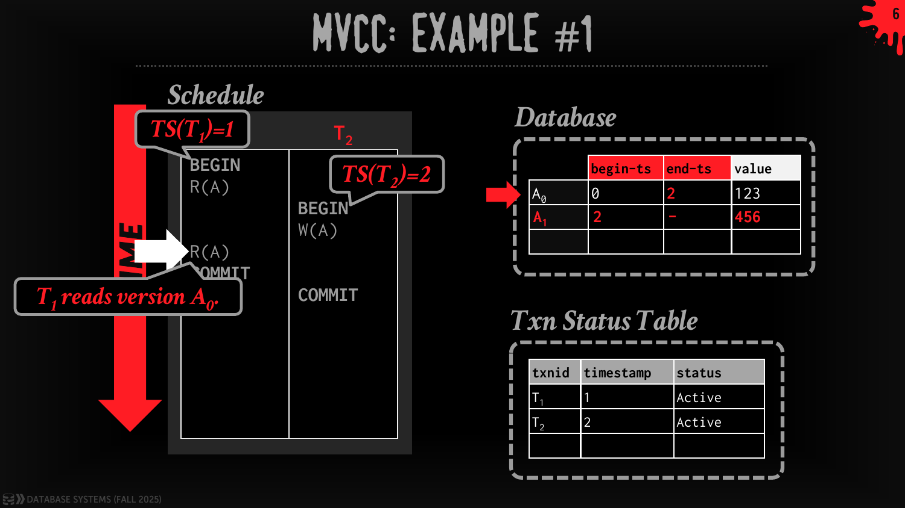


你可能会问，end-ts 是不是多余的：A0 的 end-ts 就等于下一个版本 A1 的 begin-ts，完全可以现推出来。确实可以，但把它直接记在 A0 上，判断 A0 对某个[事务](#事务)是否可见时只看 A0 自己就够了，不必再去找它的下一个版本；垃圾回收判断 A0 还有没有人需要时（第 6 节），也只需要比较这一个数。在这个例子里，T1 结束、T2 [提交](#提交)之后，新来的事务[时间戳](#时间戳)至少是 3，而 A0 的有效区间止于 2，它再也不会被任何事务看到，可以回收了。

### 2.2 [时间戳](#时间戳)说明不了的事：事务状态表

📍 *PPT 第 6–7 页*

回到上例第 4 步之后。假设此时来了一个[时间戳](#时间戳)为 3 的[事务](#事务) T3，按区间判断，它应该读 A1，因为 3 ∈ [2, ∞)。可 T2 还没有[提交](#提交)，万一 T2 随后[中止](#中止)，T3 就读到了一个从未真正存在过的值，这就是[脏读](#脏读)（dirty read）。时间戳只说明一个版本在什么时间段有效，没有说明创建它的事务到底提交了没有。

所以 [MVCC](#多版本并发控制) 还需要一张全局的**[事务状态表](#事务状态表)**（transaction status table），通常实现成一张[哈希表](#哈希表)，记录系统中每个[事务](#事务)的[时间戳](#时间戳)和状态：活跃（Active）、已[提交](#提交)（Committed）或已[中止](#中止)（Aborted）。上例第 4 步时，表里是 T1 和 T2，状态都是活跃。

PPT 第 7 页的例子把这张表用了起来。两个[事务](#事务)都要读写 A，初始仍然只有 A0。
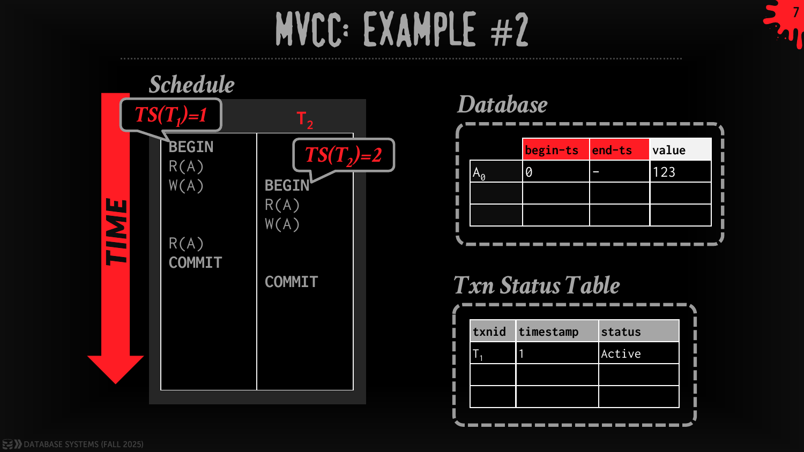


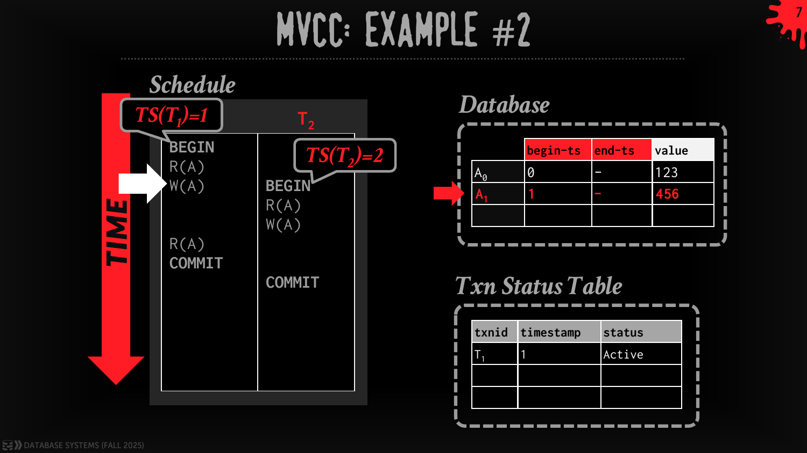

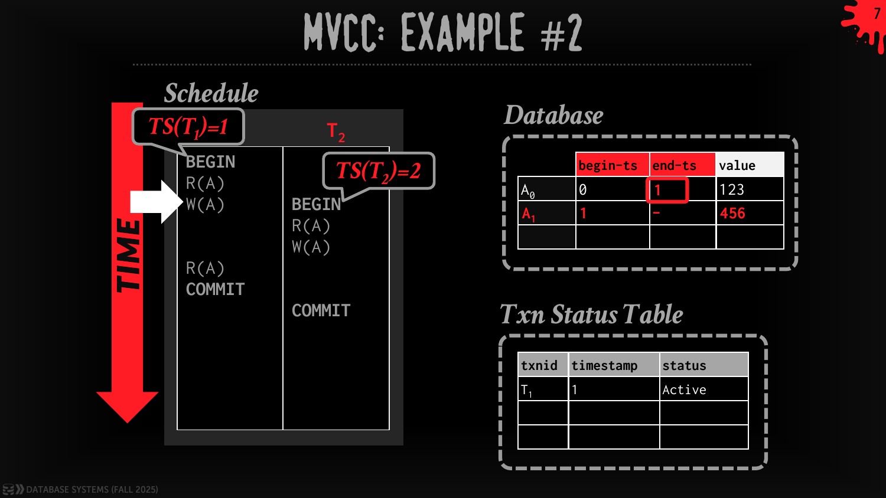


| 步骤 | T1（TS = 1） | T2（TS = 2） | A 的各个版本 | [事务状态表](#事务状态表) | 说明 |
|---|---|---|---|---|---|
| 1 | `BEGIN` | | A0：[0, ∞)，123 | T1：活跃 | |
| 2 | `R(A)` | | | | 读到 A0 |
| 3 | `W(A)` | | A0：[0, 1)，123<br>A1：[1, ∞)，456 | | 新建 A1，A0 的 end-ts 设为 1 |
| 4 | | `BEGIN` | | T2：活跃 | |
| 5 | | `R(A)` | | | 读到 A0，见下文 |
| 6 | | `W(A)` | | T2：已[中止](#中止) | 最新版本 A1 的创建者 T1 尚未[提交](#提交)，写写[冲突](#冲突) |
| 7 | `R(A)` | | | | 读到自己写的 A1 |
| 8 | `COMMIT` | | | T1：已提交 | |

第 5 步最容易糊涂。单看区间，A0 的区间 [0, 1) 不包含 2，A1 的区间 [1, ∞) 包含 2，似乎 T2 应该读 A1。但 A1 的创建者 T1 在状态表里还是活跃的，A1 不能给别人看；同样，A0 的 end-ts 是 T1 写上去的，T1 没有[提交](#提交)，这个“结束”对 T2 来说也就还没有发生。所以 T2 读到的是 A0。
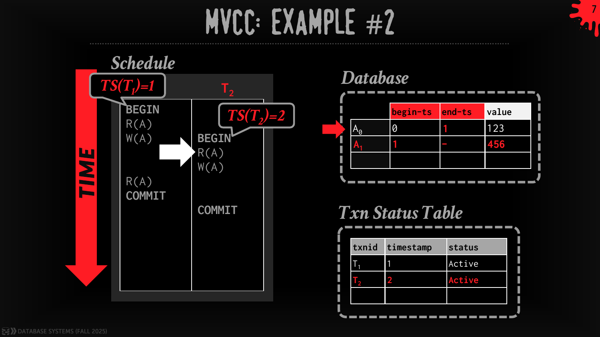


第 6 步，T2 要写 A。A 的最新版本是 A1，它的创建者 T1 还在运行。如果允许 T2 在 A1 后面再接一个 A2，就是在一个可能被[撤销](#撤销)的修改之上继续修改，T1 一旦[中止](#中止)，A2 就建在了不存在的基础上；即使 T1 最终[提交](#提交)，T2 的写很可能是基于它读到的 A0 算出来的，T1 的修改会被悄悄覆盖，这就是[丢失更新](#丢失更新)（lost update）。所以 T2 只能中止。两个[事务](#事务)写同一个对象，先写的那个赢，这条规则在第 3 节还会出现。
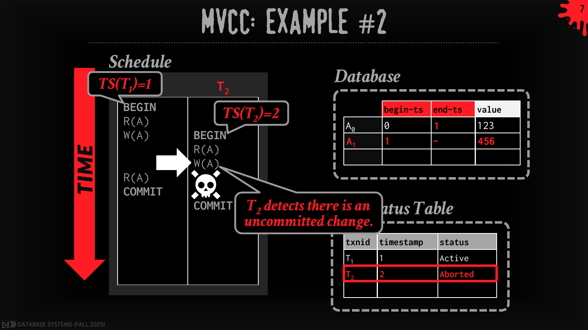

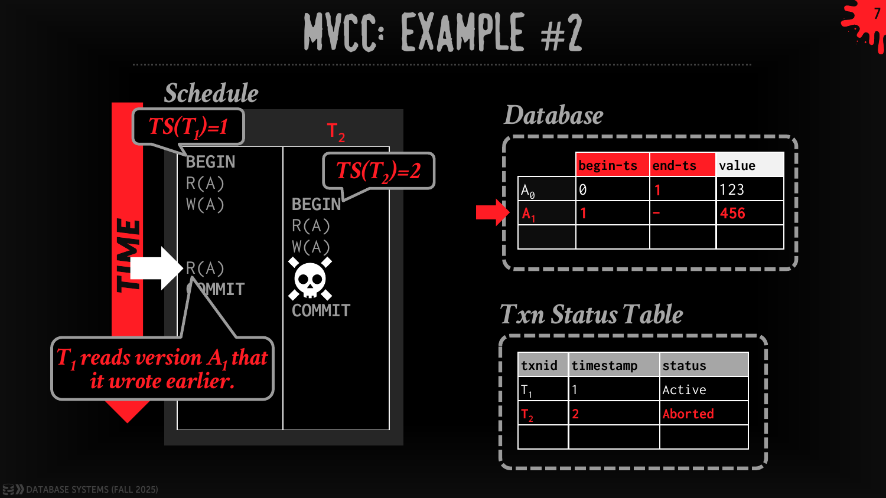

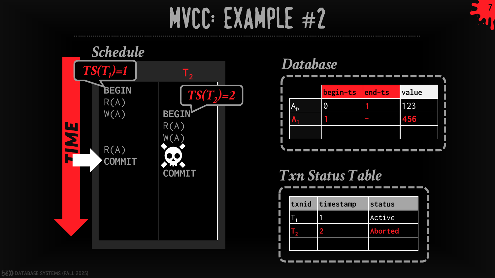

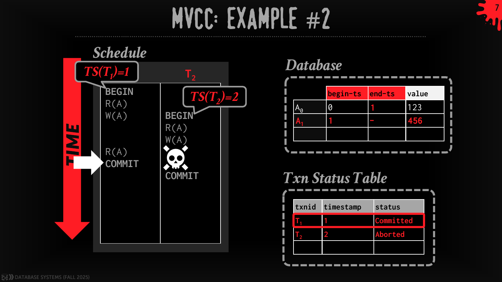


### 2.3 把规则写完整：快照

📍 *PPT 第 6–7 页*

上面的判断还差最后一块。设想 T3（TS = 3）开始时 T2 还在运行，T3 第一次读 A，A1 的创建者 T2 未[提交](#提交)，T3 读到 A0；接着 T2 提交了，T3 再读 A。如果此时才去查状态表，会发现 T2 已提交，A1 于是变得可见，T3 两次读到的值就不一样了。

问题出在查状态表的时机。一个[事务](#事务)应该看到的，是它开始那一刻已经[提交](#提交)的全部数据，所以“创建者是否已提交”要按事务开始时的情况来判断，而不是按读的时候。实现上的做法是：事务开始时复制一份[事务状态表](#事务状态表)，作为自己的**[快照](#快照)**（snapshot），其中真正用得上的，是当时仍然活跃的那些事务。[快照](#快照)中记为活跃的那些事务，即使后来提交了，它们写的版本对这个事务也始终不可见。

把以上几条合起来，可见性判断可以写成下面这段 Python：

```python
def committed_before(ts, me):
    # The writer with timestamp ts counts for me only if it had already
    # committed when I started, i.e., it was not active in my snapshot.
    return ts < me.ts and ts not in me.active_at_start and status(ts) == COMMITTED

def is_visible(v, me):
    # Rule 1: the version was created by me, or by a txn that committed before I started.
    if not (v.begin_ts == me.ts or committed_before(v.begin_ts, me)):
        return False
    # Rule 2: nobody whose writes I can see has replaced it yet.
    if v.end_ts == INF:
        return True
    return not (v.end_ts == me.ts or committed_before(v.end_ts, me))
```

`me.active_at_start` 就是[快照](#快照)。拿上一节的第 5 步验证一下：T2 的[快照](#快照)里记着 T1 活跃，A1 的 begin-ts 是 1，不满足规则 1，不可见；A0 满足规则 1，它的 end-ts 同样是 1，`committed_before(1, T2)` 为假，所以 A0 没有被“替换”，可见。规则里不需要为已[中止](#中止)的[事务](#事务)单独写一条：中止事务的状态不是已[提交](#提交)，它创建的版本过不了规则 1，它设置的 end-ts 也不算数。第 4.3 节会在 PostgreSQL 里看到这种情形。

写的规则可以用同样的语言说清楚：[事务](#事务)要在 A 的最新版本后面接新版本，这个最新版本的创建者必须是自己，或者在自己开始之前就已[提交](#提交)，否则就是写写[冲突](#冲突)，事务[中止](#中止)。这比上一节第 6 步的情形多要求了一点：即使 T1 在 T2 开始之后、T2 写 A 之前就提交了，T2 也不能写，因为它读到的 A0 已经过时。

PostgreSQL 就是这样实现的。每个[元组头](#元组头)部的 `xmin` 和 `xmax` 两个字段，分别记录创建它和删除（或替换）它的[事务](#事务)号，相当于 begin-ts 和 end-ts；[快照](#快照)里记着拍[快照](#快照)时仍在运行的事务号。在读已[提交](#提交)（read committed）级别下，PostgreSQL 每执行一条语句就重新拍一次[快照](#快照)；在可重复读（repeatable read）级别下，整个事务只用第一次拍的那一张。第 4.3 节的实验会直接显示这几个字段。

## 3. [快照隔离](#快照隔离)：挡住了什么，放过了什么

📍 *PPT 第 8–9 页*

### 3.1 [快照隔离](#快照隔离)（Snapshot Isolation）

📍 *PPT 第 8 页*

第 2 节的可见性规则给出的效果有一个名字：**[快照隔离](#快照隔离)**（Snapshot Isolation，[SI](#快照隔离)）。[事务](#事务)开始时，它看到的是[数据库](#数据库)在那一刻的一个一致[快照](#快照)：[快照](#快照)里只有在它开始之前已经[提交](#提交)的事务写下的数据，没有任何[活跃事务](#活跃事务)写了一半的东西（no torn writes）。如果 T1 改了 A 和 B，别的事务要么同时看到两处修改，要么一处都看不到，不会看到改了 A 而没改 B 的中间状态。事务自己的写，要么留在[私有工作区](#私有工作区)里，要么带着事务元数据写进存储，都只在它成功提交之后才对其他事务可见。只读事务在这种隔离下尤其轻松，它们从不需要等待任何写事务。

写写[冲突](#冲突)的规则是**[先写者胜](#先写者胜)**（first-writer-wins）：两个[并发](#并发)[事务](#事务)修改同一个对象，先写的那个赢，后写的那个[中止](#中止)，第 2.2 节的 T2 就是这样被中止的。（PPT 第 8 页误作“后写者胜”，Andy 在课上已更正，Lecture Notes 写的也是[先写者胜](#先写者胜)。）[快照隔离](#快照隔离)最初的定义把这条规则表述为“先提交者胜”（first-committer-wins），即并发写同一对象的事务里只有先[提交](#提交)的能成功；多数系统在写的那一刻就做检查，表现出来便是[先写者胜](#先写者胜)。它防住的是[丢失更新](#丢失更新)：两个事务都读到余额 100，各自加 10 后写回，若两者都能提交，最终余额是 110 而不是 120。

[快照隔离](#快照隔离)在第 [19](../L19/index.md) 讲的[隔离级别](#隔离级别)体系里处在什么位置？读已[提交](#提交)、可重复读、[可串行化](#可串行化)这条线，是按“允许哪些异常”由弱到强排出来的，[快照隔离](#快照隔离)并不落在这条线的某一点上。它比读已提交强，因为[脏读](#脏读)和[不可重复读](#不可重复读)都不会发生；它和可重复读则各有所长。SQL 标准定义的可重复读允许[幻读](#幻读)，[快照隔离](#快照隔离)不允许，因为同一[事务](#事务)中的范围扫描读的是同一张[快照](#快照)，别人后来插入的行在这张[快照](#快照)里根本不存在；[快照隔离](#快照隔离)却允许下一节的[写偏斜](#写偏斜)，而用[锁](#锁)实现的可重复读不允许。所以[快照隔离](#快照隔离)并不弱于读已提交，Andy 把它画成与那条线平行的另一条轨道。

1992 年的 SQL 标准定义[隔离级别](#隔离级别)时，只考虑了基于[锁](#锁)的系统，没有料到多版本系统会出现别的异常。几年之后，一篇题为“A Critique of ANSI SQL Isolation Levels”的论文补上了这个缺口，作者中有几位当时在微软，[写偏斜](#写偏斜)正是在这篇论文中被正式提出的。

### 3.2 [写偏斜](#写偏斜)（Write Skew）

📍 *PPT 第 9 页*

[快照隔离](#快照隔离)只在两个[事务](#事务)写同一个对象时才出手。如果两个事务各自读了对方要写的东西，写的却是互不相交的对象，它就察觉不到任何[冲突](#冲突)。这种异常叫**[写偏斜](#写偏斜)**（write skew）。

PPT 第 9 页用的是 Jim Gray 的弹珠比喻。一个袋子里有四颗弹珠，两黑两白。T1 把所有白色弹珠改成黑色，T2 把所有黑色弹珠改成白色，两个[事务](#事务)同时开始：
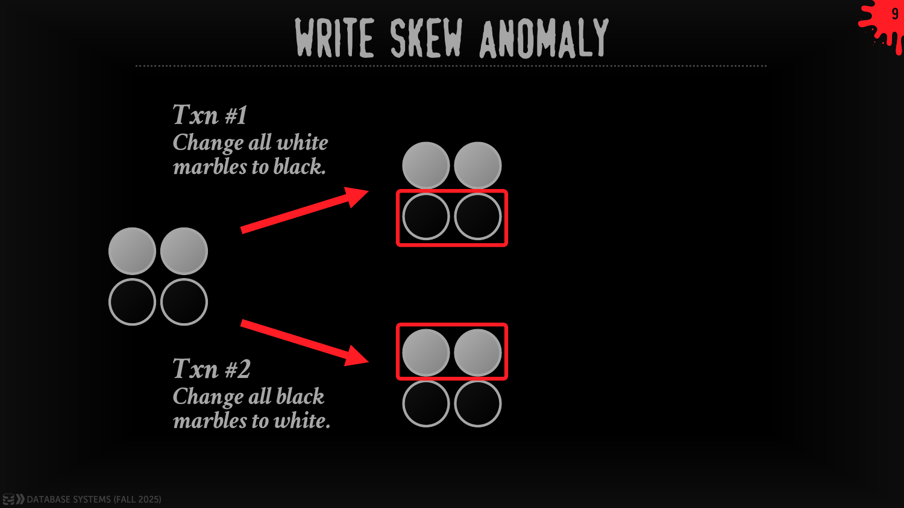


| 步骤 | T1：白色改成黑色 | T2：黑色改成白色 |
|---|---|---|
| 1 | `BEGIN`，[快照](#快照)中两黑两白 | `BEGIN`，[快照](#快照)中两黑两白 |
| 2 | 找到两颗白色，为它们写入黑色的新版本 | 找到两颗黑色，为它们写入白色的新版本 |
| 3 | `COMMIT` | `COMMIT` |

两个[事务](#事务)的写集没有交集，[先写者胜](#先写者胜)的规则无从触发，两者都[提交](#提交)成功。最终袋子里仍是两黑两白，只是每颗弹珠都换了颜色。如果串行执行，先 T1 后 T2 得到四颗白色，先 T2 后 T1 得到四颗黑色；“两黑两白”不对应任何一种串行顺序，这个调度不[可串行化](#可串行化)。
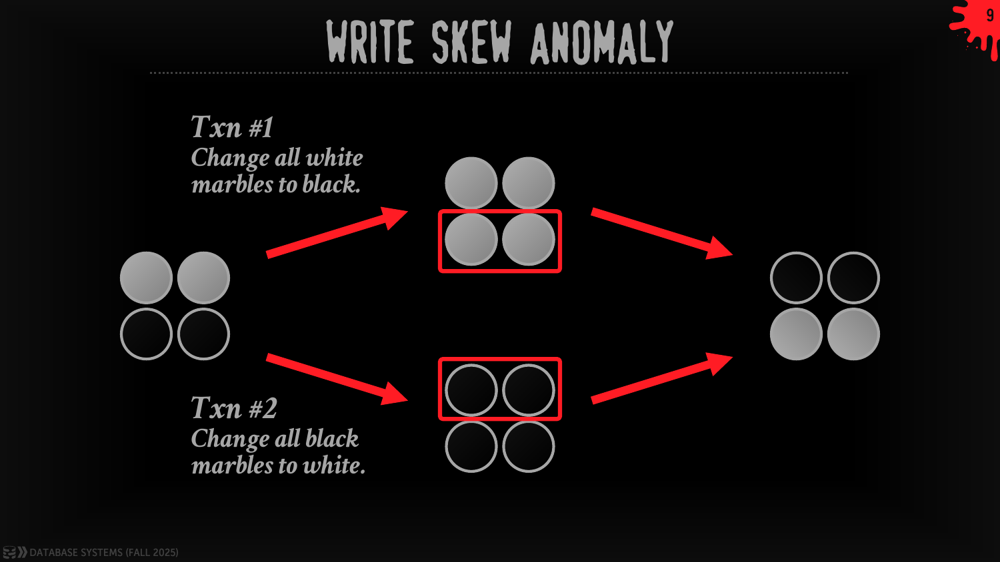

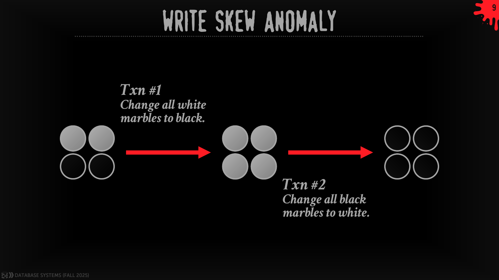


用第 [17](../L17/index.md) 讲的依赖图可以看得更清楚。T1 为了找白色弹珠，读了全部四颗，其中两颗黑色随后被 T2 改写，所以 T1 必须排在 T2 之前；对称地，T2 也必须排在 T1 之前，图中出现了环。[两阶段锁](#两阶段锁)不会放过这个调度，T1 读弹珠时拿到的[共享锁](#共享锁)会挡住 T2 的[排他锁](#排他锁)。[快照隔离](#快照隔离)察觉不到，是因为它根本不记录谁读了什么。

弹珠听起来无伤大雅，同样的结构放进业务里就是真实的事故。比如医院规定每晚至少一位医生值班，Alice 和 Bob 当晚都在岗，两人同时申请下班。两个[事务](#事务)各自先数一数在岗人数，[快照](#快照)里都是 2，确认有人顶班后各自把自己改成下班。它们改的是不同的行，都能[提交](#提交)，结果当晚没有人值班。

要堵住[写偏斜](#写偏斜)需要额外的手段，这超出了本讲的范围：一种是在读的时候显式加[锁](#锁)，比如 `SELECT ... FOR UPDATE`；另一种是 PostgreSQL [可串行化](#可串行化)级别采用的可串行化[快照隔离](#快照隔离)（Serializable Snapshot Isolation），它在[快照隔离](#快照隔离)之上追踪读写依赖，发现可能成环时[中止](#中止)其中一个[事务](#事务)。

> 💬 **旁注**
> Jim Gray 因为在[数据库](#数据库)与[事务](#事务)处理上的贡献获得了 1998 年的图灵奖。Andy 特别佩服他的一点是，他很擅长把非常复杂的数据库概念化成人人都能听懂的简单说法。“五分钟法则”也出自 Jim Gray 和同事之手：一[页](#页)数据如果每五分钟左右就会被访问一次，就值得常驻内存。
>
> *原话：“He was very good at simplifying really complex database concepts into easy things to understand.”*

## 4. MVCC 不只是一个协议

📍 *PPT 第 10–13 页*

### 4.1 名字里的“[并发](#并发)控制”

📍 *PPT 第 10–11 页*

[MVCC](#多版本并发控制) 的名字容易让人误会。Andy 特意提醒，尽管名字里带着“[并发](#并发)控制”，它并不是前两讲那种意义上的加[锁](#锁)协议或[时间戳排序](#时间戳排序)协议。[^1] [冲突](#冲突)发生时谁等待、谁[中止](#中止)，仍然要由[两阶段锁](#两阶段锁)、时间戳排序或 OCC 来决定；[MVCC](#多版本并发控制) 在此之上引入的，是“同一个[逻辑对象](#逻辑对象)可以同时存在多个[物理版本](#物理版本)”这件事。

这一件事几乎牵动了 DBMS 的每一个部分。构建一个多版本的 DBMS，要回答五个设计问题：
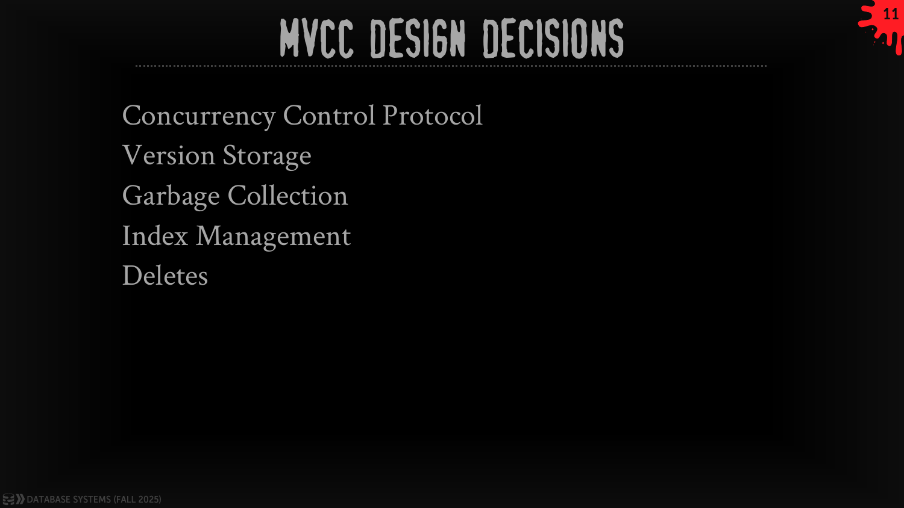


1. [并发控制协议](#并发控制协议)：在多个版本之上用哪种协议处理[冲突](#冲突)（本节）。
2. 版本存储：版本放在哪里，每个版本存什么（第 5 节）。
3. 垃圾回收：不再需要的版本怎样找到、何时清理（第 6 节）。
4. [索引](#索引)管理：版本的位置变了，索引指向哪里（第 7 节）。
5. 删除：怎样表示一个逻辑[元组](#元组)已被删除（第 8 节）。

前面学过的存储、[索引](#索引)、扫描[算子](#算子)，一旦数据有了多个版本，都得重新考虑一遍。改动这样大，仍然值得去做，按 Andy 的说法，今天几乎所有现代[数据库](#数据库)系统都在使用某种形式的多版本。[^2]
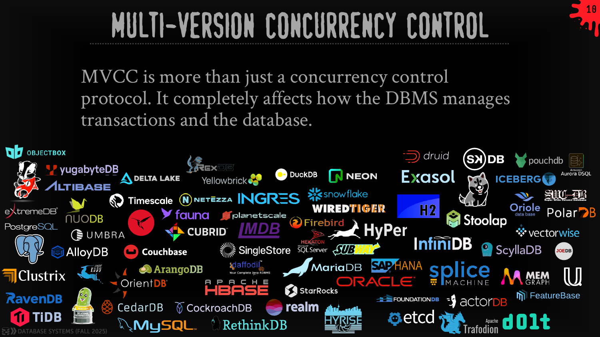


### 4.2 在多版本之上运行[两阶段锁](#两阶段锁)

📍 *PPT 第 12–13 页*

前两讲的三种协议都可以搬到多版本数据上。多版本[时间戳排序](#时间戳排序)（MV-TO）为[事务](#事务)分配[时间戳](#时间戳)来决定串行顺序，第 2 节的两个例子就属于这一种。多版本[乐观并发控制](#乐观并发控制)（MV-OCC）沿用第 [19](../L19/index.md) 讲的三阶段协议，事务新建的版本先放在[私有工作区](#私有工作区)里。多版本[两阶段锁](#两阶段锁)（MV-2PL）要求事务在读写一个逻辑[元组](#元组)之前先拿到相应的[锁](#锁)。

PPT 第 13 页用第 2.2 节同样的调度演示 MV-2PL，只是[冲突](#冲突)的处理方式变了：
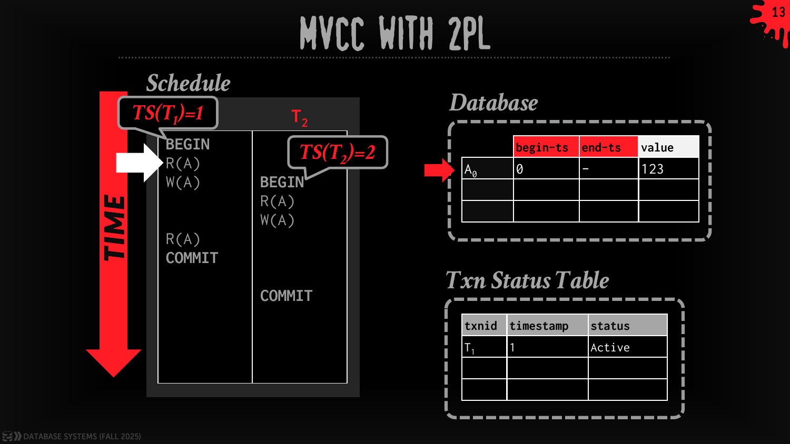

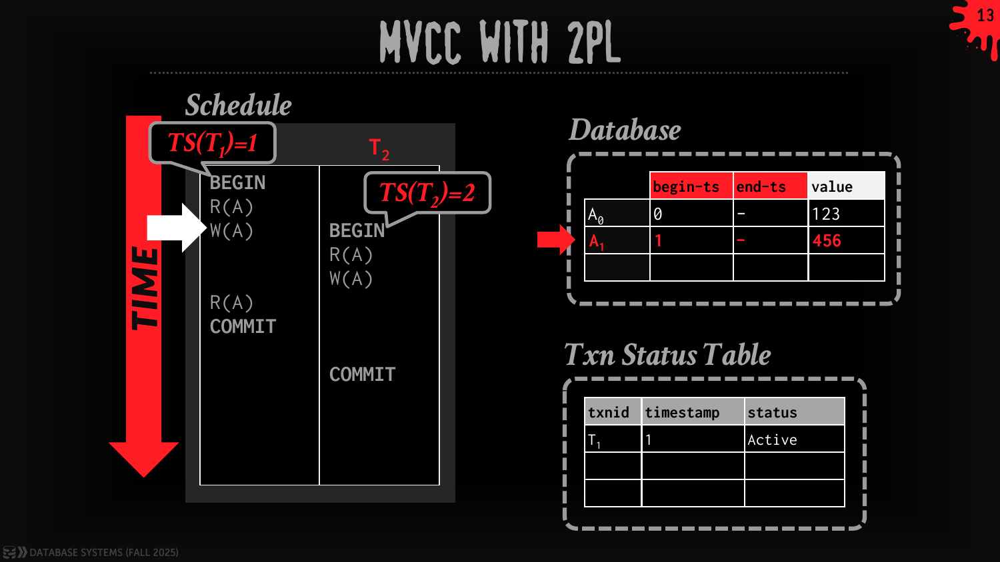

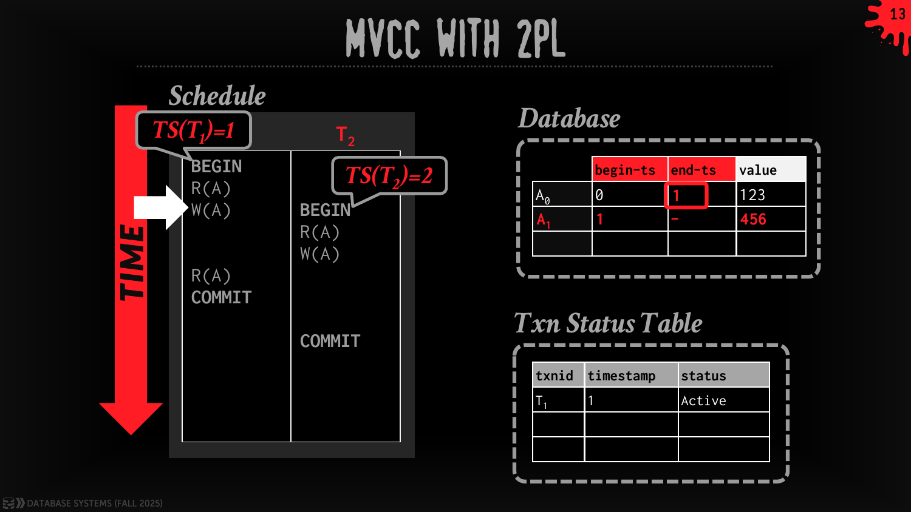


| 步骤 | T1（TS = 1） | T2（TS = 2） | A 的各个版本 | 说明 |
|---|---|---|---|---|
| 1 | `BEGIN`；`R(A)` | | A0：[0, ∞)，123 | 读到 A0 |
| 2 | `W(A)` | | A0：[0, 1)，123<br>A1：[1, ∞)，456 | T1 拿到 A 的写[锁](#锁) |
| 3 | | `BEGIN`；`R(A)` | | T1 未[提交](#提交)，T2 读 A0，不必等锁 |
| 4 | | `W(A)` | | 拿不到 A 的写锁，阻塞 |
| 5 | `R(A)` | | | 读到自己写的 A1 |
| 6 | `COMMIT` | | | T1 已提交，释放写锁 |
| 7 | | （`W(A)` 继续） | A1：[1, 2)，456<br>A2：[2, ∞)，789 | T2 拿到写锁，新建 A2 |
| 8 | | `COMMIT` | | |

和单版本的[两阶段锁](#两阶段锁)相比，收获在第 3 步：T1 持有 A 的写[锁](#锁)，T2 照样读到了 A0，因为它读的是旧版本，而写锁防的只是再造一个新版本。在这个例子里读操作根本不加锁，只有写操作需要锁。[事务](#事务)扫描时会在物理上读到各个版本并逐个判断可见性，这个过程也不需要锁，只有要修改某个逻辑[元组](#元组)时，才去拿它的锁。
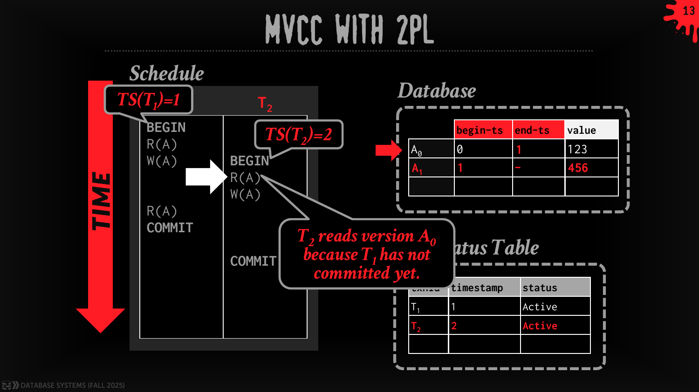

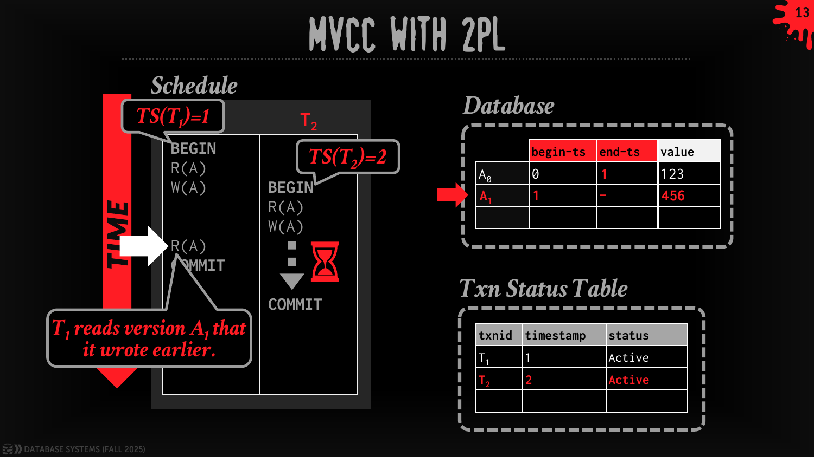


[锁](#锁)加在什么东西上？PPT 的写法是[事务](#事务)在[物理版本](#物理版本)上加锁，Andy 在课上则反复强调锁的是逻辑[元组](#元组) A，而不是某个[物理版本](#物理版本)。两种说法并不矛盾：实现上，锁往往就记在最新版本的头部，比如一个记录持锁事务号的字段，而只有最新版本后面才能接新版本，锁住它，效果就是锁住了整个逻辑元组。锁也不能按[记录 ID](#记录%20ID) 来加，因为新版本的物理位置会变；通常用[主键](#主键)来标识被锁的元组，这样执行 `UPDATE` 时，拿到主键就能先加锁、再去修改。

同样的调度，在第 2.2 节的 MV-TO 下 T2 写 A 时立即被[中止](#中止)，在这里只是等待，等 T1 [提交](#提交)后接着写。代价是：T2 在第 3 步读到的是 123，而它写下 789 时，A 已经被 T1 改成了 456，如果 789 是 T2 根据 123 算出来的，T1 的修改就丢了。系统允不允许这样做，取决于[隔离级别](#隔离级别)。在读已提交下，系统会在拿到[锁](#锁)之后重新读一次最新的已提交版本，在它的基础上执行更新，下一节 PostgreSQL 的实验正是如此；在[快照隔离](#快照隔离)下，T1 在 T2 开始之后提交，又和 T2 写了同一个对象，T2 必须中止，PostgreSQL 的可重复读级别此时会报出串行化失败的错误。

### 4.3 在 PostgreSQL 和 MySQL 里观察多版本

📍 *PPT 第 13 页之后（现场演示）*

下面几组实验各开两个会话，在 PostgreSQL 和 MySQL 里验证前面的规则。按 Andy 的说法，PostgreSQL 几乎就是这类系统的教科书式实现，[^3] 它的行为可以直接对照第 2 节的规则。实验用的表 `transaction_demo` 有 `id` 和 `val` 两列、两行数据，`id = 1` 那一行的 `val` 起初为 100。表格中的 `SELECT` 和 `UPDATE` 指的是这两条语句：

```sql
SELECT val FROM transaction_demo WHERE id = 1;
UPDATE transaction_demo SET val = val + 1 WHERE id = 1;
```

**实验一：PostgreSQL 的默认级别，读已[提交](#提交)。**

| 步骤 | 会话 1 | 会话 2 | 结果 |
|---|---|---|---|
| 1 | `BEGIN` | `BEGIN` | |
| 2 | `UPDATE` | | 会话 1 自己读到 101 |
| 3 | | `SELECT` | 100：会话 1 尚未[提交](#提交) |
| 4 | | `UPDATE` | 阻塞：`id = 1` 的写[锁](#锁)在会话 1 手里 |
| 5 | `COMMIT` | | 会话 2 的 `UPDATE` 随即完成 |
| 6 | | `SELECT` | 102 |

最后的值是 102，而不是会话 2 读到过的 100 加 1。会话 2 的 `UPDATE` 拿到[锁](#锁)以后，读已[提交](#提交)级别允许它看到会话 1 刚提交的 101，它在 101 的基础上加 1。两次加 1 都生效了，没有[丢失更新](#丢失更新)。

**实验二：MySQL 的默认级别，可重复读。**

| 步骤 | 会话 1 | 会话 2 | 结果 |
|---|---|---|---|
| 1 | `BEGIN`；`SELECT` | `BEGIN`；`SELECT` | 都是 100 |
| 2 | `UPDATE` | | |
| 3 | | `SELECT` | 100 |
| 4 | `COMMIT` | | |
| 5 | | `SELECT` | 仍然是 100 |

会话 1 已经[提交](#提交)，会话 2 仍然看到 100，因为 MySQL 默认的[隔离级别](#隔离级别)是可重复读，会话 2 整个[事务](#事务)读的都是同一张[快照](#快照)。再做一轮：会话 1 先改，会话 2 在此之后才第一次读，读到的是修改之前的值；会话 1 提交后会话 2 再读，仍然是修改之前的值。MySQL 的 InnoDB 引擎在事务第一次读数据时才拍下[快照](#快照)，那一刻会话 1 尚未提交，它的修改就一直留在这张[快照](#快照)之外。

**实验三：看见版本。** PostgreSQL 允许在查询里直接选出[元组头](#元组头)部的系统列：

```sql
SELECT xmin, xmax, ctid, * FROM transaction_demo;
```

`xmin` 和 `xmax` 就是第 2.3 节说的创建者和替换者的[事务](#事务)号，`xmax` 为 0 表示这是最新版本；`ctid` 是[元组](#元组)的物理位置（[页](#页)号，[槽](#槽)号），也就是第 [3](../L03/index.md) 讲的[记录 ID](#记录%20ID)。两个会话都以[可串行化](#可串行化)级别开始事务（`BEGIN ISOLATION LEVEL SERIALIZABLE;`），会话 1 先读一遍，然后会话 2 修改 `id = 1` 那一行，并用 `RETURNING` 子句取回自己的事务号：

```sql
UPDATE transaction_demo SET val = val + 1 WHERE id = 1 RETURNING txid_current();
```

返回的[事务](#事务)号是 1397。这时两个会话各自再查一次 `id = 1`：

| | 会话 1 看到的版本 | 会话 2 看到的版本 |
|---|---|---|
| `ctid` | (0,1) | (0,3) |
| `xmin` | 创建它的更早的[事务](#事务) | 1397 |
| `xmax` | 1397（此前是 0） | 0 |

会话 1 仍然看到旧版本，但旧版本的 `xmax` 已经被填上了会话 2 的[事务](#事务)号，这正是第 2 节里“新建版本，同时改写旧版本的 end-ts”那一步。会话 2 看到的是自己新建的版本，位于同一[页](#页)的第 3 个[槽](#槽)；`id = 2` 那一行没有改动，两个会话看到的都是 (0,2)。PostgreSQL 把新版本和旧版本放在同一张表的页里，这就是第 5 节要讨论的[仅追加存储](#仅追加存储)。`ctid` 也可以写在 `WHERE` 条件里，直接按物理位置取[元组](#元组)，但版本一变位置就变，不应依赖它。

**实验四：[死锁检测](#死锁检测)。** MV-2PL 用[锁](#锁)处理写写[冲突](#冲突)，就可能出现[死锁](#死锁)，PostgreSQL 也就需要第 [18](../L18/index.md) 讲的死锁检测。先把 `deadlock_timeout`（等锁多久之后开始检查死锁）设为 10 秒。会话 1 更新 `id = 1`，会话 2 更新 `id = 2`，然后会话 1 去更新 `id = 2`，会话 2 去更新 `id = 1`，两者互相等待。10 秒后检测器发现环路，报出 `deadlock detected` 并中止会话 1 的[事务](#事务)，会话 1 的锁一释放，会话 2 的更新立刻完成。

**实验五：PostgreSQL 的读未[提交](#提交)。** 两个会话都以读未提交（read uncommitted）级别开始。会话 1 修改一行而不提交，会话 2 去读，按读未提交的定义它可以看到这个未提交的值，实际上却看不到。PostgreSQL 接受了读未提交的设置，实际执行的却是读已提交，因为支持读取未提交的数据要专门多做一份工程，而在多版本系统里读一个一致的[快照](#快照)本来就不费事，读未提交能带来多少性能好处也很难说。Andy 的评价是，PostgreSQL 在对你撒谎，不过是善意的谎言。[^4] Oracle 的做法恰好相反：你要求[可串行化](#可串行化)，它答应下来，实际给的却是[快照隔离](#快照隔离)。在 Andy 看来，给的比要求的多，总比给的比要求的少要好。

这一轮里还有一个细节。表中某个版本的 `xmax` 是 1399，而 1399 是一个已经[回滚](#回滚)的[事务](#事务)。读者看到这个 `xmax`，要去[事务状态表](#事务状态表)（在 PostgreSQL 中是记录每个事务[提交](#提交)状态的提交[日志](#日志)）里查 1399 的结局，发现它已[中止](#中止)，就知道这个版本并没有被替换，仍然是最新版本。这正是第 2.3 节规则 2 对中止事务的处理方式。

（建议回看视频：约 PPT 第 13 页之后的现场演示。）

## 5. 版本放在哪里：版本存储

📍 *PPT 第 14–19 页*

### 5.1 版本链（Version Chain）

📍 *PPT 第 14 页*

前几节默认[事务](#事务)能找到一个逻辑[元组](#元组)的所有版本，再逐个判断可见性。如果每次都要在整张表里把 A 的版本找齐，代价不可接受。DBMS 的做法是在[元组头](#元组头)部放一个指针字段，把同一个逻辑元组的所有版本串成一条按[时间戳排序](#时间戳排序)的单向链表，叫作**[版本链](#版本链)**（version chain）。这与第 [13](../L13/index.md) 讲[万圣节问题](#万圣节问题)的解法是同一个思路：都在元组头部记下“它被改过”，只不过那里记的是修改者，这里记的是指向旧版本的指针。[索引](#索引)永远指向链的头部（head），事务从链头出发，沿着指针走到第一个对自己可见的版本为止。

```c
struct version {
    uint64_t    begin_ts;  // timestamp of the txn that created this version
    uint64_t    end_ts;    // timestamp of the txn that replaced it; UINT64_MAX means infinity
    record_id_t next;      // location of the next version of the same logical tuple
    char        data[];    // attribute values follow the header
};
```

`next` 存的是[记录 ID](#记录%20ID)（[页](#页)号加[槽](#槽)号），而不是内存地址，因为版本存放在磁盘页里，页被[缓冲池](#缓冲池)换进换出，内存地址并不固定。

链表的形状定下来之后，剩下的问题是链上的节点放在哪里、每个节点存什么。这就是版本存储方案（version storage scheme）要回答的，常见的有三种：[仅追加存储](#仅追加存储)、[时间旅行存储](#时间旅行存储)和[增量存储](#增量存储)。
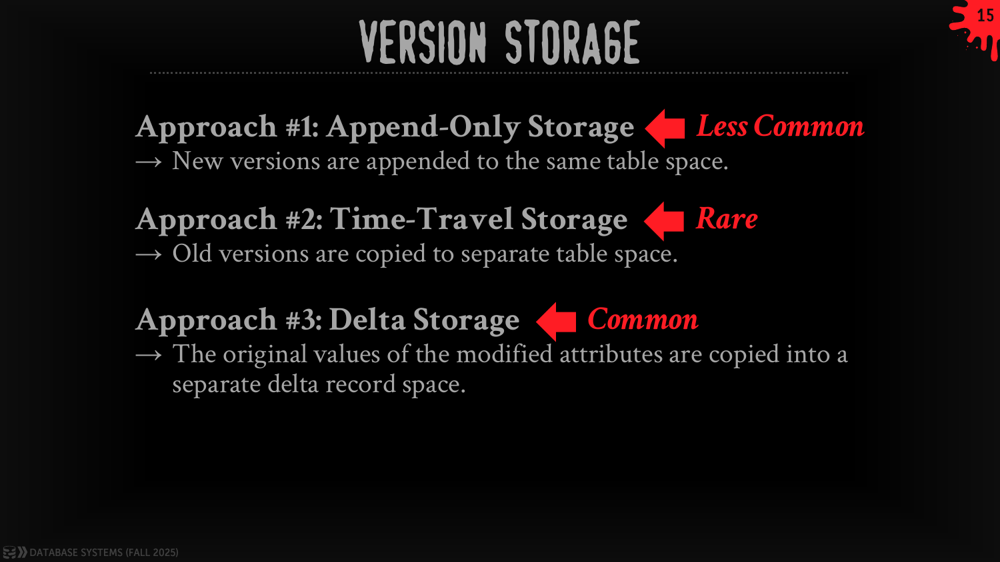


### 5.2 仅追加存储（Append-Only Storage）

📍 *PPT 第 15–16 页*

**[仅追加存储](#仅追加存储)**把一个逻辑[元组](#元组)的所有[物理版本](#物理版本)都放在同一个表空间里，新旧版本混杂在一起。每次更新，DBMS 把当前版本整个复制一份，在副本上做修改，再把它追加到表中的某个空位上，最后更新[版本链](#版本链)的指针。PPT 第 16 页的例子：


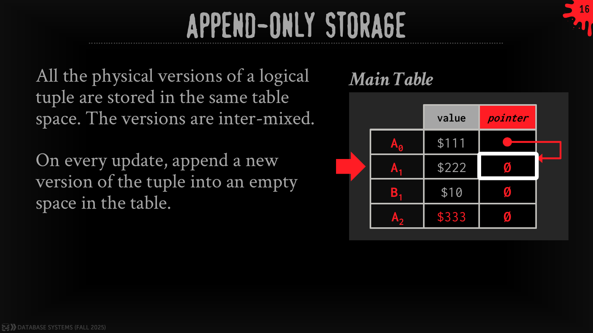

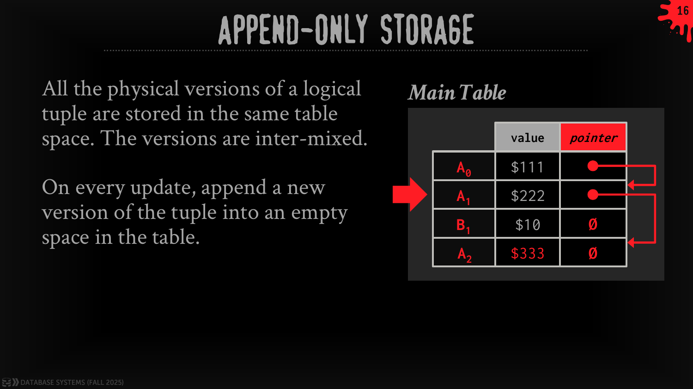


```text
Before UPDATE A                         After UPDATE A
Main Table                              Main Table
+----+-------+----------+               +----+-------+----------+
|    | value | pointer  |               |    | value | pointer  |
+----+-------+----------+               +----+-------+----------+
| A0 | $111  | -> A1    |               | A0 | $111  | -> A1    |
| A1 | $222  | Ø        |               | A1 | $222  | -> A2    |
| B1 | $10   | Ø        |               | B1 | $10   | Ø        |
+----+-------+----------+               | A2 | $333  | Ø        |
                                        +----+-------+----------+
```

这个方案实现起来最简单，只要能复制[元组](#元组)、能找到空位就够了。第 4.3 节实验三中，新版本出现在同一[页](#页)的 (0,3)，PostgreSQL 用的就是这种方案。它的代价留到讲完另外两种方案之后一起比较（第 5.6 节），先看它马上带来的一个问题：链的方向。

### 5.3 版本链的方向

📍 *PPT 第 17 页*

[仅追加存储](#仅追加存储)中，新版本可以接在链尾，也可以插在链头。
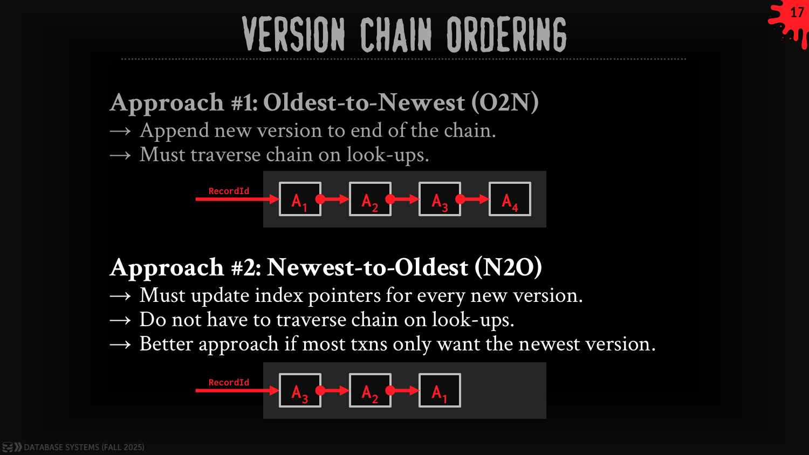


**[从旧到新](#从旧到新)**（Oldest-to-Newest，[O2N](#从旧到新)）：链头是最老的版本，新版本追加到链尾。

```text
Before:  RecordId --> A1 --> A2 --> A3
After:   RecordId --> A1 --> A2 --> A3 --> A4      (index still points to A1)
```

**[从新到旧](#从新到旧)**（Newest-to-Oldest，[N2O](#从新到旧)）：链头是最新的版本，新版本插在链头。
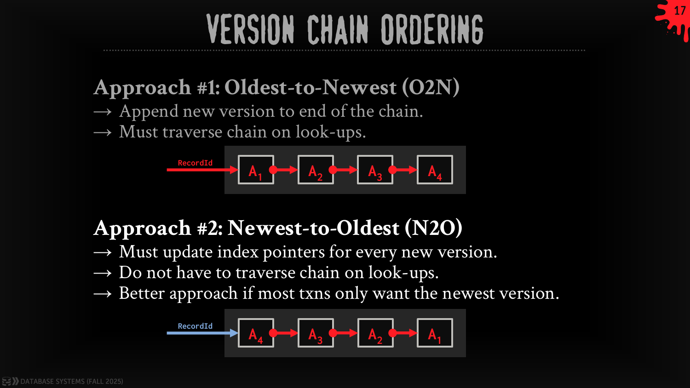


```text
Before:  RecordId --> A3 --> A2 --> A1
After:   RecordId --> A4 --> A3 --> A2 --> A1      (index moved from A3 to A4)
```

两者的得失正好相反。[O2N](#从旧到新) 追加新版本时[索引](#索引)不用动，但多数[事务](#事务)要的恰恰是最新版本，每次查找都得从最老的版本一路走到链尾，链越长越慢。[N2O](#从新到旧) 查找时停在链头就能拿到最新版本，代价是每产生一个新版本，所有指向这个[元组](#元组)的索引都要改指针。多数事务只关心最新版本，所以一般认为 [N2O](#从新到旧) 是更好的选择。[O2N](#从旧到新) 也有它的用处，它让协作式垃圾回收成为可能（第 6.2 节）。PostgreSQL 的[版本链](#版本链)是 [O2N](#从旧到新) 的。
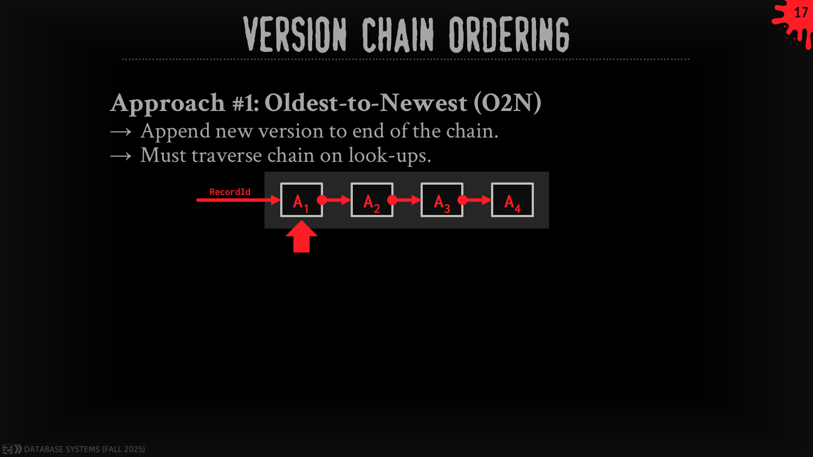

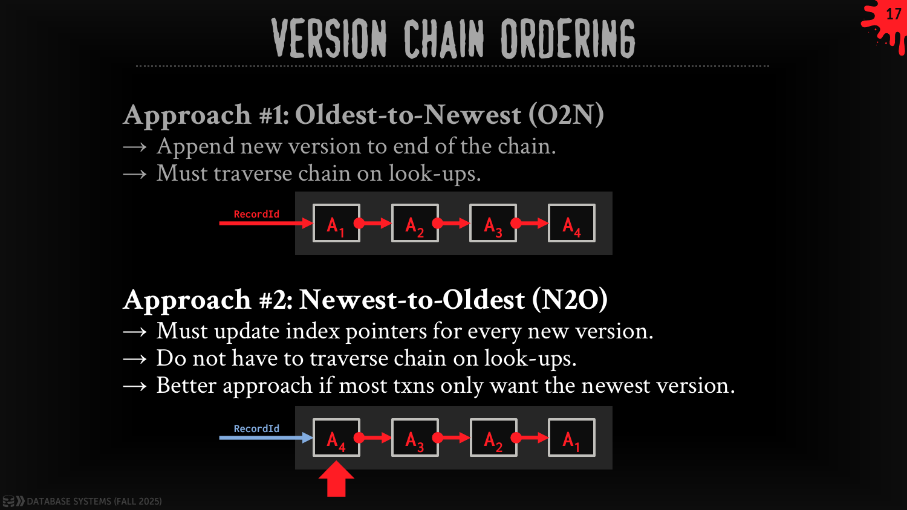


### 5.4 时间旅行存储（Time-Travel Storage）

📍 *PPT 第 18 页*

[仅追加存储](#仅追加存储)的一个麻烦是新旧版本混在同一张表里。**[时间旅行存储](#时间旅行存储)**把旧版本挪了出去：DBMS 另外维护一张**时间旅行表**（time-travel table），主表里只保留每个逻辑[元组](#元组)的主版本（master version），也就是最新版本。每次更新，先把当前的主版本整个复制到时间旅行表，副本的指针指向更老的版本，然后在主表里原地覆盖主版本，让它的指针指向刚复制出去的那一份。时间旅行表里存的是全部旧版本，不只是上一个版本。PPT 第 18 页的例子：

```text
Before UPDATE A
Main Table                       Time-Travel Table
+----+-------+---------+         +----+-------+---------+
| A2 | $222  | -> A1   |         | A1 | $111  | Ø       |
| B1 | $10   |         |         +----+-------+---------+
+----+-------+---------+

After UPDATE A
Main Table                       Time-Travel Table
+----+-------+---------+         +----+-------+---------+
| A3 | $333  | -> A2   |         | A1 | $111  | Ø       |
| B1 | $10   |         |         | A2 | $222  | -> A1   |
+----+-------+---------+         +----+-------+---------+
```

链的方向在这里是 [N2O](#从新到旧)，主表中的主版本就是链头。与[仅追加存储](#仅追加存储)的 [N2O](#从新到旧) 不同，主版本是原地覆盖的，它在主表里的位置不变，指向它的[索引](#索引)也就不用动。另一个好处在清理时才显现出来：旧版本全在时间旅行表里，垃圾回收只需扫描这张表，不会打扰在主表上运行的[事务](#事务)。[仅追加存储](#仅追加存储)做不到这一点，PostgreSQL 的 vacuum 必须进入主表去清理。SQL Server 的常规存储引擎把旧版本放在 tempdb 的版本存储区里，采用的就是这种思路；PPT 第 33 页的表中，SAP HANA 也采用[时间旅行存储](#时间旅行存储)。不过总体而言，这种方案很少见。
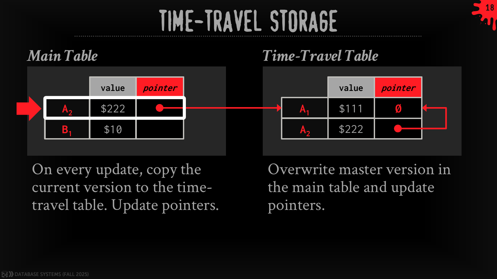

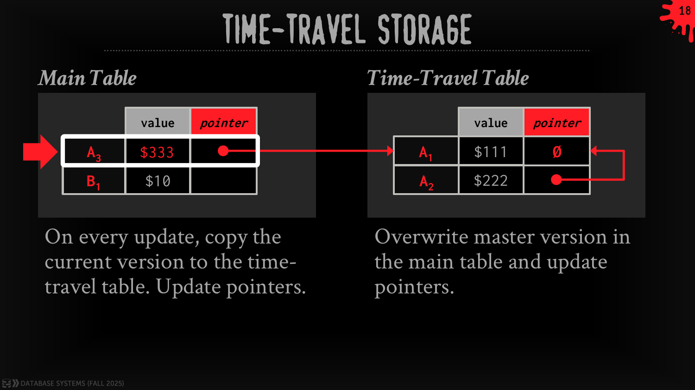

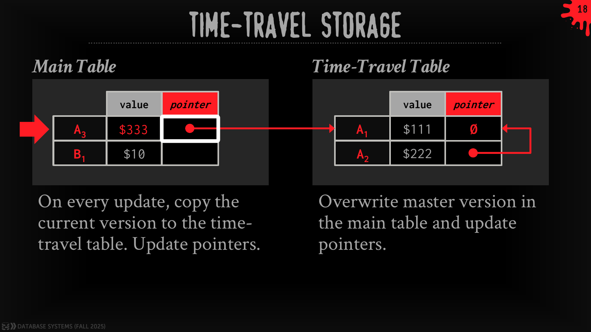

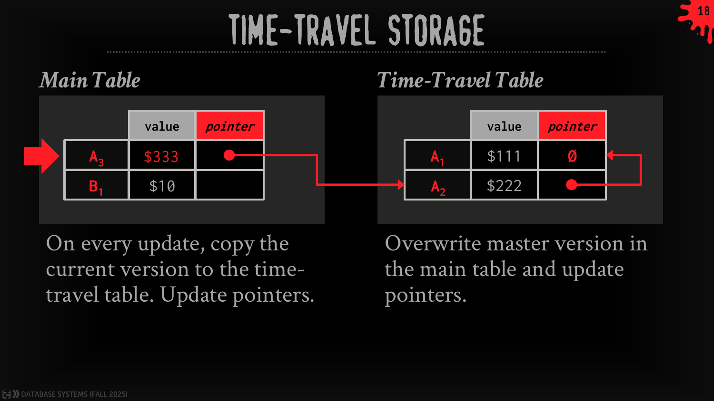


### 5.5 [增量存储](#增量存储)（Delta Storage）

📍 *PPT 第 19 页*

[时间旅行存储](#时间旅行存储)仍然每次复制整个[元组](#元组)。如果一张表有一千列，一次更新只改了其中一列，却要把一千列全部复制一遍。**[增量存储](#增量存储)**只复制被修改的那几列的原值：每次更新，DBMS 把被修改[属性](#属性)的旧值写进一个独立的**[增量存储](#增量存储)段**（delta storage segment），形成一条增量记录（delta record），然后在主表里原地覆盖主版本，并让它的指针指向这条增量记录。PPT 第 19 页的例子里，A 连续被更新两次：

```text
(1) Initial
Main Table                   Delta Storage Segment
| A1 | $111 |                (empty)
| B1 | $10  |

(2) After UPDATE A: $111 -> $222
Main Table                   Delta Storage Segment
| A2 | $222 | -> A1          | A1 | (VALUE -> $111) | Ø     |
| B1 | $10  |

(3) After UPDATE A: $222 -> $333
Main Table                   Delta Storage Segment
| A3 | $333 | -> A2          | A1 | (VALUE -> $111) | Ø     |
| B1 | $10  |                | A2 | (VALUE -> $222) | -> A1 |
```

增量记录 `A2 (VALUE -> $222)` 的意思是：要回到版本 A2，把 `VALUE` 改回 $222。[事务](#事务)要重建一个旧版本，就从主版本出发，沿着链把增量记录按从新到旧的顺序逐条“反向打补丁”：从 A3 的 $333 出发，应用 A2 的增量得到 $222，再应用 A1 的增量得到 $111。这和用 `diff` 生成的补丁把文件一步步退回旧版是同一个道理。

与[时间旅行存储](#时间旅行存储)相比，[增量存储](#增量存储)写得更快，因为每次复制的数据更少；读旧版本则更慢，因为要逐条应用增量才能把它重建出来。读最新版本不受影响，它就在主表里。清理同样简单：[增量存储](#增量存储)段与主表分开存放，其中某一段增量如果已经老到没有任何[事务](#事务)需要，可以整块丢弃，完全不碰主表。

Oracle 和 MySQL 都采用[增量存储](#增量存储)，它们把存放这些旧值的地方叫作**[回滚段](#回滚段)**（rollback segment），因为这里存的正是把数据“滚回”旧值所需的信息。这份数据还有第二个用途：[事务](#事务)[中止](#中止)时，DBMS 同样要靠这些旧值[撤销](#撤销)它的修改，第 [21](../L21/index.md)、[22](../L22/index.md) 讲会再遇到它。

### 5.6 三种方案的取舍

📍 *PPT 第 15 页*

| | [仅追加存储](#仅追加存储) | [时间旅行存储](#时间旅行存储) | [增量存储](#增量存储) |
|---|---|---|---|
| 旧版本存放在 | 主表，与新版本混在一起 | 独立的时间旅行表 | 独立的[增量存储](#增量存储)段 |
| 每次更新复制 | 整个[元组](#元组) | 整个元组 | 被修改的列 |
| 主表中的元组 | 新旧版本都有 | 只有最新版本，原地覆盖 | 只有最新版本，原地覆盖 |
| 更新时链头是否移动 | [N2O](#从新到旧) 移动；[O2N](#从旧到新) 不移动 | 不移动 | 不移动 |
| 清理时是否进入主表 | 是 | 否 | 否 |
| 普及程度（PPT 第 15 页） | 较少见 | 罕见 | 常见 |
| 代表系统（PPT 第 33 页） | PostgreSQL、SQL Server Hekaton | SAP HANA | Oracle、MySQL、SingleStore、DuckDB、HyPer、CockroachDB |

Andy 对[仅追加存储](#仅追加存储)的态度十分明确：别这么做，哪怕 PostgreSQL 就是这么做的；PostgreSQL 作为一个[数据库](#数据库)系统固然出色，这一块却是它实现得最差的部分。[^5] 上面的比较已经给出了理由。每次更新都复制整个[元组](#元组)；旧版本和新版本挤在同一批[页](#页)里，扫描主表时要跨过大量无用的旧版本；清理必须进入主表，和正常[事务](#事务)争用同一批页；链头位置变化时，指向它的[索引](#索引)也要跟着改，第 7 节会看到这一点在[二级索引](#二级索引)上的代价有多大。PostgreSQL 的这套设计定型于 1980 年代，今天从头构建的系统不会再这样选。对于[增量存储](#增量存储)，他的评价是：MySQL 和 Oracle 用的就是它，这才是正确的做法。[^6]
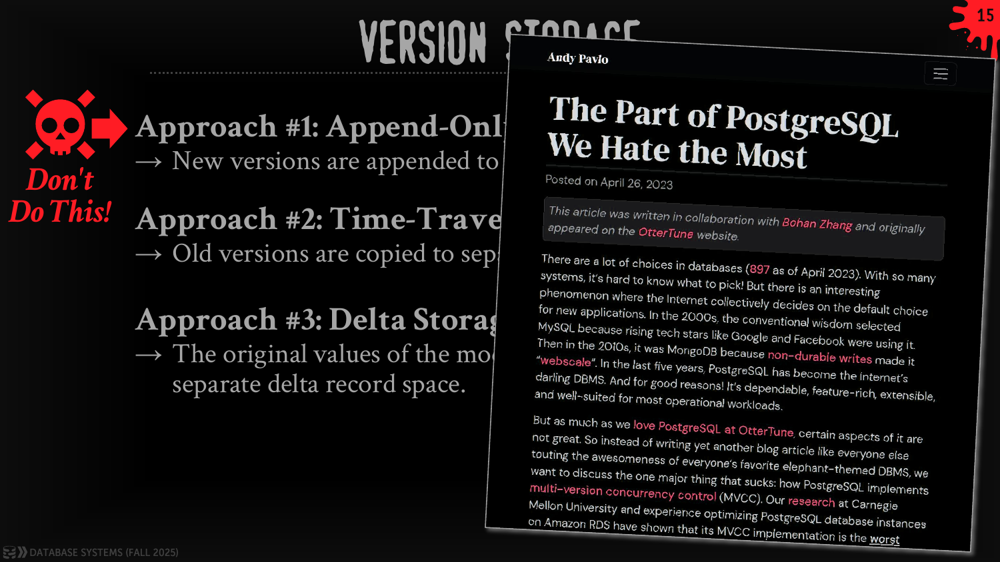


## 6. 清理不再可见的版本：垃圾回收

📍 *PPT 第 20–24 页*

### 6.1 哪些版本可以回收

📍 *PPT 第 20 页*

[MVCC](#多版本并发控制) 从不覆盖旧数据，版本只会越积越多，DBMS 必须定期把可回收的[物理版本](#物理版本)清理掉。一个版本在两种情况下可以回收：在[快照隔离](#快照隔离)下，已经没有任何[活跃事务](#活跃事务)能看到它；或者它是由一个已[中止](#中止)的[事务](#事务)创建的，本来就不会有人看到它。

由此引出两个设计问题：怎样找到这些过期的版本，以及怎样判断回收它们是安全的。

安全性的判断靠一条**[水位线](#水位线)**（watermark），即所有[活跃事务](#活跃事务)中最小的[时间戳](#时间戳)。时间戳只增不减，新开始的[事务](#事务)只会拿到更大的时间戳，所以一个版本的 end-ts 如果小于[水位线](#水位线)，并且替换它的事务已经[提交](#提交)，那么现有的事务看不到它，将来的事务也看不到它，它就可以回收。在第 2.3 节那种按[快照](#快照)判断可见性的实现里，[水位线](#水位线)要取得更保守一些，取所有活跃事务的[快照](#快照)里记录的最老的那个事务。

[水位线](#水位线)会随着老[事务](#事务)的结束不断前移，前提是没有事务一直不结束。只要有一个事务开着几个小时不[提交](#提交)，[水位线](#水位线)就卡在它那里，这段时间里整个[数据库](#数据库)产生的旧版本都无法回收。在 PostgreSQL 的运维中，开启事务后就闲置不动的连接，是表和[索引](#索引)膨胀的常见原因。

### 6.2 [元组](#元组)级回收（Tuple-Level GC）

📍 *PPT 第 21–22 页*

**[元组](#元组)级回收**直接检查元组本身来找旧版本，有两种做法。
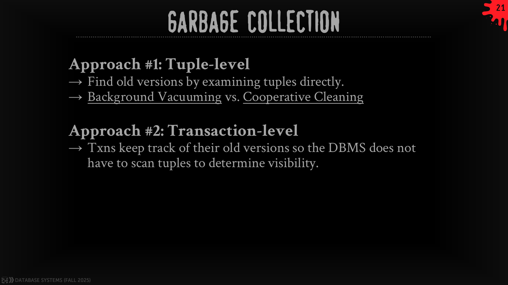


**[后台清理](#后台清理)**（background vacuuming）由独立的线程周期性地扫描表，找出可回收的版本。PPT 第 22 页的例子中有两个[活跃事务](#活跃事务)，[时间戳](#时间戳)分别是 12 和 25，[水位线](#水位线)是 12：

| 版本 | begin-ts | end-ts | [时间戳](#时间戳) 12、25 的[事务](#事务)能否看到 | 处理 |
|---|---|---|---|---|
| A100 | 1 | 9 | 都不能 | 回收 |
| B100 | 1 | 9 | 都不能 | 回收 |
| B101 | 10 | 20 | 12 能看到 | 保留 |

A 的更新版本不在这张表里，但它们一定存在于别处，否则 A100 的 end-ts 不会是 9。[后台清理](#后台清理)不关心版本以何种方式存储，适用于任何版本存储方案。

它的问题是要扫描整张表。如果一张大表自上次清理以来只改过几[页](#页)，逐页读一遍不但浪费 I/O，还会把大量用不着的页读进[缓冲池](#缓冲池)（第 [4](../L04/index.md) 讲），把真正有用的页挤出去。一个简单的优化是维护一张**[脏块位图](#脏块位图)**（dirty block bitmap），每一位对应一个页，记录它自上次清理以来是否被修改过，清理线程只处理位图中标记过的页。位图只说明页被改过，不说明改了什么，但足以跳过大量无须处理的页。PostgreSQL 的可见性映射（visibility map）是同一思路的另一面：它为每个页记一位，表示这一页里的[元组](#元组)是否已经对所有[事务](#事务)可见，这样的页 vacuum 可以直接跳过。
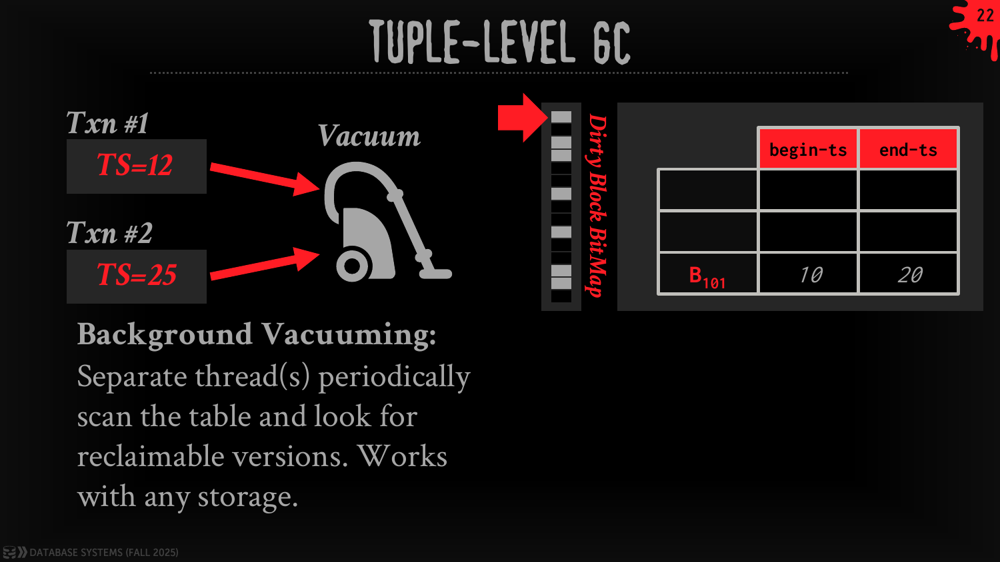

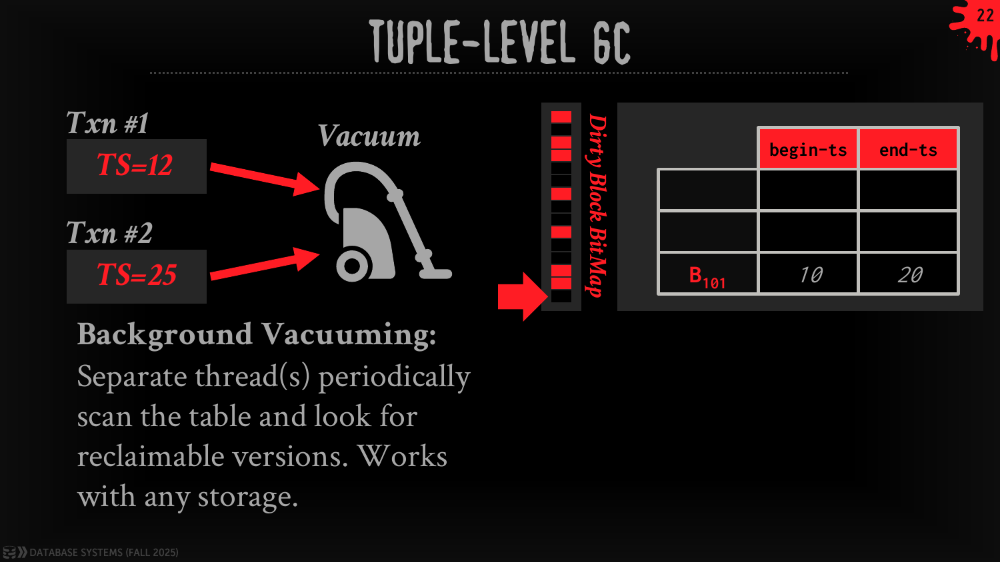


**[协作式清理](#协作式清理)**（cooperative cleaning）不另设线程，由执行查询的工作线程顺手完成：[事务](#事务)沿着[版本链](#版本链)寻找自己要的版本时，每遇到一个对所有[活跃事务](#活跃事务)都不可见的版本，就把它从链上摘下来回收。PPT 第 22 页的例子中，一个事务执行 `GET(A)`：
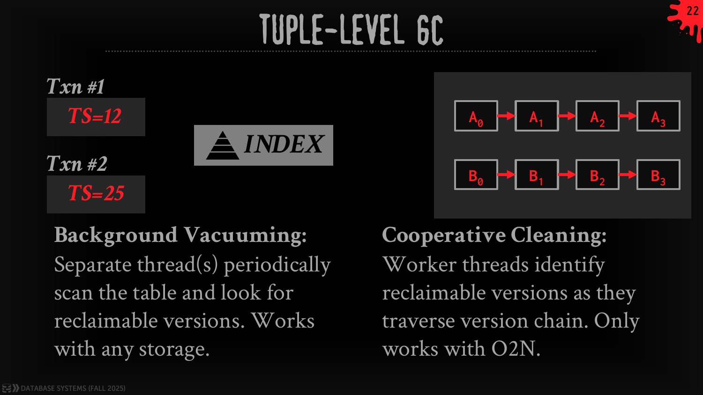

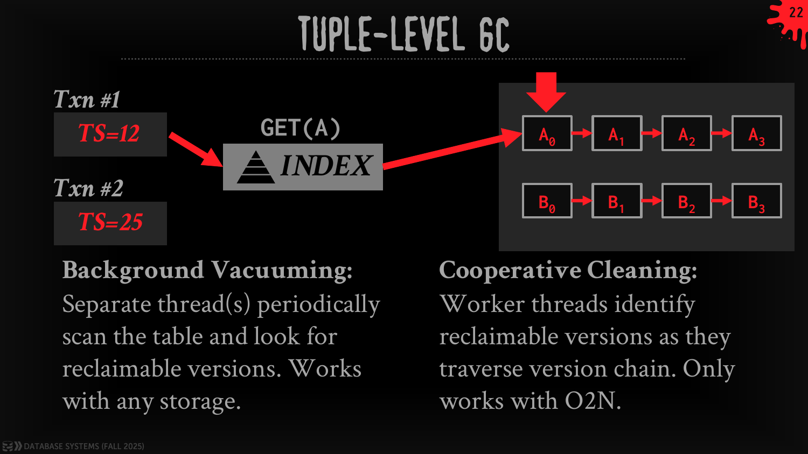

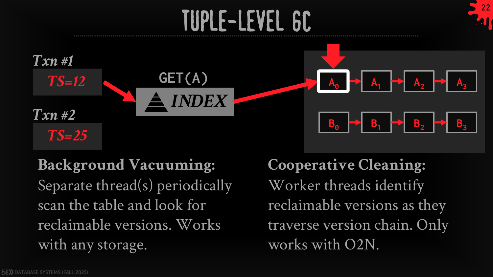

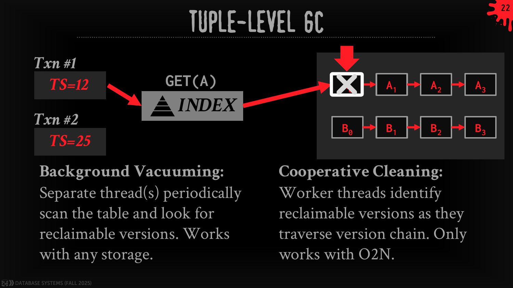


```text
Before GET(A)
INDEX --> A0 --> A1 --> A2 --> A3
INDEX --> B0 --> B1 --> B2 --> B3

After GET(A)       (A0 and A1 were invisible to every active txn)
INDEX --> A2 --> A3
INDEX --> B0 --> B1 --> B2 --> B3
```

这种做法只适用于 [O2N](#从旧到新) 的[版本链](#版本链)。[O2N](#从旧到新) 链的头部是最老的版本，垃圾恰好集中在[事务](#事务)出发的地方，事务从头走起，必然先经过它们；换成 [N2O](#从新到旧)，事务在链头附近就找到了自己要的版本，永远走不到堆积着垃圾的链尾。

它也带来两个副作用。第一，读操作变成了写操作：摘掉 A0、A1 之后，[索引](#索引)要改为指向 A2。用 Andy 的话说，本该只读的 `SELECT` 查询，现在实际上在做更新。[^7] 逻辑上[数据库](#数据库)的内容没有变，所以不需要加[锁](#锁)；但物理上改了数据结构，需要拿[闩](#闩)（第 [10](../L10/index.md) 讲）。第二，没有人访问的[版本链](#版本链)永远不会被清理。例子中 B 的[版本链](#版本链)没有被任何[事务](#事务)访问，其中再旧的版本也会一直留在那里。文献里把这类很少被访问、因而也很少被清理的地方叫作“积灰的角落”（dusty corners）。所以采用[协作式清理](#协作式清理)的系统仍然需要[后台清理](#后台清理)线程，隔一段时间把这些角落扫一遍。
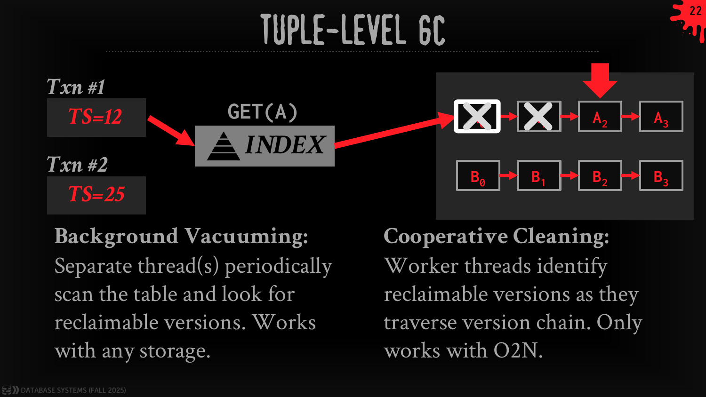

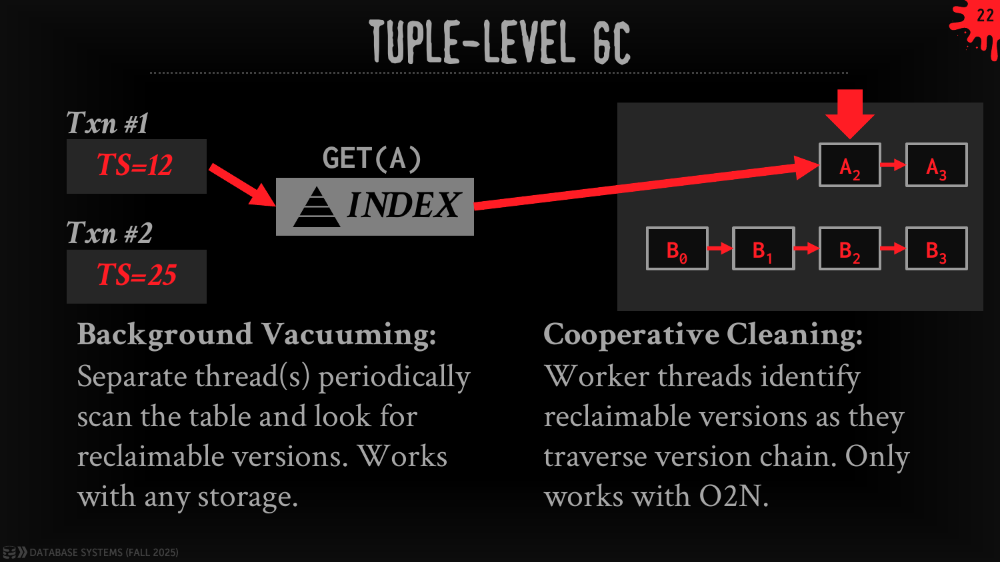


### 6.3 事务级回收（Transaction-Level GC）

📍 *PPT 第 23–24 页*

[元组](#元组)级回收要到数据里去“找”垃圾。**[事务级回收](#事务级回收)**换了一个思路：旧版本是谁造成的，就由谁来登记。每个[事务](#事务)在执行过程中记下自己让哪些版本失效了，[提交](#提交)或[中止](#中止)时，把这份清单交给一个集中的 vacuum 线程；DBMS 定期检查，一个已结束事务留下的这些版本何时不再对任何事务可见，到时直接回收，完全不必扫描元组。通常说事务记录的是自己的读写集，回收真正用得上的只是其中的写集。

PPT 第 24 页的例子：
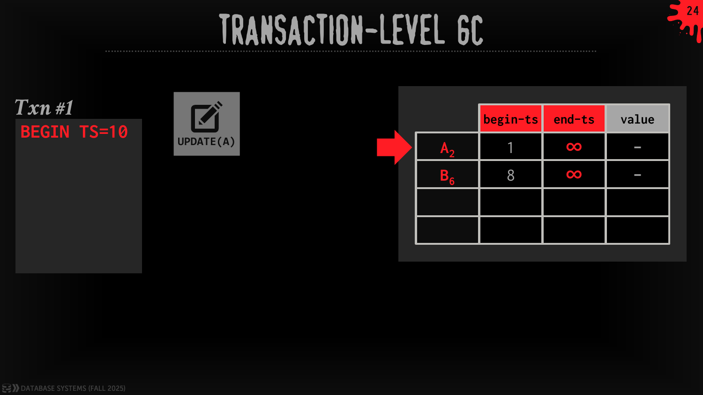


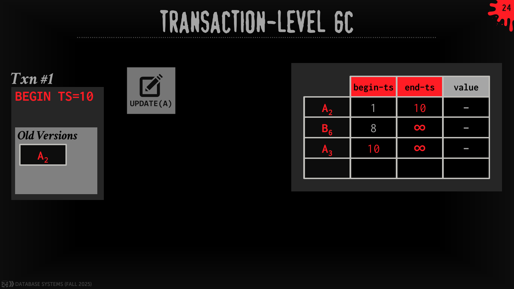

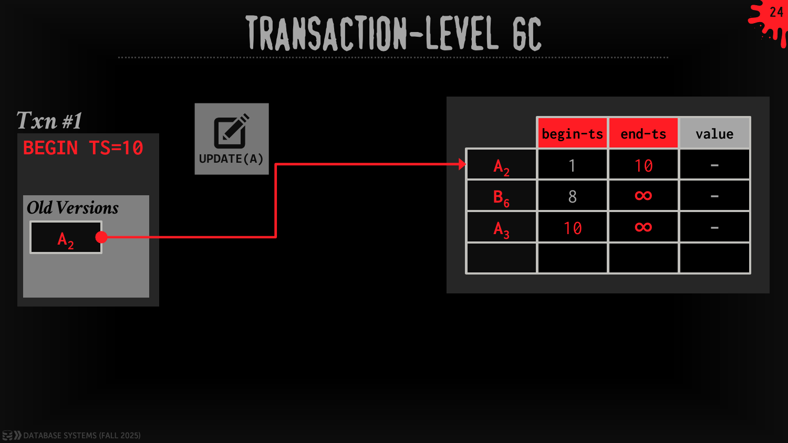


| 步骤 | Txn #1 的操作 | 版本变化 | 登记的旧版本 |
|---|---|---|---|
| 1 | `BEGIN`，TS = 10 | A2：[1, ∞)；B6：[8, ∞) | 无 |
| 2 | `UPDATE(A)` | 新建 A3：1[0, ∞)；A2 变为 [1, 10) | A2 |
| 3 | `UPDATE(B)` | 新建 B7：[1[0, ∞)；B6 变为 [8, 10) | A2、B6 |
| 4 | `COMMIT`，TS = 15 | | 把 A2、B6 交给 vacuum 线程 |

A2 和 B6 的 end-ts 都是 10，只有[时间戳](#时间戳)小于 10 的[事务](#事务)才能看到它们。vacuum 线程只需等到系统中不再有时间戳小于 10 的[活跃事务](#活跃事务)，就可以直接回收这两个版本。如果事务[中止](#中止)，要回收的则是它自己新建的 A3 和 B7。PPT 第 33 页中，DuckDB 和 HyPer 采用这种方式。

## 7. 版本在动，[索引](#索引)指向哪里

📍 *PPT 第 25–30 页*

### 7.1 [主键](#主键)[索引](#索引)

📍 *PPT 第 25 页*

[主键](#主键)[索引](#索引)永远指向[版本链](#版本链)的头部。它需要多频繁地更新，取决于系统在更新[元组](#元组)时是否把新版本放到新的位置：[仅追加存储](#仅追加存储)配合 [N2O](#从新到旧)，每次更新都产生新的链头，主键索引每次都要改；[时间旅行存储](#时间旅行存储)和[增量存储](#增量存储)原地覆盖主版本，链头不动，主键索引也就不用动。MySQL 的 InnoDB 采用[索引组织存储](#索引组织存储)（第 [5](../L05/index.md) 讲），元组本身就存放在主键 [B+ 树](#B+%20树)的[叶节点](#叶节点)里，叶节点中的那条记录就是逻辑上的链头，旧版本放在[回滚段](#回滚段)中。


如果[事务](#事务)修改的正是[元组](#元组)的[主键](#主键)[属性](#属性)，DBMS 把它当作一次 `DELETE` 加一次 `INSERT`：新主键在[索引](#索引)中的位置和旧主键不同，在逻辑上这已经是另一个元组了。先插入新键、确认没有冲突再删除旧键，效果也一样。旧主键对应的[版本链](#版本链)以一次删除结束，这会引出第 7.3 节要处理的一种情况。

### 7.2 [二级索引](#二级索引)：物理指针与逻辑指针

📍 *PPT 第 26–27 页*

[二级索引](#二级索引)要复杂得多。它的值部分必须指向某个东西，而链头的位置可能不断变化。有两种做法。


**[物理指针](#物理指针)**（physical pointer）：[二级索引](#二级索引)直接存链头的物理地址，即[记录 ID](#记录%20ID)。在仅追加、[N2O](#从新到旧) 的方案下，每次更新都产生新的链头，所有指向它的[索引](#索引)都要跟着改。

**[逻辑指针](#逻辑指针)**（logical pointer）：给每个[元组](#元组)一个固定不变的标识，[二级索引](#二级索引)存这个标识，再通过一个间接层把它翻译成链头的物理位置。这个标识可以是[主键](#主键)，也可以是系统分配的元组 ID，后者需要一张从元组 ID 到[记录 ID](#记录%20ID) 的映射表。链头移动时，只需改间接层里的那一处，二级索引一个也不用动；代价是每次通过二级索引查找都要多走一层。

PPT 第 27 页对比了这两种做法（[仅追加存储](#仅追加存储)，[N2O](#从新到旧)）：

```text
Physical pointers: every index stores the Record Id of the chain head

PRIMARY INDEX   --(Record Id)--+
SECONDARY INDEX --(Record Id)--+
SECONDARY INDEX --(Record Id)--+--> A4 --> A3 --> A2 --> A1
SECONDARY INDEX --(Record Id)--+

Logical pointers: secondary indexes store the primary key

SECONDARY INDEX --(Primary Key)--> PRIMARY INDEX --(Record Id)--> A4 --> A3 --> A2 --> A1
```

一张表往往建有好几个[二级索引](#二级索引)。在[物理指针](#物理指针)方案下，哪怕一次更新只改了一个没有建[索引](#索引)的列，只要它产生了新的链头，所有二级索引都要更新，每棵 [B+ 树](#B+%20树)都要走一遍[闩](#闩)蟹行协议（第 [10](../L10/index.md) 讲）。MySQL 选择了[逻辑指针](#逻辑指针)：二级索引的值是[元组](#元组)的[主键](#主键)，通过二级索引查找时，先拿到主键，再到主键索引里查一次。由于 InnoDB 是索引组织的，第二次查找到达[叶节点](#叶节点)时元组也就到手了，额外代价不大。只有当被修改的列正好是某个二级索引的键，或者主键本身被修改时，相应的二级索引才需要更新。

两种选择的差距在真实系统里可以大到让一家公司更换[数据库](#数据库)。Uber 在 2016 年发表过一篇博客，解释他们为什么把数据库从 PostgreSQL 换成 MySQL，核心原因之一就在这里。PostgreSQL 的[索引](#索引)存的是[元组](#元组)的物理位置 `ctid`，而它的[仅追加存储](#仅追加存储)让每次更新都产生一个位于新位置的新版本，于是每次更新都要在表上的每一个索引里插入新的索引项，即使被修改的列与这些索引毫无关系；MySQL 的[二级索引](#二级索引)存[主键](#主键)，只有涉及被修改列的索引才需要更新。在 Uber 这种写入密集、索引又多的负载下，前者的[写放大](#写放大)非常可观。PostgreSQL 为缓解这个问题做过一种称为 HOT（Heap-Only Tuple）的优化：如果一次更新没有修改任何被索引的列，而新版本又恰好放得进旧版本所在的[页](#页)，就不新增索引项，而是让查找从旧版本在页内跳到新版本。这个优化的细节超出了本讲范围。

按 Andy 的解释，PostgreSQL 也从这种设计中得到一点好处。它的[版本链](#版本链)是 [O2N](#从旧到新) 的，一条长链可能横跨好几个[页](#页)，而[索引](#索引)为同一个逻辑[元组](#元组)的不同版本各存了一个索引项，扫描可以直接跳到链上的某个位置，不必从最老的版本一路走过来。代价是更新时每个索引都要多出一项，清理时又要把指向已回收版本的索引项一一删掉：扫描变快了，删除变慢了。

> 💬 **旁注**
> Uber 最初用的其实是 MySQL，2013 年迁到了 PostgreSQL，三年后又迁了回去，两次迁移的说明出自同一位工程师之手。Andy 说那篇 2016 年的博客真正的标题应该是“Uber 为什么从 MySQL 换到 PostgreSQL 又换回 MySQL”，还补了一句：他们为此想必花了几百万美元，其实付给我们少得多的钱，我们就能告诉他们别这么做。
>
> *原话：“The real name of this blog article should actually be why Uber went from MySQL to Postgres back to MySQL.”*
>
> *原话：“They could have paid us to tell them not to do it for less.”*

### 7.3 同一个键，多个[元组](#元组)：重复键问题

📍 *PPT 第 28–30 页*

多版本 DBMS 的[索引](#索引)通常不在键的旁边存版本信息，索引组织表（如 MySQL）是例外，因为[元组](#元组)本身就在索引里。不存版本信息，索引就得面对单版本系统里不会出现的情况：在不同的[快照](#快照)里，同一个键可能对应不同的逻辑元组。因此每个索引都必须支持重复键，哪怕它是[主键](#主键)索引。

PPT 第 29 页的例子：

| 步骤 | Txn #1（TS = 10） | Txn #2（TS = 20） | Txn #3（TS = 30） | 版本 |
|---|---|---|---|---|
| 1 | `BEGIN`；`READ(A)` | | | A1：[1, ∞)，读到 A1 |
| 2 | | `BEGIN`；`UPDATE(A)` | | A1 变为 [1, 20)；新建 A2：2[0, ∞) |
| 3 | | `DELETE(A)` | | A2 的 end-ts 也设为 20，A 被删除 |
| 4 | | `COMMIT`，TS = 25 | | |
| 5 | | | `BEGIN`；`INSERT(A)` | 新建 A3：3[0, ∞)，与 A1、A2 不在同一条链上 |
| 6 | `READ(A)` | | | 必须仍然读到 A1 |

第 5 步 T3 插入 A 时，旧的 A 已经被 T2 删除并[提交](#提交)，从 T3 的角度看表里没有 A，插入是合法的。但 A3 是一个新的逻辑[元组](#元组)，和 A1、A2 不在同一条[版本链](#版本链)上。T1 还在运行，它在第 6 步再读 A 时，必须仍然读到 A1；即使 T3 提交了，T1 也不能读到 A3。于是[索引](#索引)里的键 A 必须同时保留两个索引项，一个指向 A1、A2 所在的旧链，一个指向 A3。

PPT 第 30 页给出了应对办法。[索引](#索引)的底层数据结构必须支持非唯一键，第 [8](../L08/index.md)、[9](../L09/index.md) 讲中 [B+ 树](#B+%20树)处理重复键的办法在这里同样适用，比如把[记录 ID](#记录%20ID) 拼进键里，让物理上存储的每个键都互不相同，即使它们在逻辑上是同一个键。[主键](#主键)索引和唯一索引的唯一性，改由执行层的附加逻辑来保证：插入时原子地检查这个键是否已经对应一个“活着”的[元组](#元组)，不存在才插入。T3 插入 A 时，检查发现旧链以一次已[提交](#提交)的删除告终，于是允许插入。读者按一个键去查，可能拿回好几个索引项，要逐一沿着指针找到对自己可见的那个版本。

垃圾回收回收旧版本时，也要把指向它们的[索引](#索引)项一并删掉，否则索引会指向已经不存在的版本。

## 8. 删除

📍 *PPT 第 31–32 页*

多版本系统里的删除分两层。逻辑上，[事务](#事务)执行 `DELETE` 之后，这个[元组](#元组)对之后的[快照](#快照)不再存在；物理上，只有当一个被[逻辑删除](#逻辑删除)的元组的所有版本都对任何事务不可见时，DBMS 才能把它从[数据库](#数据库)里真正删掉，这件事由垃圾回收完成。

[逻辑删除](#逻辑删除)也是一次写，遵守同样的写写[冲突](#冲突)规则：[先写者胜](#先写者胜)，两个[事务](#事务)不能同时删除或修改同一个[元组](#元组)。一个元组被删除之后，它的[版本链](#版本链)就到头了，最新版本之后不能再接新版本；如果有人再插入同样的键，那是第 7.3 节所说的另一个逻辑元组。

所以 DBMS 需要一种方式，记下“这个逻辑[元组](#元组)在某个时刻被删除了”。有两种做法。


**[删除标记](#删除标记)**（deleted flag）：维护一个标记，表示这个逻辑[元组](#元组)在最新的[物理版本](#物理版本)之后已被删除。它可以放在[元组头](#元组头)部，也可以作为单独的一列。[事务](#事务)沿[版本链](#版本链)扫描时遇到这个标记，就知道这个元组已被[逻辑删除](#逻辑删除)，至于这次删除对自己是否可见，仍按可见性规则判断。

**[墓碑元组](#墓碑元组)**（tombstone tuple）：创建一个空的[物理版本](#物理版本)，作为这个逻辑[元组](#元组)最新的版本，专门表示它已被删除。为了减少存储开销，可以把[墓碑元组](#墓碑元组)放在单独的池里，[版本链](#版本链)指针用一种特殊的位模式指向它，不必真的为它分配一个完整的元组。“[墓碑](#墓碑)”这个词在第 [7](../L07/index.md) 讲的[线性探测哈希](#线性探测哈希)表里出现过，意思相同：一个占着位置、宣告“这里的东西已经删了”的记号。

## 9. 真实系统的选择

📍 *PPT 第 33–34 页*

PPT 第 33 页总结了几个主流系统在四个设计决策上的选择：


| 系统 | [并发控制协议](#并发控制协议) | 版本存储 | 垃圾回收 | [二级索引](#二级索引) |
|---|---|---|---|---|
| Oracle | MV-2PL | 增量 | [后台清理](#后台清理) | [逻辑指针](#逻辑指针) |
| PostgreSQL | MV-2PL / MV-TO | 仅追加 | [后台清理](#后台清理) | [物理指针](#物理指针) |
| MySQL（InnoDB） | MV-2PL | 增量 | [后台清理](#后台清理) | [逻辑指针](#逻辑指针) |
| SQL Server Hekaton | MV-OCC | 仅追加 | [协作式清理](#协作式清理) | [物理指针](#物理指针) |
| SingleStore | MV-OCC | 增量 | [后台清理](#后台清理) | [物理指针](#物理指针) |
| SAP HANA | MV-2PL | 时间旅行 | 混合 | [逻辑指针](#逻辑指针) |
| DuckDB | MV-OCC | 增量 | [事务](#事务)级 | [逻辑指针](#逻辑指针) |
| HyPer | MV-OCC | 增量 | 事务级 | [逻辑指针](#逻辑指针) |
| CockroachDB | MV-2PL | 增量（LSM） | 压实 | [逻辑指针](#逻辑指针) |

协议一栏和存储一栏之间看不出固定的搭配，说明第 4.1 节的几个设计决策基本上可以分别选择。[仅追加存储](#仅追加存储)只剩下 PostgreSQL 和 Hekaton（SQL Server 的内存 OLTP 引擎）两家，其余系统几乎都选了[增量存储](#增量存储)。在 Andy 看来，[增量存储](#增量存储)不仅更高效，要把性能做好所需的工程复杂度也比 PostgreSQL 的方案低得多。一个例子是空间回收：PostgreSQL 的 vacuum 回收旧版本之后，腾出的空间一般留在表文件里供以后复用，并不归还给操作系统（只有表文件末尾的整[页](#页)全空时才可能截掉）。大批删除之后，表文件通常不会缩回去，只是多出大片可以复用的空位；要真正缩小它，得执行 `VACUUM FULL` 或借助 pg_repack 这类工具重写整张表。CockroachDB 的[增量存储](#增量存储)建立在 [LSM 树](#LSM%20树)（第 [5](../L05/index.md) 讲）之上，表中列出的回收方式是 LSM 树的压实。

[多版本并发控制](#多版本并发控制)是今天的[数据库](#数据库)系统中使用最广的方案，过去十年里新实现的 DBMS 几乎都采用了它。即使是不支持多语句[事务](#事务)、不能把几条 `UPDATE` 包成一个原子单元[提交](#提交)的系统，例如许多 NoSQL 系统，内部也在使用某种形式的多版本。

## 小结

📍 *PPT 第 35 页*

一切从一个简单的改动开始：写操作不再覆盖旧数据，而是追加新版本。读者和写者从此各读各写，互不等待，代价是 DBMS 必须回答一连串新问题。为了让[事务](#事务)找到该读的版本，每个版本带上开始和结束[时间戳](#时间戳)，再配一张[事务状态表](#事务状态表)，并在事务开始时拍下[快照](#快照)。这套可见性规则自然给出了[快照隔离](#快照隔离)，它挡住了[脏读](#脏读)、[不可重复读](#不可重复读)和[幻读](#幻读)，用[先写者胜](#先写者胜)防住了[丢失更新](#丢失更新)，却察觉不到[写偏斜](#写偏斜)，因为它从不记录谁读了什么。

版本的存在方式又牵动了整个系统。旧版本放在主表还是另一处、存整份拷贝还是只存改动的列，决定了[版本链](#版本链)的方向、[索引](#索引)要不要跟着改、清理时要不要进入主表；垃圾回收要在[后台清理](#后台清理)、[协作式清理](#协作式清理)和[事务级回收](#事务级回收)之间取舍，并且始终受制于最老的那个[活跃事务](#活跃事务)；[二级索引](#二级索引)用[物理指针](#物理指针)还是[逻辑指针](#逻辑指针)，影响大到足以让一家公司更换[数据库](#数据库)；索引还必须接受重复键，删除要留下标记或[墓碑](#墓碑)。PostgreSQL 与 MySQL、Oracle 的差别，大多可以追溯到这几个选择上。

这些结论在后面还会出现。[增量存储](#增量存储)的[回滚段](#回滚段)保存着修改前的旧值，第 [21](../L21/index.md)、[22](../L22/index.md) 讲[撤销](#撤销)[中止](#中止)[事务](#事务)时依赖的也是这类信息；第 [23](../L23/index.md)、[24](../L24/index.md) 讲的分布式[数据库](#数据库)大多建立在多版本之上。下一讲开始讨论数据库[日志](#日志)：怎样保证已[提交](#提交)事务的修改在系统崩溃之后不会丢失。

## 术语速查表

### 并发控制协议

**Concurrency Control Protocol**：运行时约束多个事务操作如何交错的规则。（本讲首次出现：摘要；引入于：第 10 讲）

### 元组

**Tuple**：关系中的一个元素，即表中的一行。（本讲首次出现：摘要；引入于：第 1 讲）

### 数据库

**Database**：一组经过组织、相互关联、用来模拟现实世界某方面的数据。（本讲首次出现：摘要；引入于：第 1 讲）

### 两阶段锁

**Two-Phase Locking / 2PL**：先获取或升级，后释放或降级，进入收缩阶段后不能回头。（本讲首次出现：摘要；引入于：第 18 讲）

### 乐观并发控制

**Optimistic Concurrency Control (OCC)**：事务在私有工作区执行、提交时验证冲突的 T/O 协议。（本讲首次出现：摘要；引入于：第 17 讲）

### 私有工作区

**Private Workspace**：事务专属、他人不可见的暂存区，所有写操作先落在这里。（本讲首次出现：摘要；引入于：第 19 讲）

### 提交

**Commit**：数据库接受事务成功完成及其整体修改。（本讲首次出现：摘要；引入于：第 17 讲）

### 事务

**Transaction**：为完成业务功能而共同执行、整体成功或失败的一组数据库操作。（本讲首次出现：摘要；引入于：第 10 讲）

### 时间戳

**Timestamp**：用来建立事务先后关系的有序标识；此处用于决定等待优先级。（本讲首次出现：摘要；引入于：第 18 讲）

### 隔离级别

**Isolation Level**：事务暴露于其他并发事务动作的程度。（本讲首次出现：摘要；引入于：第 19 讲）

### 脏读

**Dirty Read**：读取另一个事务尚未提交的写入。（本讲首次出现：摘要；引入于：第 17 讲）

### 不可重复读

**Unrepeatable Read**：同一事务重复读取同一对象，因并发修改而得到不同值。（本讲首次出现：摘要；引入于：第 17 讲）

### 幻读

**Phantom Read**：两次扫描同一范围之间有元组被插入或删除，导致结果不同。（本讲首次出现：摘要；引入于：第 17 讲）

### 索引

**Index**：按适合查找的方式组织键与记录定位信息的访问结构。（本讲首次出现：摘要；引入于：第 8 讲）

### 日志

**Logging**：按序记录修改及恢复所需的信息。（本讲首次出现：摘要；引入于：第 17 讲）

### 二级索引

**Secondary Index**：表上主键索引以外的其他索引。（本讲首次出现：摘要；引入于：第 5 讲）

### 并发

**Concurrency**：多个事务的执行时间重叠，可以交替或同时推进。（本讲首次出现：课程地图；引入于：第 17 讲）

### 冲突可串行化

**Conflict Serializability**：与某个串行调度冲突等价。（本讲首次出现：课程地图；引入于：第 17 讲）

### 共享锁

**Shared Lock / S Lock**：允许读取对象，可与其他事务的共享锁共存。（本讲首次出现：课程地图；引入于：第 18 讲）

### 排他锁

**Exclusive Lock / X Lock**：允许读写对象，排斥其他事务的冲突访问权。（本讲首次出现：课程地图；引入于：第 18 讲）

### 冲突

**Conflict**：不同事务访问同一对象、且至少一方写入的一对操作。（本讲首次出现：课程地图；引入于：第 17 讲）

### 等待图

**Waits-for Graph**：用从等待者指向持锁者的边表示当前阻塞关系。（本讲首次出现：课程地图；引入于：第 18 讲）

### 死锁

**Deadlock**：事务形成循环等待，没有参与者能够独立继续。（本讲首次出现：课程地图；引入于：第 10 讲）

### 死锁检测

**Deadlock Detection**：允许等待发生，通过检测环并回滚事务解除死锁。（本讲首次出现：课程地图；引入于：第 18 讲）

### 中止

**Abort**：事务不能成功完成，需要取消其修改。（本讲首次出现：课程地图；引入于：第 17 讲）

### 时间戳排序

**Timestamp Ordering (T/O)**：用时间戳规定事务在可串行顺序中先后的一类协议。（本讲首次出现：课程地图；引入于：第 19 讲）

### 记录 ID

**Record ID**：表示元组物理位置的唯一标识，如页 ID 加槽号。（本讲首次出现：课程地图；引入于：第 3 讲）

### 页

**Page**：定长的数据块，数据库中一切数据的存放单位。（本讲首次出现：课程地图；引入于：第 3 讲）

### 槽

**Slot**：哈希表数组中的一个定长存储位置。（本讲首次出现：课程地图；引入于：第 7 讲）

### 缓冲池

**Buffer Pool**：由定长帧组成的一大块内存，用来存放从磁盘读入的页。（本讲首次出现：课程地图；引入于：第 3 讲）

### 索引组织存储

**Index-Organized Storage**：把元组直接作为索引叶节点中的值存放，表与索引合一。（本讲首次出现：课程地图；引入于：第 5 讲）

### LSM 树

**Log-Structured Merge Tree**：由 MemTable 和分层 SSTable 组成的日志结构存储结构。（本讲首次出现：课程地图；引入于：第 5 讲）

### 哈希表

**Hash Table**：用哈希函数把键映射到数组偏移量的无序关联数组。（本讲首次出现：课程地图；引入于：第 7 讲）

### 墓碑

**Tombstone**：标记槽中的键已被逻辑删除，查找时继续扫描、插入时可复用。（本讲首次出现：课程地图；引入于：第 5 讲）

### B+ 树

**B+ Tree**：内部节点导航、叶节点保存真实值的有序多路平衡树。（本讲首次出现：课程地图；引入于：第 8 讲）

### 闩

**Latch**：保护内部数据结构临界区的短期同步机制。（本讲首次出现：课程地图；引入于：第 4 讲）

### 锁

**Lock**：协调事务访问数据库逻辑内容的机制。（本讲首次出现：课程地图；引入于：第 4 讲）

### 撤销

**Undo**：消除不应保留的事务修改。（本讲首次出现：课程地图；引入于：第 17 讲）

### 严格两阶段锁

**Strict 2PL**：在 2PL 基础上，把 X 锁保留到事务结束，S 锁可在收缩阶段释放。（本讲首次出现：1.1；引入于：第 18 讲）

### 多版本并发控制

**Multi-Version Concurrency Control (MVCC)**：为每个逻辑对象维护多个物理版本，写时创建新版本，读时按时间戳选择版本。（本讲首次出现：1.2；引入于：本讲）

### 逻辑对象

**Logical Object**：应用眼中的一行数据。（本讲首次出现：1.2；引入于：本讲）

### 物理版本

**Physical Version**：这行数据在存储中实际存在的一份拷贝。（本讲首次出现：1.2；引入于：本讲）

### 主键

**Primary Key**：唯一标识关系中一个元组的属性或属性组合。（本讲首次出现：1.2；引入于：第 1 讲）

### 时间旅行查询

**Time-Travel Query**：在保留全部历史版本的前提下，查询数据库在过去某个时刻的状态。（本讲首次出现：1.3；引入于：本讲）

### 开始时间戳

**Begin Timestamp**：圈出一个版本有效区间 begin-ts, end-ts) 的两个时间戳。（本讲首次出现：2.1；引入于：本讲）

### 结束时间戳

**End Timestamp**：圈出一个版本有效区间 begin-ts, end-ts) 的两个时间戳。（本讲首次出现：2.1；引入于：本讲）

### 事务状态表

**Transaction Status Table**：记录每个事务的时间戳和状态（活跃、已提交、已中止）的全局表。（本讲首次出现：2.2；引入于：本讲）

### 丢失更新

**Lost Update**：一个事务的更新效果被另一个事务覆盖。（本讲首次出现：2.2；引入于：第 17 讲）

### 快照

**Snapshot**：事务开始时记下的当时仍在运行的事务，决定此后哪些写对它可见。（本讲首次出现：2.3；引入于：本讲）

### 元组头

**Tuple Header**：元组开头存放可见性信息、NULL 位图等元数据的部分。（本讲首次出现：2.3；引入于：第 3 讲）

### 快照隔离

**Snapshot Isolation (SI)**：事务只看到开始前已提交的数据，写写冲突时先写者胜。（本讲首次出现：3.1；引入于：[第 19 讲](../L19/index.md)）

### 先写者胜

**First-Writer-Wins**：并发事务写同一对象时，先写的成功，后写的中止。（本讲首次出现：3.1；引入于：本讲）

### 活跃事务

**Active Transaction**：尚未提交的事务。（本讲首次出现：3.1；引入于：第 19 讲）

### 可串行化

**Serializability**：调度与某个完整的串行执行等价。（本讲首次出现：3.1；引入于：第 17 讲）

### 写偏斜

**Write Skew**：两个事务各自读了对方要写的数据，写集却不相交，结果不可串行化。（本讲首次出现：3.2；引入于：[第 17 讲](../L17/index.md)）

### 算子

**Operator**：执行扫描、过滤、连接、排序或聚合等处理工作的节点。（本讲首次出现：4.1；引入于：第 11 讲）

### 回滚

**Rollback**：撤销事务修改的过程或发起撤销的命令。（本讲首次出现：4.3；引入于：第 17 讲）

### 版本链

**Version Chain**：用元组头部的指针把同一逻辑元组的所有版本串成的链表。（本讲首次出现：5.1；引入于：本讲）

### 万圣节问题

**Halloween Problem**：更新改变了元组的物理位置，使扫描多次访问同一个元组。（本讲首次出现：5.1；引入于：第 13 讲）

### 仅追加存储

**Append-Only Storage**：新版本以完整拷贝的形式追加到同一表空间，新旧版本混杂。（本讲首次出现：5.2；引入于：本讲）

### 从旧到新

**Oldest-to-Newest (O2N)/ Newest-to-Oldest (N2O)**：版本链头是最老的。（本讲首次出现：5.3；引入于：本讲）

### 从新到旧

**Oldest-to-Newest (O2N)/ Newest-to-Oldest (N2O)**：最新的版本。（本讲首次出现：5.3；引入于：本讲）

### 时间旅行存储

**Time-Travel Storage**：旧版本整份复制到独立的时间旅行表，主表原地覆盖。（本讲首次出现：5.4；引入于：本讲）

### 增量存储

**Delta Storage**：只把被修改列的旧值写入增量存储段，主表原地覆盖。（本讲首次出现：5.5；引入于：[第 06 讲](../L06/index.md)）

### 回滚段

**Rollback Segment**：Oracle、MySQL 中存放旧值的增量存储空间，也用于撤销。（本讲首次出现：5.5；引入于：本讲）

### 属性

**Attribute**：关系中的一个命名分量，即表中的一列。（本讲首次出现：5.5；引入于：第 1 讲）

### 水位线

**Watermark**：活跃事务中最小的时间戳，替换时间早于它的旧版本可以回收。（本讲首次出现：6.1；引入于：本讲）

### 后台清理

**Background Vacuuming**：独立线程周期性扫描表、回收过期版本。（本讲首次出现：6.2；引入于：本讲）

### 脏块位图

**Dirty Block Bitmap**：记录哪些页自上次清理以来被修改过，让清理跳过其余的页。（本讲首次出现：6.2；引入于：本讲）

### 协作式清理

**Cooperative Cleaning**：工作线程遍历版本链时顺手回收过期版本，只适用于 O2N。（本讲首次出现：6.2；引入于：本讲）

### 事务级回收

**Transaction-Level GC**：事务登记自己使哪些版本失效，结束时交给集中的清理线程。（本讲首次出现：6.3；引入于：本讲）

### 叶节点

**Leaf Node**：保存实际索引键值条目的底层节点。（本讲首次出现：7.1；引入于：第 8 讲）

### 物理指针

**Physical Pointer**：二级索引直接存链头地址。（本讲首次出现：7.2；引入于：本讲）

### 逻辑指针

**Logical Pointer**：存固定标识，再经间接层找到链头。（本讲首次出现：7.2；引入于：本讲）

### 写放大

**Write Amplification**：一次逻辑写入在压实中引起多次物理写入。（本讲首次出现：7.2；引入于：第 5 讲）

### 删除标记

**Deleted Flag**：表示逻辑元组已在最新版本之后被删除的标记。（本讲首次出现：8；引入于：本讲）

### 墓碑元组

**Tombstone Tuple**：表示逻辑元组已被删除的空物理版本。（本讲首次出现：8；引入于：本讲）

### 逻辑删除

**Logical Deletion**：先设置删除标志让读者忽略，稍后再物理摘除。（本讲首次出现：8；引入于：第 9 讲）

### 线性探测哈希

**Linear Probe Hashing**：冲突时顺序向后查找第一个空槽的开放寻址方案。（本讲首次出现：8；引入于：第 7 讲）

[^1]: 原话：“Even though it has concurrency control in the name, it's not going to be a locking or timestamp ordering protocol in the same way we saw in the last two lectures.”

[^2]: 原话：“Pretty much every modern database system that's around today is doing some variation of multi-versioning.”

[^3]: 原话：“Postgres is like a textbook definition of a database system like this.”

[^4]: 原话：“So Postgres is lying to you, but in a good way.”

[^5]: 原话：“And so my takeaway for this: don't do this, even though Postgres does this. Don't do this. Postgres, as great as it is as a database system, this is actually the worst part of its implementation.”

[^6]: 原话：“MySQL and Oracle do the last approach, the delta storage. That's the right way to do it.”

[^7]: 原话：“So what was a select query that should have been read only is now actually doing an update.”


<details>
<summary>📎 本讲未被 📍 标注的幻灯片（共 2 页：封面、目录与行政页）</summary>


</details>
