# CMU 15-445 第 [21](index.md) 讲：数据库日志（Database Logging）

> **课程**：CMU 15-445/645 Database Systems（Fall 2025）· **主讲**：Andy Pavlo
> **课程主页**：https://15445.courses.cs.cmu.edu/fall2025/
> **材料**：课件 PPT、官方 Lecture Notes、课堂录音转写稿
> **说明**：正文以 PPT 与 Lecture Notes 为准。讲者原话的中文为意译，英文原文见脚注，依据课堂录音转写整理，已修正明显的语音识别错误。文中“📍 PPT 第 X 页”指幻灯片右上角印的编号。

## 摘要（Abstract）

[数据库](#数据库)把数据的正本放在磁盘上，却在内存的[缓冲池](#缓冲池)里修改它们。由此产生两个危险：内存里的修改可能在断电时消失，而系统已经告诉用户“[提交](#提交)成功”；一个最终被[中止](#中止)的[事务](#事务)，它写到一半的修改又可能已经落到了磁盘上。[恢复算法](#恢复算法)要在这两种情况下同时守住[持久性](#持久性)和[原子性](#原子性)。

全讲围绕一个问题展开：[脏页](#脏页)什么时候可以写回磁盘。[缓冲池](#缓冲池)在这件事上有两条策略可以选：是否允许把未[提交](#提交)[事务](#事务)的脏页写回（[窃取](#窃取)），以及提交时是否必须把事务改过的[页](#页)全部写回（[强制](#强制)）。最省事的组合是[不窃取](#不窃取)加[强制](#强制)，恢复时既不用[撤销](#撤销)也不用[重做](#重做)，但事务的[写集](#写集)必须装得进内存，改动多个页的提交也不是原子的。[影子分页](#影子分页)用一次指针切换解决了[原子性](#原子性)，代价是提交时大量的随机写和越来越严重的数据碎片。这些代价有同一个来源：提交时要整页、随机地写数据。[预写日志](#预写日志)把它换成了“提交时顺序地写一小段[日志](#日志)”，于是系统可以采用[窃取](#窃取)加[非强制](#非强制)，获得最好的运行时性能，代价转移到恢复阶段。日志会无限增长，所以还需要[检查点](#检查点)来限定恢复时要回看的范围。

读完本讲，读者应当能够：用[窃取](#窃取)、[强制](#强制)两条策略给任何一种持久化方案归类，并说出它恢复时需要[撤销](#撤销)、[重做](#重做)还是两者都要；说清[预写日志](#预写日志)的核心规则，以及为什么[提交](#提交)时只需要刷[日志](#日志)；比较[物理日志](#物理日志)、[逻辑日志](#逻辑日志)和[物理逻辑日志](#物理逻辑日志)的取舍；手工分析一段带[阻塞检查点](#阻塞检查点)的日志，判断崩溃后哪些[事务](#事务)要[重做](#重做)、哪些要[撤销](#撤销)，并指出这种[检查点](#检查点)留下的两个问题。

## 课程地图

本讲开启课程的第六个阶段“[日志](#日志)与恢复”。

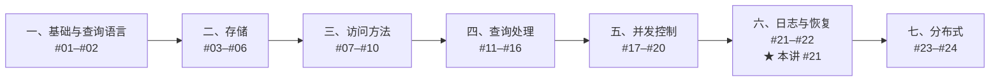

[并发](#并发)控制部分（第 [17](../L17/index.md)、[18](../L18/index.md)、[19](../L19/index.md)、[20](../L20/index.md) 讲）让 DBMS 具备了 ACID 中的[原子性](#原子性)、[一致性](#一致性)和[隔离性](#隔离性)：并发执行的[事务](#事务)彼此不干扰，被[中止](#中止)的事务在内存里的修改可以撤回。那些讨论都默认机器不会断电。本讲补上[持久性](#持久性)（durability），并让原子性在崩溃之后依然成立。

本讲用到的旧概念主要有三块。第一块是[缓冲池](#缓冲池)（buffer pool）、[脏页](#脏页)（dirty page）和[替换策略](#替换策略)（第 [4](../L04/index.md) 讲），本讲的所有策略归根到底都是在规定缓冲池何时可以、何时必须把脏页写回磁盘。第二块是[槽式页](#槽式页)（slotted page，第 [3](../L03/index.md) 讲），它决定了[日志](#日志)记录能以多“抽象”的方式描述一次修改。第三块是[多版本并发控制](#多版本并发控制)（MVCC，第 [20](../L20/index.md) 讲），它和[影子分页](#影子分页)、日志在思想上高度重合，追加式 MVCC 甚至可以省掉日志里的[旧值](#旧值)。[LSM 树](#LSM%20树)的 [MemTable](#MemTable)（第 [5](../L05/index.md) 讲）也会在讨论中出现。

本讲只回答“正常运行时要做哪些准备”。崩溃之后怎样利用[日志](#日志)把[数据库](#数据库)恢复到正确状态，以及不必暂停整个系统的[检查点](#检查点)，是第 [22](../L22/index.md) 讲 ARIES 的内容。日志作为一条完整的变更流，还会在第 [23](../L23/index.md)、[24](../L24/index.md) 讲的分布式复制中再次出现。

## 1. 已[提交](#提交)的数据为什么会丢

📍 *PPT 第 4–9 页*

### 1.1 “[提交](#提交)成功”之后的一次断电

📍 *PPT 第 5 页*

从最简单的[事务](#事务)开始：T1 读 A、写 A、[提交](#提交)。DBMS 读 A 时，先把 A 所在的[页](#页)从磁盘复制进[缓冲池](#缓冲池)；T1 写 A 时，修改发生在缓冲池里的那一页上，磁盘上的页不动。随后 T1 提交，DBMS 向应用返回“提交成功”。
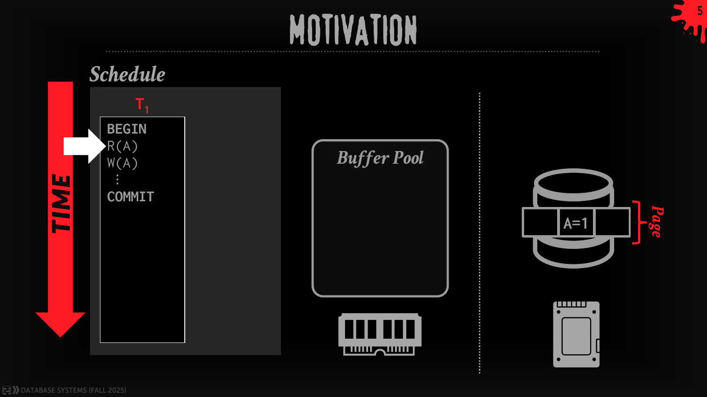

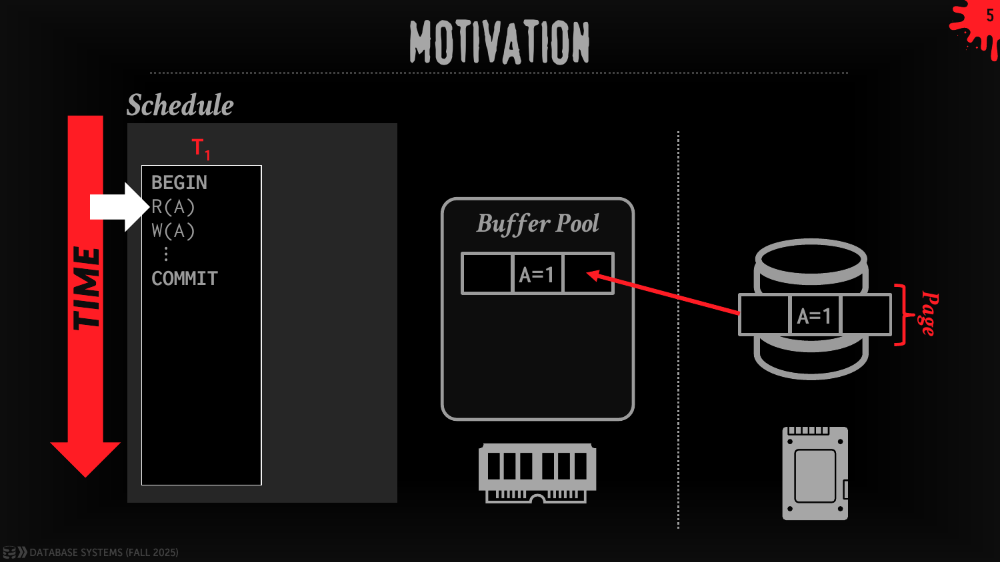

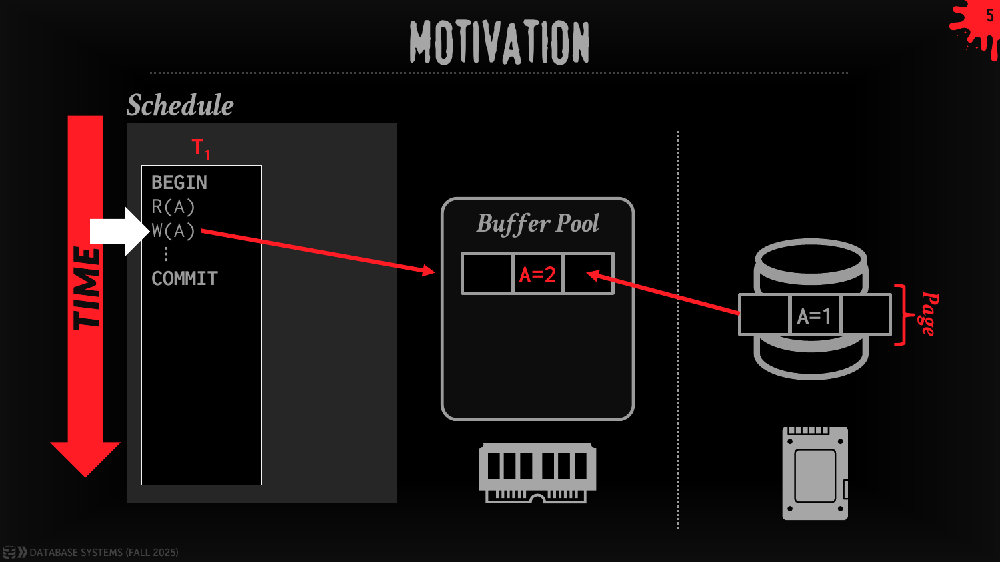

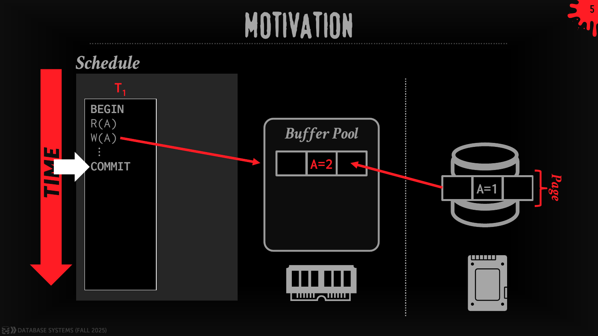


| 时刻 | [缓冲池](#缓冲池)中的 A | 磁盘上的 A |
|---|---|---|
| `R(A)` | 1 | 1 |
| `W(A)` | 2 | 1 |
| `COMMIT`，返回成功 | 2 | 1 |
| 雷暴断电，重启 | （内存内容全部丢失） | 1 |

[提交](#提交)是一个承诺：DBMS 告诉外部世界，这个[事务](#事务)的全部修改都已经具备 ACID 保证。[缓冲池](#缓冲池)位于 DRAM 中，DRAM 是易失性存储（volatile storage），断电即失。重启之后，系统从磁盘读到的仍然是 A=1，已经承诺过的修改就这样丢了。整个数据中心坠入天坑这类灾难靠单机解决不了，那是分布式部分的话题；本讲要保证的是，只要机器还能重新启动，承诺过的数据就一定还在。
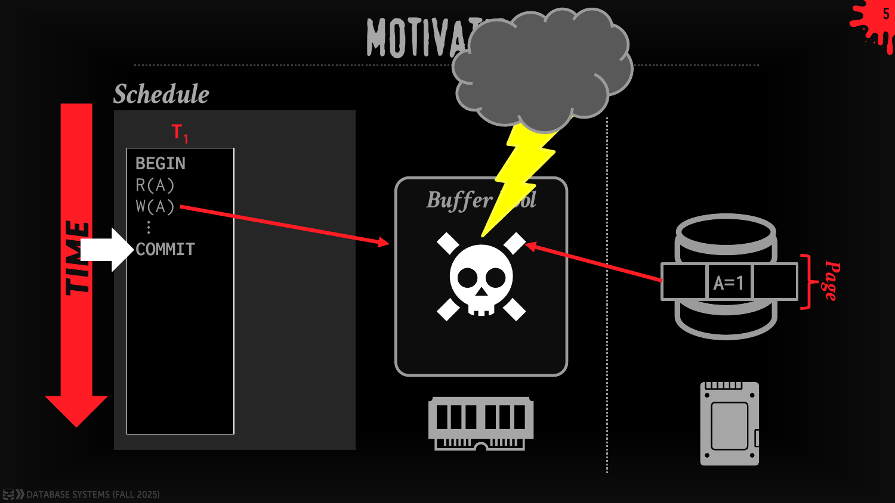


这个承诺有一个精确的生效时刻：应用收到[提交](#提交)成功的确认。系统也可能已经把数据安全写好，却在发出确认消息之前崩溃，这种情况并不算违约。应用没有收到确认，理应在重连后自己查询这个[事务](#事务)到底提交了没有。Andy 承认几乎没有人这样写代码，“但理论上，这才是你应该做的”。[^1]

### 1.2 恢复算法要守住的两件事

📍 *PPT 第 6、8 页*

[数据库](#数据库)的主存储位置在非易失性存储（non-volatile storage）上，SSD、机械硬盘乃至 S3 这样的对象存储都属于此类。它们比内存慢，所以 DBMS 在内存里操作数据：先把目标记录所在的[页](#页)复制进内存，在内存里完成修改，之后再把[脏页](#脏页)写回磁盘。在这套流程下，DBMS 必须保证两件事：

- 一旦 DBMS 告诉别人某个[事务](#事务)已经[提交](#提交)，这个事务的修改就是持久的。
- 如果事务[中止](#中止)，它的任何部分修改都不能持久保留。

第一条是[持久性](#持久性)，第二条是[原子性](#原子性)在崩溃场景下的样子。

**[恢复算法](#恢复算法)（recovery algorithm）** 是在发生故障时仍能保证[数据库](#数据库)[一致性](#一致性)、[事务](#事务)[原子性](#原子性)和[持久性](#持久性)的一组技术。它总是由两部分组成：正常处理事务期间采取的准备措施，以及故障发生后把数据库恢复到正确状态的措施。本讲讨论前者，第 [22](../L22/index.md) 讲讨论后者。两部分必须配套设计，因为正常运行时往磁盘上记下了什么，决定了崩溃之后能做什么。
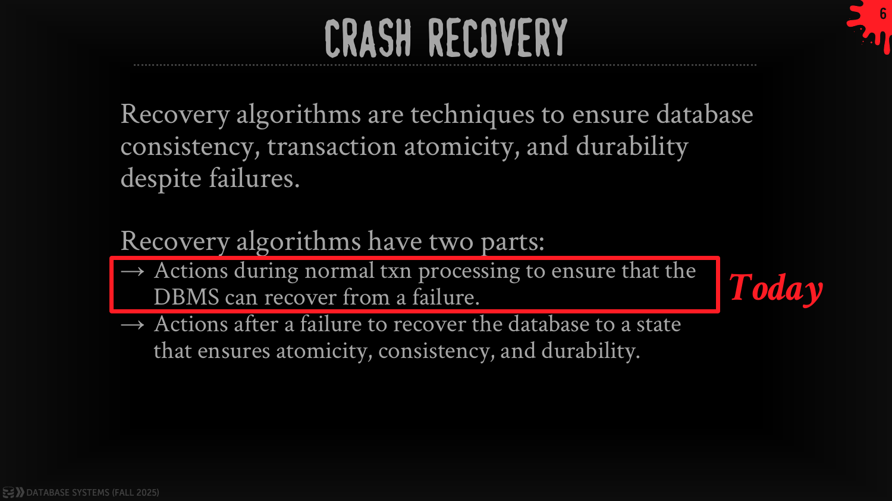


硬件让这件事更难。存储设备通常只保证 4 KB 大小的写入是原子的，而[数据库](#数据库)[页](#页)可能更大，PostgreSQL 的默认页大小就是 8 KB。写一个 8 KB 的页要分成两次 4 KB 的写入，崩溃如果恰好发生在两次写入之间，磁盘上就会留下一个前半新、后半旧的页，这种情况称为**[撕裂写](#撕裂写)（torn write）**。PostgreSQL 专门为此提供了 `full_page_writes` 参数，它的文档写明，操作系统崩溃时正在进行的页写入可能只完成了一部分，磁盘上会留下新旧数据混杂的页。多个页的情形与此同理：一个[事务](#事务)改了两个页，只写出其中一个就崩溃，这个事务的修改也被撕成了两半。

### 1.3 [撤销](#撤销)与[重做](#重做)

📍 *PPT 第 9 页*

两项保证各自对应一种手段。

**[撤销](#撤销)（Undo）** 是清除未完成或已[中止](#中止)[事务](#事务)所产生影响的过程。需要[撤销](#撤销)的情况有三种：事务自己发出 `ROLLBACK`；[并发控制协议](#并发控制协议)判定它不能[提交](#提交)，把它中止（比如第 [18](../L18/index.md) 讲的[死锁](#死锁)处理）；事务还在运行，系统就崩溃了。

**[重做](#重做)（Redo）** 是为了[持久性](#持久性)，把已[提交](#提交)[事务](#事务)的修改重新施加一遍的过程，使恢复后的[数据库](#数据库)与这个事务完整执行过之后的状态完全一致。
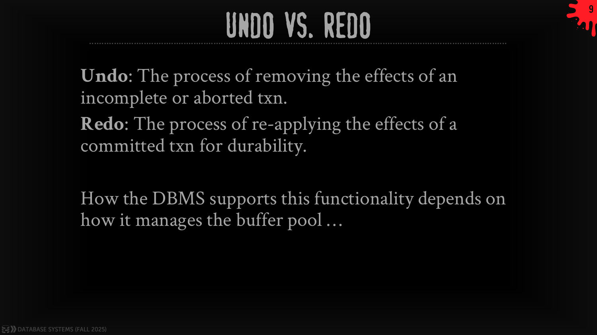


并不是每种[恢复算法](#恢复算法)都同时需要两者。一个方案需要[撤销](#撤销)、[重做](#重做)还是两者都要，取决于[缓冲池](#缓冲池)在正常运行时被允许做什么。

## 2. [缓冲池](#缓冲池)的两条策略

📍 *PPT 第 10–12、22 页*

### 2.1 同一[页](#页)上的两个[事务](#事务)

📍 *PPT 第 10 页*

设一个[页](#页)里有 A=1、B=9、C=7 三条记录。T1 读写 A，T2 读写 B，二者访问不同的记录，没有冲突，[并发](#并发)控制允许它们交错执行。[两阶段锁](#两阶段锁)或 OCC 仍然在上层照常工作，这里暂且不管它们。

| 步骤 | T1 | T2 | [缓冲池](#缓冲池)中的[页](#页) | 磁盘上的页 |
|---|---|---|---|---|
| 1 | `BEGIN` `R(A)` | | A=1 B=9 C=7 | A=1 B=9 C=7 |
| 2 | `W(A)` | | A=3 B=9 C=7 | A=1 B=9 C=7 |
| 3 | | `BEGIN` `R(B)` | A=3 B=9 C=7 | A=1 B=9 C=7 |
| 4 | | `W(B)` | A=3 B=8 C=7 | A=1 B=9 C=7 |
| 5 | | `COMMIT` | ？ | ？ |
| 6 | `ROLLBACK` | | ？ | ？ |

第 5 步 T2 [提交](#提交)，DBMS 面对两个问题。第一，要不要在告诉应用“T2 已提交”之前，[强制](#强制)把 T2 的修改写到磁盘？第二，B 和 A 在同一个[页](#页)上，T1 还没有提交，它对 A 的修改能不能跟着这一页一起覆盖磁盘上的 A？

假设 DBMS 把整[页](#页)写了出去，磁盘上变成 A=3 B=8 C=7，T2 得到[提交](#提交)确认。接着第 6 步 T1 [回滚](#回滚)。应用发出 `ROLLBACK` 后会立即得到确认，DBMS 不会让它等着，清理现场是 DBMS 自己的事。现在磁盘上躺着一个未提交的 A=3。最直接的清理办法是把这一页读回来，把 A 改回 1，再写出去。只有一个页时这样做没有问题；假如 T1 已经改了十亿个页，而且它们早已被写到磁盘上，回滚就意味着把十亿个页读回来、逐一改正、再写回去，中途再崩溃一次，还会留下一堆撕裂的页要收拾。
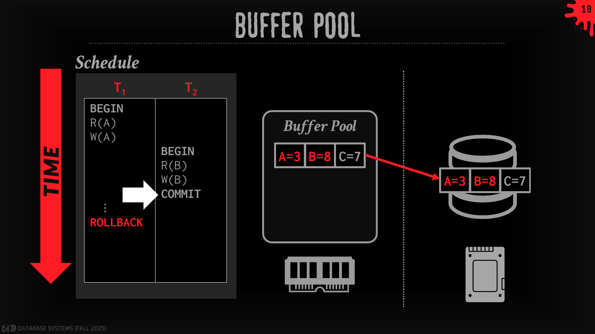

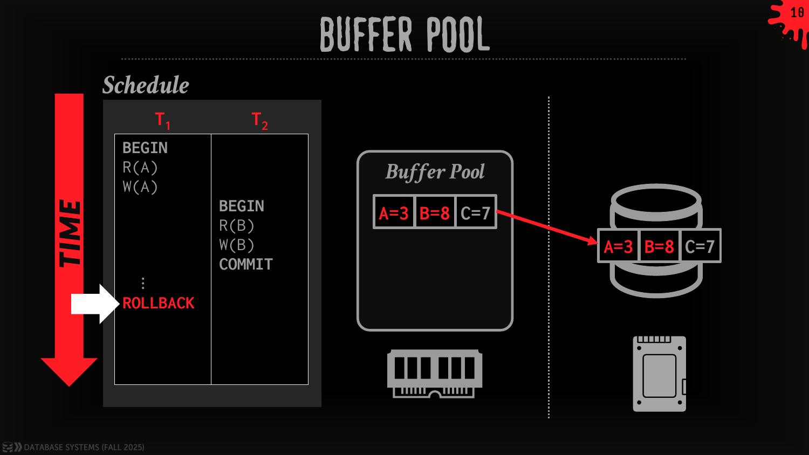

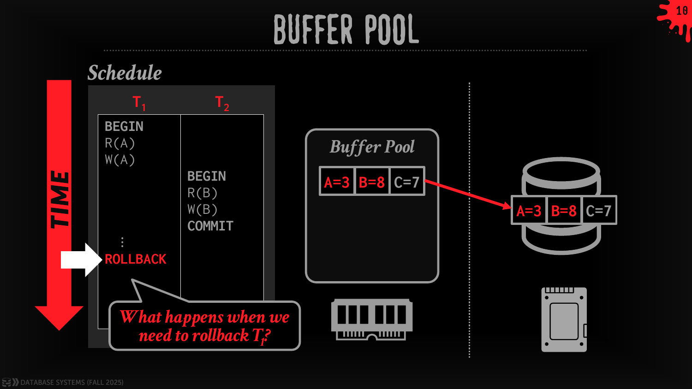


这两个问题分别由两条[缓冲池](#缓冲池)策略回答。

### 2.2 窃取策略（Steal Policy）

📍 *PPT 第 11 页*

**[窃取](#窃取)策略（steal policy）** 规定 DBMS 能否把[缓冲池](#缓冲池)中被未[提交](#提交)[事务](#事务)修改过的脏对象淘汰出去，并用它覆盖非易失性存储中该对象最近一次提交的版本。
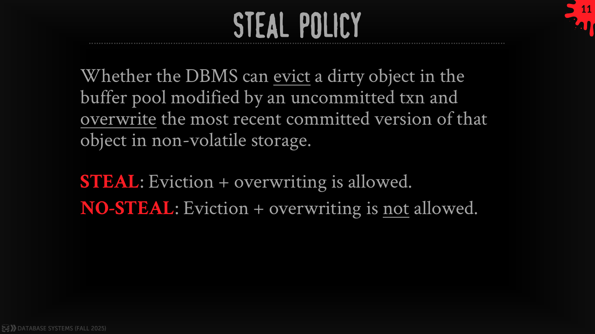


- **[窃取](#窃取)（STEAL）**：允许淘汰并覆盖。
- **[不窃取](#不窃取)（NO-STEAL）**：不允许。

这个名字可以这样记：[缓冲池](#缓冲池)空间紧张时，系统从还在运行的[事务](#事务)手里“偷走”它的[脏页](#脏页)，写回磁盘，腾出[帧](#帧)来。定义里有两个动词，淘汰和覆盖。第 4 节分析[影子分页](#影子分页)时会看到，真正起作用的是“覆盖最近一次[提交](#提交)的版本”：把未提交的数据写到磁盘上别的位置，并不算[窃取](#窃取)。

这条策略和第 [4](../L04/index.md) 讲的[替换策略](#替换策略)直接相关。[LRU-K](#LRU-K) 这类算法挑出一个受害[页](#页)时，如果它是[脏页](#脏页)，而修改它的[事务](#事务)还没有[提交](#提交)，能不能淘汰它，要看系统采用的是哪条策略。策略是整个系统的设定，一个实现只会选其中一种，不会对一部分事务[窃取](#窃取)、对另一部分[不窃取](#不窃取)。

你可能已经想到，如果不允许[窃取](#窃取)，而[缓冲池](#缓冲池)又装不下某个[事务](#事务)改过的全部[页](#页)，这个事务就永远无法完成。确实如此。一个绕开的办法是把这些页写到“旁边”去，这正是第 4 节[影子分页](#影子分页)的思路。

### 2.3 强制策略（Force Policy）

📍 *PPT 第 12 页*

**[强制](#强制)策略（force policy）** 规定 DBMS 是否要求一个[事务](#事务)的全部修改在该事务[提交](#提交)之前都已写回非易失性存储。
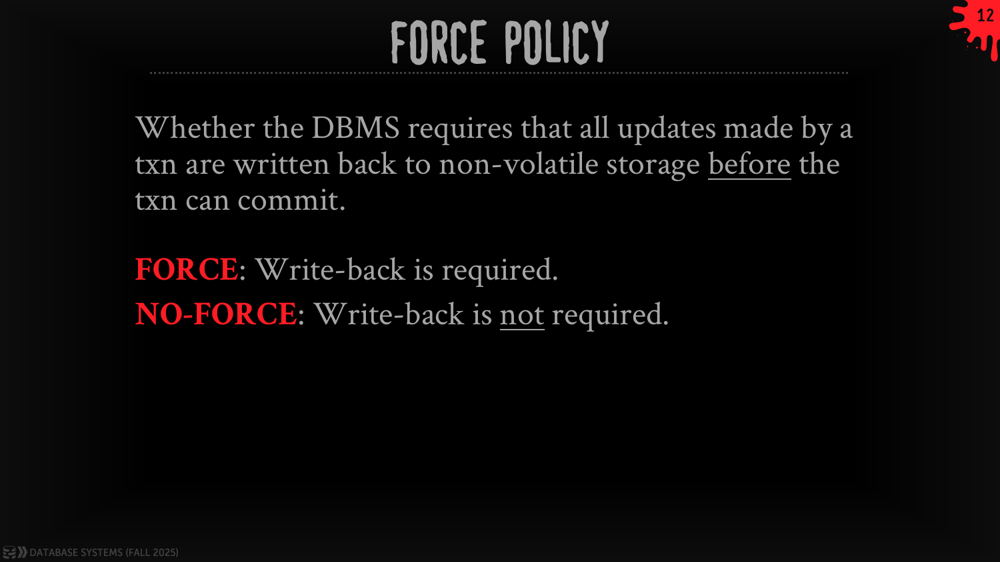


- **[强制](#强制)（FORCE）**：[提交](#提交)前必须写回。
- **[非强制](#非强制)（NO-FORCE）**：不要求。

[强制](#强制)让恢复变得简单：[事务](#事务)只要[提交](#提交)了，它的修改就都在磁盘上，崩溃后不需要[重做](#重做)。它的代价体现在提交延迟上，事务改过多少个[页](#页)，提交时就要等多少次页写入。

两条策略的名字很容易混淆，区别在于它们管的时间段不同：[窃取](#窃取)管的是[提交](#提交)之前能不能写，[强制](#强制)管的是提交之时必须不必须写。

### 2.4 四种组合

📍 *PPT 第 22 页*

两条策略互相独立，组合出四种情况。每条策略的选择，直接决定恢复时需要哪种手段：

- 允许[窃取](#窃取)，即使修改某个[页](#页)的[事务](#事务)还在运行，只要这个页没有被钉住（pin，第 [4](../L04/index.md) 讲），就可以把它刷到磁盘。磁盘上于是可能出现未[提交](#提交)事务的修改，崩溃后必须能够**[撤销](#撤销)**，所以要在[日志](#日志)里记下[旧值](#旧值)。
- 采用[非强制](#非强制)，已提交事务的修改就可能还只在内存里，崩溃后必须能够**[重做](#重做)**，所以提交时至少要把一份修改的“摘要”写到磁盘上。这份摘要就是日志。
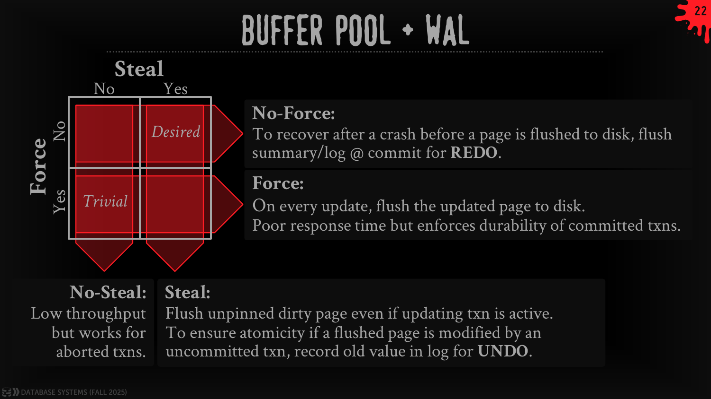


| | [不窃取](#不窃取) | [窃取](#窃取) |
|---|---|---|
| **[强制](#强制)** | 无须[撤销](#撤销)，无须[重做](#重做)；实现最简单 | 需要[撤销](#撤销)，无须[重做](#重做) |
| **[非强制](#非强制)** | 无须[撤销](#撤销)，需要[重做](#重做) | 既要[撤销](#撤销)，也要[重做](#重做)；最理想 |

[不窃取](#不窃取)的代价是吞吐量低，[脏页](#脏页)只能占着内存，等[事务](#事务)结束；好处是[中止](#中止)的事务不需要任何磁盘上的清理。[强制](#强制)的代价是响应时间差，每次[提交](#提交)都要等[页](#页)写入；好处是已提交事务的[持久性](#持久性)得到直接保证。实践中常见的只有左上和右下两种组合，另外两种优势不大，很少被采用。第 4.5 节会看到，SQLite 早期的[回滚](#回滚)[日志](#日志)恰好落在“[窃取](#窃取) + [强制](#强制)”这一格。

## 3. 最简单的组合：不窃取 + 强制

📍 *PPT 第 13–14 页*

### 3.1 同一个例子，换一种策略

📍 *PPT 第 13 页*

回到 2.1 节的调度，这次系统采用[不窃取](#不窃取)加[强制](#强制)。第 5 步 T2 [提交](#提交)时，两条策略撞在了一起：[强制](#强制)要求此刻就把 T2 的修改写到磁盘，[不窃取](#不窃取)禁止 T1 对 A 的修改写到磁盘，而 A 和 B 在同一个[页](#页)上。
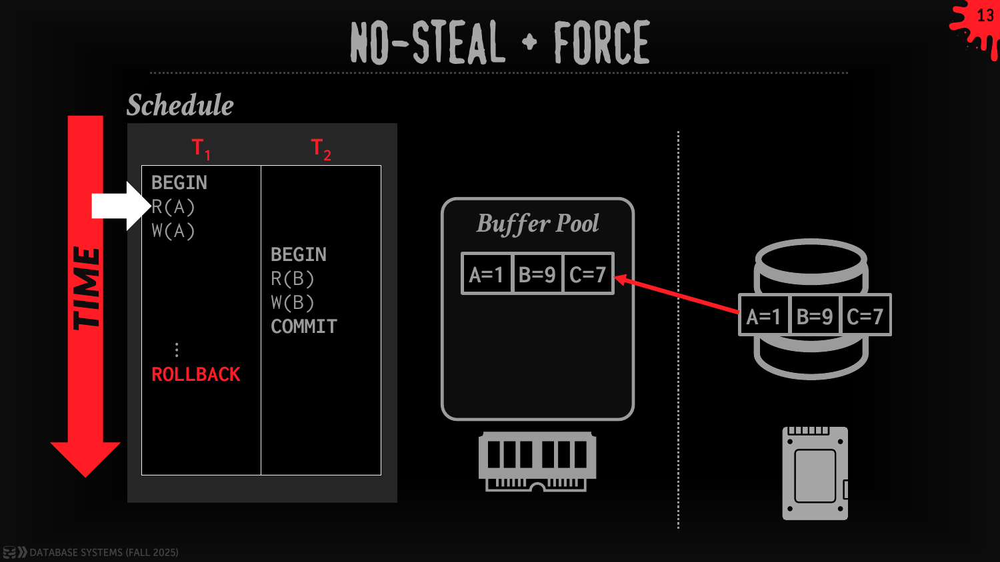

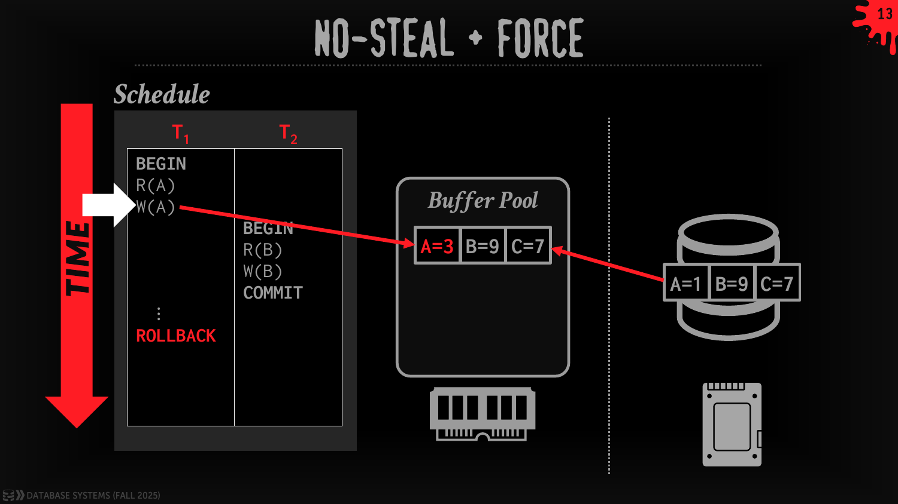

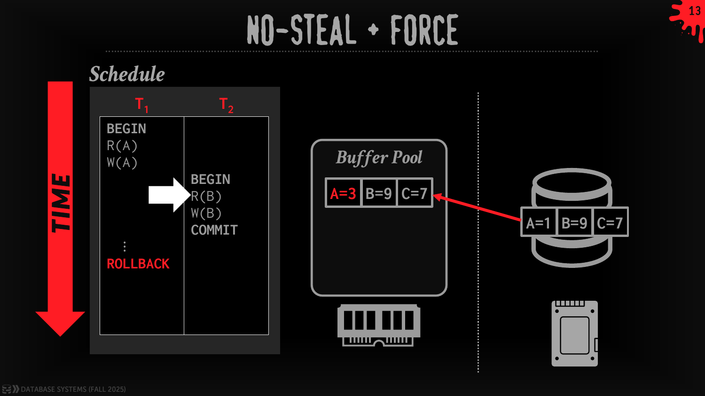

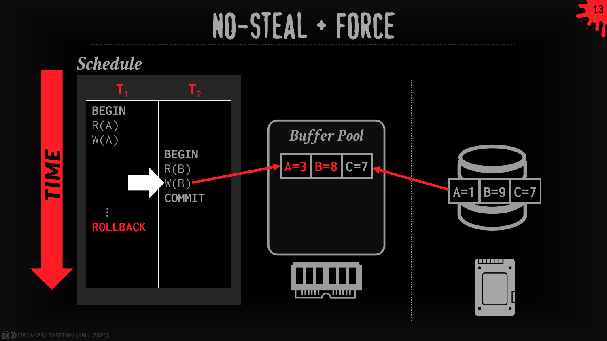

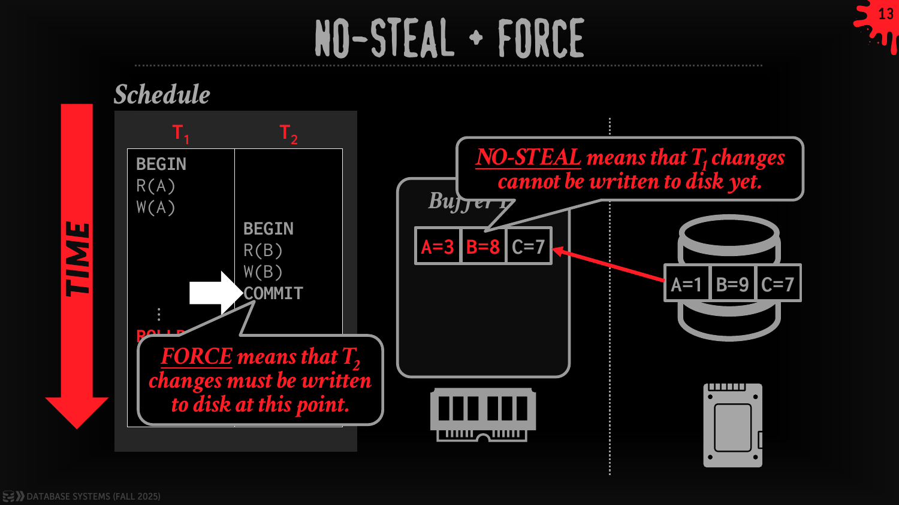


解决办法是在内存中复制这个[页](#页)，副本里只施加 T2 的修改，然后把副本写到磁盘：
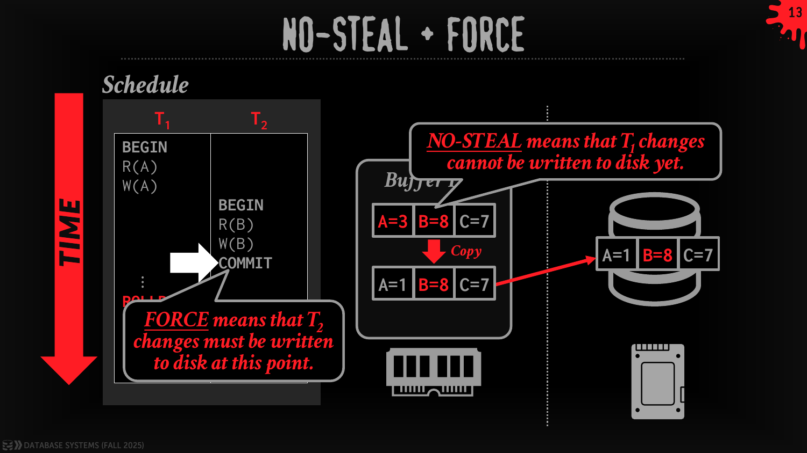


```text
        缓冲池                                   磁盘
┌───────┬───────┬───────┐
│  A=3  │  B=8  │  C=7  │  原页，含 T1 未提交的 A=3
└───────┴───────┴───────┘
            │  复制，只保留 T2 的修改
            ▼
┌───────┬───────┬───────┐              ┌───────┬───────┬───────┐
│  A=1  │  B=8  │  C=7  │ ───────────▶ │  A=1  │  B=8  │  C=7  │
└───────┴───────┴───────┘              └───────┴───────┴───────┘
```

做副本时，DBMS 需要知道 A 原来是 1。这要求每个[事务](#事务)在内存里维护自己改了什么、从什么值改过来的元数据，后面的[日志](#日志)记录的正是这类信息。

第 6 步 T1 [回滚](#回滚)时，只需把内存[页](#页)里的 A 改回 1，磁盘上根本没有 T1 的痕迹。[缓冲池](#缓冲池)最终是 A=1 B=8 C=7，与磁盘一致。


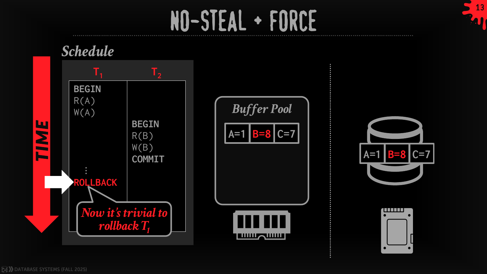


一个自然的想法是让 T2 等一等，等 T1 结束了再把整[页](#页)一起写出去。[影子分页](#影子分页)确实会用到类似的思路，但等待没有上限。交互式环境里，用户开启一个[事务](#事务)后起身离开是常有的事，这个事务可能挂上几个小时甚至一整天。让一个已经做完的事务陪着一个不知何时结束的事务等下去，是不可接受的。

### 3.2 优点与局限

📍 *PPT 第 14 页*

这个组合最容易实现。[中止](#中止)[事务](#事务)的修改从来没有写到磁盘上，所以永远不需要[撤销](#撤销)；已[提交](#提交)事务的修改在提交时已经全部写到磁盘上，所以永远不需要[重做](#重做)。第二句话成立有一个前提：硬件写入是原子的。局限也由此而来。

第一，[事务](#事务)的**[写集](#写集)（write set）**，即它要修改的全部数据，必须装得进内存。不能在[提交](#提交)前把[脏页](#脏页)写回，一个要改一亿个[页](#页)的事务在内存不够时根本无法执行。复制页本身也需要内存，内存紧张时连副本都做不出来。
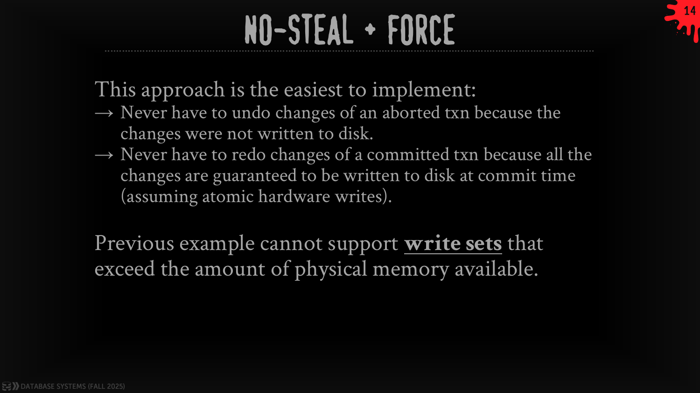


第二，改动多个[页](#页)的[提交](#提交)不是原子的。例子里只有一个页，一次写入就能完成。[事务](#事务)改了三个页时，[强制](#强制)要求三个页都写到磁盘，而崩溃可能发生在第二个页写完之后。磁盘上又没有任何元数据标明“这个事务的修改已经全部写完”，恢复时既不知道这个事务写全了没有，也没有[旧值](#旧值)可以回退。

第三，频繁的整[页](#页)写入会加快 SSD 等存储设备的磨损。

前两条是不同性质的问题，一个关于内存容量，一个关于[原子性](#原子性)。[影子分页](#影子分页)首先解决的是第二条，同时也缓解了第一条。

## 4. [影子分页](#影子分页)（Shadow Paging）

📍 *PPT 第 15–19 页*

### 4.1 主副本、影子副本和一次指针切换

📍 *PPT 第 15 页*

**[影子分页](#影子分页)（shadow paging）** 同时维护[数据库](#数据库)的两个版本：
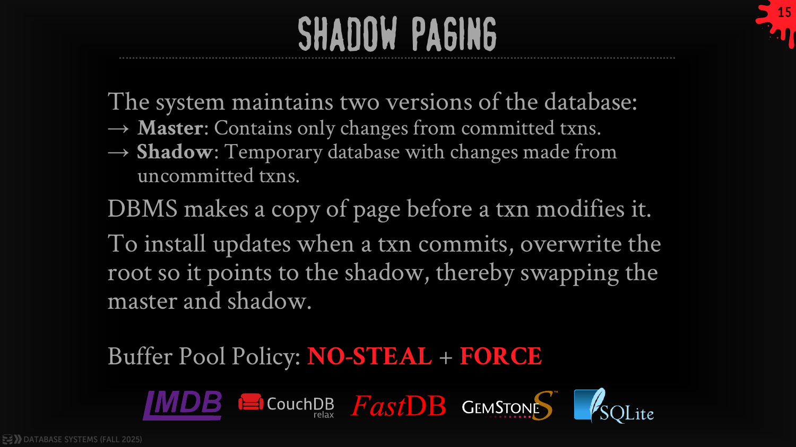


- **[主副本](#主副本)（master）**：只包含已[提交](#提交)[事务](#事务)的修改。
- **[影子副本](#影子副本)（shadow）**：一个临时的[数据库](#数据库)，包含未提交事务的修改。

[事务](#事务)修改一个[页](#页)之前，DBMS 先为这个页做一份拷贝，修改只落在拷贝上，这种做法称为**[写时复制](#写时复制)（copy-on-write）**。事务[提交](#提交)时，DBMS 覆盖[数据库](#数据库)的根指针，让它指向[影子副本](#影子副本)，[主副本](#主副本)和[影子副本](#影子副本)就此互换，旧的[主副本](#主副本)之后被当作垃圾回收。

它的[原子性](#原子性)来自根指针。根指针只占一个[页](#页)（比如[数据库](#数据库)文件的文件头），对它的一次写入可以原子地完成。[事务](#事务)改了多少个页都没有关系：这些页先全部写好，再用一次原子写入切换根指针。切换之前，它们都不属于磁盘上的数据库；切换之后，它们全部属于。3.2 节的第二个问题就这样被解决了，多页写入的原子性被归结成了一次单页写入的原子性。

C 程序员对这个手法并不陌生：先在一块新申请的内存里把一个结构体完整地填好，最后用一次指针赋值让全局指针指向它。读者读到的要么是旧结构，要么是新结构，不会读到填了一半的结构。

影子[页](#页)既存在于[缓冲池](#缓冲池)中，也可以在内存紧张时被写到磁盘上的空闲位置。它们从不覆盖[主副本](#主副本)中已[提交](#提交)的版本，所以按 2.2 节的定义，[影子分页](#影子分页)仍然属于[不窃取](#不窃取)，但它不再要求[写集](#写集)必须装得进内存。从这个意义上说，[影子分页](#影子分页)是一种更聪明的“[不窃取](#不窃取) + [强制](#强制)”。

这套做法和第 [20](../L20/index.md) 讲的[多版本并发控制](#多版本并发控制)很像，只是版本的粒度从[元组](#元组)变成了[页](#页)。相应地，这类系统在[并发](#并发)控制上使用页级[锁](#锁)。

IBM 在 1970 年代为 System R 设计持久化方案时，最先采用的就是[影子分页](#影子分页)。使用过它的系统有 LMDB、CouchDB、FastDB、GemStone，以及早期的 SQLite。在 Andy 看来，今天这样做的系统已经很少，其中最有名的是 LMDB。

> 💬 **旁注**
> LMDB 的作者和 Andy 在两件事上立场正好相反：他钟爱 mmap，也钟爱[影子分页](#影子分页)，而且公开表达得很积极。Andy 则一向反对 DBMS 依赖 mmap。
>
> *原话：“He's the opposite of me. He loves mmap. He loves shadow paging, and he's very vocal about this.”*

### 4.2 一次[提交](#提交)的完整经过

📍 *PPT 第 16 页*

[影子分页](#影子分页)用一张[页表](#页表)（page table，第 [3](../L03/index.md) 讲称之为[页目录](#页目录)）把[页](#页)号映射到磁盘上的位置。内存和磁盘上各有一个主指针，指向当前的主页表。下面用四张[快照](#快照)走一遍写[事务](#事务) T1 的生命周期，Pn 表示磁盘上的一个页。
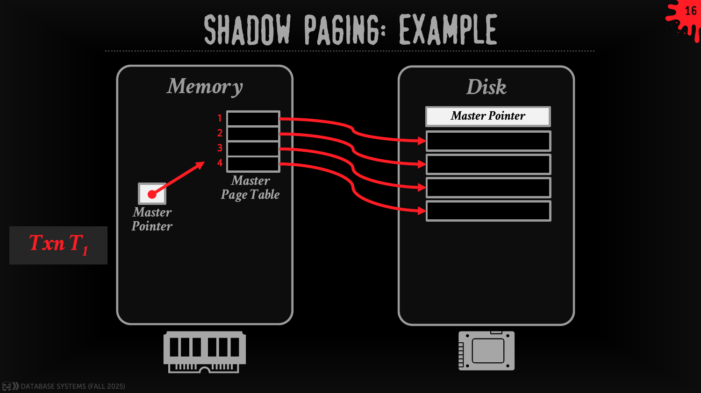

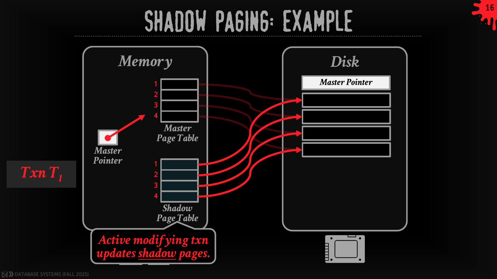

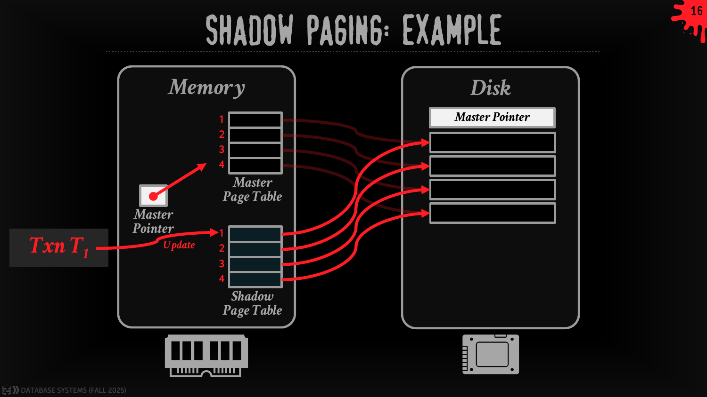

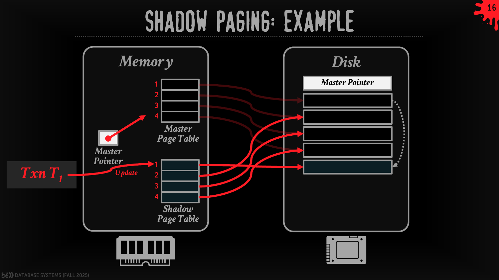

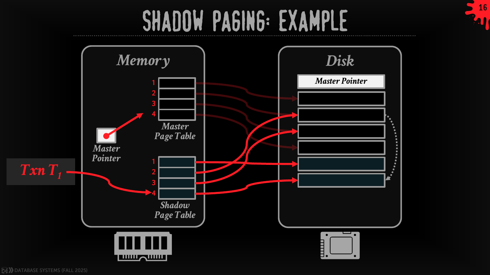


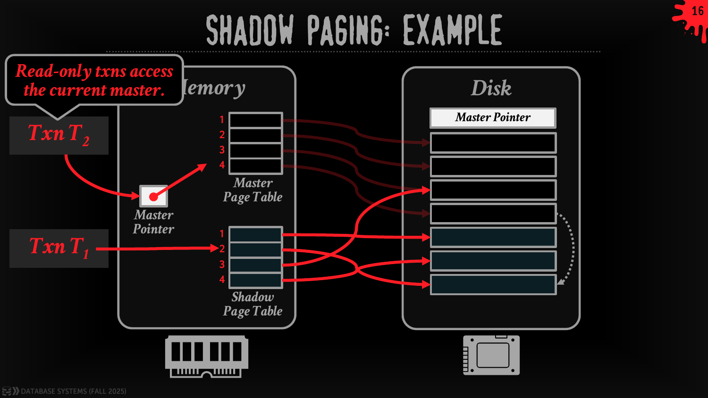

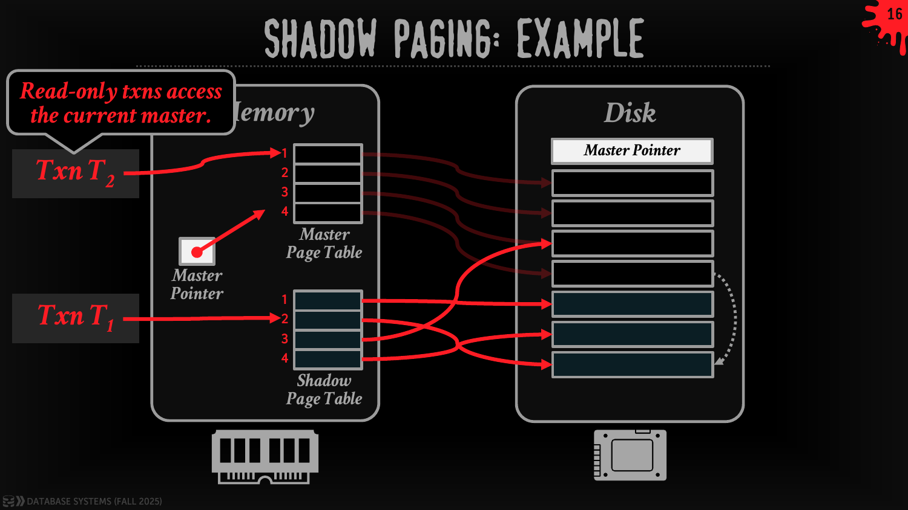

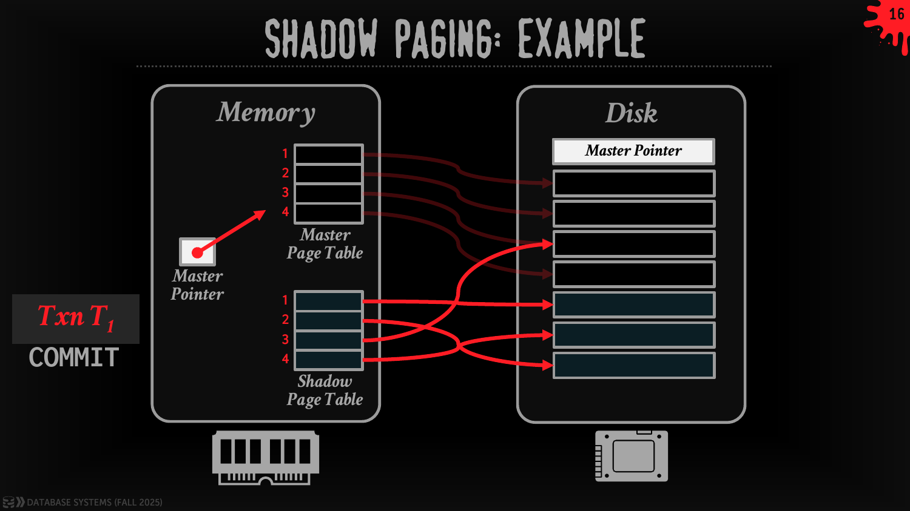

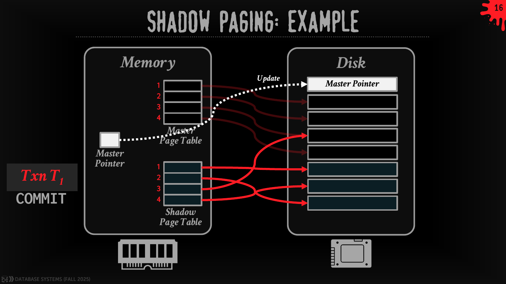

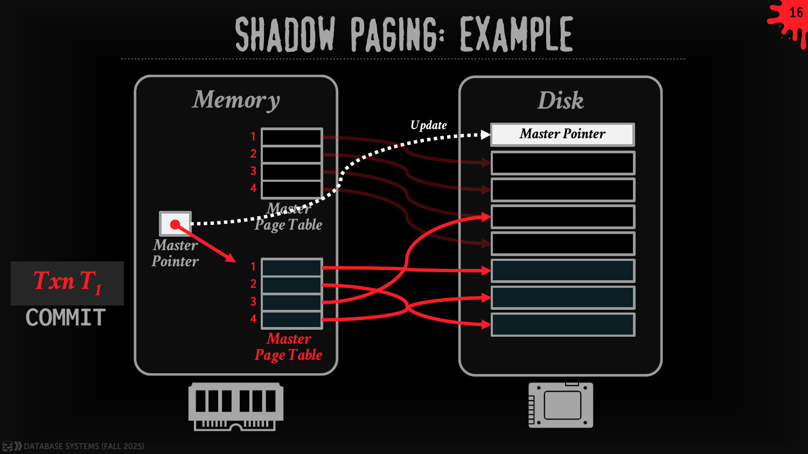

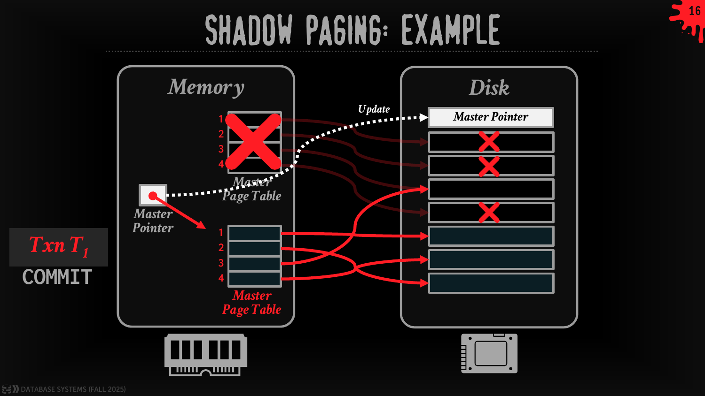

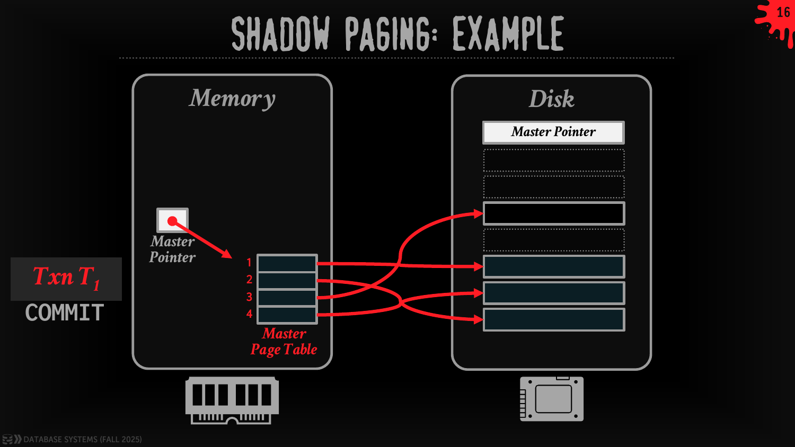


```text
① T1 开始：复制出一张影子页表，内容与主页表相同，指向同样的磁盘页

   主指针 ──▶ 主页表     1→P1   2→P2   3→P3   4→P4
              影子页表   1→P1   2→P2   3→P3   4→P4     （T1 使用）

   磁盘： [主指针] P1 P2 P3 P4
```

```text
② T1 依次修改页 1、4、2：每次先把原页复制到磁盘上的空闲位置，
   在副本上修改，再让影子页表的对应项指向副本

   主指针 ──▶ 主页表     1→P1   2→P2   3→P3   4→P4     （只读事务 T2 从这里读）
              影子页表   1→P1'  2→P2'  3→P3   4→P4'    （T1 使用）

   磁盘： [主指针] P1 P2 P3 P4 P1' P4' P2'
```

```text
③ T1 提交：确认 P1'、P4'、P2' 和影子页表都已写到磁盘之后，
   原子地改写磁盘上的主指针，影子页表成为新的主页表

   主指针 ──▶ 新主页表   1→P1'  2→P2'  3→P3   4→P4'

   磁盘： [主指针] P1✗ P2✗ P3 P4✗ P1' P4' P2'      （✗：不再被引用）
```

```text
④ 垃圾回收：旧主页表以及 P1、P2、P4 的空间被回收，供以后的事务复用

   磁盘： [主指针] ░░ ░░ P3 ░░ P1' P4' P2'
```

有三处值得注意。P3 没有被 T1 修改，新旧两代[页表](#页表)一直共享它，[影子分页](#影子分页)只复制被改过的[页](#页)。只读[事务](#事务) T2 在整个过程中通过主指针读取主页表，看不到 T1 的任何中间状态；主指针切换之后开始的事务，看到的是 T1 [提交](#提交)后的版本。第 ③ 步的顺序不能颠倒：必须先确认所有影子页落盘，再切换指针，这是[强制](#强制)策略在[影子分页](#影子分页)中的体现。

例子里只有一个写[事务](#事务)。LMDB 正是只允许一个写事务、多个读事务同时存在。要支持多个写事务，难点在于何时切换主指针，因为切换时不能把尚未[提交](#提交)的修改一起发布出去。一种做法是等所有写事务都准备提交，再成批切换一次，这和 5.4 节的[组提交](#组提交)是同一种思路。另一种做法是用[页](#页)级[排他锁](#排他锁)保证两个事务不会修改同一个页：某个事务提交时，只把它自己的页装进新的主[页表](#页表)，再为仍在运行的事务重新建立包含其修改的影子页表。后一种做法可行，但工作量大得多。

[页](#页)级[排他锁](#排他锁)还顺带说明了 3.1 节的复制技巧为什么在这里用不上：一个页只可能被一个写[事务](#事务)修改，写到磁盘上的影子页不会混入别的未[提交](#提交)事务的修改。

### 4.3 [撤销](#撤销)与[重做](#重做)

📍 *PPT 第 17 页*

在[影子分页](#影子分页)下，[回滚](#回滚)和恢复都很容易。
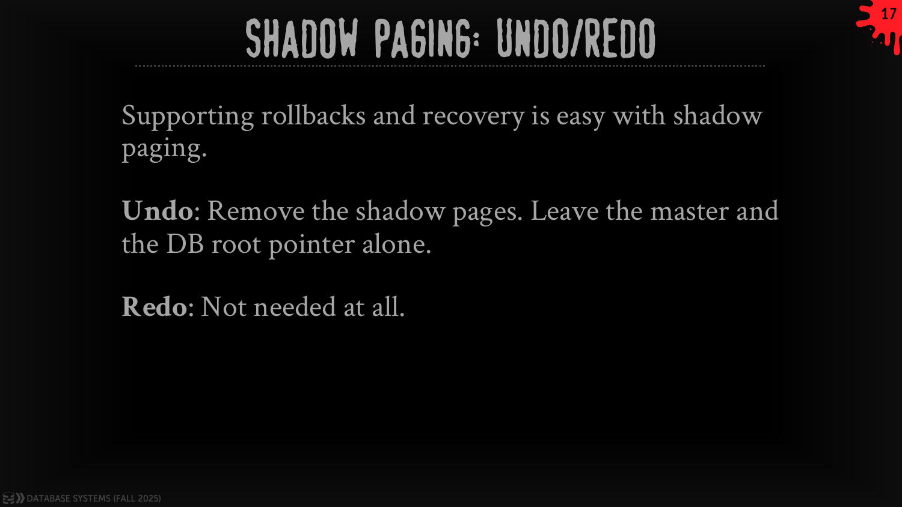


[撤销](#撤销)只需删除影子[页](#页)，[主副本](#主副本)和根指针保持原样。[事务](#事务)在运行中途[中止](#中止)，DBMS 丢弃它的影子页，不切换指针即可；事务在运行中途遇上崩溃，重启后 DBMS 直接读磁盘上的主指针，那些影子页没有被任何[页表](#页表)引用，等同于不存在。

[重做](#重做)完全不需要。[提交](#提交)就意味着修改已经全部在磁盘上，并且可以通过主指针访问到。

重启之后几乎无事可做，这是所有方案中最理想的恢复速度。

### 4.4 [影子分页](#影子分页)的代价

📍 *PPT 第 18 页*

**复制整张[页表](#页表)代价太高。** [数据库](#数据库)有几百万个[页](#页)时，每个写[事务](#事务)都复制一张几百万项的页表是不现实的。LMDB 的办法是把页表组织成一棵 [B+ 树](#B+%20树)（第 [8](../L08/index.md) 讲）；LMDB 本身是[索引组织存储](#索引组织存储)（第 [5](../L05/index.md) 讲），B+ 树就是数据本身。修改一个[叶节点](#叶节点)时，只需复制从根到这个叶节点的路径，其余子树由新旧两棵树共享，[提交](#提交)时切换的是树根：
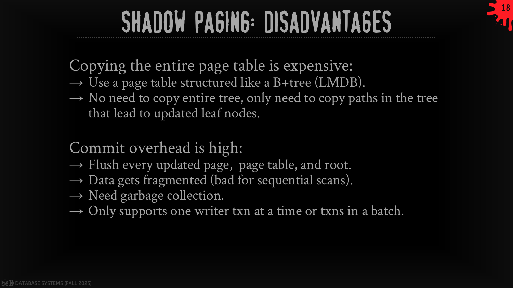


```text
      提交前（主）              提交后（新主）
          R                         R'
        /   \                     /   \
      N1     N2                 N1     N2'
     /  \   /  \               /  \   /  \
    L1  L2 L3  L4             L1  L2 L3  L4'
```

T1 只改了[叶节点](#叶节点) L4，于是只有 L4 及其祖先 N2、R 被复制成 L4'、N2'、R'，N1、L1、L2、L3 在新旧两棵树之间共享。

**[提交](#提交)开销大。** 每个被修改的[页](#页)、[页表](#页表)和根都要刷盘，而这些页散落在文件各处，写它们全是随机写。

**数据碎片化。** 原本相邻的数据，改过一次之后就散落到文件的不同位置，这对[顺序扫描](#顺序扫描)非常不利。System R 当年遇到的正是这个问题。顺序 I/O 比随机 I/O 快得多（第 [3](../L03/index.md) 讲），表里的[页](#页)被副本打散、中间留下一个个空洞之后，扫描一张表就得跳来跳去，逐渐退化成随机 I/O。[数据库](#数据库)越用越慢，只能靠代价高昂的垃圾回收来整理。在 1970 年代的慢速硬件上，这个问题格外严重，这也是 IBM 后来放弃[影子分页](#影子分页)的原因之一。

同样是多版本，第 [20](../L20/index.md) 讲里 MySQL 和 Oracle 采用的[增量存储](#增量存储)、由新到旧的[版本链](#版本链)就没有这个问题：主表里始终存放最新版本，大多数查询只需要最新版本，不必去读增量记录，主表因而保持紧凑。[影子分页](#影子分页)没有这样一张稳定的主表，版本就是[页](#页)本身，每[提交](#提交)一次，数据的物理布局就被打乱一次。

**需要垃圾回收**，回收旧[页表](#页表)和旧[页](#页)。

**只支持一次一个写[事务](#事务)，或者成批[提交](#提交)的一组事务。**

你可能会问，SSD 以及更快的存储会不会让随机写和顺序写的差别不再重要。Andy 的团队研究过 Intel Optane 持久内存，它的速度接近 DRAM，写入却是持久的。在那种环境下，[写时复制](#写时复制)的方案依然不如[预写日志](#预写日志)：磁盘慢的时候，瓶颈在磁盘；磁盘快到一定程度，[写时复制](#写时复制)在内存里整[页](#页)拷贝的开销就成了新的瓶颈。Optane 已经停产，Andy 认为这个结论今天依然成立，同时也说要重新验证才能确定。至于 SSD，扫描时顺序访问仍然比随机访问快，LMDB 这类树形结构的数据在文件里更分散，在这一点上会吃亏。

### 4.5 SQLite 的[回滚](#回滚)[日志](#日志)

📍 *PPT 第 19 页*

SQLite 在 2010 年以前用的是另一种[写时复制](#写时复制)，称为**[回滚](#回滚)模式（rollback mode）**：[事务](#事务)修改一个[页](#页)之前，DBMS 先把这个页的原样拷贝写进一个独立的[日志](#日志)文件（journal file），然后再在原位置修改。和 LMDB 一样，SQLite 同一时刻只允许一个写事务，不必考虑多个事务[并发](#并发)修改。
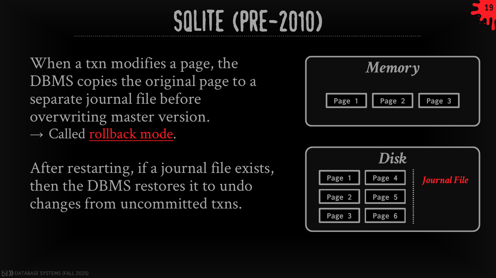


下面是一次[事务](#事务)的经过。[数据库](#数据库)文件里有[页](#页) 1 到页 6，内存里缓存着页 1、2、3。

| 步骤 | 内存 | [数据库](#数据库)文件中的[页](#页) 2、3 | [日志](#日志)文件 |
|---|---|---|---|
| 修改页 2 之前，先把页 2 原样写进日志文件并刷盘 | 页 2（旧） | 旧、旧 | 页 2（旧） |
| 在内存中修改页 2 | 页 2（新） | 旧、旧 | 页 2（旧） |
| 同样处理页 3 | 页 2、3（新） | 旧、旧 | 页 2、3（旧） |
| [提交](#提交)：把页 2 写进数据库文件 | 页 2、3（新） | 新、旧 | 页 2、3（旧） |
| 写页 3 时崩溃 | （全部丢失） | 新、旧 | 页 2、3（旧） |
| 重启，发现日志文件存在，读入其中的旧页 | 页 2、3（旧） | 新、旧 | 页 2、3（旧） |
| 用旧页覆盖数据库文件中的页 2、3 | 页 2、3（旧） | 旧、旧 | 页 2、3（旧） |
| 删除日志文件，恢复完成 | | 旧、旧 | （无） |

[日志](#日志)文件里保存的是修改之前的[页](#页)，它是一份[撤销](#撤销)信息。重启时只要日志文件存在，就说明有[事务](#事务)没能完成[提交](#提交)。DBMS 不去判断崩溃前哪些页已经写出、哪些没有，而是把日志里的旧页全部覆盖回[数据库](#数据库)文件。这样做是安全的，因为用同一份旧页覆盖一次和覆盖两次结果相同，恢复中途即使再次崩溃，重来一遍即可。恢复完成、删除日志文件之后，系统才开始执行新的事务。任何一个 DBMS 启动时的调试日志里都能看到类似的步骤：它会先检查日志、[检查点](#检查点)或[回滚](#回滚)日志文件，因为它无法确定上一次是不是正常关闭的。

[回滚](#回滚)[日志](#日志)和[影子分页](#影子分页)方向相反。[影子分页](#影子分页)把新数据放在一旁，[主副本](#主副本)保持不动；[回滚日志](#回滚模式（回滚日志）)把旧数据放在一旁，新数据直接写进主文件。

按 2.4 节的表格归类：旧[页](#页)已经安全地存进了[日志](#日志)文件，所以 DBMS 可以在[提交](#提交)之前就把[脏页](#脏页)写进[数据库](#数据库)文件、覆盖已提交的版本，这是[窃取](#窃取)，[写集](#写集)必须装进内存的限制随之消失。另一方面，[事务](#事务)要等所有脏页写进数据库文件才算提交完成，SQLite 的文档说明，提交发生在[回滚](#回滚)日志被删除的那一刻，这是[强制](#强制)。所以[回滚日志](#回滚模式（回滚日志）)是“[窃取](#窃取) + [强制](#强制)”的一个实例：需要[撤销](#撤销)，不需要[重做](#重做)。

2010 年 7 月发布的 SQLite 3.7.0 引入了[预写日志](#预写日志)模式，此后 SQLite 转向了[预写日志](#预写日志)。不过[回滚](#回滚)[日志](#日志)至今仍是 SQLite 的默认模式（`journal_mode=DELETE`），[预写日志](#预写日志)需要用 `PRAGMA journal_mode=WAL;` 显式打开。SQLite 文档对两者的比较是，[预写日志](#预写日志)在大多数场景下明显更快，磁盘 I/O 也更趋于顺序。

> 💬 **旁注**
> SQLite 以向后兼容著称。它的开发者公开表示，计划支持 SQLite 直到 2050 年，并保证 C 接口和磁盘文件格式完全向后兼容。Andy 的解释是，SQLite 运行在卫星上、飞机上，是关键的基础设施，必须能一直运行下去。所以我们很难在短期内见到 SQLite 4。
>
> *原话：“This thing is running in satellites, running in planes. This is a critical piece of infrastructure. You need to make sure that it runs forever.”*

## 5. [预写日志](#预写日志)（Write-Ahead Log）

📍 *PPT 第 20–29 页*

### 5.1 把随机写变成顺序写

📍 *PPT 第 20–21 页*

[影子分页](#影子分页)和[回滚](#回滚)[日志](#日志)都要在[提交](#提交)时把整[页](#页)数据写到磁盘上互不相邻的位置。回看从第 3 节开始的各种代价，它们有同一个来源：提交时要整页、随机地写数据。即使在现代 SSD 上，顺序 I/O 依然比随机 I/O 快。理想的方案应当做到两件事：把随机写变成顺序写；一个页里只改了几个字节时，不必把整页写出去。

CouchDB 做到了前一半。它把影子[页](#页)追加到[数据库](#数据库)文件的末尾，不再有随机写，之后再像 [LSM 树](#LSM%20树)那样截断和压实文件；但它写出去的仍然是整页。
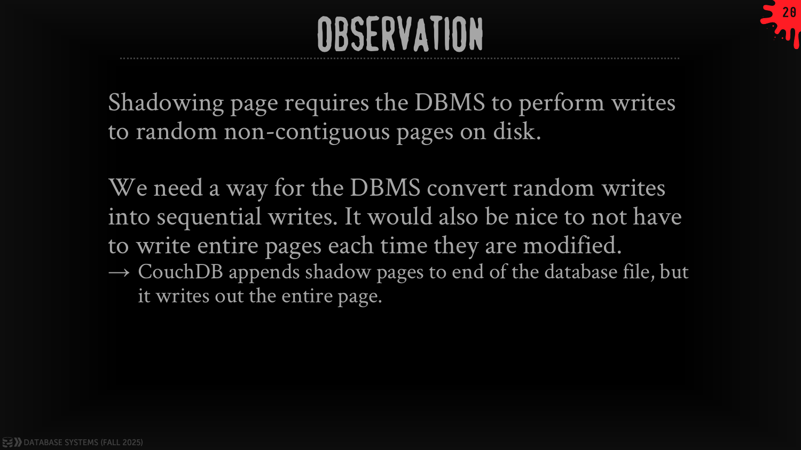


**[预写日志](#预写日志)（Write-Ahead Log，[WAL](#预写日志)）** 同时做到了这两件事。DBMS 在数据文件之外维护一个独立的[日志](#日志)文件，记录[事务](#事务)对[数据库](#数据库)所做的修改。我们假设日志存放在**[稳定存储](#稳定存储)（stable storage）**上，即写入之后不会因崩溃而丢失的存储，并且日志中包含足够的信息，可以执行恢复数据库所需的[撤销](#撤销)和[重做](#重做)操作。
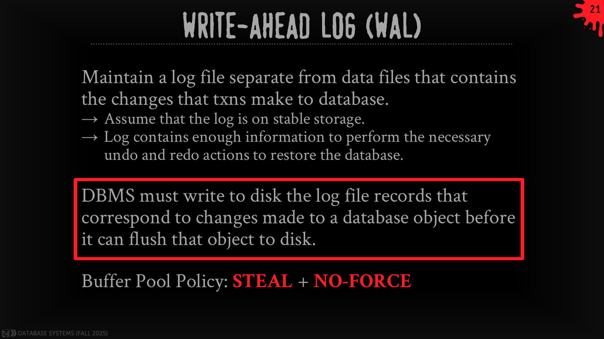


[预写日志](#预写日志)最核心的规则只有一条：**一个[数据库](#数据库)对象被修改之后，DBMS 必须先把对应这次修改的[日志](#日志)记录写到磁盘，然后才能把这个对象刷到磁盘上。** Andy 强调，关于[预写日志](#预写日志)最需要理解的就是这一条。[^2] “预写”指的正是日志先于数据写到磁盘。Andy 的团队在研究非易失性内存时提出过“后写日志”（write-behind logging），先写数据、后写日志，但那只适用于实验性硬件，他的原话是：那只存在于研究领域，真实系统里别这么做，日志必须在前。[^3]

[预写日志](#预写日志)对应的[缓冲池](#缓冲池)策略是[窃取](#窃取)加[非强制](#非强制)，两条策略都因为[日志](#日志)而变得安全：

- [窃取](#窃取)：[脏页](#脏页)可以在[事务](#事务)[提交](#提交)前写回磁盘，因为对应的[日志](#日志)记录已经先落盘，里面有[旧值](#旧值)，崩溃后可以[撤销](#撤销)。
- [非强制](#非强制)：提交时不必把数据[页](#页)写回磁盘，因为日志里有[新值](#新值)，崩溃后可以[重做](#重做)。只需保证在提交之前，这个事务的全部日志记录都已落盘。

这就是性能的来源。一个[事务](#事务)改了 1000 个[页](#页)，就会产生至少 1000 条[日志](#日志)记录。这些记录追加在日志文件末尾，一次顺序写就能带走许多条；而那 1000 个页分散在数据文件各处，[影子分页](#影子分页)要为它们做 1000 次随机写。

### 5.2 WAL 协议

📍 *PPT 第 23–24 页*

[预写日志](#预写日志)的运行规则由三部分组成。

DBMS 先把[事务](#事务)的[日志](#日志)记录暂存在易失性存储中的**[日志缓冲区](#日志缓冲区)（log buffer）**里。实际系统中它通常是一块独立的内存，而不是从[缓冲池](#缓冲池)里分出来的[页](#页)（课件上写的是“通常由缓冲池提供”，Andy 特意纠正了这一点）。PostgreSQL 的 `wal_buffers` 就是专门存放尚未写到磁盘的 [WAL](#预写日志) 数据的一块[共享内存](#共享内存)。

与某个[页](#页)相关的所有[日志](#日志)记录，必须在这个页于非易失性存储上被覆盖之前写入非易失性存储。[缓冲池](#缓冲池)的[替换策略](#替换策略)在淘汰[脏页](#脏页)时要检查这一条。具体的做法是给每条日志记录编一个递增的号码，称为日志序列号（LSN），再比较脏页上记录的号码和已落盘日志的号码，第 [22](../L22/index.md) 讲会详细介绍。

[事务](#事务)的所有[日志](#日志)记录都写入[稳定存储](#稳定存储)之后，这个事务才算[提交](#提交)。

[日志](#日志)中的记录分为三类：

- [事务](#事务)开始时，写一条 `<BEGIN>` 记录，标记它的起点。本讲暂时用不到它，第 [22](../L22/index.md) 讲恢复时要靠它确定一个事务从[日志](#日志)的哪里开始。
- 事务每修改一个对象，追加一条记录，其中包括事务 ID、对象 ID、**[旧值](#旧值)（before value）**和**[新值](#新值)（after value）**，[旧值](#旧值)用于[撤销](#撤销)，[新值](#新值)用于[重做](#重做)。实际系统还会附加一些与实现相关的数据，比如[时间戳](#时间戳)和[校验和](#校验和)。
- 事务结束时，追加一条 `<COMMIT>` 记录，并确保此前的所有日志记录都已刷盘，然后才向应用返回确认。
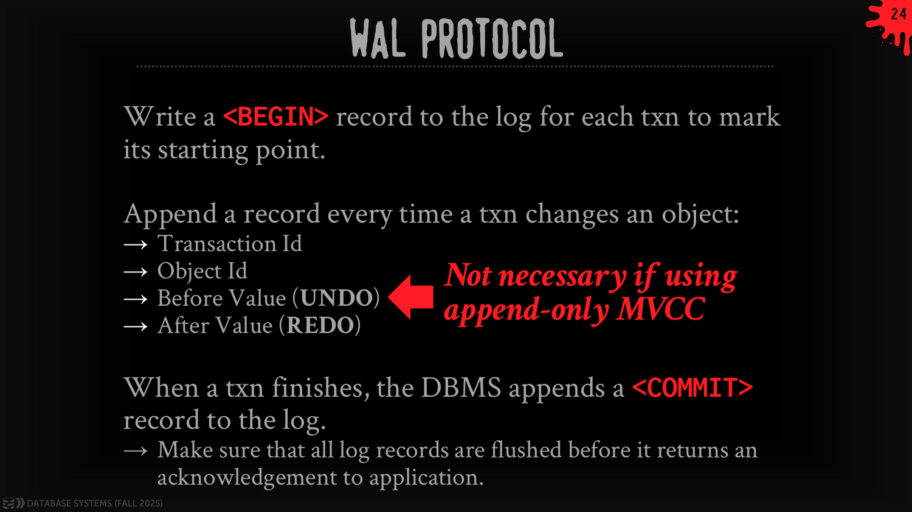


如果系统采用追加式 MVCC（第 [20](../L20/index.md) 讲，PostgreSQL 的做法），[日志](#日志)里可以不记[旧值](#旧值)。这种系统从不原地覆盖[元组](#元组)，每次修改都生成一个新版本，旧版本本身还在，[撤销](#撤销)用不上日志里的[旧值](#旧值)。这是[并发](#并发)控制机制和恢复机制互相配合的一个例子。本讲的例子为了完整，[旧值](#旧值)和[新值](#新值)都记。

[日志缓冲区](#日志缓冲区)刷盘时，可能把尚未[提交](#提交)[事务](#事务)的记录一起写出去。这不会造成问题：恢复时看到某个事务有修改记录，却没有 `<COMMIT>` 记录，就知道它没有提交，需要[撤销](#撤销)。

### 5.3 一个[事务](#事务)的[日志](#日志)

📍 *PPT 第 25 页*

磁盘上的数据[页](#页)初始为 A=1、B=5、C=7。[事务](#事务) T1 写 A、写 B、[提交](#提交)，下表逐步列出[日志缓冲区](#日志缓冲区)、[缓冲池](#缓冲池)和磁盘的状态。
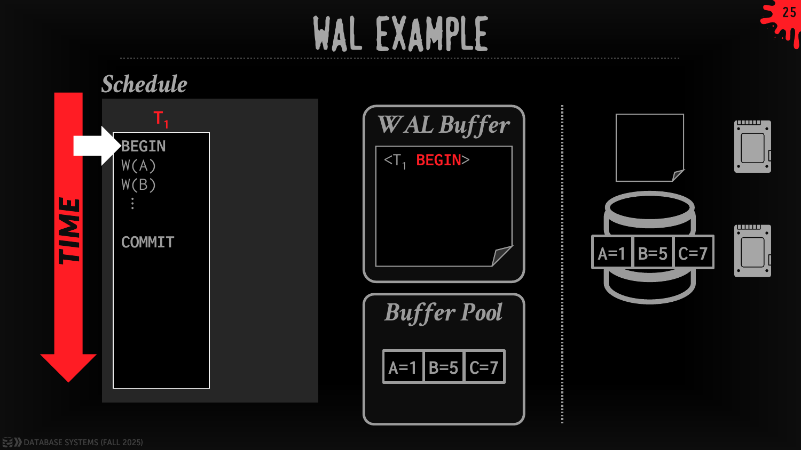


| 步骤 | T1 | [日志缓冲区](#日志缓冲区)（内存） | [缓冲池](#缓冲池)（内存） | 磁盘上的[日志](#日志) | 磁盘上的数据[页](#页) |
|---|---|---|---|---|---|
| 1 | `BEGIN` | `<T1 BEGIN>` | A=1 B=5 C=7 | （空） | A=1 B=5 C=7 |
| 2 | `W(A)`，先追加日志 | ＋`<T1, A, 1, 8>` | A=1 B=5 C=7 | （空） | A=1 B=5 C=7 |
| 3 | `W(A)`，再改页 | 同上 | A=8 B=5 C=7 | （空） | A=1 B=5 C=7 |
| 4 | `W(B)` | ＋`<T1, B, 5, 9>` | A=8 B=9 C=7 | （空） | A=1 B=5 C=7 |
| 5 | `COMMIT` | ＋`<T1 COMMIT>`，整体刷盘 | A=8 B=9 C=7 | 四条记录 | A=1 B=5 C=7 |
| 6 | 刷盘完成，返回[提交](#提交)成功 | | A=8 B=9 C=7 | 四条记录 | A=1 B=5 C=7 |
| 7 | 断电 | （丢失） | （丢失） | 四条记录 | A=1 B=5 C=7 |

`<T1, A, 1, 8>` 的含义是：[事务](#事务) T1 把对象 A 从 1 改成了 8。每次写操作都是先追加[日志](#日志)记录，再修改[缓冲池](#缓冲池)里的[页](#页)，这两步都在内存中完成，非常快。


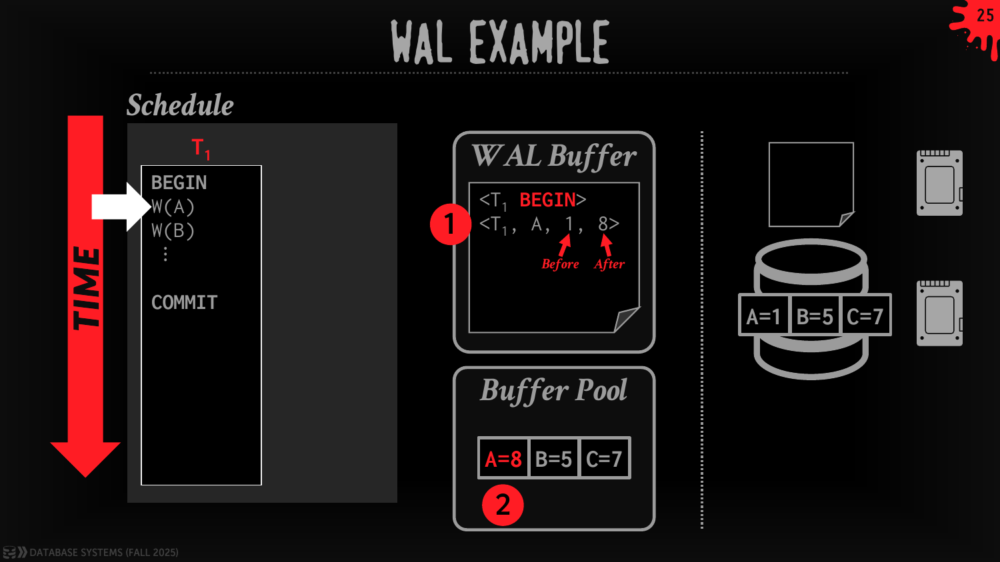

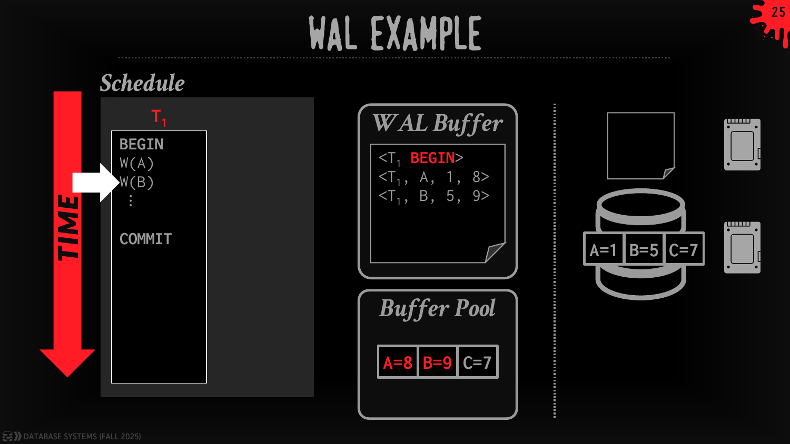


第 5 步的刷盘要用到操作系统的 `fsync`。操作系统默认把程序的写入先放在内核的[页缓存](#页缓存)里，稍后才真正写到设备上；`fsync` 要求操作系统把某个文件在页缓存里的修改全部写到设备，写完才返回。只有 `fsync` 返回之后，DBMS 才能告诉应用[事务](#事务)已经[提交](#提交)。
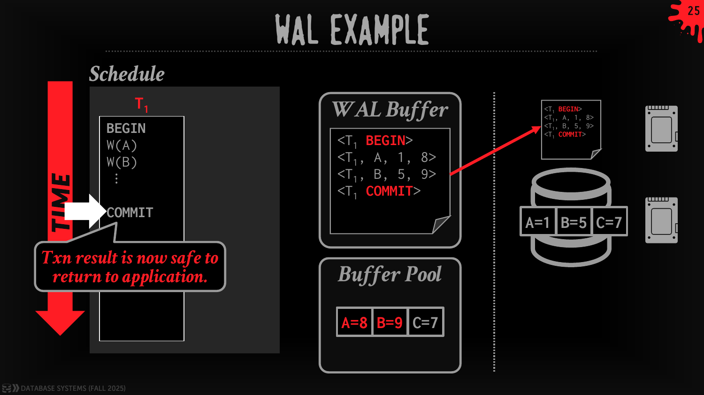

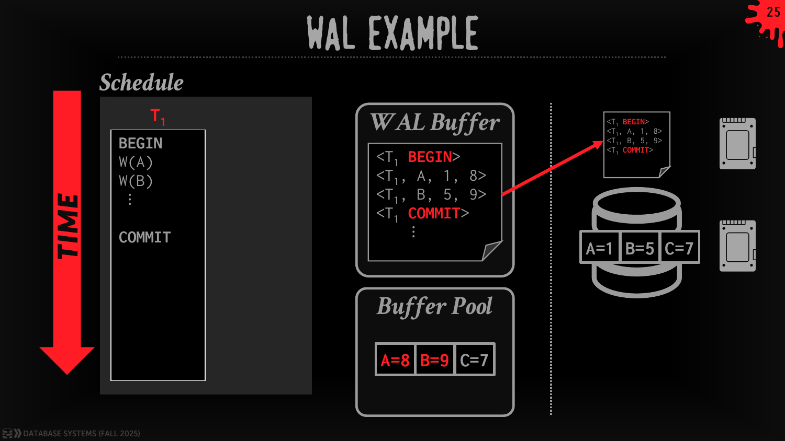


第 7 步断电后，[日志缓冲区](#日志缓冲区)和[缓冲池](#缓冲池)都没了，数据[页](#页)也从来没有写出去过，磁盘上仍是 A=1 B=5 C=7。这并不要紧，重建 T1 所需的一切都在[日志](#日志)里：重启后依据日志中的[新值](#新值)[重做](#重做)，A 变回 8，B 变回 9。
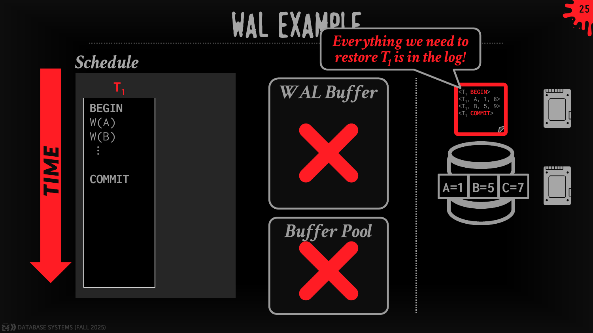


### 5.4 组提交（Group Commit）

📍 *PPT 第 26–27 页*

每次[提交](#提交)都要等一次[日志](#日志)刷盘，这会成为瓶颈。Andy 估计，即使在快速的 SSD 上，一次刷盘也要 1 到 5 毫秒。按最好的情况 1 毫秒计算：

$$
\frac{1\ \text{s}}{1\ \text{ms}} = 1000
$$

即每秒最多[提交](#提交) 1000 个[事务](#事务)，而有的应用需要每秒处理十万甚至上百万个事务。

**[组提交](#组提交)（group commit）** 把多个[事务](#事务)的[日志](#日志)刷盘合并成一次，分摊刷盘的开销。刷盘在两种情况下触发：[日志缓冲区](#日志缓冲区)写满了，或者距离上次刷盘已经超过一个超时时间（比如 5 毫秒）。下面的例子里有两个[日志缓冲区](#日志缓冲区)。
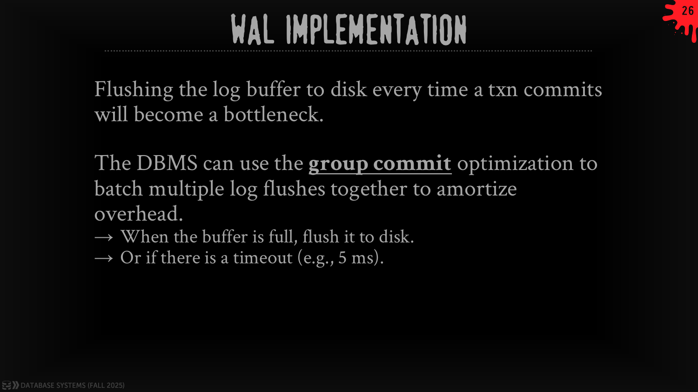

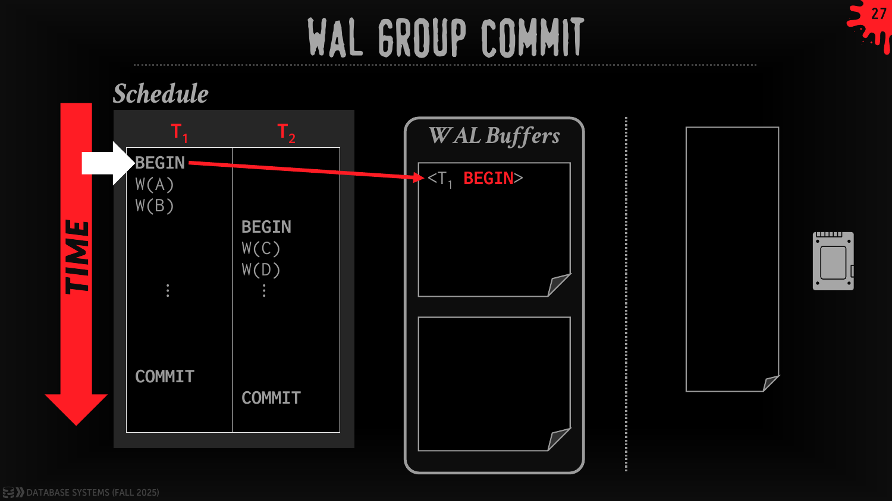

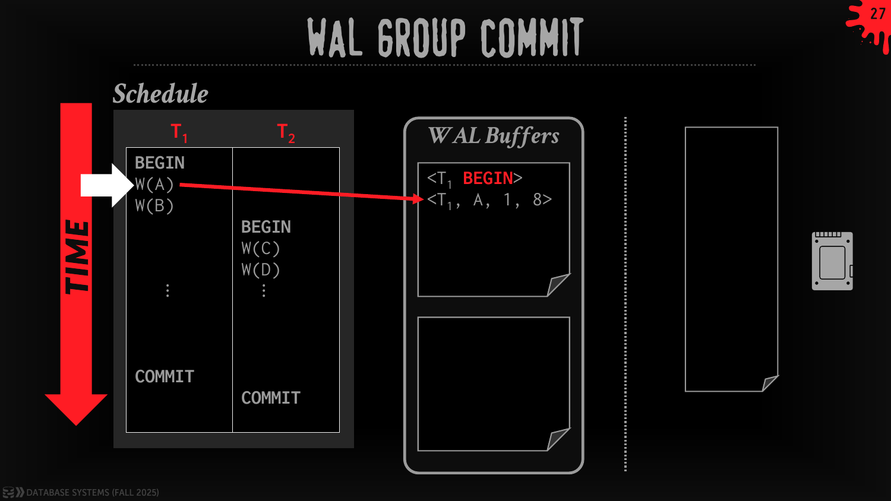


| 时刻 | T1 | T2 | 缓冲区 1 | 缓冲区 2 | 磁盘上的[日志](#日志) |
|---|---|---|---|---|---|
| 1 | `BEGIN` | | `<T1 BEGIN>` | | |
| 2 | `W(A)` | | ＋`<T1, A, 1, 8>` | | |
| 3 | `W(B)` | | ＋`<T1, B, 5, 9>` | | |
| 4 | | `BEGIN` | ＋`<T2 BEGIN>` | | |
| 5 | | `W(C)` | ＋`<T2, C, 1, 2>`，已满，开始刷盘 | | |
| 6 | | `W(D)` | （刷盘中） | `<T2, D, 3, 4>` | 前 5 条 |
| 7 | `COMMIT`，等待 | | （刷盘中） | ＋`<T1 COMMIT>` | 前 5 条 |
| 8 | | `COMMIT`，等待 | 刷盘完成，已清空 | ＋`<T2 COMMIT>` | 前 5 条 |
| 9 | 超时到达，缓冲区 2 刷盘，T1、T2 同时收到确认 | | | 已清空 | 全部 8 条 |

两个缓冲区轮流使用：一个在刷盘时，新的记录写进另一个，[事务](#事务)不必停下来等 I/O。缓冲区也可以不止两个，这样[日志](#日志)写入几乎可以一刻不停地进行。无论多少个缓冲区，所有写入都是追加到日志文件末尾的顺序写。

5 毫秒的等待会让[提交](#提交)延迟变长，这在实践中能否接受，Andy 给出了一个经验值：对大多数网站而言，[事务](#事务)提交在 50 毫秒以内就足够好。这个量级在互联网广告竞价中很典型，用户打开一个网页时，广告平台向多家买方发出竞价请求，留给对方响应的时间大约只有四五十毫秒，其中还要包括执行事务的时间。5 毫秒的[组提交](#组提交)窗口在这个预算之内。高频交易要求亚毫秒甚至微秒级的延迟，这类系统通常把整个[数据库](#数据库)放在内存里，依靠复制到多台机器来防止数据丢失，而不是等待磁盘。

[组提交](#组提交)并不改变承诺，每个[事务](#事务)仍然要等自己的 `<COMMIT>` 记录落盘之后才收到确认。有的系统允许放宽这一点，称为**[异步提交](#异步提交)（asynchronous commit）**：事务逻辑上完成后立即返回成功，不等[日志](#日志)刷盘。PostgreSQL 把 `synchronous_commit` 设为 `off` 就是这种模式，它的文档说明，在报告[提交](#提交)成功和日志真正落盘之间存在一个风险窗口，最长为 `wal_writer_delay` 的三倍；该参数默认 200 毫秒，也就是说，最近约 600 毫秒内“已提交”的事务可能在崩溃中丢失。丢失的只是最后几个事务，[数据库](#数据库)不会损坏，因为日志按提交顺序重放，后面的事务不可能保留下来而它依赖的前一个事务却丢了。PostgreSQL 的 `synchronous_commit` 和 MySQL InnoDB 对应的 `innodb_flush_log_at_trx_commit` 默认都采用每次提交都刷盘的安全设置。第 [1](../L01/index.md) 讲提到，有些系统会默认牺牲[持久性](#持久性)来换取看起来更快的速度，这类开关就是那种取舍在配置项上的样子。Andy 的提醒很直接：如果你真的在乎不丢数据，一定要确认这个开关是打开的。[^4]

### 5.5 运行时性能与恢复性能

📍 *PPT 第 29 页*

把四种组合分别放在正常运行和崩溃恢复两个场景下比较，得到两张方向正好相反的表：

| 运行时性能 | [不窃取](#不窃取) | [窃取](#窃取) |
|---|---|---|
| **[非强制](#非强制)** | — | 最快 |
| **[强制](#强制)** | 最慢 | — |

| 恢复性能 | [不窃取](#不窃取) | [窃取](#窃取) |
|---|---|---|
| **[非强制](#非强制)** | — | 最慢（[撤销](#撤销) + [重做](#重做)） |
| **[强制](#强制)** | 最快（无[撤销](#撤销)、无[重做](#重做)） | — |

几乎所有 DBMS 都选择[窃取](#窃取)加[非强制](#非强制)。理由在于正常运行是常态，崩溃是例外。只要系统不是每隔几秒就崩溃一次，就应该为常态优化，把代价推到恢复阶段。再配合下一阶段要讲的复制，一台机器恢复期间可以由别的机器接管服务，恢复慢一些的代价就更小了。


[影子分页](#影子分页)仍然有人用，主要因为它容易实现。Andy 的评价是，[不窃取](#不窃取)加[强制](#强制)可以写得又快又糙，而[预写日志](#预写日志)要复杂得多，加上[检查点](#检查点)之后更难，因为系统必须能处理恢复过程中再次崩溃的情况，[影子分页](#影子分页)则根本没有这个问题。[^5]

### 5.6 [日志](#日志)结构系统同样需要 WAL

📍 *PPT 第 28 页*

[日志](#日志)结构的 DBMS（第 [5](../L05/index.md) 讲的 [LSM 树](#LSM%20树)）没有[脏页](#脏页)，从磁盘读出的[页](#页)都是不可变的。写入先进入内存中的 [MemTable](#MemTable)，MemTable 满了再整体写成一个 [SSTable](#SSTable)。MemTable 在内存里，崩溃即丢；而且它写到磁盘时，里面可能包含尚未[提交](#提交)[事务](#事务)的修改。所以这类系统仍然维护一个独立的 [WAL](#预写日志)，用来在崩溃后重建 MemTable。一个 MemTable 写成 SSTable 并安全落盘之后，对应的那段日志就可以截断了。


看到这里会发现，[预写日志](#预写日志)、[影子分页](#影子分页)、[多版本并发控制](#多版本并发控制)、[LSM 树](#LSM%20树)彼此之间有大量重叠的思想，它们之所以被当作不同的概念，是因为系统按抽象层次把关注点分开了。这种分层带来了冗余。早期的 Postgres 没有[预写日志](#预写日志)，它的设计者认为，每次修改都生成一个新的[元组](#元组)版本并写出去，这本身就起到了[日志](#日志)的作用；后来出于性能考虑，Postgres 还是加上了[预写日志](#预写日志)。在 DBMS 之下，日志式文件系统维护着自己的日志；再往下，SSD 内部也在做类似日志的事情。Andy 的看法是：冗余很多，但除非你掌控整个技术栈，而实际上没有人能做到，这些冗余基本无法避免。[^6] 即便是自己掌控很多层的 Oracle，底下通常也还是一个带日志的文件系统。

## 6. [日志](#日志)里记什么

📍 *PPT 第 30–32 页*

### 6.1 三种[日志](#日志)方案

📍 *PPT 第 30–31 页*

前面的 `<T1, A, 1, 8>` 回避了一个问题：“对象 A”在实际系统中怎样定位，“1”和“8”又是什么形式的数据。[日志](#日志)记录的内容有三种做法。

**[物理日志](#物理日志)（physical logging）** 记录对某个特定[页](#页)的字节级修改，类似 `git diff`。

**[逻辑日志](#逻辑日志)（logical logging）** 记录[事务](#事务)执行的高层操作，比如它发出的 `UPDATE`、`DELETE`、`INSERT` 语句，一条记录不局限于单个[页](#页)。


**[物理逻辑日志](#物理逻辑日志)（physiological logging）** 是二者的混合：对[页](#页)是物理的，对页内是逻辑的。它用页号加[槽](#槽)号标识一个[元组](#元组)，记录这个元组的字节级修改，但不规定页内的数据如何组织。

以同一条语句为例：

```sql
UPDATE foo SET val = XYZ WHERE id = 1;
```

```text
物理日志                      逻辑日志                      物理逻辑日志
<T1,                          <T1,                          <T1,
 Table=X,                      Query="UPDATE foo             Table=X,
 Page=99,                             SET val=XYZ            Page=99,
 Offset=1024,                         WHERE id=1">           Slot=1,
 Before=ABC,                                                 Before=ABC,
 After=XYZ>                                                  After=XYZ>
<T1,                                                        <T1,
 Index=X_PKEY,                                               Index=X_PKEY,
 Page=45,                                                    IndexPage=45,
 Offset=9,                                                   Key=(1,Record1)>
 Key=(1,Record1)>
```

（PPT 中语句里的表名写作 `foo`，[日志](#日志)记录里写作 `X`，指的是同一张表。）

[物理日志](#物理日志)和[物理逻辑日志](#物理逻辑日志)的区别只在一处：前者记“99 号[页](#页)、偏移 1024”，后者记“99 号页、1 号[槽](#槽)”。在[槽式页](#槽式页)（第 [3](../L03/index.md) 讲）中，槽号是[元组](#元组)在页内的逻辑编号，[槽数组](#槽数组)记录它在页内的实际偏移。[日志](#日志)只记槽号，那么日志写出之后，DBMS 仍然可以整理这个页，比如把空闲空间压紧、移动元组的位置，日志照样能正确施加。[物理日志](#物理日志)把偏移写死，页内一旦重排，旧日志就对不上了。这和 C 程序里用句柄而不用裸指针引用对象是同一个道理：对象搬家时，只需要更新句柄表。大多数 DBMS 采用的是[物理逻辑日志](#物理逻辑日志)。


两种记录都包含了[索引](#索引)的修改。索引是数据的第二份拷贝，同样需要写[日志](#日志)；否则恢复之后只能重建索引，而重建要把整张表重新读一遍。内存[数据库](#数据库)常常反其道而行：它们启动时反正要把整个数据库读进内存，于是干脆不给索引写日志，在加载数据时顺便重建索引，以此减少正常运行时的日志量。

### 6.2 逻辑日志的代价

📍 *PPT 第 32 页*

[逻辑日志](#逻辑日志)的优点是每条记录写的数据少。一条 `UPDATE` 改了十亿个[元组](#元组)，[逻辑日志](#逻辑日志)只需要一条记录；[物理日志](#物理日志)要为每个被修改的[页](#页)各写一条，这些元组若分布在十亿个页上，就是十亿条。

它的困难在恢复上。

第一，非确定性的函数。语句里如果有 `NOW()` 或随机数函数，今天执行得到今天的日期，崩溃后明天重放得到明天的日期，恢复出来的数据和[提交](#提交)时的不一样。系统必须额外记下这些函数当时返回的值。

第二，[并发](#并发)。多个[事务](#事务)并发执行、而且[隔离级别](#隔离级别)较低时，一条查询的结果取决于它和其他事务的交错方式。恢复时按[日志](#日志)顺序逐条重新执行，得不到当初的交错，结果可能不同。系统必须额外记录事务实际执行的先后顺序，逻辑上的[提交](#提交)顺序不够用。


第三，很难知道崩溃前[数据库](#数据库)的哪些部分已经被一条查询改过。在[窃取](#窃取)策略下，一条 `UPDATE` 涉及的[页](#页)，可能有一部分已经刷盘、一部分还没有。[日志](#日志)只说执行过这条语句，恢复时不知道该从哪里补起；整条重新执行也不一定安全，比如 `SET x = x + 1` 在已经落盘的页上再执行一次，结果就错了。

第四，恢复慢。恢复要把[日志](#日志)里的每条查询重新执行一遍，一条查询在正常运行时花了一个小时，恢复时重放它还要一个小时。

所以大多数系统不用[逻辑日志](#逻辑日志)做崩溃恢复。[逻辑日志](#逻辑日志)在复制中另有用武之地：把一台[数据库](#数据库)的修改同步到另一台时，有的系统允许在逻辑和物理两种格式之间选择，比如 MySQL 的二进制[日志](#日志)（binlog）可以按语句记录，也可以按行记录。

## 7. [日志](#日志)的另一种用途：变更数据捕获

📍 *PPT 第 33 页*

[日志](#日志)里保存着对[数据库](#数据库)修改的完整序列，它的用途不止于崩溃恢复。**[变更数据捕获](#变更数据捕获)（Change Data Capture，[CDC](#变更数据捕获)）** 自动把数据库的修改传播给外部系统，用来复制和同步数据库的内容。它是 ETL（Extract Transform Load，抽取、转换、加载）的一种实现方式：业务数据库上的变更被源源不断地送进数据仓库，供分析使用。有的系统原生支持 [CDC](#变更数据捕获)，有的需要借助第三方工具。


最直接的例子是复制。两台 PostgreSQL，写入全部发往第一台，第一台把自己的[预写日志](#预写日志)发给第二台，第二台假装自己正处在崩溃恢复中，把收到的[日志](#日志)逐条重放。它做的事情和崩溃后的恢复完全相同，只是日志来自网络，而不是本地磁盘。

[CDC](#变更数据捕获) 有三种实现方式：

- **基于 [WAL](#预写日志)**：直接读取[数据库](#数据库)本来就要写的[预写日志](#预写日志)。
- **基于触发器**：在每张表上定义触发器，把每次修改另外写一份到一张变更表里。代价是每个[事务](#事务)都要多做一次写入。
- **基于[时间戳](#时间戳)**：每行带一个最后修改时间，定期查询比上次同步时间更新的行。实现简单，但它看不到已被删除的行，也要求表里有这样一列。

基于 [WAL](#预写日志) 的方式效率最高，因为[日志](#日志)反正要写，读取它几乎不给[事务](#事务)增加负担，也不会漏掉删除。日志的格式通常有文档说明，所以有一批工具专门解析它：开源的 Debezium 可以读取 PostgreSQL 的[预写日志](#预写日志)，把其中的变更转换成 JSON 之类的事件，送进 Kafka 这样的[流处理系统](#流处理系统)，再由下游系统消费；商业产品中，Andy 认为最贵的大概是 Oracle GoldenGate；Striim、Qlik 也属于这一类。

这里还有一个值得记住的观点：[预写日志](#预写日志)不一定要写在磁盘上，它也可以是发往另一个系统的网络流，本讲的所有机制照样成立。第 [23](../L23/index.md)、[24](../L24/index.md) 讲的复制正是建立在这个观点上。

## 8. [检查点](#检查点)（Checkpoints）

📍 *PPT 第 34–38 页*

### 8.1 [日志](#日志)会无限增长

📍 *PPT 第 34 页*

到目前为止的[预写日志](#预写日志)有一个明显的问题：它会一直增长下去。[数据库](#数据库)运行一年，[日志](#日志)里就有一年的记录；有的系统连续运行了几十年，如果不加管理，日志可能累积到 PB 级。崩溃之后要把整个日志重放一遍，即使采用施加速度很快的[物理逻辑日志](#物理逻辑日志)，处理一年的记录也要花很长时间。

解决办法是**[检查点](#检查点)（checkpoint）**：DBMS 周期性地把所有缓冲区刷到磁盘，并在[日志](#日志)中记下一个标记。它有两个作用。第一，恢复时它告诉 DBMS 需要往回看多远，[检查点](#检查点)之前的修改都已经在磁盘上了。第二，日志可以截断到某个安全点为止，更早的记录可以丢弃。


截断是允许的，而不是必须的。金融等行业出于审计和监管的要求，可能需要把变更记录保存很多年；在这类场景下，旧[日志](#日志)留着只是占空间，恢复时并不会去读它们。

### 8.2 阻塞检查点

📍 *PPT 第 35–36 页*

**[阻塞检查点](#阻塞检查点)（blocking checkpoint）**，也称一致性[检查点](#检查点)（consistent checkpoint）。它的完整定义是停止接受新[事务](#事务)、等待所有[活跃事务](#活跃事务)结束，然后再刷盘（Lecture Notes 采用的就是这个定义）：这样做出的[检查点](#检查点)之前不存在任何未完成的事务，恢复时完全不必看[检查点](#检查点)之前的[日志](#日志)；代价是停顿时间还要加上运行最久的那个事务的剩余时间，可能长达几个小时。


一个更省事的变体是只暂停查询、不等[事务](#事务)结束，步骤如下：

1. 暂停所有查询：不再开始新的[事务](#事务)和查询，正在执行的查询停在原地。
2. 把内存中的所有 [WAL](#预写日志) 记录刷到磁盘。
3. 把[缓冲池](#缓冲池)中所有被修改过的[页](#页)刷到磁盘。
4. 向 [WAL](#预写日志) 写一条 `<CHECKPOINT>` 记录，并刷到磁盘。
5. 恢复查询的执行。

第 2 步必须在第 3 步之前，这是[预写日志](#预写日志)规则的直接要求：[脏页](#脏页)落盘之前，它对应的[日志](#日志)记录必须先落盘。

两相对照就能看出差别：完整定义的[阻塞检查点](#阻塞检查点)不会留下跨越[检查点](#检查点)的[事务](#事务)，而只暂停查询的变体会留下——下面的例子里 T2、T3 就跨越了[检查点](#检查点)，这些事务正是第 [22](../L22/index.md) 讲[模糊检查点](#模糊检查点)要处理的对象。

下面是一段[日志](#日志)，崩溃发生在最后一条记录之后：

```text
<T1 BEGIN>
<T1, A, 1, 2>
<T1 COMMIT>
<T2 BEGIN>
<T2, A, 2, 3>
<T3 BEGIN>
<CHECKPOINT>
<T2, B, 4, 5>
<T2 COMMIT>
<T3, A, 3, 4>
      ⋮
   ✗ 崩溃
```

恢复时，DBMS 从[日志](#日志)末尾往前扫描，找到最近的一条 `<CHECKPOINT>`，以它为分析的起点。


| [事务](#事务) | 与[检查点](#检查点)的关系 | 恢复动作 |
|---|---|---|
| T1 | [检查点](#检查点)之前已[提交](#提交) | 忽略：它的修改已随[检查点](#检查点)落盘 |
| T2 | [检查点](#检查点)时尚未提交，在[检查点](#检查点)之后、崩溃之前提交 | [重做](#重做) |
| T3 | 崩溃时仍未提交 | [撤销](#撤销) |

具体到数据：T2 在[检查点](#检查点)之前写的 `<T2, A, 2, 3>` 已经随[检查点](#检查点)刷到了磁盘，尽管那时 T2 还没有[提交](#提交)，这正是[窃取](#窃取)策略在起作用；T2 在[检查点](#检查点)之后写的 `<T2, B, 4, 5>` 可能还没有落盘，按[新值](#新值)[重做](#重做)，B=5。T3 的 `<T3, A, 3, 4>` 可能已经被写到磁盘，也可能没有，按[旧值](#旧值)[撤销](#撤销)，A=3。恢复后[数据库](#数据库)中 A=3、B=5，正是 T1、T2 提交、T3 从未发生过的状态。

### 8.3 阻塞检查点的两个问题

📍 *PPT 第 37 页*

第一个问题是暂停。为了得到一致的[快照](#快照)，DBMS 做[检查点](#检查点)时必须让所有[事务](#事务)停下来。[缓冲池](#缓冲池)越大、[脏页](#脏页)越多，停顿就越长。Andy 设想了一个极端情况：缓冲池有 100 TB，而且全是脏页。即使磁盘能以每秒 10 GB 的速度持续写入，也需要

$$
\frac{100\ \text{TB}}{10\ \text{GB/s}} = \frac{10^{14}\ \text{B}}{10^{10}\ \text{B/s}} = 10^{4}\ \text{s} \approx 2.8\ \text{h}
$$

在这将近 3 小时里，没有一条查询能够执行。

第二个问题是扫描。[检查点](#检查点)只保证在它之前产生的[脏页](#脏页)已经落盘，没有说明[检查点](#检查点)时刻有哪些[事务](#事务)还在运行。像 T2、T3 这样跨越[检查点](#检查点)的事务，它们在[检查点](#检查点)之前写下的记录恢复时也可能要用到。假如崩溃时 T2 尚未[提交](#提交)，就要[撤销](#撤销)它的 `<T2, A, 2, 3>`，而这条记录在[检查点](#检查点)之前，它对应的修改已经随[检查点](#检查点)落了盘。DBMS 只能沿着[日志](#日志)继续往前扫描，把这些事务找出来，最坏情况下要扫描整个日志。同样的原因，截断日志时也不能简单地丢掉[检查点](#检查点)之前的全部记录。这种扫描无法完全避免，但可以在 `<CHECKPOINT>` 记录里加入提示信息来加快它，比如记下[检查点](#检查点)时刻仍在运行的事务，这是第 [22](../L22/index.md) 讲的内容。


### 8.4 [检查点](#检查点)的频率

📍 *PPT 第 38 页*

[检查点](#检查点)做得太频繁，运行时性能会下降，系统把太多时间花在刷缓冲区上。间隔太长同样糟糕：每个[检查点](#检查点)要刷的[脏页](#脏页)更多、耗时更长，崩溃后的恢复时间也会大大延长。

所以[检查点](#检查点)的频率是一个可调参数，取决于应用对恢复时间的要求。Andy 的说法是，这个问题没有标准答案，取决于你的应用、你的公司对痛苦的忍耐程度。[^7]

触发[检查点](#检查点)的条件有两类：按时间，或者按产生的[日志](#日志)量。按日志量触发的好处是，系统空闲时不会白白做[检查点](#检查点)，只有写入了足够多的数据才需要。PostgreSQL 两者都用：`checkpoint_timeout` 默认 5 分钟，`max_wal_size` 默认 1 GB，哪个条件先满足就触发[检查点](#检查点)，文档也提醒调大这两个参数会延长崩溃恢复的时间。PostgreSQL 的[检查点](#检查点)并不暂停系统，它采用的是第 [22](../L22/index.md) 讲的[模糊检查点](#模糊检查点)，但触发条件的设计思路与这里讲的相同。

## 小结

📍 *PPT 第 39–40 页*

一切从一次“[提交](#提交)成功”之后的断电开始。把恢复所需的手段归结为[撤销](#撤销)和[重做](#重做)之后，问题变成了[缓冲池](#缓冲池)策略的选择：[窃取](#窃取)决定是否需要[撤销](#撤销)，[非强制](#非强制)决定是否需要[重做](#重做)。[不窃取](#不窃取)加[强制](#强制)最简单，但受限于内存，也做不到多[页](#页)提交的[原子性](#原子性)。[影子分页](#影子分页)用一次原子的指针切换解决了原子性，却付出了随机写和碎片化的代价；SQLite 的[回滚](#回滚)[日志](#日志)换了一个方向，把旧页放在一旁，成为“[窃取](#窃取) + [强制](#强制)”的实例。[预写日志](#预写日志)把提交时整页的随机写换成了日志的顺序追加，从而可以采用[窃取](#窃取)加[非强制](#非强制)，获得最好的运行时性能，再用[组提交](#组提交)分摊刷盘开销，用[检查点](#检查点)限制日志的增长和恢复的范围。结论是：面对易失性存储的丢失，[预写日志](#预写日志)几乎总是最好的方案；采用[窃取](#窃取)加[非强制](#非强制)的增量更新，配合[检查点](#检查点)；恢复时[撤销](#撤销)未提交的[事务](#事务)，[重做](#重做)已提交的事务。

本讲留下了三个问题：[阻塞检查点](#阻塞检查点)要暂停整个系统；[检查点](#检查点)记录不说明哪些[事务](#事务)还在运行，恢复时可能要扫描整个[日志](#日志)；[缓冲池](#缓冲池)需要一种办法判断某个[脏页](#脏页)的日志是否已经落盘。它们都由第 [22](../L22/index.md) 讲解决：用日志序列号追踪日志与[页](#页)的关系，用[模糊检查点](#模糊检查点)代替[阻塞检查点](#阻塞检查点)，并用 ARIES 算法完成恢复。ARIES 由 IBM 在 1992 年发表，论文近 70 页。Andy 提醒，大多数系统并不会完全照论文实现，但分析、[重做](#重做)、[撤销](#撤销)三个阶段的高层思路大体相同。

> 💬 **旁注**
> [影子分页](#影子分页)和 ARIES 都出自 IBM。Andy 开玩笑说，跟 IBM 那些老派的[数据库](#数据库)研究者聊天时，无论你讲自己在研究什么，他们都会告诉你，这东西他们八十年代就发明过了。
>
> *原话：“If you hang around any of the old-school database guys at IBM, you tell them whatever your research is, they'll tell you they invented that in the eighties.”*

下一讲是第 [22](../L22/index.md) 讲“[数据库](#数据库)恢复”，讲崩溃之后怎样利用本讲写下的[日志](#日志)和[检查点](#检查点)，把数据库恢复到正确的状态。


## 术语速查表

### 数据库

**Database**：一组经过组织、相互关联、用来模拟现实世界某方面的数据。（本讲首次出现：摘要；引入于：第 1 讲）

### 缓冲池

**Buffer Pool**：由定长帧组成的一大块内存，用来存放从磁盘读入的页。（本讲首次出现：摘要；引入于：第 3 讲）

### 提交

**Commit**：数据库接受事务成功完成及其整体修改。（本讲首次出现：摘要；引入于：第 17 讲）

### 中止

**Abort**：事务不能成功完成，需要取消其修改。（本讲首次出现：摘要；引入于：第 17 讲）

### 事务

**Transaction**：为完成业务功能而共同执行、整体成功或失败的一组数据库操作。（本讲首次出现：摘要；引入于：第 10 讲）

### 持久性

**Durability**：已成功提交的修改在约定故障范围内能够保留或恢复。（本讲首次出现：摘要；引入于：第 1 讲）

### 原子性

**Atomicity**：事务的修改全部生效或全部不留下。（本讲首次出现：摘要；引入于：第 17 讲）

### 脏页

**Dirty Page**：标记页在内存中被改过；这样的页淘汰前必须写回。（本讲首次出现：摘要；引入于：第 4 讲）

### 页

**Page**：定长的数据块，数据库中一切数据的存放单位。（本讲首次出现：摘要；引入于：第 3 讲）

### 日志

**Logging**：按序记录修改及恢复所需的信息。（本讲首次出现：摘要；引入于：第 17 讲）

### 并发

**Concurrency**：多个事务的执行时间重叠，可以交替或同时推进。（本讲首次出现：课程地图；引入于：第 17 讲）

### 一致性

**Consistency**：正确事务把满足规则的数据库状态变成另一个合法状态。（本讲首次出现：课程地图；引入于：第 17 讲）

### 隔离性

**Isolation**：约束并发事务如何观察和影响彼此。（本讲首次出现：课程地图；引入于：第 17 讲）

### 替换策略

**Replacement Policy**：缓冲池满时决定淘汰哪一页的算法。（本讲首次出现：课程地图；引入于：第 4 讲）

### 槽式页

**Slotted Page**：用槽数组记录元组页内偏移、元组从页尾向前存放的页布局。（本讲首次出现：课程地图；引入于：第 3 讲）

### 多版本并发控制

**Multi-Version Concurrency Control (MVCC)**：为每个逻辑对象维护多个物理版本，写时创建新版本，读时按时间戳选择版本。（本讲首次出现：课程地图；引入于：第 20 讲）

### LSM 树

**Log-Structured Merge Tree**：由 MemTable 和分层 SSTable 组成的日志结构存储结构。（本讲首次出现：课程地图；引入于：第 5 讲）

### MemTable

**MemTable**：内存中先接收所有修改的有序数据结构。（本讲首次出现：课程地图；引入于：第 5 讲）

### 恢复算法

**Recovery Algorithm**：在故障发生时仍保证一致性、原子性和持久性的技术，分为正常运行时的准备和故障后的恢复两部分。（本讲首次出现：1.2；引入于：本讲）

### 撕裂写

**Torn Write**：一次写入只完成了一部分，磁盘上留下新旧混杂的页。（本讲首次出现：1.2；引入于：本讲）

### 撤销

**Undo**：清除未完成或已中止事务所产生影响的过程。（本讲首次出现：1.3；引入于：[第 17 讲](../L17/index.md)）

### 重做

**Redo**：重新施加已提交事务的修改，以保证持久性。（本讲首次出现：1.3；引入于：[第 17 讲](../L17/index.md)）

### 并发控制协议

**Concurrency Control Protocol**：运行时约束多个事务操作如何交错的规则。（本讲首次出现：1.3；引入于：第 10 讲）

### 死锁

**Deadlock**：事务形成循环等待，没有参与者能够独立继续。（本讲首次出现：1.3；引入于：第 10 讲）

### 两阶段锁

**Two-Phase Locking / 2PL**：先获取或升级，后释放或降级，进入收缩阶段后不能回头。（本讲首次出现：2.1；引入于：第 18 讲）

### 回滚

**Rollback**：撤销事务修改的过程或发起撤销的命令。（本讲首次出现：2.1；引入于：第 17 讲）

### 窃取

**Steal**：是否允许把未提交事务的脏页写回磁盘，覆盖最近一次提交的版本。（本讲首次出现：2.2；引入于：本讲）

### 不窃取

**No-Steal**：是否允许把未提交事务的脏页写回磁盘，覆盖最近一次提交的版本。（本讲首次出现：2.2；引入于：本讲）

### 帧

**Frame**：缓冲池中能放一页的位置。（本讲首次出现：2.2；引入于：第 3 讲）

### LRU-K

**LRU-K**：按第 K 次最近访问到现在的距离决定淘汰对象。（本讲首次出现：2.2；引入于：第 4 讲）

### 强制

**Force**：是否要求事务提交前把它的全部修改写回磁盘。（本讲首次出现：2.3；引入于：本讲）

### 非强制

**No-Force**：是否要求事务提交前把它的全部修改写回磁盘。（本讲首次出现：2.3；引入于：本讲）

### 写集

**Write Set**：一个事务要修改的全部数据。（本讲首次出现：3.2；引入于：本讲）

### 影子分页

**Shadow Paging**：修改写在页的副本上，提交时原子地切换根指针，使副本成为新的主副本。（本讲首次出现：4.1；引入于：[第 17 讲](../L17/index.md)）

### 主副本

**Master**：只含已提交修改的数据库版本。（本讲首次出现：4.1；引入于：本讲）

### 影子副本

**Shadow**：含未提交修改的临时版本。（本讲首次出现：4.1；引入于：本讲）

### 写时复制

**Copy-on-Write**：修改之前先复制，只在副本上修改。（本讲首次出现：4.1；引入于：本讲）

### 元组

**Tuple**：关系中的一个元素，即表中的一行。（本讲首次出现：4.1；引入于：第 1 讲）

### 锁

**Lock**：协调事务访问数据库逻辑内容的机制。（本讲首次出现：4.1；引入于：第 4 讲）

### 页表

**Page Table**：内存中从页 ID 到帧位置的哈希表，只含当前在内存中的页。（本讲首次出现：4.2；引入于：第 4 讲）

### 页目录

**Page Directory**：记录各数据库对象的页位置及空闲空间等元数据的特殊页。（本讲首次出现：4.2；引入于：第 3 讲）

### 快照

**Snapshot**：事务开始时记下的当时仍在运行的事务，决定此后哪些写对它可见。（本讲首次出现：4.2；引入于：第 20 讲）

### 排他锁

**Exclusive Lock / X Lock**：允许读写对象，排斥其他事务的冲突访问权。（本讲首次出现：4.2；引入于：第 18 讲）

### B+ 树

**B+ Tree**：内部节点导航、叶节点保存真实值的有序多路平衡树。（本讲首次出现：4.4；引入于：第 8 讲）

### 索引组织存储

**Index-Organized Storage**：把元组直接作为索引叶节点中的值存放，表与索引合一。（本讲首次出现：4.4；引入于：第 5 讲）

### 叶节点

**Leaf Node**：保存实际索引键值条目的底层节点。（本讲首次出现：4.4；引入于：第 8 讲）

### 顺序扫描

**Sequential Scan**：逐页读取整张表，检查每个元组。（本讲首次出现：4.4；引入于：第 13 讲）

### 增量存储

**Delta Storage**：只把被修改列的旧值写入增量存储段，主表原地覆盖。（本讲首次出现：4.4；引入于：第 6 讲）

### 版本链

**Version Chain**：用元组头部的指针把同一逻辑元组的所有版本串成的链表。（本讲首次出现：4.4；引入于：第 20 讲）

### 回滚模式（回滚日志）

**Rollback Mode (Rollback Journal)**：修改页之前把原页存入独立的日志文件，崩溃后用它覆盖回数据库文件。（本讲首次出现：4.5；引入于：本讲）

### 预写日志

**Write-Ahead Log (WAL)**：独立的日志文件，对象落盘之前，它对应的日志记录必须先落盘。（本讲首次出现：5.1；引入于：[第 17 讲](../L17/index.md)）

### 稳定存储

**Stable Storage**：写入后不会因崩溃而丢失的存储。（本讲首次出现：5.1；引入于：本讲）

### 日志缓冲区

**Log Buffer**：暂存尚未刷盘的日志记录的内存区域。（本讲首次出现：5.2；引入于：本讲）

### 旧值

**Before Value**：日志记录中修改前的值（用于撤销）/ 修改后的值（用于重做）。（本讲首次出现：5.2；引入于：本讲）

### 新值

**After Value**：日志记录中修改前的值（用于撤销）/ 修改后的值（用于重做）。（本讲首次出现：5.2；引入于：本讲）

### 共享内存

**Shared Memory**：多个进程都能访问的内存区域，用来存放全局数据结构。（本讲首次出现：5.2；引入于：第 14 讲）

### 时间戳

**Timestamp**：用来建立事务先后关系的有序标识；此处用于决定等待优先级。（本讲首次出现：5.2；引入于：第 18 讲）

### 校验和

**Checksum**：由页内容算出的值，用于检测页是否损坏。（本讲首次出现：5.2；引入于：第 3 讲）

### 页缓存

**OS Page Cache**：操作系统在内核中为文件维护的缓存。（本讲首次出现：5.3；引入于：第 1 讲）

### 组提交

**Group Commit**：把多个事务的日志刷盘合并成一次，以分摊刷盘开销。（本讲首次出现：5.4；引入于：本讲）

### 异步提交

**Asynchronous Commit**：不等日志刷盘就向应用报告提交成功，以可能丢失最近事务为代价换取低延迟。（本讲首次出现：5.4；引入于：本讲）

### SSTable

**Sorted String Table**：MemTable 写满后落盘形成的按键有序、不可修改的文件。（本讲首次出现：5.6；引入于：第 5 讲）

### 物理日志

**Physical Logging**：记录对特定页、特定偏移的字节级修改。（本讲首次出现：6.1；引入于：本讲）

### 逻辑日志

**Logical Logging**：记录事务执行的高层操作，如 SQL 语句。（本讲首次出现：6.1；引入于：本讲）

### 物理逻辑日志

**Physiological Logging**：用页号加槽号定位元组并记录其修改，不规定页内组织方式。（本讲首次出现：6.1；引入于：本讲）

### 槽

**Slot**：哈希表数组中的一个定长存储位置。（本讲首次出现：6.1；引入于：第 7 讲）

### 槽数组

**Slot Array**：从槽号到元组起始偏移的映射。（本讲首次出现：6.1；引入于：第 3 讲）

### 索引

**Index**：按适合查找的方式组织键与记录定位信息的访问结构。（本讲首次出现：6.1；引入于：第 8 讲）

### 隔离级别

**Isolation Level**：事务暴露于其他并发事务动作的程度。（本讲首次出现：6.2；引入于：第 19 讲）

### 变更数据捕获

**Change Data Capture (CDC)**：把数据库的修改自动传播给外部系统，用于复制和同步。（本讲首次出现：7；引入于：本讲）

### 流处理系统

**Stream Processing System**：在不断到来的数据流上持续执行查询的系统。（本讲首次出现：7；引入于：第 14 讲）

### 检查点

**Checkpoint**：周期性地把缓冲区刷到磁盘并在日志中留下标记，限定恢复范围、允许截断日志。（本讲首次出现：8.1；引入于：[第 17 讲](../L17/index.md)）

### 阻塞检查点

**Blocking (Consistent) Checkpoint**：暂停所有查询，刷出日志和全部脏页后写检查点记录的做法。（本讲首次出现：8.2；引入于：本讲）

### 活跃事务

**Active Transaction**：尚未提交的事务。（本讲首次出现：8.2；引入于：第 19 讲）

### 模糊检查点

**Fuzzy Checkpoint**：允许事务继续执行的检查点机制。（本讲首次出现：8.2；引入于：第 17 讲）

[^1]: 原话：“That's still okay because it's up for the application to go back and say, okay, did my transaction actually commit or not? People don't write code that way, but in theory, that's what you're supposed to do.”

[^2]: 原话：“The most important thing you've got to understand about the write-ahead log is this paragraph right here. And that is the database system is not allowed to write out any page that's been modified by a transaction from the buffer pool. It cannot write that out to disk before the log record that corresponds to those changes has been safely written out to disk.”

[^3]: 原话：“That's only in research land. Don't do that for real. It has to be before.”

[^4]: 原话：“If you really care about not losing data, you make sure that thing is turned on.”

[^5]: 原话：“You can do it quick and dirty pretty easily, because the write-ahead log, as we'll see, is a bit more complicated. And then when you throw checkpoints in, that's hard, because now I've got to be able to handle what if I crash and recover, and then during my recovery, I crash again. That's hard. Shadow paging doesn't have that problem.”

[^6]: 原话：“So it's a lot of redundancy, but unless you control the entire stack, which nobody actually can, it's all kind of unavoidable.”

[^7]: 原话：“It depends on the pain tolerance for whatever your application and whatever your company is.”


<details>
<summary>📎 本讲未被 📍 标注的幻灯片（共 4 页：封面、目录与行政页）</summary>


</details>
