# CMU 15-445 第 [22](index.md) 讲：数据库恢复（Database Recovery）

> **课程**：CMU 15-445/645 Database Systems（Fall 2025）· **主讲**：Andy Pavlo  
> **课程主页**：[CMU 15-445/645](https://15445.courses.cs.cmu.edu/fall2025/)  
> **材料**：课件 `22-recovery.pdf`、官方 Lecture Notes `N22-recovery.pdf`、课堂录音转写稿  
> **说明**：正文以 PPT 与 Lecture Notes 为准，结合转写稿中的解释和技术问答。讲者原话的中文为意译，英文见脚注，已修正明显的语音识别错误。“📍 PPT 第 X 页”指幻灯片右上角印的编号；本课件共 47 个编号页，动画展开后为 101 个 PDF 页面。综合例子中的笔误在相应位置说明。

## 摘要（Abstract）

[数据库](#数据库)崩溃时，磁盘上通常没有一份整齐的“最后正确状态”：某个已[提交](#提交)[事务](#事务)的修改还在内存中，另一个未提交事务的修改却已经写到了磁盘。恢复必须同时补回前者、消除后者，而且恢复程序自己也可能再次崩溃。[预写日志](#预写日志)解决了“修改有据可查”的问题，接下来还需要确定从哪里查、哪些修改已经落盘，以及[回滚](#回滚)究竟完成到了哪一步。

ARIES 用[日志序列号](#日志序列号)把[日志](#日志)、数据[页](#页)和[事务](#事务)关联起来，用[活动事务表](#活动事务表)与[脏页表](#脏页表)保留恢复所需的状态，再用[模糊检查点](#模糊检查点)缩短日志扫描范围。重启后先分析日志，重建事务与页面信息；随后按原顺序[重做](#重做)历史，连已[中止](#中止)事务的更新和补偿操作也一并考虑；最后反向[撤销](#撤销)未[提交](#提交)事务。撤销产生的补偿日志又成为下一次恢复的输入，因此恢复可以反复开始，却不会把已经撤销的事务重新变成有效事务。

掌握这些机制后，就可以根据一段 WAL 推导 ATT、DPT 和[重做](#重做)起点，判断一条更新是否需要重做，沿[事务](#事务)[日志](#日志)链完成[撤销](#撤销)，并说明为什么在[提交](#提交)、[检查点](#检查点)或[回滚](#回滚)中途断电仍能恢复。关键在于分清每个编号所证明的事实，而不只是记住 Analysis、Redo、Undo 的顺序。

## 课程地图

第 [22](index.md) 讲位于“[日志](#日志)与恢复”阶段，把单机[数据库](#数据库)的[事务](#事务)保证延伸到系统崩溃之后。

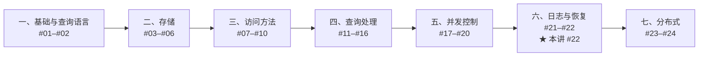

第 [4](../L04/index.md) 讲的[缓冲池](#缓冲池)解释了为什么内存[页](#页)与磁盘页会不同步；第 [17](../L17/index.md) 讲的[事务](#事务)[原子性](#原子性)与[持久性](#持久性)规定了恢复必须达到什么结果；第 [18](../L18/index.md) 讲的[强严格两阶段锁](#强严格两阶段锁)保证[回滚](#回滚)时不会覆盖其他事务合法的新写入。第 [21](../L21/index.md) 讲建立了[预写日志](#预写日志)和 STEAL、NO-FORCE 的关系，并在小结里留下三个问题——[日志序列号](#日志序列号)怎样用、跨[检查点](#检查点)的事务怎样不必扫全[日志](#日志)、ARIES 怎样完成恢复；本讲逐一回答它们。

第 [23](../L23/index.md)、[24](../L24/index.md) 讲把[数据库](#数据库)扩展到多个节点。届时，一个节点通过本地[日志](#日志)恢复成功，并不自动意味着所有节点对[事务](#事务)结果达成一致；本讲的持久化与恢复机制将成为分布式事务的基础。

## 1. 磁盘上的数据为什么还需要恢复

📍 *PPT 第 3–6、13 页*

### 1.1 [提交](#提交)状态与页面落盘状态是两回事

📍 *PPT 第 3–4 页*

[缓冲池](#缓冲池)（Buffer Pool，见第 [4](../L04/index.md) 讲）把磁盘[页缓存](#页缓存)在内存中，[事务](#事务)通常先修改内存副本。[脏页](#脏页)（Dirty Page）表示内存[页](#页)包含尚未写回磁盘的修改。“脏”只是在描述两个副本是否同步，与事务是否[提交](#提交)无关。

第 [21](../L21/index.md) 讲介绍的窃取策略（STEAL）允许系统在[事务](#事务)[提交](#提交)前，把包含该事务修改的[脏页](#脏页)写回磁盘；非强制策略（NO-FORCE）允许事务提交时不立即写回它修改的所有数据[页](#页)。前者让[缓冲池](#缓冲池)腾得出空间，后者让提交不用等待大量分散的数据页写入。性能上的这两项自由，分别带来了[撤销](#撤销)和[重做](#重做)的责任。

| [缓冲池](#缓冲池)策略 | 崩溃时可能留下什么 | 恢复必须具备的能力 |
|---|---|---|
| STEAL | 未[提交](#提交)[事务](#事务)的修改已经在磁盘上 | [撤销](#撤销)（Undo），消除这些修改 |
| NO-FORCE | 已提交事务的修改仍只在内存中 | [重做](#重做)（Redo），补回这些修改 |

用课件中的[事务](#事务)调度看，恢复的目标很明确（这里的 T1、T2、T3 是另一组事务，与第 [21](../L21/index.md) 讲[检查点](#检查点)例子中的同名事务角色不同）：
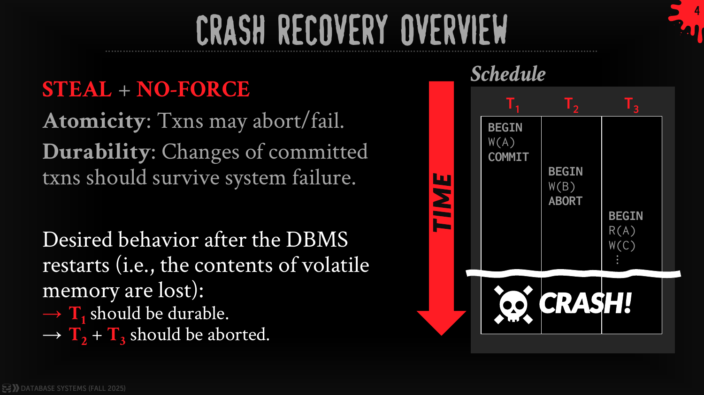


| 时间向下 | T1 | T2 | T3 |
|---|---|---|---|
| 1 | BEGIN | | |
| 2 | W(A) | | |
| 3 | COMMIT | | |
| 4 | | BEGIN | |
| 5 | | W(B) | |
| 6 | | ABORT | |
| 7 | | | BEGIN |
| 8 | | | R(A) |
| 9 | | | W(C) |
| 10 | | | 尚未结束 |
| 11 | 系统崩溃 | 系统崩溃 | 系统崩溃 |

重启后，T1 的修改必须保留，T2 的修改必须消失，T3 也必须[回滚](#回滚)。T2 虽然已经发出了[中止](#中止)请求，但回滚未必已经完成；T3 没有[提交](#提交)，恢复程序也不能替应用猜测它原本还想执行哪些语句。

因此，“恢复到崩溃前的状态”需要分阶段理解。[重做](#重做)先重建[日志](#日志)所描述的历史状态，其中可以包含未[提交](#提交)[事务](#事务)的修改；[撤销](#撤销)完成后，才得到保留已提交结果、消除未提交影响的事务状态。恢复保证的是事务[原子性](#原子性)（Atomicity）与[持久性](#持久性)（Durability），并与[并发](#并发)控制、约束检查共同维护[数据库](#数据库)[一致性](#一致性)（Consistency）。

### 1.2 ARIES 把恢复本身也纳入[日志](#日志)

📍 *PPT 第 5–6、13 页*

**ARIES（Algorithms for Recovery and Isolation Exploiting Semantics）是一套以[预写日志](#预写日志)为基础，支持[重做](#重做)历史与[事务](#事务)[撤销](#撤销)的恢复方法。** 它由 IBM Research 为包括 DB2 在内的系统发展而来；不同[数据库](#数据库)会采用其中的思想，并不一定逐项实现同一套细节。

[预写日志](#预写日志)（Write-Ahead Log，WAL，见第 [21](../L21/index.md) 讲）要求修改数据[页](#页)之前先生成相应[日志](#日志)，并且在修改后的数据页落盘之前，相关日志必须已经持久化。这样，磁盘上每个可能需要恢复的改动都有来由。

ARIES 在这个基础上继续解决两个问题。首先，磁盘[页](#页)可能停留在不同的历史时刻，直接[撤销](#撤销)很难确定面对的是哪一版数据。于是重启后先**[重复历史](#重复历史)（Repeating History）**：按照[日志](#日志)顺序补齐尚未落盘的操作，包括后来被[中止](#中止)的[事务](#事务)曾经做过的更新。其次，撤销也是一次修改，也可能只完成一半，因此撤销操作本身也必须留下日志，记录已经完成了什么、下一步还要撤销什么。

整个过程采用 STEAL + NO-FORCE。这里的意思是 ARIES 能安全支持这组灵活的[缓冲池](#缓冲池)策略；WAL 本身并不要求[数据库](#数据库)一定采用它们。更保守的页面写回策略仍可使用 WAL，只是会改变需要承担的恢复工作。

下面采用课件的简化模型：[日志](#日志)记录都能放进单个日志[页](#页)，磁盘写入具有[原子性](#原子性)，[元组](#元组)只有单个版本，[并发](#并发)控制使用[强严格两阶段锁](#强严格两阶段锁)（Strong Strict 2PL，见第 [18](../L18/index.md) 讲）；日志直接描述对象修改前后的值，不展开[索引](#索引)结构的恢复。真实系统中的大日志记录可以拆成若干片段，但必须确认片段完整，才能把该记录当作已持久化。索引页同样需要恢复，不过索引[分裂](#分裂)（第 [8](../L08/index.md) 讲）等结构变化还会引入额外处理。

原子写假设也很重要：如果磁盘[页](#页)写到一半断电，页面中可能混杂新旧内容，仅有行级差异[日志](#日志)未必足够修复。例如 PostgreSQL 在启用 `full_page_writes` 时，会为[检查点](#检查点)后第一次修改的页面把完整页映像写入 WAL，以便修复这种页面撕裂；这是对实际存储故障模型的补充。[PostgreSQL 官方说明](https://www.postgresql.org/docs/16/runtime-config-wal.html#GUC-FULL-PAGE-WRITES)

## 2. 用 LSN 把[日志](#日志)、页面与[提交](#提交)联系起来

📍 *PPT 第 8–15 页*

### 2.1 日志序列号给修改建立可比较的顺序

📍 *PPT 第 8–10、12 页*

几千个[事务](#事务)同时运行时，它们的[日志](#日志)会交错在同一个日志流中。只记录“事务 T 修改了 A”还不够，系统必须知道这次修改位于历史的哪里，才能把磁盘[页](#页)与日志对照。

**[日志序列号](#日志序列号)（Log Sequence Number，LSN）是分配给每条[日志](#日志)记录的全局唯一、单调递增的位置标识。** 课件用 `001、002、003` 表示它；实际实现可以用日志中的位置编码，不要求相邻编号恰好相差 1。LSN 描述日志中操作的顺序，与第 [19](../L19/index.md)、[20](../L20/index.md) 讲用于[事务](#事务)排序或版本可见性的[时间戳](#时间戳)承担不同职责。

系统围绕同一条[日志](#日志)，维护几种不同的“进度”。下表先作对照，后面的[回滚](#回滚)与[检查点](#检查点)会展开其余字段：
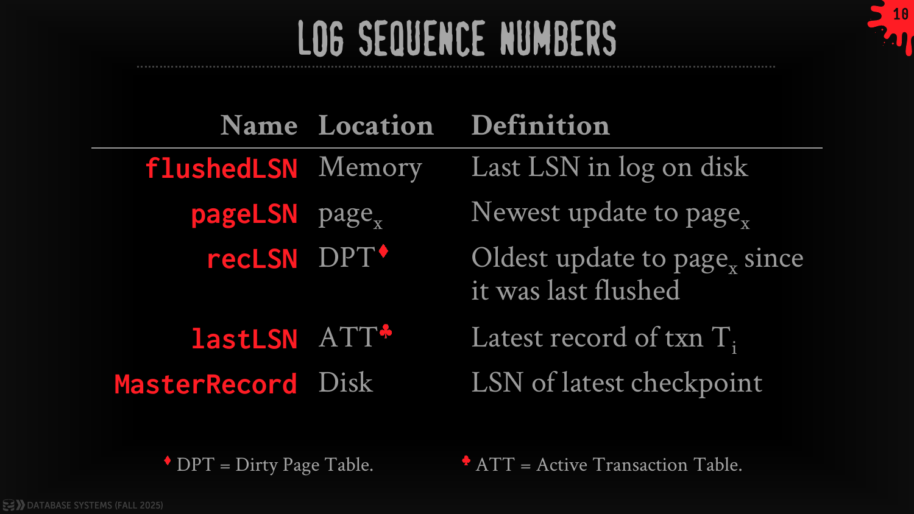


| 名称 | 保存位置 | 它回答的问题 |
|---|---|---|
| `flushedLSN` | 内存中的全局状态 | [日志](#日志)已经可靠地写到磁盘的哪个位置？ |
| `pageLSN` | 每个数据[页](#页)的[页头](#页头) | 当前这份页面已经反映了哪条最新的页[修改日志](#修改日志)？ |
| `recLSN` | [脏页表](#脏页表) DPT | 该页从上次写回后再次变脏，最早对应哪条日志？ |
| `lastLSN` | [活动事务表](#活动事务表) ATT | 该[事务](#事务)最新的一条日志在哪里？ |
| `MasterRecord` | 磁盘上的[主记录](#主记录) | 最近一次成功完成的[检查点](#检查点)从哪里开始？ |

先看前两个。**[页日志序列号](#页日志序列号)（pageLSN）是当前[页](#页)版本上最近一次已应用修改的 LSN。** 修改页面时，系统在保护页面的[写闩](#写闩)（Write Latch，见第 [10](../L10/index.md) 讲）下，同时更新内容与 `pageLSN`。同一页在[缓冲池](#缓冲池)与磁盘上的副本可能具有不同的 `pageLSN`，因为磁盘副本可能较旧。
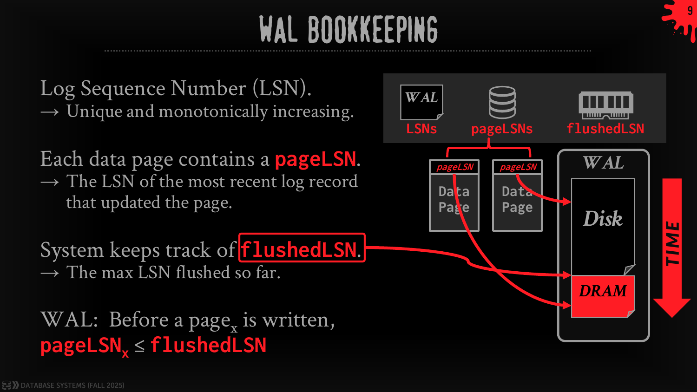

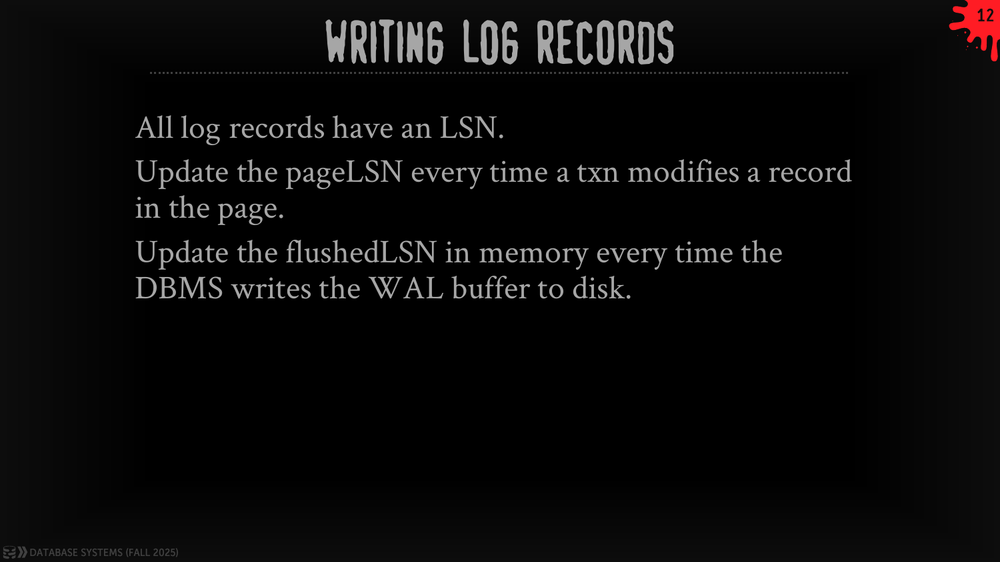


**[已刷盘日志序列号](#已刷盘日志序列号)（flushedLSN）表示已持久化[日志](#日志)前缀的末端。** “前缀”意味着它之前的日志也都已经持久化，不能跳过中间某条尚未写完的记录，只因后面的编号更大就推进这个值。它本身可以放在内存中；崩溃后，持久日志的有效末端才是恢复的依据。

剩下几个编号将在[回滚](#回滚)与[检查点](#检查点)中使用。现在需要记住的是：`pageLSN` 属于页面，`lastLSN` 属于[事务](#事务)，`flushedLSN` 属于整个[日志](#日志)。它们即使恰好取同一个数字，也是在回答不同的问题。

### 2.2 页面能不能写回，只需检查一个不等式

📍 *PPT 第 9、11–12 页*

WAL 的写入次序可以落实为一条检查：

```math
\operatorname{pageLSN}(P) \leq \operatorname{flushedLSN}
```

`P` 是准备写回磁盘的页面。满足不等式，表示这份[页](#页)内容所依赖的最新[日志](#日志)已经落盘；由于日志按前缀持久化，更早的相关日志也都在磁盘上。

课件第 11 页的[日志](#日志)已经持久化到 `016`，内存日志尾部还有：
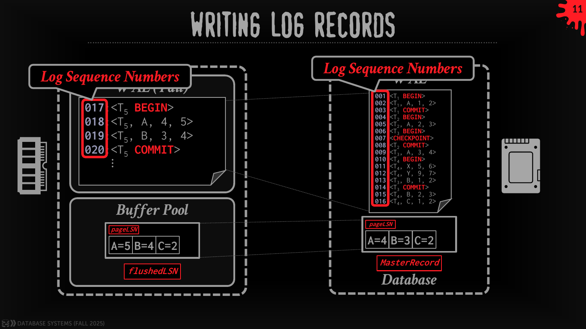

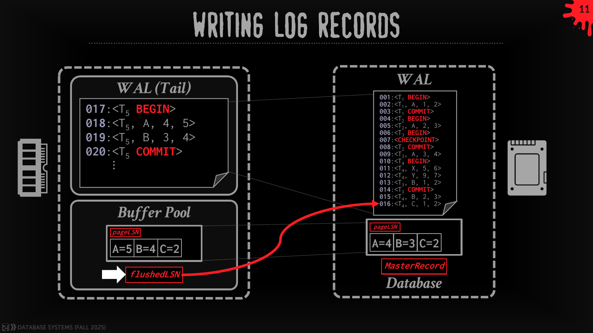

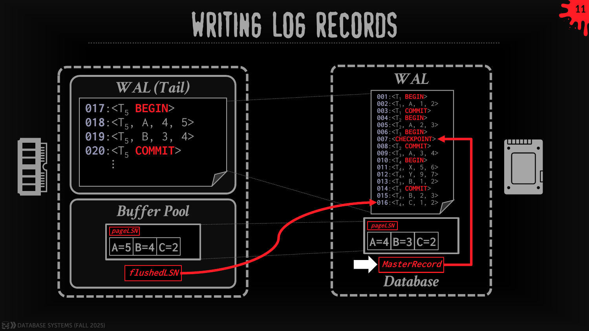


```text
017: <T5 BEGIN>
018: <T5, A, 4, 5>
019: <T5, B, 3, 4>
020: <T5 COMMIT>
```

原来的磁盘[页](#页)是 `A=4, B=3, C=2`；应用 `018、019` 后，[缓冲池](#缓冲池)里的页变成 `A=5, B=4, C=2`，`pageLSN=019`。此时 `019 > 016`，把这份页写回磁盘会违反 WAL。若随后崩溃，磁盘上可能留下 A、B 的新值，却找不到对应的更新[日志](#日志)。

[页](#页)只反映已经落盘的[日志](#日志)时可以写回；页又应用了仍在内存中的日志后，必须先推动日志刷盘。[缓冲池管理器](#缓冲池管理器)若急需淘汰这个页，可以请求日志管理器至少刷到 `019`，满足条件后再写页。它不必等待 T5 [提交](#提交)，这正是 STEAL 所允许的行为。
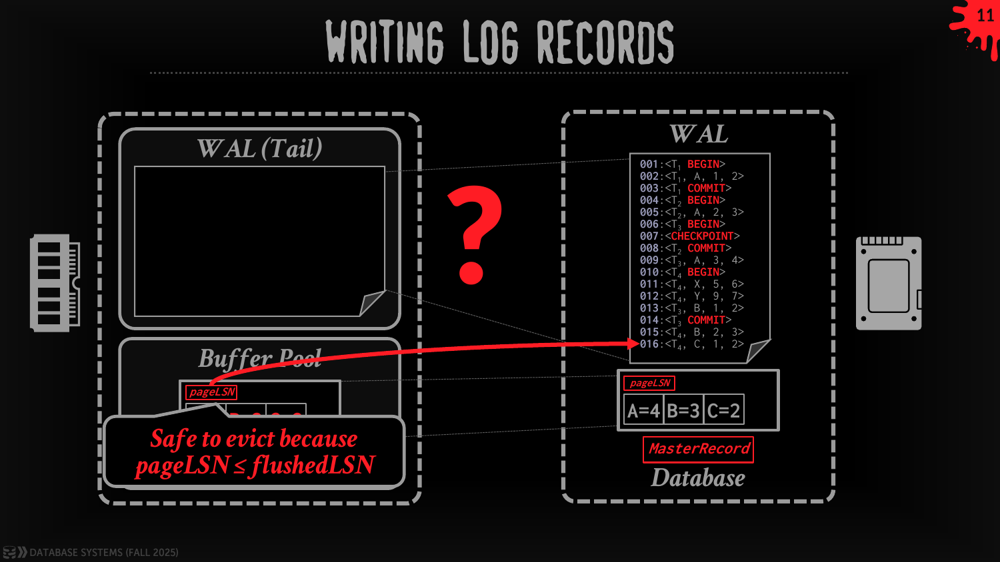


这里“先写[日志](#日志)”包含两个层次：更新内存[页](#页)前，先在[日志缓冲区](#日志缓冲区)产生记录；更新磁盘页前，先把相应日志持久化。每改一个内存对象都同步写一次磁盘，会失去日志批量写入的优势。

### 2.3 COMMIT 决定[事务](#事务)结果，TXN-END 表示处理结束

📍 *PPT 第 14–15 页*

[事务](#事务)[提交](#提交)时，系统先把 `COMMIT` 放入[日志缓冲区](#日志缓冲区)，再保证包括它在内的全部[日志](#日志)前缀落盘，最后向应用返回提交成功。多个事务可以通过[组提交](#组提交)（Group Commit，见第 [21](../L21/index.md) 讲）共享一次日志刷盘；每个事务仍要等到自己的 `COMMIT` 被覆盖，才能获得成功确认。

[日志](#日志)刷盘是顺序、同步的写入：“顺序”减少分散访问，“同步”表示[提交](#提交)路径等待持久化完成。一[页](#页)日志可以装入多条记录，因此一次持久化也可以保护多个[事务](#事务)。向操作系统缓冲区写完，并不自动等于断电后仍能保存；这里说的落盘，是系统已经通过相应持久化机制确认的写入。

第 15 页中，T4 的[日志](#日志)为：
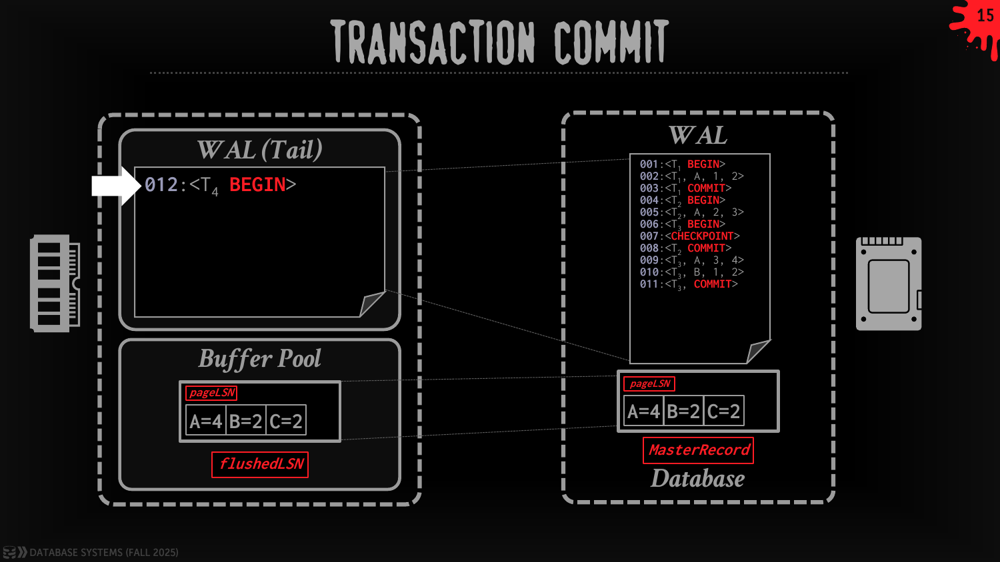

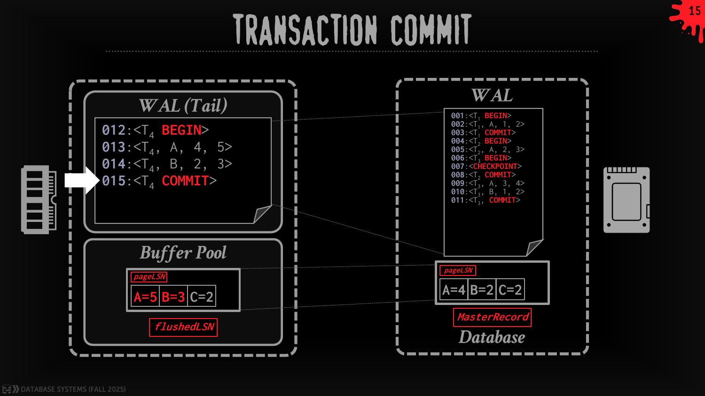


```text
012: <T4 BEGIN>
013: <T4, A, 4, 5>
014: <T4, B, 2, 3>
015: <T4 COMMIT>
...
099: <T4 TXN-END>
```

刷到 `015` 后，`flushedLSN=015`，T4 就能[提交](#提交)成功，即使磁盘数据[页](#页)仍然是 `A=4, B=2, C=2`。崩溃后，[日志](#日志)能够[重做](#重做)出 `A=5, B=3`，所以[持久性](#持久性)不要求提交时强制写回数据页。

**[事务结束记录](#事务结束记录)（TXN-END）表示该[事务](#事务)在系统内的[提交](#提交)或[回滚](#回滚)处理已经全部完成，以后不会再生成属于它的[日志](#日志)。** `COMMIT` 表示事务应当保留的结果已经确定；`TXN-END` 用于清理内部状态。后者通常不需要单独强制刷盘。
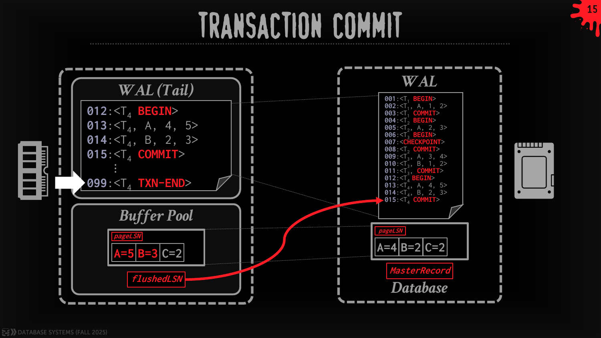


若 `COMMIT` 已持久化而 `TXN-END` 尚未落盘就崩溃，恢复仍会承认[提交](#提交)，只需补完内部收尾。正常执行时也不必故意把两个记录隔开很远：确认提交持久化、完成收尾后，可以立即追加 `TXN-END`；课件中的 `099` 只是说明两者不要求相邻。

同理，[日志缓冲区](#日志缓冲区)中已经持久化的部分可以回收或轮换，但磁盘上的老[日志](#日志)是否能够删除，还取决于恢复等用途是否需要它。`flushedLSN` 证明已经保存，不能直接充当日志删除界限。

## 3. [回滚](#回滚)为什么也必须留下[日志](#日志)

📍 *PPT 第 16–23 页*

### 3.1 prevLSN 把交错的[日志](#日志)串回[事务](#事务)自己的链

📍 *PPT 第 16–17 页*

[事务](#事务)[中止](#中止)（Abort）时，需要反向[撤销](#撤销)它已经完成的更新。若 T 连续把同一个值从 10 改成 20，再从 20 改成 30，撤销必须按 `30→20→10` 的次序执行，否则会停在错误的中间状态。
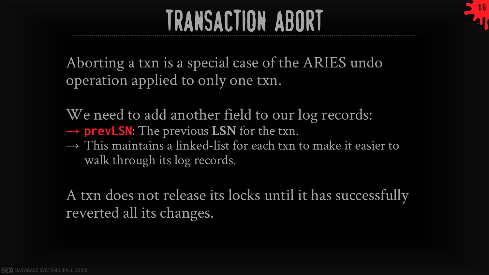


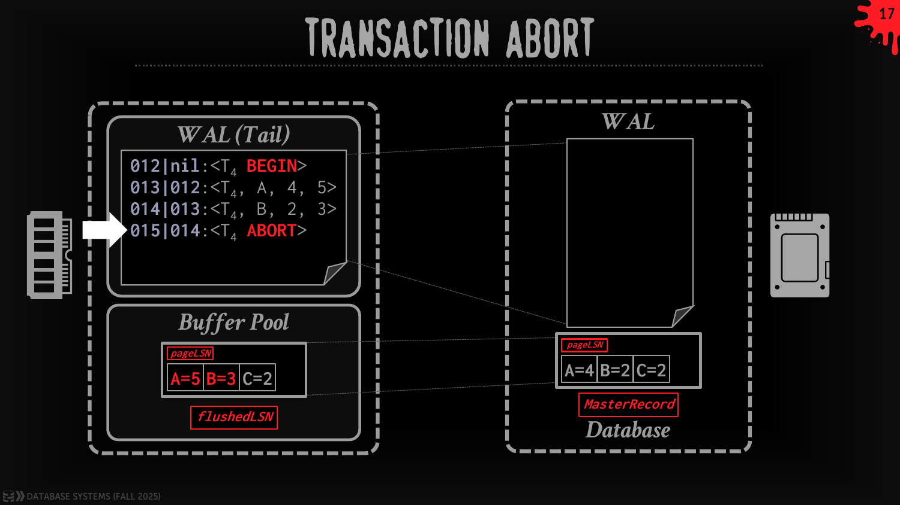


全局[日志](#日志)中混有其他[事务](#事务)的记录。**[前序日志指针](#前序日志指针)（prevLSN）保存同一事务上一条日志的 LSN**，从而在全局日志上建立一条按事务划分的反向链。**[事务末尾日志序列号](#事务末尾日志序列号)（lastLSN）保存该事务最近生成的日志位置**，是进入这条链的入口。

```text
T4 的反向日志链：

015 ABORT --> 014 UPDATE B --> 013 UPDATE A --> 012 BEGIN --> nil
          prevLSN          prevLSN          prevLSN
```

没有 `prevLSN`，仍然可以从[日志](#日志)末尾逐条查找[事务](#事务) ID；有了它，[回滚](#回滚)就能跳过大量不相关记录。它承担的是高效导航的职责。

[中止](#中止)请求也不意味着立刻释放[锁](#锁)。[强严格两阶段锁](#强严格两阶段锁)（Strong Strict 2PL）要求[事务](#事务)在完成[回滚](#回滚)前继续保护它修改过的对象。假如先放锁，让另一个事务写入新值，再用旧事务的前镜像覆盖对象，就会抹掉别人合法的更新。先[撤销](#撤销)、后放锁，才能把[并发](#并发)控制与恢复的保证接起来。

更积极的实现可以在确认某个对象的所有待[撤销](#撤销)修改都已完成后，提前释放该对象的[锁](#锁)。困难在于同一[事务](#事务)可能多次修改同一对象；只撤销最近一次，不能证明以后不会再访问它。基本流程把释放锁留到完整[回滚](#回滚)之后，就避免了这项额外判断。

### 3.2 CLR 同时记录反向修改与[撤销](#撤销)进度

📍 *PPT 第 18–23 页*

只沿链把旧值写回，尚未解决“[回滚](#回滚)到一半又断电”的问题。第二次启动时，原始更新[日志](#日志)仍在那里，系统还需要知道哪些[撤销](#撤销)已经执行，以及哪些撤销需要补做。
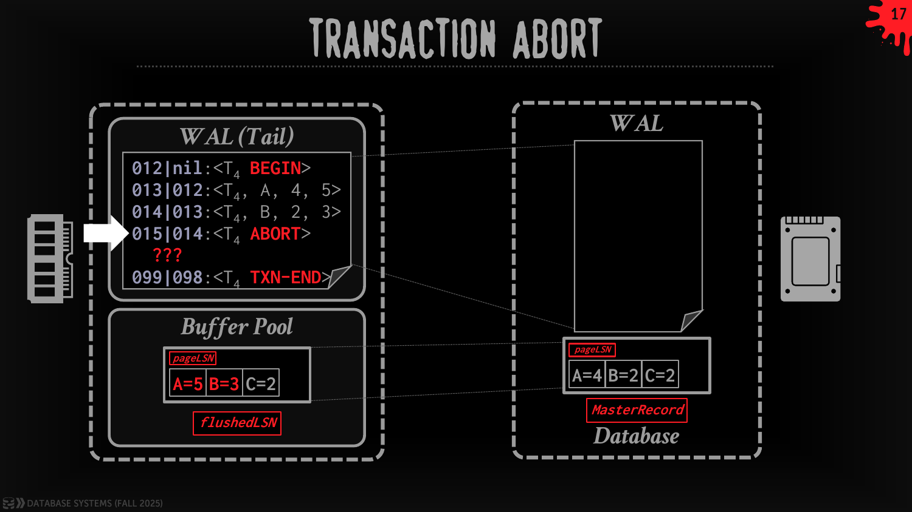

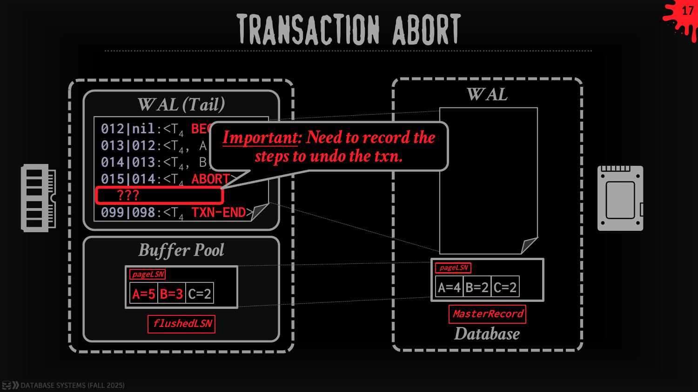


**[补偿日志记录](#补偿日志记录)（Compensation Log Record，CLR）描述[撤销](#撤销)某条更新时对页面执行的反向修改。** 它也有自己的 LSN，像普通更新一样进入 WAL。**[下一撤销位置](#下一撤销位置)（undoNextLSN）指向完成该补偿后，仍需继续检查并撤销的下一条[事务](#事务)[日志](#日志)。** 在这里的简单更新模型中，撤销日志 `L` 时，新的 CLR 通常令 `undoNextLSN=L.prevLSN`。

下表完整重画第 19–22 页的例子。中间省略的 LSN 属于其他[日志](#日志)；同一[事务](#事务)的指针保持连续。
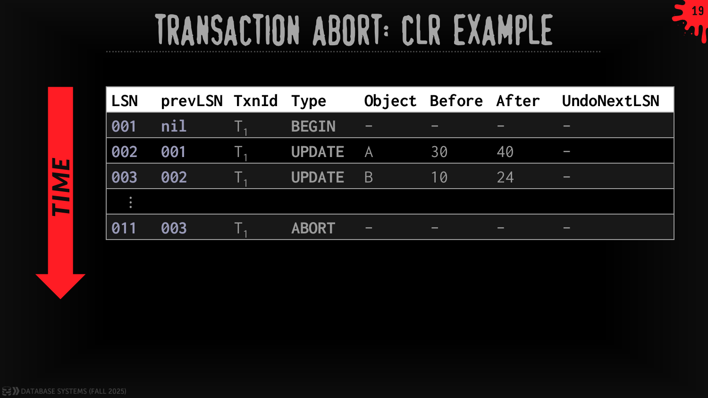


| LSN | prevLSN | [事务](#事务) | 类型 | 对象 | Before | After | undoNextLSN |
|---|---|---|---|---|---:|---:|---|
| 001 | nil | T1 | BEGIN | — | — | — | — |
| 002 | 001 | T1 | UPDATE | A | 30 | 40 | — |
| 003 | 002 | T1 | UPDATE | B | 10 | 24 | — |
| 011 | 003 | T1 | ABORT | — | — | — | — |
| 026 | 011 | T1 | CLR-003 | B | 24 | 10 | 002 |
| 027 | 026 | T1 | CLR-002 | A | 40 | 30 | 001 |
| 028 | 027 | T1 | TXN-END | — | — | — | nil |

执行到 `011`，T1 开始[回滚](#回滚)。从 `011.prevLSN=003` 找到对 B 的更新，先追加 `026`，再把 B 从 24 改回 10。此时 B 所在[页](#页)的 `pageLSN` 更新为 `026`。然后根据 `026.undoNextLSN=002`，追加 `027` 并把 A 从 40 改回 30。最后到达 `001 BEGIN`，说明需要[撤销](#撤销)的更新已经耗尽，可以追加 `028 TXN-END`，释放[锁](#锁)并移除[事务](#事务)状态。

`026` 上有两个不同的指针。`prevLSN=011` 表示“我在 T1 的[日志](#日志)链中接在谁后面”，`undoNextLSN=002` 表示“B 已经补偿过，接下来该[撤销](#撤销)谁”。沿前者能看到完整的日志历史，沿后者能跳过已经完成的撤销。把两者混为一谈，就无法正确处理恢复中途的再次崩溃。
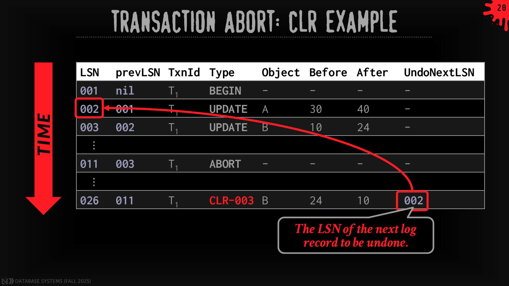


**CLR 可以[重做](#重做)，但永远不再被[撤销](#撤销)。** 重做 `026` 的含义是再次确保 B 处于补偿后的值 10；若把 `026` 撤销，就会把 B 又改成 24，复活一个本该消失的[事务](#事务)效果。

表中的 Before、After 便于看清补偿方向。实现并不一定要把所有信息都按这个格式重复保存：CLR 需要足够的信息[重做](#重做)补偿以及继续[回滚](#回滚)，却不需要为了“将来[撤销](#撤销) CLR”而保存前镜像。[日志](#日志)压缩、引用原始记录等优化都要先证明恢复仍能获得必要信息。Andy 对这类取舍的要求很直接：“在[数据库](#数据库)里，先保证正确，再让它更快。”[^correctness]
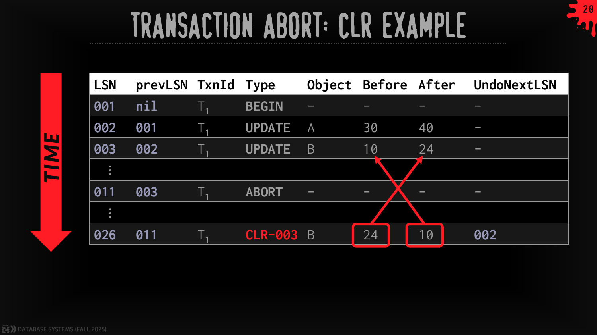

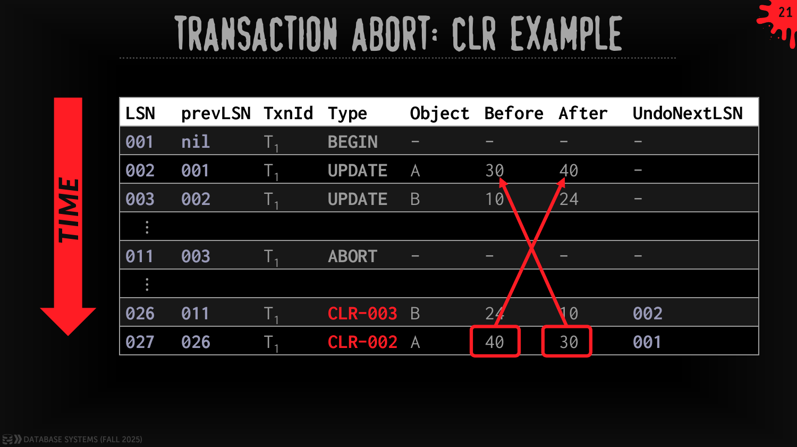


### 3.3 不必为每条 CLR 立即刷盘，仍然必须遵守 WAL

📍 *PPT 第 18、23 页*

应用得知[事务](#事务)已经[中止](#中止)，不是在获得“某批新数据已持久化”的承诺，因此无须为这次通知立即同步刷完全部 CLR。系统仍负责把[回滚](#回滚)做完，并在此之前维持需要的[锁](#锁)；“应用已经收到中止结果”与“内部清理全部完成”可以处在不同的时间点。

假设 `026` 已经生成且 B 已经在内存中改回 10，但 CLR 尚未落盘。此时可以暂不刷[日志](#日志)，却不能把反映 `026` 的页面先写到磁盘，因为 `pageLSN=026` 仍大于 `flushedLSN`。这一条 WAL 约束让各种故障位置都能解释清楚：

| 再次崩溃时的持久化情况 | 下次恢复怎样处理 |
|---|---|
| CLR 及其页面修改都没有落盘 | 持久[日志](#日志)没有保存这次补偿，恢复可以重新[撤销](#撤销)原更新 |
| CLR 已落盘，页面修改尚未落盘 | Redo [重做](#重做) CLR，把页面恢复到补偿后的状态 |
| CLR 与页面修改都已落盘 | Redo 通过 `pageLSN` 跳过已完成操作，Undo 沿 `undoNextLSN` 继续 |

“页面补偿已经落盘、对应 CLR 却没有落盘”被 WAL 排除了。恢复可靠，依赖的是这个先后关系，而不是每一步都迫切地把所有东西刷出去。Notes 的图 3 图注把“补偿落盘之后追加 END”画成一种次序；正文与 PPT 第 18、23 页给出的通用规则，并不要求每次[中止](#中止)都强制采用这一次序。

CLR 的价值也超出了恢复速度。若一次[回滚](#回滚)已经结束并释放[锁](#锁)，后续[事务](#事务)可能合法地继续修改同一对象。没有可恢复的补偿历史，重启后仅凭“旧事务没有 COMMIT”就再次盲目恢复它的旧值，可能覆盖后续事务的结果。记录补偿使“发生过一次更新，随后又[撤销](#撤销)了它”成为可重复的完整历史。

## 4. [检查点](#检查点)怎样缩短恢复，又不让[事务](#事务)停下来

📍 *PPT 第 25–31 页*

### 4.1 不等[事务](#事务)结束，就必须记住未完成的工作

📍 *PPT 第 25–26 页*

[日志](#日志)可以证明[数据库](#数据库)的全部修改，但每次重启都从数据库创建之日开始重放，显然不可行。[检查点](#检查点)（Checkpoint，见第 [21](../L21/index.md) 讲）保存一个可用于恢复的中间状态，让系统能从较近的位置重新建立上下文。

最简单的阻塞式[检查点](#检查点)停止接收新[事务](#事务)，等待当前事务全部结束，再把所有[脏页](#脏页)写回磁盘并记下检查点。这样的磁盘[快照](#快照)很容易理解：没有跨越检查点的未完成事务，快照之前的事务效果都已经处理妥当。代价是最慢的事务决定了检查点何时才能开始，而写回全部脏页又延长了停顿。
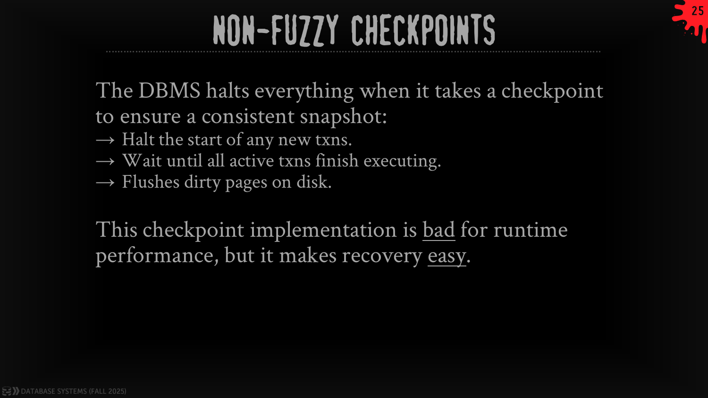


稍作改进，可以不等待[事务](#事务)结束，只暂停它们修改页面，刷完当前[脏页](#脏页)后再让它们继续。实现上可以在[检查点](#检查点)期间阻止修改者获取页面[写闩](#写闩)。这样避开了“等一个长事务跑完”的问题，却失去了事务边界整齐的[快照](#快照)。
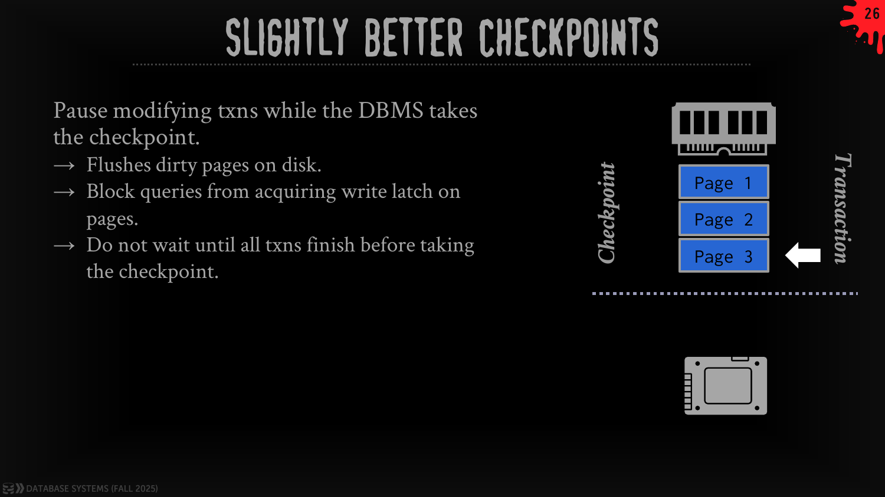

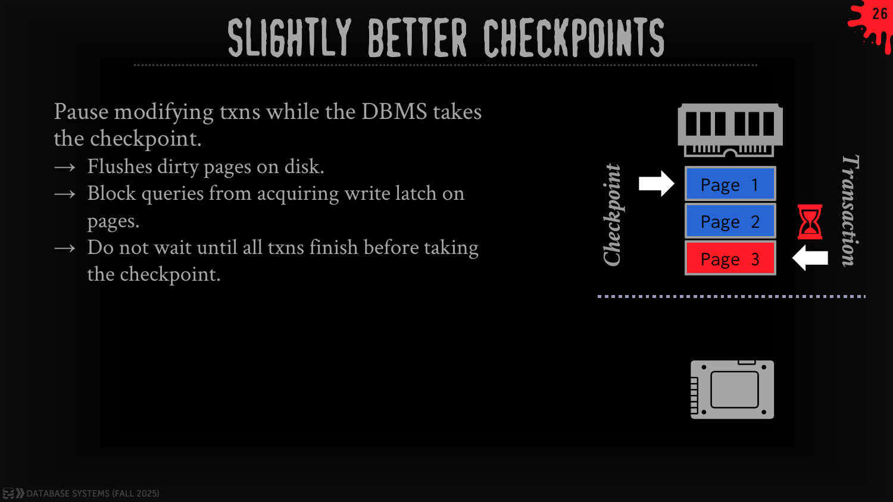


第 26 页的[事务](#事务)原本要修改 Page 3 和 Page 1。它刚改完 Page 3 就遇到[检查点](#检查点)暂停，于是磁盘收到的是“新 Page 3、旧 Page 1”。检查点结束后，事务才继续修改 Page 1。磁盘[快照](#快照)只包含这笔事务的一部分效果；以后它若[提交](#提交)，需要补上剩余修改，若失败，则需要[撤销](#撤销)已经写回的部分。
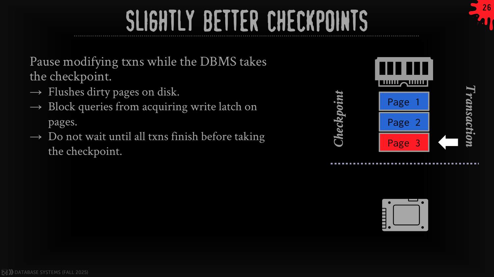

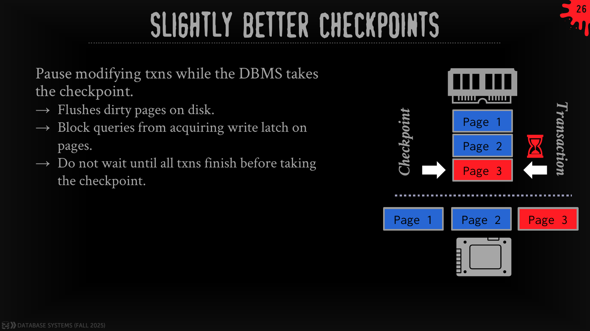

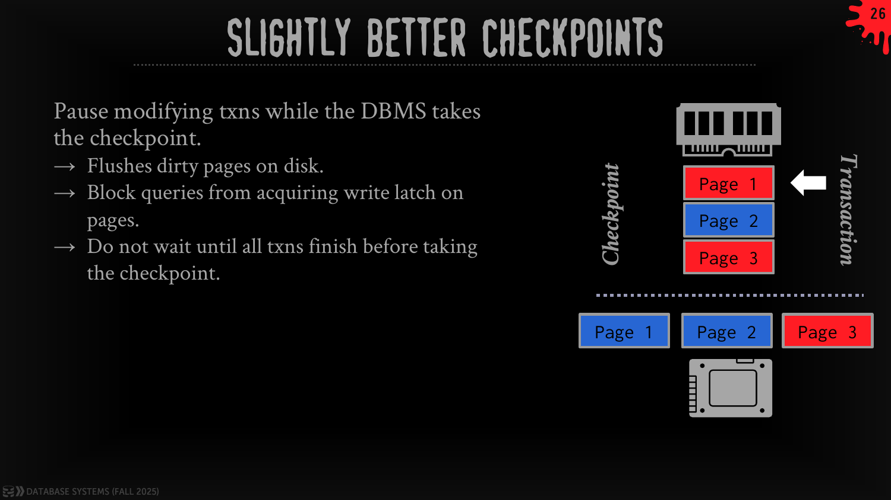


[检查点](#检查点)可以包含未完成[事务](#事务)，只要恢复时能够识别哪些工作跨越了检查点。为避免等到所有事情都结束，系统需要多记一些状态。
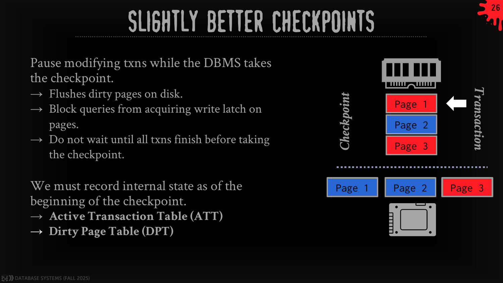


### 4.2 ATT 记录[事务](#事务)进度，DPT 记录页面进度

📍 *PPT 第 10、27–29 页*

**[活动事务表](#活动事务表)（Active Transaction Table，ATT）记录仍需要系统处理的[事务](#事务)，以及它们的状态和 `lastLSN`。** 每个条目包含 `txnId、status、lastLSN`。课件使用 R 表示正常运行（Running），C 表示已经进入[提交](#提交)状态（Committing），U 表示[撤销候选](#撤销候选)（Undo Candidate）。恢复分析时，在找到提交证据前，把未结束事务视为 U。

这里的“活动”比“正在执行 SQL”更宽。[事务](#事务)即使已经 COMMIT 或 ABORT，只要尚未完成收尾，就可能仍在 ATT 中。正常执行追加 `TXN-END` 后可以移除它；重启扫描到持久[日志](#日志)中的 `TXN-END`，也可以确认它已经完成。`TXN-END` 本身并不说明它最终[提交](#提交)还是[回滚](#回滚)，只说明系统不必再为它继续收尾。

**[脏页表](#脏页表)（Dirty Page Table，DPT）记录尚有修改未写回磁盘的页面，以及每[页](#页)的 `recLSN`。** **[恢复起点序列号](#恢复起点序列号)（recLSN，Recovery LSN）是该页自上次写回后，本轮首次变脏所对应的[日志](#日志)位置。** 它标记“这轮还欠磁盘的修改最早从哪里开始”。

例如，一个干净[页](#页)被 LSN 100 修改时，`recLSN=100`、`pageLSN=100`；同一轮脏状态中又应用了 120、150，`pageLSN` 推进到 150，`recLSN` 仍然是 100。若页完整写回、恢复干净，随后又被 200 修改，新一轮 `recLSN` 才变成 200。前者跟踪最早可能遗漏的修改，后者跟踪当前页版本已经应用到哪里。

ATT 与 DPT 不能互相替代。[事务](#事务)[提交](#提交)后，它的页面可能仍然脏；事务尚未提交，它的页面也可能已经通过 STEAL 写回。DPT 因而包括运行中、已提交以及[回滚](#回滚)操作造成的[脏页](#脏页)，不按事务结果筛选。[^dpt]

第 29 页用下面这段[日志](#日志)展示两张表。`A→P11` 表示对象 A 位于页面 P11，数值保持课件原样。
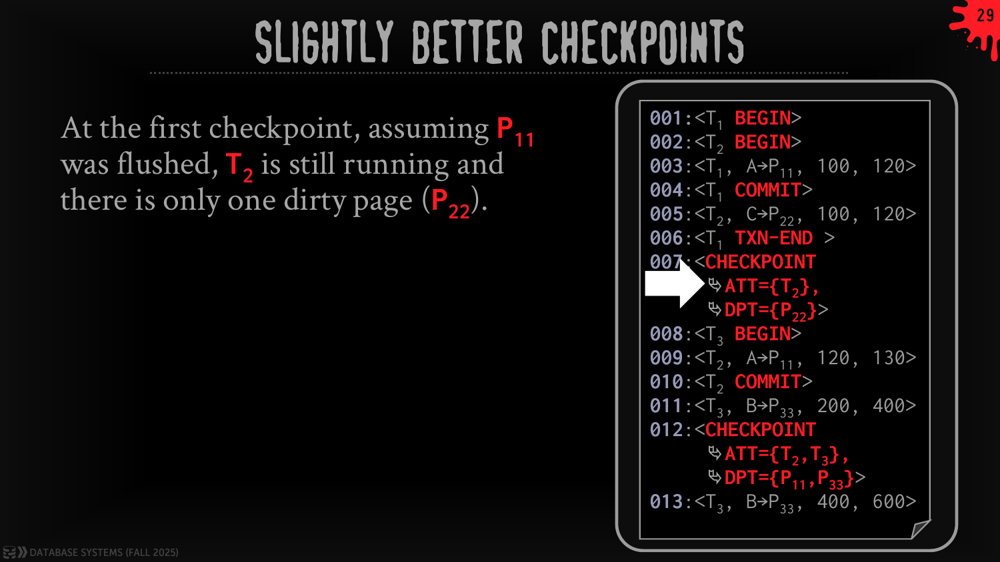


| LSN | [日志](#日志)内容 |
|---|---|
| 001 | T1 BEGIN |
| 002 | T2 BEGIN |
| 003 | T1：A→P11，100→120 |
| 004 | T1 COMMIT |
| 005 | T2：C→P22，100→120 |
| 006 | T1 TXN-END |
| 007 | CHECKPOINT：ATT={T2}，DPT={P22} |
| 008 | T3 BEGIN |
| 009 | T2：A→P11，120→130 |
| 010 | T2 COMMIT |
| 011 | T3：B→P33，200→400 |
| 012 | CHECKPOINT：ATT={T2,T3}，DPT={P11,P33} |
| 013 | T3：B→P33，400→600 |

在 `007` 的状态记录中，假设 P11 已写回。T1 有 `TXN-END`，所以 ATT 只剩 T2；P22 仍脏，`recLSN=005`。到 `012`，假设 P22 已写回，新的[脏页](#脏页)是 P11 与 P33，对应 `recLSN=009、011`。T2 虽在 `010` [提交](#提交)，却没有 `TXN-END`，所以仍在 ATT 中，状态为 C；T3 则仍在运行。

这些[检查点](#检查点)条目描述的是采集时的状态，不能把条目中出现一个[脏页](#脏页)理解为“检查点已经把它写完”。表中也没有专门的“页面已刷盘”[日志](#日志)：页面是否仍在 DPT，以及之后读取到的 `pageLSN`，才是恢复时可用的证据。最后 `013` 再次修改 P33，只会推进该[页](#页)的 `pageLSN`，不会把本轮 `recLSN=011` 改成 `013`。

### 4.3 [模糊检查点](#模糊检查点)保留恢复线索，[事务](#事务)继续执行

📍 *PPT 第 30–31 页*

即使不等[事务](#事务)结束，只要[检查点](#检查点)期间仍然阻止写入，业务也会感受到停顿。**[模糊检查点](#模糊检查点)（Fuzzy Checkpoint）允许事务在检查点[日志](#日志)写入期间继续运行，并记录足以恢复的事务和页面元数据。** ARIES 的这类检查点不要求把全部[脏页](#脏页)强制写回磁盘，后台页面写回可以独立继续。

**[检查点](#检查点)开始记录（CHECKPOINT-BEGIN）** 标出此次[检查点开始](#检查点开始／结束记录)的位置，**检查点[结束记录](#检查点开始／结束记录)（CHECKPOINT-END）** 携带 ATT 与 DPT。按课件的简化模型，后者保存的是开始时采集的状态；写出这些元数据期间，[事务](#事务)仍能产生新[日志](#日志)。

下面使用第 31 页的独立例子，不能把它的编号与上一节的[日志](#日志)拼接。假设开始前 P11 已写回，T1 已结束，T2 修改的 P22 仍脏：
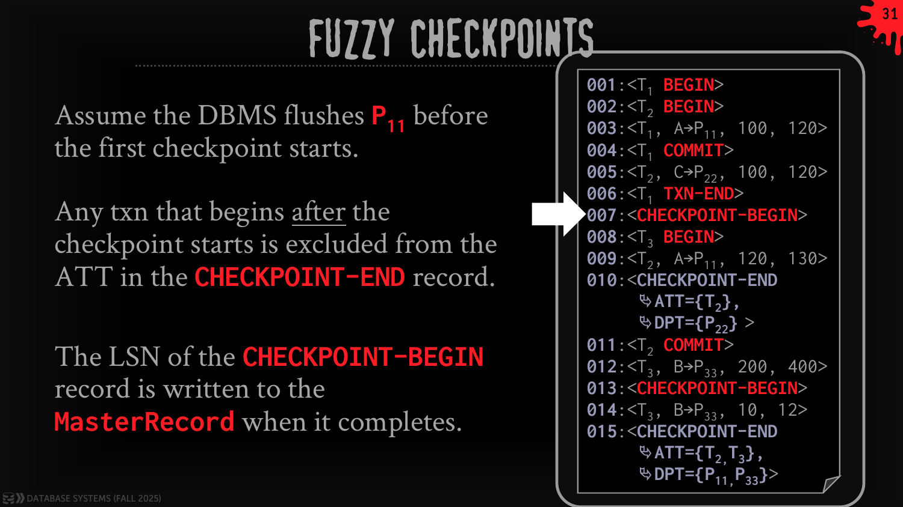


| LSN | [日志](#日志)内容 | 对[检查点](#检查点)的含义 |
|---|---|---|
| 007 | CHECKPOINT-BEGIN | 开始时 ATT={T2}，DPT={P22} |
| 008 | T3 BEGIN | T3 在开始之后出现 |
| 009 | T2：A→P11，120→130 | P11 在开始之后再次变脏 |
| 010 | CHECKPOINT-END，包含 ATT={T2}、DPT={P22} | 写出开始时采集的表 |
| 011 | T2 COMMIT | [事务](#事务)运行与检查点记录可以交错 |
| 012 | T3：B→P33，200→400 | 新的页面修改继续发生 |

`010` 的 ATT 没有 T3，DPT 也没有这次新变脏的 P11。这种遗漏可以通过扫描 `007` 之后的[日志](#日志)补回来：`008` 证明 T3 出现了，`009` 证明 P11 被修改了。恢复需要的组合是“[检查点](#检查点)保存的状态 + 从开始位置往后的日志”。只有结束位置之后的日志并不足够。
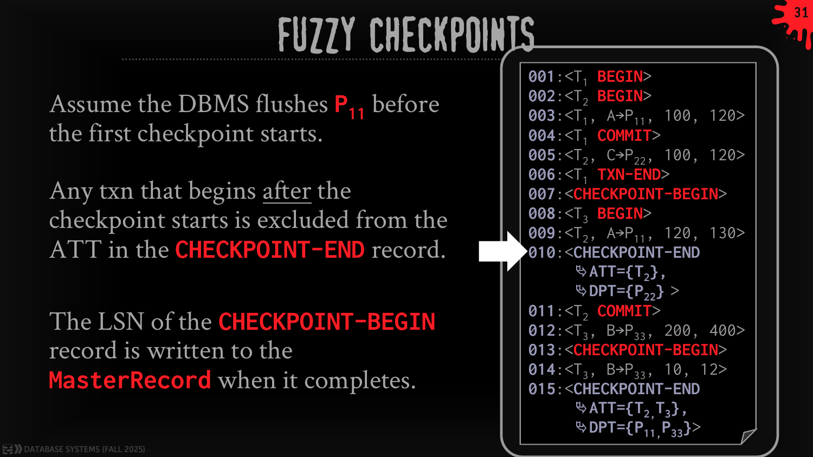

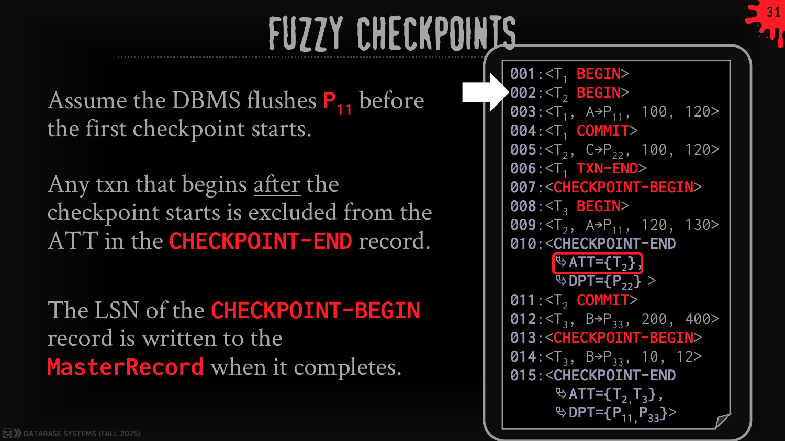

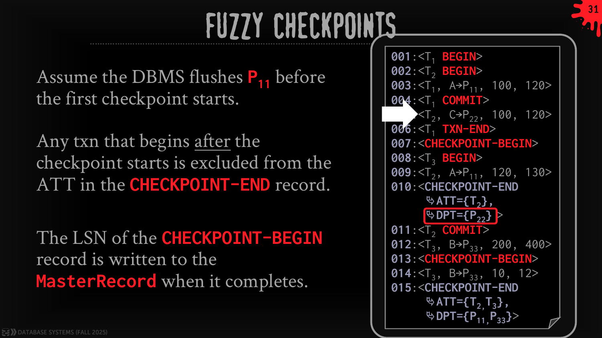


**[主记录](#主记录)（MasterRecord）是磁盘上的恢复入口，保存最近一次成功完成的[检查点](#检查点)的开始 LSN。** 必须先确保此次 `CHECKPOINT-END` 及其必要内容已持久化，再把[主记录](#主记录)更新为对应的开始位置。因此，`010` 所在的检查点完成后写入的是 `MasterRecord=007`；第 31 页后面从 `013` 开始、到 `015` 结束的检查点完成后，才改成 `013`。

如果写[检查点](#检查点)到一半崩溃，旧的[主记录](#主记录)仍然指向上一次完整检查点。恢复扫描的[日志](#日志)可能多一些，但不会拿一份尚未保存完整的元数据当作可靠起点。[主记录](#主记录)自身的可靠更新也依赖前面约定的存储保证。

“模糊”的对象是页面落盘与[事务](#事务)执行之间的时刻关系：[检查点](#检查点)附近，一些[页](#页)已经写回，一些页还没有，另一些页写回后又被修改。系统不必停下来把这些页强行对齐，而是通过 DPT 和[日志](#日志)保留足以重建历史的线索。原始 ARIES 也允许检查点采集期间状态继续变化，恢复时需合并检查点元数据与扫描所得信息；“所有表恰好对应 BEGIN 瞬间”是这里便于演算的教学模型。[ARIES 原论文，§5.4](https://www.cs.cmu.edu/~15849g/readings/mohan92.pdf)

因此，[检查点](#检查点)完成不表示它之前的[日志](#日志)都可以删除。仍[脏页](#脏页)面的 `recLSN` 可能早于检查点，未结束[事务](#事务)的[回滚](#回滚)链也可能延伸到更早的位置。检查点缩短了建立恢复上下文的距离，没有切断这些依赖。

## 5. ARIES 的三阶段各自解决什么问题

📍 *PPT 第 32–40 页*

### 5.1 分析：确定未结束[事务](#事务)与可能尚未写回的页面

📍 *PPT 第 32–36 页*

崩溃会清空内存中的 ATT、DPT 和[缓冲池](#缓冲池)。**[分析阶段](#分析阶段)（Analysis）从[主记录](#主记录)指向的最后一个完整[检查点](#检查点)开始，向前扫描持久[日志](#日志)，重建[事务](#事务)状态及可能需要[重做](#重做)的页面集合。** 它处理的是元数据，不在这一阶段应用数据更新。

只有崩溃前完整持久化的[日志](#日志)才是输入。丢失的内存日志尾部可能对应尚未[提交](#提交)的修改，WAL 保证这些修改也没有先进入磁盘数据[页](#页)；已经确认提交成功的[事务](#事务)，则必须在持久日志中留下提交依据。

扫描到普通[事务](#事务)[日志](#日志)时，需要保证该事务在 ATT 中，并更新它的 `lastLSN`。若尚无[提交](#提交)证据，就把它视为 U；见到 `COMMIT` 则改为 C；见到 `TXN-END` 就移除。[检查点](#检查点)记录不属于普通事务，不能给它凭空创建一个事务条目。
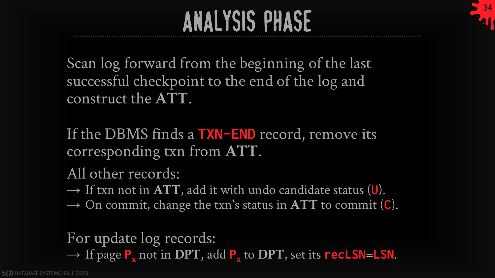

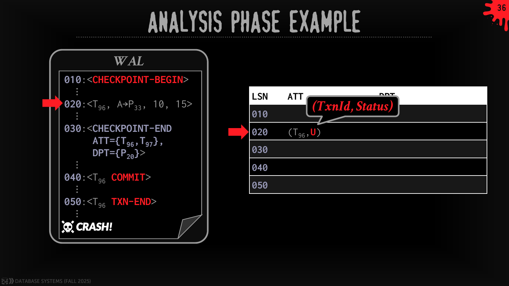

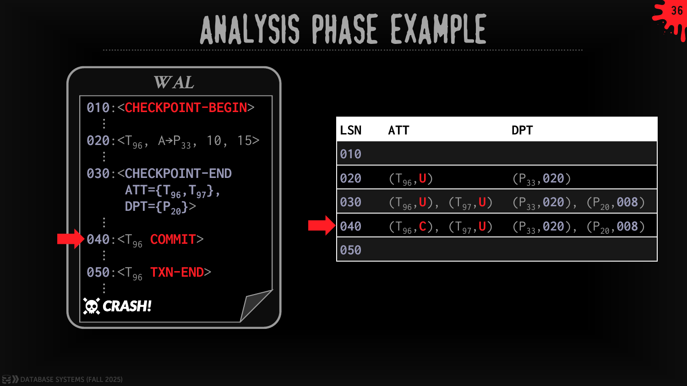


扫描到更新[日志](#日志)或会修改页面的 CLR 时，若目标[页](#页)尚不在 DPT，就把它加入，并将 `recLSN` 设为当前 LSN；若已经存在，则保留较早的恢复起点。CLR 也会让页面变脏，所以它同样需要纳入页面分析，尤其在“恢复期间又崩溃”的情况下。
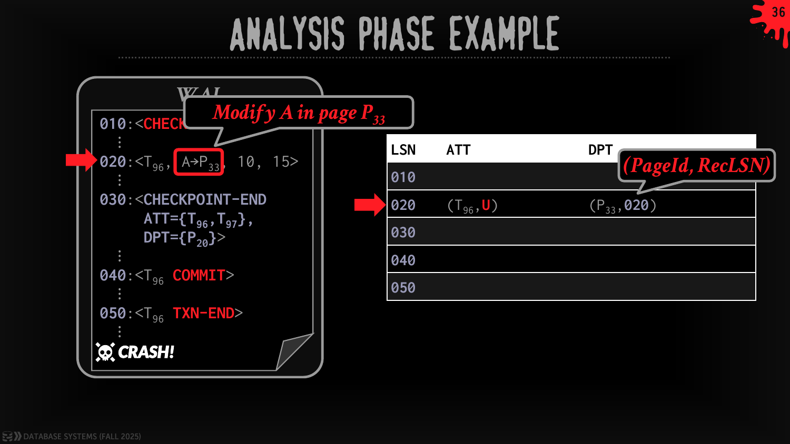


遇到 `CHECKPOINT-END`，需要把其中保存的表与已经分析出的信息合并。旧[快照](#快照)不能覆盖扫描到的新 `lastLSN`，不能把 C 改回 U，更不能复活已经遇到 `TXN-END` 的[事务](#事务)。在课件的“BEGIN 时快照”模型中，也可以先取得快照，再从 BEGIN 重放这段元数据变化；两种组织方式都要覆盖 BEGIN 与 END 之间的[日志](#日志)。
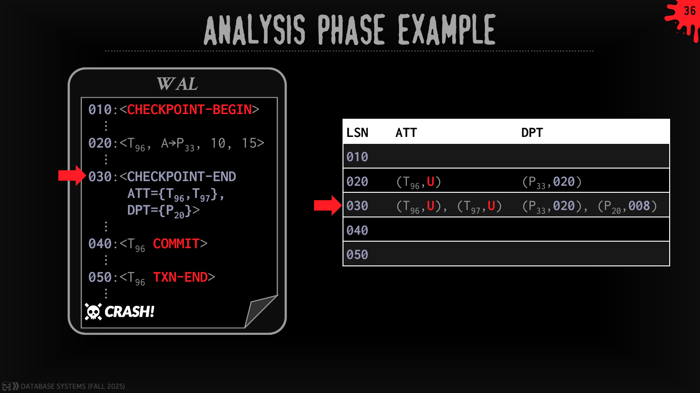


第 36 页的例子恰好说明，为什么不能把[检查点](#检查点)里的 DPT 直接当作分析结束时的 DPT：
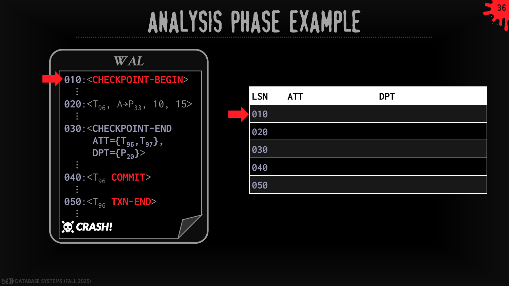


| 扫描到的 LSN | [日志](#日志)事件 | 分析中的 ATT | 分析中的 DPT：[页](#页)号→recLSN |
|---|---|---|---|
| 010 | CHECKPOINT-BEGIN | 暂为空，尚未读到[快照](#快照) | 暂为空 |
| 020 | T96：A→P33，10→15 | T96：U | P33→020 |
| 030 | CHECKPOINT-END：ATT={T96,T97}，DPT 中 P20→008 | T96：U；T97：U | P33→020；P20→008 |
| 040 | T96 COMMIT | T96：C；T97：U | P33→020；P20→008 |
| 050 | T96 TXN-END | T97：U | P33→020；P20→008 |

P33 没有出现在 `030` 保存的[快照](#快照)里，因为它在 `010` 开始时尚未变脏；但恢复已经从 `020` 看见它的修改，因此合并后不能丢掉 P33。T97 则相反：它可能在[检查点](#检查点)之前就运行，并且之后没有任何新[日志](#日志)，必须由检查点快照把它带回来。

分析结束后，ATT 说明哪些[事务](#事务)还需要收尾，其中 U 需要[撤销](#撤销)，C 只需完成已[提交](#提交)事务的处理。DPT 给出的是**可能尚未落盘**的页面。它往往比崩溃瞬间真正的[脏页](#脏页)集合大，因为常规页面写回不一定在[日志](#日志)中留下记录。保守地多检查几个[页](#页)只影响性能；错误地漏掉一个需要[重做](#重做)的页会丢失数据。
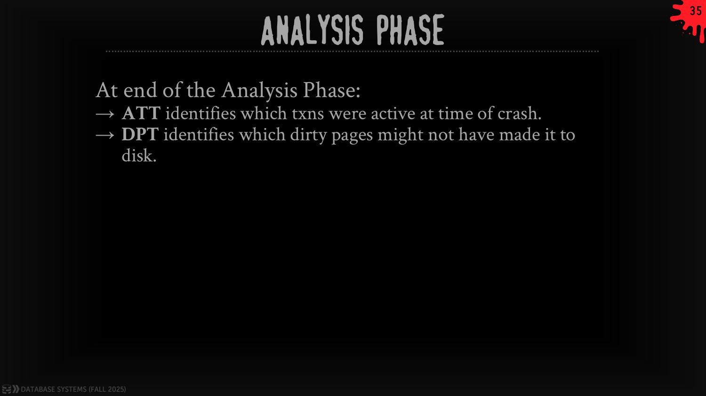


这也解释了为何不能因 T96 在 `050` 结束，就顺手把 P33 从 DPT 删除：[事务](#事务)是否结束，没有证明它的数据[页](#页)是否已经持久化。

### 5.2 [重做](#重做)：先把不同进度的页面补齐

📍 *PPT 第 33、37–39 页*

**[重做阶段](#重做阶段)（Redo）按正向[日志](#日志)顺序，重建持久日志所描述的页面历史。** 它从分析后 DPT 中最小的 `recLSN` 开始：

```math
\operatorname{redoStart}=\min_{P\in\mathrm{DPT}}\operatorname{recLSN}(P)
```

这个值取决于页面，既不是最早未[提交](#提交)[事务](#事务)的开始位置，也不一定等于[检查点](#检查点)位置。上一节的 DPT 为 `P33→020、P20→008`，所以 `redoStart=min(020,008)=008`，比[检查点开始](#检查点开始／结束记录) `010` 更早。如果 DPT 为空，就没有需要扫描[重做](#重做)的页面更新，但仍可能有事务收尾或[撤销](#撤销)工作。

扫描时既考虑普通 UPDATE，也考虑 CLR。[事务](#事务)已经[提交](#提交)、正在[回滚](#回滚)、甚至早已写过 `TXN-END`，都不能单凭这些状态排除它的页面[日志](#日志)。一个已完成回滚的事务可能先更新了某[页](#页)，随后又通过 CLR 恢复旧值，而这些操作都没有写回磁盘；[重做](#重做)必须把相应历史补齐。

“[重复历史](#重复历史)”也不意味着不加判断地再写每一[页](#页)。对于 LSN 为 `L`、目标页为 P 的 UPDATE 或 CLR，只要下面任一条件成立，就跳过：
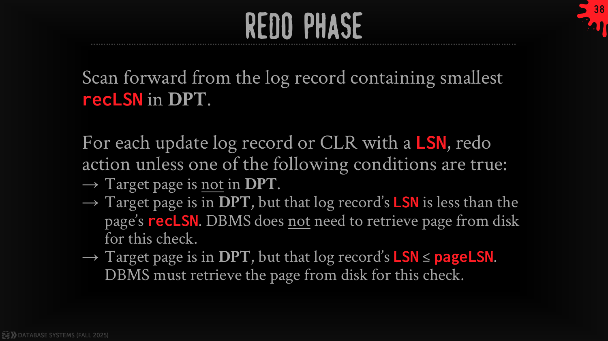


| 跳过条件 | 为什么可以跳过 | 是否需要读取数据[页](#页) |
|---|---|---|
| P 不在分析得到的 DPT 中 | 恢复元数据已排除该页存在遗漏更新的可能 | 不需要 |
| `L < recLSN(P)` | 这条记录早于该页可能缺失的修改范围 | 不需要 |
| `L ≤ pageLSN(P)` | 这份页已经反映了该记录或更晚的页修改 | 需要取得页，首次可能从磁盘读入 |

前两项只查内存中的 DPT，能避免数据[页](#页) I/O；第三项需要看实际[页头](#页头)，才知道持久页面已经走到哪里。可以把“需要[重做](#重做)”写成：

```math
P\in\mathrm{DPT}\quad\land\quad
L\geq\operatorname{recLSN}(P)\quad\land\quad
L>\operatorname{pageLSN}(P)
```

例如，一[页](#页)的 `recLSN=020`，取回后发现 `pageLSN=040`。属于这页的 LSN 015 在第二项检查就被排除；LSN 030 与 040 通过第二项，但在第三项被排除；LSN 050 才需要[重做](#重做)。此处是独立的数值示例，用来区分两个容易记反的不等号：`L=recLSN` 仍可能需要重做，`L=pageLSN` 则已经做过。

真正[重做](#重做)时，把[日志](#日志)描述的变更应用到缓冲[页](#页)，并把 `pageLSN` 设为 `L`。后续检查使用的是这份已经更新的缓冲[页头](#页头)，不能始终拿启动时读到的旧值比较。`pageLSN` 的单调推进让再次执行恢复具有**[幂等性](#幂等性)（Idempotence）**：同一段历史可以反复检查，页面不会因此累计多次相同修改。
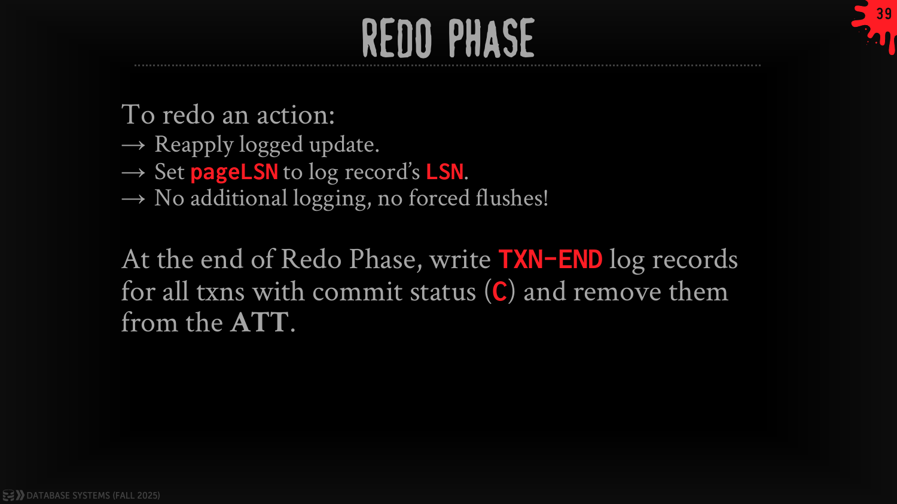


[重做](#重做)不为每条被重放的 UPDATE 或 CLR 再生成一份新[日志](#日志)，也不要求每重做一步就强制写[页](#页)。已有持久日志已经是这次修改的依据。若恢复途中再次崩溃，没落盘的工作可以重新做，落盘的工作由 `pageLSN` 识别。

按课件流程，Redo 结束后，为 ATT 中状态为 C 的[事务](#事务)追加 `TXN-END`，移除它们。这里“[重做](#重做)不产生新[日志](#日志)”指不复制被重放的页面更新记录，并不排除事务收尾时生成 END。

### 5.3 [撤销](#撤销)：从最新的未[提交](#提交)修改开始反向清理

📍 *PPT 第 33、40 页*

[重做](#重做)结束，[数据库](#数据库)已经重新具有[日志](#日志)所描述的历史，包括那些最终不能保留的[事务](#事务)效果。**[撤销阶段](#撤销阶段)（Undo）反向[撤销](#撤销) ATT 中 U 状态事务的更新，并为每次实际撤销生成 CLR。** C 状态事务不属于撤销对象，不能把“崩溃时还在 ATT 中”一概理解为“应该[回滚](#回滚)”。

可以用一个待处理集合 `ToUndo` 保存各失败[事务](#事务)当前需要检查的[日志](#日志)位置，初始位置来自它们的 `lastLSN`。每次取其中最大的 LSN，就按原始更新次序的反方向处理多个事务：

1. 如果取到普通 UPDATE，先生成 CLR，再应用反向修改，把目标[页](#页)的 `pageLSN` 更新为新 CLR 的 LSN；接下来沿原 UPDATE 的 `prevLSN` 继续。
2. 如果取到 CLR，不[撤销](#撤销)它，直接沿它的 `undoNextLSN` 继续。该 CLR 的页面效果已经由 Redo 保证。
3. 如果取到 ABORT 等不需撤销的[事务](#事务)控制记录，沿 `prevLSN` 继续；到达事务 BEGIN 或没有更早待撤销记录时，为该事务追加 `TXN-END` 并移除它。

这里的“下一个待[撤销](#撤销)位置”需要与 ATT 中的“最新生成[日志](#日志)位置”分开。产生 CLR 后，[事务](#事务)的 `lastLSN` 会指向新 CLR，但 `ToUndo` 应继续指向旧日志链中尚未处理的位置。如果总把刚生成的 CLR 当作新的待撤销 UPDATE，就会混淆恢复进度与日志增长。

同一[事务](#事务)的逆序由指针链保证，多个事务之间的逆序由选择最大 LSN 保证。若原始未[提交](#提交)更新的顺序是 `T2@014、T3@018、T2@019`，处理顺序就是 `019、018、014`。不必为[撤销](#撤销)从[日志](#日志)末尾逐条倒扫所有已提交事务的记录。

总的扫描关系如下：

| 阶段 | 从哪里开始 | 向哪里走 | 主要产物 |
|---|---|---|---|
| Analysis | [主记录](#主记录)指向的 CHECKPOINT-BEGIN | 向前到有效[日志](#日志)末端 | ATT 与保守的 DPT |
| Redo | DPT 中最小的 recLSN | 向前到有效日志末端 | 补齐页面历史 |
| Undo | U [事务](#事务)各自的最后待处理位置 | 按 LSN 递减沿事务链跳转 | CLR、恢复后的对象值、TXN-END |

Undo 可能走到[检查点](#检查点)之前，但它从较新的记录向较旧的记录回溯。Notes 第 6 页图注中“从最早记录开始”的表述容易误导；最早记录是需要回溯到的边界，不是逆序[撤销](#撤销)的起点，具体方向以 PPT 第 40 页和 Notes 的 Undo 正文为准。

## 6. 一次恢复尚未结束，系统又崩溃了

📍 *PPT 第 41–43 页*

### 6.1 把[日志](#日志)与[检查点](#检查点)状态摆在一起

📍 *PPT 第 41–42 页*

现在把三阶段放进同一个例子。页面 P5 存放 A 与 D，P3 存放 B，P1 存放 C。需要保留的对象初值为 `A=1、B=2、C=4、D=6`。这里的[页](#页)号和数值沿用课件。
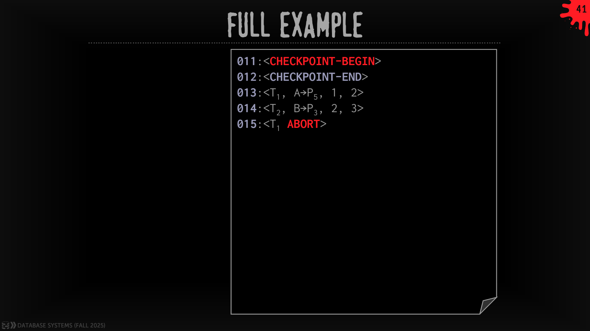


原课件综合例子有两处相互矛盾的标注，需要先说明。`016` 把 T1 的补偿写成了针对 T2 的 `014`，同时 `017` 又宣告 T1 已[回滚](#回滚)结束；正确的[事务](#事务)内[撤销](#撤销)应补偿 T1 在 `013` 对 A 的修改。另一个矛盾是 `019` 写 A，而对应的 `101 CLR-019` 写 D，且 `6→7` 与 A 的已知值不衔接。**下面采用一个明确的一致化版本：`016` 撤销 `013`，`019` 的对象按后续 CLR 统一为 D。** 这是根据[日志](#日志)语义作出的校正，不把它冒充为原[页](#页)逐字内容。

课件在[检查点](#检查点)里给出 `T1.lastLSN=003、T2.lastLSN=004、T3.lastLSN=005`，后续明确把 `005` 当作 T3 的 BEGIN。为使这个演算闭合，以下也把省略的 `003、004` 作为 T1、T2 的 BEGIN。P1 的更早[脏页](#脏页)来源在 LSN 001，原图没有展开其内容；它用于确定[重做](#重做)起点，不能凭此猜出全部早期更新。
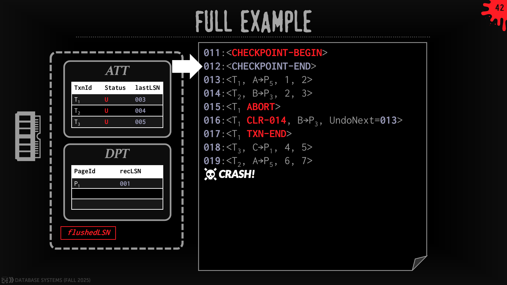


[检查点](#检查点)中保存的状态为：
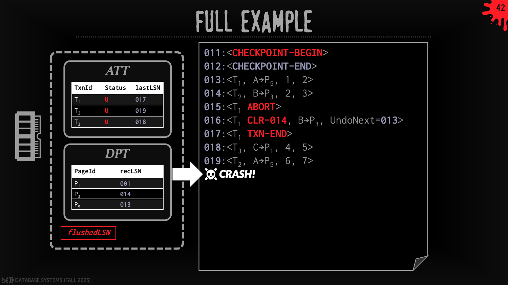


| ATT 中的[事务](#事务) | 状态 | lastLSN |
|---|---|---|
| T1 | U | 003 |
| T2 | U | 004 |
| T3 | U | 005 |

| DPT 中的[页](#页) | recLSN |
|---|---|
| P1 | 001 |

[检查点](#检查点)及其后的[日志](#日志)如下，`prevLSN` 按同一[事务](#事务)的链补出：
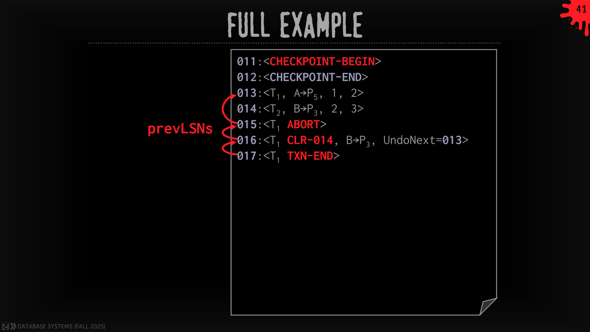

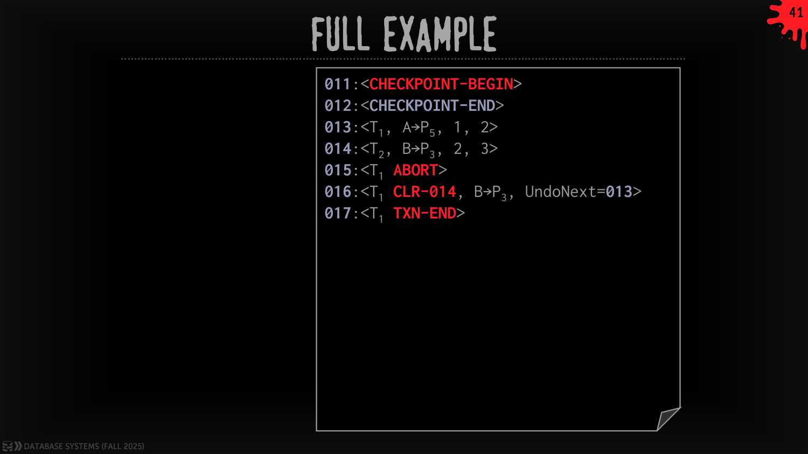

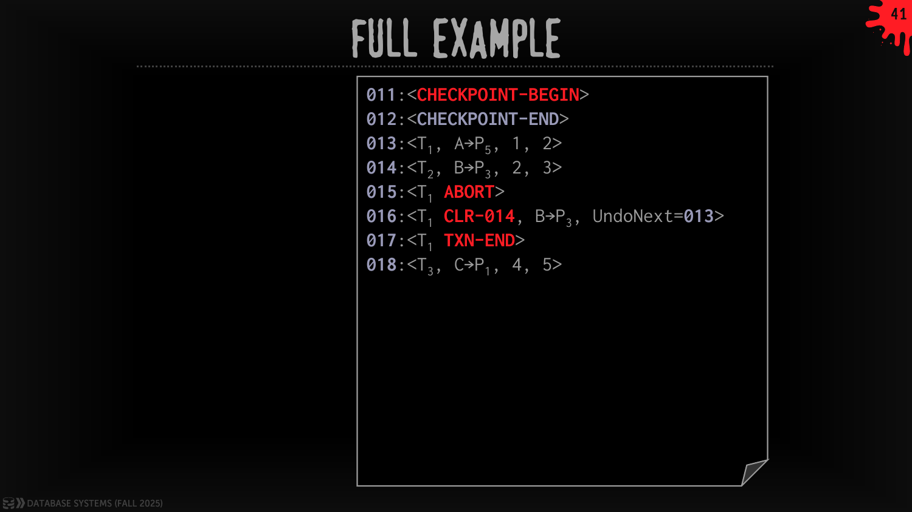


| LSN | [事务](#事务)／类型 | 对象与修改 | prevLSN | undoNextLSN |
|---|---|---|---|---|
| 011 | CHECKPOINT-BEGIN | — | — | — |
| 012 | CHECKPOINT-END | 上述 ATT、DPT | — | — |
| 013 | T1 UPDATE | A→P5，1→2 | 003 | — |
| 014 | T2 UPDATE | B→P3，2→3 | 004 | — |
| 015 | T1 ABORT | — | 013 | — |
| 016 | T1 CLR-013 | A→P5，2→1 | 015 | 003 |
| 017 | T1 TXN-END | — | 016 | — |
| 018 | T3 UPDATE | C→P1，4→5 | 005 | — |
| 019 | T2 UPDATE | D→P5，6→7 | 014 | — |
| — | 第一次崩溃 | [日志](#日志)已持久化到 019 | — | — |

T1 在崩溃前已经[回滚](#回滚)完，T2、T3 没有[提交](#提交)。正确的最终结果必须保留 `A=1`，并把 B、C、D 恢复到 `2、4、6`。但我们不能直接跳到这个结果，因为页面本身可能保存的是不同阶段的值。
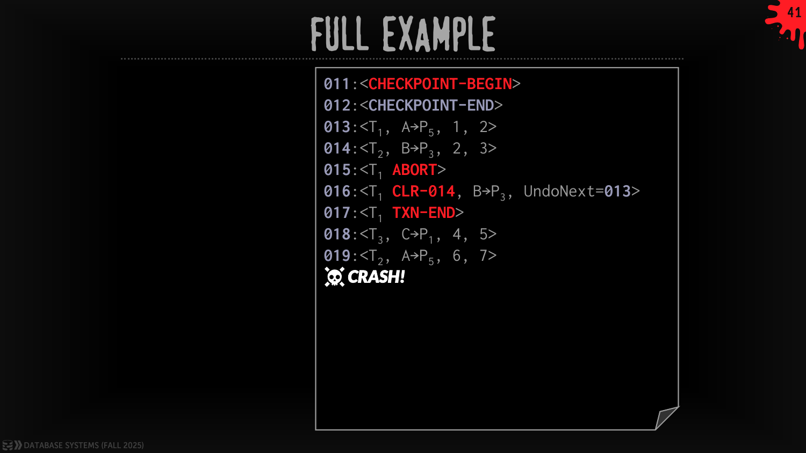


### 6.2 第一次分析与[重做](#重做)

📍 *PPT 第 41–42 页*

[主记录](#主记录)指向 `011`。取得 `012` 的[检查点](#检查点)状态后，继续扫描：
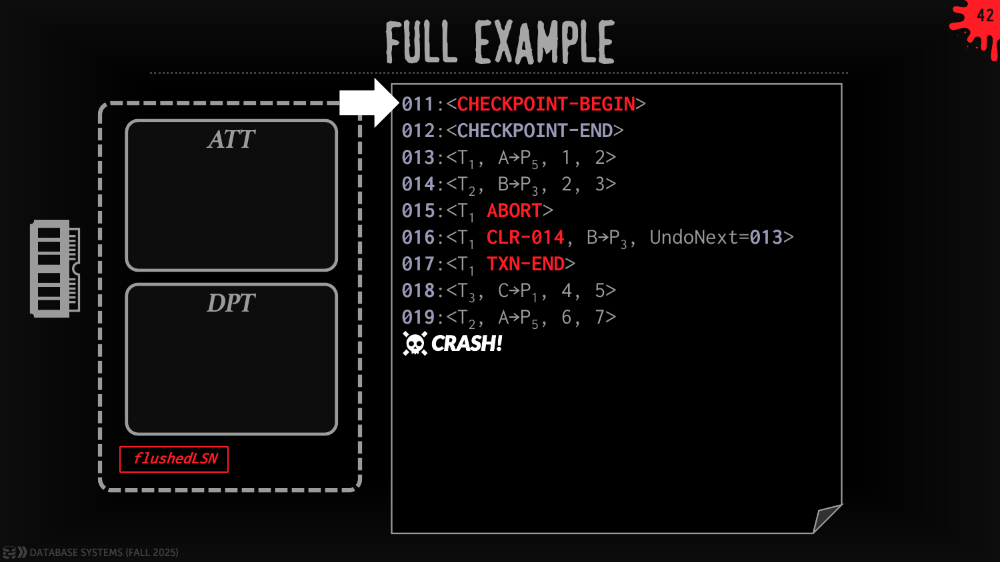


| 处理完的 LSN | ATT 的变化 | DPT 的变化 |
|---|---|---|
| 012 | T1→(U,003)，T2→(U,004)，T3→(U,005) | P1→001 |
| 013 | T1.lastLSN=013 | 加入 P5→013 |
| 014 | T2.lastLSN=014 | 加入 P3→014 |
| 015 | T1 仍为 U，lastLSN=015 | 不变 |
| 016 | T1.lastLSN=016 | P5 已存在，recLSN 仍为 013 |
| 017 | 移除 T1 | 不移除 P5 |
| 018 | T3.lastLSN=018 | P1 已存在，recLSN 仍为 001 |
| 019 | T2.lastLSN=019 | P5 已存在，recLSN 仍为 013 |

分析后的两张表是：

```text
ATT                         DPT
T2: U, lastLSN=019           P1: recLSN=001
T3: U, lastLSN=018           P3: recLSN=014
                            P5: recLSN=013
```

由此得到 `redoStart=min(001,014,013)=001`。P1 把[重做](#重做)起点拉到了[检查点](#检查点)之前，T2、T3 的 `lastLSN` 则给出了随后[撤销](#撤销)的入口。这两个范围由不同的状态决定。
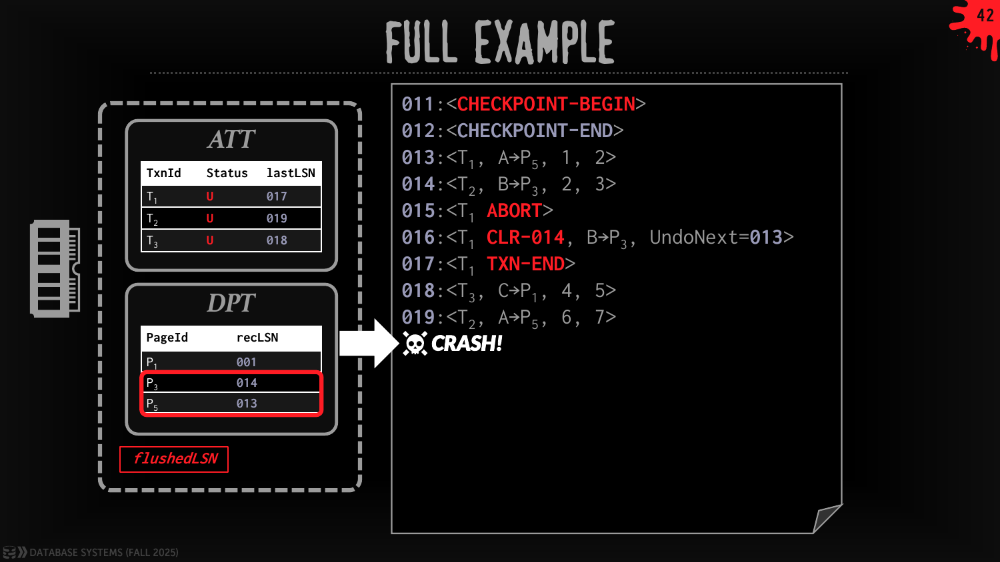


课件没有给出第一次崩溃后每个磁盘[页](#页)的 `pageLSN`，所以仅凭上表不能断言每条更新都会实际[重做](#重做)。为了观察值如何变化，以下演算假定 `013` 及之后的这些页面修改都尚未写回；这是一项演示假设。较早的[日志](#日志)从 `001` 起按同样规则处理，下面只展开图中给出了内容的页面操作：

| [重做](#重做)的 LSN | 本次操作 | 相关对象状态：A，B，C，D | 目标[页](#页)的新 pageLSN |
|---|---|---|---|
| 013 | 重做 T1 的 A：1→2 | 2，2，4，6 | P5=013 |
| 014 | 重做 T2 的 B：2→3 | 2，3，4，6 | P3=014 |
| 016 | 重做 T1 的补偿，A：2→1 | 1，3，4，6 | P5=016 |
| 018 | 重做 T3 的 C：4→5 | 1，3，5，6 | P1=018 |
| 019 | 重做 T2 的 D：6→7 | 1，3，5，7 | P5=019 |

这张表里最值得注意的是 T1：它已经不在 ATT 中，`013` 和 `016` 仍然参与[重做](#重做)检查。一次更新随后被[撤销](#撤销)，两条[日志](#日志)合起来才是完整历史。若磁盘[页](#页)已经反映其中的操作，`pageLSN` 会使相应行跳过；重做的最终状态仍应一致。


到这里，A 已是正确的 1，但 B、C、D 仍包含失败[事务](#事务)的修改。Redo 完成了自己的任务，接下来由 Undo 决定哪些事务效果必须消失。

### 6.3 先[撤销](#撤销) 019，再撤销 018，然后又断电

📍 *PPT 第 42 页*

最初 `ToUndo={019,018}`。取最大值 `019`，[撤销](#撤销) T2 对 D 的修改；再取 `018`，撤销 T3 对 C 的修改。下面沿用课件给新[日志](#日志)分配的 `101、102、103`，编号间的空隙没有额外语义。


| 新 LSN | 新[日志](#日志) | prevLSN | undoNextLSN | 修改后的相关状态 |
|---|---|---|---|---|
| 101 | T2 CLR-019，D→P5，7→6 | 019 | 014 | D=6，P5.pageLSN=101 |
| 102 | T3 CLR-018，C→P1，5→4 | 018 | 005 | C=4，P1.pageLSN=102 |
| 103 | T3 TXN-END | 102 | — | T3 完成[回滚](#回滚)，从 ATT 移除 |

产生 `101` 后，T2 下一条待[撤销](#撤销)更新是 `014`，但 T3 的 `018` 比它更新，所以先处理 T3。产生 `102` 后，它的 `undoNextLSN=005` 已经指向 BEGIN；确认没有更多更新后，可以直接把 T3 收尾。新生成的 `103` 是控制记录，不会打乱仍需撤销的页面更新顺序。


现在 A=1、C=4、D=6，但 B 仍为 3，T2 还欠一次[撤销](#撤销)。假设系统把[日志](#日志)刷到 `103`，并遵守 WAL 把这些[脏页](#脏页)写回磁盘，然后发生第二次崩溃。图中的“刷新日志和脏页”选取了一个便于观察的持久化状态，不是每撤销一个[事务](#事务)都必须执行的同步操作。


第二次崩溃抹掉了内存 ATT 和 DPT，却抹不掉已经持久化的 `101、102、103`。下一次恢复必须从这些记录中恢复[撤销](#撤销)进度。


### 6.4 第二次恢复为什么不会再[撤销](#撤销) 019

📍 *PPT 第 43 页*

第二次 Analysis 仍从最后一个完整[检查点](#检查点) `011` 开始，扫描到新的[日志](#日志)末端 `103`。它在 `017` 移除 T1，在 `103` 移除 T3，只留下：


```text
ATT
T2: U, lastLSN=101
```

重建的 DPT 仍可能包含 `P1→001、P3→014、P5→013`。虽然例子里这些[页](#页)已经写回，但[日志](#日志)中没有逐页刷盘记录，Analysis 不能据此把它们全部删掉。

第二次 Redo 会检查普通 UPDATE 和 `101、102` 两条 CLR。按刚才的持久化假设，磁盘上的 `P5.pageLSN=101、P1.pageLSN=102、P3.pageLSN=014`，对应的旧更新和补偿都能通过[页头](#页头)比较跳过。如果[页](#页)没有写回，Redo 就重放所缺失的 UPDATE、CLR，仍然到达同样的补偿后状态。

第二次 Undo 从 T2 的 `101` 开始。它一看这是 CLR，就不会把 D 从 6 改回 7，而是读取 `undoNextLSN=014`，直接找到尚未[撤销](#撤销)的 B 更新。随后生成：


| 新 LSN | 新[日志](#日志) | prevLSN | undoNextLSN | 结果 |
|---|---|---|---|---|
| 201 | T2 CLR-014，B→P3，3→2 | 101 | 004 | B=2，P3.pageLSN=201 |
| 202 | T2 TXN-END | 201 | — | 到达 T2 BEGIN，完成[回滚](#回滚) |

最后，相关对象为 `A=1、B=2、C=4、D=6`，ATT 为空。课件和 Notes 的基本流程在完成[撤销](#撤销)后刷出恢复[日志](#日志)，再开始接收新[事务](#事务)；不必因此要求把所有数据[页](#页)同时强制写完，仍[脏页](#脏页)面可以由后台按 WAL 约束写回。


两次崩溃串起来，`prevLSN` 保留了 T2 的完整[日志](#日志)链，`undoNextLSN` 则让第二次[回滚](#回滚)越过已经补偿的 `019`。第二次恢复可能[重做](#重做) `101` 的页面效果，却不会为 `019` 再生成一份已经持久化过的补偿。这就是“可以重做[撤销](#撤销)，但不撤销撤销”的具体含义。

## 7. 恢复能反复执行，性能优化才有余地

📍 *PPT 第 44–45 页*

### 7.1 每个阶段再次崩溃，都有明确的重启办法

📍 *PPT 第 44 页*

[分析阶段](#分析阶段)（Analysis）主要从持久[日志](#日志)重建内存元数据，途中崩溃，重新分析即可。[重做阶段](#重做阶段)（Redo）应用的是已经有持久日志作依据的修改；再次启动时，`pageLSN` 区分已经写回与尚未写回的工作。[撤销阶段](#撤销阶段)（Undo）会创造新的页面修改，因此它使用 CLR 保存新增历史与[回滚](#回滚)进度。

| 再次崩溃的位置 | 已完成工作留下什么依据 | 重启时怎样继续 |
|---|---|---|
| Analysis | 原有[检查点](#检查点)与[日志](#日志) | 重新构造 ATT、DPT |
| Redo | 原有日志，以及可能已经更新的[页头](#页头) | 再次按日志扫描，用 pageLSN 跳过已应用记录 |
| Undo | 已持久化的 CLR、TXN-END，以及页面版本 | 先[重做](#重做)包括 CLR 在内的历史，再沿 undoNextLSN [撤销](#撤销)剩余更新 |

若故障发生在“生成一条 CLR 的过程中”，还要分清逻辑步骤与存储[原子性](#原子性)。在这里的原子写模型中，恢复只使用已经完整持久化的[日志](#日志)记录：完整 CLR 存在，就能[重做](#重做)补偿；完整 CLR 不存在，补偿后的页面也不能先于日志落盘，于是仍可从原更新重新[撤销](#撤销)。真实系统还需识别残缺日志尾部，跨[页](#页)记录更要确认所有片段完整，不能把半条 CLR 当成一条有效操作。

“反复恢复”不等于每次都必须从最早阶段重写所有数据。算法从同一个可靠入口重新判断，页面版本与补偿进度会使已经持久化的工作逐步退出待处理范围。

### 7.2 用异步写回和延迟[撤销](#撤销)减少停机时间

📍 *PPT 第 45 页*

[重做阶段](#重做阶段)（Redo）的页面修改不必每次都同步刷盘，可以由后台异步写回。异步表示恢复线程不逐[页](#页)等待完成，以便把[日志](#日志)扫描、读取和写回重叠起来；WAL 的先后约束仍然必须满足。即使再次崩溃，也只是多[重做](#重做)一部分尚未落盘的工作。


因此，课件中“假设不会再次崩溃”的优化可以理解为：不为了立刻保存每一步恢复进度而强制等待。正确性不能真的依赖这个假设。先前各阶段能够重启，正是允许把写回延后的理由。

[撤销阶段](#撤销阶段)（Undo）也可以使用**[延迟回滚](#延迟回滚)（Lazy Rollback）**：先标记哪些对象或页面仍有待[撤销](#撤销)修改，允许系统较早接受新[事务](#事务)，等新访问将触及这些内容时，再先完成所需的[回滚](#回滚)。它类似把必须完成的工作放到首次使用之前，而不是要求启动时把所有冷数据都处理完。

这项优化需要额外的访问控制和恢复状态管理。普通查询不能看见失败[事务](#事务)留下的脏结果，新的写入也不能被稍后执行的旧[撤销](#撤销)覆盖。把“待撤销”标记与[访问路径](#访问路径)、[锁](#锁)以及[页](#页)恢复状态接好，才能安全地缩短不可用时间；基本算法仍然是在 Undo 全部结束后开放[数据库](#数据库)。

另外，长[事务](#事务)通常意味着更长的潜在[回滚](#回滚)链，也可能要求保留更老的[日志](#日志)。应用若能在不破坏业务[原子性](#原子性)的前提下缩短事务，就能减少最坏情况下的[撤销](#撤销)工作。但任意拆开本来必须共同成功的业务步骤，会改变事务语义，[恢复算法](#恢复算法)不能替应用作这个决定。

## 小结

📍 *PPT 第 46–47 页*

STEAL 允许未[提交](#提交)修改提前进入磁盘，NO-FORCE 允许已提交修改暂留内存，所以恢复必须同时具备[撤销](#撤销)与[重做](#重做)。WAL 保证每个可能进入磁盘的修改都有[日志](#日志)依据；LSN 则把这条要求变成可以直接比较的顺序关系。提交通过持久化 COMMIT 确定结果，[回滚](#回滚)通过 CLR 记录反向修改，TXN-END 负责宣布[事务](#事务)处理已经结束。

[模糊检查点](#模糊检查点)用 ATT 与 DPT 保存恢复线索，使[事务](#事务)不必为了得到一个整齐[快照](#快照)而长时间停顿。重启后，Analysis 重建事务和页面元数据，Redo 从最小 recLSN 补齐历史，Undo 再沿事务链反向消除失败事务的影响。pageLSN 使[重做](#重做)能够安全重复，undoNextLSN 使[撤销](#撤销)能够从持久化的进度继续；两者共同把“恢复过程中再次失败”变成普通的恢复输入。

第 [23](../L23/index.md)、[24](../L24/index.md) 讲会在多个节点上继续使用[日志](#日志)、[提交](#提交)与故障恢复的思想，但还必须协调各节点对[事务](#事务)结果的判断。下一讲进入分布式[数据库](#数据库)系统。

## 术语速查表

### 数据库

**Database**：一组经过组织、相互关联、用来模拟现实世界某方面的数据。（本讲首次出现：摘要；引入于：第 1 讲）

### 提交

**Commit**：数据库接受事务成功完成及其整体修改。（本讲首次出现：摘要；引入于：第 17 讲）

### 事务

**Transaction**：为完成业务功能而共同执行、整体成功或失败的一组数据库操作。（本讲首次出现：摘要；引入于：第 10 讲）

### 预写日志

**Write-Ahead Log (WAL)**：独立的日志文件，对象落盘之前，它对应的日志记录必须先落盘。（本讲首次出现：摘要；引入于：第 17 讲）

### 回滚

**Rollback**：撤销事务修改的过程或发起撤销的命令。（本讲首次出现：摘要；引入于：第 17 讲）

### 日志

**Logging**：按序记录修改及恢复所需的信息。（本讲首次出现：摘要；引入于：第 17 讲）

### 页

**Page**：定长的数据块，数据库中一切数据的存放单位。（本讲首次出现：摘要；引入于：第 3 讲）

### 重做

**Redo**：重新施加已提交事务的修改，以保证持久性。（本讲首次出现：摘要；引入于：第 17 讲）

### 中止

**Abort**：事务不能成功完成，需要取消其修改。（本讲首次出现：摘要；引入于：第 17 讲）

### 撤销

**Undo**：清除未完成或已中止事务所产生影响的过程。（本讲首次出现：摘要；引入于：第 17 讲）

### 检查点

**Checkpoint**：周期性地把缓冲区刷到磁盘并在日志中留下标记，限定恢复范围、允许截断日志。（本讲首次出现：摘要；引入于：第 17 讲）

### 缓冲池

**Buffer Pool**：由定长帧组成的一大块内存，用来存放从磁盘读入的页。（本讲首次出现：课程地图；引入于：第 3 讲）

### 原子性

**Atomicity**：事务的修改全部生效或全部不留下。（本讲首次出现：课程地图；引入于：第 17 讲）

### 持久性

**Durability**：已成功提交的修改在约定故障范围内能够保留或恢复。（本讲首次出现：课程地图；引入于：第 1 讲）

### 强严格两阶段锁

**Strong Strict 2PL / Rigorous 2PL**：在 2PL 基础上，把 S、X 锁都保留到事务结束。（本讲首次出现：课程地图；引入于：第 18 讲）

### 页缓存

**OS Page Cache**：操作系统在内核中为文件维护的缓存。（本讲首次出现：1.1；引入于：第 1 讲）

### 脏页

**Dirty Page**：标记页在内存中被改过；这样的页淘汰前必须写回。（本讲首次出现：1.1；引入于：第 4 讲）

### 并发

**Concurrency**：多个事务的执行时间重叠，可以交替或同时推进。（本讲首次出现：1.1；引入于：第 17 讲）

### 一致性

**Consistency**：正确事务把满足规则的数据库状态变成另一个合法状态。（本讲首次出现：1.1；引入于：第 17 讲）

### ARIES 恢复方法

**Algorithms for Recovery and Isolation Exploiting Semantics**：结合 WAL、重复历史和带日志的撤销来恢复事务状态。（本讲首次出现：1.2；引入于：本讲）

### 重复历史

**Repeating History**：按日志重建页面修改历史，包含后来失败事务的更新与补偿。（本讲首次出现：1.2；引入于：本讲）

### 元组

**Tuple**：关系中的一个元素，即表中的一行。（本讲首次出现：1.2；引入于：第 1 讲）

### 索引

**Index**：按适合查找的方式组织键与记录定位信息的访问结构。（本讲首次出现：1.2；引入于：第 8 讲）

### 分裂

**Split**：把一个满节点分成两个，并向父层补充入口。（本讲首次出现：1.2；引入于：第 8 讲）

### 日志序列号

**Log Sequence Number，LSN**：全局唯一、单调递增的日志位置标识。（本讲首次出现：2.1；引入于：本讲）

### 页日志序列号

**pageLSN**：当前页版本最近一次已应用修改的 LSN。（本讲首次出现：2.1；引入于：本讲）

### 已刷盘日志序列号

**flushedLSN**：已完整持久化日志前缀的末端位置。（本讲首次出现：2.1；引入于：本讲）

### 时间戳

**Timestamp**：用来建立事务先后关系的有序标识；此处用于决定等待优先级。（本讲首次出现：2.1；引入于：第 18 讲）

### 页头

**Page Header**：页开头记录页大小、校验和等元数据的区域。（本讲首次出现：2.1；引入于：第 3 讲）

### 修改日志

**Mod Log**：InnoDB 压缩页上暂存修改、推迟解压的区域。（本讲首次出现：2.1；引入于：第 6 讲）

### 写闩

**Write Latch**：让一个工作者独占对象，排斥其他读者和写者。（本讲首次出现：2.1；引入于：第 10 讲）

### 缓冲池管理器

**Buffer Pool Manager**：负责在磁盘与内存之间搬运页、并让系统以为数据全在内存中的组件。（本讲首次出现：2.2；引入于：第 4 讲）

### 日志缓冲区

**Log Buffer**：暂存尚未刷盘的日志记录的内存区域。（本讲首次出现：2.2；引入于：第 21 讲）

### 事务结束记录

**TXN-END**：标明事务的提交或回滚处理全部完成。（本讲首次出现：2.3；引入于：本讲）

### 组提交

**Group Commit**：把多个事务的日志刷盘合并成一次，以分摊刷盘开销。（本讲首次出现：2.3；引入于：第 21 讲）

### 前序日志指针

**prevLSN**：指向同一事务的上一条日志。（本讲首次出现：3.1；引入于：本讲）

### 事务末尾日志序列号

**lastLSN**：指向事务最新生成的日志记录。（本讲首次出现：3.1；引入于：本讲）

### 锁

**Lock**：协调事务访问数据库逻辑内容的机制。（本讲首次出现：3.1；引入于：第 4 讲）

### 补偿日志记录

**Compensation Log Record，CLR**：记录撤销产生的页面修改，可重做、不可撤销。（本讲首次出现：3.2；引入于：本讲）

### 下一撤销位置

**undoNextLSN**：CLR 指示的下一条待继续检查或撤销的事务日志。（本讲首次出现：3.2；引入于：本讲）

### 快照

**Snapshot**：事务开始时记下的当时仍在运行的事务，决定此后哪些写对它可见。（本讲首次出现：4.1；引入于：第 20 讲）

### 活动事务表

**Active Transaction Table，ATT**：保存尚未完成收尾的事务、状态与 lastLSN。（本讲首次出现：4.2；引入于：本讲）

### 脏页表

**Dirty Page Table，DPT**：保存脏页及各页可能需要重做的最早日志位置。（本讲首次出现：4.2；引入于：本讲）

### 恢复起点序列号

**Recovery LSN，recLSN**：页面本轮首次变脏的日志位置，恢复时用于保守确定重做范围。（本讲首次出现：4.2；引入于：本讲）

### 撤销候选

**Undo Candidate，U**：尚未获得提交证据、恢复时可能需要回滚的事务状态。（本讲首次出现：4.2；引入于：本讲）

### 模糊检查点

**Fuzzy Checkpoint**：允许事务继续执行，以元数据和日志支持后续恢复的检查点。（本讲首次出现：4.3；引入于：[第 17 讲](../L17/index.md)）

### 检查点开始／结束记录

**CHECKPOINT-BEGIN / CHECKPOINT-END**：分别标记检查点起点和保存检查点状态。（本讲首次出现：4.3；引入于：本讲）

### 主记录

**MasterRecord**：持久保存最近一个完整检查点的开始 LSN。（本讲首次出现：4.3；引入于：本讲）

### 分析阶段

**Analysis**：从检查点向前扫描，重建 ATT 与 DPT。（本讲首次出现：5.1；引入于：本讲）

### 重做阶段

**Redo**：补齐日志中尚未体现在页面上的更新及 CLR。（本讲首次出现：5.2；引入于：本讲）

### 幂等性

**Idempotence**：重复执行恢复检查仍然得到同一正确页面状态。（本讲首次出现：5.2；引入于：本讲）

### 撤销阶段

**Undo**：反向撤销未提交事务并记录补偿。（本讲首次出现：5.3；引入于：本讲）

### 延迟回滚

**Lazy Rollback**：把部分撤销延后到相关数据被新访问之前完成。（本讲首次出现：7.2；引入于：本讲）

### 访问路径

**Access Path**：从基本表中取出所需数据的方法，如顺序扫描、索引扫描。（本讲首次出现：7.2；引入于：第 1 讲）

### 恢复算法

**Recovery Algorithm**：在故障发生时仍保证一致性、原子性和持久性的技术，分为正常运行时的准备和故障后的恢复两部分。（本讲首次出现：7.2；引入于：第 21 讲）

[^correctness]: 原话：“In databases, you want to make sure it's correct first, then you make it faster.” 来自转写稿中讨论 CLR 是否需要保存重复信息的连续发言。

[^dpt]: Notes 第 4 页 DPT 段落开头以“未提交事务修改过的页”概括，紧接着又明确说明 DPT 包含所有脏页，不论修改者运行中、已提交还是已中止。本文采用后一个定义，也与 PPT 第 28 页一致。


<details>
<summary>📎 本讲未被 📍 标注的幻灯片（共 4 页：封面、目录与行政页）</summary>


</details>
