# CMU 15-445 第 [23](index.md) 讲：分布式数据库系统（上）（Distributed Database Systems I）

> **课程**：CMU 15-445/645 Database Systems（Fall 2025）· **主讲**：Andy Pavlo
> **课程主页**：https://15445.courses.cs.cmu.edu/fall2025/
> **材料**：课件 PPT（文字提取版）、官方 Lecture Notes、课堂录音转写稿
> **说明**：正文以 PPT 与 Lecture Notes 为准。讲者原话的中文为意译，英文原文见脚注，依据课堂录音转写整理，已修正明显的语音识别错误。文中“📍 PPT 第 X 页”指幻灯片右上角印的编号。

## 摘要（Abstract）

一台机器上的 DBMS 有两个它自己无法突破的极限：数据多到存不下，机器一坏整个[数据库](#数据库)就停止服务。[分布式 DBMS](#分布式%20DBMS) 把一个逻辑数据库拆到多台机器上来突破这两个极限。每台机器内部仍是前 22 讲造出来的那套系统，新的困难全部来自机器之间的网络：它慢，不可靠，而且一个节点没有回应时，其他节点无法判断它是慢了还是死了。

沿着这个困难，问题一个接一个出现。首先要决定节点之间共享什么：[无共享](#无共享)架构让每个节点只处理本地数据，性能最好，但增加节点要物理地搬运数据；[共享磁盘](#共享磁盘)架构把数据交给云存储，增加节点只需修改[目录](#目录)，却要面对缓存一致性。数据不在执行查询的节点上时，要么把查询推过去，要么把数据拉过来。接着要决定数据怎么分：哈希[分区](#分区)对等值查询最友好，可节点数一变，几乎全部数据都要换位置，[一致性哈希](#一致性哈希)与[会合哈希](#会合哈希)把迁移量降到了理论最小值。[分区](#分区)扩大了单点故障的影响，于是需要[复制](#复制)，而[复制](#复制)带来了“[提交](#提交)前等不等副本”的取舍，异步[复制](#复制)甚至可能丢掉已经确认提交的[事务](#事务)。最后，事务一旦跨越多个节点，就需要协调者；分布式[死锁](#死锁)说明，单机上的[并发](#并发)控制不能原样照搬。

读完本讲，你应该能说清四种[系统架构](#系统架构)的区别，并判断一个真实系统属于哪一种；能计算取模哈希在扩容时要搬走多少数据，并解释[一致性哈希](#一致性哈希)与[会合哈希](#会合哈希)为什么只搬 1/(N+1)；能画出同步与异步[复制](#复制)下一次[提交](#提交)的消息顺序，指出异步[复制](#复制)在什么情况下会丢数据；能解释为什么一个跨节点的[死锁](#死锁)，任何单个节点都发现不了。

## 课程地图

本讲进入课程的最后一个阶段：分布式。


到第 [22](../L22/index.md) 讲为止，我们已经能从下到上造出一台完整的单机 DBMS。本讲几乎每一节都要借用前面的某块积木：[共享磁盘](#共享磁盘)架构里节点的本地缓存就是第 [4](../L04/index.md) 讲的[缓冲池](#缓冲池)；Parquet 文件的内部组织是第 [6](../L06/index.md) 讲的 [PAX](#PAX) 布局，[垂直分区](#垂直分区)是第 [6](../L06/index.md) 讲列存储思想在节点层面的推广；哈希[分区](#分区)沿用第 [7](../L07/index.md) 讲的[哈希函数](#哈希函数)；[二级索引](#二级索引)（第 [5](../L05/index.md) 讲）怎样跨节点维护，要以第 [8](../L08/index.md)、[9](../L09/index.md) 讲的[索引](#索引)为基础；把[计划片段](#计划片段)发给别的节点执行，延续了第 [14](../L14/index.md) 讲并行执行中的[交换算子](#交换算子)，[并行 DBMS](#并行%20DBMS) 与[分布式 DBMS](#分布式%20DBMS) 的区分也最早出现在那里；[谓词下推](#谓词下推)来自第 [15](../L15/index.md) 讲；[复制](#复制)靠传送第 [21](../L21/index.md) 讲的[预写日志](#预写日志)来完成，副本重放[日志](#日志)的过程和第 [22](../L22/index.md) 讲[恢复算法](#恢复算法)的[重做阶段](#重做阶段)几乎相同；分布式[死锁](#死锁)要用第 [18](../L18/index.md) 讲的[等待图](#等待图)来分析，[时钟偏差](#时钟偏差)则会冲击第 [19](../L19/index.md)、[20](../L20/index.md) 讲依赖[时间戳](#时间戳)的协议。

本讲留下的几个问题都将在第 [24](../L24/index.md) 讲展开：多个节点怎样就“[提交](#提交)”达成一致（两阶段提交），副本怎样选出唯一的主节点（Paxos、Raft），以及数据分散在不同节点上时，[连接](#连接)等分析查询怎样执行。

## 1. 为什么要把[数据库](#数据库)拆到多台机器上

📍 *PPT 第 4–8 页*

到上一讲为止，我们已经能造出一台完整的单机 DBMS：磁盘管理器和[缓冲池](#缓冲池)负责在磁盘与内存之间搬运[页](#页)，[访问方法](#访问方法)和[算子](#算子)负责回答查询，[查询优化器](#查询优化器)负责挑选执行计划，[并发](#并发)控制与[日志](#日志)恢复保证[事务](#事务)既正确又持久。这台机器有两个它自己解决不了的问题：数据可能多到一台机器存不下；这台机器一旦宕机，整个[数据库](#数据库)就停止服务。
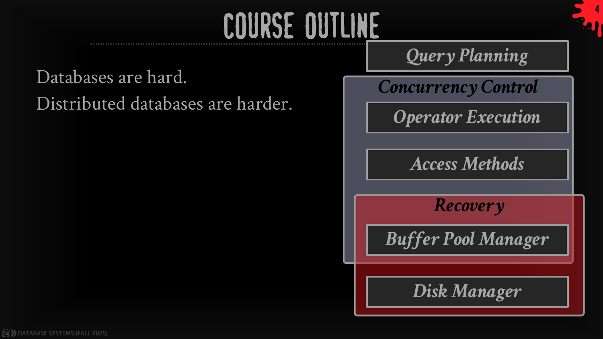


**[分布式数据库管理系统](#分布式数据库管理系统)（Distributed Database Management System，Distributed DBMS）**把一个逻辑上的[数据库](#数据库)分布到多个物理资源上，应用程序通常察觉不到数据已经被拆开。它的两个主要目标正好对应上面两个问题：可扩展性（Scalability），即存下单个节点放不下的数据；容错（Fault Tolerance），即单个节点的故障不会拖垮整个系统。并行数据库增加资源是为了跑得更快，分布式数据库增加资源，既可能为了更快，也可能只是为了在某个节点宕机时，应用程序仍然能继续查询数据库。

[分布式 DBMS](#分布式%20DBMS) 并不需要一套新的理论。它的每个节点（Node）内部仍然是前 22 讲造出来的那套分层，[查询优化](#查询优化)、[并发](#并发)控制、[日志](#日志)与恢复这些积木都可以沿用。新问题全部出在节点与节点之间：这些积木原本默认所有状态都放在同一块内存里，现在状态被网络隔开了。[数据库](#数据库)本身已经很难做对，分布式数据库更难，这也是本课程先花一整个学期讲单机系统的原因。

### 1.1 并行与分布式：通信代价不能再忽略

📍 *PPT 第 5 页*

第 [14](../L14/index.md) 讲讨论并行查询执行时，我们区分过[并行 DBMS](#并行%20DBMS) 和[分布式 DBMS](#分布式%20DBMS)。两者都用多个工作单元处理同一个[数据库](#数据库)，区别在于工作单元之间的通信：
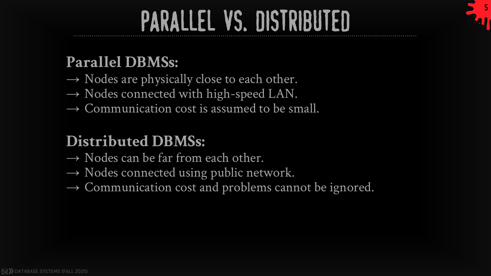


| | [并行 DBMS](#并行%20DBMS)（Parallel DBMS） | [分布式 DBMS](#分布式%20DBMS)（Distributed DBMS） |
|---|---|---|
| 节点位置 | 物理上彼此靠近 | 可能相距很远 |
| 连接方式 | 高速局域网，快且可靠 | 可能经过公共网络，慢且不可靠 |
| 通信代价 | 假定很小，设计内部协议时不必担心节点崩溃或丢包 | 通信代价与连接故障都不能忽略，节点会崩溃，数据包会丢失 |

在[并行 DBMS](#并行%20DBMS) 里，一个线程发给另一个线程的消息必定很快送达（Andy 的说法是，如果连这都送不到，CPU 大概已经在熔化了，[数据库](#数据库)另有更大的麻烦）。[分布式 DBMS](#分布式%20DBMS) 同时失去了“快”和“可靠”这两条保证。

先看“快”。设两个节点位于地球的两端，光在光纤中的传播速度约为真空光速的三分之二：

```math
t_{\text{one-way}} \approx \frac{2 \times 10^{4}\ \text{km}}{2 \times 10^{5}\ \text{km/s}} = 0.1\ \text{s}
```

其中 2×10⁴ km 约为地球周长的一半，2×10⁵ km/s 是光在光纤中的速度。一来一回至少 200 毫秒，而且这只是物理下限，路由绕行和排队只会让它更长；Andy 在课上给出的量级是 100 到 300 毫秒，出现丢包和重传时甚至要几十秒。作为对比，单机上一次内存访问约 100 纳秒，两者相差六个数量级。

再看“可靠”。消息可能丢失，也可能迟迟不到。更麻烦的是，一个节点没有回应，并不能说明它已经宕机。用 Go、Java 这类带垃圾回收的语言实现的节点，堆很大时，一次垃圾回收（Garbage Collection，GC）在最坏情况下可能让整个进程停顿 10 到 30 秒。在其他节点看来，它已经消失了；实际上它只是在清理内存，清理完就会接着处理刚才收到的消息。

由此我们得到分布式系统最根本的困难：一个节点无法区分另一个节点是慢了还是死了。如果判定它已经死亡、另选一个节点接替，而它随后醒来继续工作，系统里就可能出现两个都认为自己说了算的节点。分布式系统课程中的共识协议（Consensus Protocol），比如 Paxos 和 Raft，正是为这类问题设计的。本讲先搭起分布式[数据库](#数据库)的架构，第 [24](../L24/index.md) 讲再把这些协议叠加上去。

### 1.2 数据透明性与新的设计问题

📍 *PPT 第 6–8 页*

[分布式 DBMS](#分布式%20DBMS) 追求**[数据透明性](#数据透明性)（Data Transparency）**：用户不需要知道数据物理上存放在哪里，也不需要知道表怎样被[分区](#分区)、怎样被[复制](#复制)。换句话说，一条在单机 DBMS 上能正确运行的 SQL 查询，在分布式 DBMS 上应该以同样的方式运行，得到同样的结果。这是第 [1](../L01/index.md) 讲[数据独立性](#数据独立性)在分布式环境中的延续：Codd 把“数据是什么”和“数据怎么存”分开，[数据透明性](#数据透明性)又把“数据怎么存”和“数据存在哪台机器上”分开。

为了兑现这个承诺，系统必须替用户回答一串问题，本讲的章节按这个顺序展开。应用程序连上来之后，查询该发给哪个节点，节点又怎样找到数据，取决于[系统架构](#系统架构)以及记录数据位置的[目录](#目录)（第 2 节）；数据不在执行查询的节点上时，是把查询送到数据那里，还是把数据拉过来（第 3 节）；[数据库](#数据库)怎样拆分给各个节点，节点增减时又怎样调整（第 4、5 节）；拆开并[复制](#复制)之后，系统怎样保证正确性（第 6 至第 9 节）。

在正确性这个问题上，有些系统认为在分布式环境里保证一致性太难，于是干脆不保证，或者不立即保证。代价并没有消失，只是转移给了应用程序：它必须自己应对读到旧数据、更新丢失这类异常。我们会在第 6.3 节看到这种选择的具体形态。

## 2. 系统架构：CPU 能直接访问哪些资源

📍 *PPT 第 9–14 页*

### 2.1 四种架构

📍 *PPT 第 9–10 页*

每个节点都有 CPU、内存和磁盘，[分布式 DBMS](#分布式%20DBMS) 首先要决定的是，这些资源中哪些归节点私有，哪些由所有节点共享。**[系统架构](#系统架构)（System Architecture）**规定了 CPU 可以直接访问哪些共享资源，它决定了 CPU 之间如何协调，以及去哪里读写[数据库](#数据库)中的对象。这套分类可以追溯到 1980 年代：
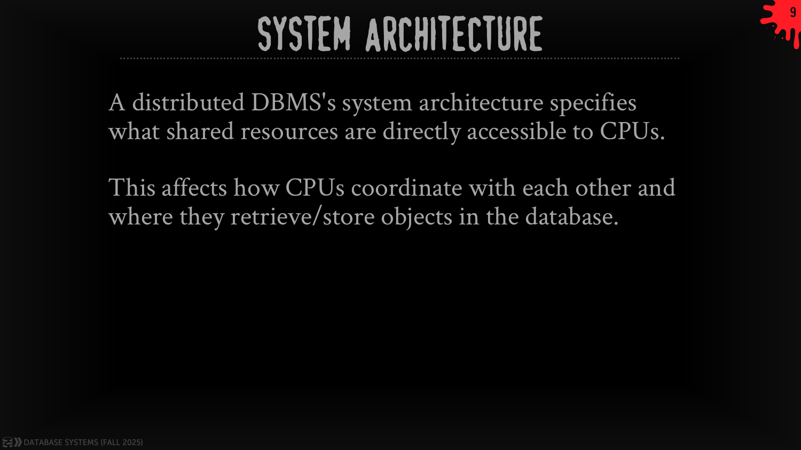


| 架构 | 每个节点私有 | 所有节点共享 | 网络位于 | 现状 |
|---|---|---|---|---|
| [全共享](#全共享)（Shared-Everything） | 只有一个节点 | CPU、内存、磁盘都在同一台机器里 | 不需要网络 | 最常见 |
| [无共享](#无共享)（Shared-Nothing） | CPU、内存、磁盘 | 无 | 节点之上 | 常见，在减少 |
| [共享磁盘](#共享磁盘)（Shared-Disk） | CPU、内存 | 磁盘 | 内存与磁盘之间 | 常见，在增加 |
| [共享内存](#共享内存)（Shared-Memory） | CPU | 内存、磁盘 | CPU 与内存之间 | 几乎不存在 |

读这张表的一个办法是看网络插在哪一层。[全共享](#全共享)架构里没有网络。[无共享](#无共享)架构把网络放在最上面，节点之间除了消息什么也不共享。[共享磁盘](#共享磁盘)把网络下移到内存与磁盘之间，磁盘于是被共享。[共享内存](#共享内存)再把网络下移到 CPU 与内存之间，连内存也被共享了。网络插得越低，共享的东西越多，对网络速度的要求也越苛刻。

**[全共享](#全共享)（Shared-Everything）**架构就是本学期到上一讲为止讨论的一切：一台机器上的 CPU 直接访问本机的内存和磁盘。课上有学生问，[全共享](#全共享)和[共享内存](#共享内存)有什么区别，两者的 CPU 不都直接访问同一块内存吗？区别在于节点的数量。[全共享](#全共享)说的是单独一台机器；把多台[全共享](#全共享)的机器用网络连起来，任何一台的 CPU 都不能直接读写另一台的内存或磁盘，这就成了[无共享](#无共享)。

**[共享内存](#共享内存)（Shared-Memory）**架构中，CPU 通过高速互连访问同一个内存地址空间，也共享同一块磁盘，每个处理器都能看到内存中所有数据结构的全局视图。要让它跑得动，节点之间的网络必须和 CPU 访问本地内存一样快，这样的网络极其昂贵。Andy 的评价是，这种架构只存在于学术文献中，除了高性能计算、科学计算那一类场景，他不知道有哪个[数据库](#数据库)真的这么做。[^shm] 后面不再讨论它。

[^shm]: 原话：“This one is theoretical. It's in the academic literature, but I'm not aware of any database that actually does this outside of the high performance computing world, like scientific stuff.”

剩下的两种是[分布式 DBMS](#分布式%20DBMS) 的主流选择，它们的地位正在交换。Postgres 的作者 Michael Stonebraker 在 1986 年发表了题为《The Case for Shared Nothing》的论文，此后二三十年，人们构建分布式[数据库](#数据库)基本都采用[无共享](#无共享)架构。云计算改变了这一点：Amazon S3 这类对象存储普及之后，近十年新出现的分布式数据库，尤其是分析型系统，大多采用[共享磁盘](#共享磁盘)架构。两者的结构如下：

```text
Shared-Nothing:

 ================= NETWORK =================
      |              |              |
  +--------+     +--------+     +--------+
  |  CPU   |     |  CPU   |     |  CPU   |
  |  MEM   |     |  MEM   |     |  MEM   |
  |  DISK  |     |  DISK  |     |  DISK  |
  +--------+     +--------+     +--------+

Shared-Disk:

  +--------+     +--------+     +--------+
  |  CPU   |     |  CPU   |     |  CPU   |
  |  MEM   |     |  MEM   |     |  MEM   |
  | (SSD)  |     | (SSD)  |     | (SSD)  |   <- local SSD is only a cache
  +--------+     +--------+     +--------+
      |              |              |
 ================= NETWORK =================
                     |
       +---------------------------+
       | shared storage (S3 / DFS) |
       +---------------------------+
```

### 2.2 无共享（Shared-Nothing）

📍 *PPT 第 11–12 页*

**[无共享](#无共享)（Shared-Nothing）**架构中，每个节点拥有自己的 CPU、内存和本地磁盘，节点之间只能通过网络通信。一个节点的 CPU 无法直接读取另一个节点的内存或磁盘，只能发一条消息，由对方的 CPU 处理后把结果发回来。这里的网络大多就是 TCP/IP，有些系统用 UDP，少数系统借助 RDMA（远程直接内存访问，一种让网卡直接读写另一台机器内存的硬件技术），但一般可以假定，节点之间就是在 TCP 连接上互发消息。在云存储平台兴起之前，这是构建[分布式 DBMS](#分布式%20DBMS) 的常规方式，因为它用现成的商用服务器就能搭起来。
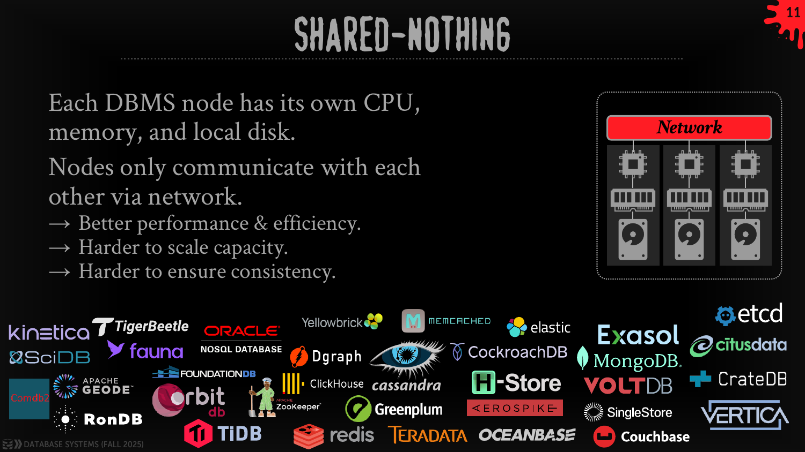


它的优点是性能与效率。每个节点处理的都是本地数据，只要查询所需的数据都在本地，就没有任何远程访问。它的缺点有两个：扩容难，因为增加节点时 DBMS 必须把数据物理地搬到新节点上；保证一致性难，因为节点之间必须就[事务](#事务)的状态相互协调。

下面用一个例子看这两面。[数据库](#数据库)只有一张表，ID 范围是 1 到 300，由两个节点分管：

| [分区](#分区) | 负责的 ID |
|---|---|
| P1 | 1–150 |
| P2 | 151–300 |

系统中还有一个**[目录](#目录)（Catalog）**服务。[目录](#目录)是 DBMS 的元数据，记录有哪些表、每张表有哪些列和约束；到了分布式环境，它还要记录[分区](#分区)方案与集群拓扑，也就是哪段数据归哪个节点管。[目录](#目录)本身也是一个[数据库](#数据库)，它需要和用户数据同样的[事务](#事务)保证，否则节点就会依据过时的[分区](#分区)信息把请求发错地方。[目录](#目录)可以放在一个中心节点上，也可以作为系统中普通节点的一部分。

查询 `Id=200` 时，系统从[目录](#目录)得知它属于 P2，于是把查询发给 P2 所在的节点，由它在本地完成查询并返回结果。

如果一条查询同时要 `Id=100` 和 `Id=200`，并且被发给了 P1 所在的节点，情况就不同了。各节点都知道[目录](#目录)中定义的[分区](#分区)方案，所以这个节点知道自己没有 `Id=200`，只能给 P2 发消息。这时它有两种选择：请 P2 执行查询中与 `Id=200` 相关的那部分，把结果发回来；或者请 P2 直接把原始数据发过来，由自己来处理。这两种选择正是第 3 节的主题。

你可能会问，为什么不让 P2 把 `Id=200` 的结果直接发给应用程序？原因在应用程序与[数据库](#数据库)之间的协议。JDBC、ODBC 这类接口是一问一答的：应用程序发出一条查询，就等着收回一个包含全部结果[元组](#元组)的结果集，应用程序也都是按这种方式编写的。更根本的是[数据透明性](#数据透明性)：同一条 SQL，在单机上得到一个结果集，在分布式系统上也应该得到一个结果集。同样的道理，理想情况下应用程序也不需要知道 ID 的分段范围。有些系统允许应用程序先查询[目录](#目录)，再把请求直接发给对应节点；但更符合[数据透明性](#数据透明性)的做法是，应用程序把 SQL 发给任意一个节点，由这个节点查[目录](#目录)，再把工作分发出去。

现在加入第三个节点，新的[分区](#分区)方案是：

| [分区](#分区) | 加节点前 | 加节点后 |
|---|---|---|
| P1 | ID 1–150 | ID 1–100 |
| P3（新节点） | — | ID 101–200 |
| P2 | ID 151–300 | ID 201–300 |

新节点负责的 101–200 原本分属两个节点：101–150 来自 P1，151–200 来自 P2。这些数据必须从旧节点的磁盘真正复制到新节点的磁盘上，复制完成后再更新[目录](#目录)，让之后来找这些数据的请求都能找到新位置。在这个例子里，300 个 ID 中有 100 个跨网络搬了家；数据量一大，这就是以小时甚至以天计的工作。Google 的 F1 论文（VLDB 2013）在解释为什么要替换 AdWords 原先的[分片](#分片) MySQL 时写道，那套系统很难扩容，重新平衡数据更难。

搬迁期间还有一个正确性问题：数据和[目录](#目录)必须一起变。有学生问，插入数据导致一个[分片](#分片)过满时，系统能不能自动把一部分数据挪走？Andy 提到，MongoDB 在 2010 年代初走红，部分原因正是它支持这种自动[分片](#分片)：某个[分片](#分片)太满或者查询太集中，就自动切出一块数据、重新平衡。但在他看来，早期的实现“完全是凑合出来的”，因为它并不保证[目录](#目录)与被搬走的数据保持同步。[^mongo] 于是同一份数据可能在两个[分片](#分片)上各有一份，两条查询分别更新了不同的副本，得出错误的结果。另一种做法是搬迁期间锁住整个[数据库](#数据库)，代价是停止服务。

[^mongo]: 原话：“They could split off a chunk of it and rebalance things automatically, but it was a total hack because they didn't guarantee that the catalog was in sync with the data that got moved.”

最后是[索引](#索引)。查询条件正好落在[分区键](#分区键)上时（比如 `id = 200`），每个节点只需为自己那一段数据建索引，查询被路由到对应节点后，在该节点的局部索引里查找即可，每个节点持有整个索引的一部分。如果要在另一列上建[二级索引](#二级索引)，而这一列与数据的划分方式无关，局部索引就帮不上忙了：按这一列查找时，任何节点上都可能有匹配的[元组](#元组)。这时要么把这个二级索引集中放在一个节点上，所有节点都去问它，这个节点就成了瓶颈；要么把它[复制](#复制)到每一个节点上，代价是每次更新都要改遍所有副本。

### 2.3 共享磁盘（Shared-Disk）

📍 *PPT 第 13–14 页*

**[共享磁盘](#共享磁盘)（Shared-Disk）**架构中，每个节点有自己的 CPU 和私有内存，所有节点通过网络访问同一个逻辑磁盘，[数据库](#数据库)的最终存放位置就在这块[共享磁盘](#共享磁盘)上。节点也可以有直接连接的本地 SSD，但它只被当作一层比内存慢、比内存大的缓存。这块“磁盘”在实践中通常是分布式文件系统或对象存储，比如 Amazon S3、Azure Blob Storage、Google Cloud Storage。它们内部由成千上万块磁盘组成，但对数据库节点而言，逻辑上就是一块谁都能读写的磁盘。人们谈论的数据湖（Data Lake）和无服务器（Serverless）数据库，大多就是这种架构；Snowflake、Databricks 等面向分析型[工作负载](#工作负载)的系统，也都是这个样子。
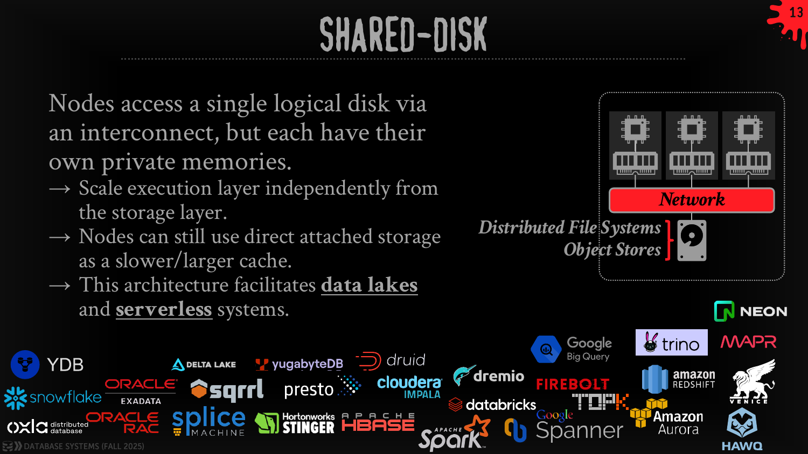


这种架构把执行层和存储层分开了，两层可以各自独立地伸缩，增加存储节点或计算节点都不影响另一层的数据布局。来看一个例子。查询 `Id=101` 到达负责它的节点，节点从[目录](#目录)得知它在[页](#页) ABC 上，于是向共享存储请求这一页，复制到自己的内存里；`Id=102` 在页 XYZ 上，处理方式相同。加入一个新节点时，与[无共享](#无共享)架构的区别就体现出来了：不需要搬动任何数据，只需要在[目录](#目录)中做一次逻辑上的指派，声明 `Id=101` 所在的那一段从此归新节点负责。其他节点得知这一变更后，把相应的请求转给新节点即可，下次有人查询 `Id=101`，新节点会自己去共享存储取页 ABC。
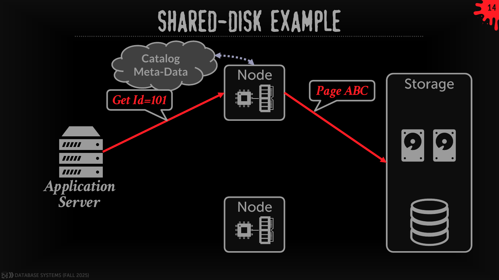

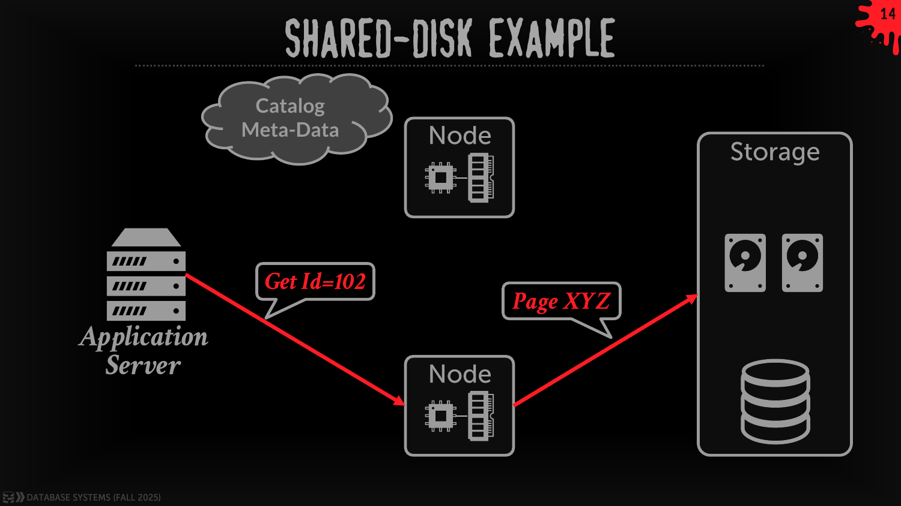

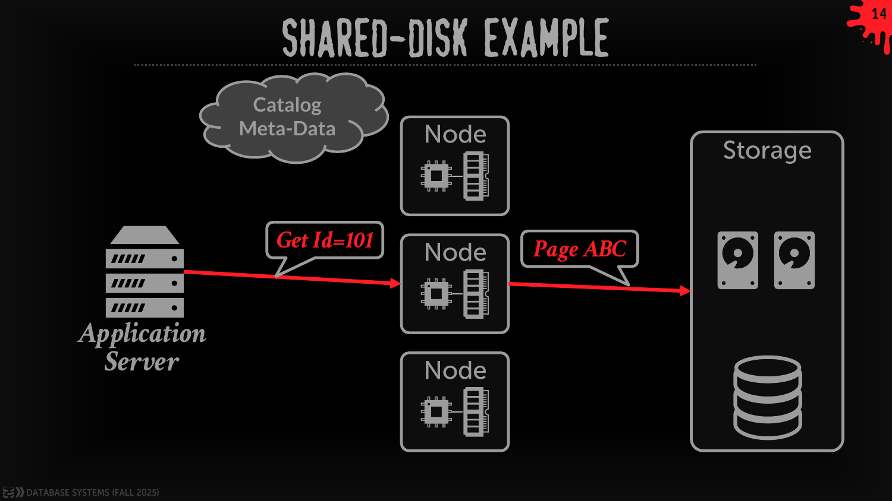


存储这一层同样可以几乎无限地伸缩。在[无共享](#无共享)架构里加容量，要把硬盘装进机器，甚至要让节点下线；在 S3 上加容量，只需要付更多的钱。Andy 的说法是：你的信用卡会先于 Amazon 的存储空间耗尽。[^cc] 节点本身也因此变成了无状态的：一个节点崩溃，丢掉的只是它的缓存，数据仍然安全地存放在共享存储里。

[^cc]: 原话：“I give Amazon more money and I get more space, like your credit card will run out of money before Amazon runs out of storage space for you.”

代价有两处。第一是性能。[无共享](#无共享)节点读的是本地磁盘，[共享磁盘](#共享磁盘)节点在缓存未命中时，每次都要跨网络访问存储服务，所以它通常比[无共享](#无共享)慢。缓解办法是让节点把热数据缓存在内存和本地 SSD 上；第 [4](../L04/index.md) 讲[缓冲池](#缓冲池)的全部知识，[替换策略](#替换策略)、[脏页](#脏页)、钉住，在这里照样适用。

第二处更微妙，是缓存一致性。节点更新 `Id=101` 时，修改的是自己内存里那份[页](#页) ABC 的副本。如果其他节点的内存里也缓存着页 ABC，它们必须得知这一页已经变了，下次读取时要么去负责这段数据的节点取最新版本，要么重新从[共享磁盘](#共享磁盘)读取，否则会继续读到旧值。这和 C 程序里的一个常见错误同构：几个线程各自把一个全局变量读进自己的局部变量里缓存起来，其中一个线程修改了全局变量，其他线程手里的局部副本并不会随之更新。
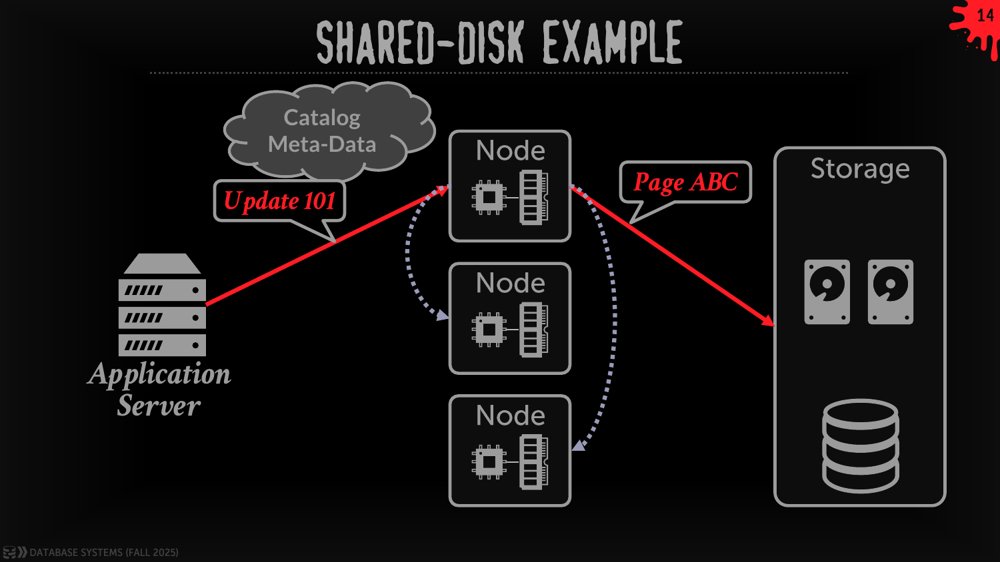


课上有学生问：为什么[共享磁盘](#共享磁盘)架构还要让不同的节点负责不同的数据范围，不能让任何节点处理任何数据吗？难点就在更新上。另一位学生提议，谁要更新数据，就向所有节点广播自己持有这把[锁](#锁)。节点多、更新频繁时，这样做代价极高，每次更新都要和所有节点通一轮消息。更实际的做法是给每段数据指定一个负责节点：对这段数据的更新必须先到它那里执行，再由它把变更传播给集群中的其他节点。这就是第 4.5 节要讲的[逻辑分区](#逻辑分区)。[共享磁盘](#共享磁盘)架构看似任何节点都能读任何数据，却仍然需要按数据划分责任，原因就在这里。

Snowflake 是[共享磁盘](#共享磁盘)路线的代表。它在 2016 年的 SIGMOD 论文中列出了[无共享](#无共享)架构的问题，其中之一是：节点集合一旦变化，无论是节点故障还是用户调整规模，都要重新分布大量数据。Snowflake 的回答是把数据全部放在 S3 上，计算节点的本地磁盘只存临时数据和缓存，等缓存热起来之后，性能接近纯粹的[无共享](#无共享)系统。Andy 认为这是 Snowflake 早年做对的一个聪明决定：不必自己构建一套容错、保持同步的分布式存储，工程师可以全部投入到查询引擎上，并且 Amazon 每改进一次 S3，Snowflake 都能免费获益。[^snow] 这和本学期反复强调的“[数据库](#数据库)要尽量自己掌控一切”有些冲突。Andy 的看法是，对分布式分析型系统，尤其是初创公司，少造一个组件是值得的；对[事务](#事务)型系统就未必，因为它对延迟更敏感。

[^snow]: 原话：“And then as Amazon makes this better, we'll get that benefit for free. So that was one of the smart things that they did in the early days.”

两种架构之间的界线在真实系统中是模糊的。Google Spanner 的每台服务器管理自己负责的数据，看上去是[无共享](#无共享)，但这些数据实际存放在 Google 的分布式文件系统 Colossus 上。Snowflake 的论文则把自己的计算引擎称为[无共享](#无共享)，把整体架构称为“多集群、共享数据”。判断一个系统属于哪种架构，要看[数据库](#数据库)的最终存放位置在哪里，以及节点之间是否只能通过彼此才能拿到数据，系统自己怎么命名只能作为参考。同样，课上有学生问，并行数据库本质上是不是就是[共享磁盘](#共享磁盘)数据库。从高层看是这样：一台接着网络存储（NAS 或 SAN）的并行数据库，结构上和[共享磁盘](#共享磁盘)架构很接近；具体的架构决策，比如把[预写日志](#预写日志)分发到共享存储上的设计，会让它们在细节上有所不同。

## 3. 数据不在本地时：推送查询，还是拉取数据

📍 *PPT 第 15–18 页*

### 3.1 两种思路

📍 *PPT 第 15–16 页*

无论采用哪种架构，都会遇到同一个局面：查询到达了某个节点，而它需要的数据不在这里。[无共享](#无共享)架构中，数据在别的节点的磁盘上；[共享磁盘](#共享磁盘)架构中，数据在远端存储上，本地缓存里也没有。分布式[系统架构](#系统架构)规定了[数据库](#数据库)的数据文件存放在哪里，也就决定了这时可以怎样做。有两种思路，两者并不互斥。

**[推送查询到数据](#推送查询到数据)（Push Query to Data）**：把整条查询或其中一部分发给数据所在的节点，在数据所在地尽可能多地完成过滤和处理，再把结果通过网络传回。
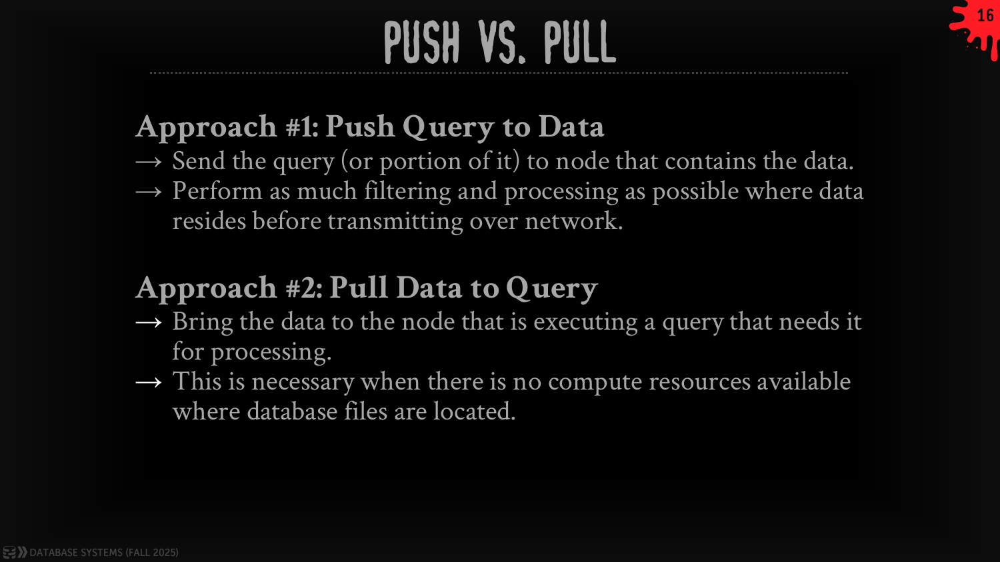


**[拉取数据到查询](#拉取数据到查询)（Pull Data to Query）**：把数据搬到正在执行查询的节点上处理。当数据文件所在的位置没有可用的计算资源时，只能这么做。

两者的区别在于网络上传输的是什么：推送传的是计算的结果，拉取传的是原始数据。设一个查询要扫描存放在远端的 1 PB 数据，即使网卡以 100 Gb/s 跑满：

```math
\frac{8 \times 10^{15}\ \text{bit}}{10^{11}\ \text{bit/s}} = 8 \times 10^{4}\ \text{s} \approx 22\ \text{h}
```

分子是 1 PB 换算成的比特数，分母是 100 Gb/s。仅传输就要将近一天。如果[谓词](#谓词)只保留 1% 的数据，并且过滤在存储一侧完成，传回的只有 10 TB，大约 13 分钟。

存储层有时也能做计算，这让推和拉的界线变得模糊。Amazon S3 曾提供一项名为 S3 Select 的功能：向 S3 请求一个对象时，可以附带一条简单的 SQL，S3 在存放数据的服务器上先做过滤，只把满足条件的部分传回。它做不了[连接](#连接)之类的复杂计算，但足以把[谓词下推](#谓词下推)（Predicate Pushdown，见第 [15](../L15/index.md) 讲）到存储层，减少从 S3 传出数据所产生的网络流量费用。AWS 目前已不再向新客户提供 S3 Select，已有客户仍可继续使用。至于为什么停掉，Andy 表示不清楚；他认为从[数据库](#数据库)的角度看，这项功能非常有用，只是不知道有多少系统真正用上了它。

有学生指出，这样一来[数据库](#数据库)的一个核心组件就落到了自己的控制之外。Andy 承认这里的矛盾：他整个学期都在强调不要信任操作系统，因为它总会把事情搞砸，现在却在说去信任 Amazon。[^os] 他的回答是要看做什么。对简单的过滤，这样做可能是划算的：假设你的机器只有 20 个核，同时向 S3 发出 1000 个请求，每个请求都在存储一侧并行过滤，效果相当于临时借用了上千个核。当然这些计算要付费，自己算也许更便宜；但自己算就要先支付把数据从 S3 搬出来的费用，搬出来之后可以缓存在本地 SSD 上，缓存又要占用空间，还可能被后来读进来的数据挤出去。这些权衡和[缓冲池](#缓冲池)里的权衡是同一类问题，只是每一项都标上了价格。

[^os]: 原话：“I know I made a big deal saying don't trust the OS. They're always going to ruin our lives. And now I'm saying, go trust Amazon.”

没有 S3 Select，也能少读数据。数据放在 S3 上，并不改变我们之前学过的原则：[索引](#索引)、[过滤器](#过滤器)、[谓词下推](#谓词下推)、[投影下推](#投影下推)照样适用，前提是[数据库](#数据库)掌握足够的元数据，知道每个存储桶里有什么。比如为每个数据块记录各列的最小值和最大值（这种元数据称为[区域映射](#区域映射)，zone map，见第 [13](../L13/index.md) 讲），查询条件是 `year = 2025`，而某个块中 `year` 的范围是 1990 到 2000，这个块就不必读取。即使拿到的是一批从未见过的 Parquet 文件（见第 3.3 节），也可以先只读每个文件末尾的[页脚](#页脚)，其中记录了文件的结构和各部分的[统计信息](#统计信息)，大小远小于文件本身，据此再决定是否需要读取文件的其余部分。

### 3.2 一次[连接](#连接)在两种架构下怎样执行

📍 *PPT 第 17–18 页*

来看一条连接查询：

```sql
SELECT * FROM R JOIN S ON R.id = S.id;
```

在[无共享](#无共享)架构中，两个节点的[分区](#分区)方式如下：

| [分区](#分区) | 负责的 R | 负责的 S |
|---|---|---|
| P1 | R.id 1–100 | S.id 1–100 |
| P2 | R.id 101–200 | S.id 101–200 |

查询到达 P1 所在的节点。它不把 P2 上的数据拉过来，而是把一个**[计划片段](#计划片段)（Plan Fragment）**推送给 P2：对 ID 在 [101, 200] 范围内的[元组](#元组)计算 `R ⋈ S`。[计划片段](#计划片段)是[查询计划](#查询计划)的一棵子树，交给另一个节点执行，思路和第 [14](../L14/index.md) 讲并行执行中的[交换算子](#交换算子)一致，只是交换的双方从同一台机器上的线程变成了网络两端的节点。P2 在本地完成这部分[连接](#连接)，把结果发回；P1 同时计算 ID 在 [1, 100] 内的连接，最后把两部分结果合并起来。
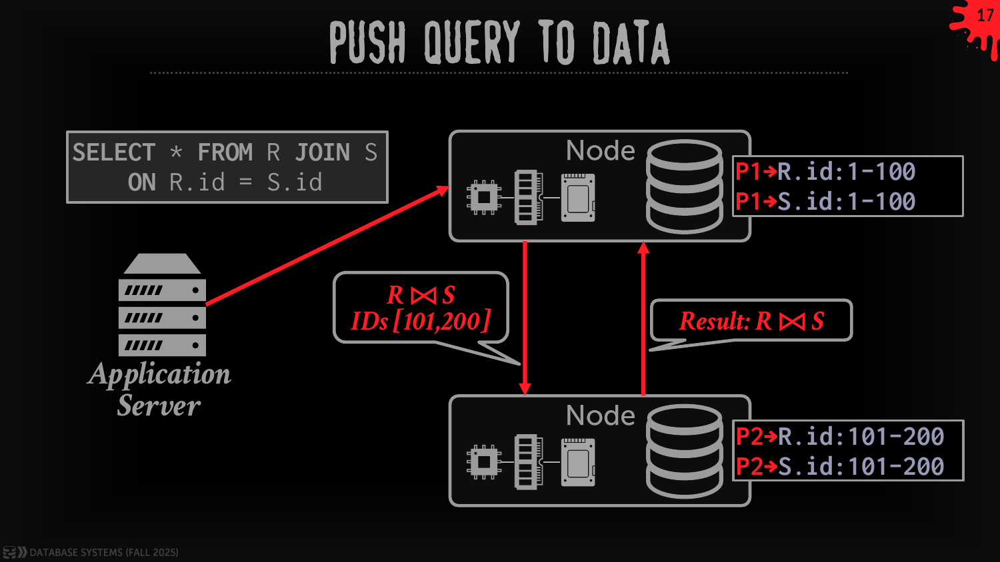


这个例子能如此干净，有一个前提：R 和 S 都按[连接](#连接)键 `id` [分区](#分区)，并且分段方式相同，所以满足 `R.id = S.id` 的两个[元组](#元组)必定落在同一个节点上，每个节点的连接都能在本地完成。如果 S 按别的列[分区](#分区)，P2 计算自己那部分连接时，就需要从其他节点取来 S 的元组。分布式连接如何处理这种情况，是第 [24](../L24/index.md) 讲的内容。

在[共享磁盘](#共享磁盘)架构中，同样的[逻辑分区](#逻辑分区)是 P1 负责 ID 1–100，P2 负责 ID 101–200。查询到达 P1 所在的节点后，这个节点同样把 ID 在 [101, 200] 内的那部分[连接](#连接)作为[计划片段](#计划片段)发给 P2 所在的节点。后者的本地缓存里没有需要的数据，于是它从共享存储取来[页](#页) ABC 和页 XYZ，复制到自己的缓存中，完成连接后把部分结果发回。收到结果的节点把各部分合并，或者继续做查询中剩下的处理。
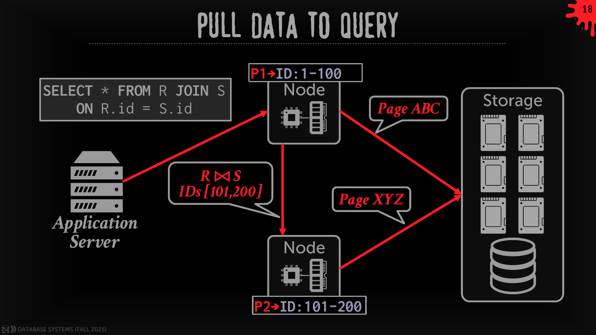


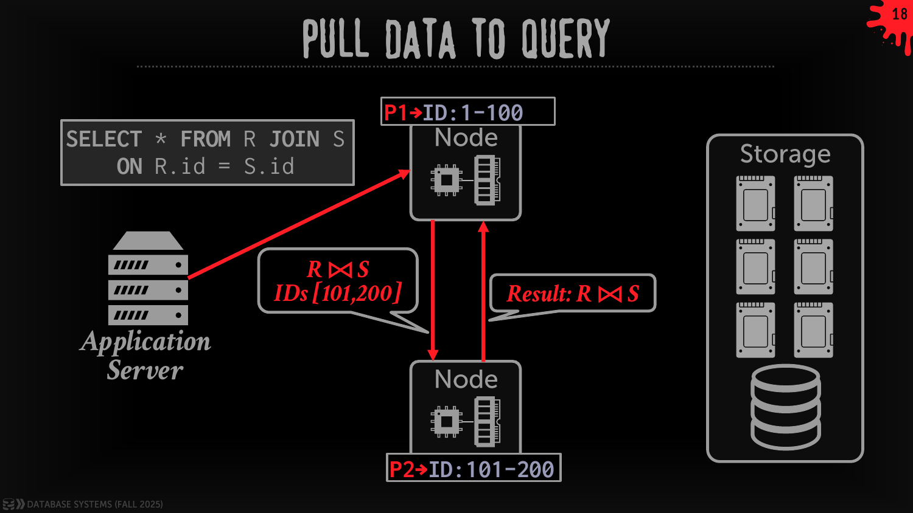


这一次推和拉同时出现了：查询被推给了负责数据的节点，这个节点又从存储把数据拉到自己这里。第一个节点之所以不自己去存储取数据，是因为 P2 负责这段数据，它的缓存里更可能已经有这些[页](#页)，而且对这段数据的更新都先经过它，它手里的版本最新。

### 3.3 云上的数据为什么常是 Parquet 文件

📍 *PPT 第 18–19 页*

讨论[共享磁盘](#共享磁盘)架构时，Parquet 这个名字反复出现。有学生问：整个学期我们都在讲 DBMS 专门设计的文件布局，[页](#页)、[槽式页](#槽式页)、[日志结构存储](#日志结构存储)，为什么到了分布式系统就改用一个通用的开源格式？

Parquet 是一种开源的列式文件格式，在[共享磁盘](#共享磁盘)的分布式分析型系统中非常常见。它的好处是把写数据的程序和查数据的程序解耦了：一个应用可以不经过[数据库](#数据库)服务器，直接把一批 Parquet 文件写进 S3，数据库随后就能在这些文件上执行查询。第 4.1 节提到的以文件为单位的粗粒度[分区](#分区)，分配的往往就是这些文件。Parquet 并没有推翻之前学过的东西，它的内部组织本质上就是第 [6](../L06/index.md) 讲的 [PAX](#PAX) 布局：先按行分成若干[行组](#行组)，每个行组内部再按列存放。而且对[事务](#事务)型[工作负载](#工作负载)来说，数据仍然主要通过 `INSERT` 进入数据库，写进 DBMS 自己的存储格式，这一点没有变。

另一位学生追问：为特定[工作负载](#工作负载)定制的格式，难道不比通用格式更好？Andy 的回答是，如果只为一个应用构建[数据库](#数据库)，完全可以把本学期讲过的每一部分都为它定制到极致；但[通用 DBMS](#通用%20DBMS) 必须服务尽可能多的应用、硬件和运行环境，只能选择一个适用于大多数场景、又不会在某些场景下性能崩溃的方案。Parquet 在 2013 年前后出现时代表了当时的先进水平，因为那时人们普遍用 CSV 或 JSON 存储数据。此后它没有跟上更新的压缩方法和列式数据访问技术，所以才有 Vortex 等新格式试图取代它。在云上的分布式分析型系统中，存储层里放的往往就是一批 Parquet 文件。

## 4. [分区](#分区)：把数据分给谁

📍 *PPT 第 19–25 页*

### 4.1 [分区](#分区)的目标与粒度

📍 *PPT 第 19 页*

**[分区](#分区)（Partitioning）**把[数据库](#数据库)拆分到多个资源上，这些资源可以是磁盘、节点或处理器。NoSQL 系统把它叫作**[分片](#分片)（Sharding）**，两者说的是同一件事。DBMS 收到查询后，先分析执行计划需要访问哪些数据，把[计划片段](#计划片段)分发到各个[分区](#分区)上执行，再把各[分区](#分区)的结果合并成一个答案。

[分区](#分区)方案的目标，是让尽可能多的[事务](#事务)只访问一个[分区](#分区)内的数据。这样的事务不需要和其他节点上的[并发](#并发)事务协调；而一旦事务跨越多个[分区](#分区)，就需要代价高昂的协调（第 7 节）。后面比较各种[分区](#分区)方案时，我们始终拿这个目标来衡量。

[分区](#分区)的粒度可粗可细。细粒度[分区](#分区)在表的内部按某些列的值划分[元组](#元组)，前面例子里按 ID 分段就是如此。粗粒度[分区](#分区)以更大的单位分配数据：可以把整张表甚至整个[数据库](#数据库)交给一个节点；Snowflake 这类云数据仓库则以文件为单位，把 S3 上的一批 Parquet 文件分配给不同的节点负责。无论粒度如何，各[分区](#分区)通常互不相交，查询只需针对整个逻辑数据库编写，由系统负责找到数据、分发[计划片段](#计划片段)、合并结果。

### 4.2 朴素表分区

📍 *PPT 第 20–21 页*

最简单的方案是**[朴素表分区](#朴素表分区)（Naive Table Partitioning）**：把一整张表交给一个节点，比如 Table1 全部放在一个[分区](#分区)上，Table2 全部放在另一个[分区](#分区)上。它假定每个节点都有足够的空间存下一整张表。像 `SELECT * FROM table1` 这样只访问一张表的查询，可以原封不动地路由到一个节点上。这种方案实现起来最容易。
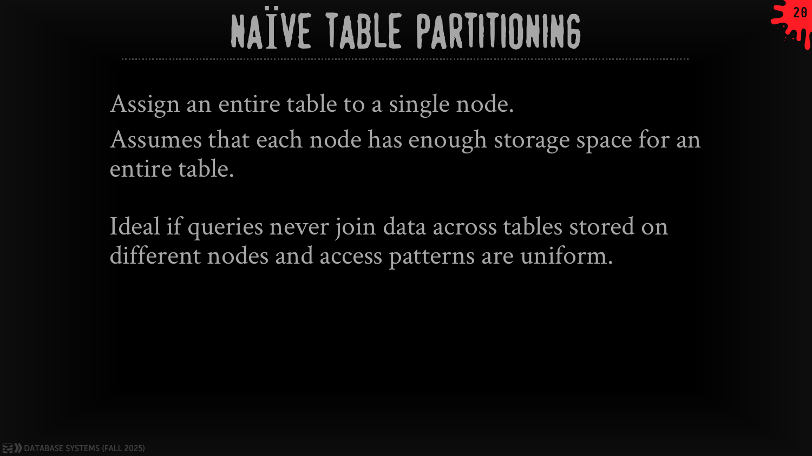

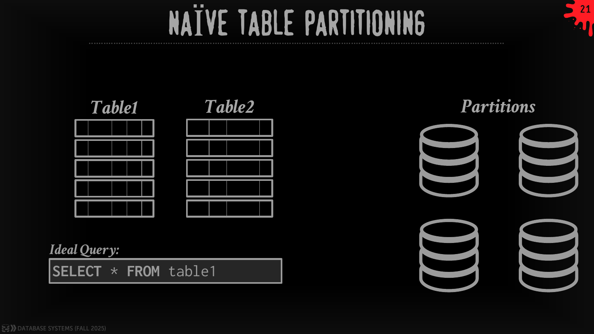

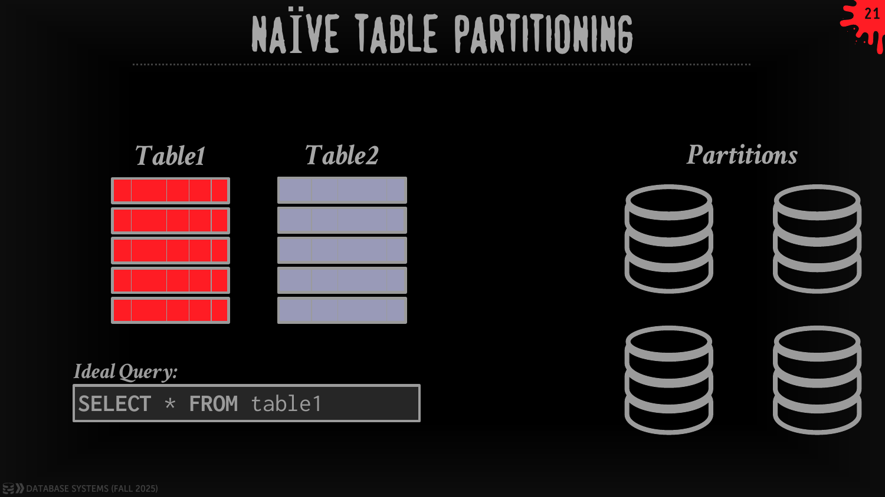

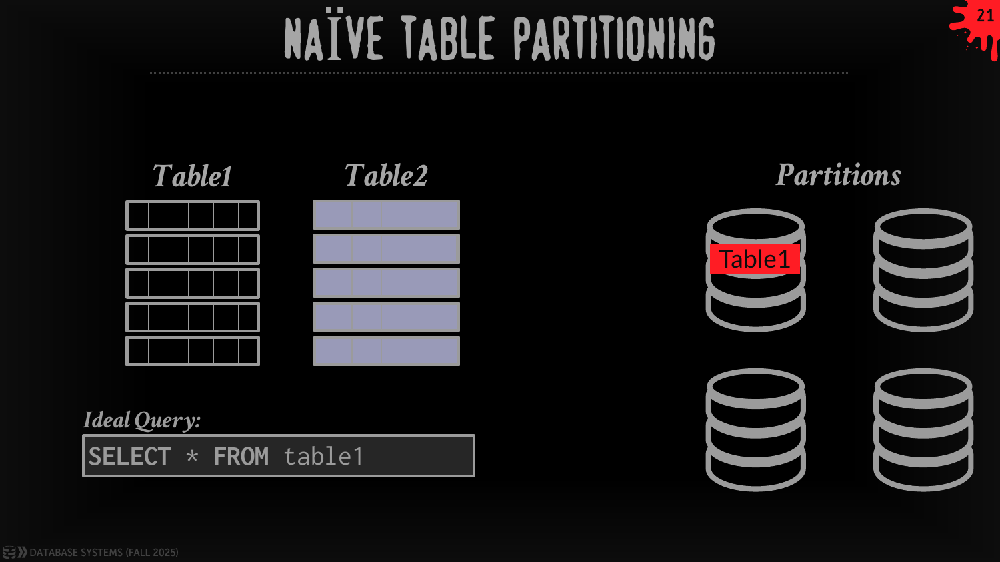

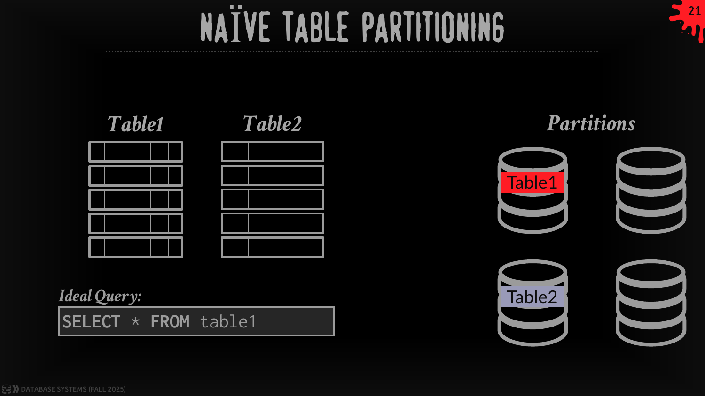


它的理想场景很窄：查询从不[连接](#连接)存放在不同节点上的表，并且各表的访问量大致均匀。一旦出现跨表连接，数据就必须跨节点移动；一旦某张表特别热，存放它的节点就会过载，其他节点却闲着；表再大一些，一个节点就放不下了，只能改用别的方案。

它仍有自己的用处。Andy 遇到过一个 MongoDB 用户：应用的大部分数据按常规方式[分区](#分区)，但有一个集合（collection，MongoDB 对表的叫法）专门记录应用日志，只插入、从不读取。他们把这个集合单独放在一个节点上，让插入尽可能快，也不干扰其他节点上的更新。

另一种变体朝相反的方向走：在每个节点上各放一份整张表的副本。这适合很小、很少更新的表，比如邮政编码表，只有几万行。任何查询需要它时，都能直接使用本地副本，[连接](#连接)不必跨节点。有学生问，这样每次更新不是都要改遍所有节点吗？确实如此，但这类表很少更新，代价可以接受。第 [24](../L24/index.md) 讲讨论分布式分析查询时还会用到这个技巧。

### 4.3 垂直分区

📍 *Lecture Notes 第 4 节（PPT 无对应页）*

**[垂直分区](#垂直分区)（Vertical Partitioning）**把一张表的[属性](#属性)拆到不同的[分区](#分区)上，每个[分区](#分区)还要保存能把各部分重新拼回原始[元组](#元组)的信息，比如元组的标识符。这相当于把第 [6](../L06/index.md) 讲列存储的思想用在了节点这一级。它适合查询只涉及少数几列的场景，也可以把很少访问的大字段（比如大段文本）和经常访问的小字段分开存放。代价是，需要完整元组的查询必须从多个[分区](#分区)取回各列，再拼接起来。

### 4.4 水平分区

📍 *PPT 第 22–23 页*

更常见的是**[水平分区](#水平分区)（Horizontal Partitioning）**：根据某个[分区键](#分区键)和[分区](#分区)方案，把一张表的[元组](#元组)分成互不相交的子集。**[分区键](#分区键)（Partitioning Key）**是用来决定元组去向的一列或几列，通常是[主键](#主键)，但不一定。选择[分区键](#分区键)时，希望它能把[数据库](#数据库)在大小、负载或使用频率上均匀地分开。这几个目标可能互相冲突：一个节点即使只存了很少的数据，如果大部分查询都落到它身上，也不应该再给它分配更多数据，否则它会被压垮。
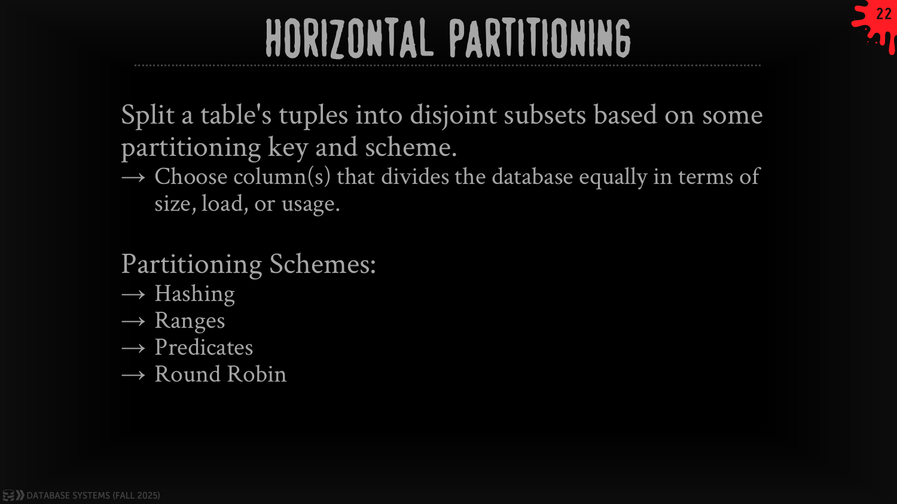


常见的[分区](#分区)方案有四种。

**哈希[分区](#分区)（Hash Partitioning）**：计算[分区键](#分区键)的哈希值，对[分区](#分区)数取模，结果决定[元组](#元组)去哪个[分区](#分区)。

**范围[分区](#分区)（Range Partitioning）**：把[分区键](#分区键)的取值空间切成若干连续区间，每个区间对应一个[分区](#分区)。第 2.2 节的 ID 分段就是[范围分区](#范围分区)。区间怎么切，取决于想要均衡的是什么。

**[谓词](#谓词)[分区](#分区)（Predicate Partitioning）**：用一组 `WHERE` 条件定义[分区](#分区)。比如满足 `name = 'Andy' AND age IN (1, 2, 3)` 的[元组](#元组)去一个节点，满足 `name = 'Andy' AND age IN (4, 5, 6)` 的去另一个节点。这种方案不太常见。

**轮询[分区](#分区)（Round-Robin Partitioning）**：按顺序把[元组](#元组)或文件轮流分给各个节点，第 1 个给节点 1，第 2 个给节点 2，依此类推。

四种方案中，哈希[分区](#分区)和[范围分区](#范围分区)最常见。来看[哈希分区](#哈希分区)的例子。表有四列，取第 2 列作为[分区键](#分区键)，共 4 个[分区](#分区)：

| 第 1 列 | 第 2 列（[分区键](#分区键)） | 第 3 列 | 第 4 列 | `hash(分区键) % 4` |
|---|---|---|---|---|
| 101 | a | XXX | 2025-11-29 | P2 |
| 102 | b | XXY | 2025-11-28 | P4 |
| 103 | c | XYZ | 2025-11-29 | P3 |
| 104 | d | XYX | 2025-11-27 | P2 |
| 105 | e | XYY | 2025-11-29 | P1 |

理想的查询是在 `WHERE` 子句中给出[分区键](#分区键)的具体值：

```sql
SELECT * FROM table WHERE partitionKey = ?
```

系统查看[目录](#目录)，用分配数据时同样的方法计算 `hash(?) % 4`，就知道该去哪个[分区](#分区)找，只需访问一个节点。

换一种查询，哈希[分区](#分区)的弱点就暴露出来了。如果 `WHERE` 子句不包含[分区键](#分区键)，任何一个[分区](#分区)都可能有匹配的[元组](#元组)，查询只能广播给所有节点。即使包含[分区键](#分区键)，如果条件是范围（比如[分区键](#分区键)在 1 到 1000 之间），哈希也帮不上忙：哈希打乱了键原有的顺序，相邻的键值散落在各个[分区](#分区)上。[范围分区](#范围分区)在这一点上正好相反，范围查询只需访问覆盖该范围的少数几个[分区](#分区)。四种方案放在一起比较如下：

| 查询或性质 | 哈希[分区](#分区) | [范围分区](#范围分区) | [谓词](#谓词)[分区](#分区) | [轮询分区](#轮询分区) |
|---|---|---|---|---|
| [分区键](#分区键)等值查询 | 1 个[分区](#分区) | 1 个[分区](#分区) | 与[分区](#分区)谓词吻合时为 1 个[分区](#分区) | 全部[分区](#分区) |
| [分区键](#分区键)范围查询 | 全部[分区](#分区) | 覆盖该范围的[分区](#分区) | 视谓词而定 | 全部[分区](#分区) |
| 不含[分区键](#分区键)的查询 | 全部[分区](#分区) | 全部[分区](#分区) | 视谓词而定 | 全部[分区](#分区) |
| 数据分布 | 键不严重倾斜时均匀 | 取决于区间划分，容易出现热点 | 取决于谓词设计 | 最均匀 |

哈希[分区](#分区)还有一个更严重的问题：节点数量一变，几乎所有数据都要换位置。这是第 5 节的主题。

### 4.5 逻辑分区与物理分区

📍 *PPT 第 24–25 页*

[分区](#分区)在两种架构中的含义不同。

**[逻辑分区](#逻辑分区)（Logical Partitioning）**：节点负责一组键，但并不实际存储它们。[共享磁盘](#共享磁盘)架构通常这样做。数据始终存放在共享存储上，[分区](#分区)只规定了这组键的请求由谁处理、这组键的更新由谁执行。
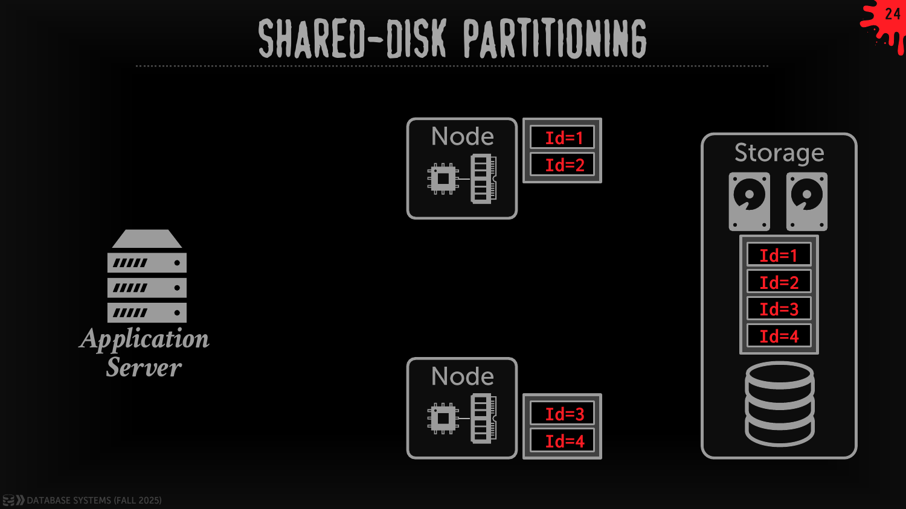


**[物理分区](#物理分区)（Physical Partitioning）**：节点负责一组键，并且物理地存储这些键。[无共享](#无共享)架构通常这样做。
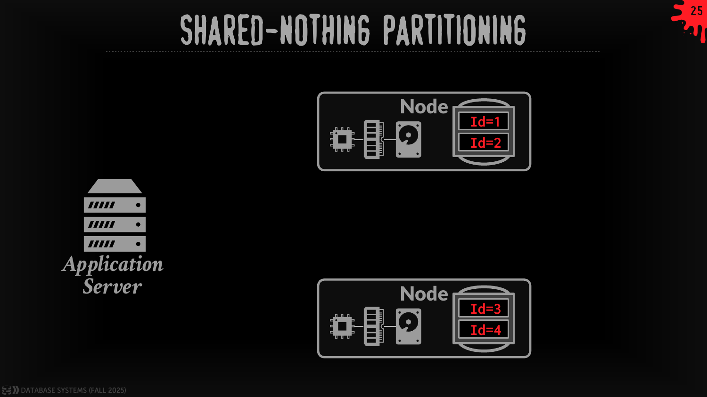


在[共享磁盘](#共享磁盘)架构中，共享存储里存放着 `Id=1` 到 `Id=4` 的全部数据，两个节点各自负责其中一部分。请求 `Id=1` 的查询发给负责它的节点，请求 `Id=3` 的查询也一样。如果一条查询同时需要 `Id=3` 和 `Id=2`，而这两个键归不同的节点负责，收到查询的节点就要和另一个节点通信：要么把查询中涉及另一个键的部分推给对方执行，要么从对方拉取需要的数据，在本地执行。[无共享](#无共享)架构的流程完全相同，区别只在于这些键真正存放在负责它的节点的本地磁盘上。

两者的差别决定了扩容的代价：改变[逻辑分区](#逻辑分区)只需修改[目录](#目录)，改变[物理分区](#物理分区)还要搬动数据。第 2 节两种架构扩容难度不同，根源就在这里。

## 5. 集群规模变化：一致性哈希与会合哈希

📍 *PPT 第 26–28 页*

### 5.1 取模的代价

📍 *PPT 第 26 页*

回到第 4.4 节哈希[分区](#分区)的例子。现在加入第 5 个[分区](#分区)，取模的除数从 4 变成 5：
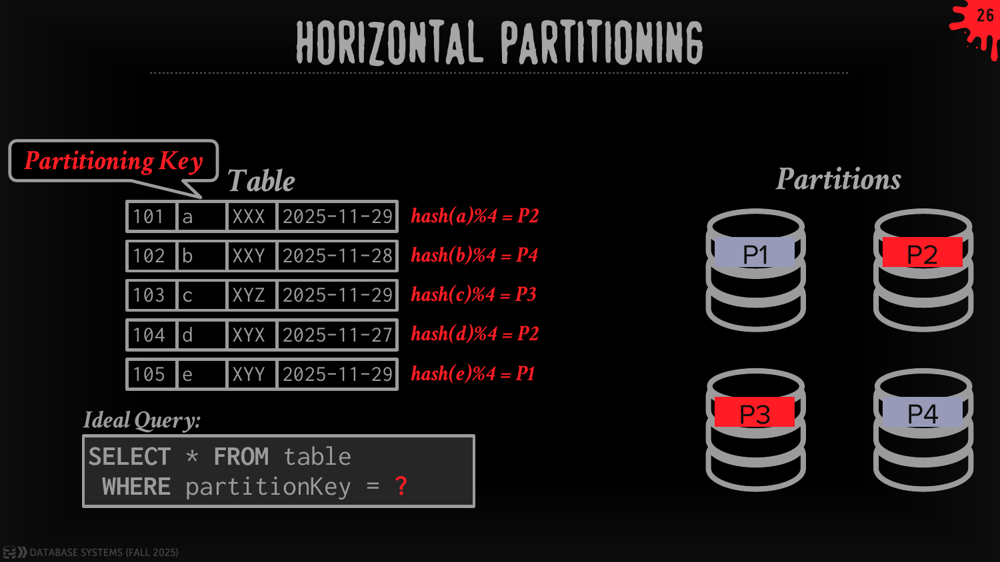

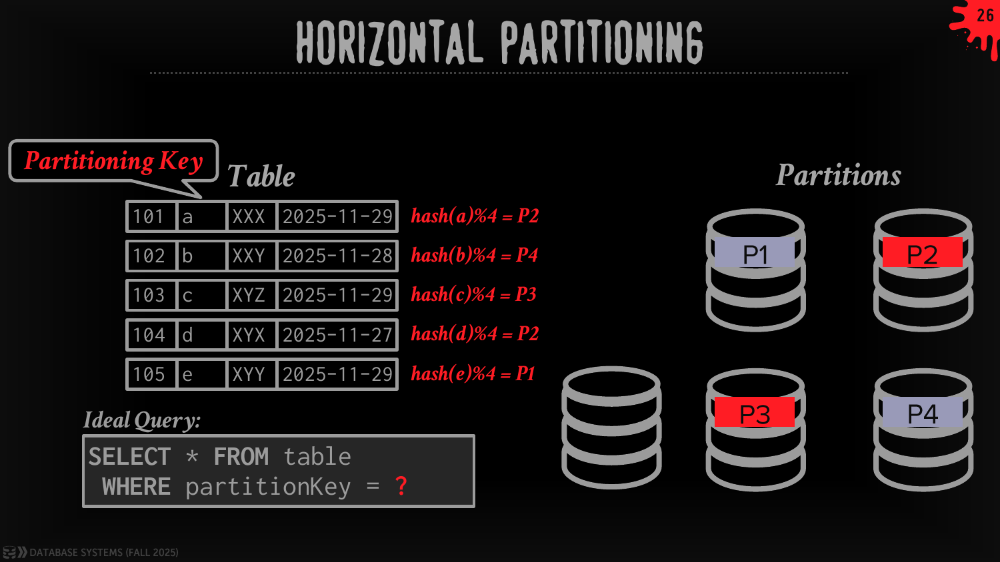


| [分区键](#分区键) | `hash % 4` | `hash % 5` |
|---|---|---|
| a | P2 | P4 |
| b | P4 | P3 |
| c | P3 | P5 |
| d | P2 | P1 |
| e | P1 | P3 |

5 个键全部换了[分区](#分区)。这并非巧合。一个哈希值为 h 的键留在原[分区](#分区)，要求 h mod N 等于 h mod (N+1)。设这个公共余数为 r，则 r < N，并且 h 同时满足 h ≡ r (mod N) 与 h ≡ r (mod N+1)。N 和 N+1 互素，所以这等价于 h ≡ r (mod N(N+1))。在任意连续 N(N+1) 个哈希值中，r 有 N 种取值，每种恰好对应一个 h，因此

```math
P(\text{stay}) = \frac{N}{N(N+1)} = \frac{1}{N+1}
```

其中 N 是原来的[分区](#分区)数，P(stay) 是一个键留在原[分区](#分区)的比例。N = 4 时，只有 1/5 的数据留在原地，80% 要搬走；N = 100 时，99% 要搬走。

再看最少需要搬多少。从 N 个[分区](#分区)扩到 N+1 个，要让每个[分区](#分区)的数据量仍然相等，新[分区](#分区)应该分到全部数据的 1/(N+1)，而这部分数据只能从旧[分区](#分区)搬来。所以理想的迁移量是 1/(N+1)，取模哈希的迁移量 N/(N+1) 恰好是它的 N 倍。

范围[分区](#分区)也有类似的问题。新节点插入后，如果希望各区间仍然大小相当，每一条区间边界都要移动，搬迁不会局限在一两个[分区](#分区)之间。

我们需要一种映射方式，在节点增减时只移动那不可避免的 1/(N+1)。

### 5.2 一致性哈希（Consistent Hashing）

📍 *PPT 第 27 页*

**[一致性哈希](#一致性哈希)（Consistent Hashing）**由 MIT 的 Karger 等人于 1997 年提出，后来 MIT 的 Chord 项目把它用在了点对点网络的查找上。Amazon 在 2007 年发表的 Dynamo 论文采用了它，之后 2010 年前后出现的一批[无共享](#无共享) NoSQL 系统纷纷效仿。在 Andy 看来，这是十年前最热门的技术。

它的做法是把哈希值的取值范围 [0, 1) 首尾相接，看成一个圆环。每个[分区](#分区)也被哈希到环上的某个位置。查找或插入一个键时，先计算它的哈希值，落到环上的某一点，再沿顺时针方向前进，遇到的第一个[分区](#分区)就负责这个键。把环在 0 点处剪开、拉直，就是下面的样子，右端与左端相接：

```text
  0                          0.5                       1.0
  |k1>P1----------P2----------+-------------k2-->P3------|
  clockwise ------------------------------------------->

  k1 = hash(key1), k2 = hash(key2); the right end wraps to the left end
```

每个[分区](#分区)负责它逆时针方向到上一个[分区](#分区)之间的那段弧：P1 负责 (P3, P1]，这段弧跨过了 0 点；P2 负责 (P1, P2]；P3 负责 (P2, P3]。key1 落在 P1 之前，所以归 P1；key2 落在 P3 之前，所以归 P3。

现在在 P2 与 P3 之间加入一个新[分区](#分区) P4：
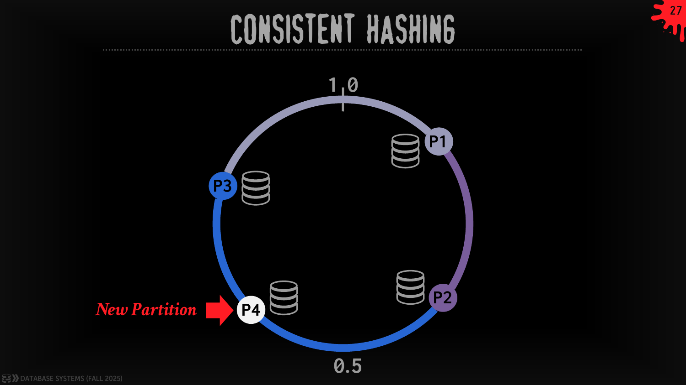


```text
  before:  |---P1----------P2-----------------------------P3------|
                             |<------- owned by P3 ------->|
  after:   |---P1----------P2-------------P4--------------P3------|
                             |<-- by P4 -->|<--- by P3 --->|
```

原来属于 P3 的弧 (P2, P3] 被切成两段：(P2, P4] 交给 P4，(P4, P3] 仍归 P3。需要搬动的只有 (P2, P4] 上的数据，并且只从 P3 搬到 P4，P1、P2 以及环上其他位置都不受影响。之后再加入 P5、P6 也一样，每次只切开一段弧，只在相邻的两个节点之间搬运数据。删除一个节点时，它的弧并入顺时针方向的下一个节点。平均而言，每次变更只移动 1/n 的键，n 是节点数。（建议回看视频：约 PPT 第 27 页附近，环上逐步加入节点的动画比文字直观。）
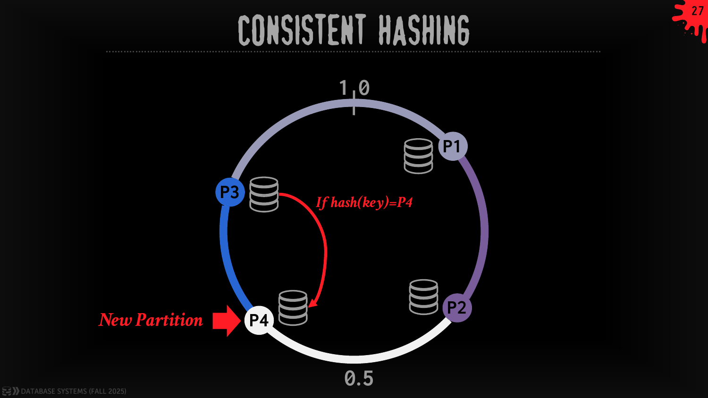

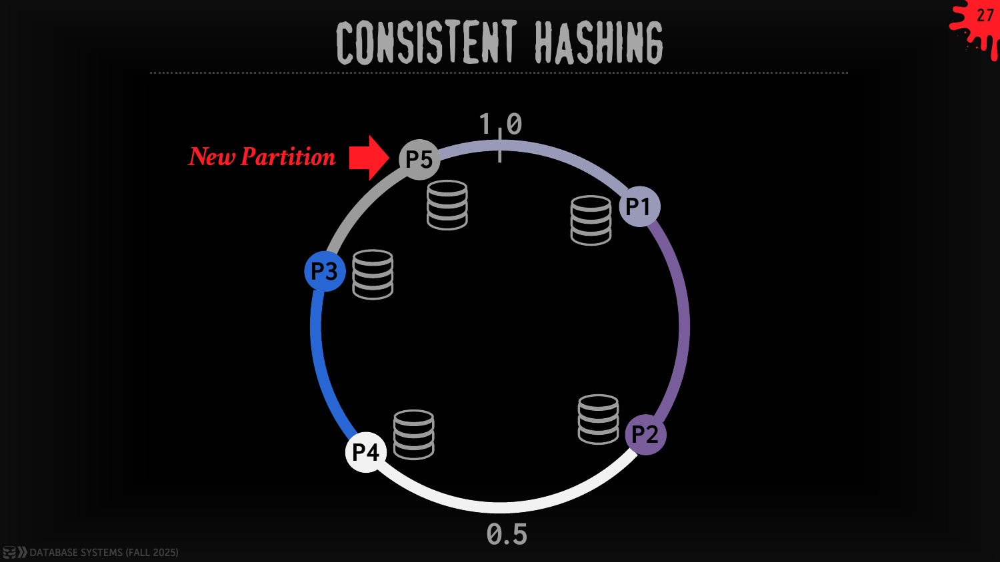

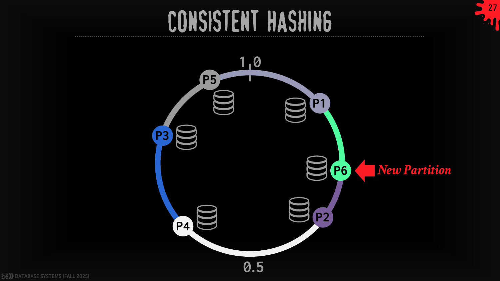


查找时，所有[分区](#分区)在环上的位置保存在一个有序结构里，Andy 提到有的实现用红黑树。给定一个键的哈希值，用二分查找找到它在环上的后继，时间为 O(log n)。这个环本身是需要所有节点保持一致的元数据，它和[目录](#目录)一样需要协调。

这个朴素的版本有一个问题：[分区](#分区)在环上的位置是随机的，弧的长度往往相差很大。可以证明，n 个随机点把单位圆环切成 n 段，最长一段的期望长度是

```math
E[L_{\max}] = \frac{1}{n} \sum_{k=1}^{n} \frac{1}{k}
```

其中 L_max 是最长弧的长度。n = 3 时这个值约为 0.61：只有三个节点的环上，最忙的节点平均要负责六成的键，而不是三分之一。解决办法是**[虚拟节点](#虚拟节点)（Virtual Node）**：每个物理节点在环上占据许多个位置，每个位置负责一段小弧。弧的数量多了，每个物理节点负责的总长度就趋于平均。[虚拟节点](#虚拟节点)还带来两个好处：一个物理节点失效时，它的许多段小弧分别并入各自的后继，负载被分摊到很多节点上，不会全部压在一个邻居身上；配置更高的机器可以分到更多的[虚拟节点](#虚拟节点)。当然，这一切的前提是[分区键](#分区键)本身不严重倾斜，如果所有[元组](#元组)的[分区键](#分区键)都是同一个值，任何[哈希方案](#哈希方案)都无能为力。

环还能顺便决定副本放在哪里。**[复制因子](#复制因子)（Replication Factor）**为 k，表示每个键存放在它顺时针方向最近的 k 个节点上。设环上已有 P1 到 P6 六个[分区](#分区)，[复制因子](#复制因子)为 3。key1 哈希后落在 P1 之前，P1 是它的主存放位置，沿顺时针方向接下来遇到的 P6 和 P2 各存一份副本。查找 key1 时，可以访问这三个[分区](#分区)中的任何一个。在 NoSQL 系统中，写入 P1 的数据通常不会立即传播到 P6 和 P2，于是从副本读到的可能是旧值，这正是第 6.3 节要讨论的一致性问题。

使用[一致性哈希](#一致性哈希)的系统很多，Dynamo、Cassandra、Riak 都用它把数据分配到节点上。它也出现在[共享磁盘](#共享磁盘)系统里：Snowflake 的[查询优化器](#查询优化器)按表文件名做[一致性哈希](#一致性哈希)，把输入文件分配给工作节点，于是后续查询访问同一批文件时会落到同一个节点上，命中它的缓存；工作节点增减时，大部分文件与节点的对应关系保持不变，已经热起来的缓存不会大面积失效。Amazon 自己后来的 DynamoDB 反而没有沿用 Dynamo 的这套设计：2022 年介绍 DynamoDB 的论文描述的是另一种架构，每个[分区](#分区)由一个副本组维护，副本组通过 Multi-Paxos 选举领导者并达成共识。
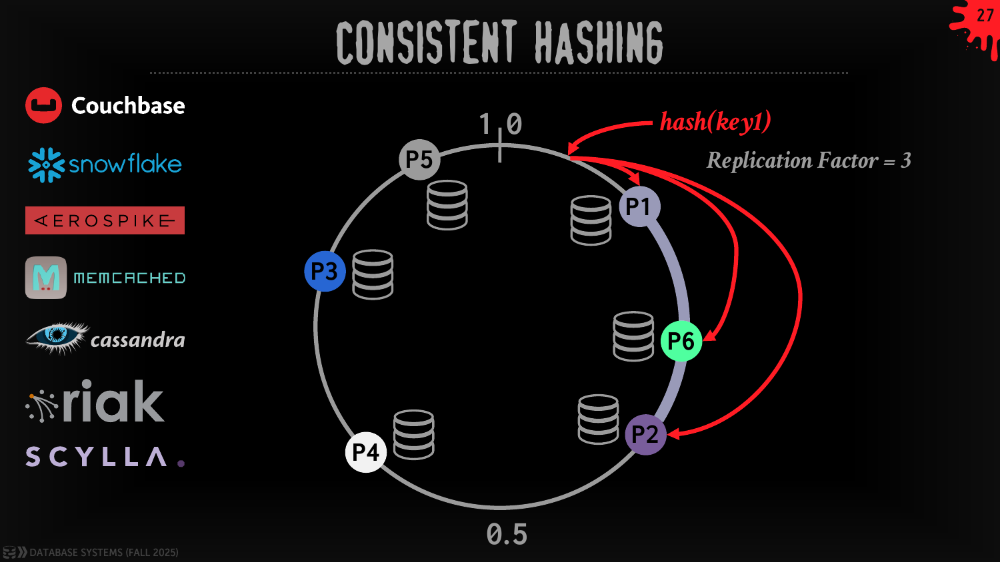


### 5.3 会合哈希（Rendezvous Hashing）

📍 *PPT 第 28 页*

**[会合哈希](#会合哈希)（Rendezvous Hashing）**又称最高随机权重哈希（Highest Random Weight Hashing，[HRW](#会合哈希)），由密歇根大学的 Thaler 和 Ravishankar 于 1996 年提出，比[一致性哈希](#一致性哈希)早一年。它的规则只有一条：对键 k 和每个[分区](#分区)标识 p，把两者拼接起来计算哈希值 h(k‖p)，作为 p 对 k 的得分，得分最高的[分区](#分区)赢得这个键。

以键 a 为例：hash(a + node1) = 100，hash(a + node2) = 90，hash(a + node3) = 80，node1 得分最高，a 分配给 node1。对每个键都这样算一遍，就得到它对所有节点的排名：

| 键 | 第 1 名 | 第 2 名 | 第 3 名 | 加入 node4 后的第 1 名 |
|---|---|---|---|---|
| a | node1 | node2 | node3 | node1 |
| b | node2 | node3 | node1 | node2 |
| c | node3 | node1 | node2 | node3 |
| d | node2 | node3 | node1 | **node4** |

加入 node4 后，每个键多算一个得分 h(k‖node4)，原有的得分不变。一个键换节点，当且仅当这个新得分超过了它原来的最高分，而且它只会换到 node4，绝不会在旧节点之间挪动。表中只有 d 的 node4 得分最高，于是只有 d 需要搬到新节点，a、b、c 原地不动。哈希值随机时，新节点在 n+1 个得分中排第一的概率是 1/(n+1)，所以迁移量恰好是第 5.1 节算出的理想值。删除一个节点时，只有以它为第一名的键需要搬迁，并且直接搬到各自的第二名。排名还顺便给出了副本的位置：排名前 k 的节点就是存放 k 份副本的地方。
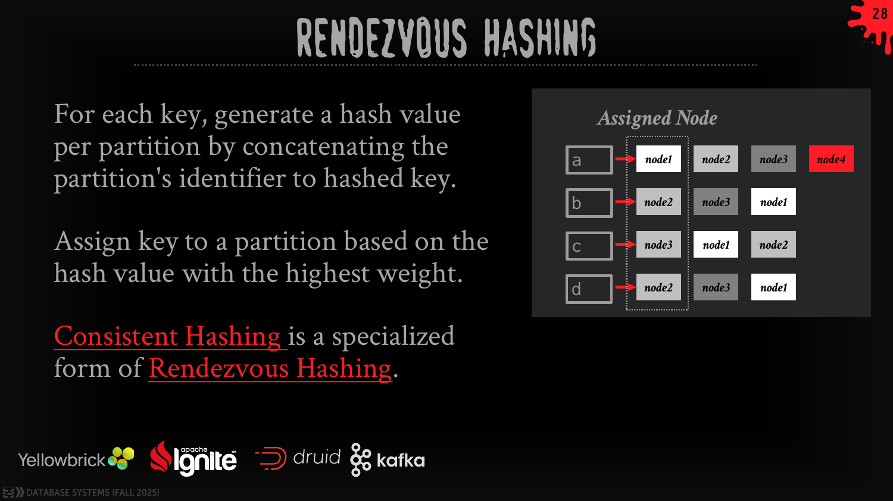

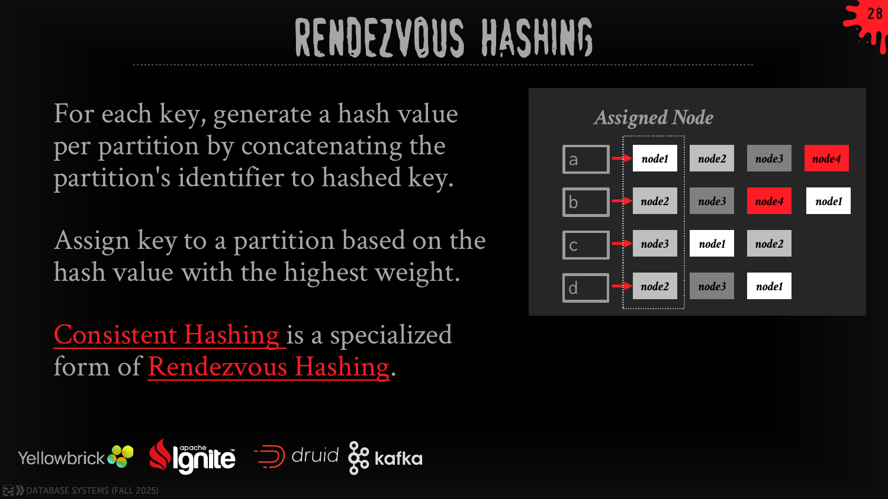

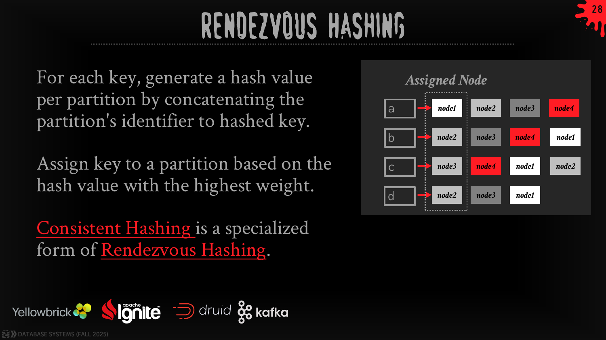

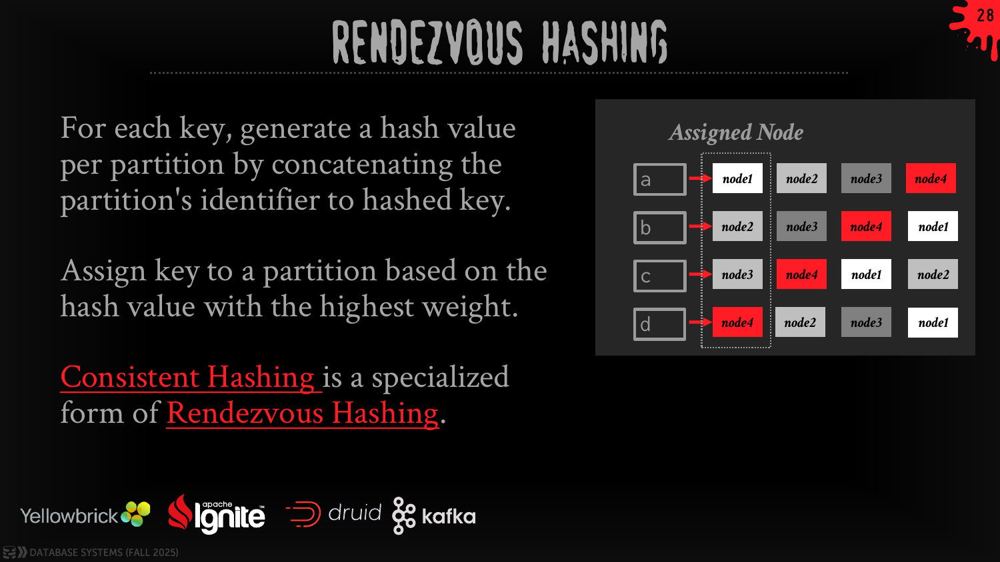


用 C 写出来，查找只是一个求最大值的循环：

```c
#include <stdint.h>

// hash2() can be any good 64-bit hash of the pair (key, node_id).
uint64_t hash2(uint64_t key, uint64_t node_id);

// Returns the index of the node that owns `key`.
int hrw_owner(uint64_t key, const uint64_t *node_ids, int n) {
    int best = 0;
    uint64_t best_score = hash2(key, node_ids[0]);
    for (int i = 1; i < n; i++) {
        uint64_t score = hash2(key, node_ids[i]);
        if (score > best_score) {
            best_score = score;
            best = i;
        }
    }
    return best;
}
```

所有节点只需要就当前有哪些节点达成一致，不需要维护环这样的共享数据结构，映射也很稳定。代价是每次查找都要计算 n 个哈希值，时间为 O(n)，而[一致性哈希](#一致性哈希)只要 O(log n)。

[一致性哈希](#一致性哈希)可以看作[会合哈希](#会合哈希)的一种特化形式。把[一致性哈希](#一致性哈希)改写成打分的形式，就能看出这一点。令 pos(p) 为[分区](#分区) p 在环上的位置，定义得分为

```math
\mathrm{score}(k, p) = -\big( (\mathrm{pos}(p) - h(k)) \bmod 1 \big)
```

括号里是从键的位置出发，顺时针走到[分区](#分区) p 的距离，取负号后，距离越近得分越高。得分最高的[分区](#分区)就是顺时针方向最近的[分区](#分区)，这正是[一致性哈希](#一致性哈希)的规则。一般的[会合哈希](#会合哈希)中，每个[分区](#分区)的得分彼此独立、各自随机，无法事先排好序，只能逐个计算；[一致性哈希](#一致性哈希)选用的这个特殊得分函数完全由环上的位置决定，可以预先把位置排好序，再用二分查找找出得分最高者，查找因此从 O(n) 降到了 O(log n)。它也因此继承了环的缺点：得分由随机位置决定，弧长不均，需要[虚拟节点](#虚拟节点)来补救；而在[会合哈希](#会合哈希)中，每个节点赢得任意一个键的概率天然相等。

## 6. 复制：一个节点坏了怎么办

📍 *PPT 第 29–36 页*

[分区](#分区)解决了存不下的问题，却让故障的影响更大了：每段数据只存在一个节点上，这个节点一宕机，这段数据就无法访问，而节点越多，其中某个节点出故障的概率越大。解决办法是**[复制](#复制)（Replication）**：DBMS 把[数据库](#数据库)[复制](#复制)到多个冗余节点上，以提[高可用](#高可用)性。某个节点崩溃时，系统不必停下来等它恢复，可以继续运行。

[复制](#复制)与前面的选择相互独立：[分区](#分区)或不[分区](#分区)的[数据库](#数据库)，[无共享](#无共享)或[共享磁盘](#共享磁盘)的架构，都可以[复制](#复制)。Andy 指出，世界上运行在两台以上机器上的数据库，大多数并没有做[分区](#分区)，只做了最基本的[复制](#复制)：每个节点仍是一台[全共享](#全共享)的单机 DBMS，主节点把变更传播给一个或多个副本节点，主节点宕机时，把一个副本提升为新的主节点。企业里运行的大多数 PostgreSQL 实例就是这样部署的。

设计一个[复制](#复制)方案，要依次决定副本的配置、变更传播的方式与时机，以及副本应用更新的方法，下面四个小节各讨论其中一项。

### 6.1 副本配置：主副本与多主

📍 *PPT 第 30–31 页*

**[主副本](#主副本)（Primary-Replica）**配置中，每个数据对象都有一个指定的主节点，对该对象的所有更新都必须发给它。主节点通过传送[日志](#日志)把更新传播给它的副本。只读[事务](#事务)可以被允许访问副本。主节点宕机时，系统举行一次选举，选出新的主节点。

传送[日志](#日志)这个做法值得停下来看一眼。副本收到的是主节点的[预写日志](#预写日志)（第 [21](../L21/index.md) 讲），它把日志记录依次应用到自己的数据上，这和第 [22](../L22/index.md) 讲[恢复算法](#恢复算法)的[重做阶段](#重做阶段)几乎是同一件事：[重做](#重做)发生在崩溃之后的同一台机器上，[复制](#复制)则持续地发生在另一台机器上。

把只读查询交给副本执行，可以减轻主节点的负担，让写操作尽可能快。代价是，取决于变更传播的方式（第 6.3 节），副本上的数据可能落后于主节点，读到的是旧值。有些应用可以容忍这一点。

为什么需要**[领导者选举](#领导者选举)（Leader Election）**？主节点宕机后，如果两个副本都认为应该由自己接任，系统里就会出现两个主节点，各自接受写入，数据从此分叉。选举保证只有一个副本胜出。Andy 把它描述成一次[事务](#事务)：系统中有一张表记录每个对象的主节点是谁，选举就是原子地更新这张表。在节点可能失联、可能“假死”的网络里做到这一点，需要 Paxos、Raft 这样的共识协议，这是第 [24](../L24/index.md) 讲的内容。

**[多主](#多主)（Multi-Primary）**配置中，[事务](#事务)可以在任何一个副本上更新数据对象，各副本之间必须用原子提交协议相互同步。难点在于[冲突](#冲突)：两个节点同时更新同一个对象，哪一个版本应该成为最终[提交](#提交)的结果？课上有学生请 Andy 举个例子。设想你和我同时各写两个对象，并且要求[可串行化](#可串行化)，那么最终结果要么全是你的写入，要么全是我的写入，不能各占一半。两个事务中必须有一个失败，而判定谁失败，靠的仍然是[两阶段锁](#两阶段锁)或[乐观并发控制](#乐观并发控制)（第 [18](../L18/index.md)、[19](../L19/index.md) 讲），只是现在要跨节点执行。[多主](#多主)配置下，每个主节点也可以各自带着自己的副本，两种配置并不互斥。

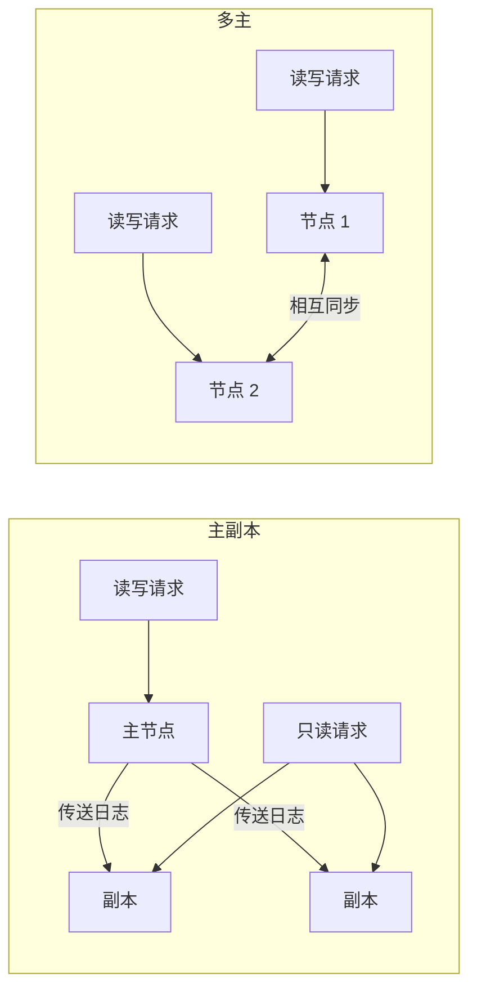

### 6.2 K-安全（K-Safety）

📍 *PPT 第 32 页*

**[K-安全](#K-安全)（K-Safety）**是衡量[复制](#复制)[数据库](#数据库)容错能力的一个阈值：K 表示每个数据对象必须始终保持可用的副本数。可用副本数一旦低于这个阈值，DBMS 就停止执行，自行下线。

设每个对象有 3 份副本，K = 2。一个节点宕机，还剩 2 份，不低于 K，系统继续运行；第二个节点也宕机，只剩 1 份，低于 K，系统停止接受更新。

主动下线看起来是在放弃可用性，理由是：如果只剩最后一份副本还在接受写入，它再坏一次，这些已经[提交](#提交)的写入就永远丢失了。与其冒这个险，不如先停下来，等其他副本恢复。这是用可用性换取[持久性](#持久性)。

不同系统对 K 的定义并不统一。本课程中 K 是必须存活的副本数；Vertica 等系统则把 K 定义为系统能够容忍失效的节点数，K = 1 表示坏掉一个节点仍能运行。读具体系统的文档时，要先确认它用的是哪一种定义。

### 6.3 传播方式：同步还是异步

📍 *PPT 第 33–34 页*

[事务](#事务)在[复制](#复制)的[数据库](#数据库)上[提交](#提交)时，DBMS 要决定：在向应用程序确认提交之前，是否等待这个事务的变更传播到其他节点。
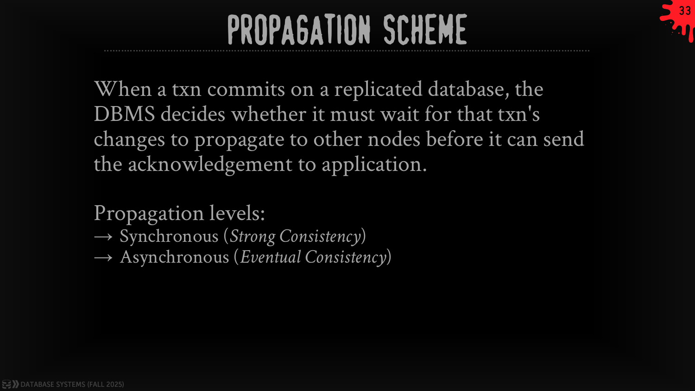


**[同步传播](#同步传播)（Synchronous Propagation）**提供**[强一致性](#强一致性)（Strong Consistency）**：主节点把更新发给副本，然后等待副本确认已经完整地应用了这些变更，也就是已经写入[日志](#日志)并落盘。

**[异步传播](#异步传播)（Asynchronous Propagation）**提供**[最终一致性](#最终一致性)（Eventual Consistency）**：主节点立即向客户端返回确认，不等副本应用变更。

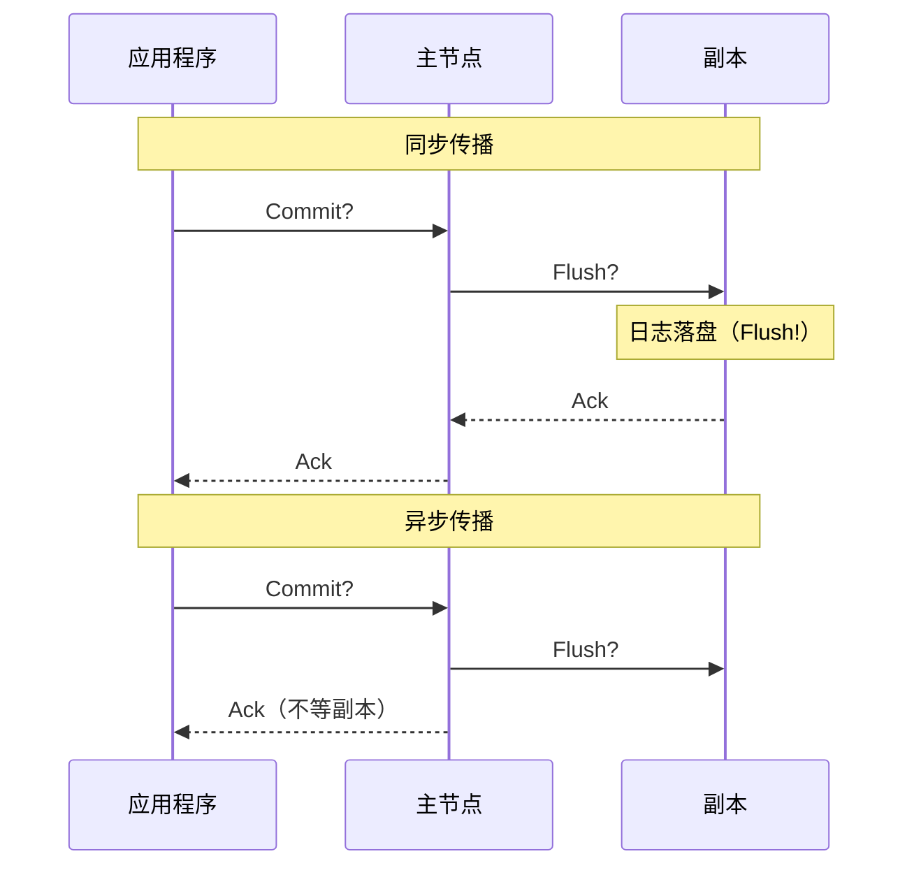

[同步传播](#同步传播)中，只有副本确认[日志](#日志)已经落盘，主节点才告诉外界[事务](#事务)已[提交](#提交)。有多个副本时，要求[强一致性](#强一致性)就需要所有副本都同意这个事务提交，具体怎么做是第 [24](../L24/index.md) 讲的内容。这样，即使主节点随后宕机，已提交的变更在副本上也有一份。
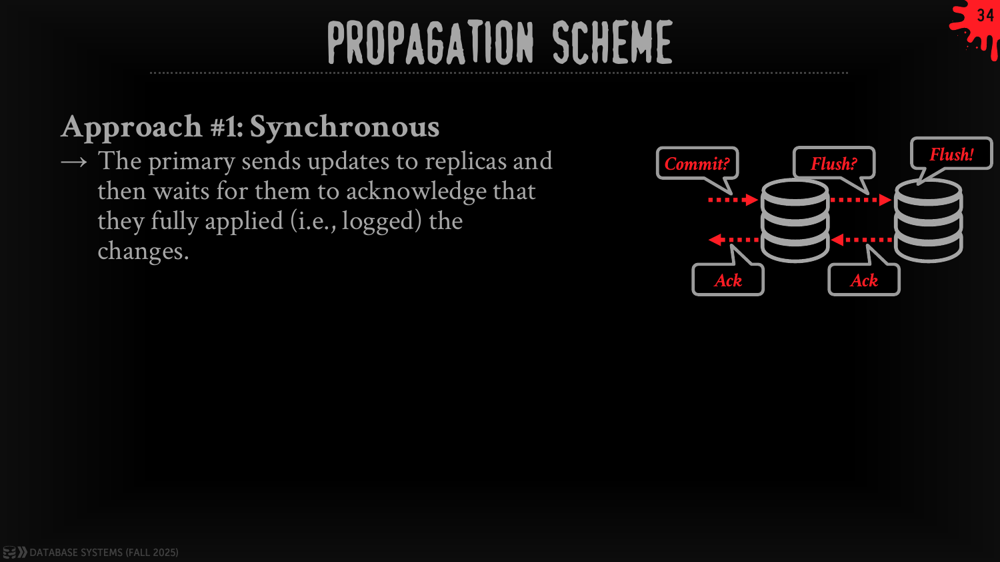


[异步传播](#异步传播)省掉了这段等待，也留下了一个窗口。下面一步步看它怎样丢失数据（[无共享](#无共享)架构，[日志](#日志)存放在各节点的本地磁盘上）：

| 步骤 | 应用程序 | 主节点 | 副本 |
|---|---|---|---|
| 1 | 发出 `COMMIT` | | |
| 2 | | [日志](#日志)写入本地磁盘，把变更发给副本 | |
| 3 | 收到“已[提交](#提交)” | 不等副本，立即确认 | 变更尚未落盘 |
| 4 | | 机器彻底损坏，本地磁盘上的日志随之消失 | |
| 5 | | | 被提升为新的主节点，其中没有这笔[事务](#事务) |
| 6 | 读取刚才提交的数据，发现它不存在 | | |

应用程序得到了“已[提交](#提交)”的确认，这笔[事务](#事务)却从系统中消失了。第 [21](../L21/index.md) 讲花了一整讲来保证提交的事务不会因崩溃而丢失，而节点一旦彻底损坏，异步[复制](#复制)就绕开了这个保证。

NoSQL 系统普遍采用[异步传播](#异步传播)，因为它们不想让写入等待副本，而且早期的 NoSQL 系统本来就没有真正的[事务](#事务)概念。如果在意数据不丢，就应该用[同步传播](#同步传播)。两者之间还有折中：比如一个主节点带三个副本，只要其中任意两个确认落盘，就向外界确认[提交](#提交)，不必等最慢的那一个。PostgreSQL 的 `synchronous_standby_names = 'ANY 2 (s1, s2, s3)'` 就是这种配置。

有学生问，[同步传播](#同步传播)是不是就是两阶段提交？两阶段提交是实现它的方式之一，它们的核心思想相同：在告诉外界[提交](#提交)成功之前，先等所有相关节点都回复“收到了”。两阶段提交将在第 [24](../L24/index.md) 讲讲解。

### 6.4 传播时机：持续传播与[提交](#提交)时传播

📍 *PPT 第 35 页*

**[持续传播](#持续传播)（Continuous Propagation）**：DBMS 每生成一条[日志](#日志)记录，就立即发给副本。[事务](#事务)结束时，还要再发一条[提交](#提交)或[中止](#中止)消息。

**[提交](#提交)时传播（On-Commit Propagation）**：DBMS 只在[事务](#事务)提交时，才把它的全部[日志](#日志)记录发给副本。

[持续传播](#持续传播)把传输分摊到了[事务](#事务)执行的过程中，[提交](#提交)时只需再发一条提交消息，副本早已应用了大部分变更，确认很快。代价是，事务如果最终[中止](#中止)，副本已经应用的变更还要[撤销](#撤销)，那些为中止事务传送的[日志](#日志)也白白浪费了。[提交时传播](#提交时传播)不会在中止的事务上浪费任何传输，也永远不需要让副本[回滚](#回滚)；但所有日志集中在提交那一刻发送，副本要花更长时间应用，提交就要等得更久。PostgreSQL 的流[复制](#复制)属于前者，它把[预写日志](#预写日志)连续地发给副本，其中也包括尚未提交的事务的记录；MySQL 的二进制日志属于后者，一个事务的变更先缓存起来，提交时才写入二进制日志，再由副本拉取。

### 6.5 更新方法：主动-主动与主动-被动

📍 *PPT 第 36 页*

**[主动-主动](#主动-主动)（Active-Active）**：[事务](#事务)在每个副本上各自独立执行，最后检查它在每个副本上是否得到了相同的结果。

**[主动-被动](#主动-被动)（Active-Passive）**：[事务](#事务)只在一个位置执行，再把产生的变更传播给副本。传播的可以是物理层面的变更，也可以是逻辑层面的变更，分别称为**[物理复制](#物理复制)（Physical Replication）**和**[逻辑复制](#逻辑复制)（Logical Replication）**。

[主动-主动](#主动-主动)之所以要在最后检查结果，是因为同一个[事务](#事务)在不同机器上执行，未必得到同样的结果：`NOW()`、`RANDOM()` 这类函数在每台机器上返回不同的值，[并发](#并发)事务的交错顺序也可能不同。[主动-被动](#主动-被动)避开了这个问题，副本不重新计算，只照抄结果。[物理复制](#物理复制)传送的是[页](#页)与字节层面的变更，比如 PostgreSQL 的流[复制](#复制)直接传送[预写日志](#预写日志)，副本的存储格式必须与主节点完全一致；[逻辑复制](#逻辑复制)传送的是“哪一行的哪一列改成了什么”，PostgreSQL 的[逻辑复制](#逻辑复制)就是如此，它可以在不同版本之间[复制](#复制)，也可以只[复制](#复制)部分表。

这组概念容易和第 6.1 节混淆。[主副本](#主副本)与[多主](#多主)回答的是“谁可以接受写入”；[主动-主动](#主动-主动)与[主动-被动](#主动-被动)回答的是“副本怎样获得新的状态”，是自己重新执行，还是接收执行的结果。两者是不同维度上的选择。这个区分在后面的[分布式事务](#分布式事务)里不再单独展开。

## 7. 跨节点的[事务](#事务)由谁来协调

📍 *PPT 第 37–41 页*

### 7.1 单节点事务与分布式事务

📍 *PPT 第 37 页*

**[单节点事务](#单节点事务)（Single-Node Transaction）**只访问一个[分区](#分区)内的数据。DBMS 可能不需要检查其他节点上[并发](#并发)运行的[事务](#事务)，每个节点运行自己的本地[并发控制协议](#并发控制协议)，事务[提交](#提交)后就结束了（这里暂不考虑[复制](#复制)）。

**[分布式事务](#分布式事务)（Distributed Transaction）**访问一个或多个[分区](#分区)上的数据，需要代价高昂的协调：参与的节点必须一致同意这个[事务](#事务)[提交](#提交)，任何一个节点单方面提交或[中止](#中止)，都会破坏[原子性](#原子性)。第 4.1 节说[分区](#分区)方案要尽量让事务只访问一个[分区](#分区)，原因就在这里。

### 7.2 集中式协调者

📍 *PPT 第 38–39 页*

如果 DBMS 支持包含多个操作的[事务](#事务)以及[分布式事务](#分布式事务)，就需要一种机制来协调它们的执行。有两种做法。**[集中式协调者](#集中式协调者)（Centralized Coordinator）**是一个全局的“交通警察”，掌握系统中所有正在运行的事务，[锁](#锁)也可以集中存放在它那里。**[去中心化协调](#去中心化协调)（Decentralized Coordination）**则由节点自行组织。大多数[分布式 DBMS](#分布式%20DBMS) 采用混合做法：定期选举某个节点，担任临时的协调者。

[集中式协调者](#集中式协调者)处理一个访问[分区](#分区) P1、P3、P4 的[事务](#事务)，流程如下：
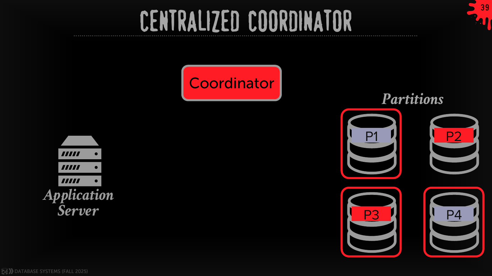


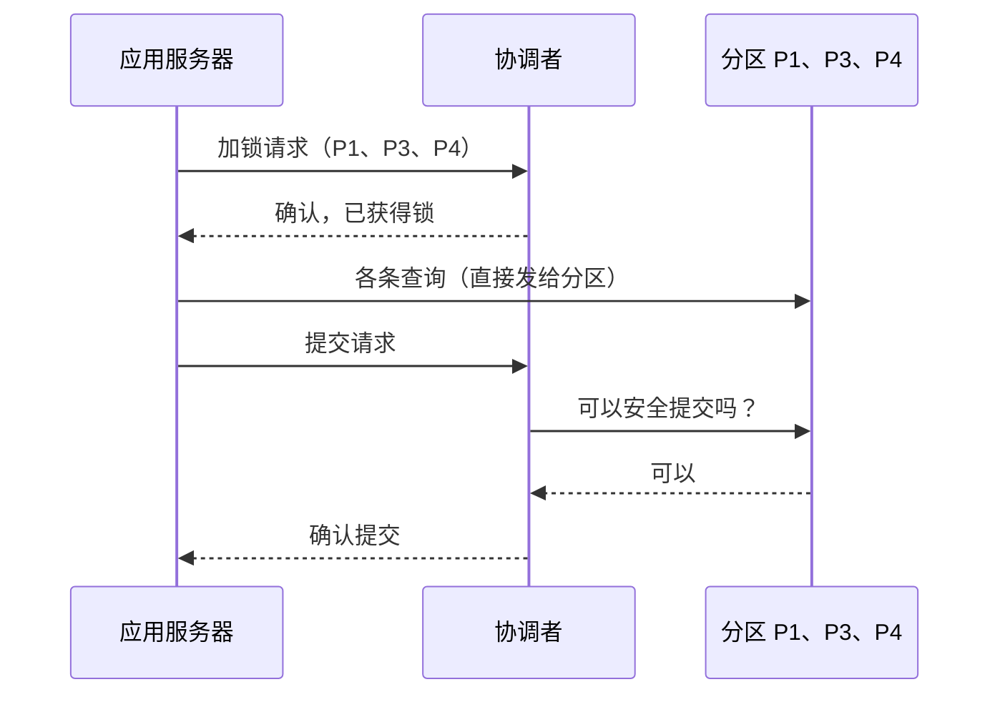

应用程序先向协调者申请[锁](#锁)。锁请求可以由协调者解析查询后自动得出，也可以由应用程序显式声明要锁哪些[分区](#分区)的哪些范围或值。协调者记录锁的信息并返回确认后，应用程序把查询直接发给相应的[分区](#分区)执行。[提交](#提交)时，应用程序向协调者发出提交请求，协调者逐一询问参与的[分区](#分区)“可以安全提交吗”。每个[分区](#分区)仍然运行自己的本地[并发控制协议](#并发控制协议)，由它判断这个[事务](#事务)能否提交。所有[分区](#分区)都回答可以之后，协调者才告诉应用程序提交成功。
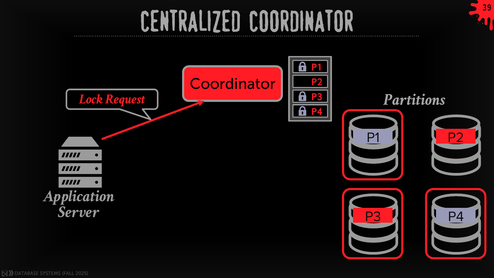

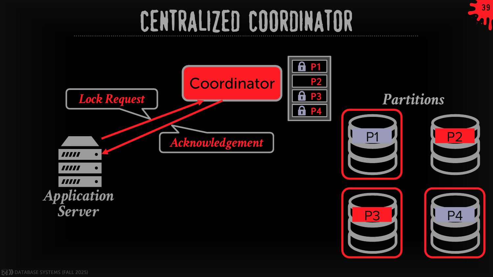


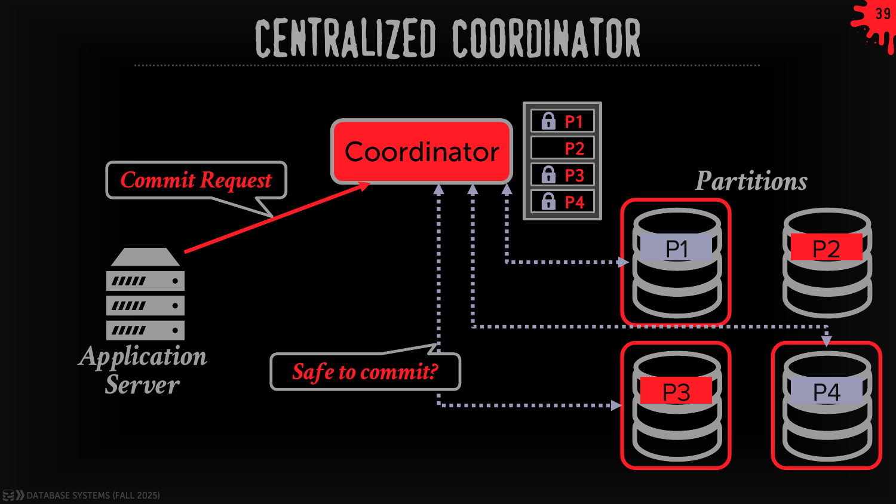


1980、1990 年代，人们正是这样构建分布式[数据库](#数据库)的。这类产品称为 **[TP 监视器](#TP%20监视器)（TP Monitor）**，它是一种[集中式协调者](#集中式协调者)，负责在多个节点上执行[分布式事务](#分布式事务)。1990 年代还出现过一个标准化的尝试，X/Open XA：它规定了 [TP 监视器](#TP%20监视器)与各个数据库之间的接口，使一个协调者能够让不同厂商的数据库一起参与同一个[分布式事务](#分布式事务)的[提交](#提交)，而每个数据库内部仍然运行自己的[并发](#并发)控制。XA 用两阶段提交来完成这件事，我们将在第 [24](../L24/index.md) 讲详细讨论。这类产品包括 Tuxedo、Transarc 的 Encina，以及为 HBase 提供[事务](#事务)支持的 Apache Omid。Andy 认为，这种方式如今已不常见。
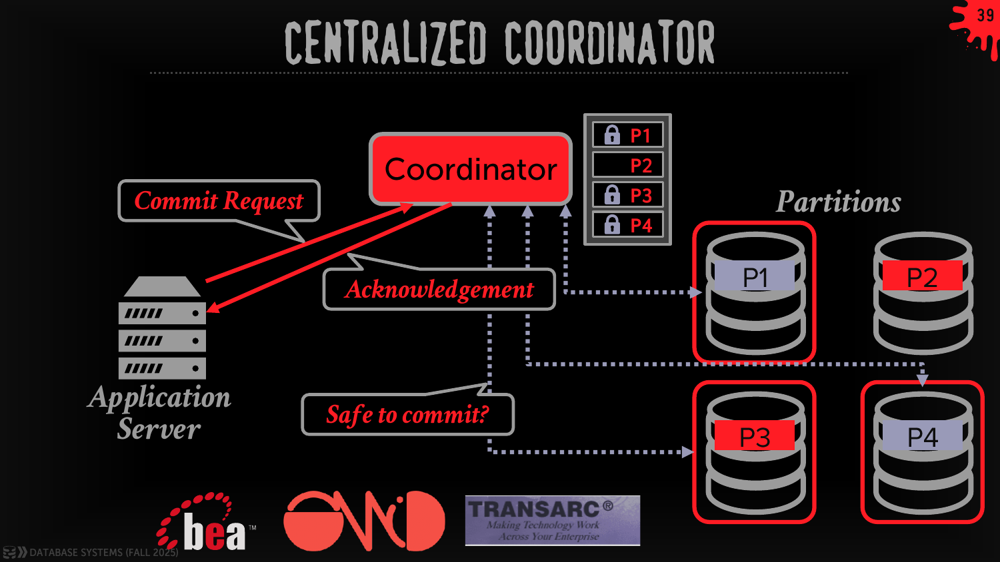


> 💬 **旁注**
> [TP 监视器](#TP%20监视器)中的 TP 最初是 teleprocessing（远程处理）的缩写，指管理大量远程终端与主机之间数据传输的程序，后来才被重新解释为 transaction processing（[事务](#事务)处理）。Transarc 与 CMU 渊源很深：它由几位 CMU 研究人员于 1989 年创立，最初是为了把 CMU Andrew 项目中的 Andrew 文件系统（AFS）商业化，1994 年被 IBM 收购。

### 7.3 中间件（Middleware）

📍 *PPT 第 40 页*

更常见的集中式做法是**[中间件](#中间件)（Middleware）**。它和上面的流程本质相同，区别在于应用程序的所有查询都直接发给[中间件](#中间件)。[中间件](#中间件)保存着[分区](#分区)映射（P1 负责 ID 1–100，P2 负责 101–200，P3 负责 201–300，P4 负责 301–400），负责把查询路由到正确的[分区](#分区)、维护[锁表](#锁表)，并在[提交](#提交)时询问各[分区](#分区)“可以安全提交吗”。在应用程序看来，它连接的就是一个单独的[数据库](#数据库)服务器实例，背后的多个节点被[中间件](#中间件)完全隐藏了。

Andy 提到，Google 在 Spanner 之前管理[分片](#分片) MySQL 的方式基本就是这样；YouTube 开源的 Vitess 也走这条路线，用一层[中间件](#中间件)把大量 MySQL 实例包装成一个逻辑[数据库](#数据库)。与 [TP 监视器](#TP%20监视器)相比，[中间件](#中间件)位于每一条查询的必经之路上，[数据透明性](#数据透明性)更好，但它自己也成了吞吐量的瓶颈和潜在的单点故障，必须能够水平扩展并且容错。

### 7.4 去中心化协调

📍 *PPT 第 41 页*

去中心化的做法中，节点自行组织。应用程序向任意一个节点发出开始[事务](#事务)的请求，经过某种选举，这个节点成为本事务的**[领导者节点](#领导者节点)（Leader Node）**，负责协调这个事务的一切。之后，应用程序可以把查询直接发给各个节点，也可以统统交给领导者，由它转发；领导者负责把结果返回给客户端。[提交](#提交)时，领导者和本事务涉及的其他[分区](#分区)通信，询问这个事务是否可以提交。

它和集中式最大的区别在于，系统中不存在一个掌握所有[事务](#事务)全局视图的角色，每个领导者只了解自己负责的事务。这让系统没有单点瓶颈，但也让一些需要全局信息的问题变难了，第 9.2 节的分布式[死锁](#死锁)就是一例。领导者究竟怎样与其他[分区](#分区)就“[提交](#提交)”达成一致，是第 [24](../L24/index.md) 讲的内容。

## 8. 联邦数据库：把不同的 DBMS 拼成一个

📍 *PPT 第 42–44 页*

到目前为止，我们默认分布式系统中的每个节点运行的是同一种 DBMS 软件。现实中的组织往往同时运行着许多种 DBMS，比如一部分数据在 MySQL 里，一部分在 MongoDB 里，还有一部分在 PostgreSQL 里。如果能用一个统一的接口访问所有这些数据，会方便得多。

**[联邦数据库](#联邦数据库)（Federated Database）**是一种分布式架构，它把各不相同的 DBMS 连接成一个逻辑系统，对外提供单一的查询接口，可以访问任何位置的数据。结构上，它就是第 7.3 节的[中间件](#中间件)：应用程序把查询发给[中间件](#中间件)，[中间件](#中间件)通过针对每种后端系统的**[连接器](#连接器)（Connector）**，把查询转换成各个后端 DBMS 能理解的形式，发给它们执行，再汇总返回的结果。这种架构在大公司里更常见。

Andy 的评价是，这类系统并不常见，效果也不好，不过这个想法由来已久，可以追溯到 1990 年代。[^fed] 这件事很难，至今没有人做得好。难处在于，各系统的[数据模型](#数据模型)、查询语言和能力限制都不同，跨系统的查询因此没有简单的优化办法，最后往往要在系统之间大量复制数据。

[^fed]: 原话：“These are not that common. They don't work very well. But this is an idea that's been around for a while, and this goes back to the 1990s.”

今天的 Trino（原名 Presto）通过[连接器](#连接器)、PostgreSQL 通过外部数据包装器（Foreign Data Wrapper），都在提供类似的能力。它们面对的核心问题，正是第 3 节的推与拉。理想情况下，[中间件](#中间件)应该把查询中属于某个后端的那部分切出来，连同[谓词](#谓词)和[投影](#投影)一起下推，翻译成该系统能执行的专门请求。但很多后端做不到，最后往往退化成一条 `SELECT *`，把整张表拉到[中间件](#中间件)再处理。要支持的后端越多，能依赖的共同能力就越少，系统只能按最低公分母来设计。

## 9. 分布式[并发](#并发)控制为什么更难

📍 *PPT 第 45–47 页*

### 9.1 单机协议能搬过来，但多了四个麻烦

📍 *PPT 第 45 页*

分布式[并发](#并发)控制要允许多个[事务](#事务)在多个节点上同时执行。单机 DBMS 的许多协议，[两阶段锁](#两阶段锁)、[时间戳排序](#时间戳排序)、[乐观并发控制](#乐观并发控制)、[多版本并发控制](#多版本并发控制)，都可以改造后使用。它之所以更难，原因来自四个方面。

第一个麻烦来自[复制](#复制)。一次写入要落到数据的每一个副本上，而每个副本可能在不同的时刻才看到这次写入。

第二个麻烦是网络通信开销。单机上获取一把[锁](#锁)，只是在[锁管理器](#锁管理器)的[哈希表](#哈希表)里改几个字段；分布式环境里，向远端节点申请一把锁要经过一次网络往返，同一数据中心内是几百微秒，跨越大洲则是第 1.1 节算过的上百毫秒。[事务](#事务)持有锁的时间随之拉长，与其他事务[冲突](#冲突)的概率也随之增加。

第三个麻烦是节点故障，包括永久故障和暂时故障。持有[锁](#锁)的节点是真的宕机了，还是只是在做第 1.1 节说的垃圾回收？如果判定它已经死亡并释放它的锁，它醒来后可能仍按“我持有这把锁”的假设继续工作。

第四个麻烦是**[时钟偏差](#时钟偏差)（Clock Skew）**。[时间戳排序](#时间戳排序)（第 [19](../L19/index.md) 讲）和[多版本并发控制](#多版本并发控制)（第 [20](../L20/index.md) 讲）都依赖[时间戳](#时间戳)来比较[事务](#事务)的先后。单机上的时间戳来自同一个计数器或同一个时钟，天然可比；多台机器的时钟各走各的，彼此之间总有偏差，两个节点各自分配的时间戳不能直接比较。

### 9.2 分布式[死锁](#死锁)

📍 *PPT 第 46 页*

来看一个具体的例子。Node 1 上存放着 A = 1，Node 2 上存放着 B = 8，两台应用服务器各运行一个[事务](#事务)，都使用[两阶段锁](#两阶段锁)（第 [18](../L18/index.md) 讲）：

| 时间 | T1 | T2 |
|---|---|---|
| 1 | 在 Node 1 上 `SET A = 2`，获得 A 的写[锁](#锁) | |
| 2 | | 在 Node 2 上 `SET B = 7`，获得 B 的写锁 |
| 3 | 在 Node 2 上请求 `SET B = 9`；B 被 T2 锁住，等待 | |
| 4 | | 在 Node 1 上请求 `SET A = 0`；A 被 T1 锁住，等待 |

这是一个[死锁](#死锁)：T1 等待 T2 释放 B，T2 等待 T1 释放 A，[等待图](#等待图)（Waits-For Graph）中有环 T1 → T2 → T1。第 [18](../L18/index.md) 讲的[死锁检测](#死锁检测)会周期性地在等待图中找环，那么看看每个节点各自看到的是什么：

| 节点 | 本地[锁管理器](#锁管理器)看到的等待关系 | 本地[等待图](#等待图)中有环吗 |
|---|---|---|
| Node 1 | T2 等待 T1（T2 想要 A） | 没有 |
| Node 2 | T1 等待 T2（T1 想要 B） | 没有 |

每个节点的局部[等待图](#等待图)都只有一条边，看不出任何问题；环只存在于把两张图合并之后的全局等待图里。所以分布式[死锁检测](#死锁检测)必须收集所有节点的等待关系：要么交给一个掌握全局视图的[集中式协调者](#集中式协调者)（第 7.2 节），要么让节点之间周期性地交换各自的边。另一条路是不检测，改用超时或[死锁预防](#死锁预防)；但第 [18](../L18/index.md) 讲的等待-死亡、伤害-等待这类预防策略靠[时间戳](#时间戳)决定谁让路，这些时间戳在多个节点之间怎样分配才能彼此可比，又回到了第 9.1 节的时钟问题。

这些问题只是分布式[数据库](#数据库)的冰山一角，要把它们做对非常难。
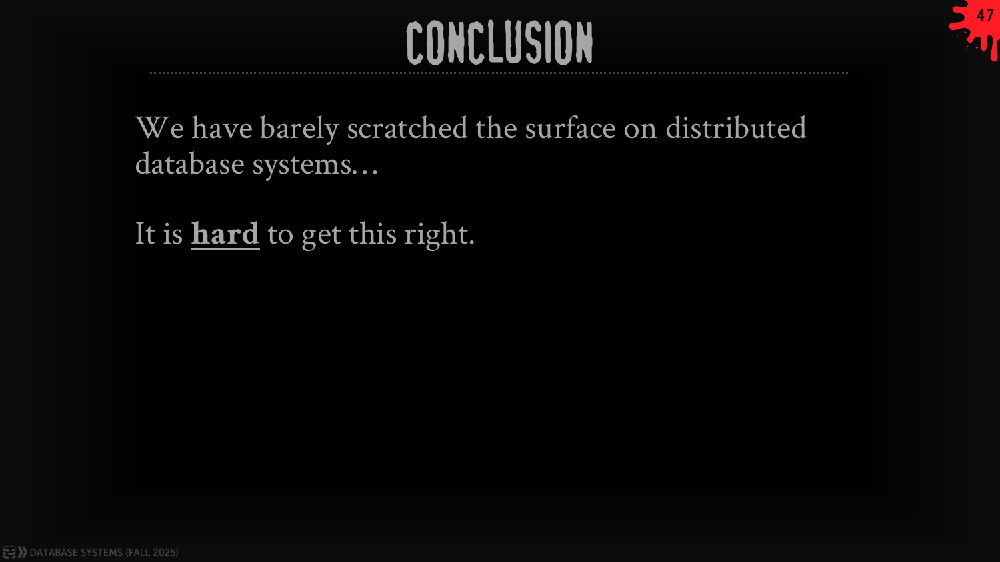


## 小结

本讲的动机链从一台机器的两个极限出发：数据存不下，机器也经不起宕机。把[数据库](#数据库)拆到多台机器上之后，第一个决定是节点之间共享什么。[无共享](#无共享)架构让每个节点只处理本地数据，性能最好，但扩容要物理地搬数据；[共享磁盘](#共享磁盘)架构把数据交给云存储，节点变成无状态的缓存，扩容只需改[目录](#目录)，却要处理缓存一致性，因此仍然需要按数据划分责任。数据不在本地时，可以把查询推过去，也可以把数据拉过来；对象存储上的计算下推和[联邦数据库](#联邦数据库)的[连接器](#连接器)，都让这个选择变得更微妙。

划分数据时，[分区](#分区)方案的目标是让尽量多的[事务](#事务)留在单个节点上。[哈希分区](#哈希分区)对等值查询最友好，却在节点增减时要搬走 N/(N+1) 的数据；[一致性哈希](#一致性哈希)和[会合哈希](#会合哈希)把迁移量降到了理想的 1/(N+1)，前者用一个需要维护的环换来 O(log n) 的查找，后者用 O(n) 的查找换来均匀与简单，而前者本身就是后者的特例。[分区](#分区)扩大了单点故障的影响，于是有了[复制](#复制)，以及随之而来的一串选择：谁接受写入，[提交](#提交)前等不等副本，何时传播，副本自己重新执行还是照抄结果。每一个选择都在延迟、可用性和一致性之间权衡，异步[复制](#复制)甚至可能丢掉已经确认提交的事务。事务跨越节点之后，需要一个协调者，无论它是集中的 [TP 监视器](#TP%20监视器)、[中间件](#中间件)，还是每个事务临时的领导者；分布式[死锁](#死锁)则说明，单机上显而易见的事情，一旦失去全局视图，就要重新设计。

本讲留下的问题将在第 [24](../L24/index.md) 讲集中回答：两阶段提交怎样让多个节点就“[提交](#提交)”达成一致，Paxos 与 Raft 怎样选出唯一的主节点，以及数据分散在各个节点上时[连接](#连接)怎样执行。下一讲的主题是分布式 OLTP 系统与分布式 OLAP 系统。
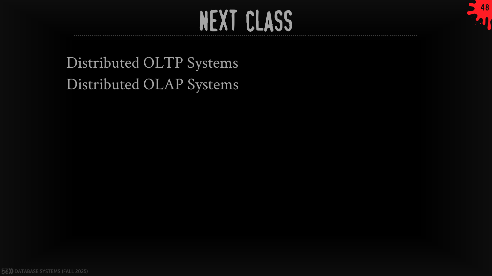


## 术语速查表

### 数据库

**Database**：一组经过组织、相互关联、用来模拟现实世界某方面的数据。（本讲首次出现：摘要；引入于：第 1 讲）

### 分布式 DBMS

**Distributed DBMS**：资源可能相距很远、通信代价与故障不可忽略的数据库系统。（本讲首次出现：摘要；引入于：第 14 讲）

### 提交

**Commit**：数据库接受事务成功完成及其整体修改。（本讲首次出现：摘要；引入于：第 17 讲）

### 事务

**Transaction**：为完成业务功能而共同执行、整体成功或失败的一组数据库操作。（本讲首次出现：摘要；引入于：第 10 讲）

### 死锁

**Deadlock**：事务形成循环等待，没有参与者能够独立继续。（本讲首次出现：摘要；引入于：第 10 讲）

### 并发

**Concurrency**：多个事务的执行时间重叠，可以交替或同时推进。（本讲首次出现：摘要；引入于：第 17 讲）

### 缓冲池

**Buffer Pool**：由定长帧组成的一大块内存，用来存放从磁盘读入的页。（本讲首次出现：课程地图；引入于：第 3 讲）

### PAX

**Partition Attributes Across**：先把行分组、组内再按列存放的混合布局。（本讲首次出现：课程地图；引入于：第 6 讲）

### 哈希函数

**Hash Function**：把任意长度的键映射为定长整数的确定性单向函数。（本讲首次出现：课程地图；引入于：第 7 讲）

### 二级索引

**Secondary Index**：表上主键索引以外的其他索引。（本讲首次出现：课程地图；引入于：第 5 讲）

### 索引

**Index**：按适合查找的方式组织键与记录定位信息的访问结构。（本讲首次出现：课程地图；引入于：第 8 讲）

### 交换算子

**Exchange Operator**：在计划中合并或拆分多路数据流、封装并行的算子。（本讲首次出现：课程地图；引入于：第 14 讲）

### 并行 DBMS

**Parallel DBMS**：资源彼此靠近、通信被假定为廉价可靠的数据库系统。（本讲首次出现：课程地图；引入于：第 14 讲）

### 谓词下推

**Predicate Pushdown**：把谓词移到计划中尽可能低的位置。（本讲首次出现：课程地图；引入于：第 15 讲）

### 预写日志

**Write-Ahead Log (WAL)**：独立的日志文件，对象落盘之前，它对应的日志记录必须先落盘。（本讲首次出现：课程地图；引入于：第 17 讲）

### 日志

**Logging**：按序记录修改及恢复所需的信息。（本讲首次出现：课程地图；引入于：第 17 讲）

### 恢复算法

**Recovery Algorithm**：在故障发生时仍保证一致性、原子性和持久性的技术，分为正常运行时的准备和故障后的恢复两部分。（本讲首次出现：课程地图；引入于：第 21 讲）

### 重做阶段

**Redo**：补齐日志中尚未体现在页面上的更新及 CLR。（本讲首次出现：课程地图；引入于：第 22 讲）

### 等待图

**Waits-for Graph**：用从等待者指向持锁者的边表示当前阻塞关系。（本讲首次出现：课程地图；引入于：第 18 讲）

### 时间戳

**Timestamp**：用来建立事务先后关系的有序标识；此处用于决定等待优先级。（本讲首次出现：课程地图；引入于：第 18 讲）

### 连接

**Join**：在共同属性上取值相同的元组组合。（本讲首次出现：课程地图；引入于：第 1 讲）

### 分布式数据库管理系统

**Distributed DBMS**：把一个逻辑数据库分布到多个物理资源上的 DBMS，节点间通信慢且不可靠。（本讲首次出现：1；引入于：本讲）

### 页

**Page**：定长的数据块，数据库中一切数据的存放单位。（本讲首次出现：1；引入于：第 3 讲）

### 访问方法

**Access Methods**：DBMS 从表中取出数据的方式。（本讲首次出现：1；引入于：第 7 讲）

### 算子

**Operator**：执行扫描、过滤、连接、排序或聚合等处理工作的节点。（本讲首次出现：1；引入于：第 11 讲）

### 查询优化器

**Query Optimizer**：把逻辑计划变成语义等价且代价尽量低的物理计划的组件。（本讲首次出现：1；引入于：第 15 讲）

### 查询优化

**Query Optimization**：DBMS 为声明式查询找出最高效执行策略的过程。（本讲首次出现：1；引入于：第 1 讲）

### 并行数据库管理系统

**Parallel DBMS**：节点彼此靠近、通过高速可靠网络连接、通信代价可以忽略的 DBMS。（本讲首次出现：1.1；引入于：本讲）

### 数据透明性

**Data Transparency**：用户无须知道数据存在哪里、怎样分区和复制，同一条 SQL 在单机与分布式上结果相同。（本讲首次出现：1.2；引入于：本讲）

### 数据独立性

**Data Independence**：应用与底层数据表示相互隔离，一层改变不影响另一层。（本讲首次出现：1.2；引入于：第 1 讲）

### 系统架构

**System Architecture**：规定 CPU 能直接访问哪些共享资源。（本讲首次出现：2.1；引入于：本讲）

### 全共享

**Shared-Everything**：单台机器，CPU 直接访问本机的内存与磁盘。（本讲首次出现：2.1；引入于：本讲）

### 共享内存

**Shared Memory**：CPU 通过高速互连共享内存与磁盘，实践中几乎不用。（本讲首次出现：2.1；引入于：[第 14 讲](../L14/index.md)）

### 无共享

**Shared-Nothing**：每个节点私有 CPU、内存、磁盘，节点之间只能通过网络消息通信。（本讲首次出现：2.2；引入于：本讲）

### 目录

**Catalog**：DBMS 的元数据，在分布式环境中还记录分区方案与集群拓扑。（本讲首次出现：2.2；引入于：[第 07 讲](../L07/index.md)）

### 元组

**Tuple**：关系中的一个元素，即表中的一行。（本讲首次出现：2.2；引入于：第 1 讲）

### 共享磁盘

**Shared-Disk**：节点私有 CPU 与内存，通过网络共享一个逻辑磁盘，如对象存储。（本讲首次出现：2.3；引入于：本讲）

### 工作负载

**Workload**：一个应用发给数据库的查询的整体特征。（本讲首次出现：2.3；引入于：第 1 讲）

### 替换策略

**Replacement Policy**：缓冲池满时决定淘汰哪一页的算法。（本讲首次出现：2.3；引入于：第 4 讲）

### 脏页

**Dirty Page**：标记页在内存中被改过；这样的页淘汰前必须写回。（本讲首次出现：2.3；引入于：第 4 讲）

### 锁

**Lock**：协调事务访问数据库逻辑内容的机制。（本讲首次出现：2.3；引入于：第 4 讲）

### 推送查询到数据

**Push Query to Data**：把查询或其一部分送到数据所在处执行，只传回结果。（本讲首次出现：3.1；引入于：本讲）

### 拉取数据到查询

**Pull Data to Query**：把数据搬到执行查询的节点上处理。（本讲首次出现：3.1；引入于：本讲）

### 谓词

**Predicate**：对每个元组得出真或假的条件。（本讲首次出现：3.1；引入于：第 1 讲）

### 过滤器

**Filter**：只回答“键是否（很可能）在集合中”、不给出位置的数据结构。（本讲首次出现：3.1；引入于：第 9 讲）

### 投影下推

**Projection Pushdown**：尽早去掉后续用不到的列，缩小中间结果。（本讲首次出现：3.1；引入于：第 15 讲）

### 区域映射

**Zone Map**：为每页预先计算的聚合值（最小值、最大值等），用来判断能否跳过该页。（本讲首次出现：3.1；引入于：第 13 讲）

### 页脚

**Footer**：不可变列式文件末尾记录各行组偏移的全局元数据。（本讲首次出现：3.1；引入于：第 6 讲）

### 统计信息

**Statistics**：系统目录中关于表、属性、索引的数量与分布信息。（本讲首次出现：3.1；引入于：第 15 讲）

### 计划片段

**Plan Fragment**：交给另一个节点执行的查询计划子树。（本讲首次出现：3.2；引入于：本讲）

### 查询计划

**Query Plan**：由算子组成的有向无环图（通常是树），数据从叶子流向根，根的输出即查询结果。（本讲首次出现：3.2；引入于：第 11 讲）

### 槽式页

**Slotted Page**：用槽数组记录元组页内偏移、元组从页尾向前存放的页布局。（本讲首次出现：3.3；引入于：第 3 讲）

### 日志结构存储

**Log-Structured Storage**：只追加 PUT/DELETE 记录、从不原地修改的页布局。（本讲首次出现：3.3；引入于：第 5 讲）

### 行组

**Row Group**：PAX 文件中横向划分出的一批连续行（ORC 称条带）。（本讲首次出现：3.3；引入于：第 6 讲）

### 通用 DBMS

**General-Purpose DBMS**：支持按某种数据模型定义、创建、查询、更新、管理数据库的 DBMS。（本讲首次出现：3.3；引入于：第 1 讲）

### 分区

**Partitioning**：把数据库拆分到多个资源上。（本讲首次出现：4.1；引入于：本讲）

### 分片

**Sharding**：把数据库拆分到多个资源上。（本讲首次出现：4.1；引入于：本讲）

### 朴素表分区

**Naive Table Partitioning**：把一整张表交给一个节点。（本讲首次出现：4.2；引入于：本讲）

### 垂直分区

**Vertical Partitioning**：把表的属性拆到不同分区，并保留重建元组所需的标识。（本讲首次出现：4.3；引入于：本讲）

### 属性

**Attribute**：关系中的一个命名分量，即表中的一列。（本讲首次出现：4.3；引入于：第 1 讲）

### 水平分区

**Horizontal Partitioning**：按分区键把元组分成互不相交的子集。（本讲首次出现：4.4；引入于：本讲）

### 分区键

**Partitioning Key**：决定元组去向的一列或几列。（本讲首次出现：4.4；引入于：本讲）

### 哈希分区

**Hash**：按哈希取模。（本讲首次出现：4.4；引入于：本讲）

### 范围分区

**Range**：连续区间。（本讲首次出现：4.4；引入于：本讲）

### 谓词分区

**Predicate**：`WHERE` 条件。（本讲首次出现：4.4；引入于：本讲）

### 轮询分区

**Round-Robin Partitioning**：轮流分配来决定元组去向。（本讲首次出现：4.4；引入于：本讲）

### 主键

**Primary Key**：唯一标识关系中一个元组的属性或属性组合。（本讲首次出现：4.4；引入于：第 1 讲）

### 逻辑分区

**Logical Partitioning**：节点负责一组键但不存储它们，常见于共享磁盘架构。（本讲首次出现：4.5；引入于：本讲）

### 物理分区

**Physical Partitioning**：节点负责并实际存储一组键，常见于无共享架构。（本讲首次出现：4.5；引入于：本讲）

### 一致性哈希

**Consistent Hashing**：节点与键都映射到环上，键归顺时针最近的节点，增删节点只迁移约 1/n 的键。（本讲首次出现：5.2；引入于：本讲）

### 虚拟节点

**Virtual Node**：一个物理节点在哈希环上占据多个位置，用来均衡负载。（本讲首次出现：5.2；引入于：本讲）

### 复制因子

**Replication Factor**：每个键保存的副本数。（本讲首次出现：5.2；引入于：本讲）

### 哈希方案

**Hashing Scheme**：发生冲突后如何安放和查找键的规则。（本讲首次出现：5.2；引入于：第 7 讲）

### 会合哈希

**Rendezvous Hashing (HRW)**：对每个节点计算 h(k‖p)，得分最高的节点获得该键。（本讲首次出现：5.3；引入于：本讲）

### 复制

**Replication**：把数据复制到多个冗余节点上以提高可用性。（本讲首次出现：6；引入于：本讲）

### 高可用

**High Availability**：通过多机复制，使服务在部分机器故障时仍可用。（本讲首次出现：6；引入于：第 1 讲）

### 主副本

**Primary-Replica**：每个对象的更新都发给指定的主节点，由它把日志传给副本。（本讲首次出现：6.1；引入于：本讲）

### 领导者选举

**Leader Election**：主节点失效后，选出唯一的新主节点。（本讲首次出现：6.1；引入于：本讲）

### 多主

**Multi-Primary**：任何副本都能接受更新，副本之间用原子提交协议同步。（本讲首次出现：6.1；引入于：本讲）

### 重做

**Redo**：重新施加已提交事务的修改，以保证持久性。（本讲首次出现：6.1；引入于：第 17 讲）

### 冲突

**Conflict**：不同事务访问同一对象、且至少一方写入的一对操作。（本讲首次出现：6.1；引入于：第 17 讲）

### 可串行化

**Serializability**：调度与某个完整的串行执行等价。（本讲首次出现：6.1；引入于：第 17 讲）

### 两阶段锁

**Two-Phase Locking / 2PL**：先获取或升级，后释放或降级，进入收缩阶段后不能回头。（本讲首次出现：6.1；引入于：第 18 讲）

### 乐观并发控制

**Optimistic Concurrency Control (OCC)**：事务在私有工作区执行、提交时验证冲突的 T/O 协议。（本讲首次出现：6.1；引入于：第 17 讲）

### K-安全

**K-Safety**：每个对象必须保持可用的副本数，低于 K 时系统自行下线。（本讲首次出现：6.2；引入于：本讲）

### 持久性

**Durability**：已成功提交的修改在约定故障范围内能够保留或恢复。（本讲首次出现：6.2；引入于：第 1 讲）

### 同步传播

**Synchronous Propagation**：等副本确认日志落盘后才确认提交。（本讲首次出现：6.3；引入于：本讲）

### 强一致性

**Strong Consistency**：等副本确认日志落盘后才确认提交。（本讲首次出现：6.3；引入于：本讲）

### 异步传播

**Asynchronous Propagation**：不等副本就确认提交，副本稍后才跟上。（本讲首次出现：6.3；引入于：本讲）

### 最终一致性

**Eventual Consistency**：不等副本就确认提交，副本稍后才跟上。（本讲首次出现：6.3；引入于：本讲）

### 持续传播

**Continuous**：日志一生成就发给副本。（本讲首次出现：6.4；引入于：本讲）

### 提交时传播

**On-Commit Propagation**：提交时一次性发送。（本讲首次出现：6.4；引入于：本讲）

### 中止

**Abort**：事务不能成功完成，需要取消其修改。（本讲首次出现：6.4；引入于：第 17 讲）

### 撤销

**Undo**：清除未完成或已中止事务所产生影响的过程。（本讲首次出现：6.4；引入于：第 17 讲）

### 回滚

**Rollback**：撤销事务修改的过程或发起撤销的命令。（本讲首次出现：6.4；引入于：第 17 讲）

### 主动-主动

**Active-Active**：每个副本各自执行事务。（本讲首次出现：6.5；引入于：本讲）

### 主动-被动

**Active-Passive**：只在一处执行，再把变更传给副本。（本讲首次出现：6.5；引入于：本讲）

### 物理复制

**Physical**：传送页与字节层面的变更。（本讲首次出现：6.5；引入于：本讲）

### 逻辑复制

**Logical Replication**：传送行层面的变更。（本讲首次出现：6.5；引入于：本讲）

### 单节点事务

**Single-Node Transaction**：只访问一个分区内数据的事务。（本讲首次出现：7.1；引入于：本讲）

### 分布式事务

**Distributed Transaction**：访问多个分区上数据、需要跨节点协调的事务。（本讲首次出现：7.1；引入于：本讲）

### 并发控制协议

**Concurrency Control Protocol**：运行时约束多个事务操作如何交错的规则。（本讲首次出现：7.1；引入于：第 10 讲）

### 原子性

**Atomicity**：事务的修改全部生效或全部不留下。（本讲首次出现：7.1；引入于：第 17 讲）

### 集中式协调者

**Centralized Coordinator**：由一个掌握全局视图的“交通警察”协调。（本讲首次出现：7.2；引入于：本讲）

### 去中心化协调

**Decentralized Coordination**：由节点自行组织。（本讲首次出现：7.2；引入于：本讲）

### TP 监视器

**TP Monitor**：在多个节点上执行分布式事务的集中式协调者产品。（本讲首次出现：7.2；引入于：本讲）

### 中间件

**Middleware**：所有查询都经过它，由它路由、加锁并协调提交。（本讲首次出现：7.3；引入于：本讲）

### 锁表

**Lock Table**：记录对象的持锁者、锁模式和等待请求的数据结构。（本讲首次出现：7.3；引入于：第 18 讲）

### 领导者节点

**Leader Node**：去中心化协调中负责某个事务的节点。（本讲首次出现：7.4；引入于：本讲）

### 联邦数据库

**Federated Database**：把不同的 DBMS 连接成单一逻辑系统的架构。（本讲首次出现：8；引入于：本讲）

### 连接器

**Connector**：联邦中间件与某种后端 DBMS 之间的适配层。（本讲首次出现：8；引入于：本讲）

### 数据模型

**Data Model**：描述数据的一组概念，规定可以有哪些东西及其联系。（本讲首次出现：8；引入于：第 1 讲）

### 投影

**Projection**：只保留、重排或计算指定属性，对应 SQL 的 `SELECT` 列表。（本讲首次出现：8；引入于：第 1 讲）

### 时钟偏差

**Clock Skew**：不同机器的时钟之间的差异，使各节点的时间戳不能直接比较。（本讲首次出现：9.1；引入于：本讲）

### 时间戳排序

**Timestamp Ordering (T/O)**：用时间戳规定事务在可串行顺序中先后的一类协议。（本讲首次出现：9.1；引入于：第 19 讲）

### 多版本并发控制

**Multi-Version Concurrency Control (MVCC)**：为每个逻辑对象维护多个物理版本，写时创建新版本，读时按时间戳选择版本。（本讲首次出现：9.1；引入于：第 20 讲）

### 锁管理器

**Lock Manager**：管理加锁、转换、解锁和等待请求的组件。（本讲首次出现：9.1；引入于：第 18 讲）

### 哈希表

**Hash Table**：用哈希函数把键映射到数组偏移量的无序关联数组。（本讲首次出现：9.1；引入于：第 7 讲）

### 死锁检测

**Deadlock Detection**：允许等待发生，通过检测环并回滚事务解除死锁。（本讲首次出现：9.2；引入于：第 18 讲）

### 死锁预防

**Deadlock Prevention**：限制等待关系，使死锁无法形成。（本讲首次出现：9.2；引入于：第 18 讲）

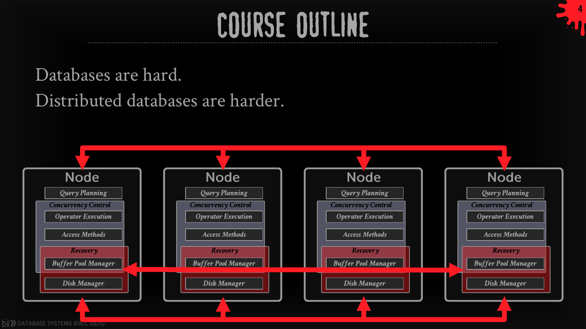

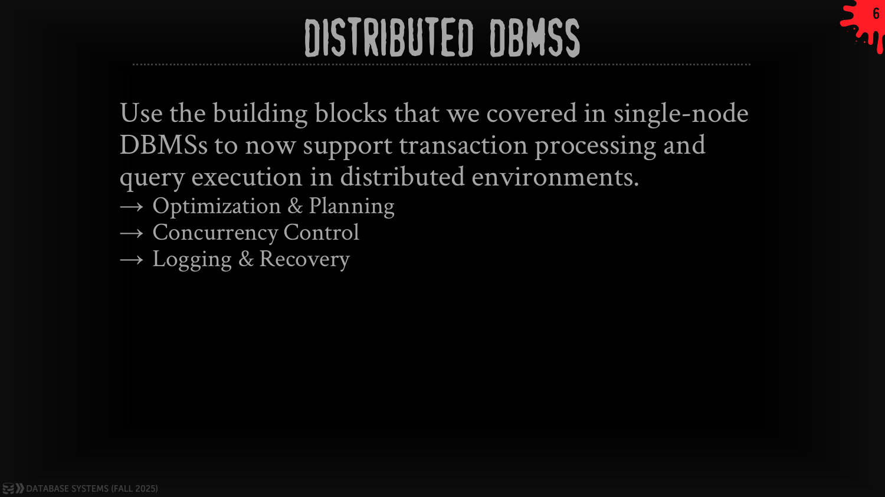

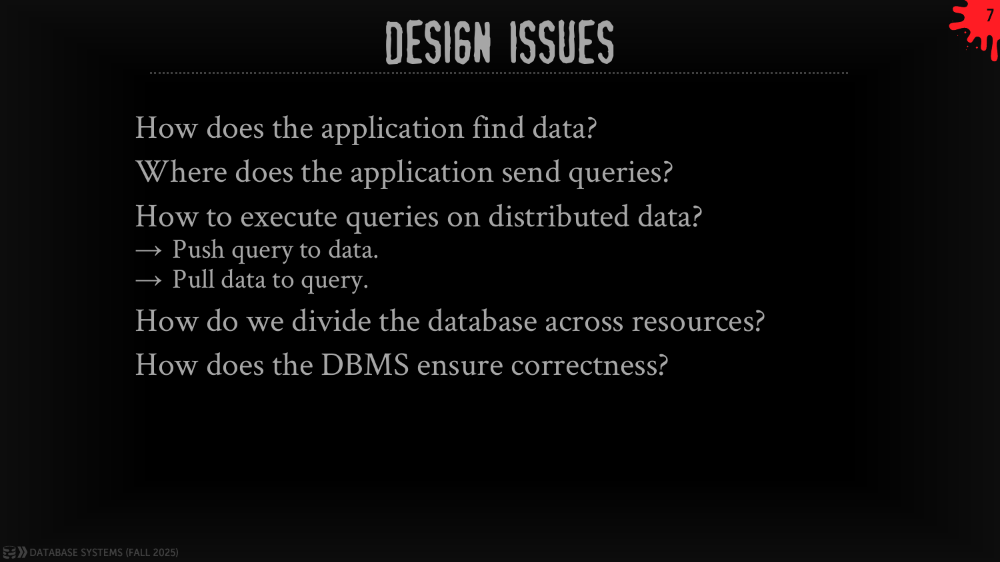


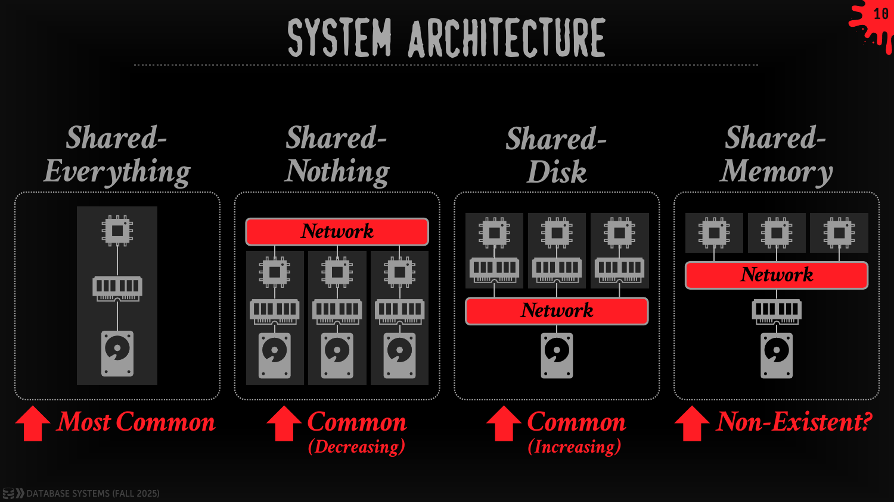

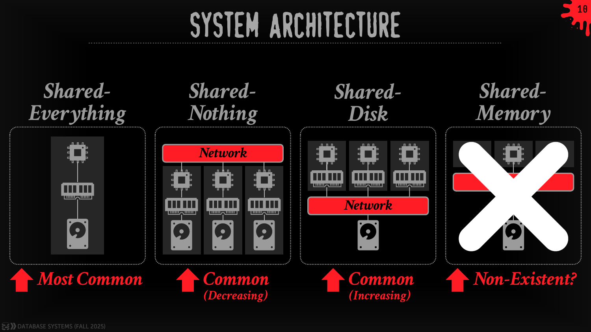

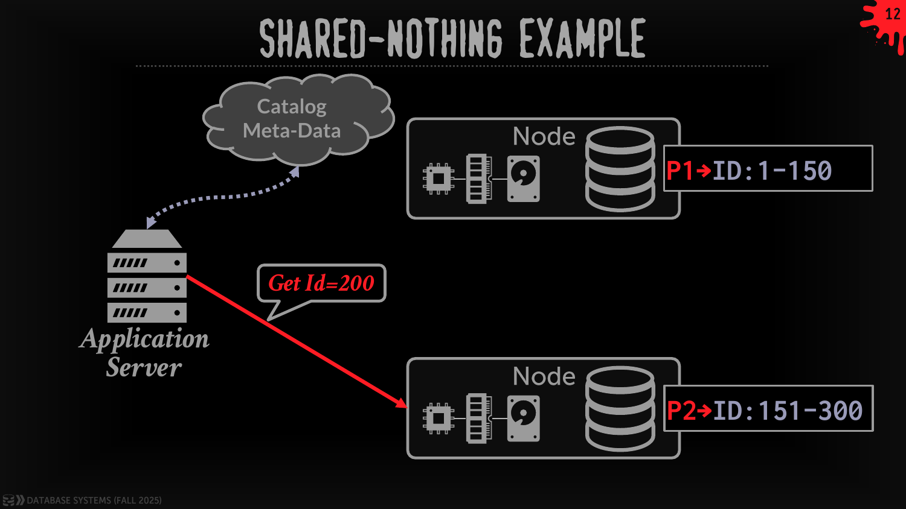


<details>
<summary>📎 本讲未被 📍 标注的幻灯片（共 4 页：封面、目录与行政页）</summary>


</details>
