# CMU 15-445 第 [24](index.md) 讲：分布式数据库系统（下）（Distributed Database Systems II）

> **课程**：CMU 15-445/645 Database Systems（Fall 2025）· **主讲**：Andy Pavlo
> **课程主页**：https://15445.courses.cs.cmu.edu/fall2025/
> **材料**：课件 PPT、官方 Lecture Notes、课堂录音转写稿
> **说明**：正文以 PPT 与 Lecture Notes 为准。讲者原话的中文为意译，英文原文见脚注，依据课堂录音转写整理，已修正明显的语音识别错误。文中“📍 PPT 第 X 页”指幻灯片右上角印的编号。

## 摘要（Abstract）

第 [23](../L23/index.md) 讲把数据分散到了多个节点上，本讲处理由此带来的两个核心问题。对[联机事务处理](#联机事务处理)（OLTP）系统而言，问题是一个[事务](#事务)读写了多个节点之后，怎样让这些节点对“[提交](#提交)还是[中止](#中止)”给出同一个、不可反悔的答案。[两阶段提交](#两阶段提交)要求全体同意，简单直接，但[协调者](#协调者)一旦在关键时刻崩溃，系统就只能停下来等它恢复。[Paxos](#Paxos) 和 [Raft](#Raft) 把“全体”放宽为“多数派”，利用任意两个多数派必然相交这一点，在少数节点失效时依然能够推进；[Multi-Paxos](#Multi-Paxos) 再通过选出唯一的领导者，免去多个[提议者](#提议者)互相抢先的开销。即使协议本身完美无缺，网络断开时系统也必须在一致性和可用性之间二选一，这就是 [CAP 定理](#CAP%20定理)；[PACELC 定理](#PACELC%20定理)进一步指出，即使网络正常，等待副本确认也是在一致性与延迟之间取舍。

对[联机分析处理](#联机分析处理)（OLAP）系统而言，问题是[连接](#连接)。参与连接的[元组](#元组)必须先到达同一个节点，之后的计算就是第 [12](../L12/index.md) 讲的单机连接算法。按照数据的分区方式，分布式连接从完全不用搬运数据，到把小表复制到每个节点（[广播连接](#广播连接)），再到把两张大表一起重新分区（[混洗连接](#混洗连接)），代价逐级上升；[半连接](#半连接)和[布隆过滤器](#布隆过滤器)可以在搬运之前先滤掉不会出现在结果中的数据。归根结底，数据在节点之间的搬运，也就是混洗，才是分布式分析查询真正的瓶颈，一些系统因此把它做成独立的执行阶段乃至独立的服务，并借此在查询运行途中重新分配计算资源。

读完本讲，你应该能够画出[两阶段提交](#两阶段提交)在成功、否决、超时三种情况下的消息时序，说清[协调者](#协调者)在哪个时刻崩溃会让[两阶段提交](#两阶段提交)阻塞、[Paxos](#Paxos) 又为什么不会；能够用 CAP 和 PACELC 看穿一个分布式[数据库](#数据库)在网络故障和跨地域[复制](#复制)时实际做了什么选择；能够根据两张表的分区方式和大小，判断一次分布式[连接](#连接)应当采用哪种方案，并估算它要在网络上传输多少数据。

## 课程地图

本讲是分布式阶段的第二讲，也是这门课讲授新内容的最后一讲。


第 [23](../L23/index.md) 讲搭起了分布式[数据库](#数据库)的骨架。[无共享](#无共享)（shared-nothing）架构让每个节点只管自己本地磁盘上的那部分数据，节点之间通过网络通信；[共享磁盘](#共享磁盘)（shared-disk）架构把数据放在 Amazon S3 这类外部存储上，各节点按需把数据取进自己的内存。表按哈希、范围或轮询被水平切分成互不相交的分区（也叫分片），再以[主副本](#主副本)（primary-replica）或[多主](#多主)（multi-primary）的方式[复制](#复制)；[事务](#事务)则由一个集中的[协调者](#协调者)（例如夹在应用与数据库之间的 [TP 监视器](#TP%20监视器)或[中间件](#中间件)）协调，或者由节点们以去中心化的方式自行协调。

这副骨架留下了一个问题：数据分散之后，一个读写了多个节点的[事务](#事务)，怎样在所有节点上“要么都[提交](#提交)，要么都不提交”？本讲前半部分回答这个问题，用到的是整个学期积累下来的单机知识：事务与 ACID（第 [17](../L17/index.md) 讲），[两阶段锁](#两阶段锁)（第 [18](../L18/index.md) 讲）和[乐观并发控制](#乐观并发控制)的验证阶段（第 [19](../L19/index.md) 讲），[多版本并发控制](#多版本并发控制)的[版本链](#版本链)（第 [20](../L20/index.md) 讲），[预写日志](#预写日志)与崩溃恢复（第 [21](../L21/index.md)、[22](../L22/index.md) 讲）。后半部分转向分析型查询，要用到[连接](#连接)算法（第 [12](../L12/index.md) 讲），[流水线阻断点](#流水线阻断点)（第 [13](../L13/index.md) 讲），[交换算子](#交换算子)与并行执行（第 [14](../L14/index.md) 讲），[谓词下推](#谓词下推)与[投影下推](#投影下推)（第 [15](../L15/index.md) 讲），以及[布隆过滤器](#布隆过滤器)（第 [8](../L08/index.md)、[9](../L09/index.md) 讲）。本讲的内容会在第 [25](../L25/index.md) 讲的期末复习中再次出现。

## 1. [分布式事务](#分布式事务)：同样的问题，更难的模式

📍 *PPT 第 5–8 页*

### 1.1 两种负载，两种重点

📍 *PPT 第 5–6 页*

分布式[数据库](#数据库)要解决什么问题，首先取决于它服务于哪一种[工作负载](#工作负载)（workload）。第 [6](../L06/index.md) 讲区分过两种。[联机事务处理](#联机事务处理)（OLTP）的[事务](#事务)寿命短、有读有写、每次只碰很少的数据，同样的操作反复出现：下一笔订单、发一条评论，都是这样的事务。它们直接面对用户或其他程序，要以毫秒计地尽快完成。[联机分析处理](#联机分析处理)（OLAP）的查询运行时间长、只读、包含复杂的[连接](#连接)，而且常常是探索性的：分析师在 OLTP 系统积累下来的数据上反复试探，希望从中提炼出新的知识，一条查询跑上几秒、几分钟乃至几小时都不稀奇。

这两类负载并不互斥。分布式 OLTP 系统照样要执行[连接](#连接)，分布式 OLAP 系统照样需要[原子提交协议](#原子提交协议)来保证数据正确，区别在于工程投入的重心放在哪里。OLTP 系统最核心的问题是怎样在多个节点上[提交](#提交)同一个[事务](#事务)，OLAP 系统最核心的问题是怎样在多个节点上执行连接。我们先讨论前者。

### 1.2 [提交](#提交)这一步变难了

📍 *PPT 第 7 页*

分布式[数据库](#数据库)的目标，是让多个物理节点在应用程序眼里表现为一个逻辑上的 DBMS。理想情况下，一条能在单机 PostgreSQL 上运行的 SQL，放到分区、[复制](#复制)之后的集群上也能原样运行，[事务](#事务)也依然满足 ACID。实现这个目标并不需要一套全新的理论。Andy 的说法是，分布式系统做的事情和单机完全相同，只是换成了“困难模式”，因为多出了许多单机上不必操心的情况。[^hard]

多出来的情况集中在[提交](#提交)这一步。单机上，提交意味着把一条提交记录刷进本地的[预写日志](#预写日志)；分布式环境下，一个[事务](#事务)可能在三个节点上都改了数据，提交就意味着这三个节点要对结局达成一致。偏偏在这个时候，其中一个节点可能宕机，提交相关的消息可能在网络上迟到甚至丢失。规模再大一些，还会出现新的权衡：一个涉及一百台机器的事务，是否必须等每一台都点头才能提交？
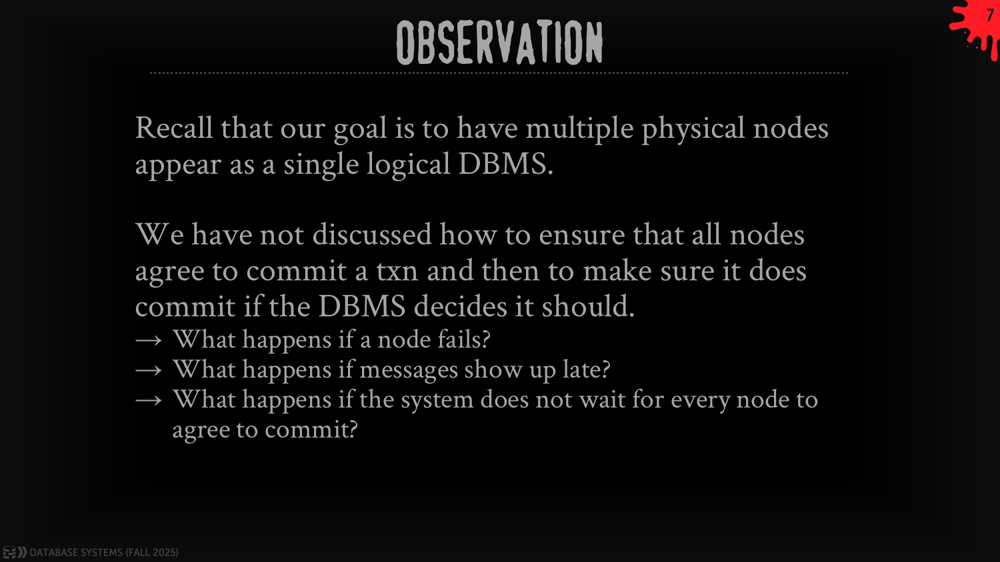


让多个节点就“这个[事务](#事务)[提交](#提交)还是[中止](#中止)”达成一致的协议，统称[原子提交协议](#原子提交协议)。讨论它之前，先要明确一个前提。

### 1.3 一个前提：节点不会撒谎

📍 *PPT 第 8 页*

本讲的所有协议都假定，[分布式 DBMS](#分布式%20DBMS) 中的节点行为良好（well-behaved），并且处在同一个管理域（administrative domain）之下：集群里运行的软件由我们部署和控制，只要没有发生故障，让一个节点[提交](#提交)某个[事务](#事务)，它就会提交。节点可能崩溃，可能变慢，可能和其他节点失去联系，但不会投了赞成票又反悔，也不会故意伪造状态去扰乱别的节点。
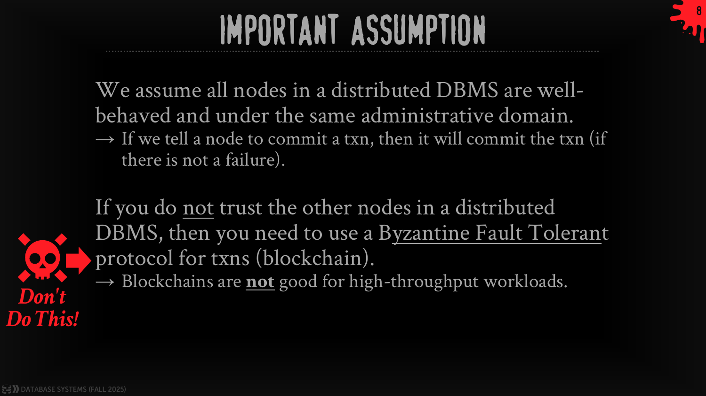


如果不能信任其他节点，认为其中一些可能是恶意的，就需要能在部分节点任意作恶时仍然达成一致的协议，即**[拜占庭容错](#拜占庭容错)（Byzantine Fault Tolerant，[BFT](#拜占庭容错)）**协议。区块链就是这样的系统。它和[数据库](#数据库)一样执行[事务](#事务)，只不过[参与者](#参与者)互不信任，所以要用 [BFT](#拜占庭容错) 协议让多数[参与者](#参与者)对结果达成一致，再用默克尔树（Merkle tree）和只能追加、不可篡改的账本记录每一次变更，保证历史无法被改写。这些机制的代价很高，区块链因此不适合高吞吐的[工作负载](#工作负载)。在一家公司自己的机房里，每个节点本来就归自己管，为防范它们作恶付出这份代价毫无意义。Andy 对此的态度毫不含糊：如果这门课只能记住两件事，一是永远不要在数据库系统里用 `mmap`（第 [3](../L03/index.md)、[4](../L04/index.md) 讲），二是不要用区块链数据库。[^two]

## 2. 原子提交协议（Atomic Commit Protocol）

📍 *PPT 第 9–10 页*

### 2.1 [提交](#提交)顺序就是系统状态

📍 *PPT 第 9 页*

**[原子提交协议](#原子提交协议)（atomic commit protocol）**负责在[分布式 DBMS](#分布式%20DBMS) 的多个节点之间协调[事务](#事务)的[提交](#提交)顺序。分布式系统领域把同一类协议叫作**[共识协议](#共识协议)（consensus protocol）**，并把被协调的对象叫作状态机（state machine）。两种叫法说的是同一件事：对[数据库](#数据库)而言，事务以什么顺序提交，就是系统的状态。

这和第 [21](../L21/index.md)、[22](../L22/index.md) 讲的[日志](#日志)是同一个思路。单机上，日志里[提交](#提交)记录的先后就是[事务](#事务)生效的顺序，崩溃后照着日志重放，就能回到崩溃前的状态。分布式环境下，协议先让各节点就这个顺序达成一致，再把它记进日志；之后任何节点按同样的顺序重放这些事务，都会得到同样的[数据库](#数据库)状态。难点全在“达成一致”上。

[原子提交协议](#原子提交协议)不关心数据是怎样分布的。[数据库](#数据库)的内容是复制到多台机器上，还是切成分区、每一块只存一份，都需要它。

这类协议的发展大致如下：

| 协议 | 提出时间 | 要点 |
|---|---|---|
| [两阶段提交](#两阶段提交)（Two-Phase Commit） | 1970 年代 | 最早的方案，要求全体[参与者](#参与者)一致同意 |
| 三阶段[提交](#提交)（Three-Phase Commit） | 1983 年 | 试图消除[两阶段提交](#两阶段提交)的阻塞问题，但过于复杂，Andy 说几乎没有系统采用 |
| 视图戳[复制](#复制)（Viewstamped Replication） | 1988 年 | 由 MIT 提出，比 [Paxos](#Paxos) 早一年，解决的是同一个问题 |
| [Paxos](#Paxos) | 1989 年 | 只需多数派同意 |
| ZAB（ZooKeeper Atomic Broadcast） | 约 2008 年 | 只用于 Apache ZooKeeper |
| [Raft](#Raft) | 2013 年 | 在 [Paxos](#Paxos) 的基础上做了简化，以容易理解为设计目标 |

从高处看，它们做的都是同一件事。[数据库](#数据库)系统里最常见的是[两阶段提交](#两阶段提交)，也有很多系统使用 [Paxos](#Paxos)，有些系统两者都用。[Raft](#Raft) 与 [Paxos](#Paxos) 的差别不大，理解了 [Paxos](#Paxos)，[Raft](#Raft) 也就不难懂。下面重点讨论[两阶段提交](#两阶段提交)和 [Paxos](#Paxos)。

### 2.2 协议要保证什么

📍 *PPT 第 10 页*

[原子提交协议](#原子提交协议)通常用**[资源管理器](#资源管理器)（Resource Manager，[RM](#资源管理器)）**来描述参与各方：每个[资源管理器](#资源管理器)运行在一个节点上，管理这个节点上的[数据库](#数据库)或其中一部分，各[资源管理器](#资源管理器)相互配合，共同决定每个[事务](#事务)的命运，[提交](#提交)或者[中止](#中止)。这套描述方式来自 Jim Gray 和 Leslie Lamport 的工作，它要求协议满足两个性质：

- **[稳定性](#稳定性)（stability）**：[事务](#事务)的结局一旦确定，就不能再更改。各节点都同意某个事务[提交](#提交)之后，任何一个节点都不能事后反悔。
- **[一致性](#一致性（提交协议）)（consistency）**：所有[资源管理器](#资源管理器)最终处于同一个状态，即使中途发生了故障。

此外，协议还假定**[活性](#活性)（liveness）**成立：在协议运行期间，有足够多的节点存活并且彼此连通，协议总有办法向前推进。[活性](#活性)并不保证[事务](#事务)一定能[提交](#提交)。如果节点不断失效，事务可能一次次被[中止](#中止)，但系统始终在向前走，不会永远卡在某个中间状态。

一个[事务](#事务)在这类协议中经历的状态，可以画成下面的状态机：

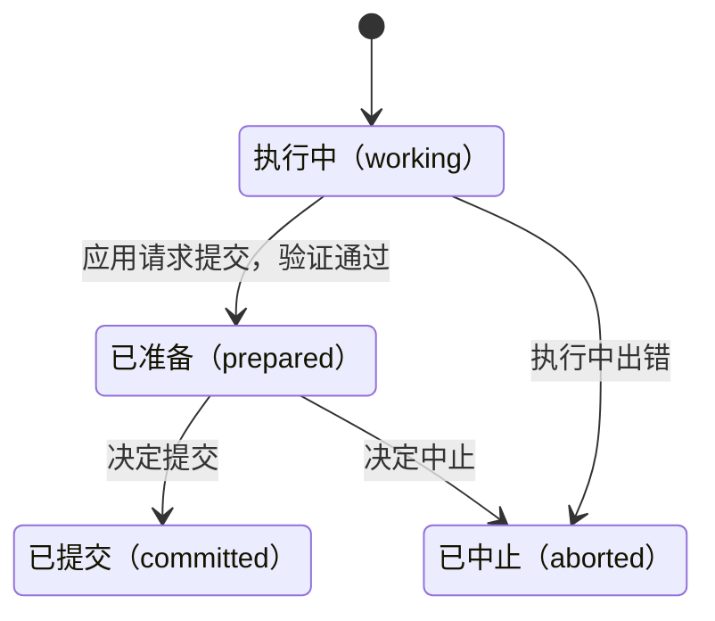

[事务](#事务)执行查询、读写数据时处于“执行中”；应用发出[提交](#提交)请求后，系统判断它能否提交，通过则进入“已准备”；最终进入“已提交”或“已[中止](#中止)”。执行过程中出错的事务可以直接中止。[稳定性](#稳定性)体现在图上，就是两个终态都没有出边。

这里的“[一致性](#一致性（提交协议）)”指所有节点的结局相同，与 ACID 中的一致性（第 [17](../L17/index.md) 讲，指数据满足完整性约束）不是一回事。第 5 节还会遇到这个词的第三种含义。

## 3. 两阶段提交（Two-Phase Commit）

📍 *PPT 第 11–18 页*

### 3.1 准备，然后[提交](#提交)

📍 *PPT 第 11 页*

设想应用服务器上的一个[事务](#事务)在 Node 1 到 Node 4 上读写了数据，现在它向 Node 1 发出[提交](#提交)请求（Commit Request）。至于为什么是 Node 1，可以假定系统事先通过某种选举指定了它，讨论 [Paxos](#Paxos) 时会看到这类选举是怎么做的。在**[两阶段提交](#两阶段提交)（Two-Phase Commit，2PC）**中，Node 1 称为**[协调者](#协调者)（coordinator）**，负责组织这个事务在各节点上的提交；其余节点称为**[参与者](#参与者)（participant）**。[协调者](#协调者)本身也可以同时是[参与者](#参与者)。[参与者](#参与者)只包括这个事务实际读写过的节点：集群里即使有一千个节点（这对事务型系统来说并不多见），[两阶段提交](#两阶段提交)也只在事务碰过的那几个节点之间进行。

顾名思义，协议分两个阶段。第一阶段是准备（prepare）：[协调者](#协调者)向所有[参与者](#参与者)发送 Prepare 消息，带上唯一标识这个[事务](#事务)的 ID，询问它能否[提交](#提交)。每个[参与者](#参与者)独立判断，判断依据是它自己采用的[并发控制协议](#并发控制协议)：用[乐观并发控制](#乐观并发控制)的节点执行验证（第 [19](../L19/index.md) 讲），用[两阶段锁](#两阶段锁)的节点确认该持有的[锁](#锁)都在手上（第 [18](../L18/index.md) 讲），同时还要检查完整性约束。判断能提交，就回复 OK，也就是投出赞成票。[协调者](#协调者)收齐所有[参与者](#参与者)的 OK 之后，进入第二阶段，提交（commit）：向所有[参与者](#参与者)发送 Commit，[参与者](#参与者)真正提交事务并回复 OK。[协调者](#协调者)收齐第二轮的 OK，才告诉应用事务提交成功。
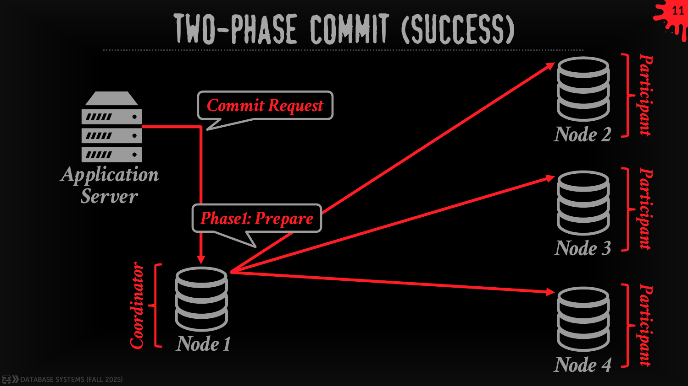

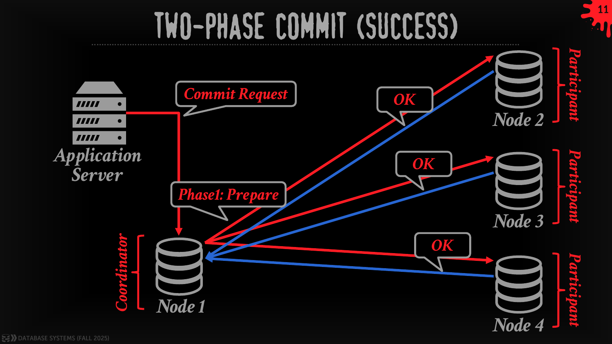

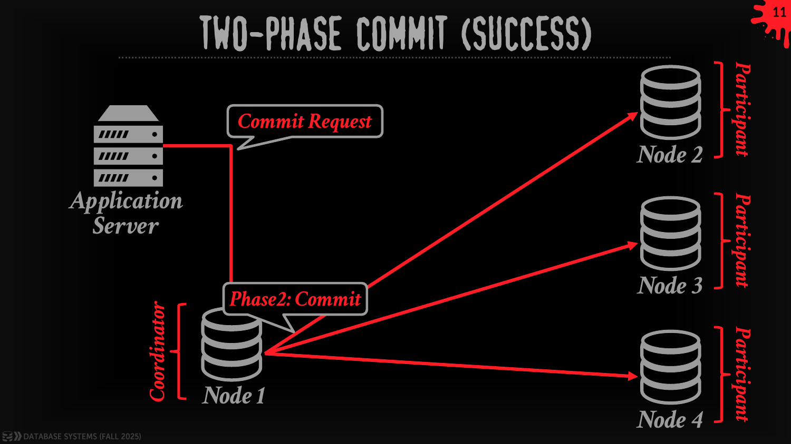

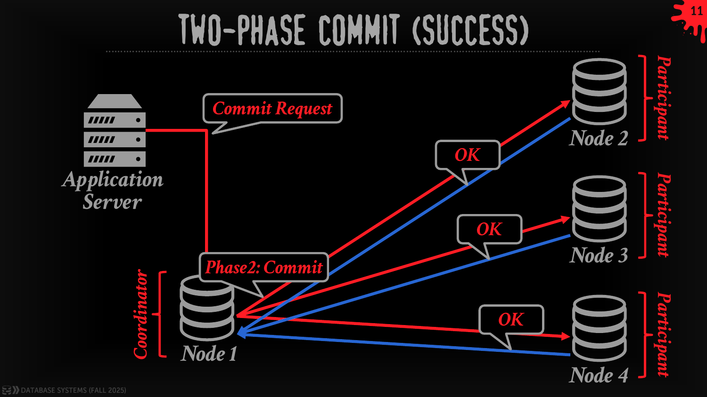


一次成功的[两阶段提交](#两阶段提交)按下面的顺序进行：

| 步骤 | 应用服务器 | [协调者](#协调者)（Node 1） | [参与者](#参与者)（Node 2、3、4） |
|---|---|---|---|
| 1 | 发出 Commit Request | | |
| 2 | | 向三个[参与者](#参与者)发送 Prepare | |
| 3 | | | 各自验证，回复 OK |
| 4 | | 收齐 3 个 OK，决定[提交](#提交)，发送 Commit | |
| 5 | | | 提交，回复 OK |
| 6 | 收到 Success! | 收齐 3 个 OK，通知应用 | |

整个过程需要两轮消息往返。真正决定结局的是第 4 步：[协调者](#协调者)收齐赞成票的那一刻，[事务](#事务)的命运就定了，第二阶段只是把这个决定传达下去。后面讨论故障和优化时，这一点会反复用到。

[两阶段提交](#两阶段提交)（2PC）和第 [18](../L18/index.md) 讲的[两阶段锁](#两阶段锁)（2PL）名字相近，管的却是两件事。两阶段锁的“两阶段”是一个[事务](#事务)先只加[锁](#锁)、后只放锁的两段时间，解决的是多个事务之间的隔离；[两阶段提交](#两阶段提交)的“两阶段”是[协调者](#协调者)和[参与者](#参与者)之间的两轮消息，解决的是同一个事务在多个节点上的[原子性](#原子性)。一个分布式系统完全可以两者都用：每个节点内部用两阶段锁做[并发](#并发)控制，跨节点用[两阶段提交](#两阶段提交)决定结局。

> 💬 **旁注**
> [两阶段提交](#两阶段提交)通常归功于 Jim Gray（[两阶段锁](#两阶段锁)等[事务](#事务)处理基础工作的提出者之一，1998 年图灵奖得主）。据 Andy 讲，Gray 在访谈中说这个想法来自 1970 年代的一位意大利程序员；而那位程序员说，它其实来自人们在纸面上订立合同的做法。一个[数据库](#数据库)协议的源头，是现实世界里签字画押的规矩。
>
> *原话：“But in interviews with him, he says that he got the idea from some Italian programmer in the 1970s. And when they talked to that guy, he said, oh, it's actually based on how people did contract law on pencil and paper.”*

### 3.2 一票否决与超时

📍 *PPT 第 12–13 页*

[两阶段提交](#两阶段提交)要求全体一致，所以任何一张反对票都足以决定结局。在第一阶段，假设一个[参与者](#参与者)回复 OK，另一个[参与者](#参与者)因为某种原因（比如[事务](#事务)违反了完整性约束）回复 ABORT。[协调者](#协调者)收到这张反对票后，不再等待第三个[参与者](#参与者)的投票，立即进入第二阶段，向所有[参与者](#参与者)发送 Abort，同时马上告诉应用事务已[中止](#中止)。[参与者](#参与者)[回滚](#回滚)各自的修改，回复 OK。

[协调者](#协调者)不必等[参与者](#参与者)[回滚](#回滚)完毕就通知应用，这和单机上的做法一样：[事务](#事务)因为[死锁](#死锁)被[中止](#中止)时，DBMS 立刻把结果告诉应用，[撤销](#撤销)工作随后借助[补偿日志记录](#补偿日志记录)（CLR，第 [22](../L22/index.md) 讲）完成，应用不需要等。至于先给应用回话还是先给[参与者](#参与者)发 Abort，只要结局已经确定，先后顺序不影响正确性。通常会尽早告诉应用，好让它早点准备重试，不过两者的时间差微乎其微。

你可能会奇怪，结局已定，[参与者](#参与者)为什么还要为 Abort 回一个 OK。原因在于[协调者](#协调者)要把每一步都记进[日志](#日志)。如果[协调者](#协调者)在这之后崩溃重启，它必须知道哪些[参与者](#参与者)已经得知[事务](#事务)[中止](#中止)、哪些还不知道；没有这些确认，它就无从判断。这是一种刻意的谨慎。

另一种情况是[参与者](#参与者)迟迟没有回音：两个[参与者](#参与者)回复了 OK，第三个一直沉默。全体一致的规则意味着[协调者](#协调者)必须等它，但不能无限期地等下去。等到超时，[协调者](#协调者)就把沉默当作反对票，进入第二阶段[中止](#中止)[事务](#事务)，并通知应用。


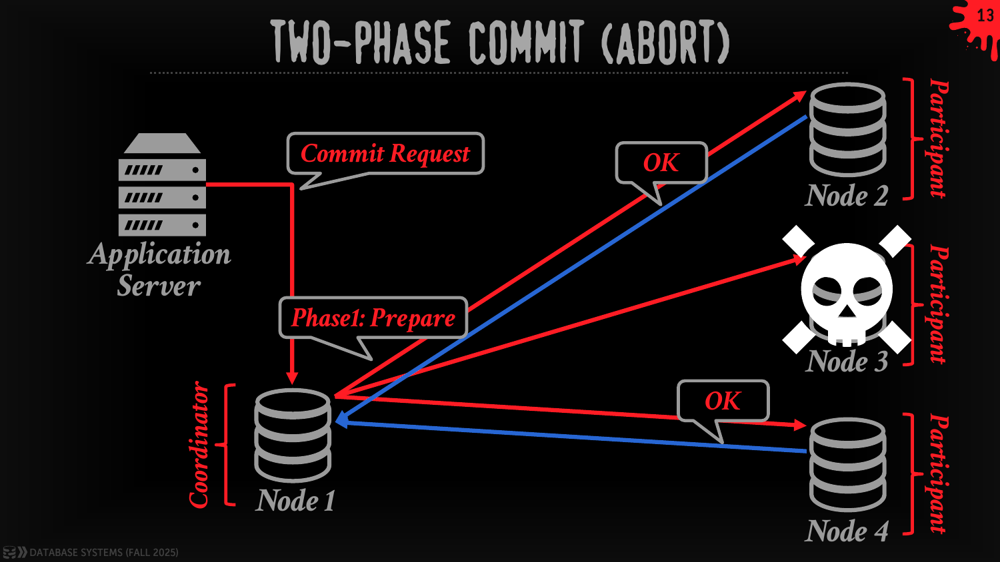

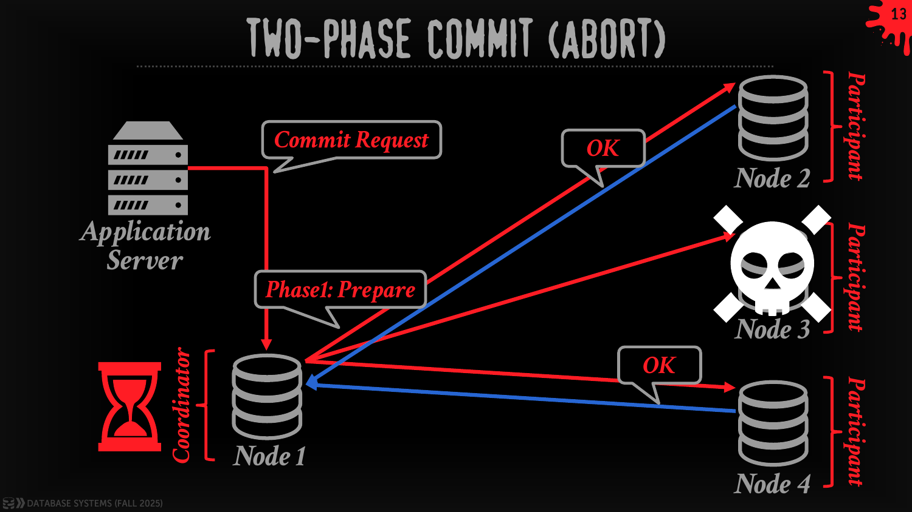

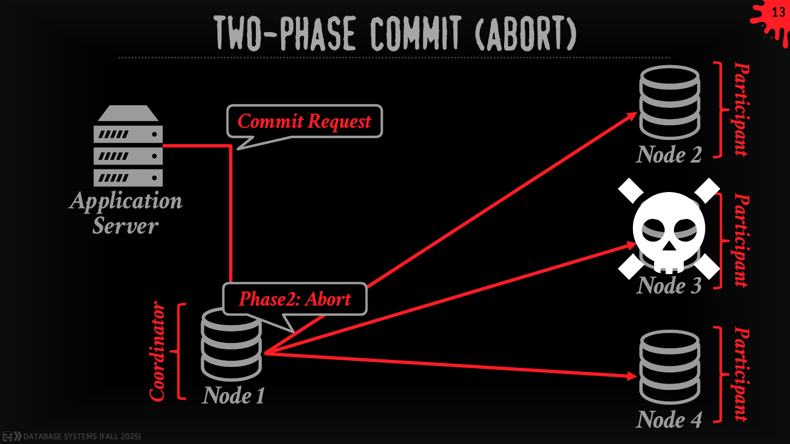

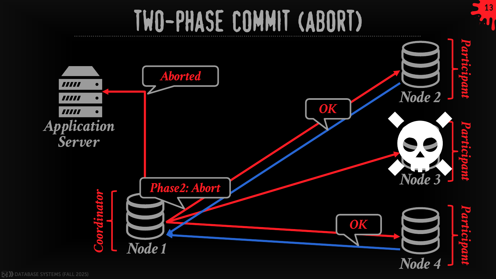


判断一个节点是否还活着，比看上去要难。节点完全宕机时，发给它的请求得不到任何回应，这很好判断。麻烦的是机器还在、[数据库](#数据库)进程却卡住了的情况：比如用 Java 编写的 DBMS 遇上一次漫长的垃圾回收停顿，进程长时间毫无响应，这时用 ping 检查，操作系统照样会回应，节点看起来一切正常。所以[分布式 DBMS](#分布式%20DBMS) 的心跳检测必须由数据库进程本身来回应，只有 DBMS 软件活着并且在正常工作，这个节点才算活着。

还有一种情况出在第二阶段。所有[参与者](#参与者)都在第一阶段投了赞成票，进入第二阶段后，某个[参与者](#参与者)却崩溃了，或者因为程序缺陷回复了不该回复的消息。[事务](#事务)依然是[提交](#提交)的：第一阶段全票通过的那一刻，结局就已确定，[稳定性](#稳定性)不允许它再改变。这个出问题的节点被视为故障节点，系统会启动一个新节点替代它，并通过重放[日志](#日志)让新节点知道这个事务已经提交。应用那边得到的回复也仍然是提交成功。

### 3.3 每一步都要写进[日志](#日志)

📍 *PPT 第 14 页*

崩溃重启的节点要想知道自己当时在做什么，只能依靠[日志](#日志)。[两阶段提交](#两阶段提交)要求每个节点把收发的每条消息和每个阶段的结果记入非易失存储上的日志，可以和普通数据一起写进[预写日志](#预写日志)，也可以单独用一份专门记录[事务](#事务)协调的日志。节点恢复时检查日志里的[两阶段提交](#两阶段提交)记录，按下表处理：

| 重启后在[日志](#日志)里看到的情况 | 处理方式 | 原因 |
|---|---|---|
| 本地[事务](#事务)处于已准备状态 | 联系[协调者](#协调者)，询问最终结局 | 它已投出赞成票，[协调者](#协调者)可能已经决定[提交](#提交)，也可能已经[中止](#中止) |
| 本地事务尚未进入已准备状态 | 直接中止 | 它没投赞成票，[协调者](#协调者)不可能决定提交 |
| 本节点是[协调者](#协调者)，且事务正在提交 | 重新向各节点发送 COMMIT | 决定已经做出，[参与者](#参与者)可能还没收到 |

最后一列是理解这套规则的钥匙：一个节点能不能自行决定，取决于它的赞成票有没有投出去。投出赞成票，等于向[协调者](#协调者)承诺“无论接下来发生什么，只要你说[提交](#提交)，我就能提交”。按照[预写日志](#预写日志)的原则（第 [21](../L21/index.md) 讲），节点应该先把记录刷到磁盘，再把对应的消息发出去。Andy 提到，许多系统为了速度并不对每条消息都这样做，代价是留下一个小窗口，崩溃后的恢复会更费事。但在经典的[两阶段提交](#两阶段提交)里，有两条记录无论如何不能省：[参与者](#参与者)在回复 OK 之前，必须先把“已准备”记录持久化，否则崩溃后它会忘掉自己许下的承诺；[协调者](#协调者)在发出决定之前，必须先把这个决定持久化，否则重启后它不知道自己决定过什么。

### 3.4 协调者崩溃：两阶段提交的阻塞

📍 *PPT 第 15、23 页*

[参与者](#参与者)崩溃的情况比较简单。[协调者](#协调者)用超时判断[参与者](#参与者)是否已死；如果崩溃的[参与者](#参与者)还没有投票，[协调者](#协调者)就当它投了反对票，[中止](#中止)[事务](#事务)。这是唯一安全的选择，因为没有任何证据表明这个事务在那个节点上的修改已经可靠落地。

[协调者](#协调者)崩溃要棘手得多。[参与者](#参与者)们只能在超时之后自己想办法，而且前提是每个[参与者](#参与者)都知道还有哪些其他[参与者](#参与者)，否则连商量的对象都找不到。在它们想出办法之前，系统对这个[事务](#事务)是不可用的。

[参与者](#参与者)能怎么办，要看自己投没投票。只要还有一个[参与者](#参与者)没有投赞成票，[协调者](#协调者)就不可能已经决定[提交](#提交)，大家可以放心地[中止](#中止)[事务](#事务)。麻烦出在已经投了赞成票的[参与者](#参与者)身上：它不能自行中止，因为[协调者](#协调者)可能已经决定提交，甚至已经告诉了应用；它也不能自行提交，因为别的[参与者](#参与者)可能投了反对票。它可以去问其他[参与者](#参与者)，只要有谁已经收到了最终决定，或者还没有投票，问题就解决了。最坏的情况是所有[参与者](#参与者)都投了赞成票，却没有一个收到最终决定：唯一知道结局的只有已经崩溃的[协调者](#协调者)，大家只能等它恢复。

这就是[两阶段提交](#两阶段提交)被称为**[阻塞协议](#阻塞协议)（blocking protocol）**的原因：如果[协调者](#协调者)在发出 Prepare 消息之后崩溃，协议可能一直阻塞到[协调者](#协调者)恢复为止。阻塞期间，处于已准备状态的[事务](#事务)仍然持有[锁](#锁)，需要这些数据的其他事务只能跟着等；系统也不能越过这个悬而未决的事务去[提交](#提交)后续事务，因为状态机的提交顺序只能一步一步向前推进。

Andy 说，大多数系统并不费心让[参与者](#参与者)自行协商出结局，而是采用最简单的做法：[中止](#中止)[事务](#事务)，必要时选出新的[协调者](#协调者)。这种做法在还有[参与者](#参与者)没有投赞成票时完全安全；一旦所有[参与者](#参与者)都已投了赞成票，就回到了上面那个只能等待的局面。要从根本上摆脱阻塞，[协调者](#协调者)本身就不能是一个会宕机的单点，下一节的 [Paxos](#Paxos) 正是为此而生。

### 3.5 两种优化

📍 *PPT 第 16–18 页*

[两阶段提交](#两阶段提交)最直接的代价是消息往返。除了前面说的不把每条消息都刷盘，常见的优化还有两种，一种少见，一种常用。

**[提前准备投票](#提前准备投票)（early prepare voting）**比较少见。如果[协调者](#协调者)发往某个节点的查询确定是这个[事务](#事务)在那里执行的最后一条查询，那个节点就可以在返回查询结果时，把自己在准备阶段的投票一并带回来，省掉一轮往返。难点在“确定”二字：系统必须确切知道这是最后一条查询，不能靠猜，否则投完票之后应用又发来一条查询，协议就乱了。这通常只有使用存储过程（stored procedure）时才办得到：整段事务逻辑预先注册在[数据库](#数据库)服务器上，应用只发起一次调用，类似一次远程过程调用（RPC），DBMS 自然知道事务什么时候结束。多数应用是一条一条地交互式发送查询，所以这种优化用得不多。

**[准备后提前确认](#准备后提前确认)（early acknowledgement after prepare）**则很常见：只要所有[参与者](#参与者)在第一阶段都投了赞成票，[协调者](#协调者)就立刻告诉应用[事务](#事务)[提交](#提交)成功，然后再去执行第二阶段。

| 步骤 | 应用服务器 | [协调者](#协调者)（Node 1） | [参与者](#参与者)（Node 2、3、4） |
|---|---|---|---|
| 1 | 发出 Commit Request | 发送 Prepare | |
| 2 | | | 各自验证，回复 OK |
| 3 | 收到 Success! | 收齐 3 个 OK，立即通知应用 | |
| 4 | | 发送 Commit | |
| 5 | | | [提交](#提交)，回复 OK |

应用的等待时间从两轮往返缩短到一轮。这样做之所以安全，靠的是 3.1 里的那个观察：收齐赞成票的时刻，结局已经确定，第二阶段只是传达。当然，第二阶段仍然要走完，在[参与者](#参与者)收到 Commit 之前，这个[事务](#事务)依然处于已准备状态、占着[锁](#锁)，与它[冲突](#冲突)的事务仍要等待。另一个前提是[协调者](#协调者)必须先把[提交](#提交)的决定写进[日志](#日志)，再回复应用。[协调者](#协调者)恰好在回复应用之后、发出 Commit 之前崩溃，正是 3.4 里所有[参与者](#参与者)都投了赞成票却不知道结局的局面；它重启后从自己的日志里读到这个决定，把 Commit 补发出去即可。Andy 的判断是，只要日志记录得当，提前确认之后事务却无法完成的可能性很低。

## 4. Paxos：多数派就够了

📍 *PPT 第 19–23 页*

### 4.1 从全票到多数派

📍 *PPT 第 19–20 页*

[两阶段提交](#两阶段提交)要求全票，所以任何一个节点出问题都会拖住整个[事务](#事务)。视图戳[复制](#复制)、[Paxos](#Paxos)、[Raft](#Raft) 这一系列协议的共同突破在于，只要求多数派（majority）同意，而不是全体同意。这样即使一部分节点宕机，只要还有多数节点活着并且同意，系统就能继续[提交](#提交)事务。

**[Paxos](#Paxos)** 是一种[共识协议](#共识协议)：由一个[协调者](#协调者)提出一个结局（例如[提交](#提交)或[中止](#中止)），再由[参与者](#参与者)投票决定这个结局能否成立。只要多数[参与者](#参与者)可用，它就不会阻塞，而且在最好的情况下，它的消息延迟已被证明是最少的。[Paxos](#Paxos) 给角色起了不同的名字：[协调者](#协调者)叫**[提议者](#提议者)（proposer）**，[参与者](#参与者)叫**[接受者](#接受者)（acceptor）**。另有一类**[学习者](#学习者)（learner）**，只观察状态机的变化，也就是[事务](#事务)的提交顺序，自己不参与投票，属于附加的角色，这里不讨论。

沿用前面的例子：Node 1 是[提议者](#提议者)，Node 2、3、4 是[接受者](#接受者)，其中一个[接受者](#接受者)在[事务](#事务)运行时宕机了。
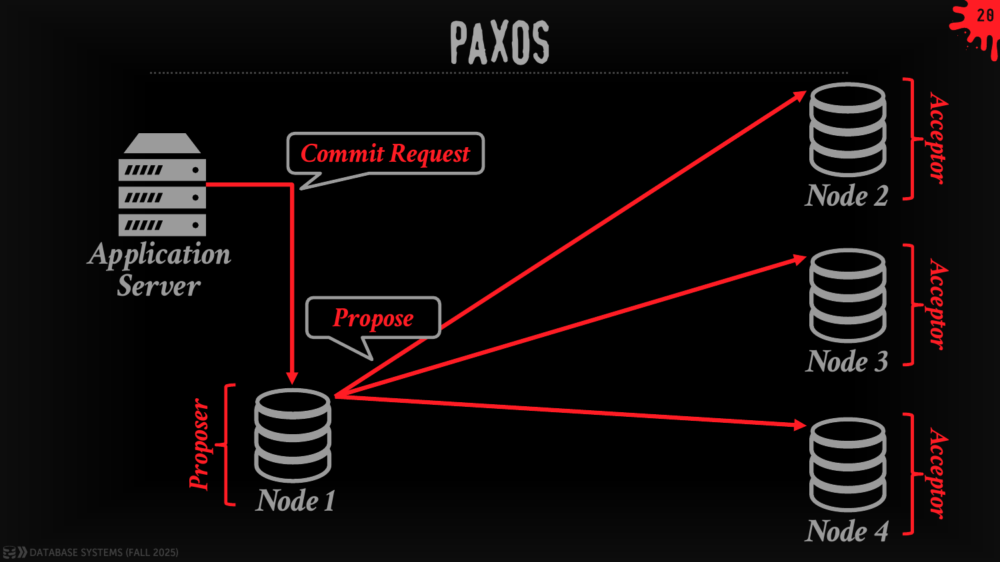

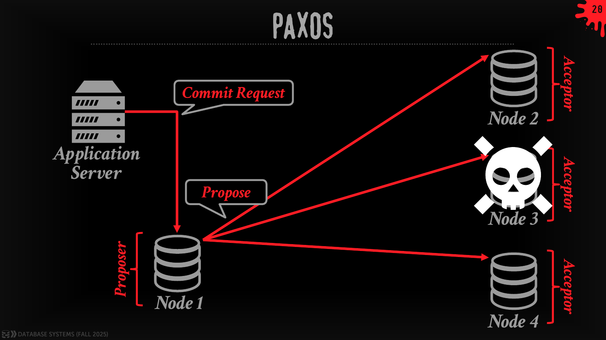

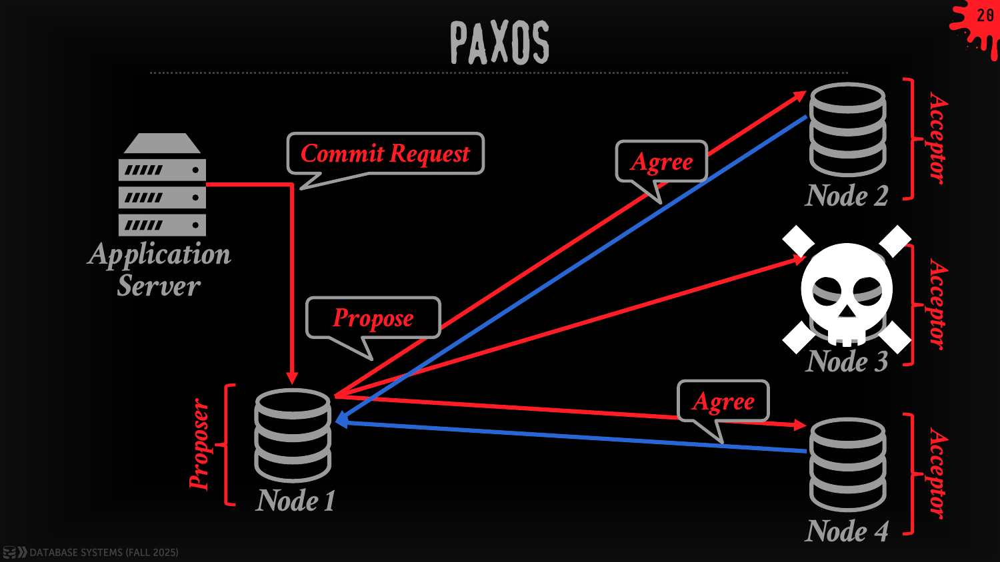

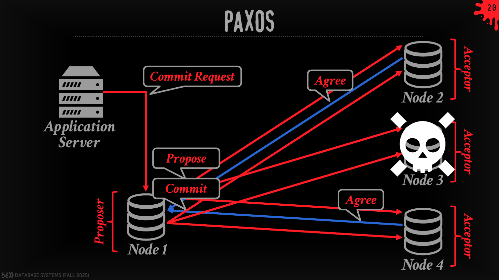

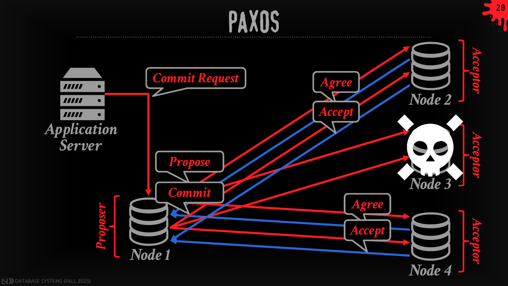

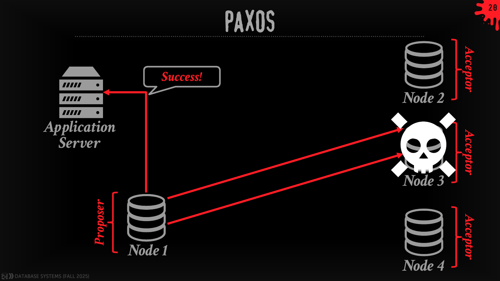


| 步骤 | [提议者](#提议者)（Node 1） | 两个存活的[接受者](#接受者) | 宕机的[接受者](#接受者) |
|---|---|---|---|
| 1 | 收到 Commit Request，发送 Propose | | 无响应 |
| 2 | | 回复 Agree | — |
| 3 | 3 个[接受者](#接受者)中 2 个同意，已过半，发送 Commit | | — |
| 4 | | 回复 Accept | — |
| 5 | 收到过半的 Accept，通知应用 Success! | | — |

换成[两阶段提交](#两阶段提交)，第 3 步就要一直等到超时，然后[中止](#中止)[事务](#事务)；[Paxos](#Paxos) 则因为 3 个里有 2 个同意，照常[提交](#提交)。注意第 5 步：[提议者](#提议者)必须收到多数[接受者](#接受者)的 Accept，才能告诉应用事务已经提交，没有[两阶段提交](#两阶段提交)那种“[准备后提前确认](#准备后提前确认)”的捷径。

宕机的节点恢复以后，要查看[日志](#日志)，弄清自己错过了什么；如果改由它的副本接替，副本同样要从日志中得知这个[事务](#事务)已经[提交](#提交)。这是多数派协议多出来的一步：失效节点回来之后，要先和其他节点对齐状态机。由于节点都不是恶意的，它会老老实实照日志执行，而不会自作主张丢掉某些记录，造成节点之间的不一致。

多数派之所以够用，是因为任意两个多数派必然有交集。5 个节点中任取 3 个，再任取 3 个，两组至少有 1 个节点重合。因此不可能有两个互相冲突的决定都拿到多数票：重合的那个节点见过两个提议，它会拒绝较旧的那一个（4.3 会看到具体的规则）。

Jim Gray 和 Leslie Lamport 在 2006 年的一篇论文中证明，[两阶段提交](#两阶段提交)其实是 [Paxos](#Paxos) 的一个退化情形。一般地，[Paxos](#Paxos) 使用

$$
N = 2F + 1
$$

个[协调者](#协调者)，其中 F 是允许同时失效的[协调者](#协调者)数量；只要至少有 F + 1 个正常工作，协议就能推进。取 F = 0，就只剩一个[协调者](#协调者)，一个失效都容忍不了，这正是[两阶段提交](#两阶段提交)。取 F = 2，则 5 个[协调者](#协调者)中任意 2 个同时宕机，系统仍能继续工作。

> 💬 **旁注**
> [Paxos](#Paxos) 的原始论文是计算机科学史上的一篇奇文。Leslie Lamport（2013 年图灵奖得主）在 1989 年写成它时，没有采用算法论文的写法，而是扮成一位考古学家，讲述自己在希腊的 [Paxos](#Paxos) 岛上发现了一个古代部落，描述这个早期的民主社会怎样把选票写在石板上、扔进洞里，其他村民又怎样来到洞边取出石板、查看结果。Andy 说，在计算机科学界找不到第二篇这样写的论文，照着它根本实现不出任何东西，读来晦涩又滑稽。
>
> 论文投稿后被拒，Lamport 把它塞进了文件柜，多年没再理会。后来陆续有人发表论文，绕着 [Paxos](#Paxos) 已经解决的问题打转，他才把它翻出来重新投稿，终于在 1998 年发表。发表时附有一段编者按，说这份稿件是最近在期刊编辑部的一个文件柜后面发现的，尽管年代久远，仍然值得发表。Lamport 在个人网站上为自己的每篇论文都写了背景回顾，按 Andy 的转述，关于这一篇，他认为论文本身是一件天才之作，只是审稿人没能看出它的精彩。Andy 读研究生时在分布式系统课上讲这篇论文，也照着这个说法把审稿人批评了一通，结果任课教授恰好就是当年的审稿人之一。据那位教授说，审稿人并不反对考古故事，只是希望作者加一个附录，说明算法究竟怎样实现，而 Lamport 认为原稿完美无缺，拒绝做任何修改，论文因此被拒。
>
> Lamport 后来又写了一篇 *[Paxos](#Paxos) Made Simple*，Andy 的评价是它一点也不简单。他推荐的入门读物是 Google 的 *[Paxos](#Paxos) Made Live*，讲的是 Google 在 Chubby [锁](#锁)服务等系统中实现 [Paxos](#Paxos) 的经验。
>
> *原话：“So you can't take this paper and actually implement anything from it, right? It's just inscrutable. It's hilarious.”*

### 4.2 多数派能替谁做主

📍 *PPT 第 20 页*

多数派的规则很容易引出一个疑问：如果三个[接受者](#接受者)中有一个投了反对票，比如它发现[事务](#事务)违反了完整性约束，其余两个同意，[Paxos](#Paxos) 是不是就忽略这张反对票，照样[提交](#提交)？

Andy 的回答是要看 [Paxos](#Paxos) 用来做什么。选举领导者时，少数节点的反对可以忽略；决定[事务](#事务)能否[提交](#提交)时，一张基于完整性约束的反对票必须导致[中止](#中止)。这样一来，似乎又退回了[两阶段提交](#两阶段提交)的全票要求。

解开这个矛盾的关键，是分清[接受者](#接受者)们在为什么投票。[Paxos](#Paxos) 原本用于[复制](#复制)：[接受者](#接受者)是同一份数据的多个副本，它们的状态完全相同，面对同一个[事务](#事务)不会得出不同的验证结论。它们投票决定的是“把这个结局记录在[日志](#日志)的这个位置”，而不是各自重新审查一遍事务。完整性约束、读写[冲突](#冲突)这些检查，应当在事务执行期间或者[提交](#提交)之前就完成，Andy 也强调了这一点。他提到一种做法：先把事务的全部查询“侦察”式地执行一遍，只记录每条查询打算做的修改而不真正写入，趁这时检查非空、唯一性之类的约束，等到提交时再一次性应用这些修改，提交阶段也就不会再冒出约束冲突。到了投票的时候，要确认的只是这个已经做出的决定能否被多数副本可靠地记住。

分区的情况则不同。如果 Node 3 是某一行数据唯一的存放位置，那么只有它能判断涉及这一行的修改是否合法，也只有它能把这一行真正写下去。别的节点存的是别的数据，它们凑成的多数派替代不了 Node 3；Node 3 一旦宕机，系统在这部分数据上本来就无能为力。要让它的失效不影响[提交](#提交)，就得给这份数据配备副本，让副本也能参与决定。

实际系统中常见的做法，正是把两者组合起来：每个分区自身[复制](#复制)成一个 [Paxos](#Paxos)（或 [Raft](#Raft)）组，分区之间再运行[两阶段提交](#两阶段提交)。这样一来，[两阶段提交](#两阶段提交)的每个[参与者](#参与者)，连同[协调者](#协调者)，都不再是单个会宕机的节点，而是一个只要多数副本存活就能继续工作的组，[两阶段提交](#两阶段提交)的阻塞问题也就随之消失。Gray 和 Lamport 在前面提到的那篇论文中提出的 [Paxos](#Paxos) Commit，就是用 [Paxos](#Paxos) 记录每个[参与者](#参与者)的投票，从而消除对单个[协调者](#协调者)的依赖；Google 的 Spanner 也采用了分区内用 [Paxos](#Paxos) 复制、分区间用[两阶段提交](#两阶段提交)的分层结构。

### 4.3 提议者之间的竞争

📍 *PPT 第 21 页*

[Paxos](#Paxos) 允许多个节点同时充当[提议者](#提议者)。每个提议带有一个逻辑[时间戳](#时间戳) n，[接受者](#接受者)遵守一条规则：如果还没有对编号更大的提议表示过同意，就回复 Agree，否则回复 Reject。下表是两个[提议者](#提议者)先后提出提议时的消息序列：

| 步骤 | 消息 | 方向 | [接受者](#接受者)的状态与判断 |
|---|---|---|---|
| 1 | Propose(n) | [提议者](#提议者) 1 → [接受者](#接受者) | 还没见过更大的编号 |
| 2 | Agree(n) | [接受者](#接受者) → [提议者](#提议者) 1 | 记下：已同意的最大编号是 n |
| 3 | Propose(n+1) | [提议者](#提议者) 2 → [接受者](#接受者) | n+1 比 n 大 |
| 4 | Commit(n) | [提议者](#提议者) 1 → [接受者](#接受者) | 已见过 n+1，n 已经过时 |
| 5 | Reject(n, n+1) | [接受者](#接受者) → [提议者](#提议者) 1 | 告诉[提议者](#提议者) 1：你的 n 已被 n+1 取代 |
| 6 | Agree(n+1) | [接受者](#接受者) → [提议者](#提议者) 2 | 已同意的最大编号变为 n+1 |
| 7 | Commit(n+1) | [提议者](#提议者) 2 → [接受者](#接受者) | 与已同意的最大编号相符 |
| 8 | Accept(n+1) | [接受者](#接受者) → [提议者](#提议者) 2 | 提议 n+1 通过 |

[提议者](#提议者) 1 的提议明明已经拿到了多数同意，却在[提交](#提交)时被拒绝，原因是[接受者](#接受者)在此期间见到了更新的提议 n+1。这条“只认最大编号”的规则保证系统总是向前推进：一个过时的提议不可能覆盖一个更新的提议。被拒绝的[提议者](#提议者)可以换一个更大的编号重新提议。

这条规则也带来一个隐患。如果两个[提议者](#提议者)不停地轮流抢先，每一方刚拿到多数同意，就被对方更大的编号作废，系统就会一直空转，谁也[提交](#提交)不了。解决办法很朴素：提议失败后按[指数退避](#指数退避)（exponential backoff）等待一段时间再重试，比如先等 50 毫秒，再失败就等 100 毫秒，以此类推。节点之间并无恶意，只需要一个简单的办法让它们互相让一让，总会有一方顺利提交。

### 4.4 Multi-Paxos：只让一个节点提议

📍 *PPT 第 22 页*

[提议者](#提议者)互相抢先，根源在于[提议者](#提议者)不止一个。**[Multi-Paxos](#Multi-Paxos)** 的办法是选出一个领导者（leader），在一段时间内只由它提出变更。既然没有别人竞争，每次[提交](#提交)就可以跳过 Propose 这一轮，直接进入 Commit 和 Accept。一旦发生故障，再退回完整的 [Paxos](#Paxos)。

“谁是领导者”本身也是系统状态的一部分，所以选举领导者同样用一轮 [Paxos](#Paxos) 来完成，相当于在“领导者是谁”这件事上[提交](#提交)一个[事务](#事务)。领导者的任期以**[租约](#租约)（lease）**的形式存在，到期之前要通过又一轮 [Paxos](#Paxos) 续约。选举时，各节点还必须交换[日志](#日志)条目，保证新领导者和大家的日志都是最新的。

之所以要定期续约，是因为系统需要不断确认领导者还活着。续约的频率是一个权衡：续得太勤，系统把大量时间花在选举上，而不是[提交](#提交)[事务](#事务)；续得太少，领导者宕机之后，系统要等到[租约](#租约)过期才能选出新的领导者，这段时间里的事务都会停滞。各系统的取值不同，例如 Google Spanner 的[租约](#租约)默认为 10 秒。领导者宕机时，可能有两个节点同时想接任，这又回到了 4.3 的竞争局面，同样用[退避](#退避)来化解。

### 4.5 两阶段提交、Paxos 与 Raft

📍 *PPT 第 23 页*

**[Raft](#Raft)** 与 [Paxos](#Paxos) 基本相同，区别主要有两点：节点角色更少，只有领导者（leader）和跟随者（follower），选举期间还有临时的候选者（candidate）；只有[日志](#日志)最新的节点才能当选领导者，因为它的状态最适合接管。三种协议的对比如下：

| | [两阶段提交](#两阶段提交) | [Paxos](#Paxos) | [Raft](#Raft) |
|---|---|---|---|
| 需要多少节点同意 | 全体[参与者](#参与者) | 多数[接受者](#接受者) | 多数节点 |
| 何时阻塞 | [协调者](#协调者)在发出 Prepare 之后崩溃，要等它恢复 | 只要多数节点存活，并且有一段足够长的时间不再发生新故障，就不阻塞 | 同 [Paxos](#Paxos) |
| 角色 | [协调者](#协调者)、[参与者](#参与者) | [提议者](#提议者)、[接受者](#接受者)、[学习者](#学习者) | 领导者、跟随者、候选者 |
| 领导者 | 无固定领导者，每个[事务](#事务)有自己的[协调者](#协调者) | [Multi-Paxos](#Multi-Paxos) 中选出 | 只有[日志](#日志)最新的节点能当选 |

[Paxos](#Paxos) 不阻塞的条件里有一句“有一段足够长的时间不再发生新故障”：如果故障接连不断，比如刚选出的领导者一个接一个地宕机，协议就始终没有机会完成一轮完整的投票。

这张表并不意味着[两阶段提交](#两阶段提交)已经过时。如果节点都在同一个数据中心，很少发生故障，又不存在恶意行为，[两阶段提交](#两阶段提交)需要的消息往返通常更少，往往比 [Paxos](#Paxos) 更合适。不过在现代系统中，[Paxos](#Paxos) 和 [Raft](#Raft) 用得比[两阶段提交](#两阶段提交)更普遍。Andy 认为，如今 [Raft](#Raft) 的使用可能已经超过了 [Paxos](#Paxos)，原因是 [Raft](#Raft) 有大量开源实现，而 [Paxos](#Paxos) 几乎没有现成的开源实现可用。

## 5. 网络断开之后：CAP 与 PACELC

📍 *PPT 第 24–30 页*

[两阶段提交](#两阶段提交)、[Paxos](#Paxos) 和 [Raft](#Raft) 都能保证，一旦协议宣布某个[事务](#事务)已经[提交](#提交)，所有节点对此就没有异议。它们没有回答的是另一个问题：如果节点之间彻底联系不上，系统还能提供什么样的保证，是否还能继续执行查询和事务？

### 5.1 CAP 定理（CAP Theorem）

📍 *PPT 第 24–26 页*

**[CAP 定理](#CAP%20定理)（CAP Theorem）**由加州大学伯克利分校的 Eric Brewer 在 1990 年代后期提出，2002 年在 MIT 得到证明。它指出，一个分布式系统不可能始终同时满足以下三个性质，最多只能同时得到其中两个：
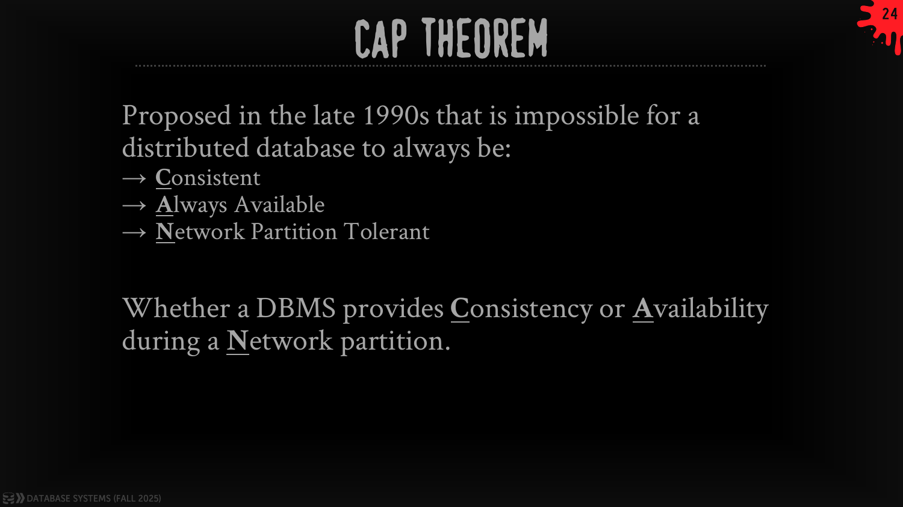


- **一致性（Consistency）**：这里指[线性一致性](#线性一致性)（linearizability）。一次写入完成之后，之后所有的读都返回这次写入的值或更晚写入的值；一次读返回了某个值之后，之后的读也只能返回这个值或更晚写入的值。
- **可用性（Availability）**：所有正常运行的节点都能响应所有请求。
- **分区容忍（Partition Tolerance）**：即使节点之间丢失了一部分消息，系统仍能正确运行。

一致性的含义可以用一主一副两个节点来看。两台应用服务器位于两个数据中心，[数据库](#数据库)里 A=1、B=8。左边的应用把 A 改成 2，主节点应用修改后，把对应的[预写日志](#预写日志)记录发给副本，副本同样把 A 改成 2 并回复确认，主节点这才告诉应用写入成功。此后，右边的应用无论从主节点还是从副本读 A，都会读到 2。只要主节点宣布[事务](#事务)已经[提交](#提交)，这个修改就应当立即在所有副本上可见。
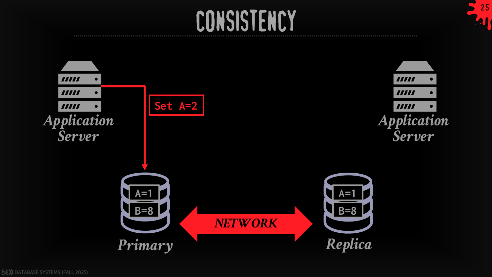

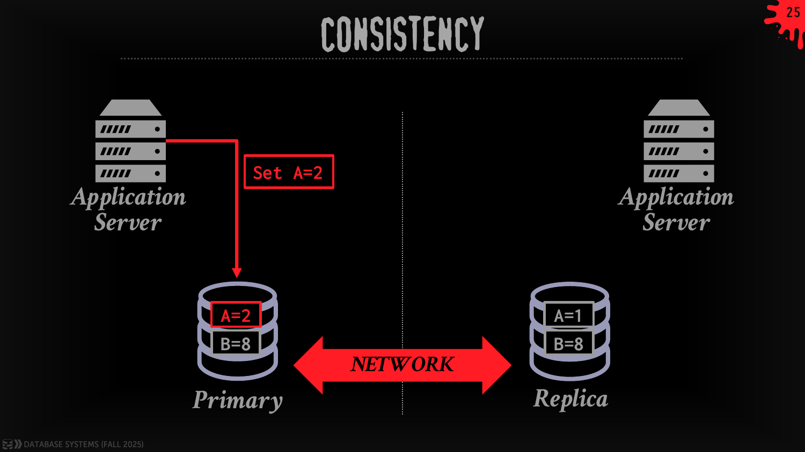

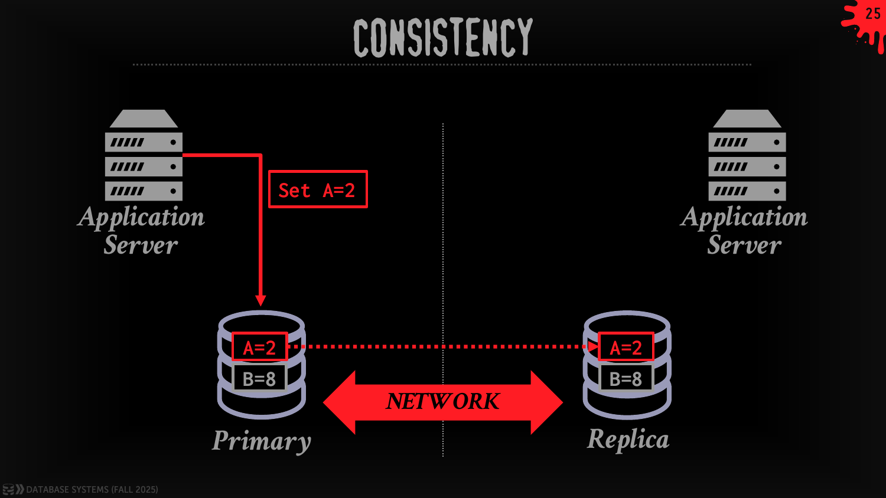

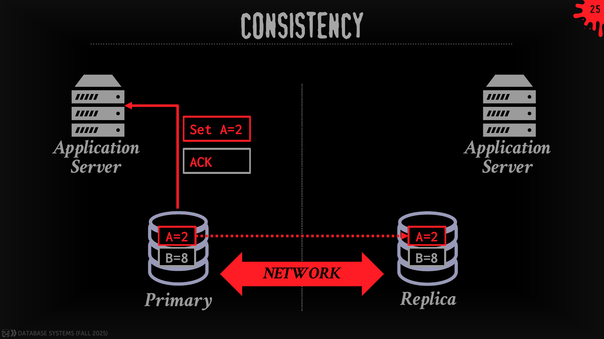

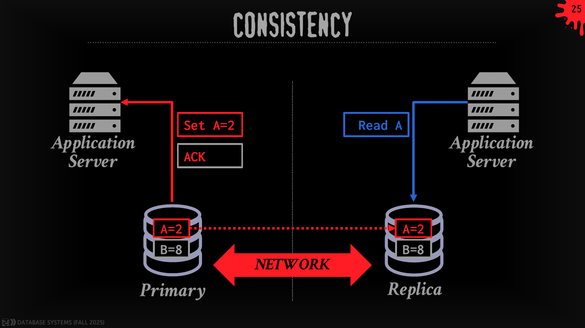

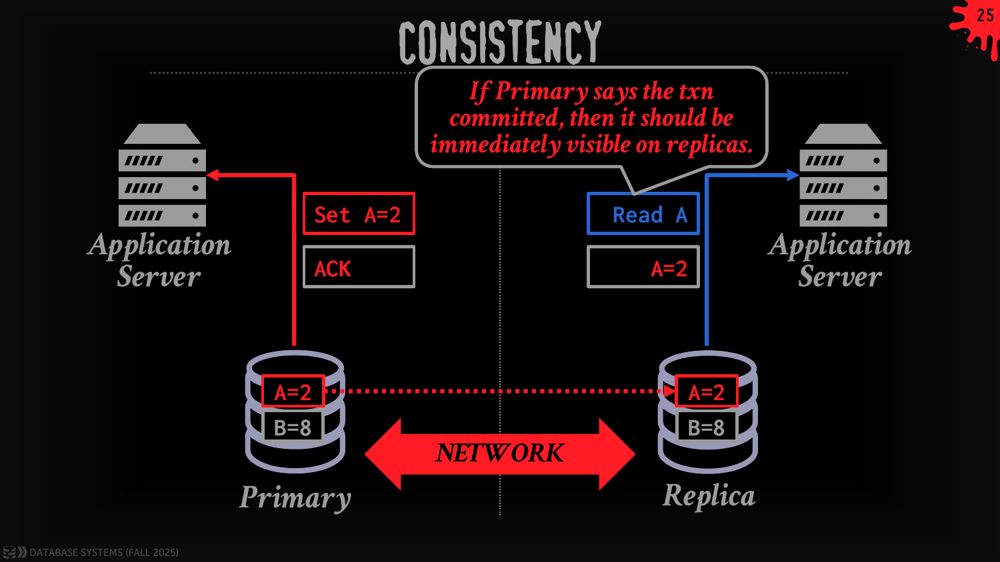


可用性说的是另一件事。如果副本宕机了，两边的应用都转去访问主节点，读 B 得到 8，读 A 得到 1，系统照常服务。
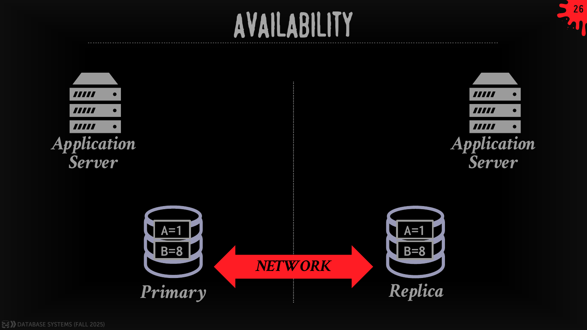


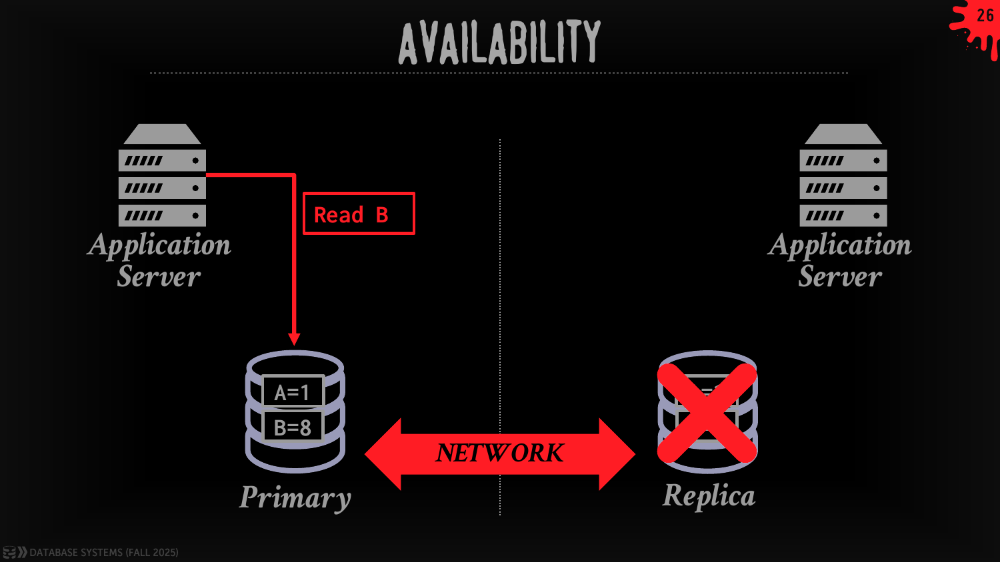

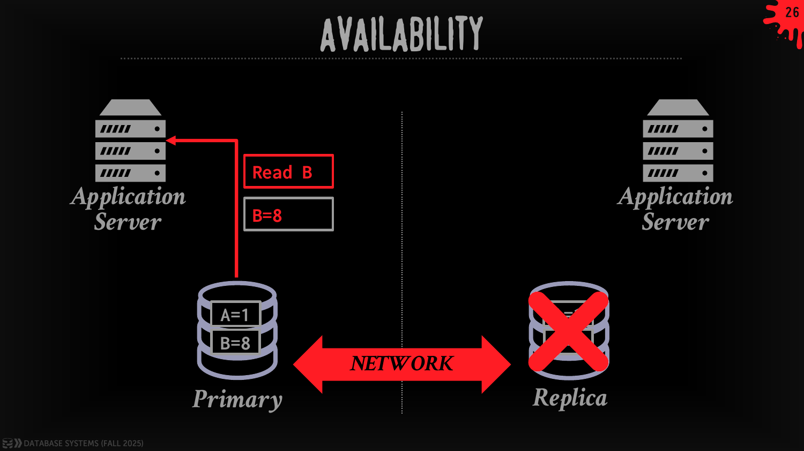

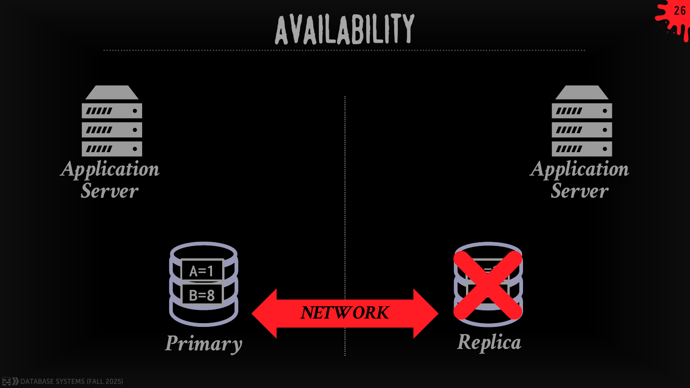

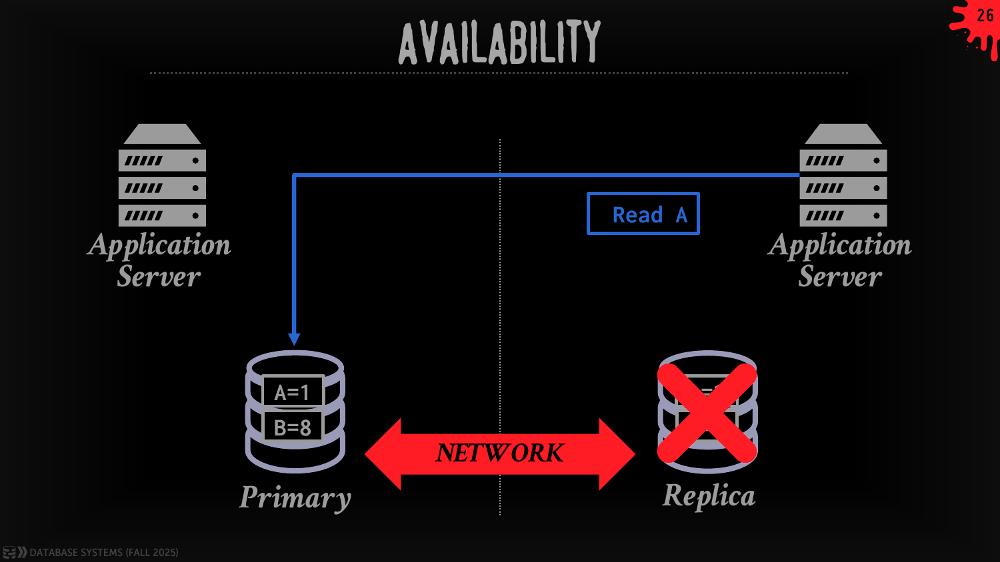

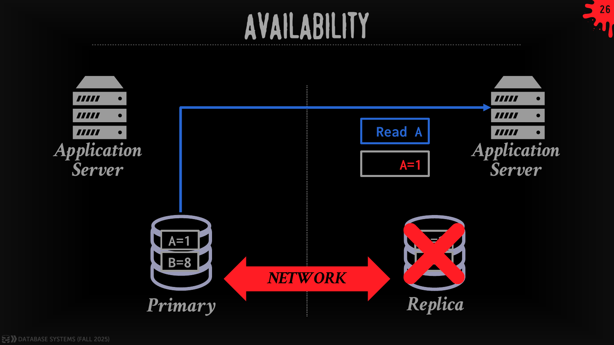


这两个例子里网络一直是通的，分区容忍还没有出场。[CAP 定理](#CAP%20定理)真正要回答的问题是：网络一旦断开，系统是保一致性，还是保可用性？NoSQL 系统通常选择可用性，传统的关系型[数据库](#数据库)和新一代的分布式 SQL（NewSQL）系统则选择一致性。

有两个词在这里容易混淆。CAP 中的 C 指[线性一致性](#线性一致性)，与 ACID 中的 C（数据满足完整性约束，第 [17](../L17/index.md) 讲）、[原子提交协议](#原子提交协议)中的[一致性](#一致性（提交协议）)（所有节点结局相同，2.2 节）都不相同。CAP 中的 P 指**[网络分区](#网络分区)（network partition）**，即网络故障把节点分隔成互相联系不上的几组，与第 [23](../L23/index.md) 讲把表切分成多块的数据分区（partitioning）也是两回事。

### 5.2 网络分区与脑裂

📍 *PPT 第 27 页*

还是一主一副两个节点，[数据库](#数据库)里 A=1、B=8，现在两者之间的网络断开了。主节点认为自己一切正常，继续作为主节点工作。副本联系不上主节点，只能推测主节点已经崩溃，于是发起[领导者选举](#领导者选举)，把自己提升为新的主节点。系统里同时出现了两个主节点：

```text
                     network down
  +--------------+        X        +--------------+
  | Primary      |                 | Primary      |  <- was the replica
  | A=2  B=8     |                 | A=3  B=8     |
  +--------------+                 +--------------+
         ^  Set A=2 / ACK                 ^  Set A=3 / ACK
         |                                |
  App Server (left)                App Server (right)
```

左边的应用把 A 改成 2，右边的应用把 A 改成 3，两边的主节点都[提交](#提交)了修改，都告诉应用写入成功。网络恢复以后，两个主节点都认为自己持有最新的数据，而系统已经对外宣布两个互相矛盾的[事务](#事务)都已提交。这种局面叫作**[脑裂](#脑裂)（split brain）**。

### 5.3 停机，还是事后和解

📍 *PPT 第 28 页*

面对[网络分区](#网络分区)，系统有两种选择。

第一种是停机。任何一个不包含多数节点的分区都停止接受更新，只读查询可以照常执行，但不允许任何[事务](#事务)修改数据，直到足够多的节点重新连通、恢复多数为止。这是用可用性换一致性，大多数支持事务的分布式[数据库](#数据库)都这样做。它和 [Paxos](#Paxos) 的多数派规则一脉相承：网络断开后，最多只有一侧拥有多数节点，只有这一侧能继续写入，也就不会出现两个主节点。这也解释了集群为什么通常由 3 个、5 个这样的奇数个节点组成。上面一主一副的例子里只有 2 个节点，断开后任何一侧都凑不齐多数，整个系统都无法写入；有了第 3 个节点，拥有 2 个节点的那一侧就能继续工作。

第二种是允许分裂、事后和解：网络断开期间，两侧都照常接受读写；网络恢复后，再判断每条被修改过的记录哪个版本才“正确”。和解有两种做法。
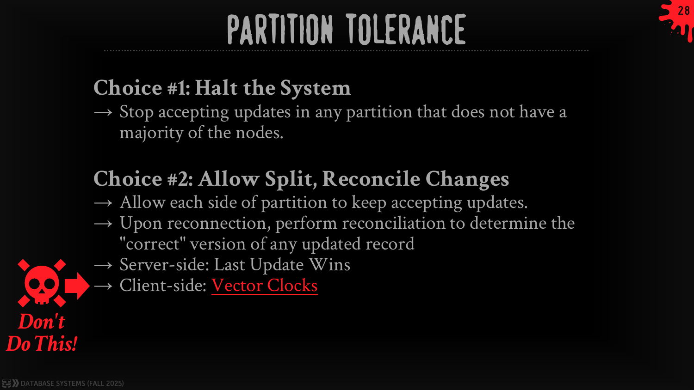


服务端的做法是**[最后写入者胜出](#最后写入者胜出)（last update wins）**：比较记录的修改[时间戳](#时间戳)，保留最新的版本。大多数 NoSQL 系统采用这种办法。它的问题在于，被丢弃的版本同样是系统曾经宣布[提交](#提交)成功的写入。上例中如果 A=3 的时间戳更晚，A=2 就会被悄无声息地覆盖，而左边的应用一直以为自己的修改已经生效。[事务](#事务)一旦包含多条语句，只看单条记录的新旧就更靠不住了。

客户端的做法是**[向量时钟](#向量时钟)（vector clock）**：每个版本附带一个计数器向量，每个节点各占一个分量，节点每写一次就把自己的分量加一。比较两个向量，就能看出一个版本是否由另一个版本演变而来。上例中，A=1 的向量是 ⟨左:0, 右:0⟩，A=2 是 ⟨左:1, 右:0⟩，A=3 是 ⟨左:0, 右:1⟩；后两者谁也不比谁大，说明它们是[并发](#并发)产生的，存在[冲突](#冲突)。系统不替用户做决定，而是把冲突的各个版本都返回给客户端，由应用决定采用哪一个。这有点像把 MVCC 的[版本链](#版本链)（第 [20](../L20/index.md) 讲）直接交给应用处理。Riak 就是这样做的。Andy 的建议是千万别这么做：普通的 JavaScript 程序员根本不知道[向量时钟](#向量时钟)是什么，更不会推理[数据库](#数据库)状态是否正确。[^vc] 与其如此，不如直接告诉开发者系统采用[最后写入者胜出](#最后写入者胜出)，或者干脆停机，等节点恢复多数再说。

### 5.4 PACELC：没有分区的时候

📍 *PPT 第 29–30 页*

[CAP 定理](#CAP%20定理)只讨论[网络分区](#网络分区)时的取舍，而且忽略了一个现实因素：延迟。理论上，系统可以一直等到网络恢复再回应请求，一致性确实保住了，但延迟可能长达几分钟乃至几小时，这在实际中不可接受。2010 年提出的 **[PACELC 定理](#PACELC%20定理)（PACELC Theorem）**把延迟纳入了考虑：如果发生分区（Partition），要在可用性（Availability）和一致性（Consistency）之间选择；否则（Else），即系统正常运行时，要在延迟（Latency）和一致性（Consistency）之间选择。名字就是这几个首字母拼起来的。

即使没有任何故障，这个取舍也时刻存在。设想主节点在美国东部（us-east），两个副本分别在欧洲（eu-east）和美国西部（us-west），[数据库](#数据库)中 A=1。应用把 A 改成 2，主节点应用修改后把它发给两个副本，副本修改后各自回复确认。问题在于主节点要等多久，才告诉应用写入成功：

| 主节点回复应用之前等待的确认 | 应用感受到的延迟 | 此后从副本读 A |
|---|---|---|
| 不等任何副本 | 最低 | 两个副本都可能还是旧值 1 |
| 只等 us-west | 较低 | 只有 us-west 保证读到 2 |
| 等全部副本 | 取决于最慢的那条跨大西洋链路 | 两个副本都保证读到 2 |

等得越少，延迟越低，但应用已经被告知写入成功，从副本读到的却可能还是旧值；想要一致性，就要等所有副本确认，延迟由最慢的副本决定。实际系统通常设置一个超时，超时之后，要么[中止](#中止)[事务](#事务)，要么接受暂时的不一致。[Paxos](#Paxos) 的多数派规则正是其中的一个折中点：3 个节点里，主节点加上较近的 us-west 就构成多数，不必等待跨越大洋的确认。
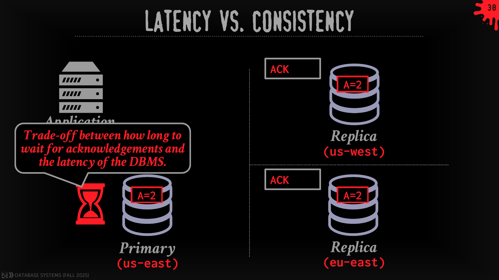

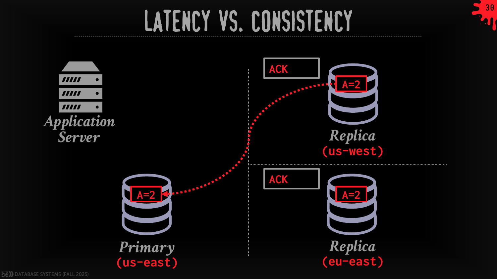

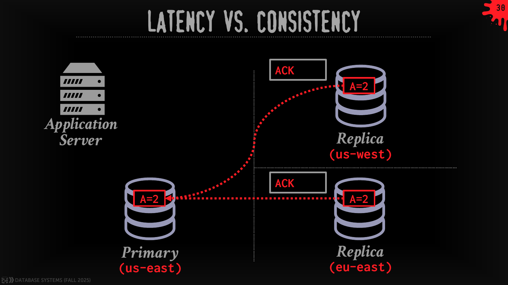

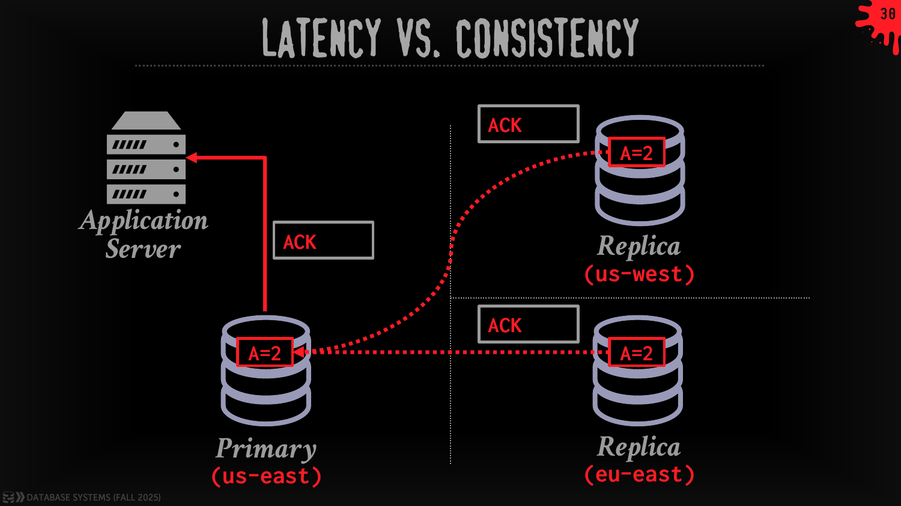


选哪一端，取决于数据有多重要。Andy 的例子是：银行账户涉及钱，必须保证一致性，不能把钱弄丢；Reddit 上的一条帖子晚几秒钟出现，没有人会在意。[^bank] 有时，不一致还能在应用层掩盖过去。Andy 举了 Facebook 早年的例子：当时所有写入都要发往位于美国的主数据中心，再传播到其他大洲的副本。南美的用户发了一条动态，刷新页面时读的是本地副本，而新动态还没传播过来，用户便以为发布失败了。Facebook 的办法是把刚发布的内容存进用户浏览器的 cookie，刷新时直接从 cookie 中取出显示，用户就看不出数据还在路上（Facebook 后来改成了[多主](#多主)架构）。这是用应用层的小技巧，换取更低的延迟。

## 6. 分布式[连接](#连接)

📍 *PPT 第 31–37 页*

前半部分的主角是[事务](#事务)的[提交](#提交)。在 OLAP 系统中，查询基本是只读的，提交不再是瓶颈，最昂贵的操作变成了[连接](#连接)，而连接的代价取决于数据在节点之间怎样分布。

### 6.1 把匹配的[元组](#元组)放到同一个节点

📍 *PPT 第 31–32 页*

对分析型负载而言，大部分时间花在计算[连接](#连接)和读取磁盘上，优化连接因此格外重要。分布式连接的效率，取决于参与连接的表各自是怎样分区的。

最省事的做法是把相关的表整张搬到同一个节点上，在那里执行[连接](#连接)。这样做会失去[分布式 DBMS](#分布式%20DBMS) 的并行能力，要通过网络传输大量数据，而且数据很可能根本放不进一个节点。
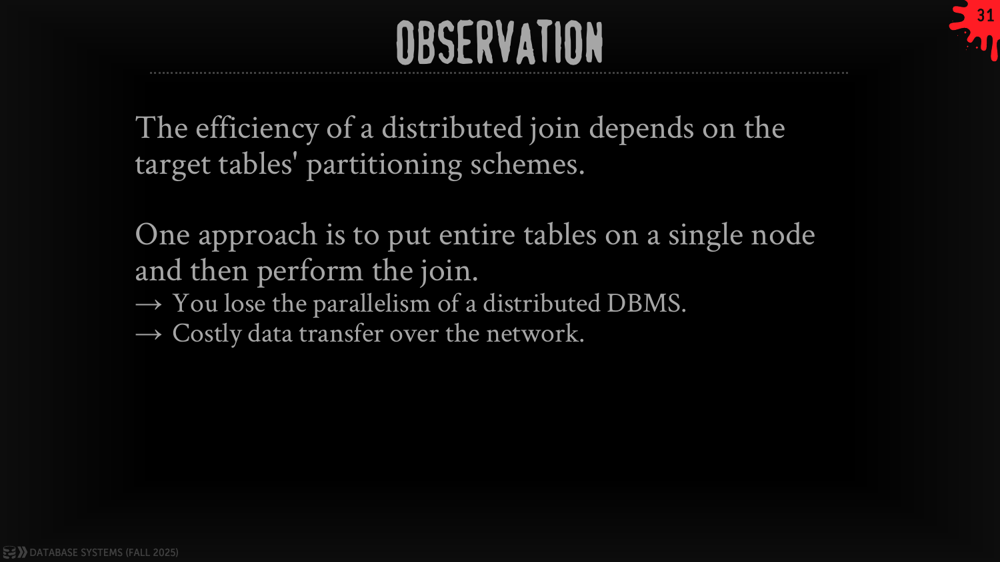


更好的思路是：要[连接](#连接) R 和 S，DBMS 只需把能够互相匹配的[元组](#元组)送到同一个节点上。数据到位之后，每个节点在本地执行第 [12](../L12/index.md) 讲的连接算法，[嵌套循环连接](#嵌套循环连接)、[排序归并连接](#排序归并连接)、[哈希连接](#哈希连接)都可以照用。分布式的部分只负责决定数据怎样移动，并且只移动计算连接所需的最少数据。结果必须和所有数据都在一个节点上时完全相同。SQL 的结果本身是无序的（除非查询带有 `ORDER BY`），所以各节点的部分结果以什么顺序拼接无关紧要，但逻辑上的结果集必须一致。

下面四种情形执行的是同一条查询，从完全不需要搬运数据，到两张表都要重新分区，代价逐级上升：

```sql
SELECT * FROM R JOIN S
    ON R.id = S.id
```

### 6.2 情形一、二：数据已经就位

📍 *PPT 第 33–34 页*

情形一：R 按[连接](#连接)键 id 分区，Node 1 存放 id 为 1–100 的[元组](#元组)，Node 2 存放 101–200；S 在每个节点上都有一份完整的副本。

```text
          Node 1                          Node 2
  +--------------------+          +--------------------+
  | R{id}  id:1-100    |          | R{id}  id:101-200  |
  | S      replicated  |          | S      replicated  |
  +--------------------+          +--------------------+
        P1: R ⋈ S                       P2: R ⋈ S
                \                        /
                 +------> R ⋈ S <-------+
```

每个节点用本地的 R 分区和本地的 S 副本做[连接](#连接)，得到部分结果 P1 和 P2，再发给一个负责汇总的节点。汇总只是把各部分结果拼接起来，代价很低。
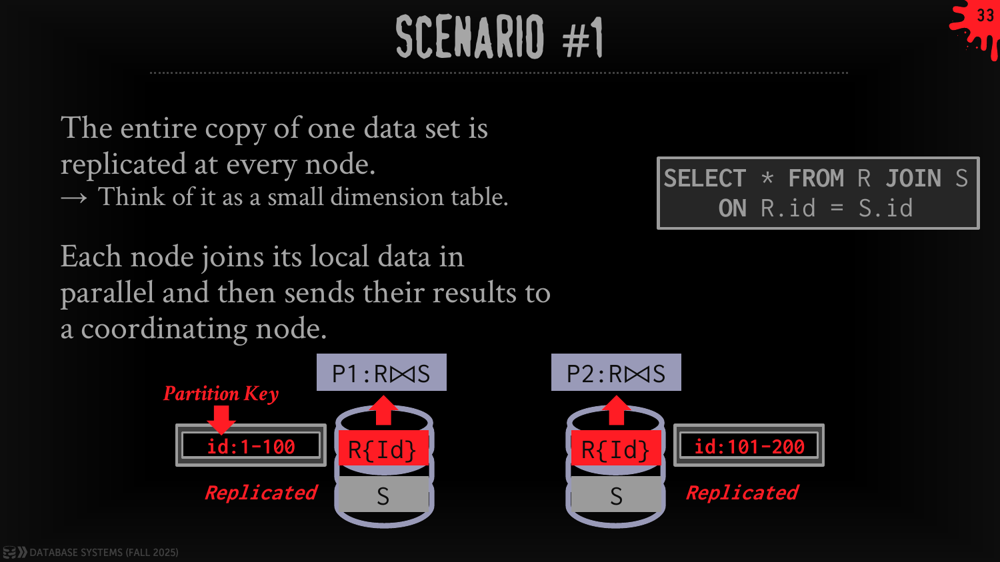

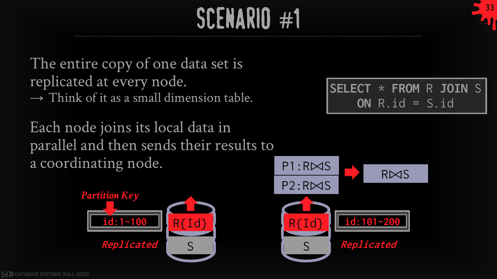


S 能够全量[复制](#复制)，是因为它很小。可以把它想象成一张邮政编码表：全美国的邮政编码只有几万行，不过几 MB 的数据，每个节点都放得下。复制的代价在写入时付出：更新这张表就要在所有节点上同步修改，需要前面讨论的[两阶段提交](#两阶段提交)或 [Paxos](#Paxos) 来保证各副本一致。这类表很少修改，这个代价可以接受。

情形二：R 和 S 都按[连接](#连接)键 id 分区，而且分区边界对齐，两个节点上分别是 id 为 1–100 和 101–200 的 R 与 S。如果用同一个[哈希函数](#哈希函数)做哈希分区，效果也一样。id 相同的 R [元组](#元组)和 S 元组必然落在同一个节点上，所以每个节点照样可以在本地完成连接，再把结果汇总。

两种情形的共同点是：数据已经按[连接](#连接)键放好了，节点之间不需要搬运数据，只需要搬运结果。这正是第 [23](../L23/index.md) 讲强调[分区键](#分区键)选择的原因。但表按什么键分区，往往在数据导入时就定下了，之后用户想按什么条件连接，就不一定符合当初的设想了。

### 6.3 情形三：广播连接（Broadcast Join）

📍 *PPT 第 35 页*

情形三：R 仍然按 id 分区，S 却按另一个[属性](#属性) val 分区，Node 1 存放 val 为 1–50 的[元组](#元组)，Node 2 存放 51–100。某个 id 对应的 S 元组可能在任何一个节点上。如果 S 很小——判断“很小”靠的正是第 [16](../L16/index.md) 讲的[基数估计](#基数估计)——DBMS 可以把 S 广播出去：每个节点把自己手上的那部分 S 发给其他所有节点，于是每个节点都有了完整的 S，问题回到了情形一。这就是**[广播连接](#广播连接)（broadcast join）**。节点多于两个时，每个节点都要把自己的部分发给其他每一个节点。

在[共享磁盘](#共享磁盘)架构下，各节点也可以直接从共享存储读取完整的 S。但 Amazon S3 这类对象存储按请求次数收费，让 50 个节点把同样的数据各读一遍并不划算。更经济的做法是由一个节点读取，再转发给其他节点，或者在本地缓存。

“广播”只描述数据怎样移动，底下仍然要用某种[连接](#连接)算法，所以严格说有广播[哈希连接](#哈希连接)、广播[排序归并连接](#排序归并连接)等。人们说“[广播连接](#广播连接)”时，通常指的是广播哈希连接。

S 要小到什么程度，广播才划算？可以粗略算一笔账。设有 n 个节点，两张表都均匀分布在各节点上。广播时，每个节点缺少 S 的 (n−1)/n，n 个节点一共要接收

$$
C_{\text{broadcast}} = n \cdot \frac{n-1}{n}\,|S| = (n-1)\,|S|
$$

的数据，其中 |S| 是 S 的大小，|R| 同理。另一种选择是下面情形四的做法，把两张表都按[连接](#连接)键重新分区。按哈希重新分配时，每个[元组](#元组)只有 1/n 的概率留在原地，需要传输的数据约为

$$
C_{\text{shuffle}} = \frac{n-1}{n}\,\bigl(|R| + |S|\bigr)
$$

比较两式，广播更划算当且仅当 n|S| < |R| + |S|，即 (n−1)|S| < |R|。所以“小”是相对的，它既取决于 R 有多大，也取决于节点有多少。以 10 个节点、|R| = 100 GB 为例：S 为 1 GB 时，广播只需传输 9 GB，重新分区则要传输 0.9 × 101 ≈ 91 GB；S 为 20 GB 时，广播要传输 180 GB，重新分区只需 0.9 × 120 = 108 GB。节点越多，广播越不划算，而且每个节点都要在内存中为完整的 S 建一张[哈希表](#哈希表)。

在这个例子里，R 本来就按 id 分区，其实还有一种更省的办法：只把 S 的每个[元组](#元组)发到存放对应 id 的那个节点，传输量只有 (n−1)/n·|S|。广播的长处在于完全不依赖 R 的分区方式，即使 R 并没有按[连接](#连接)键分区，它也能让体量庞大的 R 原地不动。

### 6.4 情形四：混洗连接（Shuffle Join）

📍 *PPT 第 36 页*

最坏的情形是两张表都不按[连接](#连接)键分区，而且都太大，无法广播。例如 R 按 name 分区（A–M 和 N–Z），S 按 val 分区（1–50 和 51–100）。这时 DBMS 只能在查询执行时，把两张表都按连接键重新分区：先确定新的分区边界（按 id 的范围或者 id 的哈希值），再由每个节点把手上的每个[元组](#元组)发往负责该 id 的节点。

```text
Before: partitioned on other keys
  Node 1:  R{name} A-M       S{val} 1-50
  Node 2:  R{name} N-Z       S{val} 51-100

      every tuple is sent to the node that owns its id

After: repartitioned on the join key
  Node 1:  R{id} 1-100       S{id} 1-100      ->  P1: R ⋈ S
  Node 2:  R{id} 101-200     S{id} 101-200    ->  P2: R ⋈ S
```

重新分区之后，情形四就变成了情形二，每个节点在本地完成[连接](#连接)，再把结果汇总。重新分区产生的数据副本通常在查询结束后删除。如果节点没有足够的磁盘空间容纳这些数据，查询只能失败。这种做法叫作**[混洗连接](#混洗连接)（shuffle join）**，同样可以细分为混洗[哈希连接](#哈希连接)、混洗[排序归并连接](#排序归并连接)等。
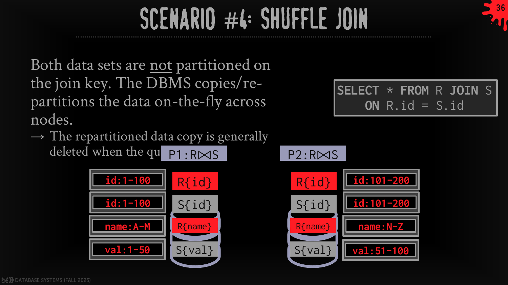

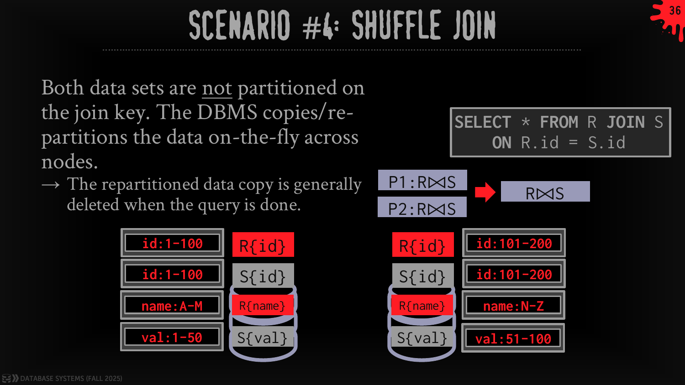


这和 MapReduce 在 map 与 reduce 之间按键重新分组数据的那一步是同一个思路。Andy 提醒，MapReduce 问世时被许多人视为前所未见的突破，其实分布式[数据库](#数据库)在 1980、1990 年代就在这样做了。

四种情形的对比如下：

| 情形 | R 的分布 | S 的分布 | 节点之间要搬运的数据 | 名称 |
|---|---|---|---|---|
| 一 | 按[连接](#连接)键分区 | 每个节点一份完整副本 | 只有结果 | — |
| 二 | 按连接键分区 | 按连接键分区，边界对齐 | 只有结果 | — |
| 三 | 按连接键分区 | 按其他键分区，且 S 很小 | 把 S 复制到每个节点 | [广播连接](#广播连接) |
| 四 | 按其他键分区 | 按其他键分区，且都很大 | 两张表都按连接键重新分区 | [混洗连接](#混洗连接) |

### 6.5 [半连接](#半连接)：搬运之前先过滤

📍 *PPT 第 37 页*

即使必须搬运数据，也可以少搬一些。先介绍两个概念（第 [15](../L15/index.md) 讲讨论[星型模式](#星型模式)时已经出现过）。分析型[数据库](#数据库)常把数据组织成[事实表](#事实表)和[维度表](#维度表)。**[事实表](#事实表)（fact table）**记录一个个事件，比如 Amazon 上的每一次购买就是一行，数据量极大。**[维度表](#维度表)（dimension table）**是旁边的辅助表，存放商品名称、商品描述、邮政编码这类信息，通常只读，规模小得多；[事实表](#事实表)中只存[维度表](#维度表)的 id，不重复存放这些描述。

考虑下面的查询，Fact 和 Dim 分别存放在两个节点上：

```sql
SELECT Fact.price, Dim.*
  FROM Fact JOIN Dim
    ON Fact.id = Dim.id
 WHERE Dim.zip = 15213
```

最终结果只涉及邮政编码为 15213 的那部分 Dim，以及与之匹配的 Fact [元组](#元组)的 price 列。把整张 Fact 搬到 Dim 那边，绝大部分数据都会在[连接](#连接)之后被丢弃。**[半连接](#半连接)（semi-join）**优化的思路是先交换最少的信息，把注定进不了结果的数据挡在网络之外：

1. 在 Dim 所在的节点上计算 `Dim_semi = Π_id(σ_{zip=15213}(Dim))`，即邮政编码为 15213 的那些 Dim [元组](#元组)的 id，只把这个 id 列表发给 Fact 所在的节点。
2. 在 Fact 所在的节点上计算 `F_small = Fact ⋈ Dim_semi`。由于 Dim_semi 只有 id 一列，这个[连接](#连接)实际上只起过滤作用，留下能够匹配的 Fact 元组；再[投影](#投影)出结果需要的 id 和 price 两列，得到 Fact_small，发回 Dim 所在的节点。
3. 在 Dim 所在的节点上计算 `Result = Π_price(Dim ⋈ Fact_small)`。式中的 Π_price 是简写，按照查询的要求，结果中还包含 Dim 的所有列。

第 2 步那种“只保留左侧有匹配的[元组](#元组)、不带右侧的列”的运算，在[关系代数](#关系代数)中就叫[半连接](#半连接)，记作 `Fact ⋉ Dim_semi`。SQL 中的 `WHERE id IN (SELECT ...)` 和 `EXISTS` 子查询（第 [2](../L02/index.md) 讲）表达的也是[半连接](#半连接)语义。这个优化由[查询优化器](#查询优化器)自动完成，查询里不需要写明，它实际上是第 [15](../L15/index.md) 讲的[谓词下推](#谓词下推)和[投影下推](#投影下推)在分布式环境中的延伸。有些系统在 SQL 中提供了显式的[半连接](#半连接)语法，但它不属于 SQL 标准。
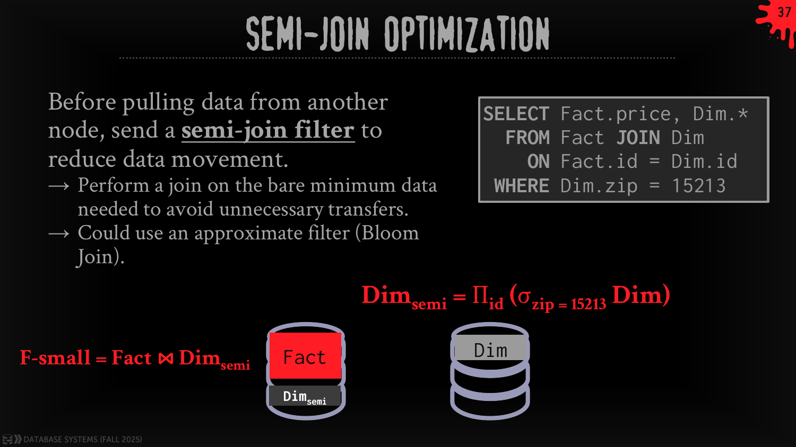


还可以更进一步：第 1 步不发送 id 列表，而是发送一个[布隆过滤器](#布隆过滤器)（第 [8](../L08/index.md)、[9](../L09/index.md) 讲），它比 id 列表紧凑得多。布隆过滤器可能出现假阳性，放过少量本不匹配的 Fact [元组](#元组)，但这些元组会在第 3 步的[连接](#连接)中被剔除，不影响正确性；它不会出现假阴性，所以不会漏掉任何应当出现在结果中的元组。这正是分布式连接对[过滤器](#过滤器)的要求：宁可多搬一点，也不能漏掉。这种做法称为**[布隆连接](#布隆连接)（Bloom join）**。

## 7. 混洗：分布式分析真正的瓶颈

📍 *PPT 第 38–40 页*

### 7.1 最贵的一步与[数据倾斜](#数据倾斜)

📍 *PPT 第 38 页*

说[连接](#连接)是分布式分析系统中最昂贵的操作，并不完全准确。Andy 的说法是，最昂贵的其实是混洗（shuffle）。[^shuffle] 一旦需要像情形四那样在节点之间重新分布数据，这一步几乎总是整个查询的瓶颈。连接之所以昂贵，很大程度上就是因为它里面的这次混洗要把大量数据复制出来，经过网络发往别处。

混洗之外还有一个问题。前面几种情形里，计算节点之间直接通信，这意味着 DBMS 在查询开始执行之前，就得确定由哪些节点参与计算。可是数据的分布未必均匀，这就是**[数据倾斜](#数据倾斜)（data skew）**。比如订单表按国家做哈希分区，而大部分订单来自同一个国家，那么存放这个国家数据的节点就要承担大部分工作，其他节点早早算完，只能闲着等它。更好的办法是在查询执行过程中，根据实际观察到的数据动态调整计算资源。

### 7.2 把混洗做成独立的阶段

📍 *PPT 第 39–40 页*

**[混洗阶段](#混洗阶段)（shuffle phase）**在[查询计划](#查询计划)的两段[流水线](#流水线)之间重新分布中间数据，并且可以根据观察到的数据特征重新分区、重新平衡负载。有的系统只在需要时才插入混洗，比如执行[混洗连接](#混洗连接)的时候。有的系统则把混洗当作执行的基本环节：据 Andy 介绍，Google 的 BigQuery 在每个[流水线阻断点](#流水线阻断点)（第 [13](../L13/index.md) 讲）都显式地插入一次混洗，并把它当作查询中途的[检查点](#检查点)，根据此时看到的数据，决定后续阶段需要更多还是更少的节点。

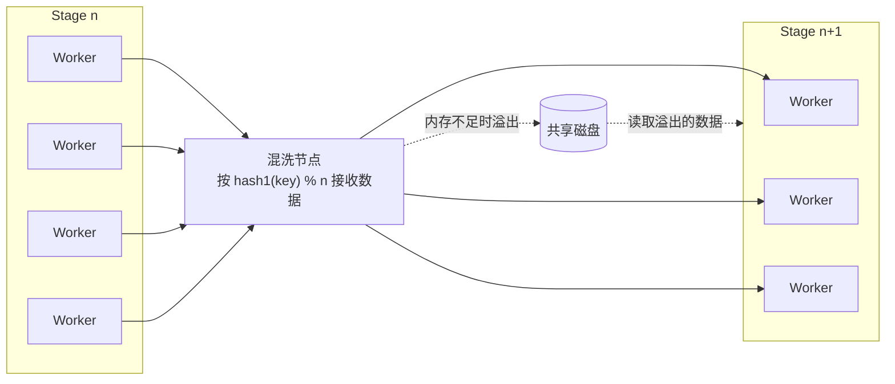

图中第 n 阶段的每个工作节点（worker）既是消费者也是生产者：它从本地磁盘、[共享磁盘](#共享磁盘)或上游阶段读取数据，完成自己那部分计算，然后对每个输出[元组](#元组)计算 `hash1(key) % n`，据此发往对应的混洗节点。混洗节点尽量把数据保存在内存中，内存不够时溢出到共享磁盘。第 n+1 阶段的工作节点再从混洗节点或共享磁盘读取数据，继续计算，结果交给下一个阶段，或者作为查询的最终结果。

两个阶段的工作节点数量并不相同：第 n 阶段有 4 个，第 n+1 阶段只有 3 个。经过第 n 阶段的过滤和处理，数据量可能比预想的少，系统就只安排 3 个工作节点。混洗节点把前后两个阶段隔开，两边的节点数不必一一对应，这正是动态调整计算资源的基础。
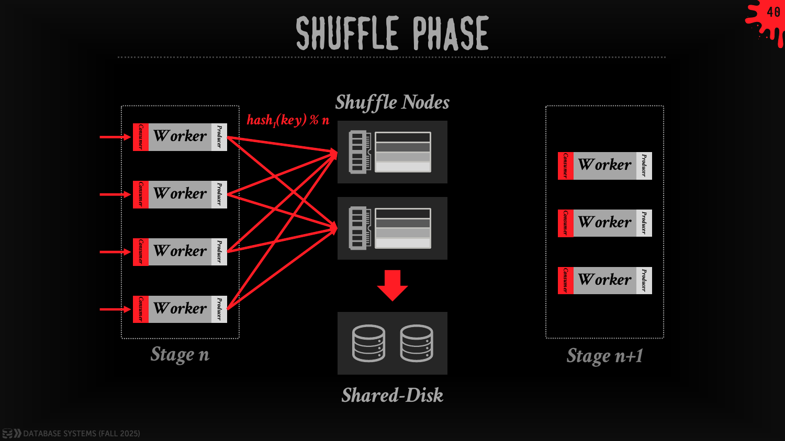

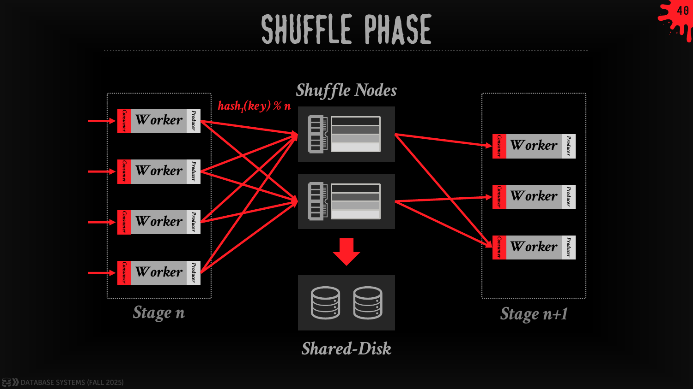

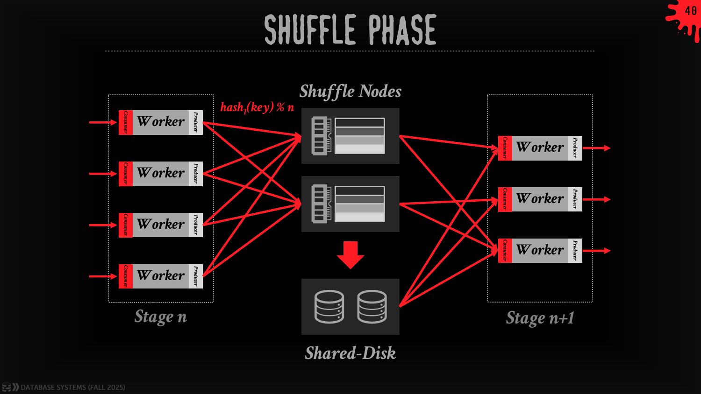


这层隔离还带来一个好处：上下游的[算子](#算子)都不必关心数据怎样在节点之间移动。[连接](#连接)之前先做一次混洗，每个节点上运行的就只是一个普通的本地[哈希连接](#哈希连接)，不需要专门编写一个感知分区的哈希连接算子。

正因为混洗如此重要，一些系统支持把它做成独立的、具备容错能力的服务。例如 Spark 内置的是基于内存的混洗实现，可以替换成单独部署的混洗服务，Apache Celeborn 和 Apache Uniffle 就是这类开源项目。

### 7.3 混洗就是[交换算子](#交换算子)

📍 *PPT 第 40 页*

这套结构看上去像 MapReduce，但它在这门课里有一个更直接的原型：第 [14](../L14/index.md) 讲的[交换算子](#交换算子)（exchange operator），确切地说，是其中负责重新分区（repartition）的那一种。在单机的并行查询中，多个线程上的[算子](#算子)并行地把数据送进一个重新分区的交换算子，由它按键把数据重新分给上一层的多个算子。[混洗阶段](#混洗阶段)做的是同一件事，只是把线程换成了节点，把内存中的传递换成了网络传输。无论在一台机器上还是在分布式系统中，这样的断点都让系统有机会根据查询的需要，重新组织和分配数据。
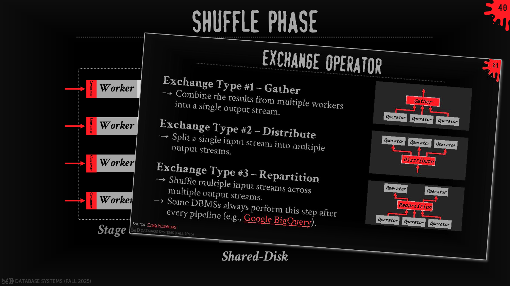


## 小结

📍 *PPT 第 41–42 页*

本讲从第 [23](../L23/index.md) 讲留下的问题出发：数据分散到多个节点之后，一个[事务](#事务)怎样在所有节点上原子地[提交](#提交)。[两阶段提交](#两阶段提交)用全票一致来回答，每一步都记入[日志](#日志)，但[协调者](#协调者)在发出 Prepare 之后崩溃，就可能让整个系统阻塞。[Paxos](#Paxos) 利用任意两个多数派必然相交这一点，只要求多数同意，从而在少数节点失效时继续推进；[Multi-Paxos](#Multi-Paxos) 选出领导者来避免[提议者](#提议者)互相抢先，[Raft](#Raft) 在同一思路上做了简化。实际系统常把两者组合起来，分区内部用 [Paxos](#Paxos) 或 [Raft](#Raft) [复制](#复制)，分区之间用[两阶段提交](#两阶段提交)。协议之外，[网络分区](#网络分区)迫使系统在一致性和可用性之间做出选择（CAP），而即使一切正常，等待副本确认也是在一致性和延迟之间取舍（PACELC）。

在多个节点之间维持[事务](#事务)的一致性很难，坏事总会发生，但这份难处应当由[数据库](#数据库)承担。Andy 的理由是，不能指望应用开发者懂得怎样面对不一致的数据。[^end] [两阶段提交](#两阶段提交)、[Paxos](#Paxos) 和 [Raft](#Raft)，是[分布式 DBMS](#分布式%20DBMS) 保证正确性最常用的几种协议。
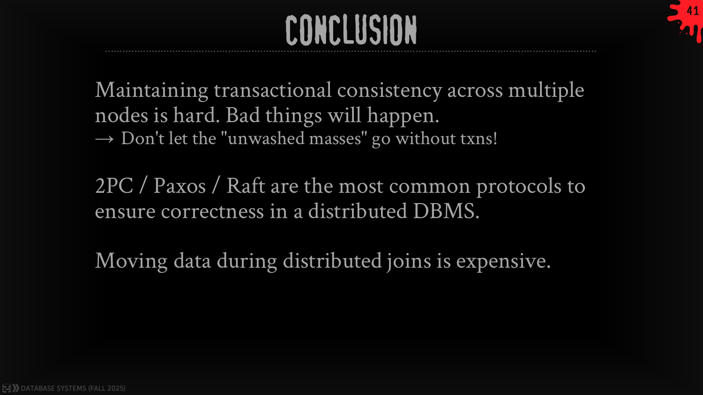


分析型查询的核心问题是[连接](#连接)，而连接的代价取决于要搬运多少数据。数据已按连接键分区时，各节点在本地完成连接；否则就要广播小表，或者把两张表都混洗一遍。[半连接](#半连接)和[布隆过滤器](#布隆过滤器)可以在搬运之前先滤掉无关的数据，前提是不能漏掉任何匹配的[元组](#元组)。混洗本身才是真正的瓶颈，把它做成独立的阶段，还能让系统在查询执行途中根据数据的实际情况重新分配资源；它的原型正是第 [14](../L14/index.md) 讲的[交换算子](#交换算子)。

这门课讲授新内容到此为止。下一讲（第 [25](../L25/index.md) 讲）是期末复习，并尝试用一讲的篇幅概览研究生课程 15-721 的内容，包括向量化执行、[即时编译](#即时编译)、数据格式和并行[哈希连接](#哈希连接)。

## 术语速查表

### 联机事务处理

**Online Transaction Processing (OLTP)**：大量快速、简单、每次只涉及单个实体少量数据的操作。（本讲首次出现：摘要；引入于：第 1 讲）

### 事务

**Transaction**：为完成业务功能而共同执行、整体成功或失败的一组数据库操作。（本讲首次出现：摘要；引入于：第 10 讲）

### 提交

**Commit**：数据库接受事务成功完成及其整体修改。（本讲首次出现：摘要；引入于：第 17 讲）

### 中止

**Abort**：事务不能成功完成，需要取消其修改。（本讲首次出现：摘要；引入于：第 17 讲）

### 联机分析处理

**On-Line Analytical Processing (OLAP)**：读取大量数据、跨实体计算聚合的复杂只读查询。（本讲首次出现：摘要；引入于：第 6 讲）

### 连接

**Join**：在共同属性上取值相同的元组组合。（本讲首次出现：摘要；引入于：第 1 讲）

### 元组

**Tuple**：关系中的一个元素，即表中的一行。（本讲首次出现：摘要；引入于：第 1 讲）

### 布隆过滤器

**Bloom Filter**：用 m 位位图和 k 个哈希函数回答成员查询，无假阴性、可能有假阳性。（本讲首次出现：摘要；引入于：第 9 讲）

### 数据库

**Database**：一组经过组织、相互关联、用来模拟现实世界某方面的数据。（本讲首次出现：摘要；引入于：第 1 讲）

### 复制

**Replication**：把数据复制到多个冗余节点上以提高可用性。（本讲首次出现：摘要；引入于：第 23 讲）

### 无共享

**Shared-Nothing**：每个节点私有 CPU、内存、磁盘，节点之间只能通过网络消息通信。（本讲首次出现：课程地图；引入于：第 23 讲）

### 共享磁盘

**Shared-Disk**：节点私有 CPU 与内存，通过网络共享一个逻辑磁盘，如对象存储。（本讲首次出现：课程地图；引入于：第 23 讲）

### 主副本

**Primary-Replica**：每个对象的更新都发给指定的主节点，由它把日志传给副本。（本讲首次出现：课程地图；引入于：第 23 讲）

### 多主

**Multi-Primary**：任何副本都能接受更新，副本之间用原子提交协议同步。（本讲首次出现：课程地图；引入于：第 23 讲）

### TP 监视器

**TP Monitor**：在多个节点上执行分布式事务的集中式协调者产品。（本讲首次出现：课程地图；引入于：第 23 讲）

### 中间件

**Middleware**：所有查询都经过它，由它路由、加锁并协调提交。（本讲首次出现：课程地图；引入于：第 23 讲）

### 两阶段锁

**Two-Phase Locking / 2PL**：先获取或升级，后释放或降级，进入收缩阶段后不能回头。（本讲首次出现：课程地图；引入于：第 18 讲）

### 乐观并发控制

**Optimistic Concurrency Control (OCC)**：事务在私有工作区执行、提交时验证冲突的 T/O 协议。（本讲首次出现：课程地图；引入于：第 17 讲）

### 多版本并发控制

**Multi-Version Concurrency Control (MVCC)**：为每个逻辑对象维护多个物理版本，写时创建新版本，读时按时间戳选择版本。（本讲首次出现：课程地图；引入于：第 20 讲）

### 版本链

**Version Chain**：用元组头部的指针把同一逻辑元组的所有版本串成的链表。（本讲首次出现：课程地图；引入于：第 20 讲）

### 预写日志

**Write-Ahead Log (WAL)**：独立的日志文件，对象落盘之前，它对应的日志记录必须先落盘。（本讲首次出现：课程地图；引入于：第 17 讲）

### 流水线阻断点

**Pipeline Breaker**：在子节点交出全部元组之前无法完成的算子，如哈希连接的构建侧、排序。（本讲首次出现：课程地图；引入于：第 13 讲）

### 交换算子

**Exchange Operator**：在计划中合并或拆分多路数据流、封装并行的算子。（本讲首次出现：课程地图；引入于：第 14 讲）

### 谓词下推

**Predicate Pushdown**：把谓词移到计划中尽可能低的位置。（本讲首次出现：课程地图；引入于：第 15 讲）

### 投影下推

**Projection Pushdown**：尽早去掉后续用不到的列，缩小中间结果。（本讲首次出现：课程地图；引入于：第 15 讲）

### 分布式事务

**Distributed Transaction**：访问多个分区上数据、需要跨节点协调的事务。（本讲首次出现：1；引入于：第 23 讲）

### 工作负载

**Workload**：一个应用发给数据库的查询的整体特征。（本讲首次出现：1.1；引入于：第 1 讲）

### 拜占庭容错

**Byzantine Fault Tolerance (BFT)**：在部分节点可能任意作恶时仍能达成一致的协议。（本讲首次出现：1.3；引入于：本讲）

### 分布式 DBMS

**Distributed DBMS**：资源可能相距很远、通信代价与故障不可忽略的数据库系统。（本讲首次出现：1.3；引入于：第 14 讲）

### 原子提交协议

**Atomic Commit Protocol**：让多个节点就事务的提交顺序与结局达成一致的协议。（本讲首次出现：2.1；引入于：本讲）

### 共识协议

**Consensus Protocol**：分布式系统领域对同类协议的称呼，协调的对象称为状态机。（本讲首次出现：2.1；引入于：本讲）

### 日志

**Logging**：按序记录修改及恢复所需的信息。（本讲首次出现：2.1；引入于：第 17 讲）

### 资源管理器

**Resource Manager (RM)**：在各节点上管理数据、共同决定事务结局的参与方。（本讲首次出现：2.2；引入于：本讲）

### 稳定性

**Stability**：事务的结局一旦确定就不能更改。（本讲首次出现：2.2；引入于：本讲）

### 一致性（提交协议）

**Consistency**：所有资源管理器最终处于同一状态。（本讲首次出现：2.2；引入于：本讲）

### 活性

**Liveness**：有足够多的节点存活并连通，协议总能向前推进。（本讲首次出现：2.2；引入于：本讲）

### 两阶段提交

**Two-Phase Commit (2PC)**：先让参与者投票，全票通过后再提交的原子提交协议。（本讲首次出现：3.1；引入于：本讲）

### 协调者

**Coordinator**：两阶段提交中组织提交的节点。（本讲首次出现：3.1；引入于：本讲）

### 参与者

**Participant**：事务读写过的其他节点。（本讲首次出现：3.1；引入于：本讲）

### 并发控制协议

**Concurrency Control Protocol**：运行时约束多个事务操作如何交错的规则。（本讲首次出现：3.1；引入于：第 10 讲）

### 锁

**Lock**：协调事务访问数据库逻辑内容的机制。（本讲首次出现：3.1；引入于：第 4 讲）

### 原子性

**Atomicity**：事务的修改全部生效或全部不留下。（本讲首次出现：3.1；引入于：第 17 讲）

### 并发

**Concurrency**：多个事务的执行时间重叠，可以交替或同时推进。（本讲首次出现：3.1；引入于：第 17 讲）

### 回滚

**Rollback**：撤销事务修改的过程或发起撤销的命令。（本讲首次出现：3.2；引入于：第 17 讲）

### 死锁

**Deadlock**：事务形成循环等待，没有参与者能够独立继续。（本讲首次出现：3.2；引入于：第 10 讲）

### 撤销

**Undo**：清除未完成或已中止事务所产生影响的过程。（本讲首次出现：3.2；引入于：第 17 讲）

### 补偿日志记录

**Compensation Log Record，CLR**：记录撤销产生的页面修改，可重做、不可撤销。（本讲首次出现：3.2；引入于：第 22 讲）

### 阻塞协议

**Blocking Protocol**：某些故障发生后必须等待故障节点恢复才能继续的协议。（本讲首次出现：3.4；引入于：本讲）

### 提前准备投票

**Early Prepare Voting**：最后一条查询的结果与准备阶段的投票一起返回。（本讲首次出现：3.5；引入于：本讲）

### 准备后提前确认

**Early Acknowledgement after Prepare**：全票赞成后立即通知应用提交成功，再执行第二阶段。（本讲首次出现：3.5；引入于：本讲）

### 冲突

**Conflict**：不同事务访问同一对象、且至少一方写入的一对操作。（本讲首次出现：3.5；引入于：第 17 讲）

### Paxos

**Paxos**：只需多数接受者同意、多数存活即不阻塞的共识协议。（本讲首次出现：4.1；引入于：本讲）

### 提议者

**Proposer**：Paxos 中提出结局、参与投票、只观察结果的三类角色。（本讲首次出现：4.1；引入于：本讲）

### 接受者

**Acceptor**：Paxos 中提出结局、参与投票、只观察结果的三类角色。（本讲首次出现：4.1；引入于：本讲）

### 学习者

**Learner**：Paxos 中提出结局、参与投票、只观察结果的三类角色。（本讲首次出现：4.1；引入于：本讲）

### 时间戳

**Timestamp**：用来建立事务先后关系的有序标识；此处用于决定等待优先级。（本讲首次出现：4.3；引入于：第 18 讲）

### 指数退避

**Exponential Backoff**：减弱后续合取条件的过滤作用以缓解低估。（本讲首次出现：4.3；引入于：第 16 讲）

### Multi-Paxos

**Multi-Paxos**：选出唯一领导者、从而跳过 Propose 阶段的 Paxos 变体。（本讲首次出现：4.4；引入于：本讲）

### 租约

**Lease**：有期限的领导者任期，到期前需要续约。（本讲首次出现：4.4；引入于：本讲）

### 退避

**Backoff**：在失败后调整重试时机，降低反复冲突。（本讲首次出现：4.4；引入于：第 10 讲）

### Raft

**Raft**：角色更少、只有日志最新的节点能当选领导者的共识协议。（本讲首次出现：4.5；引入于：本讲）

### CAP 定理

**CAP Theorem**：一致性、可用性、分区容忍三者不能同时始终满足。（本讲首次出现：5.1；引入于：本讲）

### 线性一致性

**Linearizability**：写入完成后，之后的读都返回该值或更新的值。（本讲首次出现：5.1；引入于：本讲）

### 网络分区

**Network Partition**：网络故障把节点分隔成互相联系不上的几组。（本讲首次出现：5.1；引入于：本讲）

### 脑裂

**Split Brain**：网络分区后出现多个自认为是主节点的节点。（本讲首次出现：5.2；引入于：本讲）

### 领导者选举

**Leader Election**：主节点失效后，选出唯一的新主节点。（本讲首次出现：5.2；引入于：第 23 讲）

### 最后写入者胜出

**Last Update Wins**：发生冲突时按时间戳保留最新的版本。（本讲首次出现：5.3；引入于：本讲）

### 向量时钟

**Vector Clock**：每个节点一个计数器，用来识别并发产生的冲突版本。（本讲首次出现：5.3；引入于：本讲）

### PACELC 定理

**PACELC Theorem**：分区时在可用性与一致性间取舍，正常时在延迟与一致性间取舍。（本讲首次出现：5.4；引入于：本讲）

### 嵌套循环连接

**Nested Loop Join**：枚举两侧元组对并检查连接条件。（本讲首次出现：6.1；引入于：第 12 讲）

### 排序归并连接

**Sort-Merge Join**：对有序输入定位相同键分组并输出全部匹配对。（本讲首次出现：6.1；引入于：第 12 讲）

### 哈希连接

**Hash Join**：以连接键建立哈希查找结构，再探测匹配。（本讲首次出现：6.1；引入于：第 12 讲）

### 哈希函数

**Hash Function**：把任意长度的键映射为定长整数的确定性单向函数。（本讲首次出现：6.2；引入于：第 7 讲）

### 分区键

**Partitioning Key**：决定元组去向的一列或几列。（本讲首次出现：6.2；引入于：第 23 讲）

### 广播连接

**Broadcast Join**：把小表复制到每个节点，再在本地连接。（本讲首次出现：6.3；引入于：本讲）

### 属性

**Attribute**：关系中的一个命名分量，即表中的一列。（本讲首次出现：6.3；引入于：第 1 讲）

### 基数估计

**Cardinality Estimation**：预测算子的输出行数。（本讲首次出现：6.3；引入于：第 16 讲）

### 哈希表

**Hash Table**：用哈希函数把键映射到数组偏移量的无序关联数组。（本讲首次出现：6.3；引入于：第 7 讲）

### 混洗连接

**Shuffle Join**：把两张表都按连接键重新分区，再在本地连接。（本讲首次出现：6.4；引入于：本讲）

### 事实表

**Fact Table**：记录大量事件的主表。（本讲首次出现：6.5；引入于：本讲）

### 维度表

**Dimension Table**：存放描述信息的小型辅助表。（本讲首次出现：6.5；引入于：本讲）

### 半连接

**Semi-Join**：只保留在另一张表中有匹配的元组，不带另一张表的列。（本讲首次出现：6.5；引入于：[第 15 讲](../L15/index.md)）

### 布隆连接

**Bloom Join**：用布隆过滤器代替键列表来过滤数据的半连接。（本讲首次出现：6.5；引入于：本讲）

### 星型模式

**Star Schema**：一张事实表通过外键引用多张维度表的设计模式。（本讲首次出现：6.5；引入于：第 15 讲）

### 投影

**Projection**：只保留、重排或计算指定属性，对应 SQL 的 `SELECT` 列表。（本讲首次出现：6.5；引入于：第 1 讲）

### 关系代数

**Relational Algebra**：在关系上检索和操纵元组的一组基本运算。（本讲首次出现：6.5；引入于：第 1 讲）

### 查询优化器

**Query Optimizer**：把逻辑计划变成语义等价且代价尽量低的物理计划的组件。（本讲首次出现：6.5；引入于：第 15 讲）

### 过滤器

**Filter**：只回答“键是否（很可能）在集合中”、不给出位置的数据结构。（本讲首次出现：6.5；引入于：第 9 讲）

### 数据倾斜

**Data Skew**：数据在节点之间分布不均，少数节点承担大部分工作。（本讲首次出现：7.1；引入于：[第 12 讲](../L12/index.md)）

### 混洗阶段

**Shuffle Phase**：在流水线之间重新分布中间数据的执行阶段。（本讲首次出现：7.2；引入于：本讲）

### 查询计划

**Query Plan**：由算子组成的有向无环图（通常是树），数据从叶子流向根，根的输出即查询结果。（本讲首次出现：7.2；引入于：第 11 讲）

### 流水线

**Pipeline**：一串算子，元组在其间连续流动，不需要中间存储。（本讲首次出现：7.2；引入于：第 13 讲）

### 检查点

**Checkpoint**：周期性地把缓冲区刷到磁盘并在日志中留下标记，限定恢复范围、允许截断日志。（本讲首次出现：7.2；引入于：第 17 讲）

### 算子

**Operator**：执行扫描、过滤、连接、排序或聚合等处理工作的节点。（本讲首次出现：7.2；引入于：第 11 讲）

### 即时编译

**Just-in-Time Compilation (JIT)**：在查询执行时为它生成并编译专门的代码。（本讲首次出现：7.3；引入于：第 13 讲）

[^hard]: 原话：“It's just doing all the same stuff we were doing before, but now just in hard mode because we have to worry about a bunch of things we didn't worry about before when we were on a single node.”

[^two]: 原话：“So again, if you remember only two things from this class: never use mmap in your database system, and then don't use blockchain databases.”

[^vc]: 原话：“Don't do this. This is super hard to do because your average JavaScript programmer isn't going to know what a vector clock is.”

[^bank]: 原话：“Like if it's your bank account and you're trying to count money stuff, you want to have consistency because you don't want to lose money. But if it's like a post on Reddit, who cares if it gets delayed by a couple seconds?”

[^shuffle]: 原话：“I said joins are the most expensive thing in a distributed OLAP system. The most expensive thing is actually going to be shuffles.”

[^end]: 原话：“Having strong consistency for the transactions is hard to do, but it's important and necessary because we can't assume the application developer is going to know how to reason about inconsistent data.”

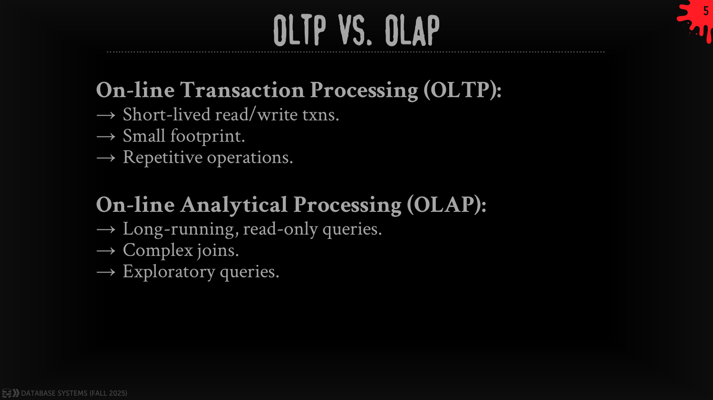

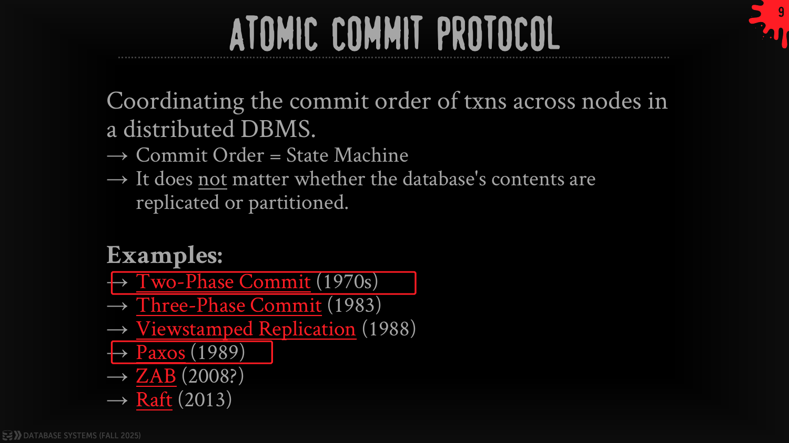

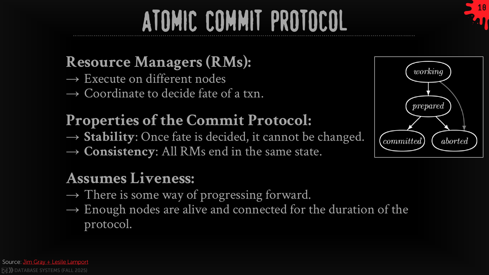


<details>
<summary>📎 本讲未被 📍 标注的幻灯片（共 5 页：封面、目录与行政页）</summary>


</details>
