# CMU 15-445 第 [25](index.md) 讲：期末复习与系统杂谈（Final Review + Systems Potpourri）

> **课程**：CMU 15-445/645 Database Systems（Fall 2025）· **主讲**：Andy Pavlo
> **课程主页**：https://15445.courses.cs.cmu.edu/fall2025/
> **材料**：课件 PPT、课堂录音转写稿（本讲没有官方 Lecture Notes）
> **说明**：正文以 PPT 为准。讲者原话的中文为意译，英文原文见脚注，依据课堂录音转写整理，已修正明显的语音识别错误。文中“📍 PPT 第 X 页”指幻灯片右上角印的编号。课件标题页印的是“Lecture #24 · Advanced DB Speed-Run”，按 Fall 2025 官方课表，本讲为第 [25](index.md) 讲。第 2 至 5 节取自 CMU 高级数据库课程 15-721（Spring 2024）。3.1 节的分支测试数据和第 6 节的查询结果是整理时补做的实测，不属于课堂材料。

## 摘要（Abstract）

一个学期下来，我们从磁盘上的[页](#页)出发，搭起了一个能运行[分布式事务](#分布式事务)的 DBMS。每一层的出现都是为了解决下面一层留下的问题：页要读进内存，于是有了[缓冲池](#缓冲池)；要快速找到[元组](#元组)，于是有了[哈希表](#哈希表)和 [B+ 树](#B+%20树)；在[访问方法](#访问方法)之上搭起[算子](#算子)、执行器和优化器；再用[并发](#并发)控制和恢复保证多个[事务](#事务)同时运行、机器随时崩溃时结果依然正确；最后把这一切扩展到多台机器上。第 1 节沿这条链回顾全学期，并细看两处容易出错的地方：一个 MVCC 与[两阶段锁](#两阶段锁)配合、却放过了[丢失更新](#丢失更新)的调度；以及[共识协议](#共识协议)为什么迫使完整性约束在[提交](#提交)前检查、分布式[数据库](#数据库)为什么常常放弃[外键](#外键)。

这门课的[代价模型](#代价模型)以磁盘 I/O 为中心。对分析型系统来说，数据按列存储、压缩、缓存之后，剩下的开销落在 CPU 处理每条[元组](#元组)的指令上。第 2 至 4 节依次处理其中三种浪费：[分支预测](#分支预测)失败用无分支代码消除，一条指令只处理一个值的问题用 SIMD 解决，逐元组解释[查询计划](#查询计划)的开销用[代码特化](#代码特化)消除。[代码特化](#代码特化)有两条路，为每条查询生成并编译代码，或者预先编译好一批原语再在运行时拼接；后者更易构建和调试，工业界大多选了它。

第 5 节考察六个工业系统：BigQuery、Snowflake、Redshift、Yellowbrick、Databricks Photon 和 ClickHouse。它们共享[存算分离](#存算分离)、列存储、向量化执行这套底座，分歧集中在[代码特化](#代码特化)的方式和工程投入的深度上；由于[统计信息](#统计信息)靠不住，它们都把越来越多的决策推迟到运行时。第 6 节来自一场嘉宾演讲：同一个求差集的查询，三种写法在数据含 [NULL](#NULL) 时给出三个不同的答案，查询跑得再快，语义被误解时结果依然是错的。

读完之后，你应当能够：逐步推演一个 MVCC 加[两阶段锁](#两阶段锁)的调度并判断它是否[可串行化](#可串行化)；解释无分支扫描为什么在中等[选择率](#选择率)下快得多，并手工模拟一次 SIMD 选择扫描；比较[查询编译](#查询编译)与[预编译原语](#预编译原语)的得失；读懂一个分析型系统的特性清单，把其中每一项放回这门课的知识地图上；认出 `NOT IN` 遇到 [NULL](#NULL) 的陷阱。

## 课程地图

本讲是整门课的最后一讲，处在总复习阶段：前半部分回收整个学期的知识，后半部分越过这门课的边界，看工业界的分析型系统在这些基础之上又做了什么。


第 1 节用到前面全部 24 讲。第 2 至 5 节依赖最多的是：列存储、[PAX](#PAX) 与压缩（第 [6](../L06/index.md) 讲），[线性探测哈希](#线性探测哈希)表（第 [7](../L07/index.md) 讲），[哈希连接](#哈希连接)、[布隆过滤器](#布隆过滤器)与[延迟物化](#延迟物化)（第 [12](../L12/index.md) 讲），向量化执行模型、表达式求值与[顺序扫描](#顺序扫描)优化（第 [13](../L13/index.md) 讲），并行执行与[交换算子](#交换算子)（第 [14](../L14/index.md) 讲），[统计信息](#统计信息)与[基数估计](#基数估计)（第 [15](../L15/index.md)、[16](../L16/index.md) 讲），以及分布式查询执行（第 [23](../L23/index.md)、[24](../L24/index.md) 讲）。第 6 节回到第 [1](../L01/index.md)、[2](../L02/index.md) 讲的[关系模型](#关系模型)与 SQL。

这是课程的终点，后面不再有讲次。想继续深入，第 2 至 5 节所取材的 15-721 就是下一站。

## 1. 回头看：一层层搭起来的 DBMS

📍 *PPT 第 5–17 页*

一个学期的内容可以讲成一条链，每一层都是为了解决下面一层留下的问题而出现的。下面沿着这条链把全学期串一遍，并在两处值得停下来的地方展开：一个 MVCC 与[两阶段锁](#两阶段锁)配合的完整例子，以及分布式环境下完整性约束的处境。

### 1.1 从磁盘上的[页](#页)到查询结果

📍 *PPT 第 5–9 页*

用户用 SQL 只声明想要什么，怎样算由 DBMS 决定（第 [1](../L01/index.md)、[2](../L02/index.md) 讲）。要兑现这个承诺，系统首先得把数据存下来。磁盘以块为单位读写，随机访问远慢于顺序访问，于是 DBMS 以[页](#页)为单位组织数据（第 [3](../L03/index.md)、[5](../L05/index.md) 讲），按[工作负载](#工作负载)在行存储和列存储之间取舍，再用压缩减少要读的字节数（第 [6](../L06/index.md) 讲）。页必须读进内存才能使用，而内存装不下整个[数据库](#数据库)，于是有了[缓冲池](#缓冲池)（buffer pool，第 [4](../L04/index.md) 讲），由它决定哪些页留在内存、哪一页该被换出；[预取](#预取)、[扫描共享](#扫描共享)这类优化也在这一层完成（第 [5](../L05/index.md) 讲）。
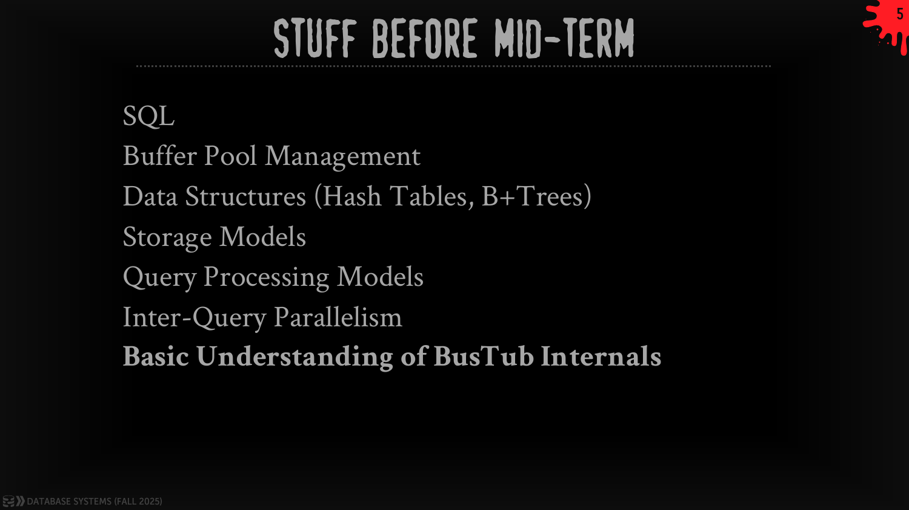


数据能读进来之后，下一个问题是怎样不扫一遍整张表就找到需要的[元组](#元组)。[哈希表](#哈希表)适合[点查询](#点查询)，[B+ 树](#B+%20树)同时支持点查询和范围扫描（第 [7](../L07/index.md)、[8](../L08/index.md)、[9](../L09/index.md) 讲）；多个线程同时修改同一棵树时，要用[闩](#闩)（latch）保护树的结构，闩蟹行协议规定了加闩与放闩的顺序（第 [10](../L10/index.md) 讲）。

有了[访问方法](#访问方法)，就可以在上面搭查询[算子](#算子)。排序与聚合（第 [11](../L11/index.md) 讲）、[连接](#连接)（第 [12](../L12/index.md) 讲）是其中最重的几个，而在这门课的[代价模型](#代价模型)里，它们的开销用磁盘 I/O 次数衡量。记外表 R 占 M [页](#页)、有 m 条[元组](#元组)，内表 S 占 N 页，[缓冲池](#缓冲池)可用 B 个页[帧](#帧)，C 是一次[索引](#索引)探测的代价，各种连接算法的代价如下（推导见第 [12](../L12/index.md) 讲）：

| 算法 | I/O 代价 |
|---|---|
| 朴素[嵌套循环连接](#嵌套循环连接) | `M + m·N` |
| [块嵌套循环连接](#块嵌套循环连接) | `M + ⌈M/(B−2)⌉·N` |
| [索引嵌套循环连接](#索引嵌套循环连接) | `M + m·C` |
| [排序归并连接](#排序归并连接) | 排序 R 与 S 的代价 + `(M + N)`；排序一张 M [页](#页)的表代价为 `2M·(1 + ⌈log_{B−1}⌈M/B⌉⌉)`；所有[元组](#元组)[连接](#连接)键都相同时，归并阶段退化为 `M·N` |
| [分区](#分区)[哈希连接](#哈希连接) | `3(M + N)` |

把这几个公式放在一起，能看出每种算法在利用什么：块嵌套循环用[缓冲池](#缓冲池)装满外表的[页](#页)，拿 B 去换内层循环的次数；[索引](#索引)嵌套循环用已有的索引代替对 S 的扫描；排序归并和[哈希连接](#哈希连接)则先花 I/O 把数据整理成有序或[分区](#分区)的形式，再用一次线性扫描完成匹配。[混合哈希连接](#混合哈希连接)（hybrid hash join）进一步让一个分区的[哈希表](#哈希表)常驻内存，这个分区既不必写出，也不必读回。[布隆过滤器](#布隆过滤器)（Bloom filter）则在构建侧建好之后交给探测侧，先挡掉不可能匹配的[元组](#元组)。

[算子](#算子)怎样组织在一起执行，是第 [13](../L13/index.md)、[14](../L14/index.md) 讲的内容。执行模型有三种：迭代器（火山）模型每次调用 `Next()` 返回一条[元组](#元组)，[物化模型](#物化模型)一次交出算子的全部输出，向量化模型一次交出一批元组。计划可以从根节点向下拉取数据（pull），也可以从叶节点向上推送数据（push）。[访问方法](#访问方法)除了[顺序扫描](#顺序扫描)和单[索引扫描](#索引扫描)，还有[多索引扫描](#多索引扫描)：用几个[索引](#索引)分别找出满足各自[谓词](#谓词)的[记录 ID](#记录%20ID) 集合，再求交集。更新查询有一个著名的陷阱，叫[万圣节问题](#万圣节问题)（Halloween problem）：更新让元组移到了扫描游标的前方，同一条元组被再次扫到、再次更新，解决办法是记下本条查询已经改过哪些记录 ID。谓词和表达式在执行时表示成一棵[表达式树](#表达式树)，对每条元组遍历一遍；第 4 节会看到，这种逐元组的解释正是分析型系统要消灭的开销。

DBMS 的工作单元（worker）可以是独立的进程、线程，也可以嵌入在应用进程里，这是[进程模型](#进程模型)。[查询间并行](#查询间并行)（inter-query parallelism）让多条查询同时运行；[查询内并行](#查询内并行)（intra-query parallelism）让多个 worker 合作完成一条查询，又分三种：[算子](#算子)内并行（水平），同一个算子的多个实例分头处理数据的不相交子集；算子间并行（垂直，也叫[流水线并行](#流水线并行)），上游算子一边产出、下游算子一边消费；以及两者混合的[浓密并行](#浓密并行)（bushy parallelism）。[交换算子](#交换算子)（exchange operator）在这些 worker 之间汇集、分发、重[分区](#分区)数据，并行[哈希连接](#哈希连接)就是靠它把两张表按[连接](#连接)键重新分区的。[I/O 并行](#I/O%20并行)关心数据怎样分布在多块磁盘上。一种很常见的做法是把[预写日志](#预写日志)单独放在最快的那块磁盘上：[事务](#事务)[提交](#提交)前必须等[日志](#日志)落盘，日志盘的速度直接决定了系统多快能告诉外界“提交成功”。

[查询优化](#查询优化)是第 [15](../L15/index.md)、[16](../L16/index.md) 讲的内容。启发式规则包括[谓词下推](#谓词下推)、[投影下推](#投影下推)，以及把嵌套子查询改写或拆解；[基于代价的搜索](#基于代价的搜索)依赖[统计信息](#统计信息)，用[直方图](#直方图)、草图（sketch）等数据摘要估计每个[谓词](#谓词)的[选择率](#选择率)和每个[算子](#算子)输出的[基数](#基数)，再自底向上或自顶向下地搜索计划空间。这些估计常常不准，第 5 节会看到，工业界的分析型系统为此把许多决策推迟到了运行时。
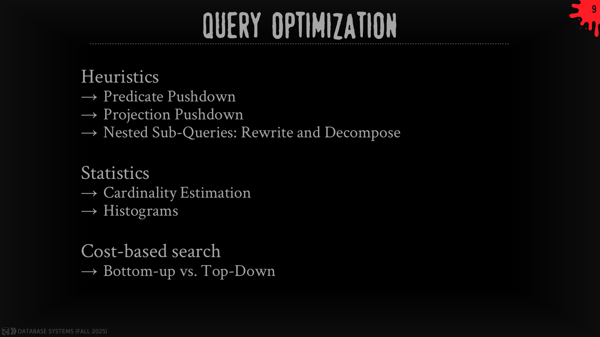


### 1.2 [事务](#事务)：什么样的[并发](#并发)执行是正确的

📍 *PPT 第 10–12 页*

查询能跑了，接下来的问题是多个[事务](#事务)同时读写时，什么样的结果才算正确。事务要满足 ACID 四条性质：[原子性](#原子性)，要么全做要么全不做；[一致性](#一致性)；[隔离性](#隔离性)，[并发](#并发)执行的效果如同某种串行执行；[持久性](#持久性)，[提交](#提交)了就不丢（第 [17](../L17/index.md) 讲）。

[隔离性](#隔离性)的标准说法是[可串行化](#可串行化)。[冲突可串行化](#冲突可串行化)（conflict serializability）看的是[冲突](#冲突)操作对的先后顺序，所谓冲突，是两个[事务](#事务)访问同一对象且至少一个是写。两个调度中所有冲突对的顺序都相同，它们就是[冲突等价](#冲突等价)的；判断一个调度是否冲突可串行化，只需画出依赖图，看有没有环。[视图可串行化](#视图可串行化)（view serializability）的条件更宽，一些包含[盲写](#盲写)（不读就写）的调度不是冲突可串行化的，却是视图可串行化的。它更灵活，代价是判定它需要理解应用真正想要什么，在运行时无法高效检查，所以实际系统执行的都是冲突可串行化，或者更弱的保证。

更弱的保证就是[隔离级别](#隔离级别)。SQL 标准从强到弱定义了四级，每一级可能出现的异常如下。[快照隔离](#快照隔离)（snapshot isolation）不在这条线上，它不会出现表中的三种异常，却允许[写偏斜](#写偏斜)（write skew）。

| [隔离级别](#隔离级别) | [脏读](#脏读) | [不可重复读](#不可重复读) | [幻读](#幻读) |
|---|---|---|---|
| SERIALIZABLE | 不会 | 不会 | 不会 |
| REPEATABLE READ | 不会 | 不会 | 可能 |
| READ COMMITTED | 不会 | 可能 | 可能 |
| READ UNCOMMITTED | 可能 | 可能 | 可能 |

表中写的是“可能”。你也许想问，能不能断定某个[隔离级别](#隔离级别)下一定会出现某种异常。答案是不能。异常是否真的发生，取决于[事务](#事务)之间怎样交错，而交错方式又取决于某次磁盘写是否恰好让一个事务停顿了一下，这和程序里的竞态条件是同一类问题。极端地说，在读未[提交](#提交)级别下，如果每次只有一个事务在跑，结果照样是[可串行化](#可串行化)的。反过来，一旦某个事务真的读到了不该读的数据并据此写回[数据库](#数据库)，之后所有基于这份数据的读写都会跟着出错，这种影响会一路传递下去，事后很难度量。

[两阶段锁](#两阶段锁)（two-phase locking，2PL，第 [18](../L18/index.md) 讲）要求[事务](#事务)在[增长阶段](#增长阶段)只加[锁](#锁)，一旦释放任何一把锁就进入[收缩阶段](#收缩阶段)，此后不能再加锁。SQL 里没有释放锁的语句，系统无从知道事务何时进入收缩阶段，所以实际系统用的是两种变体：**[严格两阶段锁](#严格两阶段锁)（strict 2PL）**把[排他锁](#排他锁)一直持有到[提交](#提交)或[中止](#中止)，[共享锁](#共享锁)可以在收缩阶段提前释放；**[强严格两阶段锁](#强严格两阶段锁)（strong strict 2PL，也叫 rigorous 2PL）**把所有锁都持有到最后，相当于没有收缩阶段。两者都不会让别的事务读到未提交的写，也就避免了[级联中止](#级联中止)。

[死锁](#死锁)有两类对策。检测是在[等待图](#等待图)（waits-for graph）里找环，选一个牺牲者[中止](#中止)，有时要中止不止一个[事务](#事务)才能解开。预防则按事务[时间戳](#时间戳)定下的优先级，用 wait-die 或 wound-wait 规则决定请求者是等待、中止自己，还是抢走对方的[锁](#锁)。[多粒度锁](#多粒度锁)用[意向锁](#意向锁)（intention lock）在层次结构的上层（[数据库](#数据库)、表）提示下层（[页](#页)、[元组](#元组)）正在发生什么，让事务在与[锁管理器](#锁管理器)的往返次数和系统的[并行度](#并行度)之间取得平衡；一个事务持有的细粒度锁太多时，可以升级成一把更粗的锁，前提是这把粗锁与其他事务已持有的锁相容。

[乐观并发控制](#乐观并发控制)（OCC，第 [19](../L19/index.md) 讲）分三个阶段：读阶段把所有修改写进[事务](#事务)私有的工作区；[提交](#提交)时进入验证阶段，为简单起见可以假定验证由单线程在一把[全局闩](#全局闩)下完成；验证通过后进入写阶段，把修改装进[数据库](#数据库)。验证有两个方向：向后验证（backward validation）检查已经提交的、与自己重叠的事务有没有写过自己读过的数据；向前验证（forward validation）检查尚未提交的事务有没有读过自己将要写的数据。发现交集，就意味着违背了[可串行化](#可串行化)顺序，要[中止](#中止)其中一方。
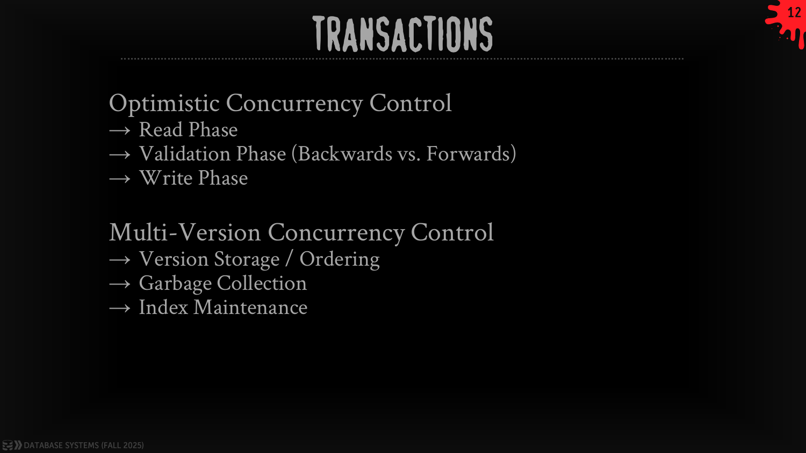


[多版本并发控制](#多版本并发控制)（MVCC，第 [20](../L20/index.md) 讲）为每个逻辑[元组](#元组)保留多个物理版本，让读者不必被写者阻塞。它的设计空间有四个维度：版本存储（只追加、时间旅行表、增量记录）；[版本链](#版本链)顺序（从旧到新或从新到旧，[增量存储](#增量存储)通常从新到旧，因为旧版本被挪进了[回滚段](#回滚段)）；垃圾回收，找出任何[活跃事务](#活跃事务)都不再可见的版本并删除；以及[索引](#索引)维护，删除版本时指向它们的索引项也要随之清理。

### 1.3 一个完整的例子：[多版本并发控制](#多版本并发控制)加[两阶段锁](#两阶段锁)

📍 *PPT 第 13 页*

MVCC 回答的是“读者看到哪个版本”，它本身不决定两个同时写同一[元组](#元组)的[事务](#事务)谁先谁后，这一点要交给另一种[并发控制协议](#并发控制协议)。下面的例子用[两阶段锁](#两阶段锁)管理写操作：读不加任何[锁](#锁)，写之前要先拿到“为这个元组创建新版本”的[排他锁](#排他锁)，所以任一时刻只有一个事务能为某个元组创建新版本。

两个[事务](#事务)开始时分别拿到[时间戳](#时间戳) TS(T1)=1 和 TS(T2)=2。每个版本带有 begin-ts 和 end-ts，表示它对时间戳落在哪个区间内的事务可见，end-ts 为“-”表示尚未结束；[事务状态表](#事务状态表)（Txn Status Table）记录每个事务是活跃（Active）还是已[提交](#提交)（Committed）。初始时[数据库](#数据库)里只有一个版本 A0，begin-ts 为 0，值为 123。这里假定[两阶段锁](#两阶段锁)配合[死锁检测](#死锁检测)。

| 步骤 | T1（TS=1） | T2（TS=2） | 发生了什么 |
|---|---|---|---|
| 1 | BEGIN；R(A) | | 读到 A0 = 123 |
| 2 | W(A) | | 拿到 A 的新版本[排他锁](#排他锁)，创建 A1（begin-ts = 1，值 456），把 A0 的 end-ts 设为 1 |
| 3 | | BEGIN；R(A) | A1 的创建者 T1 仍是 Active，跳过 A1，读到 A0 = 123 |
| 4 | | W(A) | 排他锁在 T1 手里，T2 阻塞 |
| 5 | R(A) | | 读到自己写的 A1 = 456 |
| 6 | COMMIT | | 状态表中 T1 变为 Committed，释放[锁](#锁) |
| 7 | | W(A)（继续） | 创建 A2（begin-ts = 2，值 789），把 A1 的 end-ts 设为 2 |
| 8 | | COMMIT | |

第 2 步和第 7 步之后，版本表和[事务状态表](#事务状态表)分别是：
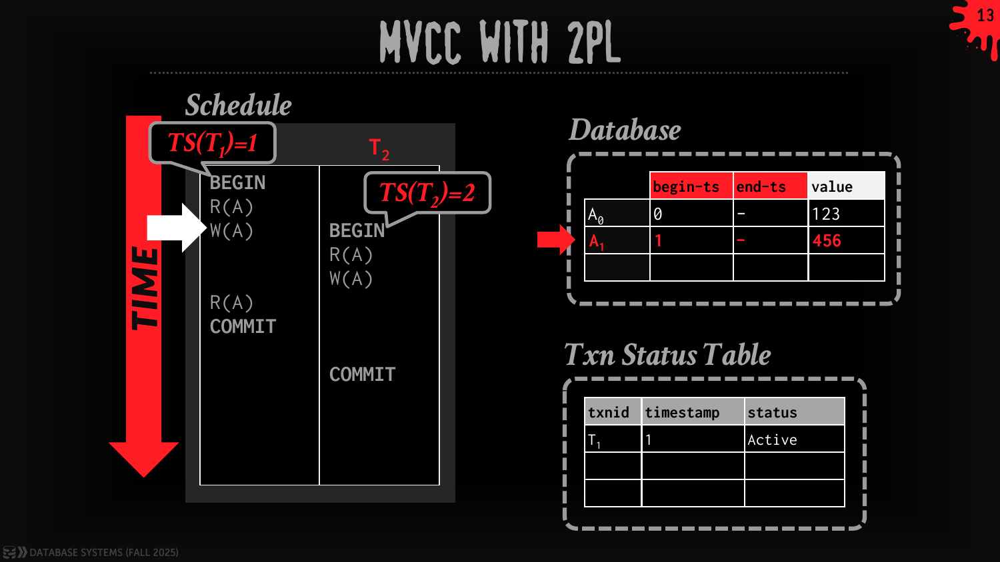

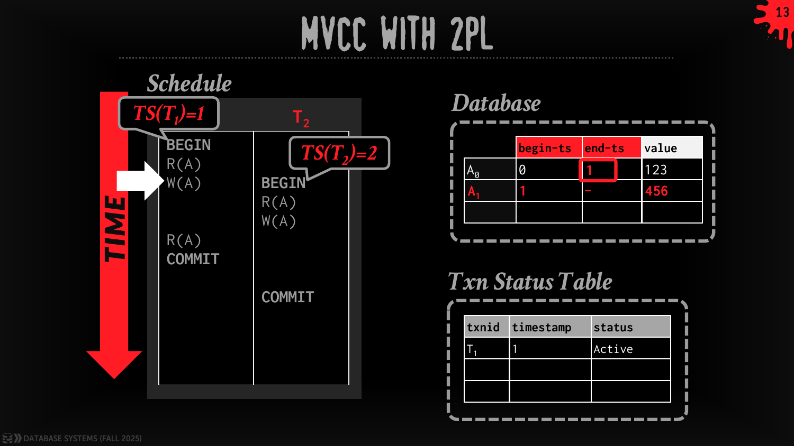

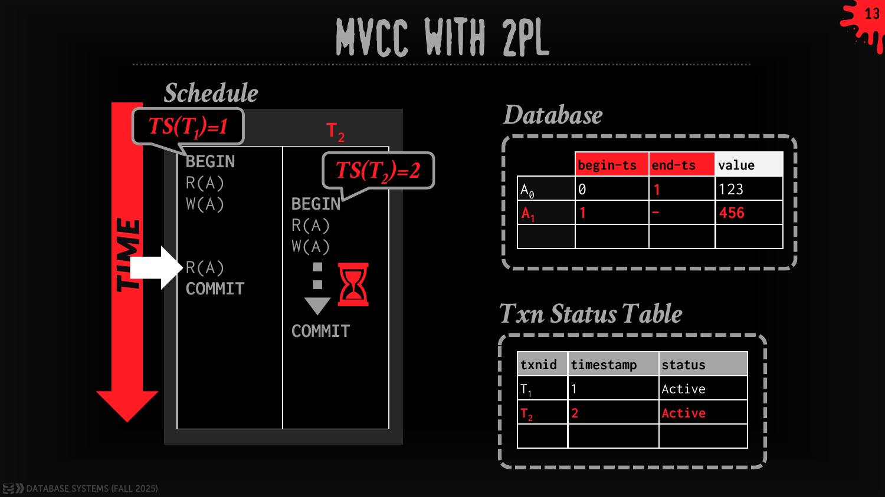

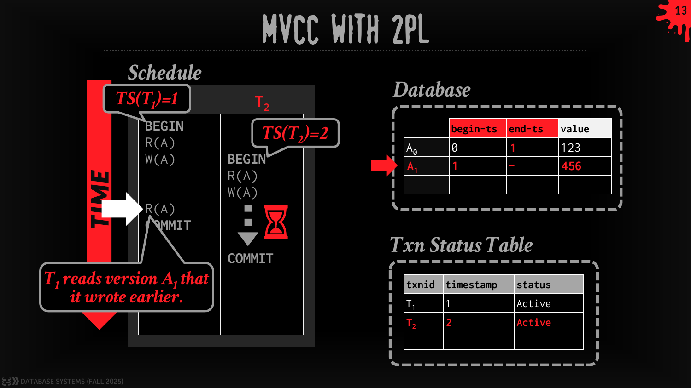

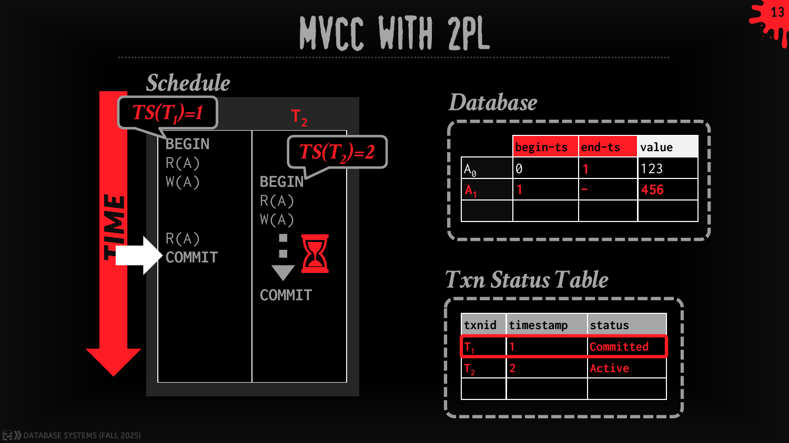

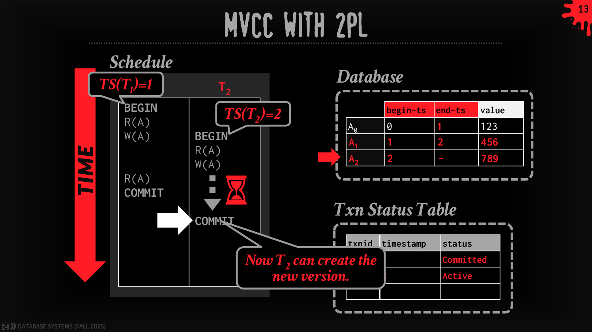


```text
After step 2                          After step 7
      begin-ts  end-ts  value               begin-ts  end-ts  value
A0    0         1       123           A0    0         1       123
A1    1         -       456           A1    1         2       456
                                      A2    2         -       789

txnid  timestamp  status              txnid  timestamp  status
T1     1          Active              T1     1          Committed
                                      T2     2          Active
```

第 3 步是整个例子里最容易想错的地方。只看[时间戳](#时间戳)，T2 的时间戳 2 落在 A1 的区间 [1, ∞) 里，却不在 A0 的区间 [0, 1) 里，照此应该读 A1。但 A1 是 T1 尚未[提交](#提交)的写，读它就是[脏读](#脏读)。所以可见性判断必须查[事务状态表](#事务状态表)：未提交[事务](#事务)创建的版本对别人不可见，未提交事务写下的 end-ts 也不算数。事务状态表出现在这个例子里，就是为了这一步。
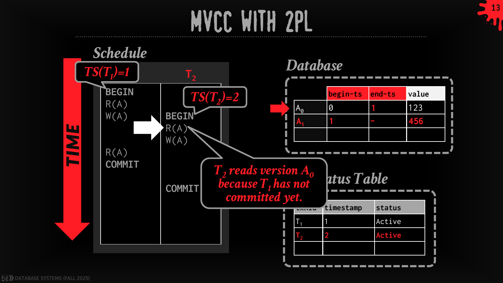


第 4 步如果换成[死锁预防](#死锁预防)策略，结果会不同。T2 的[时间戳](#时间戳)更新，优先级更低：按 wound-wait 规则它照样等待，按 wait-die 规则它会直接[中止](#中止)。
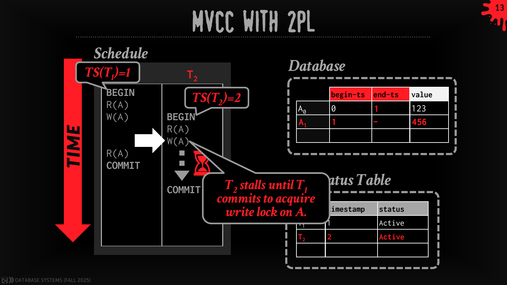


这个调度能执行完，却不是[可串行化](#可串行化)的。设 T1 做的是 `A = A + 333`，T2 做的是 `A = A + 666`，两者的写入值正好是 456 和 789。串行执行的话，无论谁先谁后，最终值都应该是 123 + 333 + 666 = 1122；实际的最终值是 789，T1 那笔 +333 凭空消失了。T2 基于过期的 123 算出新值，又覆盖了 T1 已经[提交](#提交)的写，这就是**[丢失更新](#丢失更新)（lost update）**：一个[事务](#事务)的写被另一个没看到它的事务覆盖掉。

要堵上这个漏洞，就得在 T2 创建新版本时多做一次检查：它要覆盖的版本 A1 是在它的[快照](#快照)之后才[提交](#提交)的，而它读到的是更旧的 A0，说明它在基于过期的数据写入，应当[中止](#中止)。[快照隔离](#快照隔离)的**[先提交者胜](#先提交者胜)（first-committer-wins）**规则做的就是这件事，PostgreSQL 在可重复读级别下遇到这种情况会让 T2 报错中止。这一检查只能挡住对同一对象的[冲突](#冲突)写。要挡住[写偏斜](#写偏斜)这类涉及不同对象的异常、达到完全的[可串行化](#可串行化)，还要跟踪[事务](#事务)之间的读写依赖，在依赖图中出现危险结构时中止其中一个事务，PostgreSQL 的**[可串行化快照隔离](#可串行化快照隔离)（Serializable Snapshot Isolation，[SSI](#可串行化快照隔离)）**就是这样实现的。

围绕这个例子还有一个定义上的分歧。课程的参考教材把多版本[两阶段锁](#两阶段锁)描述为更新[事务](#事务)必须遵守严格（或强严格）两阶段锁。Andy 不认同这种绑定：在他看来，两阶段锁在这里只负责决定写者之间的顺序，[锁](#锁)要持有到什么时候是另一个独立的设计选择，他援引的依据是 Jim Gray 与 Andreas Reuter 的事务处理专著《Transaction Processing: Concepts and Techniques》。

最后是性能上的取舍。MVCC 的好处是读者读旧版本，不会被写者阻塞；代价是要维护[版本链](#版本链)、做垃圾回收。单版本的[两阶段锁](#两阶段锁)也不是零成本：[事务](#事务)就地覆盖数据，[中止](#中止)时要恢复原值，所以旧值同样得存在某处，要么放在内存里的[撤销](#撤销)缓冲区，要么只留在[预写日志](#预写日志)里。后一种做法省内存，可一旦[日志](#日志)已经刷盘、内存里的副本没了，[回滚](#回滚)就得把日志从磁盘读回来重放。旧版本总要存在某个地方，两种方案的区别只在于存在哪里、何时付出代价。

### 1.4 故障恢复

📍 *PPT 第 14–15 页*

[事务](#事务)[提交](#提交)之后不能丢，这是[持久性](#持久性)，由[日志](#日志)和恢复来保证（第 [21](../L21/index.md)、[22](../L22/index.md) 讲）。起点是[缓冲池](#缓冲池)的两条策略：窃取（steal）允许把未提交事务弄脏的[页](#页)写回磁盘，非窃取不允许；强制（force）要求事务提交前把它弄脏的所有页写回磁盘，非强制不要求。窃取加非强制对运行时最友好，缓冲池可以随时换出任何页，提交时也不必等一堆随机写，但它把最多的恢复工作留到了故障之后。

[影子分页](#影子分页)（shadow paging）走另一个极端：修改写在[页](#页)的副本上，[提交](#提交)时原子地切换[页表](#页表)的根指针，所以崩溃后磁盘上的[数据库](#数据库)总处于一致状态，重启时无事可做，适合看重即时恢复的场景；代价是运行时的复制开销和[碎片](#碎片)。[预写日志](#预写日志)（write-ahead logging，WAL）配合窃取加非强制，运行时更快，所以绝大多数系统选它。它的规则把[日志序列号](#日志序列号)（LSN）贯穿进了[缓冲池](#缓冲池)：一个[脏页](#脏页)只有在修改它的最新那条[日志](#日志)记录（pageLSN）已经刷盘之后，才允许写回磁盘。日志可以记物理变化，即字节级的前后镜像，也可以记逻辑操作。

[检查点](#检查点)限制了恢复时要重放多少[日志](#日志)。非[模糊检查点](#模糊检查点)要让系统停下来，换来一个干净的[快照](#快照)；模糊检查点（fuzzy checkpoint）允许[事务](#事务)继续运行，代价是要把检查点时刻的[活跃事务](#活跃事务)表（ATT）和[脏页表](#脏页表)（DPT）一并记下。ARIES 基于这两张表分三个阶段恢复：[分析阶段](#分析阶段)从最近的检查点往后扫描日志，重建崩溃时的 ATT 和 DPT；[重做阶段](#重做阶段)从 DPT 中最小的 recLSN 开始重放历史，把[数据库](#数据库)恢复到崩溃那一刻的状态；[撤销阶段](#撤销阶段)逆序[回滚](#回滚)崩溃时尚未[提交](#提交)的事务，每[撤销](#撤销)一步写一条[补偿日志记录](#补偿日志记录)（CLR），保证恢复过程中再次崩溃也不会重复撤销。

### 1.5 分布式：[两阶段提交](#两阶段提交)、共识与完整性约束

📍 *PPT 第 16–17 页*

数据多到一台机器放不下，或者要容忍整机故障时，就进入了分布式[数据库](#数据库)（第 [23](../L23/index.md)、[24](../L24/index.md) 讲）。[系统架构](#系统架构)分[共享磁盘](#共享磁盘)（shared-disk，计算节点共享同一个存储层）和[无共享](#无共享)（shared-nothing，每个节点只管自己的磁盘）；[复制](#复制)分[主副本](#主副本)（primary-replica）和[多主](#多主)（multi-primary）；[分区](#分区)通常是[水平分区](#水平分区)，按哈希或范围把[元组](#元组)分到各个节点。查询执行要跨节点移动数据，分布式[连接](#连接)怎样做取决于两张表按什么键分区。[半连接](#半连接)（semi-join）优化只把连接键，或者由连接键构成的[布隆过滤器](#布隆过滤器)，先发给对方，过滤掉不可能匹配的元组，再传输真正需要的数据。

跨节点的[事务](#事务)[提交](#提交)需要[原子提交协议](#原子提交协议)。下面是[两阶段提交](#两阶段提交)（two-phase commit，2PC）[中止](#中止)的完整流程，Node 1 是协调者，Node 2、3、4 是参与者：

```text
 Application Server      Node 1 (Coordinator)        Node 2 / 3 / 4 (Participants)
        |---- Commit Request ---->|                              |
        |                         |---- Phase 1: Prepare ------->|
        |                         |<--- OK ... ABORT ------------|   (at least one ABORT)
        |<------- Aborted --------|                              |
        |                         |---- Phase 2: Abort --------->|
        |                         |<--- OK / OK / OK ------------|
```

第一阶段，协调者向所有参与者发出 Prepare，只要有一个参与者回复 ABORT，[事务](#事务)就注定[中止](#中止)。此时协调者可以立即告诉应用“已中止”，不必等第二阶段结束，因为这个决定已经不可能改变；第二阶段它再通知所有参与者中止，并收齐它们的确认。
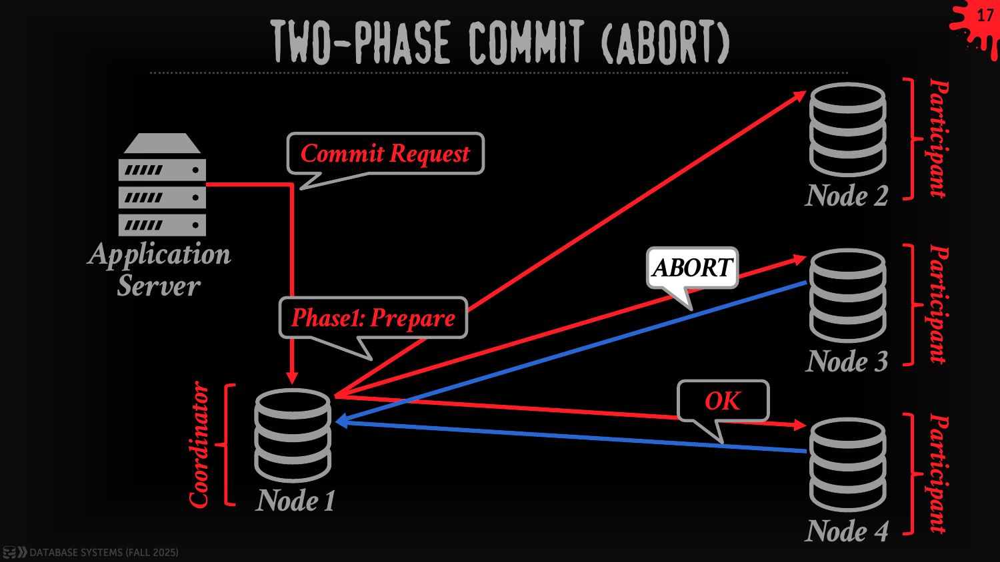

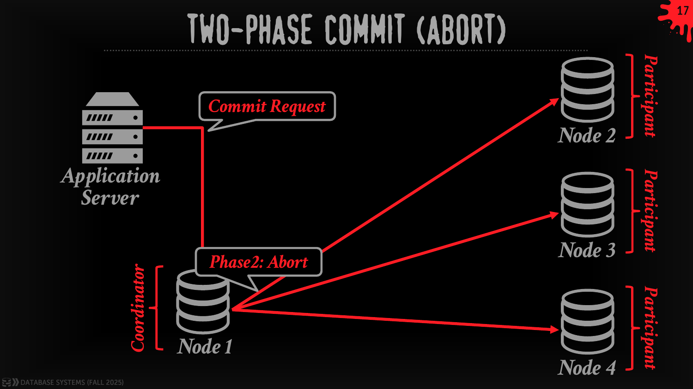

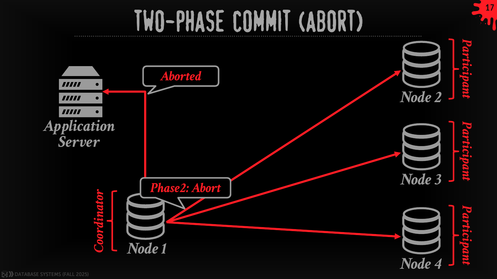

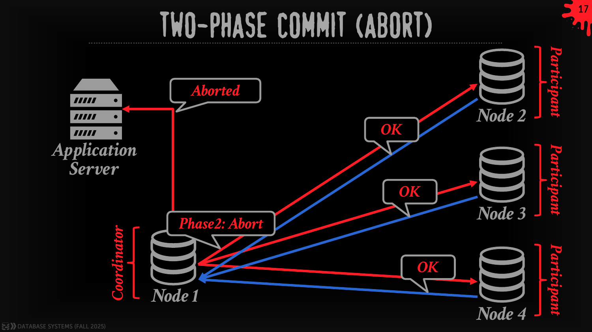


[两阶段提交](#两阶段提交)要求所有参与者一致同意，而 [Paxos](#Paxos)、[Raft](#Raft) 这类[共识协议](#共识协议)只需要多数派同意。这个差别决定了完整性约束能在哪里检查。在两阶段提交里，每个参与者都能独立地否决：它在 Prepare 时发现本地数据违反了约束，回复 ABORT 即可。在 Paxos 里，少数派的反对会被多数派盖过，所以“这个[事务](#事务)是否违反约束”必须在进入共识之前，由领导者（proposer）确定性地判定好；共识过程只负责让所有节点就“这些事务以什么顺序[提交](#提交)”达成一致，也就是把[复制](#复制)做成一台状态机。Paxos 的接受者（acceptor）拒绝一个提议，是因为顺序上的冲突。比如[网络分区](#网络分区)造成“[脑裂](#脑裂)”，两边各有一个节点自认为是领导者，一个提议 T1 在前，另一个提议 T2 在前，Paxos 保证最终只有一种顺序被接受。

你可能会问：约束如果很复杂、数据又分散在多个[分区](#分区)上，检查它本来就需要节点之间通信，开销不就和跑一遍共识差不多吗？这正是分布式[数据库](#数据库)的一个公开的秘密。Andy 的说法是，分布式系统往往不提供单机系统那样完整的完整性约束和[引用完整性](#引用完整性)约束，[^fk1][外键](#外键)通常是第一个被放弃的。[^fk2]

检查[外键](#外键)的代价取决于[分区](#分区)方式。以学生表 `student(id, ...)` 和选课表 `enrolled(student_id, ...)` 为例，`enrolled.student_id` 是指向 `student.id` 的外键。两张表如果都按学生 ID 分区，学号 123 的学生和他的选课记录就落在同一个节点上，检查外键只是一次本地查找；[分区键](#分区键)如果不同，每插入一条选课记录都可能要问遍所有节点。所以有的系统规定，只有当分区键与外键一致时才替你检查外键。Spanner 提供了外键，它的检查代价同样取决于两张表怎样分区。`NOT NULL`、`CHECK` 这类只涉及单条[元组](#元组)的约束检查起来很便宜，不成问题。[断言](#断言)（assertion，见第 [1](../L01/index.md) 讲）则是另一个极端：它声明一条查询，要求每次[提交](#提交)后这条查询的结果都满足条件。单机系统几乎都不实现它，放到分布式环境下，就意味着每提交一个[事务](#事务)都要向全体节点广播一次查询，没有系统这样做。

## 2. 瓶颈从磁盘移到 CPU

📍 *PPT 第 19–20 页*

到这里为止，这门课的[代价模型](#代价模型)一直以磁盘 I/O 为中心：[缓冲池](#缓冲池)是为了少读[页](#页)，[连接](#连接)算法按 I/O 次数比较优劣。分析型（OLAP）系统的情况不同：数据按列存储并压缩，热数据缓存在内存或本地 SSD 上，扫描可以在多块磁盘、多台机器上并行，I/O 不再是唯一的瓶颈，剩下的开销落在 CPU 处理每条[元组](#元组)所执行的指令上。CMU 的高级[数据库](#数据库)课程 15-721 专门研究怎样让分析型系统把 OLAP 查询跑到尽可能快，第 2 至 5 节是那门课的一次“速通”。

起点是第 [13](../L13/index.md) 讲列过的一张表：让[顺序扫描](#顺序扫描)更快的所有办法。其中大多数已在前面各讲出现过：
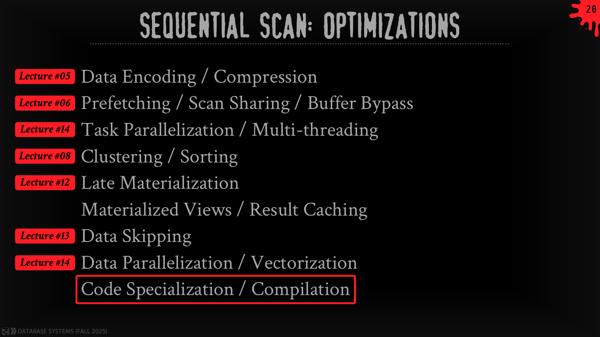


| 优化 | 做法 | 出处 |
|---|---|---|
| 数据编码 / 压缩 | 读更少的字节；[游程编码](#游程编码)等方式一次可以取出多条[元组](#元组) | 第 [6](../L06/index.md) 讲 |
| [预取](#预取) / [扫描共享](#扫描共享) / [缓冲池](#缓冲池)旁路 | 提前读入后续的[页](#页)；多个查询共享同一次扫描；扫描用私有内存而不占缓冲池，避免[顺序泛洪](#顺序泛洪) | 第 [5](../L05/index.md)、[13](../L13/index.md) 讲 |
| 任务并行 / 多线程 | 多个线程分头扫描 | 第 [14](../L14/index.md) 讲 |
| 聚簇 / 排序 | 按[聚簇索引](#聚簇索引)的顺序存放元组 | 第 [8](../L08/index.md) 讲 |
| [延迟物化](#延迟物化) | 列存储把拼接元组推迟到计划的上层 | 第 [12](../L12/index.md) 讲 |
| [物化视图](#物化视图) / [结果缓存](#结果缓存) | 见下文 | — |
| [数据跳过](#数据跳过) | [区域映射](#区域映射)（zone map）为每页预先算好最小值、最大值等聚合，据此跳过整页 | 第 [13](../L13/index.md) 讲 |
| 数据并行 / 向量化 | 一次处理一批元组 | 第 [13](../L13/index.md)、[14](../L14/index.md) 讲 |
| [代码特化](#代码特化) / 编译 | 为查询生成专门的代码 | 第 4 节 |

没有展开讲过的只有[物化视图](#物化视图)和[结果缓存](#结果缓存)。**[结果缓存](#结果缓存)（result caching）**最直接：同一条 SQL 再次出现、底层数据又没有变，就直接返回上次的结果，查询根本不执行。**[物化视图](#物化视图)（materialized view）**是用一条查询定义、结果被存下来的[视图](#视图)，难点在于底层数据变化之后怎样维护它。重跑一遍整条查询最简单，也最贵；增量维护只根据数据的变化修补结果。对 `COUNT(*) ... GROUP BY key` 这样的视图，增量维护很容易，插入一条[元组](#元组)就把对应分组的计数加一；视图里一旦有[连接](#连接)，一条新元组可能要与另一张表的许多元组匹配，增量维护就复杂得多。PostgreSQL 的[物化视图](#物化视图)不会自动更新，要手动执行 `REFRESH MATERIALIZED VIEW` 重新计算，也有一些系统能增量维护。

[代码特化](#代码特化)是第 4 节的主题。在那之前，先看同一条扫描在 CPU 层面还有哪些浪费。

## 3. 让 CPU 满负荷运转

📍 *PPT 第 21–25 页*

### 3.1 分支预测失败与无分支扫描

📍 *PPT 第 21–22 页*

以最简单的范围选择为例：
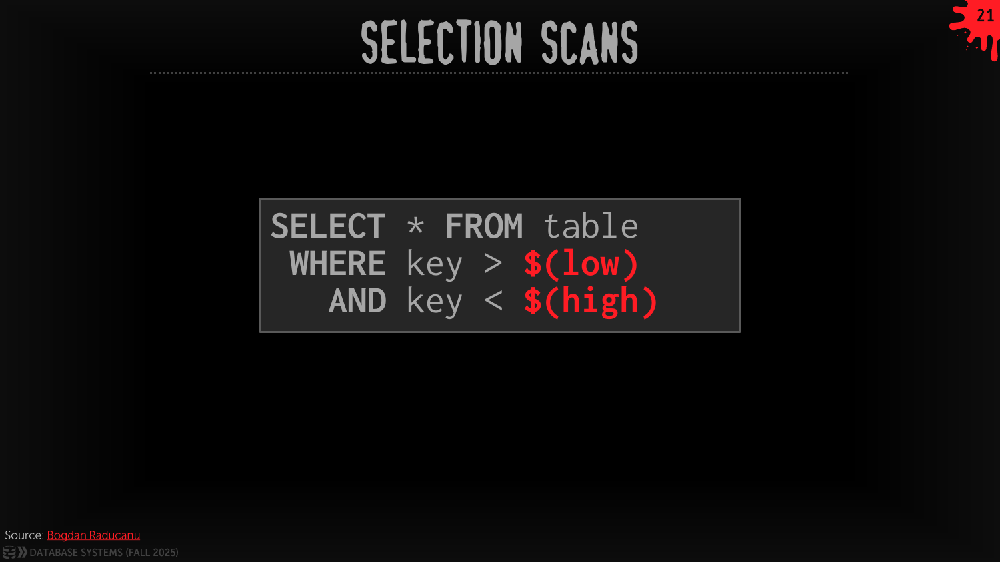


```sql
SELECT * FROM table
 WHERE key > $(low)
   AND key < $(high)
```

直接的写法是逐条检查，满足条件才把[元组](#元组)拷进输出缓冲区（PPT 伪代码，照录）：
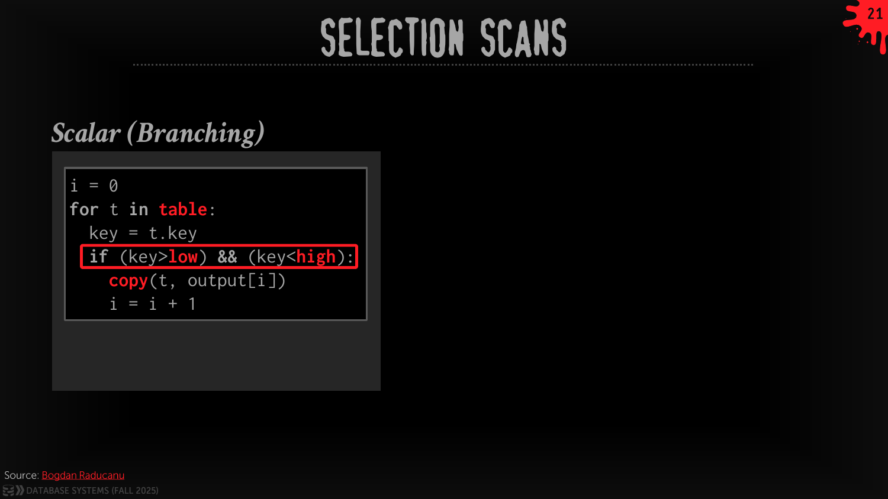


```text
Scalar (Branching)
i = 0
for t in table:
    key = t.key
    if (key>low) && (key<high):
        copy(t, output[i])
        i = i + 1
```

这段代码对人来说再自然不过，对现代 CPU 却有一个隐患，就在那个 `if` 上。现代 CPU 是[流水线](#流水线)化的超标量处理器：一条指令的执行被拆成取指、译码、执行等十几个阶段，多条指令像工厂流水线上的零件一样重叠推进，每个时钟周期还能同时发射好几条。流水线要保持满载，遇到分支时就不能停下来等条件算完，而是先猜一个方向，沿着猜的方向投机地执行下去。猜对了，没有任何代价；猜错了，已经投机执行的指令全部作废，流水线清空重来，白白浪费十几个时钟周期。这和[乐观并发控制](#乐观并发控制)很像：先假定不会[冲突](#冲突)，冲突了再回滚。

**[分支预测](#分支预测)（branch prediction）**靠历史规律来猜。[选择率](#选择率)接近 0 时，条件几乎总是假，预测器几乎总能猜对；接近 100% 时同理。选择率越接近 50%，条件的真假越接近随机，预测器猜错得越频繁。对一个要扫十亿条[元组](#元组)的查询，这意味着数以亿计的[流水线](#流水线)清空。

解决办法是去掉分支（PPT 伪代码，照录）：
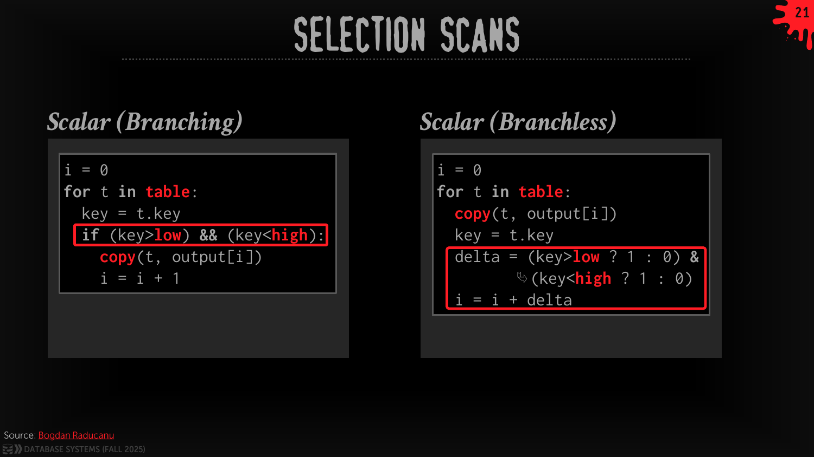


```text
Scalar (Branchless)
i = 0
for t in table:
    copy(t, output[i])
    key = t.key
    delta = (key>low ? 1 : 0) &
            (key<high ? 1 : 0)
    i = i + delta
```

每条[元组](#元组)都先无条件地拷进输出缓冲区，再算出 delta：满足[谓词](#谓词)为 1，否则为 0，输出位置只前进 delta 格。不满足的元组会在下一轮被覆盖掉，循环结束时再检查最后一个位置是否有效。三元运算符写成 `key > low` 也一样，C 语言里比较的结果本来就是 1 或 0；编译器会把它翻译成 `setcc` 这类按条件置位的指令，而不是跳转，所以循环体里没有依赖数据的分支。拷贝本身也不贵，分析型系统按列处理数据，拷贝的只是一个定长的值或偏移量。这就是**[无分支选择扫描](#无分支选择扫描)（branchless selection scan）**。

每条[元组](#元组)都拷贝一次，看起来是在做无用功，它换来的是每条元组的代价固定不变，与[选择率](#选择率)无关。Andy 的评价是：这种写法对人来说违反直觉，编译器也不会替你做这种变换。[^branchless] 编译器不做是有原因的：原来的程序只在条件成立时才写 `output[i]`，改成无条件写，就凭空多出了一次内存写入，而在多线程程序里，编译器不允许引入源程序中没有的写操作。

CWI 的研究者测量过两种写法在不同[选择率](#选择率)下的耗时（PPT 第 22 页）：有分支的版本在选择率很低时表现不错，选择率升高后迅速变慢，无分支的版本则是一条水平线。我们把上面两段伪代码原样翻译成 C，在一台 2.1 GHz 的 Xeon 云服务器上用 gcc 13 以 `-O2` 编译（反汇编确认有分支的版本保留了条件跳转），对 100 万个均匀分布在 [0, 100) 内的随机整数各扫 50 遍，每个选择率取三次试验中的最好成绩，整个程序运行三遍取平均，得到每条[元组](#元组)的耗时：
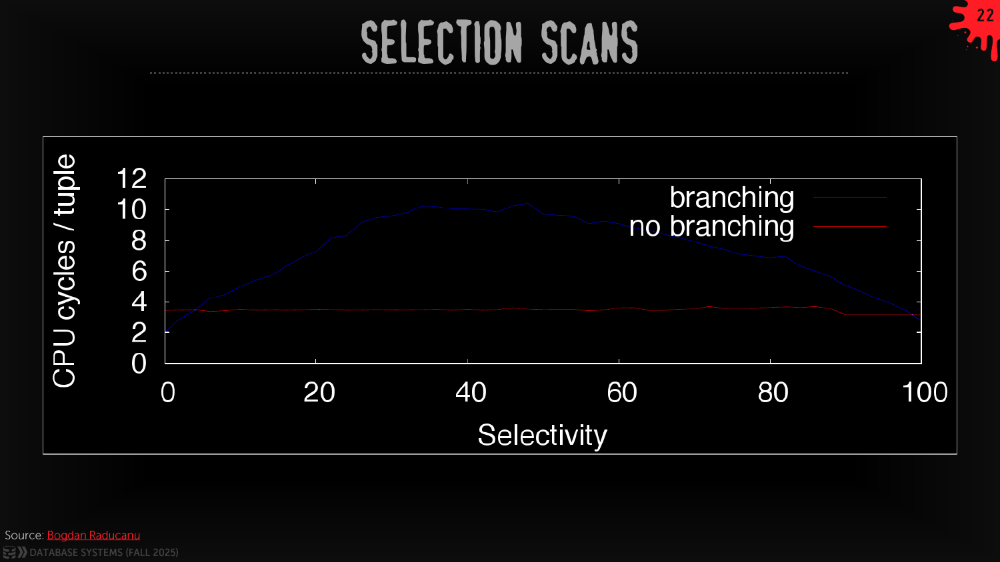


| [选择率](#选择率) | 有分支（ns/[元组](#元组)） | 无分支（ns/元组） |
|---|---|---|
| 0% | 1.1 | 0.7 |
| 5% | 1.6 | 0.7 |
| 10% | 2.2 | 0.7 |
| 25% | 3.5 | 0.7 |
| 50% | 4.8 | 0.7 |
| 75% | 3.5 | 0.7 |
| 90% | 1.8 | 0.7 |
| 95% | 1.1 | 0.7 |
| 99% | 0.7 | 0.7 |
| 100% | 0.5 | 0.7 |

有分支版本的曲线正是预测失败率的形状，在 50% 处最高，向两端下降。[选择率](#选择率) 50% 时，它比无分支版本多花 4.1 ns，按 2.1 GHz 折算约合 8.6 个时钟周期；这时预测器大约每两条[元组](#元组)猜错一次，相当于每次猜错损失 17 个周期左右，和前面说的“十几个时钟周期”吻合。只有在选择率接近 100% 时，有分支版本才略快，因为它几乎每次都猜对，又省掉了计算 delta 的几条指令。在这台机器上，选择率接近 0 时有分支版本也没有占到便宜。两端的细节会随 CPU 和编译器变化，中间区域的巨大差距则由[分支预测](#分支预测)机制本身决定。

<details>
<summary>测试程序（C）</summary>

```c
// Branching vs branchless selection scan micro-benchmark (gcc -O2)
#include <stdio.h>
#include <stdlib.h>
#include <stdint.h>
#include <time.h>

#define N (1 << 20)
#define REPS 50

static int32_t keys[N];
int32_t out[N + 1];   // non-static so the stores cannot be optimized away

static double now_ns(void) {
    struct timespec ts;
    clock_gettime(CLOCK_MONOTONIC, &ts);
    return ts.tv_sec * 1e9 + ts.tv_nsec;
}

// Copy a key only when the predicate holds
__attribute__((noinline))
size_t scan_branch(const int32_t *k, size_t n, int32_t low, int32_t high) {
    size_t i = 0;
    for (size_t t = 0; t < n; t++) {
        int32_t key = k[t];
        if (key > low && key < high) {
            out[i] = key;
            i++;
        }
    }
    return i;
}

// Always copy, then advance the cursor by 0 or 1
__attribute__((noinline))
size_t scan_branchless(const int32_t *k, size_t n, int32_t low, int32_t high) {
    size_t i = 0;
    for (size_t t = 0; t < n; t++) {
        int32_t key = k[t];
        out[i] = key;
        i += (size_t)((key > low) & (key < high));
    }
    return i;
}

int main(void) {
    srand(42);
    for (size_t t = 0; t < N; t++) keys[t] = rand() % 100;   // uniform in [0, 100)
    int sels[] = {0, 5, 10, 25, 50, 75, 90, 95, 99, 100};
    for (size_t s = 0; s < sizeof(sels) / sizeof(sels[0]); s++) {
        int32_t low = -1, high = sels[s];                    // selectivity = sels[s] %
        volatile size_t sink = 0;
        double best_b = 1e30, best_bl = 1e30;
        for (int trial = 0; trial < 3; trial++) {            // keep the best of 3 trials
            double t0 = now_ns();
            for (int r = 0; r < REPS; r++) sink += scan_branch(keys, N, low, high);
            double t1 = now_ns();
            for (int r = 0; r < REPS; r++) sink += scan_branchless(keys, N, low, high);
            double t2 = now_ns();
            double b  = (t1 - t0) / ((double)N * REPS);
            double bl = (t2 - t1) / ((double)N * REPS);
            if (b < best_b) best_b = b;
            if (bl < best_bl) best_bl = bl;
        }
        printf("%3d%%  branch %.2f ns  branchless %.2f ns\n", sels[s], best_b, best_bl);
    }
    return 0;
}
```

</details>

### 3.2 用 SIMD 一次比较一批值

📍 *PPT 第 23 页*

去掉分支之后，每条[元组](#元组)仍然要单独做两次比较。**SIMD（Single Instruction, Multiple Data，[单指令多数据](#单指令多数据)）**让一条指令同时处理多个值。CPU 里有专门的宽寄存器，Intel 的 AVX2 是 256 位，AVX-512 是 512 位。一个 512 位寄存器可以看成 16 个 32 位整数并排放在 16 个**[通道](#通道)（lane）**里，一条比较指令同时比较全部 16 对值，结果是每个[通道](#通道)一位的位掩码。键如果是单字节字符，一个 512 位寄存器能装 64 个。

把无分支版本改写成向量化版本（PPT 伪代码，照录）：
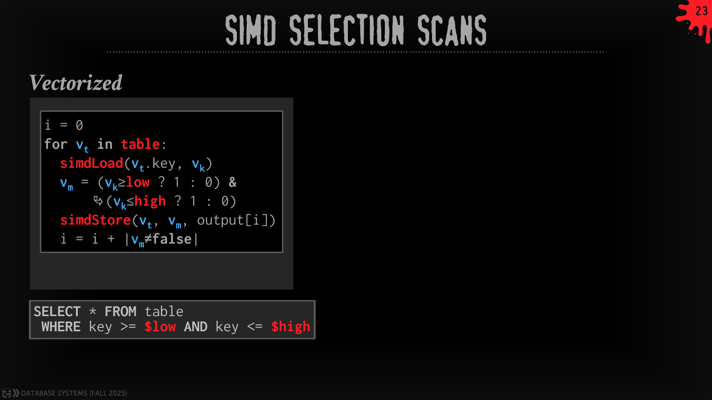


```text
Vectorized
i = 0
for vt in table:
    simdLoad(vt.key, vk)
    vm = (vk≥low ? 1 : 0) &
         (vk≤high ? 1 : 0)
    simdStore(vt, vm, output[i])
    i = i + |vm≠false|
```

循环每次取一个向量 `vt`，而不是一条[元组](#元组)；`vm` 是位掩码，`|vm≠false|` 是掩码中 1 的个数。用具体数据走一遍。查询是：

```sql
SELECT * FROM table
 WHERE key >= 'N' AND key <= 'U'
```

表中的数据如下，字符按 ASCII 码比较：
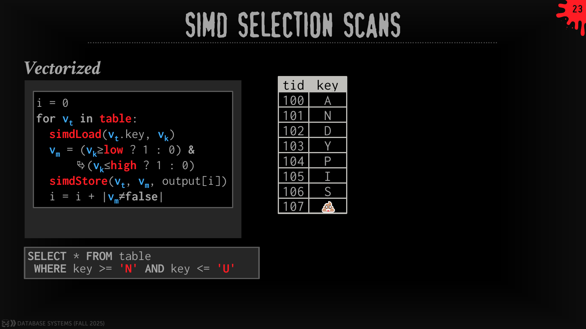


```text
tid  : 100  101  102  103  104  105  106  107
key  :  A    N    D    Y    P    I    S    -
```

| 步骤 | 指令 | 结果（[通道](#通道) 0 → 7） |
|---|---|---|
| 1 | SIMD Load：把 8 个键装进一个寄存器 | `A N D Y P I S -` |
| 2 | SIMD Compare：key ≥ 'N' | Mask #1 = `0 1 0 1 1 0 1 0` |
| 3 | SIMD Compare：key ≤ 'U' | Mask #2 = `1 1 1 0 1 1 1 0` |
| 4 | SIMD AND：Mask #1 与 Mask #2 逐位相与 | Mask #3 = `0 1 0 0 1 0 1 0` |
| 5 | SIMD Compress：按 Mask #3 从偏移量 `0 1 2 3 4 5 6 7` 中挑出对应位为 1 的 | `1 4 6` |

最后一个[通道](#通道)没有有效的键，两个掩码在这里都是 0。偏移量 1、4、6 对应 tid 101、104、106，也就是键 N、P、S。五条 SIMD 指令处理了 8 个键，过程中没有一次分支。最后一步的 **[SIMD 压缩](#SIMD%20压缩)（compress）**把掩码为 1 的[通道](#通道)挤到寄存器的前部，得到一个紧凑的偏移量数组，后面的[算子](#算子)可以顺着它直接取数据，这个数组就是 3.4 节要讲的[选择向量](#选择向量)。

这也解释了“向量化”一词的两层含义为什么总是一起出现。向量化执行模型（第 [13](../L13/index.md) 讲）让[算子](#算子)之间一次传递一批[元组](#元组)，SIMD 向量化让一条指令处理多个值；前者按批送来连续的数据，后者才有东西装满寄存器。如今主流的分析型系统都这样做。

几乎每种[算子](#算子)都有 SIMD 版本，但并不是每种都同样有效。数据一旦超出 CPU 缓存，就要频繁访问主存，SIMD 省下的指令会被访存延迟淹没；数据排列得整齐时，SIMD 才能发挥作用。

### 3.3 SIMD 哈希探测

📍 *PPT 第 24 页*

SIMD 不只用于扫描。第 [7](../L07/index.md) 讲的[线性探测哈希](#线性探测哈希)表是这样探测的：对输入键 k1 求哈希，得到槽位 h1，从 h1 开始逐个比较[槽](#槽)中的键，依次遇到 k9、k3、k8，第四次比较才碰到 k1。
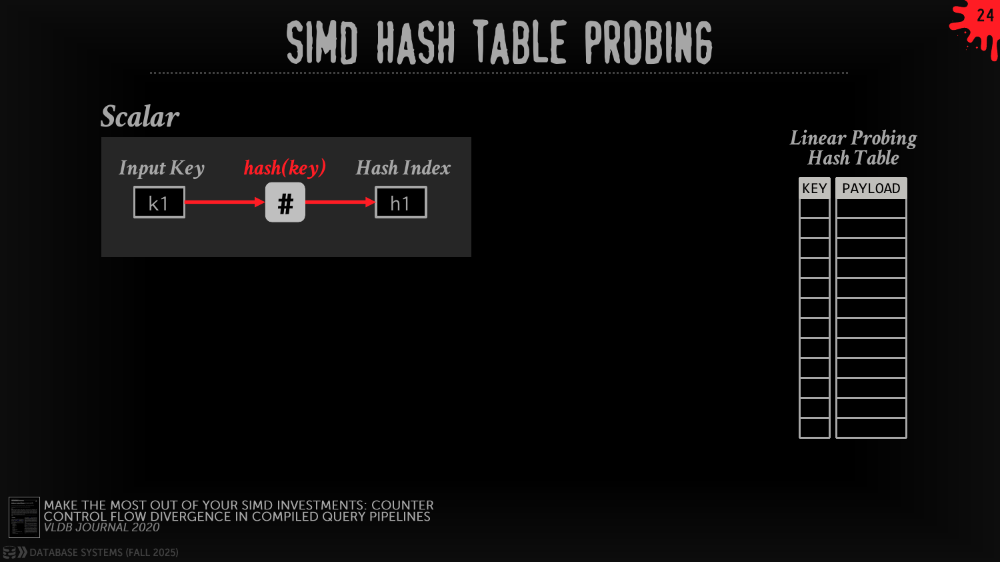

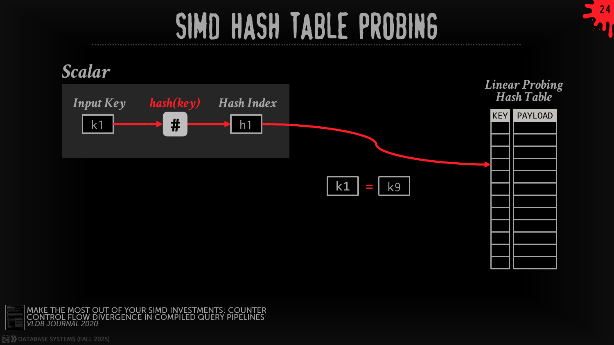

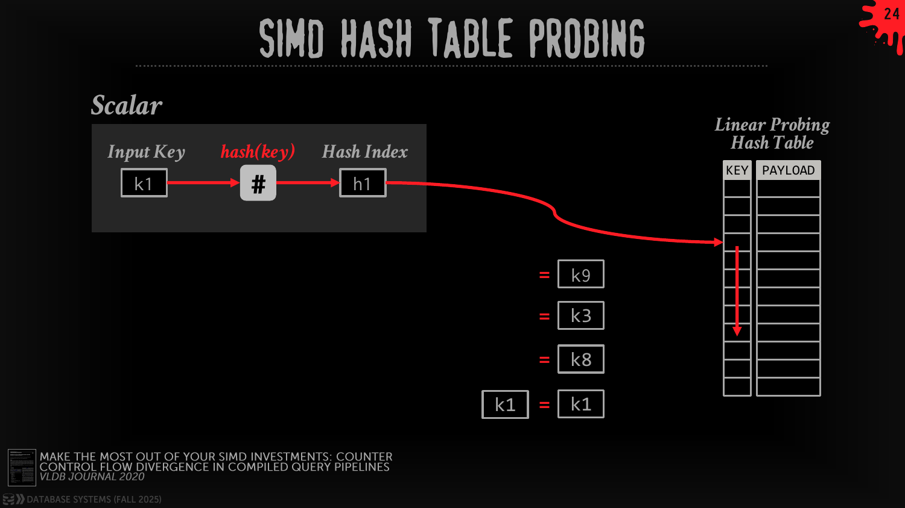


**[水平向量化](#水平向量化)（horizontal vectorization）**把[哈希表](#哈希表)改成**[分桶哈希表](#分桶哈希表)（bucketized hash table）**：每个桶连续存放 4 个键，后面跟着对应的 4 个值。探测时仍然只对 k1 求一次哈希，定位到[桶](#桶)之后，把桶里的 4 个键一次装进 SIMD 寄存器，与复制到每个[通道](#通道)的 k1 比较一次，得到匹配掩码 `0 0 0 1`，于是直接到第 4 个位置取值。

```text
Scalar (linear probing)                Vectorized (horizontal, bucketized)

hash(k1) -> h1                         hash(k1) -> h1
slot h1   : k9  != k1                  bucket h1 : [ k9 | k3 | k8 | k1 ] [ 4 values ]
slot h1+1 : k3  != k1                  compare   : [ k1 | k1 | k1 | k1 ]   (one SIMD instruction)
slot h1+2 : k8  != k1                  mask      : [ 0  | 0  | 0  | 1  ]  -> 4th value
slot h1+3 : k1  == k1  -> payload
```

CPU 从内存读数据的最小单位是 64 字节的缓存行（cache line），探测[哈希表](#哈希表)时反正要把整行读进来。在一行里塞进更多的键，再用一条指令比较它们，就把原来的 4 次比较和 4 次循环判断压成了一次；在 AVX-512 上，一个寄存器能装 16 个 32 位的键。大多数探测都以不匹配告终，省下的正是这些失败比较的开销。

键如果是变长的，比如字符串，同一个桶里的键长度各不相同，没法直接装进定宽的[通道](#通道)。常见的做法是在[桶](#桶)里另存一份定长的**[指纹](#指纹)（fingerprint）**，比如哈希值的前 8 位。先用 SIMD 比较[指纹](#指纹)：[指纹](#指纹)不同，完整的键一定不同；只有[指纹](#指纹)相同的少数候选，才去比较完整的键。

与之相对的是垂直向量化（vertical vectorization）：每个[通道](#通道)各放一个不同的输入键，同时探测多个键。它不如[水平向量化](#水平向量化)常见。

### 3.4 [算子](#算子)之间怎样传递筛选结果

📍 *PPT 第 25 页*

SIMD 比较的产物是位掩码，选择扫描的产物是偏移量数组。一个[算子](#算子)把一批[元组](#元组)筛过一遍之后，怎样告诉上面的算子“这一批里哪些还有效”？主要有两种表示（出自 CMU 的论文，DAMON 2021）。

**[选择向量](#选择向量)（selection vector）**是一个有序、紧凑的偏移量列表，列出本批中有效的[元组](#元组)；它的最大长度就是一批的大小，可以预先分配好。**[位图](#位图（筛选结果）)（bitmap）**则与数据按位置对齐，第 i 位表示第 i 条元组是否有效；一些 SIMD 指令（比如 AVX-512 的掩码寄存器）可以直接拿这种[位图](#位图（筛选结果）)当输入掩码。
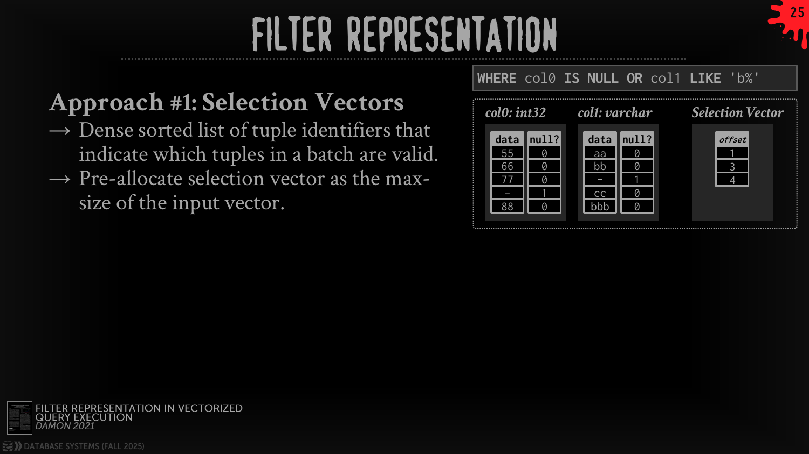


例子是 `WHERE col0 IS NULL OR col1 LIKE 'b%'`，一批 5 条[元组](#元组)：

| 偏移量 | col0（int32） | col0 为空？ | col1（varchar） | col1 为空？ | [谓词](#谓词)结果 |
|---|---|---|---|---|---|
| 0 | 55 | 0 | aa | 0 | 假 |
| 1 | 66 | 0 | bb | 0 | 真 |
| 2 | 77 | 0 | — | 1 | 未知 |
| 3 | — | 1 | cc | 0 | 真 |
| 4 | 88 | 0 | bbb | 0 | 真 |

[选择向量](#选择向量)是 `[1, 3, 4]`，[位图](#位图（筛选结果）)是 `0 1 0 1 1`。第 2 行值得多看一眼：col1 为 [NULL](#NULL)，`NULL LIKE 'b%'` 的结果是“未知”，`FALSE OR UNKNOWN` 仍是未知，而 WHERE 只保留结果为真的[元组](#元组)，所以它被筛掉了。NULL 带来的三值逻辑，第 6 节还会遇到。表中每一列是否为空，本身也用一个与数据按位置对齐的位图表示，和筛选结果的[位图](#位图（筛选结果）)是同一种思路。
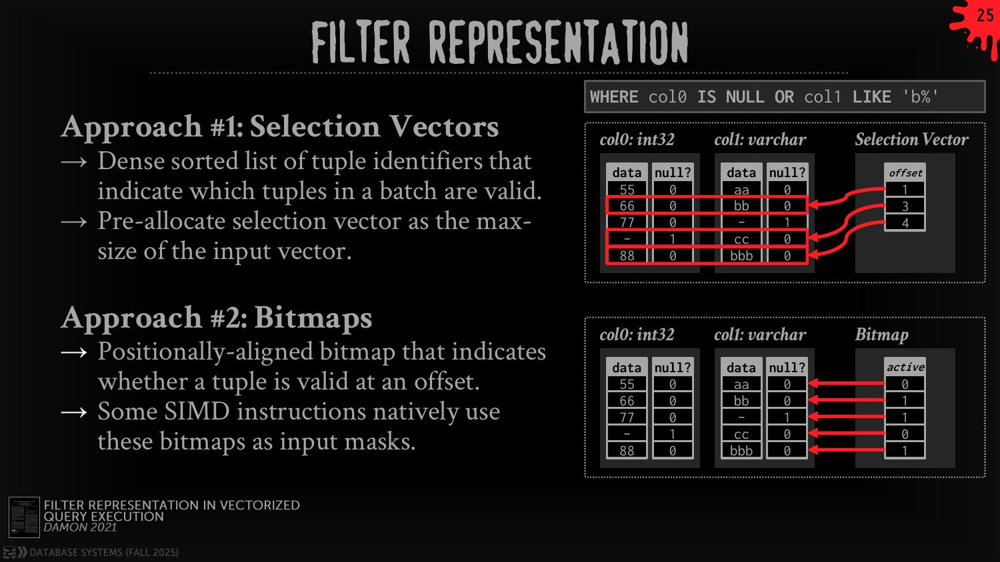

**勘误：**上图原始幻灯片的 Bitmap 印为 `0 1 1 0 1`，其中偏移量 2、3 的位值颠倒。按图中谓词和输入数据计算，正确[位图](#位图（筛选结果）)是 `0 1 0 1 1`，与[选择向量](#选择向量) `[1, 3, 4]` 一致。偏移量 2 的谓词结果为 UNKNOWN，不能通过 WHERE；偏移量 3 的 `col0 IS NULL` 为 TRUE，应当保留。


两种表示各有适用的场合。拿到[选择向量](#选择向量)的[算子](#算子)只需遍历其中的偏移量，有效[元组](#元组)少、后续运算又贵时，这能省掉大量无用计算。拿到[位图](#位图（筛选结果）)的算子往往对整批数据照算不误，最后再用[位图](#位图（筛选结果）)屏蔽结果，这对 SIMD 最友好，适合有效元组多、运算简单的情形。不同系统的选择不同。

还有一个实际问题：如果一批 1024 条[元组](#元组)里只有一条满足[谓词](#谓词)，把这一批原样传上去，上层[算子](#算子)就要为一条元组付出处理整批的开销。有些系统会在算子之间放一个暂存缓冲区，攒够有效元组、凑成一个满的批次再往上传。系统也可以在运行时根据[选择率](#选择率)在几种做法之间切换，前提是每种做法都要实现一遍。

GPU 是 SIMD 思路的延伸。上一个十年出现过一批 GPU [数据库](#数据库)，它们要求把整个数据库放进 GPU 显存，没能流行起来。随着 NVLink 等 GPU 互连技术的进展，这一限制正在松动，Andy 预计 GPU 数据库会重新兴起，而上面这些 SIMD 的原则在 GPU 上同样适用。

## 4. 消除解释开销：[代码特化](#代码特化)的两条路

📍 *PPT 第 26–29 页*

### 4.1 解释执行慢在哪里

📍 *PPT 第 27 页*

向量化和 SIMD 让每条指令做更多的事，另一类浪费则是根本不必执行的指令。第 [13](../L13/index.md) 讲的执行器是一个解释器：执行时遍历[查询计划](#查询计划)树，对每条[元组](#元组)再遍历一遍[表达式树](#表达式树)（PPT 伪代码，照录）：

```text
Interpreted Plan
for t in range(table.num_tuples):
    tuple = get_tuple(table, t)
    if eval(predicate, tuple, params):
        emit(tuple)
```

表面上只有两个函数调用，每一个背后都有一串工作。`get_tuple` 要从[目录](#目录)（catalog）里取出这张表的模式，根据[元组](#元组)大小算出偏移量，再返回指向元组的指针。`eval` 要遍历[谓词](#谓词)树，把值逐层向上传；遇到元组中的[属性](#属性)，就算出它在元组中的偏移量；按需为比较运算做类型转换；最后返回真或假。

对同一条查询的每一条[元组](#元组)，这些工作都完全一样：表的模式不会在扫描中途改变，[属性](#属性)的偏移量也不会。用 C 写一个最小的表达式解释器，就能看清代价在哪里：

```c
// A minimal expression-tree interpreter
typedef struct Expr {
    enum { COL, PARAM, CONST, ADD, EQ } kind;
    int offset;                  // COL: byte offset of the attribute in the tuple
    int value;                   // PARAM / CONST: the literal value
    struct Expr *left, *right;
} Expr;

int eval(const Expr *e, const char *tuple) {
    switch (e->kind) {           // one dispatch per node, per tuple
    case COL:   return *(const int *)(tuple + e->offset);
    case PARAM:
    case CONST: return e->value;
    case ADD:   return eval(e->left, tuple) + eval(e->right, tuple);
    case EQ:    return eval(e->left, tuple) == eval(e->right, tuple);
    }
    return 0;
}
```

对 `WHERE b = ? + 1` 这样的[谓词](#谓词)，[表达式树](#表达式树)有 5 个节点（`EQ`、`COL`、`ADD`、`PARAM`、`CONST`），每条[元组](#元组)要做 5 次函数调用和 5 次 `switch` 分派，每次分派都是一次间接跳转，又回到了 3.1 节的[分支预测](#分支预测)问题；真正有用的计算只有一次加法和一次比较。真实系统里还有类型检查、类型转换、[NULL](#NULL) 处理，开销只会更多。

如果在拿到查询之后，把这些不变的东西直接写死在代码里，就得到下面的模板化计划（PPT 伪代码，照录）：
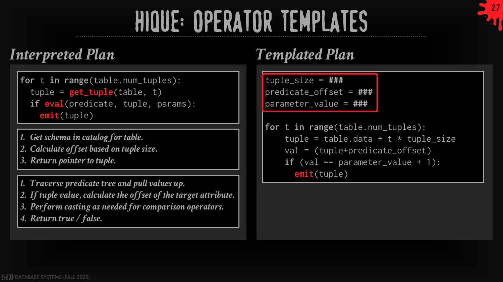


```text
Templated Plan
tuple_size = ###
predicate_offset = ###
parameter_value = ###

for t in range(table.num_tuples):
    tuple = table.data + t ∗ tuple_size
    val = (tuple+predicate_offset)
    if (val == parameter_value + 1):
        emit(tuple)
```

`###` 处在生成代码时填入具体的常量。[元组](#元组)地址变成一次乘法和一次加法，[属性](#属性)值变成一次按固定偏移量的读取（伪代码中的 `val = (tuple+predicate_offset)` 指读取该地址处的值，写成 C 是 `*(int *)(tuple + predicate_offset)`），[谓词](#谓词)变成一条比较指令，编译器还会在编译期把 `parameter_value + 1` 算好。这种为特定查询生成专门代码的做法，叫作**[代码特化](#代码特化)（code specialization）**。

### 4.2 第一条路：为每条查询生成并编译代码

📍 *PPT 第 26 页*

最直接的做法是为每条查询生成一个程序，这叫**[查询编译](#查询编译)（query compilation）**。爱丁堡大学的 HIQUE（ICDE 2010）就是这样做的：拿到[查询计划](#查询计划)之后，生成一段实现该计划的 C/C++ 程序，把所有[谓词](#谓词)和类型转换都写死在里面；再调用现成的编译器（gcc）把它编译成共享对象（shared object，Linux 下的 `.so` 文件，即动态链接库），链接进 DBMS 进程，然后调用其中的执行函数。用 C 的话说，就是生成源码、编译，用 `dlopen` 加载，用 `dlsym` 找到入口函数，再通过函数指针调用它。

这样做有两个问题。第一个是编译本身很慢。gcc 要做预处理、语法分析、优化、生成机器码，对一条几毫秒就能跑完的查询，编译时间可能比执行时间还长。大多数做[查询编译](#查询编译)的系统都直接调用现成的编译器编译生成的源码，慕尼黑工业大学的研究组则在这个问题上一路改进。HyPer 不再生成 C 代码，而是直接生成 LLVM 的**[中间表示](#中间表示)（intermediate representation，[IR](#中间表示)）**，交给 LLVM 编译成机器码，省掉了解析 C 源码的开销。它的后继者 Umbra（其商业化版本是 CedarDB）走得更远：先生成自己的 [IR](#中间表示)，用一个手写的、极快的后端把 [IR](#中间表示) 直接翻译成机器指令，立即开始执行；同时在后台用 LLVM 以最高优化级别编译同一份 [IR](#中间表示)。如果查询在优化版本编好之前就跑完了，事情就结束了；如果还没跑完，就换用优化过的版本。切换发生在任务之间：调度器每派发一个任务，就检查优化版本是否已经就绪，就绪就调用它，否则继续用快速生成的版本。这种运行时生成代码的方式叫**[即时编译](#即时编译)（just-in-time compilation，[JIT](#即时编译)）**。

第二个问题更麻烦：调试。生成的代码在运行中崩溃时，落点是一段没有符号、没有源码对应的机器码，调试器无法告诉你它是由生成器里的哪一行产生的，而真正要修的恰恰是生成器。要像调试普通程序那样调试这类系统，就得自己造工具，把崩溃点映射回生成它的那一行代码；开发这种系统的人既要懂[数据库](#数据库)，又要懂编译器。Andy 在 CMU 的研究组也做过基于 LLVM 的[即时编译](#即时编译)查询引擎，他的评价是：调试起来是一场噩梦。[^jit]

这个想法并不新。IBM 在 1970 年代的 System R 里就为[查询计划](#查询计划)生成汇编代码，遇到的也是同样的问题：系统一崩溃，就得追查是哪段生成器代码产生了出错的汇编；而且当时的抽象做得不好，存储层的接口每改一次，代码生成器也得跟着改。

### 4.3 第二条路：预编译原语

📍 *PPT 第 28–29 页*

另一条路来自 Vectorwise（论文 SIGMOD 2013）：不在运行时生成代码，而是在构建 DBMS 时就预先编译好成千上万个**[预编译原语](#预编译原语)（precompiled primitive）**，每个原语对某种类型的数据执行一种基本操作，比如“整数列等于整数常量”“整数列小于整数常量”“字符串列等于字符串常量”。执行查询时，DBMS 按计划把需要的原语串起来调用。

两个设计让这条路走得通。第一，每个原语都是一个简单的紧凑循环，编译器很容易把它自动向量化成 SIMD 代码。第二，原语一次处理一批[元组](#元组)，函数调用的开销被整批分摊：逐元组调用时，一批 1024 条元组要调用 1024 次，按批调用只要一次。原语的输出是满足条件的元组偏移量，也就是[选择向量](#选择向量)，下一个原语只处理这些位置。

以下面这条查询为例（PPT 代码，照录）：
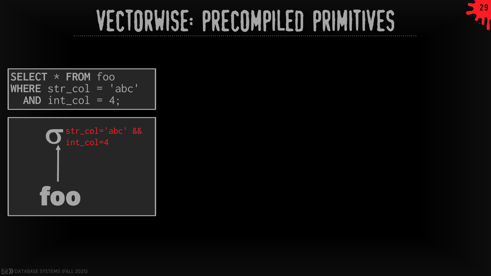


```sql
SELECT * FROM foo
 WHERE str_col = 'abc'
   AND int_col = 4;
```

```cpp
vec<offset> sel_eq_str(vec<string> col, string val) {
    vec<offset> positions;
    for (offset i = 0; i < col.size(); i++)
        if (col[i] == val) positions.append(i);
    return (positions);
}

vec<offset> sel_eq_int(vec<int> col, int val,
                       vec<offset> positions) {
    vec<offset> res;
    for (offset i : positions)
        if (col[i] == val) res.append(i);
    return (res);
}
```

这是 C++ 风格的伪代码。`vec<offset>` 是元素类型为 `offset` 的动态数组，尖括号是 C++ 模板的语法，相当于在 C 里为每种元素类型各写一个“数组加长度”的结构体；`for (offset i : positions)` 是 C++ 的范围 for 循环，依次取出 `positions` 中的每个元素，等价于在 C 里按下标遍历整个数组。第一个原语扫描整个字符串列，返回相等的位置；第二个原语只检查这些位置上的整数列，返回两个条件都满足的位置。两者通过偏移量数组串联，调用的先后由优化器决定。

你可能担心原语的数量会爆炸。查询的写法有无穷多种，但原语只覆盖最底层的操作：数据类型只有那么几种，操作也只有等于、小于、加减等有限几种，再乘上“列与常量”“列与列”几种组合，总数是有限的。这些原语在代码库里用 C++ 模板批量生成，编译进 DBMS 的二进制文件，运行时要做的只是通过函数指针把它们拼起来。原语里有 bug 时，它就是一段普通的、编译好的代码，可以用 gdb 单步调试、稳定复现。
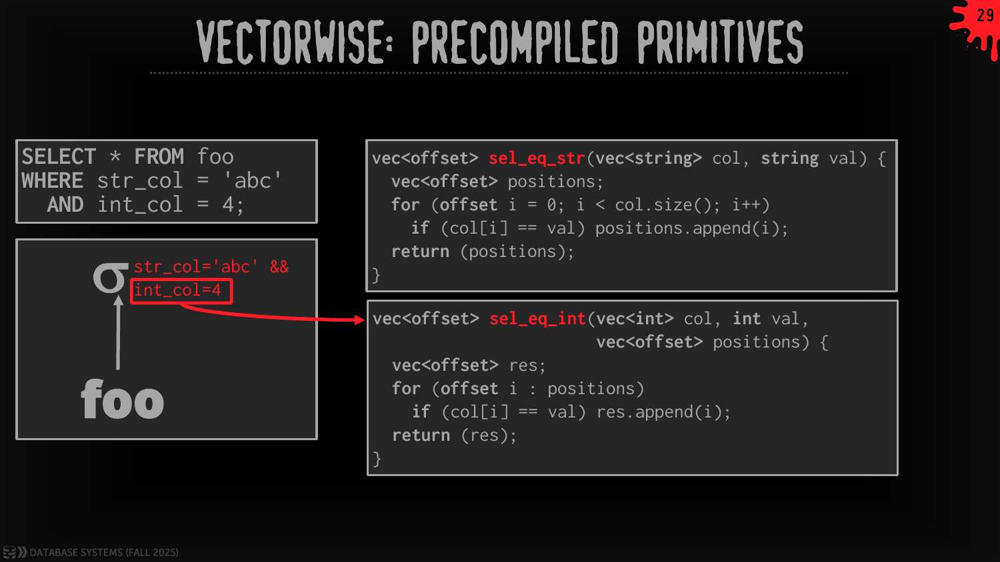


两条路放在一起比较：[查询编译](#查询编译)为每条查询量身定做代码，执行效率的上限最高，但要付出编译延迟和调试困难的代价；[预编译原语](#预编译原语)放弃了跨原语的优化，却把工程复杂度控制在普通软件的水平，按批调用又摊薄了函数调用的开销。Andy 认为，目前的研究结论是后者才是构建系统的正确方式，而不是[即时编译](#即时编译)。[^prim] 第 5 节的系统里，Snowflake 和 Databricks Photon 都选了这条路。

Vectorwise 出自荷兰国家数学与计算机科学研究中心（CWI），DuckDB 也诞生在那里。它的联合创始人 Marcin Żukowski 后来与两位 Oracle 出身的工程师共同创办了 Snowflake，把这套设计带进了云数据仓库。

> 💬 **旁注**
> Andy 很佩服 Marcin Żukowski 对[数据库](#数据库)的投入，还展示过一张他亲手拍的照片：Marcin 的腿上文着 Snowflake 的标志。按 Andy 的说法，Marcin 文这个是因为太爱自己的数据库了；如果你觉得 Andy 对数据库已经够狂热，Marcin 和他是一路人。
>
> *原话：“He got the Snowflake tattoo because he loves his database so much.”*

## 5. 真实系统中的取舍

📍 *PPT 第 30–63 页*

### 5.1 共同的底座

📍 *PPT 第 30、33、39、45、50、57、62 [页](#页)*

下面考察六个系统：Google BigQuery、Snowflake、Amazon Redshift、Yellowbrick、Databricks Photon 和 ClickHouse。把它们的特性清单并排放在一起（“—”表示清单中没有列出）：

| 系统 | 存储架构 | 存储格式 | 执行模型 | [代码特化](#代码特化) | [连接](#连接)算法 | 优化器 |
|---|---|---|---|---|---|---|
| BigQuery | [共享磁盘](#共享磁盘) / [存算分离](#存算分离) | 列存储（[区域映射](#区域映射)、[字典编码](#字典编码) + [游程编码](#游程编码)） | 向量化；基于[混洗](#混洗)的分布式执行 | — | 只有[哈希连接](#哈希连接) | 启发式 + 自适应 |
| Snowflake | 共享磁盘 / [存算分离](#存算分离) | [PAX](#PAX) 列存储 | 推送式向量化 | [预编译原语](#预编译原语) | — | [自适应优化](#自适应优化) |
| Redshift | 共享磁盘 / [存算分离](#存算分离) | PAX 列存储 | 推送式向量化 | [转译](#转译)成 C++ + [预编译原语](#预编译原语) | 排序归并 + 哈希 | 分层（stratified）优化器 |
| Yellowbrick | 共享磁盘 / [存算分离](#存算分离) | 行存储 + PAX 列存储 | 推送式向量化 | [转译](#转译)成 C++ | 排序归并 + 哈希 | 增强版 PostgreSQL 优化器 |
| Photon | 共享磁盘 / [存算分离](#存算分离) | — | 拉取式向量化；基于[混洗](#混洗)的分布式执行 | [预编译原语](#预编译原语) + [表达式融合](#表达式融合) | 排序归并 + 哈希 | 统一优化器 + 自适应 |
| ClickHouse | [无共享](#无共享) | MergeTree | 拉取式向量化；一次一个[算子](#算子) | 用 LLVM 编译表达式 | 排序归并 + 哈希 | 启发式 + 基于规则的重写 |

几点一目了然。六个系统全部采用向量化执行。除 ClickHouse 外都是[共享磁盘](#共享磁盘)架构：数据放在云上的对象存储或分布式文件系统里，计算节点可以独立增减，这就是**[存算分离](#存算分离)（disaggregated storage）**。列存储也是标配，几个系统用的 [PAX](#PAX) 格式（第 [6](../L06/index.md) 讲）在[页](#页)内按列分组存放[属性](#属性)。推送式与拉取式（第 [13](../L13/index.md) 讲）各有系统选用，两种方向都能做得很快。分歧集中在[代码特化](#代码特化)上：Snowflake 和 Photon 选择[预编译原语](#预编译原语)；Redshift 和 Yellowbrick 把查询**[转译](#转译)（transpile）**成 C++ 源码再编译，这是源到源的翻译，也就是 HIQUE 那条路；ClickHouse 只对表达式做[即时编译](#即时编译)。

还有一条贯穿几个系统的线索：[统计信息](#统计信息)靠不住，所以把决策推迟到运行时。第 [15](../L15/index.md)、[16](../L16/index.md) 讲的优化器依赖统计信息估计[基数](#基数)，而在云数据仓库和数据湖里，数据常常刚刚导入，甚至是从未见过的原始文件，根本没有统计信息，有也可能早已过时。下面会反复看到，系统在运行时观察真实的数据量，再调整计划和资源。

### 5.2 Google BigQuery：把混洗层当作[检查点](#检查点)

📍 *PPT 第 31–36 页*

BigQuery 的前身是 Google 在 2006 年作为业余项目开发的 Dremel，最初用来分析其他工具产生的数据文件。“交互式”是它的核心目标：直接在原地（in situ）的数据文件上跑即席查询，不必先把数据导入[数据库](#数据库)。第一个版本甚至不支持[连接](#连接)。后来它被重写为建立在 Google 文件系统（GFS）之上的[共享磁盘](#共享磁盘)架构，并于 2012 年以 BigQuery 之名作为商业产品公开发布。它的特性清单（论文 VLDB 2020）中有几项可以和前面的课程对照：列存储配有[区域映射](#区域映射)和[过滤器](#过滤器)，压缩用[字典编码](#字典编码)加[游程编码](#游程编码)（第 [6](../L06/index.md) 讲）；唯一允许的[索引](#索引)是专供文本搜索的[倒排索引](#倒排索引)（inverted index，从词映射到包含它的记录）；连接算法只有[哈希连接](#哈希连接)一种。

BigQuery 最有特色的是它的内存**[混洗](#混洗)（shuffle）**。一条查询被切成若干阶段（stage），第 n 阶段的每个 worker 作为生产者，把输出按[分区](#分区)写进一个独立的内存存储层；第 n+1 阶段的 worker 作为消费者，从这一层读取各自的分区。这就是第 [14](../L14/index.md) 讲[交换算子](#交换算子)做的重分区，只是中间多了一层专门的存储：

```text
Distributed File System
          |
          v
Stage n    : [Worker] [Worker] [Worker] [Worker]        producers
          |  write partitions
          v
In-Memory Storage (shuffle tier) ---- statistics ----> Coordinator
          |  read partitions                                |  decides how many workers
          v                                                 v
Stage n+1  : [Worker] [Worker] [Worker] ( + more if the output is large )    consumers
```

多出的这一层存储带来三个好处。第一，每个[混洗阶段](#混洗阶段)都成了查询生命周期里的一个[检查点](#检查点)：协调者（coordinator）确认上一阶段的所有任务都已完成，结果已经安全地存在[混洗](#混洗)层里，下一阶段才开始。第二，容错和应对掉队者：某个 worker 没能在期限内交出任务的结果，协调者就**[推测执行](#推测执行)（speculative execution）**一个冗余的任务，谁先完成用谁的结果；由于输入就在[混洗](#混洗)层里，重跑一个任务不必重跑整条查询。第三，动态资源分配：协调者看到一个阶段实际输出了多少数据，再决定下一阶段用多少个 worker。代价是数据要多写一次、多读一次。5.3 节的 Snowflake 做了相反的选择。
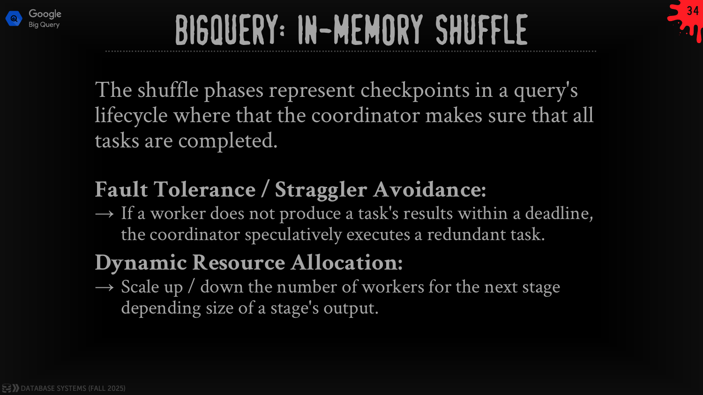

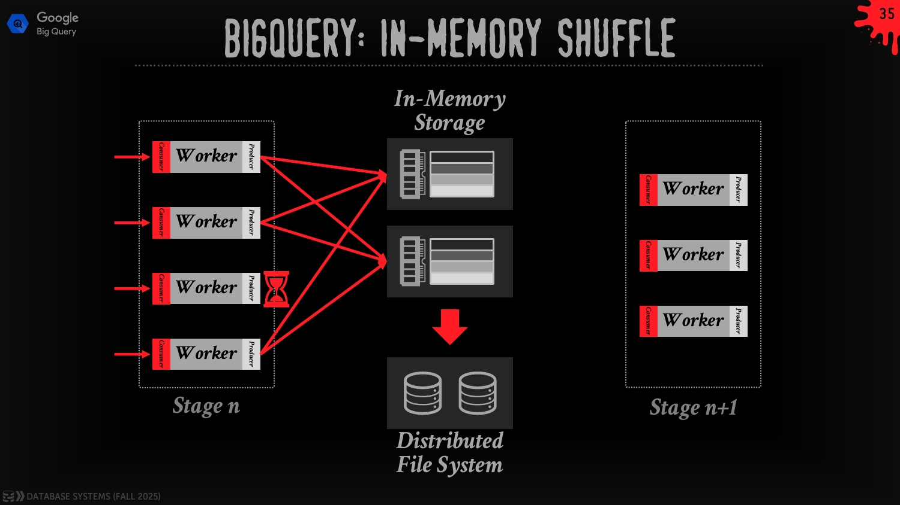

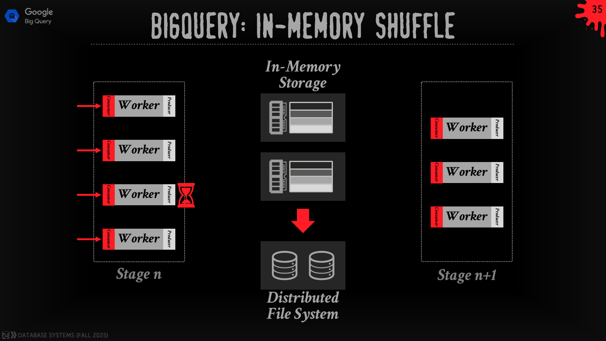

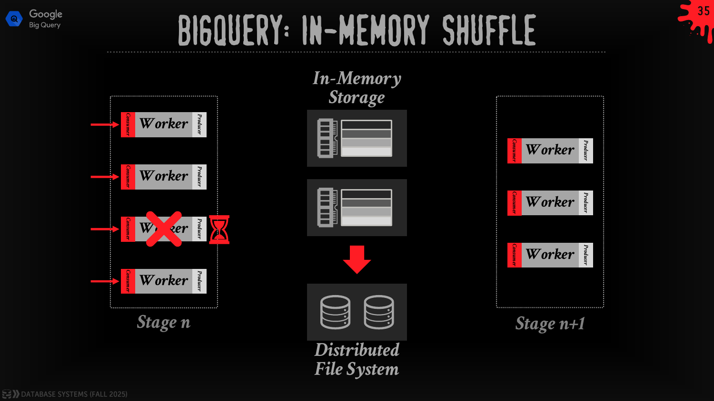

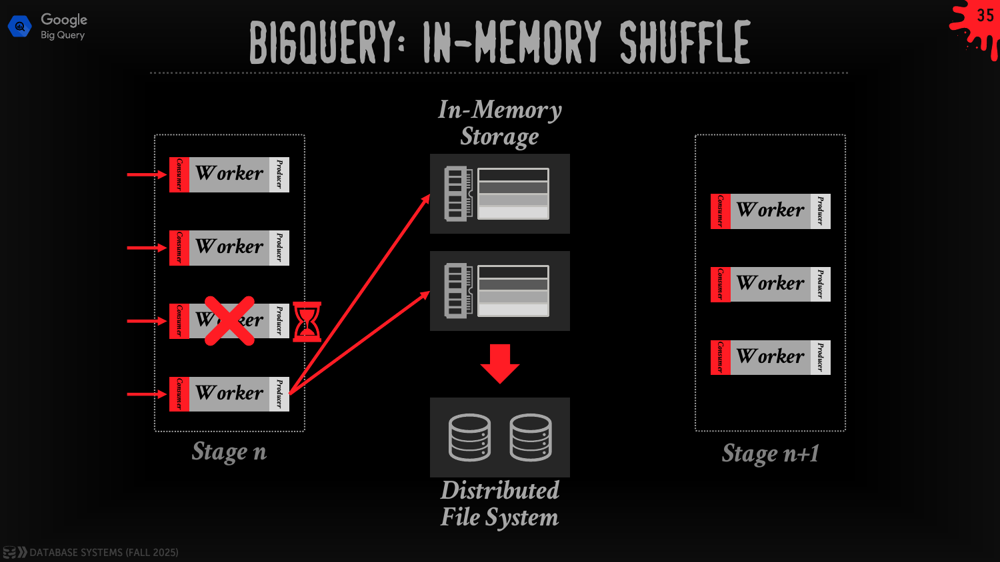

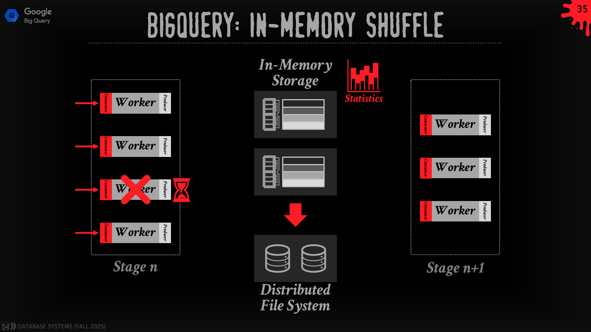

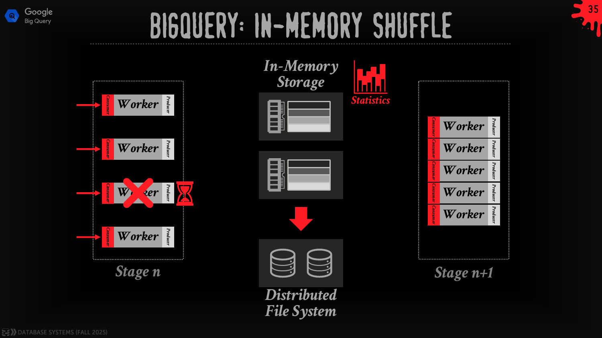

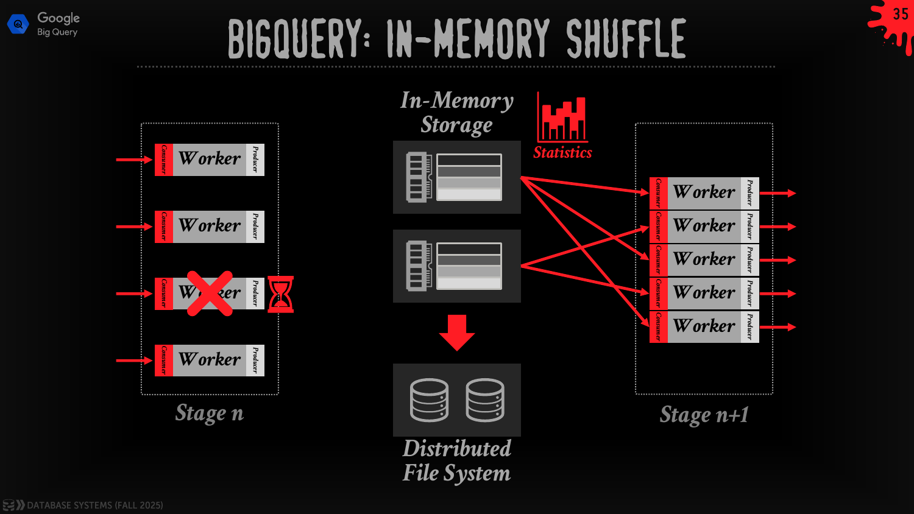


**[动态重分区](#动态重分区)（dynamic repartitioning）**处理的是[数据倾斜](#数据倾斜)。按哈希[分区](#分区)时，如果某个键特别热门，它所在的分区会被撑得远大于其他分区，负责它的 worker 就成了整个阶段的瓶颈。BigQuery 在[混洗](#混洗)过程中监视各分区的大小，发现某个分区过满时就调整分区方案：

1. worker 按 `hash1(key)` 把数据写进[分区](#分区) #1 和 #2；
2. [统计信息](#统计信息)显示分区 #2 快满了；
3. 协调者新增分区 #3 和 #4，指示 worker 改用 `hash2(key)`，新数据写进 #3 和 #4；
4. 分区 #2 中已有的数据按新方案重新分到 #3 和 #4；
5. 分区 #2 撤销，剩下 #1、#3、#4。
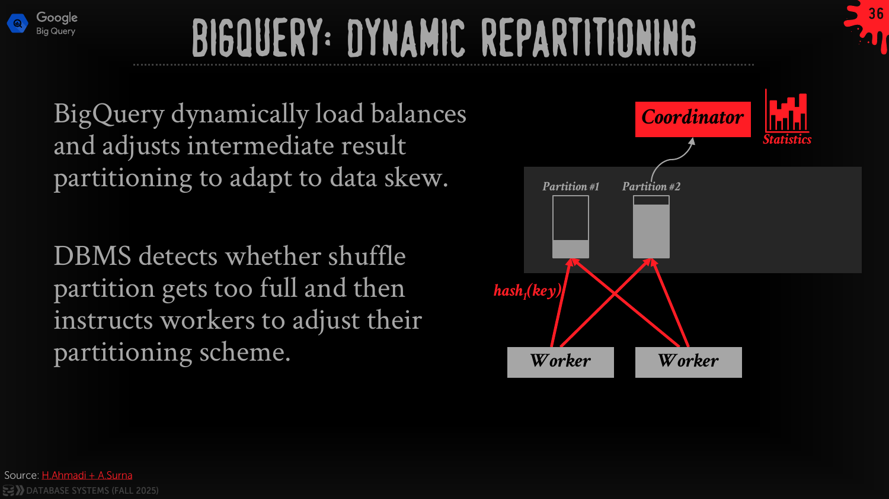

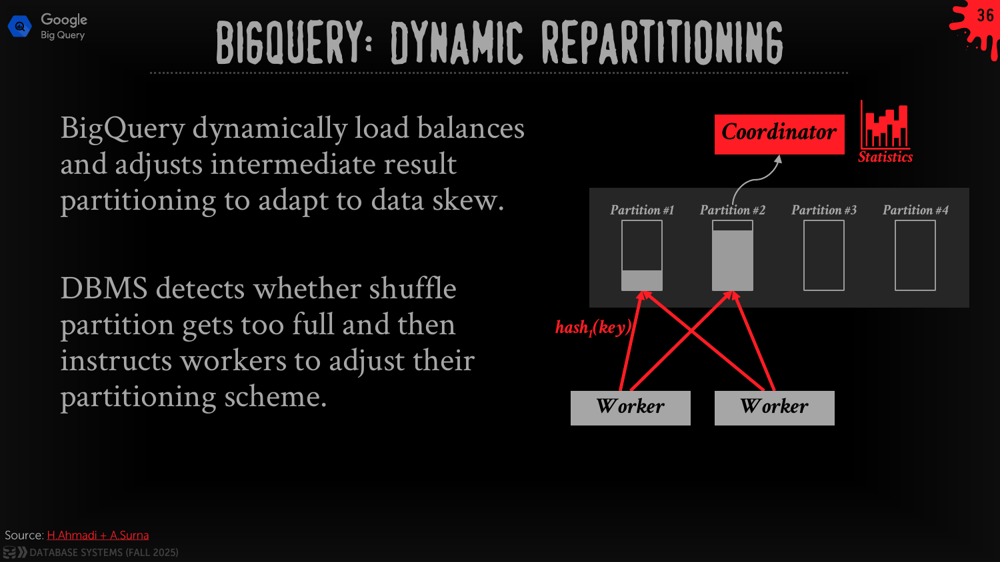


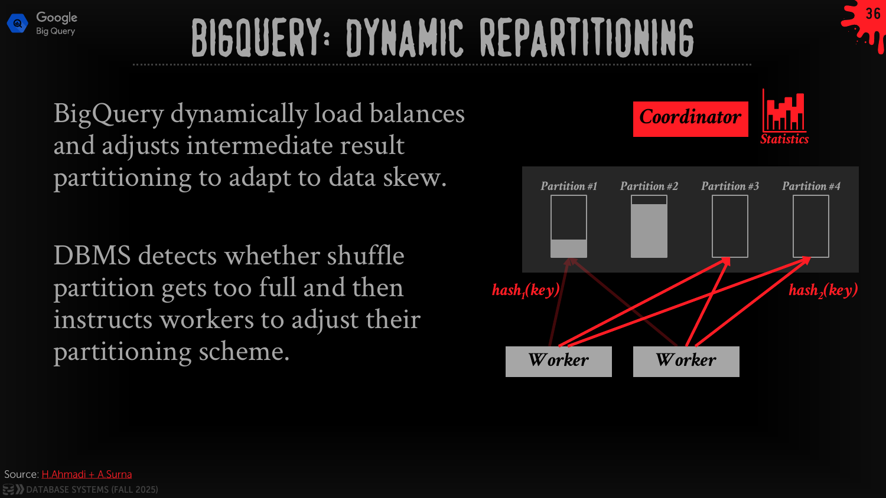

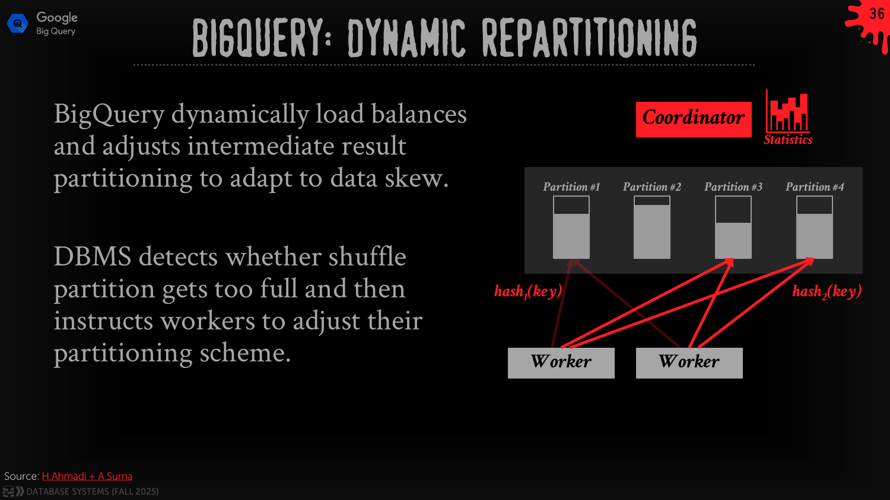

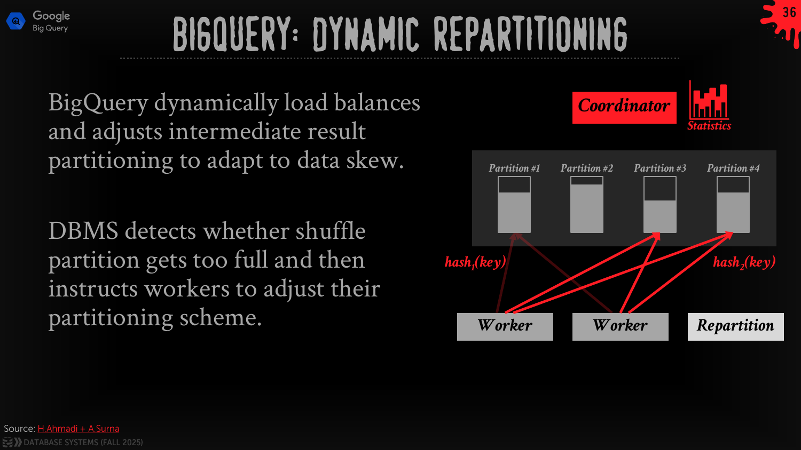

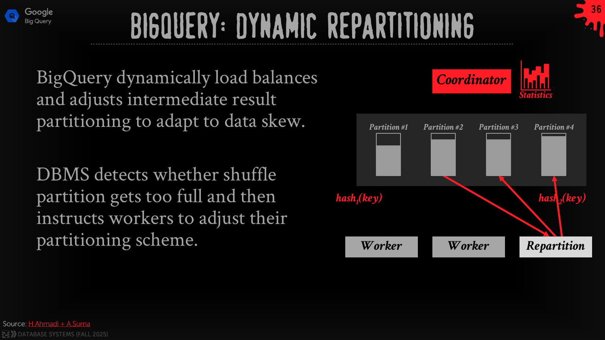

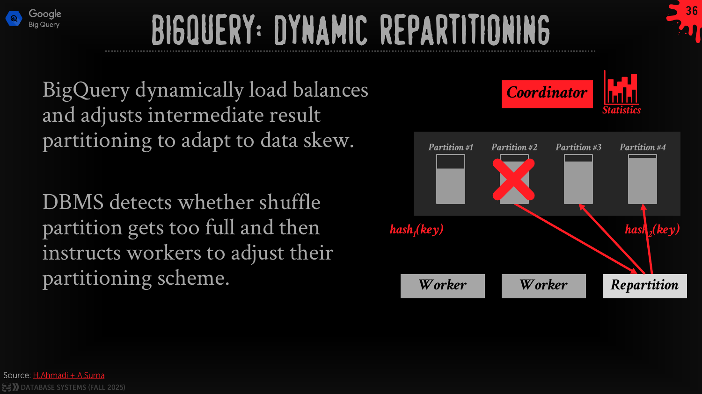

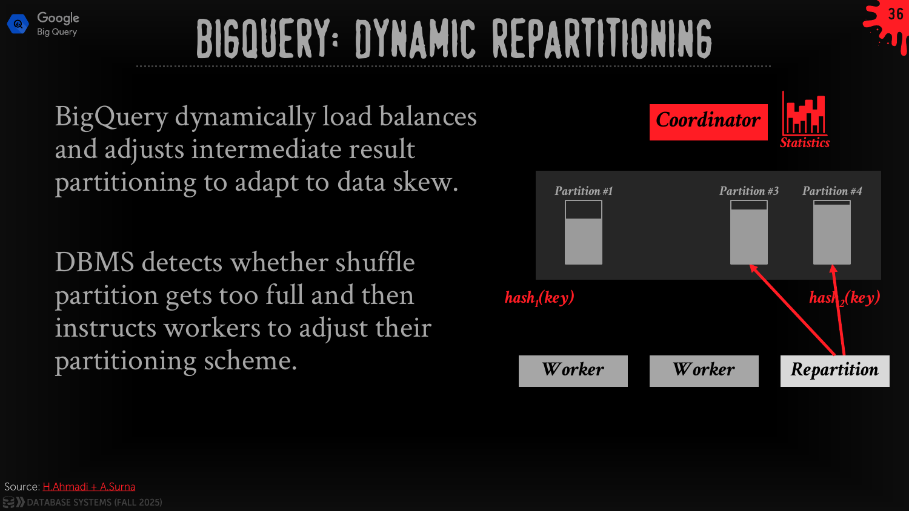


### 5.3 Snowflake：原语加运行时自适应

📍 *PPT 第 37–42 页*

Andy 称 Snowflake 为“元祖级”的云原生数据仓库（论文 SIGMOD 2016）：一个用 C++ 从零写起的托管式 OLAP 系统，没有借用任何现成系统的组件，有自己的 [SQL 方言](#SQL%20方言)和客户端-服务器网络协议。它采用[共享磁盘](#共享磁盘)架构，同时在计算节点本地积极地缓存数据。它的特性清单里有两项与前面的课程形成对照：一是没有第 [4](../L04/index.md) 讲那样的[缓冲池](#缓冲池)，靠计算节点的本地缓存保存从共享存储取来的数据；二是表数据与元数据分开存放。

[执行引擎](#执行引擎)是推送式的向量化引擎，[算子](#算子)的核心计算都用[预编译原语](#预编译原语)实现，不同向量数据类型的变体用 C++ 模板预先生成。它唯一使用代码生成（通过 LLVM）的地方，是 worker 之间传输[元组](#元组)时的序列化与反序列化。一个合理的解释是：序列化格式由被传输元组的具体模式决定，这种组合无法预先枚举，而序列化又是每条元组都要经过的热点。

Snowflake 不支持部分重试查询：一个 worker 出故障，整条查询都要从头再来。这正是 BigQuery 那层[混洗](#混洗)存储所避免的：没有可以从中恢复的中间[检查点](#检查点)，故障的代价就是整条查询；反过来，省掉那一层也就省掉了数据的额外写入和读取。

**[自适应优化](#自适应优化)（adaptive optimization）**在 Snowflake 里的一个例子是聚合下推。在[连接](#连接)之前先聚合，常常能大幅缩小连接的输入：一张表里如果有大量重复的分组键，先按分组键聚合一遍，送进连接的[元组](#元组)就少得多。Snowflake 的优化器在确定连接顺序之后，找出可以下推到连接下方的聚合，把这些下游的聚合（AggChild、AggParent）加进计划，但它们是否真正生效，要等到运行时根据执行中观察到的[统计信息](#统计信息)决定。推迟决定的理由很清楚：预聚合只在分组键重复很多时才有收益，分组键如果几乎各不相同，它不会减少元组，反而白白消耗 CPU 和内存，而优化器在编译期无法知道属于哪种情况。

**[灵活计算](#灵活计算)（flexible compute）**把运行时自适应从计划扩展到了资源。某个[计划片段](#计划片段)要处理的数据量很大时，Snowflake 可以临时调来额外的 worker 节点加速它。例子中的计划有一个大表扫描，经过过滤和[连接](#连接)[过滤器](#过滤器)（JoinFilter，由[哈希连接](#哈希连接)构建侧生成、在探测侧提前过滤不可能匹配的[元组](#元组)，即第 [12](../L12/index.md) 讲的[布隆过滤器](#布隆过滤器)优化）之后做分组聚合。改写之后，这个片段放到临时节点上执行，结果像一张普通表一样写回存储（Insert）；原计划再用 TableScan 把它读回来，与本地算出的部分通过 UnionAll 合并。临时节点与原计划之间通过存储交换数据，所以它们的加入和撤离不会打扰原来的集群。

### 5.4 Amazon Redshift：保留代码生成，用缓存摊薄编译

📍 *PPT 第 43–46 页*

Redshift 是亚马逊的旗舰 OLAP [数据库](#数据库)服务（论文 SIGMOD 2022）。它基于 ParAccel 最初的[无共享](#无共享)架构，2017 年改为支持[存算分离](#存算分离)（数据放在 S3 上），2022 年加入了无服务器（serverless）部署。与 BigQuery、Spark 相比，Redshift 更像传统的数据仓库，希望数据完全由它自己掌控；它的首要设计目标是尽可能替用户免去管理和配置上的选择。特性清单里，Redshift 同时用了两种[代码特化](#代码特化)，[转译](#转译)成 C++ 再编译，以及[预编译原语](#预编译原语)；此外还有计算端缓存、[PAX](#PAX) 列存储、排序归并加[哈希连接](#哈希连接)、硬件加速（AQUA）和分层[查询优化器](#查询优化器)。

[查询编译](#查询编译)的第一个问题是编译太慢，Redshift 的回答是专门的编译服务：由独立的节点用 GCC 编译[查询计划](#查询计划)，并积极地缓存编译结果。查询计划被拆成模板化的片段，DBMS 先看当前客户的本地缓存里是否已有某个片段的编译版本；没有，再去查一个面向全体 Redshift 客户的全局缓存。DBMS 发布新版本时，后台 worker 会主动把计划重新编译一遍。

这套设计成立的前提是查询片段大量重复。同一个仪表盘每隔几分钟发出的查询结构相同，只是参数不同；不同客户的查询拆成模板片段后，也有大量相同的形状。一个片段编译一次，就能被无数次执行摊薄。HIQUE 为每条查询付出的编译代价，在这里变成了整个服务范围内的一次性投入。

### 5.5 Yellowbrick：绕开操作系统

📍 *PPT 第 48–54 页*

Yellowbrick 是一个用 C++ 编写的 OLAP 系统，源自 PostgreSQL 9.5 的硬分叉（hard fork）：它沿用 PostgreSQL 的前端，也就是网络、[解析器](#解析器)和[目录](#目录)，来接收 SQL 请求，其余部分全部重写（论文 CIDR 2024）。它最初是带 FPGA 加速的本地部署一体机，2021 年转为[数据库](#数据库)服务，云版本的所有组件都运行在 Kubernetes 上。特性清单和 Redshift 很像：[存算分离](#存算分离)、推送式向量化、[转译](#转译)成 C++ 的代码生成、计算端缓存、排序归并加[哈希连接](#哈希连接)，优化器是增强版的 PostgreSQL 优化器，存储上把行存储和 [PAX](#PAX) 列存储分开。清单最后一项写的是“疯狂的系统工程”，这才是它真正的特点。Andy 对他们的评价是：他们和他一样厌恶操作系统。

它的架构由对象存储、worker 节点、编译服务、批量导入服务、行存储和调度器组成。worker 与对象存储之间用的是自己写的 S3 客户端，节点之间用自己设计的 UDP 协议，访问本地 SSD 用自己写的 NVMe 驱动。

执行上，它是推送式的向量化引擎，同时支持行式和列式数据，并采用[早期物化](#早期物化)；为此引入了转置（transpose）[算子](#算子)，在行格式和列格式之间来回转换。[查询编译](#查询编译)是整体式的，通过源到源的[转译](#转译)完成。它的架构目标是让 worker 处理的数据始终留在 CPU 的 L3 缓存里，而不是主存里。L3 缓存是 CPU 芯片上的最后一级缓存，访问速度比主存快得多。

内存分配器是自己写的：一个感知 NUMA、无[闩](#闩)（latch-free）的分配器，在启动时就一次性拿到所需的全部内存。具体做法是用 `mmap` 配合 `mlock` 和大页（huge page）。NUMA（非一致内存访问）是说多路服务器上每个 CPU 插槽都有自己的本地内存，访问别的插槽的内存更慢；`mlock` 把内存[锁](#锁)在物理内存里，不让操作系统换出；大页用 2 MB 而不是 4 KB 的[页](#页)，减少地址翻译时的 TLB 未命中。分配按查询分组，避免[碎片](#碎片)。Yellowbrick 声称它比 libc 的 `malloc` 快 100 倍。每个 worker 还有自己的[缓冲池管理器](#缓冲池管理器)，用 MySQL 风格的近似 [LRU-K](#LRU-K)（第 [4](../L04/index.md) 讲）缓存数据文件。

设备驱动也是自己写的。NVMe 驱动和网卡驱动运行在用户态，省去数据在内核与用户空间之间的拷贝，必要时再退回 Linux 自带的驱动。节点之间的通信用自己设计的可靠 UDP 协议，并借助 DPDK 实现**[内核旁路](#内核旁路)（kernel bypass）**。通常网卡收到的数据先进内核缓冲区，经过协议栈，再拷贝到用户进程；[内核旁路](#内核旁路)让用户进程直接轮询网卡，自己在用户空间管理协议栈，操作系统不再插手。存储方面对应的工具是 SPDK。每个 CPU 都有自己的收发队列，异步地轮询；数据只发给其他 worker 上对应的“伙伴”CPU。Yellowbrick 用 TPC-DS 比较了两种网络栈下的运行时间（PPT 第 54 页，数值越小越好）：

| 集群规模 | TCP | DPDK |
|---|---|---|
| 2 个 worker | 2430 | 1976 |
| 3 个 worker | 1626 | 1358 |
| 4 个 worker | 1222 | 995 |

三种规模下，DPDK 都把运行时间缩短了 16%–19%。你也许会想到 RDMA，它同样能绕开内核，但需要专门的网卡硬件；DPDK 和 SPDK 不需要特殊硬件，在 Amazon 这样的公有云上也能用，而一个依赖专用硬件的系统没法在云上随处部署。

这一切与第 [4](../L04/index.md) 讲一脉相承。在那里，DBMS 拒绝把[页](#页)的管理交给操作系统的[页缓存](#页缓存)和 `mmap`，理由是 DBMS 比操作系统更清楚自己的[访问模式](#访问模式)。Yellowbrick 把这种不信任推到了极致，内存分配、磁盘驱动、网络协议栈全部自己实现。Andy 的描述是：Yellowbrick 一启动就申请好一大块内存、接管硬件，从此再也不和操作系统打交道，因为操作系统会毁了你的生活。[^os]

### 5.6 Databricks Photon 与 Spark：从 JVM 回到 C++

📍 *PPT 第 55–60 页*

Databricks 的产品建立在 Spark 之上。Spark 用 Scala 编写，运行在 Java 虚拟机（JVM）上，最初是一个一次处理一条[元组](#元组)的行式系统。Spark SQL 后来也做了[即时编译](#即时编译)，在运行时生成 JVM 字节码，但很难用这种方式拿到好的性能：这要求工程师同时懂编译器、懂[数据库](#数据库)，还要懂 JVM 的种种特性，大量时间花在了调优 JVM 上，而不是让查询引擎本身变快。Andy 对 JVM 的态度一向鲜明。[^jvm]

Photon（论文 SIGMOD 2022）是 Databricks 的回答：一个用 C++ 编写的单线程[执行引擎](#执行引擎)，通过 JNI（Java Native Interface，让 JVM 中的代码调用 C/C++ 函数的机制）嵌入 Databricks Runtime（DBR）。执行查询时，只要某个操作有 Photon 实现，就交给 C++ 代码运行，否则退回原来的 JVM 实现。它同时支持 Spark 早期的 SQL 引擎和 DataFrame API，并且要处理行式的 DBR 与列式的 Photon 之间的“阻抗失配”，和第 [1](../L01/index.md) 讲的[对象-关系阻抗失配](#对象-关系阻抗失配)是同一类问题：两边的数据表示方式不同，交界处需要转换。它的目标场景是在数据湖里“原始的、未经整理的”文件上加速查询。

Photon 的执行方式和 Vectorwise 一脉相承：把[物理计划](#物理计划)转换成一个函数指针列表，每个函数对列式的数据批执行一种底层操作。用 C 的眼光看，一条查询在 Photon 里就是一个数组，数组元素是指向[预编译原语](#预编译原语)的函数指针。Databricks 给出的理由是，向量化引擎比[即时编译](#即时编译)引擎更容易构建和维护：用[即时编译](#即时编译)时，工程师写的是工具和观测钩子，而不是引擎本身；用向量化引擎时，工程师可以把时间花在为常见情况编写专门的代码路径上，一步步逼近[即时编译](#即时编译)的性能。据 Andy 介绍，Photon 最初的版本并不比原来的[即时编译](#即时编译)版本快，但工程师的时间都用在了让原语变快上，最终的提升超过了继续在 JVM 上投入所能得到的。
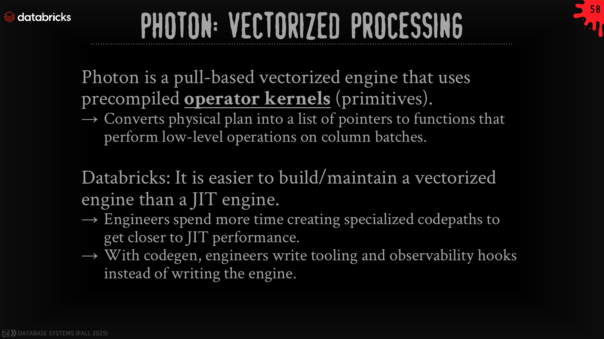


Photon 还会“押注”数据的性质。一列即使声明为可以为空，Photon 也可以先假定其中没有 [NULL](#NULL)，省掉大量空值检查，押错了再回滚。数据湖里的 Parquet、CSV 文件往往是第一次见到，没有任何[统计信息](#统计信息)，只能先猜；JSON 几乎没有类型，可以先假定某个字段绝大多数时候是整数，真的遇到字符串时再退回通用的处理方式。这和 3.1 节的[分支预测](#分支预测)是同一种思路，押注的层次从单条指令升到了整批数据。

**[表达式融合](#表达式融合)（expression fusion）**是 Photon 对[预编译原语](#预编译原语)的改进。**[算子融合](#算子融合)（operator fusion）**是把[谓词](#谓词)直接放进扫描[算子](#算子)，而不是作为两个独立的算子；[表达式融合](#表达式融合)在更细的粒度上做同样的事。查询

```sql
SELECT * FROM foo
 WHERE cdate BETWEEN '2024-01-01' AND '2024-04-01';
```

中的 `BETWEEN` 等价于 `cdate >= '2024-01-01' AND cdate <= '2024-04-01'`，按原语的做法要调用两个原语（照录）：

```cpp
vec<offset> sel_geq_date(vec<date> batch, date val) {
    vec<offset> positions;
    for (offset i = 0; i < batch.size(); i++)
        if (batch[i] >= val) positions.append(i);
    return (positions);
}

vec<offset> sel_leq_date(vec<date> batch, date val) {
    vec<offset> positions;
    for (offset i = 0; i < batch.size(); i++)
        if (batch[i] <= val) positions.append(i);
    return (positions);
}
```

Photon 为常见的组合预先生成融合后的原语，一次完成两个比较（照录）：
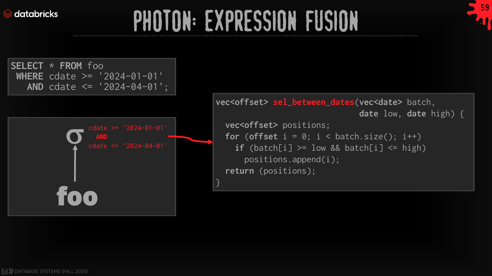

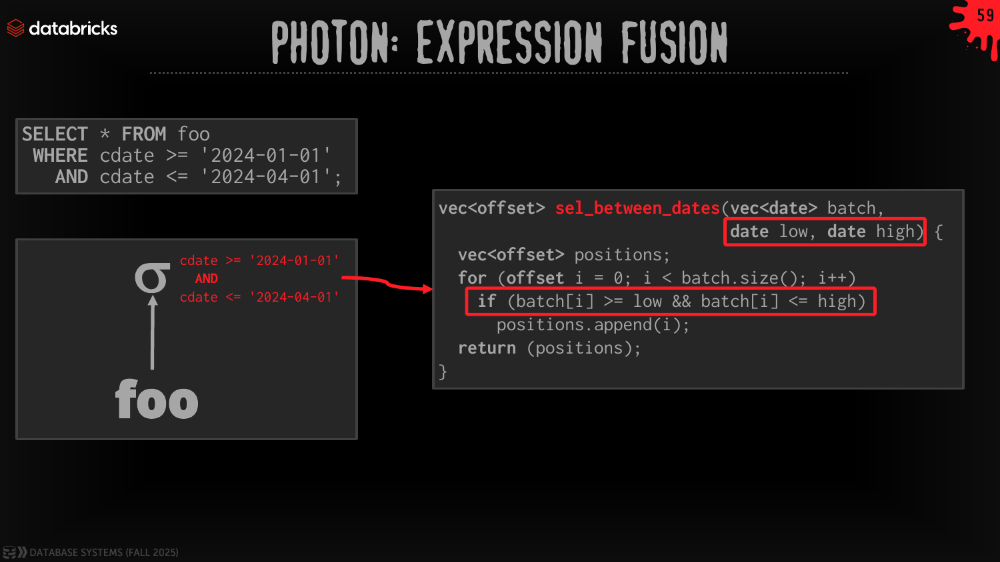


```cpp
vec<offset> sel_between_dates(vec<date> batch,
                              date low, date high) {
    vec<offset> positions;
    for (offset i = 0; i < batch.size(); i++)
        if (batch[i] >= low && batch[i] <= high)
            positions.append(i);
    return (positions);
}
```

少了一次函数调用，数据只需扫过一遍，中间的偏移量数组也不必再[物化](#物化)一次。

Spark 在[混洗](#混洗)上的自适应做法与 BigQuery 方向相反（PPT 第 60 页）。它为每个阶段预先分配、甚至过量分配大量[混洗](#混洗)[分区](#分区)，数量要大到任何一个分区都不至于被撑得太满；[混洗](#混洗)完成之后，再按启发式规则把利用率低的小[分区合并](#分区合并)起来，比如五个分区里有三个偏小，就把它们合成一个，下一阶段只需处理三个分区。这叫**[分区合并](#分区合并)（partition coalescing）**。BigQuery 在分区过满时拆分，Spark 先多分、再把过小的合并，两者针对的都是优化器事先无法知道各分区会有多少数据；每次[混洗](#混洗)之后，系统也就有机会按实际数据量增减下一阶段的 worker。

### 5.7 ClickHouse：把特化做到[哈希表](#哈希表)

📍 *PPT 第 61–63 页*

ClickHouse 出自 Yandex，2009 年前后开始开发，2016 年开源（论文 VLDB 2024）。Andy 说它刚公开时，他一度怀疑是假的：一个此前没听说过的系统一亮相，列出的特性就与当时的 Snowflake 相当，某些方面还更超前。实际上它已经在内部打磨了很多年。

ClickHouse 支持多种表引擎，默认的 MergeTree 由类似 [SSTable](#SSTable) 的不可变文件组成，思路与第 [5](../L05/index.md) 讲的 [LSM 树](#LSM%20树)相同：写入生成新文件，后台再把文件合并。它是这六个系统里唯一的[无共享](#无共享)架构（也支持把数据放在 S3 上），执行模型是拉取式向量化、一次一个[算子](#算子)（operator-at-a-time），只对表达式用 LLVM 做[即时编译](#即时编译)，与 PostgreSQL 编译表达式的方式相同。它的优化器只有启发式规则和基于规则的重写，ClickHouse 自己也公开承认优化器很弱。Andy 的评价是，对它擅长的单表查询来说这不成问题，麻烦出在连接上。[^ch1]

ClickHouse 真正下功夫的地方，是把特化推到了数据结构层面：它为不同的键类型和使用场景准备了大量专门的[哈希表](#哈希表)实现。Andy 的评价是，没有别的系统这样做，连 Yellowbrick 那帮人都没疯到这个地步。[^ch2] 论文 SAHA（一种字符串自适应哈希表，Applied Sciences 2020）在一个“[连接](#连接) + 分组聚合”的微基准上比较了多种哈希表（PPT 第 63 页）：最慢的要 109 秒，最快的只要 16 秒，相差近 7 倍。用字符串做键时，现成的[线性探测哈希](#线性探测哈希)表表现并不好；按字符串的长度选择不同的存放方式，考虑键能否放进槽位、会不会跨越缓存行，性能就能好得多。这和[预编译原语](#预编译原语)是同一个思路，特化的对象从“某种类型上的某种比较”换成了“某种键类型上的哈希表”。

ClickHouse 还为不同的 SIMD 指令集各编译一份[算子](#算子)，运行时检测 CPU 支持哪些指令再做选择。更宽的指令不一定更快：一些较老的 Intel CPU 执行 AVX-512 指令时会因发热而降低主频，这时 256 位的 AVX2 版本反而更快。

## 6. 快之外：SQL 自身的语义陷阱

📍 *PPT 第 30 页；本节依据课堂录音*

讲到这里，我们一直在问怎样让查询跑得更快。一位来自 RelationalAI、同时在爱丁堡大学任职的嘉宾提出了一个更根本的问题：我们真的理解 SQL 吗？

SQL 在 1986 年成为 ANSI 标准，1987 年成为 ISO 国际标准，SQL-92 基本确立了它今天的样子，最新的版本是 SQL:2023。标准由 ISO/IEC JTC 1/SC 32/WG 3 委员会制定，技术工作主要由美国的 INCITS 完成，每一版都要经过委员会投票和各国标准机构的多轮表决，版本之间通常相隔数年。标准分为 11 个部分，编号散布在 1 到 16 之间，并不连续；各家 DBMS 实现的主要是第 2 部分 SQL/Foundation 的核心，再加上各自的偏差和扩展。标准本身已长达数千页，没有人通晓其中的全部内容。

**`NOT IN` 与 [NULL](#NULL)。**关系 R 和 S 都只有一个[属性](#属性) A，求 R 减 S，教科书上有三种标准写法：

```sql
-- (1) set difference
SELECT A FROM R EXCEPT SELECT A FROM S;
-- (2) NOT IN
SELECT A FROM R WHERE A NOT IN (SELECT A FROM S);
-- (3) NOT EXISTS
SELECT A FROM R WHERE NOT EXISTS (SELECT * FROM S WHERE S.A = R.A);
```

没有 [NULL](#NULL) 时，三条查询的结果相同。现在往数据里放进 NULL，取一个最小的例子：R = {1, NULL}，S = {NULL}。我们在 PostgreSQL 16 和 SQLite 3.45 上实际运行，两者结果一致：

| 写法 | 结果 |
|---|---|
| `EXCEPT` | {1} |
| `NOT IN` | 空集 |
| `NOT EXISTS` | {1, [NULL](#NULL)} |

原因都在 [NULL](#NULL) 的比较规则上。`EXCEPT` 是集合运算，判断两行是否相同时把两个 NULL 视为“不相异”，所以 R 里的 NULL 被 S 里的 NULL 抵消，只剩下 1。`NOT IN` 把 `1 NOT IN (NULL)` 展开成 `NOT (1 = NULL)`，结果是未知，WHERE 不保留未知，所以连 1 也被丢掉，结果为空。`NOT EXISTS` 对 R 的每一行执行子查询，无论 R.A 是 1 还是 NULL，`S.A = R.A` 都因为与 NULL 比较而得到未知，子查询都返回空集，`NOT EXISTS` 都为真，于是两行全部保留。很多写 SQL 的人把 `NOT IN` 和 `NOT EXISTS` 当作可以互换的写法，掉进的就是这个陷阱。

**`SELECT *` 到底选了什么。**嘉宾断言，绝大多数 SQL 程序员其实并不知道 `SELECT *` 做了什么。[^star] 设 R 只有一个[属性](#属性) A、一条[元组](#元组)。查询 `SELECT R.A, R.A FROM R` 把 A 输出两次，所有系统的结果都一样。把它放进子查询：

```sql
SELECT * FROM (SELECT R.A, R.A FROM R) AS T;
```

结果取决于你用的是哪个系统。我们实测，PostgreSQL 返回两列，列名都是 A，此时再写 `SELECT T.A` 会报“列引用有歧义”；SQLite 也返回两列，但悄悄把第二列改名为 `A:1`。按嘉宾的测试，Oracle、SQL Server、MySQL、DB2 和 DuckDB 则在编译阶段直接报错。

**[假阳性](#假阳性)。**第三个例子贴近真实业务。[数据库](#数据库)里有订单表和付款表，其中一笔付款不知道对应哪个订单：

| orders.o_id |
|---|
| o1 |
| o2 |
| o3 |

| payments.p_id | payments.o_id |
|---|---|
| p1 | o1 |
| p2 | [NULL](#NULL) |

找出未付款的订单：

```sql
SELECT o_id FROM orders o
 WHERE NOT EXISTS (SELECT * FROM payments p WHERE p.o_id = o.o_id);
```

SQL 返回 o2 和 o3（实测结果）。可我们知道还有一笔付款 p2，只是不知道它付的是哪个订单，o2 和 o3 中的一个可能已经付过款了。SQL 把“不知道付没付”当成了“没付”，答案里包含了不一定为真的结果，这就是**[假阳性](#假阳性)（false positive）**。拿着这份名单去催款，就可能催到已经付过钱的客户。换成 `NOT IN` 写法，结果又变成空集，一个订单都报不出来。嘉宾的研究组在查询里系统地注入 [NULL](#NULL) 做实验，发现这类[假阳性](#假阳性)相当常见。

**标准有多标准。**嘉宾的团队还用随机查询生成器做过实验：即使只用 SQL 最基础的那部分，也有一部分查询在不同系统上行为不同，其中一些只是语法上的小差别，另一些则给出不同的结果。

在嘉宾看来，问题的根源是标准膨胀得太快，已经没有人能掌握全貌。RelationalAI 的做法是另起炉灶：设计一个很小的、语义定义清晰的核心语言，其余功能都以库的形式在它之上扩展。回想第 [1](../L01/index.md) 讲，[关系模型](#关系模型)本身并不依赖任何一种查询语言；SQL 只是它最成功的一种表达方式，而这种方式在 [NULL](#NULL) 面前的语义，至今仍在困扰使用它的人。

## 小结

📍 *PPT 第 64 页*

整个学期的内容串起来是一条链：为了把数据存下来有了[页](#页)和[存储模型](#存储模型)，为了在有限的内存里使用它们有了[缓冲池](#缓冲池)，为了快速找到数据有了[哈希表](#哈希表)和 [B+ 树](#B+%20树)；在这些之上搭起[算子](#算子)、执行器和优化器，再用[并发](#并发)控制和恢复保证多个[事务](#事务)同时运行、机器随时崩溃时结果依然正确，最后把这一切扩展到多台机器上。MVCC 加[两阶段锁](#两阶段锁)的例子说明，每一层的保证都有边界，越过边界的调度照样能跑完，只是结果不再[可串行化](#可串行化)；[共识协议](#共识协议)与完整性约束的关系则说明，协议的选择会反过来决定系统能提供哪些保证。

越过这门课的边界，还有另一条链：I/O 不再是瓶颈之后，分析型系统先用无分支代码消除[分支预测](#分支预测)失败，再用 SIMD 让一条指令处理多个值，然后面对解释执行的开销，在[查询编译](#查询编译)和[预编译原语](#预编译原语)之间做选择。六个工业系统显示，[存算分离](#存算分离)、列存储、向量化执行已成共识，分歧集中在[代码特化](#代码特化)的方式和工程投入的深度上；[统计信息](#统计信息)靠不住，则让它们把越来越多的决策推迟到运行时。嘉宾的演讲提醒我们，查询跑得再快，语言的语义若被误解，得到的仍是错误的答案。

Andy 在最后一页写道：[数据库](#数据库)涵盖了计算机科学的方方面面，这门课只触及了表面；理解了这些系统如何工作，就能在整个职业生涯中做出有依据的决定，同时要避免过早优化。Yellowbrick 那样重写驱动和网络协议的工程，Andy 自己也说，刚起步的创业公司不该去碰。[^yb] 先把系统做对，再在测量证明值得的地方把它做快，这是贯穿全课的工程态度。想继续深入，下一站是 CMU 15-721 高级数据库系统（https://15721.courses.cs.cmu.edu/spring2024），第 2 至 5 节正是它的缩影。
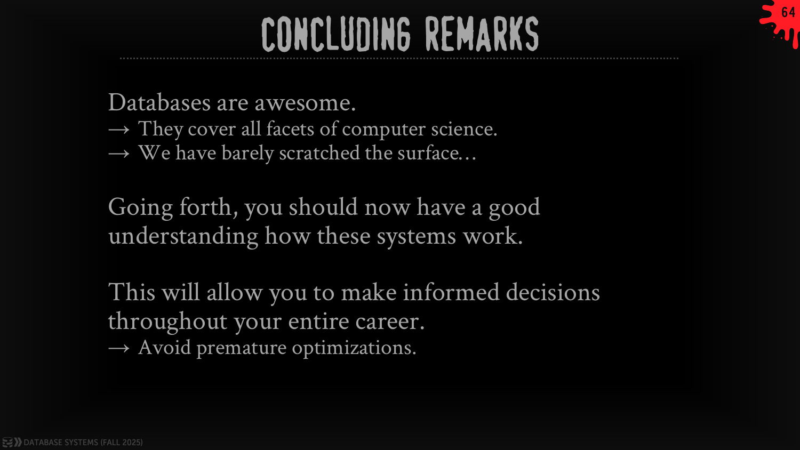


## 术语速查表

### 页

**Page**：定长的数据块，数据库中一切数据的存放单位。（本讲首次出现：摘要；引入于：第 3 讲）

### 分布式事务

**Distributed Transaction**：访问多个分区上数据、需要跨节点协调的事务。（本讲首次出现：摘要；引入于：第 23 讲）

### 缓冲池

**Buffer Pool**：由定长帧组成的一大块内存，用来存放从磁盘读入的页。（本讲首次出现：摘要；引入于：第 3 讲）

### 元组

**Tuple**：关系中的一个元素，即表中的一行。（本讲首次出现：摘要；引入于：第 1 讲）

### 哈希表

**Hash Table**：用哈希函数把键映射到数组偏移量的无序关联数组。（本讲首次出现：摘要；引入于：第 7 讲）

### B+ 树

**B+ Tree**：内部节点导航、叶节点保存真实值的有序多路平衡树。（本讲首次出现：摘要；引入于：第 8 讲）

### 访问方法

**Access Methods**：DBMS 从表中取出数据的方式。（本讲首次出现：摘要；引入于：第 7 讲）

### 算子

**Operator**：执行扫描、过滤、连接、排序或聚合等处理工作的节点。（本讲首次出现：摘要；引入于：第 11 讲）

### 并发

**Concurrency**：多个事务的执行时间重叠，可以交替或同时推进。（本讲首次出现：摘要；引入于：第 17 讲）

### 事务

**Transaction**：为完成业务功能而共同执行、整体成功或失败的一组数据库操作。（本讲首次出现：摘要；引入于：第 10 讲）

### 两阶段锁

**Two-Phase Locking / 2PL**：先获取或升级，后释放或降级，进入收缩阶段后不能回头。（本讲首次出现：摘要；引入于：第 18 讲）

### 共识协议

**Consensus Protocol**：分布式系统领域对同类协议的称呼，协调的对象称为状态机。（本讲首次出现：摘要；引入于：第 24 讲）

### 提交

**Commit**：数据库接受事务成功完成及其整体修改。（本讲首次出现：摘要；引入于：第 17 讲）

### 数据库

**Database**：一组经过组织、相互关联、用来模拟现实世界某方面的数据。（本讲首次出现：摘要；引入于：第 1 讲）

### 外键

**Foreign Key**：值必须对应另一关系中某个元组（通常是其主键）的属性。（本讲首次出现：摘要；引入于：第 1 讲）

### 代价模型

**Cost Model**：估计计划执行代价、用来比较计划优劣的模型。（本讲首次出现：摘要；引入于：第 15 讲）

### 查询计划

**Query Plan**：由算子组成的有向无环图（通常是树），数据从叶子流向根，根的输出即查询结果。（本讲首次出现：摘要；引入于：第 11 讲）

### 统计信息

**Statistics**：系统目录中关于表、属性、索引的数量与分布信息。（本讲首次出现：摘要；引入于：第 15 讲）

### NULL

**NULL**：表示值未知或未定义的特殊值，与任何值比较的结果都是未知。（本讲首次出现：摘要；引入于：第 1 讲）

### 可串行化

**Serializability**：调度与某个完整的串行执行等价。（本讲首次出现：摘要；引入于：第 17 讲）

### 选择率

**Selectivity**：满足条件的行数占输入总行数的比例。（本讲首次出现：摘要；引入于：第 1 讲）

### PAX

**Partition Attributes Across**：先把行分组、组内再按列存放的混合布局。（本讲首次出现：课程地图；引入于：第 6 讲）

### 线性探测哈希

**Linear Probe Hashing**：冲突时顺序向后查找第一个空槽的开放寻址方案。（本讲首次出现：课程地图；引入于：第 7 讲）

### 哈希连接

**Hash Join**：以连接键建立哈希查找结构，再探测匹配。（本讲首次出现：课程地图；引入于：第 12 讲）

### 布隆过滤器

**Bloom Filter**：用 m 位位图和 k 个哈希函数回答成员查询，无假阴性、可能有假阳性。（本讲首次出现：课程地图；引入于：第 9 讲）

### 延迟物化

**Late Materialization**：先传递键与记录位置，需要时再读取和组合其余属性。（本讲首次出现：课程地图；引入于：第 6 讲）

### 顺序扫描

**Sequential Scan**：逐页读取整张表，检查每个元组。（本讲首次出现：课程地图；引入于：第 13 讲）

### 交换算子

**Exchange Operator**：在计划中合并或拆分多路数据流、封装并行的算子。（本讲首次出现：课程地图；引入于：第 14 讲）

### 基数估计

**Cardinality Estimation**：预测算子的输出行数。（本讲首次出现：课程地图；引入于：第 16 讲）

### 关系模型

**Relational Model**：以关系描述数据、以值表达联系、以声明式接口操纵数据的数据模型。（本讲首次出现：课程地图；引入于：第 1 讲）

### 工作负载

**Workload**：一个应用发给数据库的查询的整体特征。（本讲首次出现：1.1；引入于：第 1 讲）

### 预取

**Pre-Fetching**：根据查询计划在页被需要之前提前读入。（本讲首次出现：1.1；引入于：第 4 讲）

### 扫描共享

**Scan Sharing**：多个查询共用同一个扫描游标，共享读页的 I/O。（本讲首次出现：1.1；引入于：第 4 讲）

### 点查询

**Point Query**：按键查找单条记录的查询。（本讲首次出现：1.1；引入于：第 4 讲）

### 闩

**Latch**：保护内部数据结构临界区的短期同步机制。（本讲首次出现：1.1；引入于：第 4 讲）

### 连接

**Join**：在共同属性上取值相同的元组组合。（本讲首次出现：1.1；引入于：第 1 讲）

### 帧

**Frame**：缓冲池中能放一页的位置。（本讲首次出现：1.1；引入于：第 3 讲）

### 索引

**Index**：按适合查找的方式组织键与记录定位信息的访问结构。（本讲首次出现：1.1；引入于：第 8 讲）

### 嵌套循环连接

**Nested Loop Join**：枚举两侧元组对并检查连接条件。（本讲首次出现：1.1；引入于：第 12 讲）

### 块嵌套循环连接

**Block Nested Loop Join**：一批外表页面共享一次内表扫描。（本讲首次出现：1.1；引入于：第 12 讲）

### 索引嵌套循环连接

**Index Nested Loop Join**：为每条外表记录，通过内表索引定位匹配项。（本讲首次出现：1.1；引入于：第 12 讲）

### 排序归并连接

**Sort-Merge Join**：对有序输入定位相同键分组并输出全部匹配对。（本讲首次出现：1.1；引入于：第 12 讲）

### 分区

**Partitioning**：把数据库拆分到多个资源上。（本讲首次出现：1.1；引入于：第 23 讲）

### 混合哈希连接

**Hybrid Hash Join**：部分分区驻留并立即连接，其余分区落盘后处理。（本讲首次出现：1.1；引入于：第 12 讲）

### 物化模型

**Materialization Model**：每个算子一次处理全部输入，一次交出全部输出。（本讲首次出现：1.1；引入于：第 13 讲）

### 索引扫描

**Index Scan**：选择一个索引来找出查询需要的元组。（本讲首次出现：1.1；引入于：第 13 讲）

### 多索引扫描

**Multi-Index Scan**：用多个索引分别求记录 ID 集合，按谓词取交集或并集后再取元组。（本讲首次出现：1.1；引入于：第 13 讲）

### 谓词

**Predicate**：对每个元组得出真或假的条件。（本讲首次出现：1.1；引入于：第 1 讲）

### 记录 ID

**Record ID**：表示元组物理位置的唯一标识，如页 ID 加槽号。（本讲首次出现：1.1；引入于：第 3 讲）

### 万圣节问题

**Halloween Problem**：更新改变了元组的物理位置，使扫描多次访问同一个元组。（本讲首次出现：1.1；引入于：第 13 讲）

### 表达式树

**Expression Tree**：用树表示 `WHERE` 子句等表达式，节点是比较、运算、常量、属性引用等。（本讲首次出现：1.1；引入于：第 13 讲）

### 进程模型

**Process Model**：DBMS 支持并发请求与查询的架构方式。（本讲首次出现：1.1；引入于：第 14 讲）

### 查询间并行

**Inter-Query Parallelism**：多条查询同时执行，提高吞吐量。（本讲首次出现：1.1；引入于：第 14 讲）

### 查询内并行

**Intra-Query Parallelism**：一条查询的算子并行执行，缩短延迟。（本讲首次出现：1.1；引入于：第 14 讲）

### 流水线并行

**Pipelined Parallelism**：算子间并行的别名，数据边产生边交给下一阶段。（本讲首次出现：1.1；引入于：第 14 讲）

### 浓密并行

**Bushy Parallelism**：算子内并行与算子间并行的组合。（本讲首次出现：1.1；引入于：第 14 讲）

### I/O 并行

**I/O Parallelism**：把数据分散到多块存储设备上以提高带宽。（本讲首次出现：1.1；引入于：第 14 讲）

### 预写日志

**Write-Ahead Log (WAL)**：独立的日志文件，对象落盘之前，它对应的日志记录必须先落盘。（本讲首次出现：1.1；引入于：第 17 讲）

### 日志

**Logging**：按序记录修改及恢复所需的信息。（本讲首次出现：1.1；引入于：第 17 讲）

### 查询优化

**Query Optimization**：DBMS 为声明式查询找出最高效执行策略的过程。（本讲首次出现：1.1；引入于：第 1 讲）

### 谓词下推

**Predicate Pushdown**：把谓词移到计划中尽可能低的位置。（本讲首次出现：1.1；引入于：第 15 讲）

### 投影下推

**Projection Pushdown**：尽早去掉后续用不到的列，缩小中间结果。（本讲首次出现：1.1；引入于：第 15 讲）

### 基于代价的搜索

**Cost-based Search**：枚举等价计划、估计代价并挑出最低者的优化方式。（本讲首次出现：1.1；引入于：第 15 讲）

### 直方图

**Histogram**：按值或值区间记录频数。（本讲首次出现：1.1；引入于：第 16 讲）

### 基数

**Cardinality**：一个属性不同取值的个数。（本讲首次出现：1.1；引入于：第 6 讲）

### 原子性

**Atomicity**：事务的修改全部生效或全部不留下。（本讲首次出现：1.2；引入于：第 17 讲）

### 一致性

**Consistency**：正确事务把满足规则的数据库状态变成另一个合法状态。（本讲首次出现：1.2；引入于：第 17 讲）

### 隔离性

**Isolation**：约束并发事务如何观察和影响彼此。（本讲首次出现：1.2；引入于：第 17 讲）

### 持久性

**Durability**：已成功提交的修改在约定故障范围内能够保留或恢复。（本讲首次出现：1.2；引入于：第 1 讲）

### 冲突可串行化

**Conflict Serializability**：与某个串行调度冲突等价。（本讲首次出现：1.2；引入于：第 17 讲）

### 冲突

**Conflict**：不同事务访问同一对象、且至少一方写入的一对操作。（本讲首次出现：1.2；引入于：第 17 讲）

### 冲突等价

**Conflict Equivalence**：相同事务的相同操作中，每对冲突操作的相对顺序都相同。（本讲首次出现：1.2；引入于：第 17 讲）

### 视图可串行化

**View Serializability**：与某个串行调度视图等价。（本讲首次出现：1.2；引入于：第 17 讲）

### 盲写

**Blind Write**：不依赖事先读取该对象旧值的写入。（本讲首次出现：1.2；引入于：第 5 讲）

### 隔离级别

**Isolation Level**：事务暴露于其他并发事务动作的程度。（本讲首次出现：1.2；引入于：第 19 讲）

### 快照隔离

**Snapshot Isolation (SI)**：事务只看到开始前已提交的数据，写写冲突时先写者胜。（本讲首次出现：1.2；引入于：第 19 讲）

### 写偏斜

**Write Skew**：两个事务各自读了对方要写的数据，写集却不相交，结果不可串行化。（本讲首次出现：1.2；引入于：第 17 讲）

### 脏读

**Dirty Read**：读取另一个事务尚未提交的写入。（本讲首次出现：1.2；引入于：第 17 讲）

### 不可重复读

**Unrepeatable Read**：同一事务重复读取同一对象，因并发修改而得到不同值。（本讲首次出现：1.2；引入于：第 17 讲）

### 幻读

**Phantom Read**：两次扫描同一范围之间有元组被插入或删除，导致结果不同。（本讲首次出现：1.2；引入于：第 17 讲）

### 增长阶段

**Growing Phase**：事务可以取得新锁和升级锁，但不能释放或降级的阶段。（本讲首次出现：1.2；引入于：第 18 讲）

### 锁

**Lock**：协调事务访问数据库逻辑内容的机制。（本讲首次出现：1.2；引入于：第 4 讲）

### 收缩阶段

**Shrinking Phase**：事务只能释放或降级锁，仍可使用已有访问权的阶段。（本讲首次出现：1.2；引入于：第 18 讲）

### 严格两阶段锁

**Strict 2PL**：在 2PL 基础上，把 X 锁保留到事务结束，S 锁可在收缩阶段释放。（本讲首次出现：1.2；引入于：第 18 讲）

### 排他锁

**Exclusive Lock / X Lock**：允许读写对象，排斥其他事务的冲突访问权。（本讲首次出现：1.2；引入于：第 18 讲）

### 中止

**Abort**：事务不能成功完成，需要取消其修改。（本讲首次出现：1.2；引入于：第 17 讲）

### 共享锁

**Shared Lock / S Lock**：允许读取对象，可与其他事务的共享锁共存。（本讲首次出现：1.2；引入于：第 18 讲）

### 强严格两阶段锁

**Strong Strict 2PL / Rigorous 2PL**：在 2PL 基础上，把 S、X 锁都保留到事务结束。（本讲首次出现：1.2；引入于：第 18 讲）

### 级联中止

**Cascading Abort / Cascading Rollback**：一个事务失败，连带迫使依赖其未提交修改的事务撤销。（本讲首次出现：1.2；引入于：第 18 讲）

### 死锁

**Deadlock**：事务形成循环等待，没有参与者能够独立继续。（本讲首次出现：1.2；引入于：第 10 讲）

### 等待图

**Waits-for Graph**：用从等待者指向持锁者的边表示当前阻塞关系。（本讲首次出现：1.2；引入于：第 18 讲）

### 时间戳

**Timestamp**：用来建立事务先后关系的有序标识；此处用于决定等待优先级。（本讲首次出现：1.2；引入于：第 18 讲）

### 多粒度锁

**Multiple-Granularity Locking**：按包含层次协调不同范围的锁。（本讲首次出现：1.2；引入于：第 18 讲）

### 意向锁

**Intention Lock**：在祖先上声明后代细粒度访问，供粗粒度锁检查冲突。（本讲首次出现：1.2；引入于：第 18 讲）

### 锁管理器

**Lock Manager**：管理加锁、转换、解锁和等待请求的组件。（本讲首次出现：1.2；引入于：第 18 讲）

### 并行度

**Degree of Parallelism**：一条查询或一个算子被拆成的并行任务数。（本讲首次出现：1.2；引入于：第 14 讲）

### 乐观并发控制

**Optimistic Concurrency Control (OCC)**：事务在私有工作区执行、提交时验证冲突的 T/O 协议。（本讲首次出现：1.2；引入于：第 17 讲）

### 全局闩

**Global Latch**：覆盖整个数据结构的闩，可用于协调布局变化。（本讲首次出现：1.2；引入于：第 10 讲）

### 多版本并发控制

**Multi-Version Concurrency Control (MVCC)**：为每个逻辑对象维护多个物理版本，写时创建新版本，读时按时间戳选择版本。（本讲首次出现：1.2；引入于：第 20 讲）

### 版本链

**Version Chain**：用元组头部的指针把同一逻辑元组的所有版本串成的链表。（本讲首次出现：1.2；引入于：第 20 讲）

### 增量存储

**Delta Storage**：只把被修改列的旧值写入增量存储段，主表原地覆盖。（本讲首次出现：1.2；引入于：第 6 讲）

### 回滚段

**Rollback Segment**：Oracle、MySQL 中存放旧值的增量存储空间，也用于撤销。（本讲首次出现：1.2；引入于：第 20 讲）

### 活跃事务

**Active Transaction**：尚未提交的事务。（本讲首次出现：1.2；引入于：第 19 讲）

### 丢失更新

**Lost Update**：一个事务的写被另一个没看到它的事务覆盖掉。（本讲首次出现：1.3；引入于：[第 17 讲](../L17/index.md)）

### 先提交者胜

**First-Committer-Wins**：快照隔离的规则：并发事务写同一对象时，后提交的一方中止。（本讲首次出现：1.3；引入于：本讲）

### 可串行化快照隔离

**Serializable Snapshot Isolation (SSI)**：在快照隔离之上跟踪读写依赖，发现危险结构就中止事务，从而达到可串行化。（本讲首次出现：1.3；引入于：本讲）

### 并发控制协议

**Concurrency Control Protocol**：运行时约束多个事务操作如何交错的规则。（本讲首次出现：1.3；引入于：第 10 讲）

### 事务状态表

**Transaction Status Table**：记录每个事务的时间戳和状态（活跃、已提交、已中止）的全局表。（本讲首次出现：1.3；引入于：第 20 讲）

### 死锁检测

**Deadlock Detection**：允许等待发生，通过检测环并回滚事务解除死锁。（本讲首次出现：1.3；引入于：第 18 讲）

### 死锁预防

**Deadlock Prevention**：限制等待关系，使死锁无法形成。（本讲首次出现：1.3；引入于：第 18 讲）

### 快照

**Snapshot**：事务开始时记下的当时仍在运行的事务，决定此后哪些写对它可见。（本讲首次出现：1.3；引入于：第 20 讲）

### 撤销

**Undo**：清除未完成或已中止事务所产生影响的过程。（本讲首次出现：1.3；引入于：第 17 讲）

### 回滚

**Rollback**：撤销事务修改的过程或发起撤销的命令。（本讲首次出现：1.3；引入于：第 17 讲）

### 影子分页

**Shadow Paging**：修改写在页的副本上，提交时原子地切换根指针，使副本成为新的主副本。（本讲首次出现：1.4；引入于：第 17 讲）

### 页表

**Page Table**：内存中从页 ID 到帧位置的哈希表，只含当前在内存中的页。（本讲首次出现：1.4；引入于：第 4 讲）

### 碎片

**Fragmentation**：页内因空洞、空槽等原因无法利用的空间。（本讲首次出现：1.4；引入于：第 5 讲）

### 日志序列号

**Log Sequence Number，LSN**：全局唯一、单调递增的日志位置标识。（本讲首次出现：1.4；引入于：第 22 讲）

### 脏页

**Dirty Page**：标记页在内存中被改过；这样的页淘汰前必须写回。（本讲首次出现：1.4；引入于：第 4 讲）

### 检查点

**Checkpoint**：周期性地把缓冲区刷到磁盘并在日志中留下标记，限定恢复范围、允许截断日志。（本讲首次出现：1.4；引入于：第 17 讲）

### 模糊检查点

**Fuzzy Checkpoint**：允许事务继续执行，以元数据和日志支持后续恢复的检查点。（本讲首次出现：1.4；引入于：第 17 讲）

### 脏页表

**Dirty Page Table，DPT**：保存脏页及各页可能需要重做的最早日志位置。（本讲首次出现：1.4；引入于：第 22 讲）

### 分析阶段

**Analysis**：从检查点向前扫描，重建 ATT 与 DPT。（本讲首次出现：1.4；引入于：第 22 讲）

### 重做阶段

**Redo**：补齐日志中尚未体现在页面上的更新及 CLR。（本讲首次出现：1.4；引入于：第 22 讲）

### 撤销阶段

**Undo**：反向撤销未提交事务并记录补偿。（本讲首次出现：1.4；引入于：第 22 讲）

### 补偿日志记录

**Compensation Log Record，CLR**：记录撤销产生的页面修改，可重做、不可撤销。（本讲首次出现：1.4；引入于：第 22 讲）

### 两阶段提交

**Two-Phase Commit (2PC)**：先让参与者投票，全票通过后再提交的原子提交协议。（本讲首次出现：1.5；引入于：第 24 讲）

### 系统架构

**System Architecture**：规定 CPU 能直接访问哪些共享资源。（本讲首次出现：1.5；引入于：第 23 讲）

### 共享磁盘

**Shared-Disk**：节点私有 CPU 与内存，通过网络共享一个逻辑磁盘，如对象存储。（本讲首次出现：1.5；引入于：第 23 讲）

### 无共享

**Shared-Nothing**：每个节点私有 CPU、内存、磁盘，节点之间只能通过网络消息通信。（本讲首次出现：1.5；引入于：第 23 讲）

### 复制

**Replication**：把数据复制到多个冗余节点上以提高可用性。（本讲首次出现：1.5；引入于：第 23 讲）

### 主副本

**Primary-Replica**：每个对象的更新都发给指定的主节点，由它把日志传给副本。（本讲首次出现：1.5；引入于：第 23 讲）

### 多主

**Multi-Primary**：任何副本都能接受更新，副本之间用原子提交协议同步。（本讲首次出现：1.5；引入于：第 23 讲）

### 水平分区

**Horizontal Partitioning**：按分区键把元组分成互不相交的子集。（本讲首次出现：1.5；引入于：第 23 讲）

### 半连接

**Semi-Join**：只保留在另一张表中有匹配的元组，不带另一张表的列。（本讲首次出现：1.5；引入于：第 15 讲）

### 原子提交协议

**Atomic Commit Protocol**：让多个节点就事务的提交顺序与结局达成一致的协议。（本讲首次出现：1.5；引入于：第 24 讲）

### Paxos

**Paxos**：只需多数接受者同意、多数存活即不阻塞的共识协议。（本讲首次出现：1.5；引入于：第 24 讲）

### Raft

**Raft**：角色更少、只有日志最新的节点能当选领导者的共识协议。（本讲首次出现：1.5；引入于：第 24 讲）

### 网络分区

**Network Partition**：网络故障把节点分隔成互相联系不上的几组。（本讲首次出现：1.5；引入于：第 24 讲）

### 脑裂

**Split Brain**：网络分区后出现多个自认为是主节点的节点。（本讲首次出现：1.5；引入于：第 24 讲）

### 引用完整性

**Referential Integrity**：外键引用的元组必须存在。（本讲首次出现：1.5；引入于：第 1 讲）

### 分区键

**Partitioning Key**：决定元组去向的一列或几列。（本讲首次出现：1.5；引入于：第 23 讲）

### 断言

**Assertion**：以任意 SQL 查询为检查条件的全局约束。（本讲首次出现：1.5；引入于：第 1 讲）

### 结果缓存

**Result Caching**：同一查询再次出现且数据未变时，直接返回缓存的结果。（本讲首次出现：2；引入于：本讲）

### 物化视图

**Materialized View**：结果被存储下来的视图，底层数据变化后需要刷新或增量维护。（本讲首次出现：2；引入于：[第 13 讲](../L13/index.md)）

### 游程编码

**Run-Length Encoding (RLE)**：把连续相同的值压成（值, 偏移, 长度）三元组。（本讲首次出现：2；引入于：第 6 讲）

### 顺序泛洪

**Sequential Flooding**：顺序扫描读入的一次性页挤出常用页的现象。（本讲首次出现：2；引入于：第 4 讲）

### 聚簇索引

**Clustered Index**：使表记录的存储组织跟随某个索引键顺序。（本讲首次出现：2；引入于：第 8 讲）

### 数据跳过

**Data Skipping**：事先判断哪些数据不可能满足查询，从而不去读它。（本讲首次出现：2；引入于：第 13 讲）

### 区域映射

**Zone Map**：为每页预先计算的聚合值（最小值、最大值等），用来判断能否跳过该页。（本讲首次出现：2；引入于：第 13 讲）

### 视图

**View**：用查询定义的虚拟表，用来实现外模式。（本讲首次出现：2；引入于：第 1 讲）

### 分支预测

**Branch Prediction**：CPU 在条件算出之前猜测分支方向并投机执行，猜错则清空流水线。（本讲首次出现：3.1；引入于：本讲）

### 无分支选择扫描

**Branchless Selection Scan**：无条件拷贝每条元组，用 0/1 的谓词结果推进输出位置，消除依赖数据的分支。（本讲首次出现：3.1；引入于：本讲）

### 流水线

**Pipeline**：一串算子，元组在其间连续流动，不需要中间存储。（本讲首次出现：3.1；引入于：第 13 讲）

### 单指令多数据

**SIMD**：一条指令同时对宽寄存器中的多个值执行相同操作。（本讲首次出现：3.2；引入于：[第 08 讲](../L08/index.md)）

### 通道

**Lane**：SIMD 寄存器中存放一个值的位置。（本讲首次出现：3.2；引入于：本讲）

### SIMD 压缩

**SIMD Compress**：按掩码把选中的通道挤到寄存器前部，得到紧凑的结果。（本讲首次出现：3.2；引入于：本讲）

### 水平向量化

**Horizontal Vectorization**：一个输入键同时与一个桶中的多个键比较。（本讲首次出现：3.3；引入于：本讲）

### 分桶哈希表

**Bucketized Hash Table**：每个桶连续存放多个键和值，便于一次 SIMD 比较。（本讲首次出现：3.3；引入于：本讲）

### 指纹

**Fingerprint**：存在桶中的定长哈希前缀，用来快速排除不匹配的变长键。（本讲首次出现：3.3；引入于：[第 09 讲](../L09/index.md)）

### 槽

**Slot**：哈希表数组中的一个定长存储位置。（本讲首次出现：3.3；引入于：第 7 讲）

### 桶

**Bucket**：可容纳多个键值对的存储单元，通常是一页。（本讲首次出现：3.3；引入于：第 7 讲）

### 选择向量

**Selection Vector**：列出一批中有效元组偏移量的有序紧凑数组。（本讲首次出现：3.4；引入于：本讲）

### 位图（筛选结果）

**Bitmap**：与数据按位置对齐、每位表示一条元组是否有效的位串。（本讲首次出现：3.4；引入于：本讲）

### 代码特化

**Code Specialization**：把查询中不变的信息写死，为特定查询生成专门的代码。（本讲首次出现：4.1；引入于：[第 11 讲](../L11/index.md)）

### 目录

**Catalog**：DBMS 的元数据，在分布式环境中还记录分区方案与集群拓扑。（本讲首次出现：4.1；引入于：第 3 讲）

### 属性

**Attribute**：关系中的一个命名分量，即表中的一列。（本讲首次出现：4.1；引入于：第 1 讲）

### 查询编译

**Query Compilation**：为每条查询生成程序并编译成机器码执行。（本讲首次出现：4.2；引入于：本讲）

### 中间表示

**Intermediate Representation (IR)**：编译器内部介于源码与机器码之间的程序表示，如 LLVM IR。（本讲首次出现：4.2；引入于：本讲）

### 即时编译

**Just-in-Time Compilation (JIT)**：在运行时生成并编译代码。（本讲首次出现：4.2；引入于：[第 13 讲](../L13/index.md)）

### 预编译原语

**Precompiled Primitive**：构建时预先编译好的、对某种类型的一批数据执行一种基本操作的函数。（本讲首次出现：4.3；引入于：本讲）

### 存算分离

**Disaggregated Storage**：数据放在共享的存储层，计算节点独立增减。（本讲首次出现：5.1；引入于：本讲）

### 转译

**Transpilation**：把查询计划翻译成另一种语言（如 C++）的源代码再编译。（本讲首次出现：5.1；引入于：本讲）

### 字典编码

**Dictionary Encoding**：用定长编码替换原值，另存编码到原值的字典。（本讲首次出现：5.1；引入于：第 6 讲）

### 混洗

**Shuffle**：分布式执行中在阶段之间按分区重新分发数据。（本讲首次出现：5.2；引入于：本讲）

### 推测执行

**Speculative Execution**：为迟迟不完成的任务启动冗余副本，用先完成者的结果。（本讲首次出现：5.2；引入于：本讲）

### 动态重分区

**Dynamic Repartitioning**：运行时发现分区过满，改变哈希方案并把数据重新分区。（本讲首次出现：5.2；引入于：本讲）

### 过滤器

**Filter**：只回答“键是否（很可能）在集合中”、不给出位置的数据结构。（本讲首次出现：5.2；引入于：第 9 讲）

### 倒排索引

**Inverted Index**：从词项到包含它的记录的映射，也称全文检索索引。（本讲首次出现：5.2；引入于：第 9 讲）

### 混洗阶段

**Shuffle Phase**：在流水线之间重新分布中间数据的执行阶段。（本讲首次出现：5.2；引入于：第 24 讲）

### 数据倾斜

**Data Skew**：数据在节点之间分布不均，少数节点承担大部分工作。（本讲首次出现：5.2；引入于：第 12 讲）

### 自适应优化

**Adaptive Optimization**：根据执行中观察到的统计信息调整计划。（本讲首次出现：5.3；引入于：本讲）

### 灵活计算

**Flexible Compute**：临时调集额外节点执行计算量大的计划片段。（本讲首次出现：5.3；引入于：本讲）

### SQL 方言

**SQL Dialect**：某个系统对 SQL 标准的具体实现，包括它的偏离和扩展。（本讲首次出现：5.3；引入于：第 2 讲）

### 执行引擎

**Execution Engine**：执行查询、向缓冲池请求页的组件。（本讲首次出现：5.3；引入于：第 3 讲）

### 计划片段

**Plan Fragment**：交给另一个节点执行的查询计划子树。（本讲首次出现：5.3；引入于：第 23 讲）

### 查询优化器

**Query Optimizer**：把逻辑计划变成语义等价且代价尽量低的物理计划的组件。（本讲首次出现：5.4；引入于：第 15 讲）

### 内核旁路

**Kernel Bypass**：用户进程直接访问网卡或磁盘，绕开操作系统内核。（本讲首次出现：5.5；引入于：本讲）

### 解析器

**Parser**：把 SQL 字符串解析成抽象语法树的组件。（本讲首次出现：5.5；引入于：第 15 讲）

### 早期物化

**Early Materialization**：较早把元组数据放入中间记录，与键一同传递和排序。（本讲首次出现：5.5；引入于：第 11 讲）

### 缓冲池管理器

**Buffer Pool Manager**：负责在磁盘与内存之间搬运页、并让系统以为数据全在内存中的组件。（本讲首次出现：5.5；引入于：第 4 讲）

### LRU-K

**LRU-K**：按第 K 次最近访问到现在的距离决定淘汰对象。（本讲首次出现：5.5；引入于：第 4 讲）

### 页缓存

**OS Page Cache**：操作系统在内核中为文件维护的缓存。（本讲首次出现：5.5；引入于：第 1 讲）

### 访问模式

**Access Mode**：提示事务是否会修改数据库：`READ WRITE` 或 `READ ONLY`。（本讲首次出现：5.5；引入于：第 19 讲）

### 算子融合

**Operator Fusion**：把相邻的算子（如扫描与谓词）合并进同一个循环。（本讲首次出现：5.6；引入于：[第 13 讲](../L13/index.md)）

### 表达式融合

**Expression Fusion**：把多个常见的谓词组合预先生成为一个原语。（本讲首次出现：5.6；引入于：本讲）

### 分区合并

**Partition Coalescing**：混洗完成后把过小的分区合并起来。（本讲首次出现：5.6；引入于：本讲）

### 对象-关系阻抗失配

**Object-Relational Impedance Mismatch**：程序中的对象与数据库中的表之间的结构错位。（本讲首次出现：5.6；引入于：第 1 讲）

### 物理计划

**Physical Plan**：每个算子都指定了算法与访问路径、可以直接执行的计划。（本讲首次出现：5.6；引入于：第 15 讲）

### 物化

**Materialization**：把中间结果实际计算出来并保存，供后续使用。（本讲首次出现：5.6；引入于：第 2 讲）

### SSTable

**Sorted String Table**：MemTable 写满后落盘形成的按键有序、不可修改的文件。（本讲首次出现：5.7；引入于：第 5 讲）

### LSM 树

**Log-Structured Merge Tree**：由 MemTable 和分层 SSTable 组成的日志结构存储结构。（本讲首次出现：5.7；引入于：第 5 讲）

### 假阳性

**False Positive**：查询结果中包含实际上不一定为真的答案。（本讲首次出现：6；引入于：本讲）

### 存储模型

**Storage Model**：DBMS 在磁盘和内存中物理组织元组的方式。（本讲首次出现：6；引入于：第 6 讲）

[^fk1]: 原话：“So the dirty secret in distributed systems: oftentimes they don't have the full integrity and referential constraints that a single-node system would have.”

[^fk2]: 原话：“But oftentimes the foreign keys is the first thing to go.”

[^branchless]: 原话：“It seems counterintuitive to us as humans, and the compiler isn't going to do this for you.”

[^jit]: 原话：“We built an LLVM-based query engine that did this just-in-time compilation stuff. It's a nightmare to debug.”

[^prim]: 原话：“The current research says this is the right way to build your systems, not do the JIT compilation stuff.”

[^os]: 原话：“When Yellowbrick turns on, they call malloc, get a bunch of memory, take control of the hardware, and they never talk to the operating system ever again because the operating system is going to ruin your life.”

[^jvm]: 原话：“JVM is terrible. Don't use it.”

[^ch1]: 原话：“But for the things they're doing, single-table queries, it's okay. It's the joins that cause the problems.”

[^ch2]: 原话：“Nobody does that in their system. Even the Yellowbrick guys aren't that crazy.”

[^star]: 嘉宾原话：“I'm making a claim that the absolute majority of SQL programmers actually don't know what SELECT * does.”

[^yb]: 原话：“The amount of system optimization they're doing, you would not want to do if you're a brand-new startup.”


<details>
<summary>📎 本讲未被 📍 标注的幻灯片（共 5 页：封面、目录与行政页）</summary>


</details>
